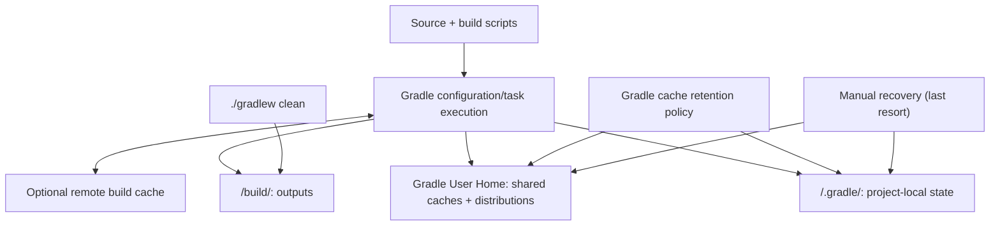

# Chính sách dọn cache và phân biệt với xóa thư mục build trong Gradle

Lệnh `./gradlew clean` thường được dùng khi build gặp vấn đề hoặc khi cần kiểm tra khả năng tái tạo artifact. Nhưng `clean` **không có nghĩa là “xóa hết cache Gradle”**. Nó xử lý **build outputs** của những project có task `clean` được gọi; trong khi dependency artifacts, task output build cache, configuration cache, Gradle distributions, transformed artifacts và daemon logs có **vị trí, mục đích, chính sách lưu giữ và cách xử lý riêng**.

Một câu hỏi điển hình: “Tôi đã chạy `./gradlew clean` mà Gradle vẫn báo `FROM-CACHE` — Gradle có làm sai không?” **Không.** `clean` xóa output hiện tại trong `build/`; khi build cache được bật, Gradle vẫn có thể khôi phục output tương ứng với cùng task inputs từ cache đã được lưu ở chỗ khác. Đây chính là lý do phải tách **xóa output** khỏi **dọn cache**.

Bài Knowledge **“Chính sách dọn cache và phân biệt với xóa thư mục build”**, thuộc nhóm **Các lớp cache** trong **Build Tool Gradle**, giải thích:

1. Các vị trí `build/`, `.gradle/` của project, `GRADLE_USER_HOME` và remote cache khác nhau thế nào.
2. `clean` thực sự xóa gì; vì sao nó không phải lệnh global reset Gradle.
3. Phân biệt **UP-TO-DATE**, **FROM-CACHE**, **configuration cache**, **dependency cache**, **compiled script cache**, **wrapper distribution cache**, **transform cache** và daemon state.
4. Gradle tự dọn cache theo thời gian sử dụng như thế nào; retention mặc định, init scripts và các chế độ `DEFAULT`, `ALWAYS`, `DISABLED`.
5. Khi nào cần `--refresh-dependencies`, `--rerun-tasks`, `--no-build-cache`, `--no-configuration-cache`, `--offline` hoặc `--stop` thay vì xóa thư mục.
6. Quy trình dọn cache an toàn trên laptop, mono-repo, CI runners và remote build cache.
7. Lab Java 17 chạy được bằng Gradle 8.10.2, Groovy/Kotlin DSL và `javac`/`java`, với stdout chính xác và cách đọc task outcomes.

**Nguyên tắc:** sửa đúng **lớp có vấn đề**, dùng **can thiệp ít phá hủy nhất**, và bảo đảm có thể giải thích **cái gì bị xóa, cái gì còn nguyên, cái gì sẽ được tạo lại**.

## 1. Mô hình tổng thể: output khác cache

Có ba nhóm dữ liệu dễ bị lẫn lộn:

- **Outputs được tạo từ build:** compiled classes, JARs, test reports, generated sources, distributions… thường dưới `<project>/build/`.
- **State/cache phục vụ Gradle:** dữ liệu giúp resolve dependency, bỏ qua task, tránh cấu hình lại build, phục hồi task outputs, lưu toolchain/distribution… nằm tại project `.gradle/` hoặc Gradle User Home.
- **Dữ liệu bên ngoài build:** source code, Gradle Wrapper files được commit, repositories bên ngoài, remote build cache, IDE caches, CI service caches. Những thứ này không bị xóa bởi `clean` thông thường.

Sơ đồ giản lược:



Mũi tên `clean → build/` **không** kéo theo `clean → ~/.gradle/caches/` hay `clean → remote cache`.

### Cùng một tên “cache” nhưng mục đích khác nhau

Ví dụ:

- Dependency cache giúp **không tải lại thư viện**.
- Task output build cache giúp **không thực thi lại một task cacheable** khi inputs/implementation match.
- Configuration cache giúp **không chạy lại toàn bộ cấu hình** khi configuration inputs hợp lệ.
- Project-local incremental history giúp Gradle so sánh **UP-TO-DATE** cho workspace hiện tại.
- JVM daemon làm giảm startup overhead; nó không phải một folder để `clean` xóa.

Không có một “thùng cache” duy nhất mà lệnh `clean` có thể reset an toàn mọi loại.

## 2. Bản đồ thư mục: nhớ đúng cấp sở hữu

Giả sử project của bạn là `cache-cleanup-lab`:

```text
cache-cleanup-lab/
├── settings.gradle
├── build.gradle
├── gradle.properties
├── gradlew
├── gradlew.bat
├── gradle/wrapper/
│   ├── gradle-wrapper.jar
│   └── gradle-wrapper.properties
├── src/main/java/...
├── build/                       # (A) outputs của project
│   ├── classes/
│   ├── libs/
│   ├── reports/
│   └── tmp/
└── .gradle/                     # (B) project-local caches/state
    ├── <gradle-version>/
    └── configuration-cache/
```

Trong user home, mặc định Linux/macOS `~/.gradle/`; Windows thường `%USERPROFILE%\.gradle\`:

```text
~/.gradle/                       # (C) Gradle User Home
├── caches/
│   ├── <gradle-version>/        # compiled scripts / version-specific
│   ├── modules-2/               # dependency artifacts + metadata
│   ├── build-cache-1/           # local task-output build cache
│   ├── transforms-*/            # artifact transforms
│   └── jars-*/                  # instrumented JAR caches
├── wrapper/dists/               # Gradle Wrapper distributions
├── daemon/<gradle-version>/     # registry + daemon log files
├── jdks/                        # JDKs được provision nếu có
├── init.d/                      # init scripts, gồm cleanup settings nếu có
└── gradle.properties            # user-level settings, có thể chứa secrets
```

Các tên hậu tố như `modules-2`, `build-cache-1`, `jars-9`, `transforms-3` là **ví dụ format versions**, không phải hợp đồng ổn định để automation hard-code mãi mãi. Gradle có thể đổi layout ở bản mới. Gradle User Home có thể không nằm tại `~/.gradle` nếu môi trường đã đặt `GRADLE_USER_HOME` hoặc lựa chọn user home bằng CLI; kiểm tra trước khi chẩn đoán.

### Bảng quyết định theo directory

| Vị trí | Chứa gì? | `clean` thường xóa? | Khi mất có thể tạo lại? |
| --- | --- | --- | --- |
| `<project>/build/` | JAR, class, generated files, reports | **Có**, nếu task clean của project ấy được chạy | Có, khi chạy tasks tương ứng và input/tool có sẵn |
| `<root>/.gradle/<version>/` | Project-local task snapshots/state | **Không** | Có, nhưng phải cấu hình/tính lại |
| `<root>/.gradle/configuration-cache/` | Serialized configuration model | **Không** | Có, Gradle cấu hình lại nếu bật cache |
| `GRADLE_USER_HOME/caches/modules-2/` | Downloaded dependencies + metadata | **Không** | Có nếu repository/mạng/sources còn truy cập được |
| `GRADLE_USER_HOME/caches/build-cache-1/` | Local build cache task outputs | **Không** | Có, nhưng task có thể phải chạy lại |
| `GRADLE_USER_HOME/caches/<version>/` | Script/JAR caches theo Gradle version | **Không** | Có, có thể làm build sau chậm |
| `GRADLE_USER_HOME/wrapper/dists/` | Wrapper distributions đã tải | **Không** | Tải lại nếu URL distribution khả dụng |
| `GRADLE_USER_HOME/daemon/` | Daemon state/logs | **Không** | Daemon/log mới khi cần |
| Remote build cache | Task outputs ở server khác | **Không** | Theo retention/chính sách server; không nên xóa tùy tiện |
| `src/`, `settings.gradle`, `gradlew` | Source và build definition | **Không** | Không thể coi là cache để tự xóa |

**Cảnh báo quan trọng:** xóa trọn `~/.gradle` không chỉ xóa caches. Bạn có thể xóa luôn `gradle.properties`, init scripts, credentials, downloaded JDKs, Wrapper distributions và logs phục vụ debug. Không dùng toàn bộ Gradle User Home như một folder rác.

## 3. `clean` là task của build, không phải “clear all cache”

Khi áp dụng các plugins như `java`, `java-library` hoặc `application` (thông qua base/lifecycle plugins), project thường có task `clean` kiểu Delete gắn với **build directory** hiện hành.

Ví dụ:

```bash
./gradlew clean
```

được hiểu là yêu cầu Gradle thực thi các task `clean` mà task selector khớp trong build/project context, không phải yêu cầu Gradle xóa mọi directory có chữ “cache”. Với multi-project, dùng **task path rõ ràng** để tránh nhầm:

```bash
./gradlew :app:clean
./gradlew :core:clean
```

Lệnh `:app:clean` chỉ chạy task clean của project `:app`; nếu task được cấu hình theo convention, nó xóa `layout.buildDirectory` của app. Với một root Java project, `:clean` xóa build directory của root. Với CLI unqualified `clean`, Gradle có thể chọn các tasks khớp ở subprojects tùy project context; muốn scope chắc chắn thì gọi qualified paths.

**Không phải mọi project đều có task `clean` mặc định.** Một project không áp dụng Base/Java/Application plugin hoặc plugin tương đương có thể không có task đó. Dùng:

```bash
./gradlew tasks --all
./gradlew :app:tasks --all
```

để biết task nào thực sự tồn tại, đừng khẳng định mọi Gradle project đều có `clean` như built-in command độc lập khỏi plugin.

### Build directory có thể tùy chỉnh

Trong Gradle hiện đại, output directory do `layout.buildDirectory` đại diện. Nếu module tùy chỉnh:

```groovy
layout.buildDirectory = layout.projectDirectory.dir('out')
```

thì clean task được plugin cấu hình phù hợp có thể nhắm **`out/`**, không nhất thiết là folder tên `build/`. Ví dụ trên là snippet; không dùng nó như một bước bắt buộc trong lab.

**Quan trọng:** custom task ghi file ngoài `layout.buildDirectory` hoặc ngoài declared outputs có thể **không được clean** bởi task `clean` thông thường. Nếu task ghi ra `generated/` ở root hoặc `../shared-output/`, phải thiết kế ownership và cleanup task riêng, không mở rộng `clean` thành lệnh xóa mọi thư mục tùy ý.

### Điều `clean` không làm

`clean` không tự:

- Xóa dependency artifacts đã tải trong User Home.
- Xóa task output local/remote build cache.
- Xóa `.gradle/configuration-cache`.
- Xóa Wrapper distributions.
- Xóa JDK toolchains đã provision.
- Xóa daemon logs.
- Buộc Gradle làm mới dependency resolution của mọi module.
- Xóa Gradle installation, Maven cache hoặc IDE indexes.
- Tải lại dependency hay xoá caches của tất cả projects trên máy.

Đây là lý do `clean` thường là bước **ít phá hủy hơn** xóa cache.

## 4. Ba trạng thái task dễ bị hiểu nhầm

Sau khi chạy một task Gradle, bạn có thể gặp:

| Trạng thái | Ý nghĩa giản lược | Phụ thuộc dữ liệu nào? |
| --- | --- | --- |
| `UP-TO-DATE` | Task output hiện có phù hợp với snapshots của inputs/outputs; action không cần chạy | Task history và output tại workspace |
| `FROM-CACHE` | Task outputs phù hợp được lấy từ build cache; action không cần chạy | Local/remote build cache và task cache key |
| Task chạy thật | Gradle thực thi action vì chưa có output phù hợp/không thể reuse | Source/tool/plugin/configuration |
| `NO-SOURCE` | Source task trống; Gradle không có work để làm | Input source set |
| `SKIPPED` | Task bị bỏ qua vì điều kiện/logic task | Task semantics |

**`FROM-CACHE` không chứng minh `clean` thất bại**. Nó chứng minh build cache vẫn có artifact phù hợp sau khi outputs hiện tại bị xóa, đây là hành vi dự kiến.

### Quan hệ giữa clean và build cache

```text
Lần 1: build --build-cache
  compileJava thực thi
  -> build/classes/java/main/... được tạo
  -> entry có thể được lưu trong local build cache

Lần 2: build --build-cache
  inputs và outputs không đổi
  -> compileJava có thể UP-TO-DATE

Chạy clean
  -> build/ bị xóa
  -> build cache ở user home vẫn còn

Lần 3: build --build-cache
  outputs thiếu
  -> compileJava có thể FROM-CACHE
  -> classes được phục hồi mà không cần compile lại
```

Có thể không nhìn thấy `FROM-CACHE` nếu task không cacheable, cache tắt, inputs/plugin/toolchain thay đổi, cache entry đã bị dọn hoặc bị lỗi, hoặc tác vụ buộc phải thực thi. **Không hard-code một task outcome làm kết luận chắc chắn trên mọi máy.**

## 5. Dependency cache không phải build cache

Đây là hai lớp thường bị nhập chung.

**Dependency cache**:

- Lưu artifacts, metadata của external modules/Gradle plugins đã resolve.
- Ví dụ location: `GRADLE_USER_HOME/caches/modules-2/`.
- Giúp tránh tải lại POM/JAR và xử lý metadata từ repositories.
- Có TTL logic cho dynamic versions và changing modules.
- Có thể được dùng ngay cả khi bạn **không bật task output build cache**.
- `--refresh-dependencies` tác động tới việc kiểm tra lại dependency resolution, không phải cách chuẩn để xóa mọi cached bytes.

**Task output build cache**:

- Lưu outputs của task có thể cache theo input/implementation fingerprints.
- Ví dụ local cache: `GRADLE_USER_HOME/caches/build-cache-1/`.
- Khi khớp, Gradle có thể khôi phục outputs thay vì chạy task action.
- Được bật bằng `--build-cache` hoặc `org.gradle.caching=true`, nếu môi trường/config không thay.
- Có thể có **local cache** và **remote cache**.
- Không phải kho “chứa mọi Maven dependency” thay cho dependency cache.

### Sửa lỗi dependency stale đúng cách

Nếu dependency được publish lại hoặc dynamic version chưa cập nhật, bắt đầu bằng:

```bash
./gradlew dependencies --configuration runtimeClasspath
./gradlew build --refresh-dependencies
```

`--refresh-dependencies` yêu cầu Gradle **kiểm tra lại** repositories/metadata và xác thực artifacts; nó **không nhất thiết tải lại toàn bộ JAR** nếu checksum xác nhận file hiện tại không đổi. Đây không phải tương đương:

```text
xóa ~/.gradle/caches/modules-2
```

Xóa cache thủ công có thể làm mất khả năng build offline và buộc tải lại rất nhiều files, trong khi nguyên nhân thực là sai repository order, metadata, changing flag hoặc dependency lockfile.

### Dynamic/changing TTL và retention là hai chính sách khác

- **TTL resolution**: bao lâu Gradle có thể dùng lại metadata/resolved dynamic/changing version trước khi kiểm tra server. Docs mặc định nêu khoảng **24 giờ** cho dynamic/changing dependencies (có API tùy chỉnh).
- **Retention của cached artifact files**: bao lâu artifacts **không dùng tới** được giữ trước khi Gradle dọn khỏi disk. Docs hiện hành nêu **30 ngày** cho downloaded resources mặc định.

Một artifact không tải mới trong 24 giờ **không đồng nghĩa bị xóa khỏi disk sau 24 giờ**. Cũng không phải “downloaded resources retention = 30 ngày” có nghĩa Gradle chỉ cập nhật version mỗi 30 ngày.

Có thể điều chỉnh TTL trong build script khi thực sự cần, ví dụ:

```groovy
configurations.configureEach {
    resolutionStrategy.cacheDynamicVersionsFor 10, 'minutes'
    resolutionStrategy.cacheChangingModulesFor 4, 'hours'
}
```

Đây là **cấu hình resolution TTL**, **không phải** Gradle User Home cache cleanup retention. Không hạ TTL xuống 0 cho toàn công ty chỉ để sửa một artifact stale, vì sẽ tăng truy cập repository và giảm tính ổn định.

## 6. Configuration cache không nằm trong build/

`Configuration cache` giúp Gradle reuse cấu hình build giữa các lần chạy hợp lệ. Dữ liệu project-local thường nằm dưới:

```text
<root>/.gradle/configuration-cache/
```

Nó **khác** với:

- `build/`: compiled classes/JARs.
- `~/.gradle/caches/build-cache-1/`: task output build cache.
- `.gradle/<gradle-version>/`: project-local incremental/task state.
- Dependency cache: downloaded module artifacts.

Bật một lần:

```bash
./gradlew build --configuration-cache
```

hoặc khai báo có chủ đích trong `gradle.properties`:

```properties
org.gradle.configuration-cache=true
```

**Không cần xóa configuration cache chỉ vì thay build script.** Gradle theo dõi các configuration inputs và có thể tự invalidate/khởi tạo cache entry mới nếu thay đổi ảnh hưởng model. Nếu phát hiện lỗi cache corrupted thực sự, thao tác chỉ với `.gradle/configuration-cache` là hẹp hơn xóa `~/.gradle`.

`--no-configuration-cache` tắt việc sử dụng cơ chế cho invocation đó; **không tự xóa** các stored entries. Tương tự `--no-build-cache` không xóa local build cache.

### Cách thử lỗi configuration cache tối thiểu

```bash
./gradlew help --configuration-cache
./gradlew help --no-configuration-cache
```

So sánh hành vi khi dùng/tắt configuration cache. Nếu build fail chỉ khi bật cache, xem báo cáo configuration cache và plugin incompatibility trước khi xóa cache bằng tay. Cấu hình sai như task action truy cập `Project` model phải sửa bằng API đúng, không được chữa lâu dài bằng xóa cache mỗi build.

## 7. Wrapper distributions và compiled scripts cũng được quản lý riêng

`Gradle Wrapper` nằm trong repository ở `gradle/wrapper/`, nhưng distribution tải về để thực thi Gradle thường nằm tại:

```text
GRADLE_USER_HOME/wrapper/dists/
```

Đây là hai phần **khác nhau**:

- Repo `gradle-wrapper.jar` và `gradle-wrapper.properties` được commit (build bootstrap).
- User Home `wrapper/dists` chứa Gradle zip/distribution đã download/unpack.

`clean` không xóa cả hai. Xóa distribution cache có thể buộc Wrapper tải distribution lại, dễ gặp lỗi khi offline hoặc repository server chưa sẵn sàng.

Bên cạnh đó, cache biên dịch Groovy/Kotlin DSL scripts và Gradle-generated jars ở `GRADLE_USER_HOME/caches/<version>/` có thể cần được tạo lại khi chuyển Gradle version. Xóa chúng có thể tốn thời gian build, nhưng không sửa logic build script bị viết sai.

**Không dùng câu “xóa Gradle cache” mà không nêu loại cache và path.** Một directory tên `wrapper` trong repository là nguồn bootstrap; một directory tên `wrapper/dists` trong User Home là downloaded distribution.

## 8. Lab Java 17: chứng minh clean khác build cache

Đây là một **lab chạy được** với Gradle 8.10.2, Java 17 và core `application` plugin. Không cần external libraries để tránh việc dependency download làm nhiễu bài thực hành.

### 8.1. Cây file

```text
cache-cleanup-lab/
├── settings.gradle
├── build.gradle
├── gradle.properties
├── gradlew
├── gradlew.bat
├── gradle/
│   └── wrapper/
│       ├── gradle-wrapper.jar
│       └── gradle-wrapper.properties
└── src/
    └── main/
        └── java/
            └── demo/
                └── cache/
                    └── Main.java
```

Các Wrapper files phải được **sinh thật bằng Gradle wrapper task** và commit; `gradle-wrapper.jar` không phải file text hoặc placeholder có thể tự tạo rỗng.

### 8.2. settings.gradle

```groovy
rootProject.name = 'cache-cleanup-lab'
```

### 8.3. build.gradle (Groovy DSL)

```groovy
plugins {
    id 'application'
}

java {
    toolchain {
        languageVersion = JavaLanguageVersion.of(17)
    }
}

tasks.withType(JavaCompile).configureEach {
    options.encoding = 'UTF-8'
    options.release = 17
}

application {
    mainClass = 'demo.cache.Main'
}
```

`application` plugin đưa vào lifecycle liên quan Java và task `run`; nó cũng có `clean` qua Base plugin integration. Java toolchain 17 cấu hình compiler/launcher theo Gradle Java plugin. Khi chạy thủ công bằng `javac`/`java`, máy phải có JDK 17 (hoặc bản tương thích với target).

### 8.4. gradle.properties

```properties
# Task output build cache bật mặc định cho build này.
org.gradle.caching=true

# Không bắt buộc bật configuration cache để làm lab clean.
# org.gradle.configuration-cache=true
```

`org.gradle.caching=true` bật build cache cho invocation không có override. Bạn vẫn có thể chạy `--no-build-cache` để chẩn đoán một lượt. Dòng comment về configuration cache **không kích hoạt nó**.

### 8.5. src/main/java/demo/cache/Main.java

```java
package demo.cache;

public final class Main {
    private Main() {
    }

    private record Greeting(String name) {
        String render() {
            return "Hello, " + name + "!";
        }
    }

    public static void main(String[] args) {
        System.out.println(new Greeting("Gradle").render());
        System.out.println("Cache lab: Java 17");
    }
}
```

Nested `record Greeting` cần Java 16+; lab target Java 17. Không có random, clock, network, OS-specific output nên stdout của chính chương trình cố định.

### 8.6. Tạo Wrapper một lần

Nếu mới tạo project và máy đã cài Gradle tương thích:

```bash
gradle wrapper --gradle-version 8.10.2 --distribution-type bin
```

Sau đó dùng chính Wrapper đã commit trong repo. Linux/macOS:

```bash
./gradlew --version
./gradlew build --build-cache --console=plain
./gradlew -q run
```

Stdout **do `demo.cache.Main` in**, không tính log Gradle:

```text
Hello, Gradle!
Cache lab: Java 17
```

Các lệnh `--version` và `build` còn có log/task statuses tùy Gradle, JDK và cache. Không đồng nhất stdout của `run` với tất cả Gradle console output.

### 8.7. PowerShell tương đương

```powershell
.\gradlew.bat --version
.\gradlew.bat build --build-cache --console=plain
.\gradlew.bat -q run
```

Stdout của Java app:

```text
Hello, Gradle!
Cache lab: Java 17
```

### 8.8. Chuỗi thử nghiệm clean + cache

Từ project root:

```bash
# Lần đầu: có thể phải compile và lưu task outputs vào cache.
./gradlew build --build-cache --console=plain

# Lần sau, nếu inputs/outputs không đổi, compileJava có thể UP-TO-DATE.
./gradlew build --build-cache --console=plain

# Xóa project build outputs.
./gradlew clean --console=plain

# build/ đã bị xóa; cache entry có thể vẫn còn ở User Home.
./gradlew build --build-cache --console=plain

# Chương trình Java chạy được sau khi outputs được tạo hoặc restore.
./gradlew -q run
```

Không kết luận mọi task đều `FROM-CACHE`. Một số lifecycle tasks không có action, một số không cacheable, một số có changed inputs. Với `compileJava`, lần sau `clean` nó **có thể** `FROM-CACHE` nếu entry cache hợp lệ vẫn tồn tại; đây là bằng chứng `clean` không xóa build cache.

### 8.9. Đối chứng: build cache bị tắt cho invocation

```bash
./gradlew clean
./gradlew build --no-build-cache --console=plain
```

Dù `gradle.properties` bật caching, `--no-build-cache` cho lượt này làm Gradle không dùng build cache. Tasks có thể chạy lại; lệnh **không xóa** cache entries đã có trước đó. Lần build sau có thể bật lại cache.

### 8.10. Đối chứng: rerun không phải clean

```bash
./gradlew compileJava --rerun-tasks --console=plain
```

`--rerun-tasks` buộc task(s) được yêu cầu và dependencies thực thi, bỏ qua up-to-date checks; **nó không xóa toàn bộ `build/`**. Đây là lựa chọn khi bạn cần tái thực thi để chẩn đoán nhưng không muốn xóa reports/artifacts khác.

Nếu muốn khảo sát behavior không bị cache xen vào, có thể thêm `--no-build-cache`:

```bash
./gradlew compileJava --rerun-tasks --no-build-cache --console=plain
```

Chạy xong không có nghĩa Gradle User Home đã được dọn. Task output build cache và dependency cache là hai lớp độc lập.

### 8.11. Kiểm tra Java độc lập bằng javac/java

Để khẳng định chương trình Java không lệ thuộc Gradle caching:

Linux/macOS:

```bash
mkdir -p manual-classes
javac --release 17 -encoding UTF-8 -d manual-classes \
    src/main/java/demo/cache/Main.java
java -cp manual-classes demo.cache.Main
```

Windows PowerShell:

```powershell
New-Item -ItemType Directory -Force manual-classes | Out-Null
javac --release 17 -encoding UTF-8 -d manual-classes src/main/java/demo/cache/Main.java
java -cp manual-classes demo.cache.Main
```

Stdout chính xác:

```text
Hello, Gradle!
Cache lab: Java 17
```

**Khác biệt cần hiểu:** `javac`/`java` trực tiếp không đọc `build.gradle`, không sử dụng Gradle local/remote build cache và tạo class files ở `manual-classes/`, ngoài build directory mặc định. Vì thế `./gradlew clean` **không có nghĩa xóa `manual-classes/`**. Nếu cần dọn output thủ công, tự quản lý directory đó theo quy trình của bài tập, không mặc nhiên giao cho Gradle.

### 8.12. Kotlin DSL thay thế hoàn chỉnh

Nếu dùng Kotlin DSL, thay `settings.gradle`/`build.gradle` bằng hai file sau (Java source và `gradle.properties` giữ nguyên).

`settings.gradle.kts`:

```kotlin
rootProject.name = "cache-cleanup-lab"
```

`build.gradle.kts`:

```kotlin
plugins {
    application
}

java {
    toolchain {
        languageVersion.set(JavaLanguageVersion.of(17))
    }
}

tasks.withType<JavaCompile>().configureEach {
    options.encoding = "UTF-8"
    options.release.set(17)
}

application {
    mainClass.set("demo.cache.Main")
}
```

Dùng cùng các lệnh Wrapper, `javac`/`java` và stdout. Không giữ đồng thời cả hai build scripts với kỳ vọng Gradle trộn nội dung; chọn một DSL nhất quán cho project.

### 8.13. Kiểm tra file outputs của Java plugin

Sau khi build thành công, bạn thường thấy:

```text
build/classes/java/main/demo/cache/Main.class
build/classes/java/main/demo/cache/Main$Greeting.class
build/libs/cache-cleanup-lab.jar
```

Tùy version và các task được chạy, những files khác như reports/tmp/distributions có thể có hoặc không. Với Gradle Java plugin, `build` chứa `jar`/`assemble`; tên artifact có thể thay đổi nếu project tùy chỉnh `archiveBaseName`/version.

`./gradlew clean` xóa build directory của root. Nó **không** xóa `src/main/java`, `gradlew`, `gradle/wrapper/`, `gradle.properties` hoặc downloaded Gradle distribution trong User Home.

## 9. Chính sách Gradle tự dọn caches theo thời gian

Theo hướng dẫn **Gradle-managed Directories and Caches** của tài liệu Gradle hiện hành, Gradle có quy trình **automatic cleanup** cho Gradle User Home và project-local caches. Thường không cần xóa toàn bộ bằng tay.

Dữ liệu được dọn theo **mức độ không sử dụng** và category, không phải “mỗi lần chạy clean sẽ dọn cache”.

### 9.1. Retention mặc định

| Category | Retention mặc định đối với entries không còn được dùng | Ví dụ |
| --- | ---: | --- |
| Released wrapper versions/caches | **30 ngày** | Gradle release distributions và version-specific caches |
| Snapshot wrapper versions/caches | **7 ngày** | Gradle snapshot distributions |
| Downloaded resources | **30 ngày** | Dependency artifacts/metadata tải từ repository |
| Created resources | **7 ngày** | Artifact transforms/generated caches |
| Local build cache entries | **7 ngày** | Task output build cache |
| Daemon logs | **14 ngày** | Logs trong `daemon/<version>/` |
| Project-local version-specific caches | Thường **7 ngày** không sử dụng | `.gradle/<version>/` |

Các thời hạn trên là **defaults được mô tả trong tài liệu hiện hành**; kiểm tra bản Gradle thực tế vì phiên bản cũ có rules/API khác. Thời hạn không đồng nghĩa “file mới hơn 7 ngày sẽ bị xóa”: Gradle dựa trên **dấu sử dụng/access** và các điều kiện loại bỏ, không phải ngày tạo file đơn giản.

### 9.2. Cleanup diễn ra khi nào?

Theo docs:

- Gradle kiểm tra/dọn định kỳ, mặc định **không quá một lần mỗi 24 giờ** cho các hạng mục tương ứng.
- Với daemon, cleanup thường chạy nền khi daemon dừng/shutdown, không nhất thiết là thao tác đồng bộ ngay trong lệnh `clean`.
- Với `--no-daemon`, cleanup có thể chạy foreground sau build session.
- Cache entries đang dùng hoặc vẫn cần cho Gradle versions hiện hành có thể được giữ.
- Gradle tự xử lý shared caches được dùng bởi nhiều versions theo quy tắc tương thích.

Vì vậy nếu vừa build xong và thấy một file cache cũ vẫn tồn tại, **chưa đủ bằng chứng rằng auto cleanup hỏng**. Hãy xem retention category, last access, lịch cleanup, daemon state và Gradle version.

### 9.3. Không phải tất cả folders User Home đều cùng retention

Các thư mục như `gradle.properties`, `init.d/` và downloaded JDKs không nên bị xử lý như arbitrary dependency cache entries. Gradle User Home chứa cả **cấu hình của người dùng** lẫn caches, do đó không nên viết cron job xóa mọi thứ theo “file older than 7 days”.

## 10. Cấu hình retention qua init script của Gradle User Home

**Từ Gradle 8.0+,** retention của các nhóm cache có thể được cấu hình theo API mới. Đây là **chính sách của Gradle User Home**, vì nó có thể phục vụ nhiều builds/repositories; **không** đặt đoạn dưới vào `project/build.gradle` rồi hy vọng nó tự điều chỉnh global caches.

Chọn **một** DSL tương thích với hệ thống, đặt file trong `GRADLE_USER_HOME/init.d/`.

### 10.1. Groovy init script

Đường dẫn:

```text
GRADLE_USER_HOME/init.d/cache-settings.init.gradle
```

Nội dung ví dụ (chính sách minh họa, tùy nhu cầu):

```groovy
beforeSettings { settings ->
    settings.caches {
        releasedWrappers.removeUnusedEntriesAfterDays = 45
        snapshotWrappers.removeUnusedEntriesAfterDays = 10
        downloadedResources.removeUnusedEntriesAfterDays = 45
        createdResources.removeUnusedEntriesAfterDays = 10
        buildCache.removeUnusedEntriesAfterDays = 5
        daemonLogs.removeUnusedEntriesAfterDays = 14
    }
}
```

Ý nghĩa:

- Giữ released Gradle distributions/caches không dùng tới trong **45 ngày**.
- Giữ snapshot versions **10 ngày**.
- Giữ downloaded dependencies/resources không sử dụng **45 ngày**.
- Dọn created/transformed resources sau **10 ngày** không dùng.
- Dọn unused local build cache entries sau **5 ngày**.
- Giữ daemon logs **14 ngày**.

Đây là **ví dụ chọn retention**, không phải defaults. Nó cố tình khác mặc định để dễ nhận ra thao tác cấu hình. Đừng copy chính sách 45/5 ngày cho mọi CI runner mà không cân nhắc tốc độ download, disk quota và tần suất build.

### 10.2. Kotlin DSL init script

Đường dẫn tương đương (dùng **thay thế**, không cần đặt cả hai):

```text
GRADLE_USER_HOME/init.d/cache-settings.init.gradle.kts
```

Nội dung:

```kotlin
beforeSettings {
    caches {
        releasedWrappers.setRemoveUnusedEntriesAfterDays(45)
        snapshotWrappers.setRemoveUnusedEntriesAfterDays(10)
        downloadedResources.setRemoveUnusedEntriesAfterDays(45)
        createdResources.setRemoveUnusedEntriesAfterDays(10)
        buildCache.setRemoveUnusedEntriesAfterDays(5)
        daemonLogs.setRemoveUnusedEntriesAfterDays(14)
    }
}
```

Cả hai snippets được thiết kế cho Gradle versions hỗ trợ cache retention DSL từ Gradle 8.0. Tên phương thức/property khác nhau theo DSL, nhưng cùng categories và chính sách. Chúng **không** tạo task `cleanCache`.

### 10.3. Tại sao đặt ở User Home, không ở root settings?

Một User Home có thể được nhiều builds cùng sử dụng. Nếu mỗi repository tự thay retention toàn cục trong `settings.gradle`, repo A muốn 3 ngày và repo B muốn 90 ngày sẽ tranh chính sách trên cùng caches. Gradle quy định cache cleanup settings qua **init scripts trong Gradle User Home**, tránh việc project khác nhau áp retention mâu thuẫn.

Trong CI, nếu mỗi job có riêng `GRADLE_USER_HOME`, có thể provision file init script bằng image/runner bootstrap. Nhưng đừng nhầm việc commit một script ở root repo tự động làm nó được Gradle chạy trong User Home: cần một bước cài đặt rõ ràng.

### 10.4. Tương thích khi dùng nhiều Gradle versions

Docs cảnh báo:

- Gradle **trước 8.0** không có cùng cache retention DSL.
- Các shared caches có thể được Gradle 7.x/8.x/9.x truy cập nếu cùng User Home.
- Nếu bản mới muốn retention **dài hơn** mặc định của Gradle cũ, bản cũ vẫn có thể dọn shared entries **sớm hơn** policy của bản mới.
- Khi policy dài/ngắn khác nhau có ý nghĩa, cân nhắc **User Home tách theo tập Gradle versions** và tránh share không có kiểm soát.

Có thể áp logic guard theo version trước khi apply init script cho Gradle 8+, như Gradle docs minh họa. Với repo chỉ dùng Wrapper 8.10.2, đoạn config ở trên phù hợp; với máy chạy cả Gradle 7 và 9, phải kiểm tra chính xác compatibility của init scripts.

## 11. Cleanup mode: DEFAULT, ALWAYS, DISABLED

Gradle cung cấp các chế độ điều hành cleanup:

| Mode | Ý nghĩa | Dùng khi nào |
| --- | --- | --- |
| `Cleanup.DEFAULT` | Dọn định kỳ, thường nền theo lịch | Lựa chọn mặc định cho máy phát triển/CI ổn định |
| `Cleanup.ALWAYS` | Thực hiện cleanup ở cuối mỗi build session | Khi cần đảm bảo cleanup vừa chạy trước giai đoạn kiểm toán/disk checkpoint |
| `Cleanup.DISABLED` | Không tự dọn Gradle User Home theo cơ chế đó | Ephemeral User Home hoặc chính sách dọn riêng đã được kiểm soát |

Một ví dụ Kotlin DSL **riêng** để minh họa mode:

```kotlin
beforeSettings {
    caches {
        cleanup = Cleanup.ALWAYS
    }
}
```

Đặt trong init script User Home, **không** đưa vào `build.gradle.kts` của module.

**Không suy rằng ALWAYS nghĩa “xóa mọi cache sau mỗi build”.** Nó có nghĩa **chạy cleanup theo retention rules** sau mỗi build session, chứ không phải bất kể recently used entries. Mode này có overhead, có thể làm mỗi build chậm hơn.

`DISABLED` không xóa gì; nó **vô hiệu hóa automatic cache cleanup**, do đó caches có thể tăng nếu không có lifecycle khác quản lý. Dùng cho CI ephemeral chỉ khi user home thực sự bị hủy sau job hoặc có external cleanup policy.

## 12. Local build cache và remote build cache có retention độc lập

Gradle build cache có thể gồm:

- **Local cache:** directory trên máy chạy Gradle, mặc định dưới User Home nếu không cấu hình lại.
- **Remote cache:** HTTP hoặc server khác chứa task outputs dùng chung giữa builders.

`clean` không xóa cái nào. Gradle User Home init retention chỉ quản lý phạm vi Gradle cache cleanup tại home/local phù hợp; **không tự gửi yêu cầu purge toàn remote cache server**.

### Đặt build cache ở directory riêng

Có thể cấu hình local build cache trong `settings.gradle`:

```groovy
buildCache {
    local {
        enabled = true
        directory = file('local-build-cache')
    }
}
```

Đây là **snippet thay thế để giải thích vị trí cache**, không phải phần bắt buộc của lab. Nó đặt local build cache ở `local-build-cache/` tương đối theo settings của ví dụ. Khi làm vậy:

- `clean` vẫn nhắm project `build/`.
- Local cache nằm ngoài `build/`, nên `clean` không tự xóa nó.
- Directory local cache cần được `.gitignore` và quản lý disk usage theo policy.
- Không nên chọn directory dùng chung với generated outputs của tasks.

Kotlin DSL tương ứng:

```kotlin
buildCache {
    local {
        isEnabled = true
        directory = file("local-build-cache")
    }
}
```

**Lưu ý:** nếu policy đã được áp trong settings hoặc init scripts khác, phải kiểm tra cấu hình hiệu lực. Đừng viết thêm nhiều `buildCache {}` blocks không kiểm soát và suy rằng policy mới chắc chắn thắng.

### Remote cache không nên cho mọi PR quyền push

Trong CI dùng remote build cache, một pattern thường hợp lý là:

- Trusted main-branch CI **được phép push** outputs đã kiểm chứng.
- PR không tin cậy hoặc forked source **chỉ read** hoặc tắt cache, không được push vào shared trusted namespace.
- Cache server có authentication, retention/quota, auditing và cơ chế xóa theo server policy.
- Không cache output có secrets, absolute machine-specific paths hoặc data không reproducible.
- Không coi một cache hit là bằng chứng source/build đã được kiểm thử đúng version.

Xóa local User Home không xóa remote entries. Để điều tra một cached output bị nghi vấn, **tạm tắt remote/local cache cho build xác nhận**, so kết quả rồi mới xem xét purge một key/namespace cụ thể theo công cụ quản trị của server.

## 13. “Muốn chạy lại task” không nhất thiết phải clean

Bạn thường có ba mục tiêu khác nhau:

1. **Xóa outputs của build**: `./gradlew clean`.
2. **Buộc thực thi task**: `./gradlew test --rerun-tasks`.
3. **Không lấy outputs từ build cache**: `./gradlew test --no-build-cache`.

Có thể phối hợp:

```bash
./gradlew test --rerun-tasks --no-build-cache --console=plain
```

Lệnh này giúp điều tra bug ở task execution mà không cần xóa global caches. Nếu app cần JAR sạch, có thể dùng `./gradlew clean build --no-build-cache` nhưng nó tạo lại nhiều outputs, tốn thời gian.

**Đừng dùng `--rerun-tasks` như cron job để “dọn cache”.** Nó làm tasks chạy lại, không giải phóng disk và không xóa dependency cache.

### Tạm tắt configuration cache để so sánh

```bash
./gradlew help --no-configuration-cache
./gradlew help --configuration-cache
```

Đây là cách phân biệt lỗi của configuration cache với lỗi logic build thông thường; không cần xóa `.gradle` ở bước đầu.

## 14. “Dependency không cập nhật” cũng không nhất thiết phải xóa cache

Hãy thử theo thứ tự tăng dần:

1. Xem module được resolve: `./gradlew dependencies --configuration runtimeClasspath`.
2. Với conflict, dùng `dependencyInsight` đúng configuration/dependency.
3. Kiểm tra version pin, dependency constraints, lockfile và repository priority.
4. Dùng `--refresh-dependencies` một lượt nếu nghi metadata stale.
5. Kiểm tra changing module/SNAPSHOT có được khai báo đúng không.
6. Nếu cần làm việc offline, bảo đảm artifact còn trong cache; không xóa cache rồi bật offline.
7. Chỉ khi có chứng cứ cache corruption rõ mới cân nhắc targeted cleanup sau khi các processes đã ngừng.

`--offline` yêu cầu Gradle **không truy cập mạng để resolve dependencies**; nếu artifact cần thiết chưa có trong local cache, build thất bại. Dùng nó để kiểm tra offline readiness, không phải để “dọn cache”.

### Bảng lệnh CLI: tác động thật

| Lệnh/flag | Làm gì? | Có xóa cache trên disk không? |
| --- | --- | --- |
| `./gradlew clean` | Xóa configured build outputs của task clean | Không xóa User Home caches |
| `--build-cache` | Cho phép task output caching | Không |
| `--no-build-cache` | Không dùng build cache trong invocation | Không |
| `--configuration-cache` | Cho phép reuse configuration cache | Không |
| `--no-configuration-cache` | Tắt reuse configuration cache cho invocation | Không |
| `--refresh-dependencies` | Recheck dependency resolution/metadata | Không phải lệnh xóa toàn cache |
| `--offline` | Không truy cập network để resolve dependencies | Không |
| `--rerun-tasks` | Buộc task actions thực thi, bỏ up-to-date checks | Không |
| `./gradlew --stop` | Yêu cầu daemon(s) của Gradle version tương ứng dừng | Không |
| Xóa targeted project `.gradle/configuration-cache` | Bỏ cache cấu hình project cụ thể | Có, nhưng không đụng global deps/build cache |

Không có lệnh built-in phổ quát `./gradlew cleanCache` tương đương “xóa mọi loại Gradle cache”. Một plugin có thể tự tạo task tên đó, nhưng behavior phụ thuộc plugin chứ không phải Gradle mặc định.

## 15. Runbook chẩn đoán: từ ít phá hủy đến nhiều hơn

### Case A — Compile output cũ hoặc báo lỗi do generated classes

1. Kiểm tra project task và build directory thực tế.
2. Chạy task cụ thể với `--rerun-tasks --no-build-cache`.
3. Nếu cần, `./gradlew :module:clean :module:build`.
4. Đừng xóa `~/.gradle/caches/modules-2` khi lỗi nằm ở generated class trong `module/build/`.

### Case B — Nhầm artifact của external dependency

1. Xem `dependencies` và `dependencyInsight`.
2. Xác minh repository order/version constraints/lockfile.
3. Dùng `--refresh-dependencies`.
4. Kiểm tra artifact còn tồn tại trong repository nguồn.
5. Tránh xóa dependency cache trên máy CI offline nếu chưa có kế hoạch tải lại.

### Case C — Configuration cache lỗi khi build script đổi

1. Chạy với `--no-configuration-cache` để so sánh.
2. Đọc configuration cache report.
3. Sửa plugin/task action dùng unsupported Project access.
4. Chỉ khi có bằng chứng state corrupted thì xử lý **project-local `.gradle/configuration-cache`**, sau khi ngừng Gradle process/IDE import.

### Case D — Disk đầy vì Gradle User Home

1. Xác định **đúng Gradle User Home** đang dùng.
2. Kiểm kê dung lượng theo categories, không đoán.
3. Kiểm tra default retention và chính sách của Gradle version.
4. Nếu cleanup chưa chạy, cân nhắc init script/mode phù hợp.
5. Đánh giá cost của tải lại dependencies/Wrapper distributions.
6. Chỉ xóa targeted stale cache directory khi không còn active builds.
7. Ưu tiên giữ source/config/credentials và cache artifacts cần cho offline/CI.

### Case E — CI chậm vì cache miss

1. Phân biệt **task output cache miss** với **dependency download miss**.
2. Kiểm tra toolchain/Gradle versions, task inputs, path normalization.
3. Kiểm tra cache server connectivity và quyền read/push.
4. Kiểm tra cache key retention; cache bị dọn quá sớm có thể làm CI chậm.
5. Đừng tăng retention vô hạn khi disk quota giới hạn; đo hit rate/size thật.

## 16. Kiểm tra dung lượng không phá hủy

Các lệnh sau chỉ **đọc thông tin**, không xóa. Từ project root trên Linux/macOS:

```bash
pwd
./gradlew --version
du -sh build .gradle 2>/dev/null
du -sh "$HOME/.gradle/caches" "$HOME/.gradle/wrapper/dists" 2>/dev/null
df -h .
```

Nếu `GRADLE_USER_HOME` đã được set, các lệnh đo `"$HOME/.gradle"` **có thể không phản ánh Gradle thực sự dùng chỗ nào**. Xác minh biến môi trường hoặc Gradle invocation arguments trước khi đo path. `du` có thể mất thời gian với hàng trăm nghìn files; tránh chạy lặp trong CI job ngắn.

PowerShell, có thể kiểm tra directory hiện tại và biến user home:

```powershell
Get-Location
$env:GRADLE_USER_HOME
$env:USERPROFILE
.\gradlew.bat --version
```

Đo từng thư mục đã xác minh bằng:

```powershell
Get-ChildItem -LiteralPath '.gradle' -Recurse -File |
    Measure-Object -Property Length -Sum
```

Lệnh này **chỉ đo** số bytes của files được enumerate, có thể tốn thời gian và không tự chuyển thành GB. Nếu directory không tồn tại, PowerShell sẽ báo lỗi; không dùng output lỗi ấy làm bằng chứng cache có vấn đề.

### Phân biệt cache lớn với cache hỏng

Một folder `modules-2` vài GB có thể bình thường nếu nhiều Java/Android projects chia sẻ hàng nghìn artifacts. **Dung lượng lớn không chứng minh corruption**. Ngược lại, một file output nhỏ nhưng có hidden input sai vẫn có thể gây build không đúng.

Quyết định cleanup nên dựa trên **disk pressure, last access, cache hit rate, offline requirement và correctness issue** chứ không chỉ ngưỡng file size ngẫu nhiên.

## 17. Nếu bắt buộc xóa tay: chỉ thao tác có mục tiêu

Thứ tự an toàn:

1. **Xác định chính xác mục tiêu**: output build, configuration cache, task cache, dependency artifact hay Wrapper distribution.
2. **Xác định đúng scope**: một project, một version, một Gradle User Home riêng, hay server remote.
3. **Ngừng active Gradle builds/IDE sync** trước khi xóa cache dùng chung.
4. Dùng `./gradlew --stop` với Gradle version tương ứng khi cần; nhớ lệnh này không mặc nhiên dừng daemons của các versions khác.
5. **Xem đường dẫn tuyệt đối** và bảo đảm nó nằm trong workspace/User Home dự kiến.
6. **Không xóa scripts/credentials/Wrapper source files**; sao lưu config nếu recovery có thể ảnh hưởng chúng.
7. Nếu CI/offline cần artifact, kiểm tra repository/network/cache restore plan.
8. Ưu tiên xóa **một cache subtree có lý do** và chỉ chạy lại build sau đó, thay vì xóa toàn Gradle User Home.
9. Ghi nhận action/log để phân biệt hậu quả do cleanup với bug gốc.

### Targeted configuration-cache reset (chỉ khi thật sự cần)

**Lệnh phá hủy dữ liệu cache**, chỉ chạy từ **đúng root project đã xác nhận**, khi không có Gradle process đang dùng nó:

Linux/macOS:

```bash
pwd
# Sau khi xác nhận đúng project root và không có active build:
rm -rf -- .gradle/configuration-cache
```

Windows PowerShell:

```powershell
Get-Location
# Sau khi xác nhận đúng project root và không có active build:
Remove-Item -LiteralPath '.gradle\configuration-cache' -Recurse -Force
```

Đây là ví dụ **cố tình giới hạn vào project-local configuration cache**, không phải lời khuyên xóa tùy tiện. Nó sẽ làm lần sau Gradle phải cấu hình lại; không sửa plugin incompatibility hoặc lỗi logic trong build.

**Tuyệt đối không sao chép thành** `rm -rf ~/.gradle` hoặc xóa mọi `.gradle` khi chưa biết các contents/scope. Trên máy dùng nhiều repos, Gradle User Home còn giữ cache cho các projects không liên quan.

### Vì sao không cung cấp “một lệnh xóa hết”?

Không có một tập folders phù hợp cho mọi Gradle version, mọi CI runner và mọi user. Lệnh như `rm -rf "$GRADLE_USER_HOME"` có thể xóa gradle.properties/credentials/init scripts, mất download cache/offline data, gây tranh chấp với active daemon và làm build sau tốn mạng/thời gian. Một runbook tốt phải chọn **đúng lớp và đúng sự cố**.

## 18. File locking, multi-process và concurrent CI

Gradle dependency cache có cơ chế **file-based locking** để phối hợp nhiều processes tương thích. Tuy nhiên tài liệu Gradle lưu ý concurrent access yêu cầu processes có thể giao tiếp theo cơ chế được hỗ trợ; khi chia một cache volume giữa nhiều containers bị cô lập, điều này có thể không được bảo đảm.

**Đừng xóa cache khi Gradle đang dùng nó**, kể cả script “chỉ xóa các file cũ”:

- Có thể chạm file Gradle đang tải/ghi hoặc đang snapshot.
- Cache metadata/locks có thể bị hỏng.
- Task bị fail không ổn định, rất khó tái hiện.
- Nhiều CI workers chia volume có thể làm nhau chậm/thất bại.
- Một process vừa xóa trong khi process khác đang tạo cache mới có thể làm retention policy vô nghĩa.

CI tốt hơn:

- Dùng CI cache action/volume với ownership và concurrency policy rõ.
- Tránh dùng chung writable Gradle User Home giữa containers không có synchronization được Gradle hỗ trợ.
- Nếu cần shared cache, cân nhắc read-only dependency cache seeding theo hướng dẫn Gradle hoặc remote build cache có server protocol phù hợp.
- Với remote build cache, áp dụng kiểm soát push/read và retention tại server.
- Không dọn thủ công trong khi jobs cùng dùng volume hoạt động.

## 19. Chính sách trên CI: ephemeral và persistent khác nhau

### Ephemeral runner

Runner bị hủy sau job:

- Local caches có thể bị mất ngay khi runner bị hủy.
- Tối ưu hóa thường là **lấy lại cache qua CI cache service** hoặc remote build cache.
- Việc chạy `clean` ở đầu mọi job có thể không đem lợi ích, vì checkout mới vốn không có build outputs.
- `Cleanup.DISABLED` có thể hợp lý **chỉ khi toàn bộ User Home thực sự ephemeral** và không chia sẻ/persist qua jobs.
- Nếu CI action restore `~/.gradle` từ tarball, phải biết cache lifecycle được kiểm soát bởi CI hay Gradle; một “ephemeral folder” trong container có thể được cache service duy trì qua nhiều runs.

### Persistent runner

Máy build agent dùng lâu dài:

- Shared `GRADLE_USER_HOME` giúp giảm dependency downloads.
- Cache retention tự động thường có giá trị; không tắt vô thời hạn nếu disk quota hữu hạn.
- Dùng init script có retention hợp với disk/throughput.
- Không xóa User Home mỗi tối nếu mỗi sáng lại tải hàng GB artifact.
- Giữ log/quota/cleanup metrics và quản lý available disk.
- Với runner chạy nhiều Gradle versions, đọc lưu ý cleanup compatibility.

### CI có remote cache

- Local cache trên mỗi runner có thể nhỏ/ephemeral.
- Remote cache lưu outputs để nhiều jobs reuse.
- Retention/quota/eviction ở server **độc lập** với local User Home cleanup.
- Một `clean` trong job không buộc remote cache miss.
- Untrusted PR nên có chính sách push an toàn để không làm ô nhiễm shared cache.
- Secrets không thuộc task output cache, dù remote server có authentication.

## 20. Đừng nhầm clean với “reproducible build”

Build “sạch” và build “reproducible” không hoàn toàn giống nhau.

- **Clean build**: build outputs của workspace được xóa và tasks chạy/tái tạo hoặc restore.
- **Reproducible build**: cùng inputs/toolchain cho outputs nhất quán về nội dung, metadata và bytes khi áp dụng đúng.
- **Build cache reuse**: Gradle cho phép lấy output cũ có cache key matching; nó dựa vào correctness của task input/output modeling.
- **Hermetic/offline build**: không lệ thuộc trạng thái network/các công cụ ngoài phạm vi đã kiểm soát.
- **Dependency verification/locking**: kiểm soát artifacts và versions, không chỉ dọn caches.

Có thể chạy:

```bash
./gradlew clean build --no-build-cache
```

để giảm ảnh hưởng của task output build cache, nhưng nếu project có external dependencies, Gradle vẫn có thể **dùng dependency artifacts đã tải** và Gradle User Home script caches. Vì thế lệnh đó không tương đương với một hermetic build trong sandbox hoàn toàn mới.

Muốn so binary artifact bytes giữa builds, cần kiểm soát Java toolchain, archived entry order/timestamps, environment, generated source nondeterminism, dependency versions và task configuration. Không có một lệnh `clean` nào tự bảo đảm mọi thứ đó.

## 21. Khi nào nên dùng Gradle User Home riêng?

Một User Home riêng có thể hữu ích khi:

- Điều tra cache corruption chỉ xảy ra trên một máy.
- Tránh đụng cache của các dự án khác.
- Kiểm thử policy retention/cleanup mới.
- Chạy CI với isolated permissions/quota.
- Muốn so kết quả build ở môi trường cache “lạnh”.

Bạn có thể cấu hình `GRADLE_USER_HOME` tới một directory chuyên dụng được kiểm soát (và có thể đặt ngoài source tree), rồi chạy Wrapper. **Hãy chắc chắn đây là home tạm dành cho thí nghiệm**, không phải User Home thật có credentials.

Điểm cần nhớ:

- Wrapper có thể phải tải lại distribution.
- External dependencies/plugins có thể phải resolve lại.
- Auto-provisioned JDKs có thể cần chuẩn bị lại.
- Build có thể chậm hơn lần đầu mà không có bất kỳ lỗi source nào.
- Trong CI, làm cold-home experiment tách biệt để không gây ảnh hưởng các jobs đang dùng shared cache.

Một Gradle User Home sạch dùng đúng chức năng khi cần **điều tra** cache behavior. Đừng biến cold build thành mặc định hàng ngày nếu không có correctness/security requirement rõ ràng.

## 22. Sự khác biệt giữa Gradle và IDE cache

IntelliJ IDEA, Eclipse Buildship và Android Studio có thể duy trì **IDE indexes, compiler daemon/caches, workspace model** riêng. Một lỗi IDE import không nhất thiết là Gradle cache corruption.

Triệu chứng thường gặp:

- CLI `./gradlew build` thành công nhưng IDE editor báo dependency unresolved.
- IDE sync stale sau khi đổi build scripts.
- Java language level trong IDE không khớp toolchain.
- IDE caches riêng dùng disk nhiều dù Gradle `clean` đã chạy.

Quy trình:

1. Chạy Gradle Wrapper tại terminal để xác minh build thật.
2. Reload/Sync Gradle project trong IDE.
3. So Gradle JVM, Java toolchain, plugin versions và dependencies.
4. Nếu IDE model/index thật sự hỏng, dùng phương án invalidate/reimport **của IDE** theo tài liệu IDE.
5. Không xóa Gradle global dependency cache như bước đầu tiên cho vấn đề chỉ hiển thị trong IDE.

`clean` không xóa IntelliJ/Eclipse indexes; Gradle cache cleanup cũng không quản lý mọi IDE data.

## 23. Anti-pattern trong chính sách dọn cache

| Anti-pattern | Tác hại | Thay thế |
| --- | --- | --- |
| `rm -rf ~/.gradle` mỗi khi build fail | Mất cache, init scripts, user settings, downloads, credentials | Chẩn đoán đúng layer; targeted remediation. |
| `clean` trước mọi `test` | Tốn compile time, mất UP-TO-DATE benefit | Chỉ clean khi cần baseline/outputs stale. |
| Xóa `modules-2` khi `compileJava` có stale outputs | Sửa sai lớp, gây tải lại deps | `:module:clean` hoặc rerun task phù hợp. |
| Xóa toàn User Home khi configuration cache lỗi | Phá shared caches không liên quan | Thử `--no-configuration-cache`, targeted project cache nếu cần. |
| `--refresh-dependencies` cho mọi build | Tăng requests và độ phụ thuộc mạng | Chỉ dùng khi metadata/deps stale. |
| `--rerun-tasks` để giải phóng disk | Task chạy lại, không dọn disk | Dùng retention/disk policy đúng scope. |
| `Cleanup.ALWAYS` và retention = cực ngắn cho mọi job | Overhead lớn, cache hit giảm | Dựa vào workloads/metrics. |
| Tắt cleanup mãi trên persistent runner | User Home tăng không giới hạn | Bật DEFAULT, đặt retention phù hợp. |
| Xóa wrapper/dists ở CI offline | Không còn Gradle distribution để chạy | Giữ distribution hoặc preload artifact tin cậy. |
| Dùng shared writable cache giữa containers độc lập | Locks/concurrency không được hỗ trợ | Isolation, cache service hoặc remote cache. |
| Cache task outputs chứa token/credentials | Secrets lọt vào local/remote cache | Không cache secrets, thiết kế outputs phù hợp. |
| Remote cache cho mọi fork PR quyền push | Cache poisoning/corruption risk | Chỉ trusted CI push vào trusted namespace. |
| Dựa trên tên thư mục format cache cố định | Gradle version đổi layout | Dùng docs/API và inspect actual directory. |
| Xóa cache trong khi IDE/daemon đang build | Race/locking errors | Dừng processes, phối hợp CI maintenance. |
| Nhầm `GRADLE_HOME` với `GRADLE_USER_HOME` | Xóa cài đặt hoặc kiểm tra sai path | Xác định đúng env/scope. |
| Dùng `clean` để bảo đảm hermeticity | Dependencies/cache/env vẫn ảnh hưởng | Pin deps/toolchain, verification, isolated tests. |
| Chọn thời gian retention chỉ theo tuổi file | Dọn nhầm active entries | Dựa trên Gradle automatic cleanup theo usage. |

## 24. Quy trình ra quyết định nhanh theo triệu chứng

### Triệu chứng 1: “Chạy clean rồi vẫn FROM-CACHE”

Đây **thường là đúng**. Kiểm tra `--build-cache`/`org.gradle.caching` và task cacheability. Nếu cần buộc compile thật, chạy task với `--rerun-tasks --no-build-cache`.

### Triệu chứng 2: “Tôi xóa build/ rồi Gradle vẫn tải dependency từ cache”

Đúng. Dependency artifacts ở User Home, không dưới build directory. Nếu muốn kiểm tra version mới, dùng `--refresh-dependencies` thay vì xóa tất cả.

### Triệu chứng 3: “Chạy offline bị thiếu dependency”

Nếu artifacts cần chưa có trong dependency cache, `--offline` fail. Không xóa cache; cần chuẩn bị các dependencies khi có mạng hoặc cung cấp repo mirror/offline artifact source được kiểm soát.

### Triệu chứng 4: “Gradle dùng sai configuration cũ”

Dùng `--no-configuration-cache` để so sánh và đọc report. Xóa project-local configuration cache chỉ là biện pháp mục tiêu khi state corrupted, không chữa plugin API misuse.

### Triệu chứng 5: “Disk runner đầy, xóa build vẫn không giảm nhiều”

Có thể dung lượng lớn nằm trong User Home dependencies/transforms/Wrapper distributions hoặc remote/cache volume khác. Đo size từng category; áp retention qua User Home init script, không xóa mù.

### Triệu chứng 6: “CI mới restore cache rồi build lỗi chỉ trên runner đó”

Kiểm tra cache snapshot provenance, Gradle/Java/OS version, concurrency và phạm vi restore. So với runner isolated User Home, không mặc định coi code lỗi hoặc mọi cache đều corrupt.

### Triệu chứng 7: “Sau khi nâng Gradle, có hai folders transforms-X”

Cache format versions có thể khác; Gradle để lại format cũ và dọn theo inactivity policy. Không lấy sự tồn tại hai folders làm bằng chứng Gradle đã tải/compile sai.

## 25. Một policy đề xuất cho nhóm dự án Java

Đây là **mẫu quyết định vận hành**, không phải mặc định áp dụng cho mọi nơi.

**Môi trường developer:**

- Giữ Gradle User Home mặc định, dùng automatic cleanup DEFAULT.
- Không chạy `clean` trước mọi build.
- Chỉ `--refresh-dependencies` khi có bằng chứng stale dependency metadata.
- Chỉ `--rerun-tasks --no-build-cache` khi cần điều tra task execution.
- Nếu dùng remote cache, quản lý quyền và không cache secrets.
- Không dọn khi IDE/Gradle đang hoạt động.

**Persistent CI agent:**

- Theo dõi size, disk utilization, cache hit/miss rate.
- Có retention configured qua User Home init script.
- Không chia writable cache giữa isolated containers thiếu cơ chế lock.
- Giữ downloaded artifacts đủ lâu nếu build phụ thuộc mạng chậm.
- Đảm bảo cleanup không chạy đồng thời active jobs.
- Dùng remote cache có quota/expiry riêng nếu phù hợp.

**Ephemeral CI agent:**

- Có thể dùng clean workspace mỗi job mà **không** xóa shared cache service.
- Đặt User Home/cache scope phù hợp với runner lifecycle.
- Không bật DISABLED cho cache thực ra được persist/shared nếu không có external retention.
- Restore cache theo Gradle/version/platform policy.
- Không cho untrusted CI jobs push lên trusted remote cache.

**Release/verification build:**

- Pin Wrapper, toolchain và dependency versions.
- Dùng locking/verification nếu yêu cầu supply-chain.
- So artifact output chứ không dựa một mình trên “clean thành công”.
- Khi cần test cold cache, dùng isolated Gradle User Home được tạo riêng và có thể hủy sau experiment.
- Ghi rõ khi nào tắt task output cache và lý do.

## 26. Bài tập tự kiểm tra và đáp án

**Câu 1.** `./gradlew clean` có xóa `~/.gradle/caches/modules-2` không?

**Đáp án:** Không. Nó dọn build outputs của các project tasks tương ứng; downloaded dependencies được giữ ở User Home và có cleanup riêng.

**Câu 2.** Vì sao sau `clean` task `compileJava` vẫn có thể `FROM-CACHE`?

**Đáp án:** Outputs trong `build/` mất nhưng task output build cache vẫn có entry cùng inputs/implementation; Gradle có thể restore class files.

**Câu 3.** Thư mục `.gradle/configuration-cache` thường nằm ở đâu?

**Đáp án:** Trong root project, không phải cùng `build/` và không phải local task output build cache trong User Home.

**Câu 4.** `org.gradle.caching=true` làm Gradle tự xóa dependency cũ không?

**Đáp án:** Không. Nó bật task output build cache, khác dependency cache cleanup.

**Câu 5.** `--no-build-cache` có xóa các entries cũ không?

**Đáp án:** Không. Nó chỉ không sử dụng build cache cho invocation đó.

**Câu 6.** Lệnh nào nên thử khi dependency metadata có thể stale?

**Đáp án:** `./gradlew build --refresh-dependencies`, sau khi kiểm tra repositories/versions/resolution.

**Câu 7.** `--refresh-dependencies` có tải lại mọi JAR bất kể checksum không?

**Đáp án:** Không nhất thiết. Gradle kiểm tra metadata/artifacts và có thể tái sử dụng files có checksum không đổi.

**Câu 8.** `--offline` có thể dùng khi dependency cần chưa từng được cache không?

**Đáp án:** Thường không. Nếu thiếu cached module/artifact cần thiết, dependency resolution có thể fail.

**Câu 9.** `--rerun-tasks` có tương đương xóa `build/` không?

**Đáp án:** Không. Nó buộc task execution mà không xóa toàn bộ generated outputs trước đó.

**Câu 10.** Bật configuration cache qua flag nào?

**Đáp án:** `--configuration-cache`; hoặc `org.gradle.configuration-cache=true` theo policy. Tắt invocation bằng `--no-configuration-cache` không xóa saved cache entries.

**Câu 11.** Retention mặc định của downloaded resources theo docs hiện hành?

**Đáp án:** Khoảng **30 ngày không sử dụng**.

**Câu 12.** Retention mặc định của created resources và local build cache entries?

**Đáp án:** Thường **7 ngày không sử dụng**.

**Câu 13.** Retention mặc định của released wrapper caches và snapshot wrappers?

**Đáp án:** Released **30 ngày**, snapshot **7 ngày**.

**Câu 14.** Retention daemon logs mặc định?

**Đáp án:** **14 ngày** theo docs hiện hành.

**Câu 15.** Cache cleanup chạy mặc định sau mỗi `clean` hay theo lịch?

**Đáp án:** Theo cơ chế định kỳ, thường không quá một lần mỗi 24 giờ và phụ thuộc daemon/build session, không gắn 1:1 với task `clean`.

**Câu 16.** File điều chỉnh Gradle User Home cache retention nên đặt ở đâu?

**Đáp án:** `GRADLE_USER_HOME/init.d/cache-settings.init.gradle` hoặc bản `.gradle.kts`, dùng API tương thích Gradle version.

**Câu 17.** `Cleanup.ALWAYS` có nghĩa xóa mọi cache entries cuối mỗi build?

**Đáp án:** Không. Nó chạy quá trình cleanup theo retention rules mỗi build session, không xóa recently used entries vô điều kiện.

**Câu 18.** Vì sao `Cleanup.DISABLED` có thể phù hợp ephemeral CI nhưng nguy hiểm trên persistent runner?

**Đáp án:** Ephemeral User Home bị hủy theo runner lifecycle; persistent home sẽ tăng dung lượng nếu không có cleanup thay thế.

**Câu 19.** `clean` có xóa remote build cache server không?

**Đáp án:** Không. Server cache có retention/eviction/admin API riêng.

**Câu 20.** Có nên cấp quyền remote cache push cho mọi forked PR không?

**Đáp án:** Không mặc định; untrusted input có nguy cơ cache poisoning, nên dùng read-only/isolated policy.

**Câu 21.** Nếu `.gradle/configuration-cache` corrupted, có cần xóa cả `~/.gradle`?

**Đáp án:** Không. Nên xác minh lỗi, tắt cache để đối chiếu và chỉ xử lý targeted project-local cache khi thực sự cần.

**Câu 22.** `clean` có xóa `manual-classes` từ lệnh javac riêng của lab không?

**Đáp án:** Không. `manual-classes` được tạo ngoài Gradle build directory; nó do người chạy lệnh tự quản lý.

**Câu 23.** Stdout của chương trình Java 17 trong lab là gì?

**Đáp án:**

```text
Hello, Gradle!
Cache lab: Java 17
```

**Câu 24.** Điều kiện nào khiến cacheable compile task không được `FROM-CACHE` dù đã bật cache?

**Đáp án:** Cache entry không có/hết hạn, inputs/toolchain/implementation khác, task không cacheable hoặc cache configuration/permissions không cho phép reuse.

**Câu 25.** Khi build fail ngẫu nhiên, hành động đầu tiên có nên là xóa toàn bộ `~/.gradle` không?

**Đáp án:** Không. Chẩn đoán đúng lớp qua task logs, dependency resolution, caches/paths/version rồi dùng biện pháp ít phá hủy nhất.

**Câu 26.** Tại sao không nên xóa cache khi Gradle daemon hoặc CI job còn chạy?

**Đáp án:** Có thể gây race/locking/corruption, làm cache đang được đọc/ghi bị mất và khiến lỗi không ổn định.

**Câu 27.** `GRADLE_USER_HOME` và `GRADLE_HOME` khác gì?

**Đáp án:** User Home chứa user-level Gradle settings/caches/logs; Gradle Home thường là directory cài đặt Gradle. Đừng xóa nhầm.

**Câu 28.** Muốn biết task `clean` có tồn tại tại một subproject, dùng gì?

**Đáp án:** `./gradlew :subproject:tasks --all` hoặc task discovery của Gradle; không giả định mọi project đều có clean task.

**Câu 29.** Nếu muốn chắc chắn compiler thực thi lại mà không dọn disk, lệnh nào thích hợp?

**Đáp án:** `./gradlew compileJava --rerun-tasks --no-build-cache` cho project có JavaCompile task.

**Câu 30.** Nguyên tắc một câu về dọn Gradle cache?

**Đáp án:** **Dọn đúng loại dữ liệu và đúng phạm vi theo policy sử dụng, không coi clean build outputs là xóa cache.**

## 27. Tài liệu Gradle chính thức

- [Gradle — Gradle-managed Directories and Caches](https://docs.gradle.org/current/userguide/directory_layout.html): bản đồ User Home/project folders, project-local/shared caches, auto cleanup defaults, retention init scripts và cleanup modes.
- [Gradle — Build Cache](https://docs.gradle.org/current/userguide/build_cache.html): local/remote build cache, `org.gradle.caching`, cacheability, output reuse và configuration.
- [Gradle — Dependency Caching](https://docs.gradle.org/current/userguide/dependency_caching.html): modules-2, `--offline`, `--refresh-dependencies`, dynamic/changing versions và cache locks.
- [Gradle — Command-Line Interface](https://docs.gradle.org/current/userguide/command_line_interface.html): `--build-cache`, `--no-build-cache`, `--configuration-cache`, `--rerun-tasks`, `--offline`.
- [Gradle — Gradle Command Line](https://docs.gradle.org/current/userguide/gradle_command_line.html): `clean` và các lifecycle tasks.
- [Gradle — Best Practices for Performance](https://docs.gradle.org/current/userguide/best_practices_performance.html): bật build cache, tránh cấu hình/encoding làm cache miss.
- [Gradle — Configuration Cache](https://docs.gradle.org/current/userguide/configuration_cache.html): mục đích, lưu trữ, invalidation và troubleshooting.
- [Gradle — Incremental Builds](https://docs.gradle.org/current/userguide/incremental_build.html): task inputs/outputs, up-to-date snapshots và work avoidance.
- [Gradle — Gradle Daemon](https://docs.gradle.org/current/userguide/gradle_daemon.html): `--stop`, daemon lifecycle/log cleanup và JVM.
- [Gradle — The Gradle Wrapper](https://docs.gradle.org/current/userguide/gradle_wrapper.html): Wrapper distribution vs tracked wrapper source.
- [Gradle — Java Toolchains](https://docs.gradle.org/current/userguide/toolchains.html): Java 17 compiler/launcher.
- [Gradle — Composite Builds](https://docs.gradle.org/current/userguide/composite_builds.html): multi-build scope và cache/build boundaries.
- [Gradle — Build Cache Performance](https://docs.gradle.org/current/userguide/build_cache_performance.html): cách đánh giá cache hit/miss, clean/rebuild có kiểm soát.

**Ghi nhớ:** `./gradlew clean` xóa **build outputs** của project tasks tương ứng, không “reset” dependency cache, configuration cache, local/remote task output cache hay Gradle Wrapper distributions. Gradle có **cơ chế tự dọn caches theo category và thời gian không sử dụng**, tùy chỉnh bằng **init scripts trong Gradle User Home** từ Gradle 8.0+. Nếu gặp lỗi, chọn `--rerun-tasks`, `--refresh-dependencies`, `--no-build-cache`, `--no-configuration-cache` hoặc targeted cleanup theo **đúng lớp** thay vì xóa toàn `~/.gradle`. Với CI, cân bằng disk usage, cold-build cost, security và cache correctness; với Java 17, kiểm chứng qua Wrapper, outputs và task outcomes thay vì chỉ nhìn một thông báo “clean successful”.