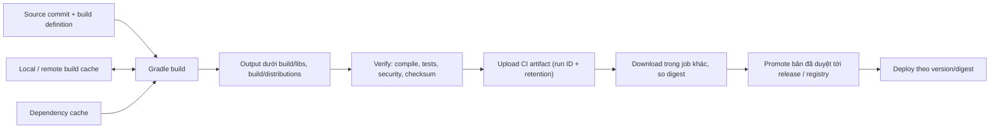

# Phân biệt cache tăng tốc với artifact cần lưu hoặc phát hành trong CI/CD dùng Gradle

Trong CI/CD, hai câu nói sau **không có cùng ý nghĩa**:

- “Build đã **cache** được kết quả biên dịch, lần sau chạy nhanh hơn.”
- “Build đã tạo một **artifact được giữ lại và có thể tải xuống/phát hành**.”

Cache giúp **tránh làm lại công việc tốn thời gian** khi dữ liệu phù hợp còn sẵn. Artifact phục vụ **giao nhận kết quả của một lần build, kiểm tra, triển khai hoặc phát hành**, có tên, nguồn gốc, thời hạn lưu giữ và yêu cầu kiểm soát riêng. Một cached task output *có thể* được dùng để tạo artifact, nhưng bản cache **không thay thế** cho artifact của pipeline hay gói phát hành bất biến.

Bài Knowledge **“Phân biệt cache tăng tốc với artifact cần lưu hoặc phát hành”** thuộc nhóm **Tích hợp CI/CD** của **Build Tool Gradle**. Bài phân biệt ba tầng có thể cùng chứa file JAR/ZIP nhưng mang mục đích hoàn toàn khác nhau:

1. **Gradle/CI cache:** dữ liệu có thể mất và tái tạo, chủ yếu để tăng tốc những lần build tiếp theo.
2. **CI workflow/job artifact:** kết quả cụ thể của **một job hoặc một workflow run**, được giữ để tải xuống, kiểm tra, chuyển giữa các jobs hoặc phục vụ điều tra, thường có retention hữu hạn.
3. **Release artifact / package registry / image registry:** bản phân phối có tọa độ, version hoặc digest, nguồn gốc kiểm chứng được, quyền truy cập và retention theo hợp đồng phát hành.

Nội dung bao gồm Gradle build cache (local/remote), configuration/dependency cache, GitHub Actions/GitLab CI cache so với artifacts, chính sách tạo một lần–promote nhiều lần, Java 17 + Gradle 8.10.2 lab chạy được, pipelines có upload/download thật, SHA-256, provenance, kiểm tra bảo mật và cách xử lý khi artifact hết hạn trong khi cache vẫn còn (hoặc ngược lại).

## 1. Bảng so sánh: cache, CI artifact và release artifact

| Tiêu chí | Cache tăng tốc | CI job/workflow artifact | Artifact phát hành |
| --- | --- | --- | --- |
| **Mục tiêu** | Tránh tải/biên dịch/chạy lại việc đã làm | Giữ hoặc chuyển giao đầu ra của một pipeline | Cung cấp đúng phiên bản phần mềm cho consumers/deployment |
| **Định danh** | Cache key/hash, OS/Gradle/input fingerprints | Workflow/pipeline run ID, job, artifact name | GAV, package version, image digest, release tag và checksum |
| **Có thể bị dọn sớm?** | **Có**, eviction là hành vi bình thường | **Có**, thường theo retention của CI | Không tùy tiện; theo release/registry policy |
| **Consumer** | Gradle tasks, package manager, jobs sau | QA, security scan, downstream job, người xem build | Deployment, hệ thống khác, khách hàng, môi trường prod |
| **Điều kiện đúng** | Cache miss vẫn build được từ nguồn đáng tin | Artifact có thật, đúng job, đúng files và còn thời hạn | Artifact đã được kiểm thử, gắn version, traceable, integrity và access control |
| **Có phải nguồn sự thật?** | **Không** | Nguồn chứng cứ của run trong thời gian retention | Có thể là nguồn phân phối chính thức của version |
| **Có dùng thay nhau?** | Không nên | Không thay registry cho release lâu dài | Không dùng làm nơi lưu Gradle User Home cache |
| **Ví dụ** | Cache JavaCompile outputs / downloaded dependencies | ZIP, JAR, test report của run #125 | Maven `group:artifact:version`, OCI image `name@sha256`, GitHub Release asset |

Một quy tắc thiết kế hữu ích: **nếu xóa cache làm mất “bản duy nhất” của một ứng dụng mà không thể phát hành lại, pipeline đã sai.** Ngược lại, nếu bạn upload cả thư mục `~/.gradle/caches` như một release artifact, bạn đang lưu dữ liệu kỹ thuật nội bộ thay vì kết quả có ý nghĩa với consumer.

## 2. Phân biệt bằng vòng đời dữ liệu



Ở đây có ba ranh giới quan trọng:

- **Build:** đầu ra được sinh hoặc restore từ cache, nhưng file phải thật sự hiện diện tại declared output path.
- **CI artifact upload:** copy/lưu bản output của **run hiện tại** vào artifact service, không phải “cache key đã tồn tại”.
- **Release promotion:** kiểm tra và đưa **cùng những byte đã được test** đến kho phát hành hoặc môi trường đích; không âm thầm rebuild ra byte khác.

Cache có thể làm mũi tên `Build` nhanh hơn. Nó không loại bỏ các yêu cầu `Verify`, `Upload` hoặc `Promote`.

## 3. Định nghĩa “artifact” có ba ngữ cảnh

Từ **artifact** được dùng rộng, nên khi trao đổi trong nhóm phải luôn nói rõ loại:

1. **Gradle task output artifact:** file JAR, ZIP, class directory do task sinh ra dưới `build/`. Có thể là input của task khác, có thể được Gradle task output cache lưu nếu task cacheable.
2. **CI job artifact:** file/directory được uploader của GitHub Actions hoặc GitLab CI giữ sau job. Tên như `candidate-jar` là tên object trong artifact service, không phải Maven coordinate.
3. **Published artifact:** gói có version/digest trong Maven/Nexus/Artifactory/GitHub Packages, OCI registry, release store hoặc kho phân phối được quản lý.

Ví dụ cùng một file `ci-artifacts-lab-1.0.0.jar` có thể đồng thời:

- Nằm ở `build/libs/` của CI runner khi job build.
- Được upload vào workflow artifact `candidate-jar` và tải trong job xác nhận.
- Được publish vào registry theo tên/version quản trị; nơi đó là kênh phát hành.

**Cùng byte không làm ba storage locations trở thành một dịch vụ.** Mỗi nơi có retention, ACL, provenance và cách truy cập riêng.

### “Bản được release” không đồng nghĩa “bản CI đã từng build”

Một JAR xuất hiện trong một PR run không tự là bản production. Chỉ sau khi kiểm thử, phê duyệt, xác nhận đúng commit/version/digest và chuyển vào release channel theo policy, nó mới trở thành release candidate hoặc release chính thức.

## 4. Gradle build cache: dữ liệu để không thực thi lại task

Gradle build cache lưu **task outputs** của cacheable tasks dựa trên cache key. Cache key phản ánh task implementation cùng khai báo inputs/outputs, thay vì một cái tên người dùng đặt như `release-1.0.0`.

```bash
./gradlew build --build-cache
```

hoặc trong `gradle.properties`:

```properties
org.gradle.caching=true
```

Nếu Gradle thấy outputs tương ứng trong cache, một task như `compileJava` có thể báo:

```text
> Task :compileJava FROM-CACHE
```

**Đây chỉ là dòng task outcome minh họa**, không phải toàn bộ Gradle log và không phải lời hứa mọi lần chạy đều FROM-CACHE. Cùng task trên workspace chưa xóa outputs có thể là `UP-TO-DATE`; task không cacheable có thể vẫn chạy.

### Những điều cache hit **không** chứng minh

- Không chứng minh `jar`, `distZip`, test reports đã được upload lên CI artifact service.
- Không chứng minh các quality/security gates của pipeline đã pass.
- Không chứng minh bản build đã có version chính thức hoặc đã được publish.
- Không chứng minh artifact không chứa secrets hoặc đã được ký.
- Không chứng minh task outputs đã tồn tại ở registry cần cho deployment.
- Không chứng minh 100% task graph đều cache hit: `jar`, `Copy` và lifecycle tasks thường không cacheable mặc định.
- Không bảo đảm cache entry sẽ tồn tại ở tuần sau; eviction/retention là một phần thiết kế.

### Cache key khác artifact digest

**Cache key** phục vụ xác định “task này có thể dùng lại outputs từ một lần thực thi tương đương không?”. **SHA-256 digest của JAR** phục vụ xác định “đây có đúng các byte của file JAR đã kiểm tra không?”. Hai loại hash có **ngữ nghĩa và phạm vi khác**.

Bạn không thể lấy một build cache key làm bản thay thế cho SHA-256 của distribution hoặc xem nó là Maven artifact coordinate.

## 5. Local, remote và CI platform cache: ba phạm vi

| Lớp | Vị trí thường gặp | Tại sao hữu ích? | Có dùng làm release storage? |
| --- | --- | --- | --- |
| Gradle local task output cache | `GRADLE_USER_HOME/caches/build-cache-1/` | Reuse task outputs trên một máy, kể cả sau clean | Không |
| Gradle remote build cache | Cache server có protocol và ACL riêng | Nhiều developer/CI agent reuse cacheable task outputs | Không |
| CI platform cache | Cache storage của GitHub Actions/GitLab Runner | Restore dependency/Gradle User Home giữa jobs/runs | Không |
| Dependency cache | `GRADLE_USER_HOME/caches/modules-2/` | Tránh download external dependencies lặp lại | Không |
| Configuration cache | `<root>/.gradle/configuration-cache/` | Bỏ qua configuration phase khi hợp lệ | Không |

**Gradle remote build cache** và **GitHub Actions cache** không phải cùng một thứ. Remote build cache hỗ trợ Gradle task output protocol và cache keys; CI platform cache thường đóng gói một số directories/files để restore cho job sau. Có thể dùng cả hai với chính sách rõ, nhưng không cần trùng lặp mọi loại cache.

### Local rồi remote

Khi cả local và remote Gradle build cache được bật, Gradle thường thử local trước, rồi remote nếu local miss; kết quả lấy từ remote có thể được lưu lại local. Chính sách thường dùng: **trusted CI push lên remote**, developers hoặc untrusted PR chỉ đọc, có quyền truy cập và server retention phù hợp.

**Không cho mọi forked PR quyền ghi vào shared trusted cache.** Nếu một task ghi cache entry sai hoặc dữ liệu bị can thiệp, các build consumer có thể dùng output không đúng. Cần trust boundaries, CI branch policies và đôi khi cache namespaces riêng.

## 6. Gradle `clean` không “cất giữ artifact” và cũng không “xóa hết cache”

Task `clean` của Base/Java/Application plugin xóa build outputs theo `layout.buildDirectory` tương ứng. Ví dụ:

```bash
./gradlew clean
./gradlew build --build-cache
```

Sau `clean`:

- `build/libs/...jar` và `build/distributions/...zip` có thể đã bị xóa ở workspace.
- Gradle User Home build cache và dependency cache thường **vẫn còn**.
- Build sau có thể restore một số compile/test outputs từ cache rồi **tạo lại file đóng gói**.
- Workflow artifact đã upload trước đó vẫn được giữ theo CI retention, độc lập với directory cục bộ.
- Release artifact trong registry không bị xóa chỉ vì bạn chạy `clean` trên một máy.

**Không dùng `clean` như cách phát hành.** Nó không gọi `upload-artifact`, `publish` hoặc công cụ release. Ngược lại, không dùng `--no-build-cache` như cách “xóa artifact đã phát hành”; đó chỉ là flag cho invocation Gradle.

## 7. Artifact retention khác cache eviction

Một cache có thể bị xóa nếu lâu không dùng, có ít dung lượng, cache key đổi hoặc CI platform áp dụng eviction rules. Đây là hành vi **chấp nhận được** nếu có thể download dependencies hoặc rebuild outputs từ nguồn đã pin.

Một **CI artifact** có thể có retention 7/14/30 ngày, theo cấu hình job/repository. Sau hạn đó, downstream user không thể giả định còn tải lại được JAR của run cũ. Retention không đồng nghĩa sự bảo đảm lâu dài.

Một **release registry** phải có policy riêng: version, ACL, artifact immutability, số phiên bản cần giữ, quy trình yanking/revocation và audit. Có thể retention lâu, nhưng không mặc định “vĩnh viễn”; đó là quyết định vận hành và hợp đồng của tổ chức.

Ví dụ:

| Dữ liệu | Ví dụ thời gian | Ý nghĩa |
| --- | --- | --- |
| GitHub/GitLab CI cache | Theo quota/eviction, không phải thời hạn cung cấp sản phẩm | Dùng để tăng tốc, có thể miss bất cứ lúc nào |
| CI artifact của PR | 14 ngày (policy minh họa) | Đủ cho review/debug/QA trong một khoảng hữu hạn |
| Candidate được phê duyệt | Theo vòng đời release candidate | Chờ scan, ký, xét duyệt |
| Released version 1.0.0 | Theo registry/release policy | Được các hệ thống hoặc người dùng tham chiếu ổn định |

**Đừng nâng retention cache lên 365 ngày chỉ vì muốn lưu release.** Cache không cung cấp semantics của package registry; cũng không nên upload binary mỗi lần vào registry nếu nó chỉ là temporary compiler output.

## 8. Điều quan trọng trong CI/CD: artifact là *đầu ra có hợp đồng*

Với một ứng dụng Java, hợp đồng có thể là:

- **Artifact name:** `ci-artifacts-lab-1.0.0.jar` và `ci-artifacts-lab-1.0.0.zip`.
- **Build source:** commit SHA, branch/tag, workflow run, Gradle Wrapper version, Java toolchain.
- **Validation:** Java compile, smoke checks, unit/integration tests, policy gates.
- **Integrity:** SHA-256 của các byte file; ký/attestation nếu cần.
- **Provenance:** build workflow, runner/toolchain, dependencies được quản lý.
- **Storage:** CI artifact service cho run; registry/release store cho version.
- **Retention:** 14 ngày cho candidate artifacts; registry theo release policy.
- **Consumption:** job verify/QA tải đúng artifact name/run/digest, deployment không rebuild tình cờ.
- **Security:** chỉ trusted CI được push release; PR có thể build nhưng không có release credentials.

Không phải mọi file trong `build/` đều thuộc hợp đồng. `build/tmp`, `build/classes` và Gradle caches phục vụ nội bộ. Chỉ những JAR/ZIP/report thực sự cần chuyển giao mới nên được upload theo allowlist.

## 9. Lab Java 17: tạo JAR/ZIP, kiểm tra và giữ đúng kết quả

Ta xây ứng dụng Java **không phụ thuộc thư viện ngoài** để lệnh Java chạy độc lập và CI dễ tái hiện. Dùng **Gradle Wrapper 8.10.2** (hoặc phiên bản tương thích) và Java 17.

Tạo:

- JAR có `Main-Class` để chạy `java -jar`.
- Application distribution ZIP chứa JAR và launch scripts.
- Task `verifyApp` kiểm tra behavior bằng Java main riêng trong `src/test/java`.
- Task `check` phụ thuộc `verifyApp`, nên `build` có smoke check mặc dù lab **không dùng JUnit**.
- Archive options hỗ trợ reproducible entry order/timestamps.

**Mục tiêu không phải chứng minh một task luôn FROM-CACHE.** Mục tiêu là **dù outputs được chạy mới hay lấy từ cache, CI vẫn phải có file artifact thật và upload đúng file ấy**.

### 9.1. Cây file hoàn chỉnh

```text
ci-artifacts-lab/
├── settings.gradle
├── build.gradle
├── gradle.properties
├── gradlew
├── gradlew.bat
├── gradle/
│   └── wrapper/
│       ├── gradle-wrapper.jar
│       └── gradle-wrapper.properties
├── src/
│   ├── main/java/demo/ci/Main.java
│   └── test/java/demo/ci/VerifyApp.java
└── .github/
    └── workflows/
        └── gradle-ci.yml
```

`gradlew`, `gradlew.bat`, `gradle-wrapper.jar` và `gradle-wrapper.properties` cần được sinh và commit qua Gradle Wrapper task, **không** tự tạo JAR trống. GitHub workflow sẽ chỉ chạy khi source nằm trong repository GitHub; build Gradle local hoạt động không cần workflow.

### 9.2. `settings.gradle`

```groovy
rootProject.name = 'ci-artifacts-lab'
```

Đây là một **single-project build**. Không cần `include` thêm module. Tên root cũng trở thành convention mặc định cho base name của JAR và application distribution.

### 9.3. `gradle.properties`

```properties
# Tối ưu hóa Gradle task outputs; không upload release.
org.gradle.caching=true
```

Bật task output build cache để khi test bạn có thể thấy `UP-TO-DATE`/`FROM-CACHE` trên tasks hỗ trợ. Không cấu hình nó như nơi chứa artifact chính thức.

### 9.4. `build.gradle` (Groovy DSL)

```groovy
plugins {
    id 'application'
}

group = 'demo.ci'
version = '1.0.0'

java {
    toolchain {
        languageVersion = JavaLanguageVersion.of(17)
    }
}

tasks.withType(JavaCompile).configureEach {
    options.encoding = 'UTF-8'
    options.release = 17
}

application {
    mainClass = 'demo.ci.Main'
}

// Lab không có external runtime dependencies.
// Jar vì vậy có thể chạy trực tiếp bằng java -jar.
tasks.named('jar', Jar) {
    manifest {
        attributes('Main-Class': 'demo.ci.Main')
    }
}

// Dùng flags rõ ràng cho Gradle 8.10.2.
// Gradle 9+ có mặc định reproducible tương ứng.
tasks.withType(AbstractArchiveTask).configureEach {
    preserveFileTimestamps = false
    reproducibleFileOrder = true
}

// JavaExec chạy một smoke check tự viết, không cần JUnit.
tasks.register('verifyApp', JavaExec) {
    group = 'verification'
    description = 'Verify the Java application behavior'
    dependsOn tasks.named('testClasses')
    classpath = sourceSets.test.runtimeClasspath
    mainClass = 'demo.ci.VerifyApp'
}

// Chỉ build thành công sau khi smoke check pass.
tasks.named('check') {
    dependsOn tasks.named('verifyApp')
}
```

**Giải thích từng quyết định:**

- `application` áp Java plugin và Distribution plugin, tạo `run`, `distZip` và scripts.
- `version='1.0.0'` giúp artifact names xác định. Một dự án thật có thể lấy version từ release policy, không nên dùng cố định mãi.
- Java toolchain 17 và `options.release=17` xác định target language/API/bytecode.
- `jar.manifest.Main-Class` chỉ làm `java -jar` biết main class; đây **không phải** shadow/fat JAR tự chứa mọi dependency. Lab không có external dependencies nên chạy trực tiếp được.
- `preserveFileTimestamps=false` và `reproducibleFileOrder=true` giúp archives tránh một số nguồn nondeterminism từ filesystem; **không tự bảo đảm 100% byte-for-byte reproducibility** nếu inputs hoặc toolchain khác.
- `verifyApp` là `JavaExec` phụ thuộc classes của test source set, kiểm tra logic mà không cần tải JUnit.
- `check.dependsOn(verifyApp)` biến smoke check thành quality gate của `build`. Default `test` task có thể `NO-SOURCE` vì lab không cung cấp JUnit test classes; **không nhầm điều đó với việc đã chạy một bộ JUnit thực**.

### 9.5. `src/main/java/demo/ci/Main.java`

```java
package demo.ci;

public final class Main {
    private Main() {
    }

    public static String message() {
        return "CI artifact ready";
    }

    public static void main(String[] args) {
        System.out.println(message());
    }
}
```

Class không có network, clock hay random. Với Java 17 và cùng source, stdout của nó xác định.

### 9.6. `src/test/java/demo/ci/VerifyApp.java`

```java
package demo.ci;

public final class VerifyApp {
    private VerifyApp() {
    }

    public static void main(String[] args) {
        String actual = Main.message();
        if (!"CI artifact ready".equals(actual)) {
            throw new AssertionError(
                "Unexpected application message: " + actual
            );
        }
        System.out.println("SMOKE_OK");
    }
}
```

Đây là một **Java main-based smoke test**, không phải JUnit. Nếu assertion fail, Java process trả exit code khác 0 và Gradle `JavaExec` task fail, làm `check`/`build` không thành công. Trong sản phẩm thật, nên thêm unit/integration tests đầy đủ và giữ `verifyApp` như một bước bổ trợ, không dùng nó thay toàn bộ test suite.

### 9.7. Tạo Wrapper và chạy

Tại root project mới, khi máy đã có Gradle tương thích:

```bash
gradle wrapper --gradle-version 8.10.2 --distribution-type bin
```

Sau đó trên Linux/macOS:

```bash
./gradlew --version
./gradlew clean build distZip --build-cache --console=plain
./gradlew -q verifyApp
java -jar build/libs/ci-artifacts-lab-1.0.0.jar
```

PowerShell:

```powershell
.\gradlew.bat --version
.\gradlew.bat clean build distZip --build-cache --console=plain
.\gradlew.bat -q verifyApp
java -jar build/libs/ci-artifacts-lab-1.0.0.jar
```

Stdout **do `VerifyApp.main` in**:

```text
SMOKE_OK
```

Stdout **do `Main.main` in khi chạy JAR**:

```text
CI artifact ready
```

Những dòng trên không phải toàn bộ console log của `gradlew build`, vì Gradle có task status, thời gian và cache behavior tùy môi trường.

### 9.8. Artifacts thực tế sau build

Dự kiến:

```text
build/
├── libs/
│   └── ci-artifacts-lab-1.0.0.jar
├── distributions/
│   ├── ci-artifacts-lab-1.0.0.zip
│   └── ci-artifacts-lab-1.0.0.tar
├── classes/
│   ├── java/main/demo/ci/Main.class
│   └── java/test/demo/ci/VerifyApp.class
└── ...
```

`build` có thể tạo cả distribution archives qua Application/Distribution plugin. Trong lab, lệnh ghi rõ `distZip` để mục tiêu ZIP hiển thị tường minh. JAR và ZIP là **các file output được chọn làm CI artifacts**. Thư mục classes và temp files chủ yếu phục vụ Gradle và không phải package được đưa tới consumers.

Một điểm dễ nhầm: cả JAR và ZIP là “artifact”, nhưng **ZIP application distribution** chứa launch scripts/runtime dependencies theo Application plugin conventions; **JAR đơn** trong lab chạy trực tiếp được vì không có external runtime dependencies. Với ứng dụng có dependencies ngoài, không được mặc định `java -jar build/libs/app.jar` sẽ có đủ dependencies; cần application distribution, classpath/launcher thích hợp hoặc fat JAR plugin riêng.

### 9.9. Xác minh output trước khi upload

Linux/macOS:

```bash
test -s build/libs/ci-artifacts-lab-1.0.0.jar
test -s build/distributions/ci-artifacts-lab-1.0.0.zip
java -jar build/libs/ci-artifacts-lab-1.0.0.jar
sha256sum build/libs/ci-artifacts-lab-1.0.0.jar
sha256sum build/distributions/ci-artifacts-lab-1.0.0.zip
```

`test -s` kiểm tra file có tồn tại và non-empty, **không** chứng minh nó là binary đúng. `java -jar` kiểm tra entry point. SHA-256 cho digest các bytes hiện tại, không tự xác minh tính đáng tin của nguồn.

PowerShell:

```powershell
Test-Path build/libs/ci-artifacts-lab-1.0.0.jar
Test-Path build/distributions/ci-artifacts-lab-1.0.0.zip
java -jar build/libs/ci-artifacts-lab-1.0.0.jar
Get-FileHash -Algorithm SHA256 build/libs/ci-artifacts-lab-1.0.0.jar
```

`Test-Path` chỉ kiểm tra tồn tại; nếu dùng trong CI phải kiểm tra kết quả và fail rõ khi false. Đối với release, cần security/compatibility gates và provenance đầy đủ hơn một lần chạy Main.

## 10. Chạy Java 17 độc lập bằng javac/java

Vì mã nguồn không có external dependencies, có thể xác nhận logic Java mà không dùng Gradle:

Linux/macOS:

```bash
mkdir -p manual-classes
javac --release 17 -encoding UTF-8 -d manual-classes \
    src/main/java/demo/ci/Main.java \
    src/test/java/demo/ci/VerifyApp.java
java -cp manual-classes demo.ci.VerifyApp
java -cp manual-classes demo.ci.Main
```

PowerShell:

```powershell
New-Item -ItemType Directory -Force manual-classes | Out-Null
javac --release 17 -encoding UTF-8 -d manual-classes src/main/java/demo/ci/Main.java src/test/java/demo/ci/VerifyApp.java
java -cp manual-classes demo.ci.VerifyApp
java -cp manual-classes demo.ci.Main
```

Kết quả của **hai lệnh `java` theo thứ tự**:

```text
SMOKE_OK
CI artifact ready
```

**Giới hạn:** `javac` chỉ tạo class files trong `manual-classes`, không tạo Gradle JAR, application ZIP, Gradle cache entries hay CI artifacts. Kết quả Java đúng không đồng nghĩa pipeline đã upload file hay đã phát hành gói. Đây là bài học quan trọng về ranh giới build logic và artifact lifecycle.

## 11. Kotlin DSL tương đương (không cần viết lại Java)

Nếu nhóm dùng Kotlin DSL, thay `settings.gradle` bằng `settings.gradle.kts`:

```kotlin
rootProject.name = "ci-artifacts-lab"
```

Và thay `build.gradle` bằng `build.gradle.kts`:

```kotlin
plugins {
    application
}

group = "demo.ci"
version = "1.0.0"

java {
    toolchain {
        languageVersion.set(JavaLanguageVersion.of(17))
    }
}

tasks.withType<JavaCompile>().configureEach {
    options.encoding = "UTF-8"
    options.release.set(17)
}

application {
    mainClass.set("demo.ci.Main")
}

tasks.named<Jar>("jar") {
    manifest {
        attributes["Main-Class"] = "demo.ci.Main"
    }
}

tasks.withType<AbstractArchiveTask>().configureEach {
    isPreserveFileTimestamps = false
    isReproducibleFileOrder = true
}

val verifyApp by tasks.registering(JavaExec::class) {
    group = "verification"
    description = "Verify the Java application behavior"
    dependsOn(tasks.named("testClasses"))
    classpath = sourceSets["test"].runtimeClasspath
    mainClass.set("demo.ci.VerifyApp")
}

tasks.named("check") {
    dependsOn(verifyApp)
}
```

Java sources không đổi, `gradle.properties` vẫn là `org.gradle.caching=true`. Chạy bằng cùng Wrapper, `java -jar` và `javac`; stdout vẫn `SMOKE_OK` và `CI artifact ready`.

**Đây là một phương án thay thế toàn bộ build scripts**, không giữ cả hai files `build.gradle`/`build.gradle.kts` cùng điều khiển một project rồi mong Gradle kết hợp. Không trộn Groovy property assignment với Kotlin DSL `Property.set(...)` trong cùng file.

## 12. GitHub Actions: cache để tăng tốc, artifact để chuyển giao

Theo tài liệu GitHub, dependency caching và workflow artifacts giải quyết hai nhu cầu khác nhau: **caching** tăng tốc giữa các workflow runs; **artifacts** lưu files sau workflow run và đưa từ job này sang job khác. Hai cơ chế có API/retention/permissions riêng.

Trong ví dụ sau:

- `gradle/actions/setup-gradle` quản lý cache cho phần Gradle User Home; không dùng đồng thời `actions/cache` và `setup-java cache: gradle` cho cùng home.
- `actions/upload-artifact` upload **JAR, checksum và ZIP**, không upload cả `~/.gradle`.
- `actions/download-artifact` tải bản JAR đã được build trong job trước; job nhận **không rebuild**.
- Action majors trong ví dụ phản ánh tài liệu chính thức được đối chiếu (checkout v7, setup-java v6, setup-gradle v6, upload-artifact v7, download-artifact v8); trong môi trường production hãy pin từng action theo **full commit SHA đã review** và kiểm tra runner/GHES compatibility trước khi nâng.

### 12.1. Workflow đầy đủ `.github/workflows/gradle-ci.yml`

```yaml
name: Gradle CI - cache vs artifacts

on:
  push:
    branches: [main]
  pull_request:
  workflow_dispatch:

permissions:
  contents: read

jobs:
  build-and-upload:
    runs-on: ubuntu-latest

    steps:
      - name: Checkout source
        uses: actions/checkout@v7

      - name: Install Java 17
        uses: actions/setup-java@v6
        with:
          distribution: temurin
          java-version: '17'

      - name: Setup Gradle cache
        uses: gradle/actions/setup-gradle@v6
        with:
          cache-provider: basic

      - name: Compile, verify and package
        run: ./gradlew --no-daemon clean build distZip --build-cache

      - name: Verify JAR runtime
        run: java -jar build/libs/ci-artifacts-lab-1.0.0.jar

      - name: Generate checksum
        run: |
          cd build/libs
          sha256sum ci-artifacts-lab-1.0.0.jar > ci-artifacts-lab-1.0.0.jar.sha256

      - name: Save CI JAR artifact
        uses: actions/upload-artifact@v7
        with:
          name: candidate-jar
          path: |
            build/libs/ci-artifacts-lab-1.0.0.jar
            build/libs/ci-artifacts-lab-1.0.0.jar.sha256
          if-no-files-found: error
          retention-days: 14

      - name: Save application distribution
        uses: actions/upload-artifact@v7
        with:
          name: candidate-distribution
          path: build/distributions/ci-artifacts-lab-1.0.0.zip
          if-no-files-found: error
          retention-days: 14

  consume-same-binary:
    needs: build-and-upload
    runs-on: ubuntu-latest

    steps:
      - name: Install Java 17
        uses: actions/setup-java@v6
        with:
          distribution: temurin
          java-version: '17'

      - name: Download candidate JAR
        uses: actions/download-artifact@v8
        with:
          name: candidate-jar
          path: incoming

      - name: Verify checksum and execute downloaded JAR
        run: |
          cd incoming
          sha256sum --check ci-artifacts-lab-1.0.0.jar.sha256
          java -jar ci-artifacts-lab-1.0.0.jar
```

**Vì sao đây là hai chức năng khác biệt?**

- `setup-gradle` có thể restore Gradle dependencies/scripts/outputs để làm job build nhanh hơn. **Không job nào sau được phép coi cache entry là output phát hành đã được kiểm chứng.**
- `upload-artifact` kiểm tra những **đường dẫn file cụ thể** và lưu chúng vào workflow artifacts trong 14 ngày theo cấu hình của ví dụ.
- `consume-same-binary` không có `checkout` hoặc `./gradlew build`. Nó tải đúng JAR đã tạo ở job `build-and-upload`, kiểm checksum và chạy nó.
- CI caching không ảnh hưởng đến việc job thứ hai cần **download-artifact**: hai dịch vụ khác nhau.
- `if-no-files-found: error` buộc workflow fail thay vì “thành công nhưng không upload gì” khi artifact path sai.
- `needs` tạo quan hệ phụ thuộc job; job consume không chạy khi job build upload không pass.
- Workflow chỉ có **một build job** upload artifact với từng name; nếu chạy matrix có nhiều jobs ghi cùng name, cần naming/aggregation strategy riêng để tránh conflicts của artifact immutable.
- `retention-days: 14` là **retention của workflow artifact**, không phải của Gradle User Home cache hay bản release trong registry.

### 12.2. Giải thích action version và caching policy

Tại thời điểm kiểm tra hướng dẫn, `gradle/actions/setup-gradle@v6` cung cấp caching providers. Mẫu trên chọn `cache-provider: basic` là phương án dựa trên CI cache quen thuộc; nếu tổ chức dùng provider khác, đánh giá licensing/permission/quota phù hợp.

Không thêm:

```yaml
# Không thêm đồng thời cho cùng Gradle User Home.
# - uses: actions/setup-java@v6
#   with:
#     cache: gradle
# - uses: actions/cache@v4
#   with:
#     path: ~/.gradle
```

vào cùng workflow khi `setup-gradle` đã quản lý cache, vì nhiều cơ chế save/restore cùng `GRADLE_USER_HOME` có thể cạnh tranh, ghi đè state hoặc làm cache miss khó truy tìm.

**Khi không có cache:** `setup-gradle` cache miss sẽ làm job biên dịch/tải những thứ cần thiết rồi tiếp tục. **Khi không có artifact:** `consume-same-binary` không được lấy một cache entry ngẫu nhiên làm thay thế JAR đã upload; job phải fail hoặc yêu cầu upstream rerun.

### 12.3. Stdout của job consume

Bước `sha256sum --check` có thể in:

```text
ci-artifacts-lab-1.0.0.jar: OK
```

Dòng này là output của công cụ checksum **khi file khớp**. Bước `java -jar` kế tiếp in:

```text
CI artifact ready
```

Đây là output có điều kiện xác nhận file đúng; không phải toàn bộ job logs. Nếu checksum fail, shell trong workflow sẽ dừng bước (exit code khác 0) và không nên coi artifact là hợp lệ.

### 12.4. Tại sao cache không thay `upload-artifact`?

Một Gradle cache entry:

- Có thể chỉ chứa classes của `compileJava`, không có JAR/ZIP kết quả cuối.
- Có thể bị evict theo quota, retention hoặc thay đổi input/toolchain.
- Không có contract “candidate-jar của run N” và không có UI/API phân phối tương đương.
- Có thể bị cache poisoning nếu trust policy yếu.
- Không phục vụ phê duyệt/traceability tới cùng một workflow run theo cách CI artifact làm.

Ngay cả nếu `jar`/`distZip` được tạo nhanh từ reused compile outputs, vẫn cần **upload những file cụ thể**.

### 12.5. Khả năng tải artifact giữa jobs và workflows

Trong cùng workflow, `download-artifact` có thể tải artifact theo name hoặc ID được upload trước đó. Với **workflow run khác/repository khác**, cần xác định run ID/repository và permissions/token phù hợp theo docs; không suy rằng tên `candidate-jar` duy nhất trên toàn repository vĩnh viễn.

Đối với promotion nhiều ngày sau, phụ thuộc duy nhất vào workflow artifact có retention ngắn dễ dẫn tới “artifact not found”. Cách bền hơn là chuyển bản đã duyệt vào một artifact registry hoặc release store có version/retention phù hợp, kèm digest.

## 13. GitLab CI: `cache:` và `artifacts:` là hai keyword khác nhau

GitLab docs phân biệt: **cache** thường dành cho downloaded dependencies và dữ liệu tái tạo được giữa pipelines; **job artifacts** dùng để chuyển kết quả giữa stages, lưu reports/binaries gắn với pipeline. Khi kết quả phải có URL/version ổn định và tồn tại lâu hơn pipeline, hãy dùng **package registry/release store**.

Ví dụ `.gitlab-ci.yml` cho cùng Groovy lab (cấu hình riêng nếu dùng GitLab, không chạy song song với GitHub workflow trong cùng nền tảng):

```yaml
image: eclipse-temurin:17-jdk

variables:
  GRADLE_USER_HOME: "$CI_PROJECT_DIR/.gradle-ci"

stages:
  - build
  - inspect

compile_candidate:
  stage: build

  cache:
    key:
      files:
        - gradle/wrapper/gradle-wrapper.properties
        - build.gradle
    paths:
      - .gradle-ci/caches/
      - .gradle-ci/wrapper/

  script:
    - sh ./gradlew --no-daemon clean build distZip --build-cache
    - java -jar build/libs/ci-artifacts-lab-1.0.0.jar

  artifacts:
    when: on_success
    expire_in: 14 days
    paths:
      - build/libs/ci-artifacts-lab-1.0.0.jar
      - build/distributions/ci-artifacts-lab-1.0.0.zip

inspect_candidate:
  stage: inspect
  needs:
    - job: compile_candidate
      artifacts: true

  script:
    - java -jar build/libs/ci-artifacts-lab-1.0.0.jar
```

Điểm đáng học:

- `GRADLE_USER_HOME` được đặt dưới project directory để GitLab runner cache có thể nhận các paths tương đối; đây là lựa chọn CI-specific, không phải bắt buộc khi build local.
- `cache:key:files` tạo key từ các file cấu hình được chỉ ra; khi version/build definition thay đổi, cache namespace có thể đổi. Đây là **tăng tốc**, job phải chịu được cache miss.
- `cache:paths` giữ một phần Gradle User Home; **không** coi nó là output của pipeline.
- `artifacts:paths` giữ JAR và ZIP của job sau khi build thành công, với `expire_in: 14 days`.
- `inspect_candidate` nhận artifacts từ job `compile_candidate` theo `needs:artifacts`, không phụ thuộc việc GitLab cache có được restore hay không.
- Ví dụ cố tình **không cache `build/` như một directory tùy tiện**: Gradle task history, timestamps và outputs có thể khác khi phục hồi nguyên trạng; dùng Gradle-aware caching/remote build cache hoặc chính sách đo đạc rõ.
- Dùng `sh ./gradlew` trong container tránh phụ thuộc executable bit khi checkout; trong repo thực cần commit Wrapper JAR/properties đáng tin. Nếu image/runner khác, điều chỉnh shell phù hợp.
- GitLab artifacts thường có retention theo instance/project policy; `expire_in` là yêu cầu thời hạn, còn cấu hình giữ artifacts của pipeline gần nhất có thể tác động đến thời gian thực tế.

Nếu project dùng `build.gradle.kts`, phải sửa `cache:key:files` thích hợp; ví dụ YAML đang khớp **Groovy build script** của lab.

## 14. CI artifact có thể được tạo từ cached outputs mà vẫn hợp lệ

Một build có thể có chuỗi:

```text
compileJava         FROM-CACHE
processResources    NO-SOURCE
classes             lifecycle
jar                 EXECUTED / UP-TO-DATE tùy lần chạy
distZip             EXECUTED / UP-TO-DATE tùy lần chạy
verifyApp           EXECUTED
upload-artifact     upload file JAR/ZIP từ build/
```

Đây là **một trường hợp minh họa**, không phải log cố định. Điều quan trọng là pipeline phải **kiểm tra file output thực** và qua quality gates trước khi upload/promote.

Lấy cached compile output không làm một JAR “kém đáng tin” hơn nếu cache được bảo vệ và task inputs/outputs chính xác. Tuy nhiên:

- Cache server phải có trust policy phù hợp.
- Build scripts/plugins/toolchain cần được pin và review.
- Kết quả test cần được chạy hoặc có cơ chế quyết định không chạy test rõ ràng.
- Checksums/provenance nên được tính trên **file artifact cuối**.
- Không được phê duyệt release chỉ vì cache hit.

Một lỗi nghiệp vụ là dùng cache key làm “đường dẫn đến bản đã được QA pass” và bỏ qua CI artifact storage. Cache key không mang đủ metadata policy của QA approval.

## 15. Build once, promote the same bytes

Nguyên tắc CD thường được diễn đạt: **build một lần, dùng chính artifact đó qua các môi trường**.

Ví dụ tốt:

```text
Commit abc123 -> CI build -> JAR sha256=H1
                         -> unit/integration/security gates
                         -> Candidate artifact + H1
                         -> Staging tải H1
                         -> Approval
                         -> Production tải đúng H1
```

Ví dụ dễ gây lệch:

```text
Commit abc123 -> CI build JAR sha256=H1 -> QA pass
              -> Deploy job chạy lại ./gradlew build -> JAR sha256=H2
              -> Deploy H2 (chưa chắc đúng byte đã kiểm thử)
```

Dù cả hai build từ cùng commit, nếu có timestamps, dynamic dependencies, generated code, environment hoặc tool versions khác, **H2 có thể khác H1**. Build lại không phải lúc nào cũng sai, nhưng nếu release contract yêu cầu deploy **đúng binary đã test**, quy trình phải tải và promote artifact, không âm thầm biên dịch lại.

### Registry theo loại sản phẩm

- **Java library**: Maven repository qua `maven-publish`, tọa độ `group:artifactId:version`.
- **Containerized application**: OCI registry với image tag và đặc biệt immutable digest `sha256`.
- **Standalone Java application**: distribution ZIP/TAR, package repository, object storage/release assets có version/ACL/retention.
- **Mobile/Desktop installers**: signing, release channels và kho phân phối tương ứng.

Không dùng “cache server của Gradle” như một Maven repository. Cache keys và Maven coordinates phục vụ hai hợp đồng khác nhau.

## 16. Gắn identity cho artifact thay vì phụ thuộc tên file đơn giản

`ci-artifacts-lab-1.0.0.jar` chỉ cho biết artifact base name/version được build script đặt. Với CI/CD thật, cần thêm metadata:

| Trường | Ví dụ ý nghĩa |
| --- | --- |
| Source repository | URL/ID repo source đã build |
| Commit SHA | Commit bất biến được checkout |
| Build run ID/attempt | Lần chạy CI tạo artifact |
| Gradle version | Wrapper distribution được commit |
| Java runtime/toolchain | JDK major/version/vendor policy |
| Artifact version | Semantic version hoặc CI build version |
| SHA-256 | Digest file JAR/ZIP đã upload |
| Quality results | Unit, integration, SAST, licensing, policy gates |
| Artifact provenance | Workflow identity, runner/build parameters |
| Release approval | Ai/quy tắc nào cho phép promote |
| Retention | Được giữ tới khi nào và tại store nào |

Nếu lưu artifact ở một object store riêng, có thể lưu metadata JSON sidecar cùng JAR/ZIP. Nếu dùng package registry, điền metadata vào hệ thống registry và ghi commit/run provenance. **Không cần nhét mọi metadata vào filename**, nhưng phải có cách tìm bản chính xác.

### Hash không đồng nghĩa chữ ký

`sha256sum` phát hiện file đã đổi so với checksum đáng tin. Nếu attacker sửa **cả file và checksum cùng nơi**, checksum không tự xác minh ai đã xây bản đó. Ký số và build provenance/attestations cung cấp bảo đảm bổ sung khi được tạo và xác minh qua trust anchors phù hợp.

## 17. Artifact attestation và SBOM cho release an toàn

GitHub Actions hỗ trợ **artifact attestations** để tạo bằng chứng về nơi/cách artifact được build. Ví dụ **đoạn tùy chọn nâng cao**, không phải phần bắt buộc để chạy workflow lab:

```yaml
# Snippet cần permissions phù hợp và GitHub plan hỗ trợ.
permissions:
  contents: read
  id-token: write
  attestations: write

steps:
  - name: Attest JAR provenance
    uses: actions/attest@v4
    with:
      subject-path: build/libs/ci-artifacts-lab-1.0.0.jar
```

Đây **không phải một workflow đầy đủ**: phải ghép vào workflow có artifact được build trước đó, đảm bảo GitHub plan/repository eligibility, permissions và policy tổ chức. Dùng action/CLI xác minh attestation tại deploy hoặc release gate.

**SBOM** (Software Bill of Materials) mô tả dependencies/components. Nếu policy yêu cầu SBOM, hãy tạo bằng công cụ được duyệt, gắn nó với artifact digest/version và lưu như một release companion artifact. Không đặt SBOM chỉ trong cache ephemeral rồi nghĩ người dùng downstream có thể kiểm tra supply-chain sau nhiều tháng.

### Ký và phát hành tách khỏi build trên PR

- Build PR có thể dùng read-only cache và upload candidate artifacts để review.
- Release job chỉ chạy từ ref/tag/branch tin cậy, có approvals và scoped credentials.
- Không đặt registry write token cho untrusted fork PR.
- Dùng OIDC và short-lived credentials khi nền tảng hỗ trợ, tránh hard-code secrets.
- Production deploy nên xác minh digest/provenance trước khi chạy binary.
- Release metadata cần ghi lại artifact ID/digest, không chỉ “workflow green”.

## 18. Tại sao Gradle cache không phải kho backup

Một build cache được thiết kế để hỗ trợ **eviction**. Server có thể xóa entry theo retention/quota, thay cache format, restart hoặc bị reset. Điều này bình thường vì task output có thể được tái tạo từ source/inputs. Một binary chỉ tồn tại trong cache là **một điểm mất dữ liệu có thể dự đoán được**.

Với CI artifact service, dữ liệu cũng có expiration; tuy nhiên nó có **hợp đồng riêng**: artifact name/run, download APIs và retention đã cấu hình. Nếu tổ chức cần artifact trong nhiều năm, nên **promote sang registry/release storage thích hợp**, không đơn thuần tăng workflow retention nếu quá quota/policy.

### Câu hỏi phục hồi quan trọng

“Sau sáu tháng, tôi có tải được **chính xác bản đã đưa production** không?”

- Nếu chỉ có build cache: **không được bảo đảm**.
- Nếu chỉ có CI artifact 14 ngày: **không được bảo đảm**.
- Nếu có package/image/release artifact immutable theo retention thích hợp, digest và provenance: **có cơ sở kiểm soát việc truy xuất**, tùy chính sách lưu trữ và quyền truy cập thực tế.

Đó là khác biệt cốt lõi giữa **acceleration** và **record of release**.

## 19. Reproducible archives có liên quan nhưng không thay artifact storage

Một kỹ thuật để binary ổn định hơn:

```groovy
tasks.withType(AbstractArchiveTask).configureEach {
    preserveFileTimestamps = false
    reproducibleFileOrder = true
}
```

Gradle 9+ đặt các defaults reproducible tương ứng; với Gradle 8.10.2 lab dùng flags tường minh. Điều này giúp tránh timestamps và filesystem traversal order ảnh hưởng JAR/ZIP contents.

Nhưng byte-identical artifacts còn phụ thuộc:

- Java toolchain/vendor/version khác nhau có thể ảnh hưởng compiled bytecode.
- Dependencies/SNAPSHOT/dynamic versions có thể thay đổi.
- Annotation processor/code generator đọc clock, hostname hoặc locale.
- ZIP/JAR manifest, file permissions, generated metadata có thể khác.
- Resource processing có thể ghi absolute paths hoặc timestamps.
- Cùng source commit nhưng Gradle plugin versions và external tools khác.

Nếu phát hành binary quan trọng, hãy kiểm tra reproducibility bằng **hai builds độc lập và so digests**, không chỉ nhìn hai flags. Và kể cả khi rebuild tạo đúng SHA-256 như cũ, **registry/release artifact vẫn phải được lưu** để consumer lấy bản được cấp phép một cách đáng tin.

## 20. Cache hit rate không phải artifact success rate

Trong dashboard CI có thể thấy:

- Dependency cache hit 90%.
- Task output build cache hit 70%.
- P95 build time giảm từ 12 phút xuống 5 phút.
- Artifact upload success 99%.
- Release publication success 100%.

Đây là các **chỉ số khác loại**. Một pipeline có thể build rất nhanh vì cache nhưng **upload sai path** và không có artifact; hoặc artifact upload thành công nhưng quality gate sau đó thất bại.

Nên đo riêng:

| Mục tiêu | Metric phù hợp |
| --- | --- |
| Tăng tốc | Cache hit/miss, remote cache latency, time saved, CPU/network, eviction |
| Chất lượng build | Test pass rate, code coverage, scan results, repeatability |
| Đầu ra CI | Artifact exists, exact path/size/digest, upload/download success |
| Truy xuất | Retention phù hợp, artifact run ID và metadata |
| Release | Registry publication ID/version, digest, attestation, deploy verification |
| Bảo mật | Cache push ACL, artifact access control, credential scope, provenance verification |

**Không dùng cache hit % làm release KPI**; không dùng “upload OK” làm performance KPI.

## 21. Khi không có cache và khi không có artifact: hành vi phải khác

### Nếu cache miss

Đây phải là tình trạng bình thường có thể xử lý:

1. Gradle download dependencies nếu cần.
2. Gradle compile/test/package lại những tasks.
3. Pipeline vẫn tiếp tục nếu build logic và nguồn đầu vào đúng.
4. Thời gian chạy tăng, nhưng artifact cuối không mất tính đúng đắn.

Nếu cache miss làm build fail do một JAR không được version/publish chỉ tồn tại trong cache, đó là lỗi **hermeticity/dependency provenance**, không phải lỗi của cache service.

### Nếu artifact upload miss

Đây phải là **pipeline failure** khi downstream cần file:

1. Kiểm tra `build/libs`, `build/distributions`.
2. Kiểm tra version/name và task được gọi.
3. Đặt `if-no-files-found: error` ở uploader.
4. Chỉ chạy downstream khi upstream thật sự upload thành công.
5. Không để downstream tự build lại “cho có artifact” nếu đang cần **đúng candidate đã test**.

### Nếu release artifact không tìm thấy

Không dùng Gradle cache làm fallback tự động. Phải xác minh version/digest, permissions và registry status; nếu mất bản release đã phát hành, cần quy trình phục hồi/rebuild có audit, không im lặng đổi sang một binary mới cùng version.

## 22. Điều gì nên cache và điều gì nên upload?

| File/directory | Cache tăng tốc? | CI artifact? | Release registry? |
| --- | --- | --- | --- |
| `~/.gradle/caches/modules-2` | Có thể được CI/Gradle cache | Không | Không |
| `~/.gradle/caches/build-cache-1` | Có thể được Gradle-aware CI cache | Không | Không |
| `.gradle/configuration-cache` | Tùy policy/secret encryption | Không | Không |
| `build/classes/java/main` | Gradle task cache quản lý khi hợp lệ | Thường không | Không |
| `build/libs/app.jar` | Không dùng toàn bộ folder làm CI cache mặc định; task producer có thể cache output | **Có** nếu là deliverable | **Có** nếu là artifact cần phát hành |
| `build/distributions/app.zip` | Tương tự, producer có thể được tối ưu | **Có** | **Có** khi là distribution |
| `build/reports/tests` | Không phải acceleration cache mặc định | Có thể, để QA/debug | Chỉ khi release policy cần |
| JUnit XML/coverage report | Không phải artifact sản phẩm | Nên lưu theo QA policy | Không thường xuyên, trừ audit contract |
| Docker image | Build layers có cache riêng | Có thể metadata/digest | OCI registry theo tag/digest |
| SBOM và attestation | Không để duy nhất trong cache | Có, nếu review trong run | Nên gắn release theo policy |
| `gradlew`/`gradle-wrapper.jar` | Source/bootstrap được commit | Không cần upload làm deliverable | Không dùng cache để thay Git |
| Secrets/credentials | **Không lưu** như cache input/output | **Không upload** | **Không phát hành** |

Một artifact upload manifest nên là **allowlist** các đường dẫn. Tránh upload `build/**` không chọn lọc vì có thể lẫn temp files, logs chứa secrets, test fixtures, caches hoặc dữ liệu lớn không cần thiết.

## 23. Artifact identity trong multi-project Gradle

Ví dụ multi-project:

```text
:
├── :core
├── :service
└── :cli
```

Mỗi project có thể có `build/libs/` và `build/distributions/` riêng. CI nên dùng **task path và artifact path rõ ràng**, không giả định mọi output nằm ở root.

```bash
./gradlew :core:build :service:build :cli:distZip
```

Possible paths:

```text
core/build/libs/core-1.0.0.jar
service/build/libs/service-1.0.0.jar
cli/build/distributions/cli-1.0.0.zip
```

Đây là **minh họa cho một layout theo convention**, không phải file tree runnable bổ sung của lab chính. Actual names phụ thuộc root/module versions và archive settings. Nếu module đã remap `projectDir`, physical outputs sẽ nằm dưới directory thật. Cấu hình CI upload phải dựa vào **task output location**, không tự biến Gradle project path `:service` thành filesystem path mọi lúc.

### Tùy chỉnh archiveBaseName

Nếu team yêu cầu tên gói khác tên project, nên dùng API archive/publication:

```groovy
tasks.named('jar', Jar) {
    archiveBaseName = 'service-api'
}
```

Đây là snippet không thuộc lab chính. Khi thay archive name, phải sửa CI path selectors và artifact manifest. **Đừng đổi tên file sau build bằng một shell step âm thầm** rồi để task output metadata và publishing policy bị lệch.

## 24. Maven `publish` khác `upload-artifact`

Đối với Java library, Gradle `maven-publish` tạo publication và tasks publish lên một repository. Việc đó khác với GitHub/GitLab CI uploader:

- `upload-artifact`: thường gắn với CI run và retention hữu hạn; consumer dùng workflow/job artifact API.
- `publish`: ghi package vào Maven repository bằng **Maven coordinates, metadata, version và repository policy**.
- `gradle build cache`: lưu cacheable task outputs, không có Maven module metadata/version hợp đồng.

Một snippet định hướng cho **Java library**:

```groovy
plugins {
    id 'java-library'
    id 'maven-publish'
}

group = 'demo.company'
version = '1.0.0'

publishing {
    publications {
        javaLibrary(MavenPublication) {
            from components.java
        }
    }
}
```

**Đây là snippet của loại dự án khác, không phải file chạy độc lập**: production cần repository target, credentials, signing và release checks. Không thay app `application` của lab thành Maven library mà không có nhu cầu thật.

Đối với Java application, distribution ZIP/TAR hoặc container image thường phù hợp hơn. Việc chọn registry phụ thuộc **loại artifact và consumer**, không phụ thuộc “đều có file .jar nên cứ Maven publish”.

## 25. Checksums, signatures và provenance là ba lớp

**Checksum:**

```bash
sha256sum build/libs/ci-artifacts-lab-1.0.0.jar
```

cho một digest xác định của file hiện tại. Nó phát hiện khác byte khi đem so với digest đáng tin.

**Signature:** cho phép kiểm chứng việc ký bằng key/certificate đáng tin; phải quản lý private key, key rotation, revocation và verification policy. Không lưu signing key trong artifact bundle.

**Provenance/attestation:** liên kết artifact với workflow, source repository, commit và build environment theo phương thức chứng thực; cần kiểm chứng chữ ký, identity và subject digest. Có thể gắn SBOM cho supply-chain audit.

Không biến checksum file đi kèm artifact thành lời khẳng định “an toàn tuyệt đối”: nếu cùng attacker đổi cả file và checksum, người kiểm tra không biết đó là artifact đã QA duyệt. Release gate cần trust anchor và policy thích hợp.

## 26. Chọn retention theo người sử dụng và nghĩa vụ vận hành

| Nhóm | Lựa chọn minh họa | Hệ quả |
| --- | --- | --- |
| PR candidate JAR | 7–14 ngày | Đủ thời gian review; sau đó phải build lại hoặc tìm release chính thức |
| Integration test logs/reports | 14–30 ngày | Phục vụ phân tích lỗi, có thể chứa thông tin nhạy cảm cần lọc |
| Nightly snapshot | Theo quy tắc snapshots | Không giả định nightly là bản release vĩnh viễn |
| Release candidate | Đến khi chấp thuận/từ chối và hết yêu cầu audit | Có traceability và digest |
| Official release 1.0.0 | Theo policy registry/version retention | Consumer/deploy phải có cách tải bản được hỗ trợ |
| Gradle cache | Theo usage/quota/eviction | Bị dọn không được làm mất deliverable |

Đây là ví dụ policy để ra quyết định, **không phải defaults của GitHub/GitLab hay Gradle**. Giới hạn retention thực tế phụ thuộc platform/repository/plan settings. Khi chọn retention cần cân nhắc chi phí storage, thời gian debug, legal/audit, nghĩa vụ rollback, dữ liệu nhạy cảm và release lifecycle.

**Rollback không được phụ thuộc vào một CI workflow artifact đã hết hạn.** Nếu cần rollback nhiều tháng sau, phải lưu versioned release binary/digest tại store phù hợp.

## 27. Khi có nhiều OS/JDK versions: matrix artifacts và cache keys

Với matrix CI chạy Linux/Windows/macOS hoặc Java 17/21:

- Cache key nên xét OS/architecture/Gradle/JDK/build definition khi dữ liệu không portable.
- Artifact filename/name nên ghi rõ target nếu binary/platform dependent.
- Không cho hai matrix jobs cùng upload vào **một artifact name** mà uploader immutable không hỗ trợ merge/update như mong muốn.
- Có thể có `app-linux-x64`, `app-windows-x64`, `app-macos-arm64` với digest riêng.
- Một ứng dụng Java thuần có thể dùng chung JAR bytecode target 17, nhưng launcher/distribution/scripts và native libraries có thể platform-dependent.
- Release metadata phải chỉ ra platform/architecture/JDK requirement.
- Đừng chọn artifact Windows khi deployment là Linux chỉ vì cùng version string.

Nếu matrix tests cho cùng một JAR, một cách tránh lệch là build JAR ở **một job producer**, upload, rồi mỗi test job tải artifact đó và chạy trên platform mục tiêu. Đây là ví dụ của **build once + test same candidate**, khác với việc từng matrix job tự compile một bản rồi đều gọi là release candidate.

## 28. Release không đồng nghĩa deployment

**Release** là công bố versioned artifact có thể tiêu thụ theo policy. **Deployment** là đưa một artifact cụ thể vào môi trường thực thi.

Một hệ thống có thể:

- Publish `1.0.0` vào Maven/OCI registry.
- Deploy digest ấy lên staging.
- Kiểm thử staging và phê duyệt.
- Promote **chính digest đó** lên production.
- Roll back về digest của release trước.

Không nên để deploy job rebuild code mà không xác minh digest, nhất là nếu dependencies có dynamic/changing versions. Đối với container images, deploy bằng immutable image digest thường chắc chắn hơn dùng mutable tag `latest` một mình.

### “Đã publish” cũng phải được kiểm tra

Nên xác minh:

1. Registry nhận đúng tọa độ và version.
2. File bytes/digest khớp candidate đã test.
3. Signature/attestation có thể verify.
4. ACL cho consumers đúng.
5. Package metadata không thiếu.
6. Release note/SBOM theo policy đã gắn.
7. Artifact có thể tải bằng consumer thực tế, không chỉ admin CI.
8. Retention/immutability phù hợp rollback.

Một lệnh publish trả exit code 0 là cần thiết, nhưng với hệ thống quan trọng vẫn nên xác nhận artifact có thể đọc/verify ở nơi đến.

## 29. CI cache bảo mật khác artifact access security

### Cache

- Cần read/write separation; trusted CI mới được push cache entries vào shared namespace.
- Không cache credentials hoặc generated outputs chứa secrets.
- Cache restore của untrusted PR không được tạo quyền ghi vào release registry.
- Cache contents có thể không đáng tin tuyệt đối; task input modeling và trusted provenance vẫn quan trọng.
- Không dùng shared writable filesystem cache giữa isolated containers không hỗ trợ locks/synchronization đúng.

### CI artifacts

- Người có quyền đọc workflow artifact có thể tải những files được upload theo quyền platform.
- Không upload toàn thư mục workspace chứa secrets, keystore hoặc private keys.
- Với logs/test reports, lọc tokens/personal data/sensitive payloads.
- Artifact name/run ID/digest cần được dùng để tránh tải nhầm bản.
- Retention phù hợp với data classification và audit.

### Release storage

- Publisher permissions phải tối thiểu; release từ protected ref/approval.
- Không cho untrusted PR có release tokens.
- Artifact signing/provenance verification ở promotion/deploy.
- Áp version immutability; tránh âm thầm overwrite `1.0.0` bằng bytes mới.
- Theo dõi package revocation/withdrawal và incident response.

Cache và artifact đều cần security, nhưng **threat models khác nhau**: cache poisoning gây wrong reused outputs; artifact substitution/release tampering gây phát hành/triển khai sai binary.

## 30. Chẩn đoán lỗi theo lớp

| Triệu chứng | Lớp có khả năng lỗi | Cách điều tra |
| --- | --- | --- |
| CI chậm hơn dù source không đổi | Cache miss/eviction/network | Gradle task outcomes, CI cache summary, remote cache connectivity |
| `compileJava FROM-CACHE` nhưng không có JAR | Packaging task chưa chạy/path khác | Chạy `jar`/`build`, xem `build/libs` |
| `upload-artifact` cảnh báo no files | CI artifact path/version sai | Dùng `if-no-files-found: error`; inspect output path |
| Artifact upload được nhưng không có checksum | Packaging manifest thiếu bước digest | Hash **file cuối**, upload checksum với JAR |
| Job test tải nhầm bản | Artifact name/run selection sai | Dùng job `needs`, artifact ID/name và digest |
| Artifact của PR đã hết hạn | CI artifact retention | Rerun từ source hoặc tìm bản release chính thức, không kéo từ cache ngẫu nhiên |
| Cache miss khiến pipeline fail | Build phụ thuộc dữ liệu chỉ nằm trong cache | Pin/repository đúng; cache phải là optimization |
| Release 1.0.0 không tải được | Registry/permissions/retention | Kiểm tra publication metadata và ACL |
| Digest deploy khác digest đã test | Rebuild/tamper/misrouting | Chặn deploy; xác minh source/byte identity |
| JAR chạy local nhưng fail khi tải xuống | Missing runtime deps/manifest/corrupt artifact | Kiểm tra application distribution và checksum |
| Test report biến mất sau workflow | Chưa upload hoặc retention ngắn | Upload báo cáo riêng với retention policy |
| `setup-gradle` và `setup-java cache: gradle` cùng chạy | Overlapping cache mechanisms | Chọn một Gradle User Home caching strategy |
| Remote cache có entry độc hại | Push policy/trust boundary yếu | Khóa remote push, phân lập namespace, rebuild xác nhận |
| Matrix job artifact name conflict | Nhiều uploads cùng tên | Tên unique per matrix hoặc job aggregator |
| File release tồn tại nhưng thiếu provenance | Build/release metadata thiếu | Attestation, source SHA, audit trail và signature policy |
| Đổi version nhưng CI vẫn lấy path cũ | Hard-coded `1.0.0` trong uploader | Đồng bộ version/pipeline contract, fail khi missing |
| User cần rollback nhưng release chỉ lưu 14 ngày | Sai storage tier | Dùng registry/release retention phù hợp |

### Runbook an toàn trước khi “xóa cache”

1. Xác định lỗi là **build**, **CI cache**, **CI artifact**, **registry** hay **deployment**.
2. Đọc task outcomes và artifact upload/download logs.
3. Kiểm tra đường dẫn file thật và version/commit/digest.
4. Nếu nghi task cache sai, so với `--no-build-cache --rerun-tasks`.
5. Nếu nghi dependency metadata stale, dùng `--refresh-dependencies` đúng mục tiêu.
6. Nếu lỗi là artifact upload missing, **không xóa `~/.gradle`**; sửa paths/task graph.
7. Nếu release registry missing, kiểm tra publication/permissions, không coi cache là backup.
8. Chỉ dùng targeted cache cleanup khi có bằng chứng corruption/eviction policy thật sự liên quan.

## 31. Một bảng quyết định cho người thiết kế pipeline

| Câu hỏi | Quyết định |
| --- | --- |
| File có thể mất và tạo lại từ declared inputs không? | Có thể đặt vào **cache**, nhưng vẫn cần security/retention/quota. |
| File phải được job kế tiếp sử dụng **đúng bản đã tạo ở job trước**? | Dùng **CI artifacts** và kiểm tra identity/digest. |
| Người review cần tải logs/reports trong vài tuần? | Upload workflow artifacts với retention phù hợp. |
| Sản phẩm cần được deploy/rollback sau nhiều tháng? | Dùng **versioned release/registry storage**, không chỉ workflow artifacts. |
| Chỉ muốn compile nhanh hơn? | Gradle task output cache/CI dependency cache. |
| Chỉ muốn tránh download Maven modules? | Dependency cache; không upload JAR sản phẩm thay thế. |
| Muốn chia sẻ task output giữa CI và developers? | Remote Gradle build cache có read/push ACL. |
| Muốn chứng minh “đúng binary được test” đã deploy? | Promote artifact theo immutable digest; kiểm attestations/signatures. |
| Muốn giữ JAR trên CI sau `clean`? | Upload trước khi workspace bị dọn, hoặc để artifact service giữ. |
| Muốn giảm dung lượng artifact? | Upload allowlist, tách reports/binaries, retention hợp lý; không trộn cache. |

Một câu kiểm tra rất hiệu quả: **“Nếu cache server bị xóa ngay lúc này, tôi còn truy xuất được mọi bản đang được hỗ trợ ngoài production không?”** Nếu không, nghĩa là release/artifact storage đang thiếu trách nhiệm.

## 32. Bài tập tự kiểm tra có đáp án

**Câu 1.** Tại sao `compileJava FROM-CACHE` không có nghĩa JAR đã được phát hành?

**Đáp án:** FROM-CACHE chỉ cho biết task outputs được reuse; phát hành cần file artifact cuối, quality gates và bước upload/publish vào store phù hợp.

**Câu 2.** Cache miss có nên làm CI fail không?

**Đáp án:** Không, nếu source/dependencies/toolchain sẵn có và cache đúng nghĩa acceleration. Build có thể chậm hơn nhưng vẫn chạy được.

**Câu 3.** Workflow artifact khác Maven repository ở đâu?

**Đáp án:** Workflow artifact gắn một CI run và retention, còn Maven repository cung cấp artifacts/metadata theo tọa độ versioned package cho consumers.

**Câu 4.** `./gradlew clean` có xóa remote build cache không?

**Đáp án:** Không. Nó xóa configured build outputs; local/remote caches có lifecycle riêng.

**Câu 5.** Cùng byte JAR có thể nằm tại `build/libs`, CI artifact và registry không?

**Đáp án:** Có, đó là ba storage locations với mục đích và retention khác nhau.

**Câu 6.** Vì sao không upload `~/.gradle/caches` làm release?

**Đáp án:** Đó là dữ liệu Gradle nội bộ theo cache key/retention, không có artifact/package identity hoặc release contract phù hợp.

**Câu 7.** Trong lab, `Main.main` in gì?

**Đáp án:**

```text
CI artifact ready
```

**Câu 8.** `VerifyApp.main` in gì khi pass?

**Đáp án:**

```text
SMOKE_OK
```

**Câu 9.** Tại sao `build` trong lab có verify gate dù không dùng JUnit?

**Đáp án:** `check` được cấu hình `dependsOn verifyApp`; `verifyApp` là JavaExec smoke task thực thi class `VerifyApp`.

**Câu 10.** Output JAR chính của lab là file nào?

**Đáp án:** `build/libs/ci-artifacts-lab-1.0.0.jar` theo root project name/version và Jar conventions đã thiết lập.

**Câu 11.** Application ZIP tên gì theo lab?

**Đáp án:** `build/distributions/ci-artifacts-lab-1.0.0.zip`.

**Câu 12.** JAR của một app có external dependencies có luôn chạy được bằng `java -jar` không?

**Đáp án:** Không. Cần classpath hoặc distribution/fat JAR đúng, vì manifest Main-Class không tự đóng gói dependencies.

**Câu 13.** Vai trò của `actions/upload-artifact` khác `gradle/actions/setup-gradle`?

**Đáp án:** Uploader lưu file outputs của run để tải/chuyển giao; setup-gradle hỗ trợ caching Gradle User Home để tăng tốc.

**Câu 14.** Trong workflow GitHub lab, job thứ hai chạy Gradle build lại không?

**Đáp án:** Không. Nó tải `candidate-jar`, kiểm checksum, chạy chính JAR đã upload.

**Câu 15.** `retention-days: 14` có đặt retention của Gradle local build cache không?

**Đáp án:** Không. Nó áp cho workflow artifact của `upload-artifact`.

**Câu 16.** GitLab `cache:paths` và `artifacts:paths` có thể cùng xuất hiện không?

**Đáp án:** Có. Chúng phục vụ hai mục đích khác nhau và có lifecycle/semantics riêng.

**Câu 17.** `cache:key:files` giúp gì trên GitLab?

**Đáp án:** Tạo cache key phụ thuộc nội dung các file được chọn; giúp tránh reuse cache namespace một cách quá rộng, không biến cache thành artifact.

**Câu 18.** SHA-256 của JAR có thay cho chữ ký đáng tin không?

**Đáp án:** Không. Digest kiểm byte identity; signature/attestation mới bổ sung nguồn gốc và trust kiểm chứng được.

**Câu 19.** Vì sao `build once, promote the same bytes` quan trọng?

**Đáp án:** Tránh rebuild ở deploy job tạo binary khác bản đã được QA test; promote theo artifact digest giúp traceability.

**Câu 20.** Một CI artifact giữ 14 ngày có đủ cho rollback sau sáu tháng?

**Đáp án:** Không được bảo đảm. Cần versioned registry/release artifact có retention phù hợp.

**Câu 21.** Cache entry bị eviction có làm mất phiên bản đã release không?

**Đáp án:** Không được làm mất, nếu release đúng nghĩa đã lưu ở registry/release storage riêng.

**Câu 22.** Có nên bật remote cache push cho untrusted fork PR?

**Đáp án:** Không mặc định. Dùng read-only hoặc isolated namespaces để giảm cache poisoning.

**Câu 23.** Vì sao `if-no-files-found: error` hữu ích?

**Đáp án:** Làm job fail rõ khi CI artifact path không có file, thay vì tuyên bố thành công dù thiếu deliverable.

**Câu 24.** Artifact name giống nhau trên hai workflow runs có đủ xác định byte không?

**Đáp án:** Không. Phải chỉ ra run/artifact ID và tốt hơn là digest/version/provenance.

**Câu 25.** `reproducibleFileOrder` và `preserveFileTimestamps` giúp gì?

**Đáp án:** Giảm nondeterminism ở archive entry order và timestamps, nhưng không tự bảo đảm mọi build bytes giống nhau.

**Câu 26.** Vì sao không upload toàn bộ `build/**`?

**Đáp án:** Dễ lẫn temp files, generated intermediates, dữ liệu nhạy cảm và files không thuộc contract; nên upload allowlist.

**Câu 27.** Một release cần lưu cả source SHA và artifact digest không?

**Đáp án:** Nên có, vì source SHA nói commit nào; artifact digest nói binary bytes nào. Hai giá trị không thay thế nhau.

**Câu 28.** Khi Gradle build cache hit 100% mà artifact upload fail, pipeline thành công không?

**Đáp án:** Không nếu artifact upload là deliverable bắt buộc. Cache success không bù được artifact failure.

**Câu 29.** Maven `publish` có tương đương GitHub `upload-artifact` không?

**Đáp án:** Không. Maven publishing tạo versioned module coordinates/metadata trong repository; workflow artifact gắn với run.

**Câu 30.** Công thức ngắn để chọn nơi lưu output?

**Đáp án:** **Dùng cache để tăng tốc; CI artifact để chuyển giao và kiểm chứng một run; registry/release store để phân phối versioned binary có thể truy xuất.**

## 33. Nguồn tham khảo chính thức

- [Gradle — Build Cache](https://docs.gradle.org/current/userguide/build_cache.html): task cache key, `FROM-CACHE`, local/remote caches, tính đúng đắn của declared inputs/outputs và giới hạn cacheable tasks.
- [Gradle — Build Cache Concepts](https://docs.gradle.org/current/userguide/build_cache_concepts.html): fingerprint, repeatable outputs và cache hits.
- [Gradle — Build Cache Use Cases](https://docs.gradle.org/current/userguide/build_cache_use_cases.html): shared cache giữa developers/CI và trust policies khi push remote cache.
- [Gradle — Gradle-managed Directories and Caches](https://docs.gradle.org/current/userguide/directory_layout.html): Gradle User Home, cache directories và project-local state.
- [Gradle — Configuration Cache](https://docs.gradle.org/current/userguide/configuration_cache.html): khác biệt với task output cache.
- [Gradle — Application Plugin](https://docs.gradle.org/current/userguide/application_plugin.html): `run`, `jar`/`distZip`, application distribution và startup scripts.
- [Gradle — Reproducible Archives](https://docs.gradle.org/current/userguide/working_with_files.html): reproducible file order và timestamps.
- [Gradle — Gradle Wrapper](https://docs.gradle.org/current/userguide/gradle_wrapper.html): pin Gradle distribution trong local/CI.
- [GitHub Docs — Dependency Caching vs Artifacts](https://docs.github.com/en/actions/concepts/workflows-and-actions/dependency-caching): hai tính năng không thay thế nhau.
- [GitHub Docs — Workflow Artifacts](https://docs.github.com/en/actions/concepts/workflows-and-actions/workflow-artifacts): upload/download, artifacts của một workflow run.
- [GitHub — Gradle Setup Action](https://github.com/gradle/actions/blob/main/docs/setup-gradle.md): Gradle User Home caching, cache providers và tránh cơ chế cache trùng lặp.
- [GitHub — upload-artifact](https://github.com/actions/upload-artifact): upload behavior, `if-no-files-found`, `retention-days` và immutability theo version.
- [GitHub — download-artifact](https://github.com/actions/download-artifact): cách tải artifacts theo name/ID và workflow.
- [GitHub Docs — Artifact Attestations](https://docs.github.com/en/actions/how-tos/secure-your-work/use-artifact-attestations/use-artifact-attestations): provenance, signing/verification và plan eligibility.
- [GitLab Docs — Caching in CI/CD](https://docs.gitlab.com/ci/caching/): cache cho dependencies và tăng tốc, khác job artifacts.
- [GitLab Docs — Job Artifacts](https://docs.gitlab.com/ci/jobs/job_artifacts/): `artifacts:paths`, `expire_in`, downstream jobs và registry dùng cho release.

**Kết luận:** Gradle build cache, dependency cache và CI caching là **cơ chế tăng tốc có thể bị loại bỏ**; chúng không phải kho lưu bản release. `build/libs/*.jar` và `build/distributions/*.zip` là outputs thực của build; muốn downstream QA dùng đúng chúng, cần **upload CI artifacts có tên/run/retention và kiểm tra file/digest**. Muốn phát hành lâu dài, phải **promote đúng byte đã test vào registry/release store** với version/digest, quyền, provenance và chính sách lưu giữ. Một pipeline đúng luôn chịu được **cache miss**, nhưng **không nên chấp nhận thiếu artifact bắt buộc**.