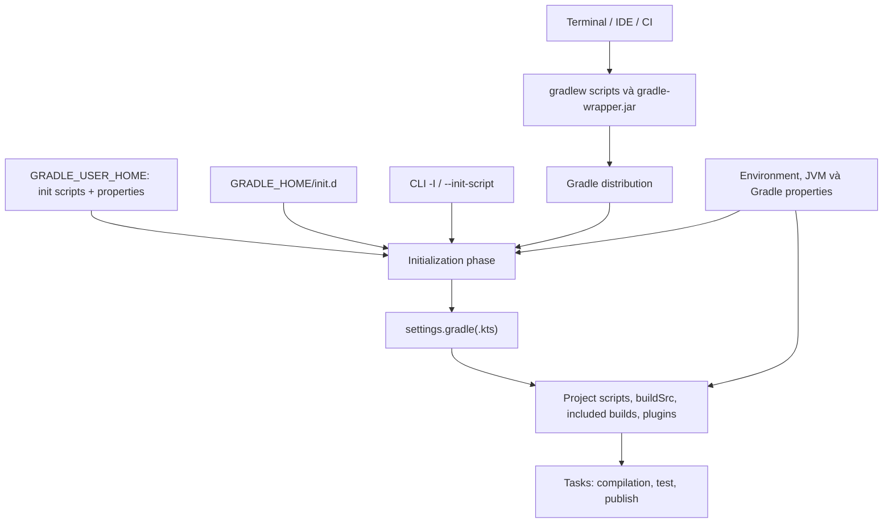

# Rà soát init script, Gradle User Home và cấu hình toàn máy để bảo đảm an toàn build

Trong Gradle, **mã ảnh hưởng tới build không chỉ nằm trong repository**. Một thư mục `GRADLE_USER_HOME` của người dùng có thể chứa init scripts tự chạy, `gradle.properties` có mức ưu tiên cao hơn file dự án, downloaded Gradle distributions, plugin/dependency caches và daemon logs. Tương tự, Gradle installation có thể chứa init scripts riêng; IDE hoặc CI có thể thêm `-I`, JVM flags hoặc biến môi trường. Vì thế hai máy checkout cùng commit, dùng cùng `build.gradle`, vẫn có thể resolve dependency hoặc thực thi task khác nhau.

Bài Knowledge **“Rà soát init script, Gradle User Home và cấu hình toàn máy”** thuộc nhóm **An toàn build** của **Build Tool Gradle**. Mục tiêu là hiểu và kiểm soát **các cấu hình thực thi bên ngoài Git**: vị trí, thứ tự phát hiện, phạm vi tác động, quyền ghi, nguy cơ tải/chạy code ngoài ý muốn, lộ secrets và cách tái tạo kết quả bằng môi trường đáng tin.

Bạn sẽ học cách rà soát `init.gradle(.kts)`, `init.d`, `-I`, Gradle distribution, `gradle.properties`, `GRADLE_OPTS`/`JAVA_HOME`, Wrapper, repository mirrors, CI runners và cache restore. Phần lab dùng **Gradle Wrapper 8.10.2 + Java 17**, có một **init script vô hại**, User Home thử nghiệm độc lập, file Groovy/Kotlin DSL đầy đủ, lệnh `javac`/`java` và stdout xác định.

**Luận điểm bảo mật:** Init script là **executable build code chạy với quyền của tài khoản Gradle**, không phải metadata vô hại. Trước khi chạy một build đáng ngờ, ưu tiên inventory bằng lệnh **chỉ đọc**; `./gradlew help` vẫn có thể thực thi initialization/configuration code.

## 1. Các nguồn executable input của Gradle



Một build chịu tác động của nhiều trust boundaries:

- **Wrapper/bootstrap**: shell/batch script và Wrapper JAR là code trước khi Gradle thực sự start.
- **Gradle distribution**: binary/version được Wrapper tải hoặc installation cung cấp.
- **Initialization**: scripts từ CLI, User Home và Gradle distribution.
- **Settings**: project graph, plugin/dependency repositories.
- **Project/plugins**: tasks, compiler flags, sources, publication.
- **Môi trường**: Gradle User Home, JVM, toolchain, OS/CI secrets và proxy.

Không có một file `build.gradle` nào chứng minh toàn bộ chain là đáng tin. `git status` sạch chỉ nói về tracked/untracked workspace theo Git; nó không rà soát user-level script hoặc CI image.

## 2. Init script là gì?

Init script được viết bằng **Groovy** hoặc **Kotlin DSL**, thực thi trong **initialization phase**, trước khi project build scripts được evaluate. Nó có thể cấu hình Gradle invocation và đăng ký callbacks.

Những callback thường gặp:

- `gradle.beforeSettings { ... }` — trước khi settings được evaluate.
- `gradle.settingsEvaluated { ... }` — sau khi settings hoàn thành.
- `gradle.projectsLoaded { ... }` — khi Project instances đã tồn tại.
- `gradle.beforeProject { ... }` hoặc lifecycle API tương ứng — khi project chuẩn bị configure.

Init script có thể áp dụng **init plugin** với target `Plugin<Gradle>`; đó là scope khác với `Plugin<Project>` và `Plugin<Settings>`. Theo Gradle docs, init script **không thể trực tiếp coi `buildSrc` của target build là classpath đã có sẵn**, vì nó chạy rất sớm.

Các mục đích hợp pháp: enterprise repository mirror, proxy setup, JVM/SDK path theo máy, CI telemetry, cache retention policy, logger hoặc tooling tích hợp doanh nghiệp.

Các nguy cơ: tự tải executable plugin classpath, thay repository resolution, ghi file ngoài build outputs, chạy process, thay compiler/test settings, vô hiệu quality checks, đọc/log credentials hoặc persistence qua `init.d`.

**Không mặc định một init script do doanh nghiệp quản trị là độc hại.** Điều cần xác minh là source, owner, version, permission, dependencies, behavior và rollback. Nhưng cũng không chấp nhận một file chỉ vì tên chứa “security” hoặc “company”.

## 3. Nguồn init script và thứ tự phát hiện

Theo tài liệu **Initialization Scripts and Init Plugins**, các nguồn được liệt kê theo thứ tự:

1. **CLI** `-I path/to/audit.init.gradle` hoặc `--init-script path/to/audit.init.gradle.kts`. Có thể khai báo nhiều `-I`.
2. **Root của Gradle User Home**: `GRADLE_USER_HOME/init.gradle` hoặc `init.gradle.kts`.
3. **User Home init.d**: `GRADLE_USER_HOME/init.d/*.init.gradle` và `*.init.gradle.kts`, alphabetically trong cùng directory.
4. **Gradle installation init.d**: `GRADLE_HOME/init.d/` với naming rule tương ứng, alphabetically.

**Tất cả scripts tìm thấy đều có thể chạy.** Dùng `-I` **không loại trừ** User Home init scripts hoặc distribution init scripts.

Ví dụ:

```text
~/.gradle/
├── init.gradle
└── init.d/
    ├── 10-company.init.gradle
    └── 20-audit.init.gradle.kts

<Gradle distribution>/init.d/
└── managed.init.gradle

CLI:
  ./gradlew -I local-audit.init.gradle help
```

Một invocation như trên có thể sử dụng cả các script đã được chỉ định lẫn scripts được auto-discovered. File `local-audit.init.gradle` ở repo root **không tự chạy** nếu không có `-I` hoặc một cơ chế áp dụng khác.

### Thứ tự phát hiện không phải mọi precedence rule

Dù script A chạy trước script B, kết quả cuối còn phụ thuộc lifecycle hooks, `Property.convention` so với `Property.set`, plugin application, task configuration và khi values được finalized. Không suy từ danh sách discovery ra quy tắc “last script wins toàn bộ”.

### Init script có thể tác động trước project settings

Một script đăng ký `beforeSettings` có thể làm việc trước nội dung settings; `settingsEvaluated` nhìn được tên root project sau khi file settings chạy. Do đó một thay đổi ở User Home có thể ảnh hưởng build mà không sửa `settings.gradle` trong Git.

## 4. Gradle User Home khác Gradle Home và project root

| Vị trí | Vai trò | Điều cần kiểm |
| --- | --- | --- |
| `GRADLE_USER_HOME` | Cấu hình toàn user, init scripts, shared caches, daemon logs, distributions, JDKs | ACL/owner, secrets, scripts ngoài Git |
| `GRADLE_HOME` | Gradle installation hoặc distribution | `init.d`, version/binary provenance |
| `<project>/.gradle` | Cache/state của riêng project | Configuration cache, task execution history |
| `<project>/build` | Output classes/JAR/reports | Không phải global init scripts |
| `gradle/wrapper` trong Git | Wrapper source files | Wrapper JAR, distribution URL và checksum |
| `GRADLE_USER_HOME/wrapper/dists` | Downloaded distributions | Thường được tạo từ Wrapper bootstrap |

Sơ đồ Gradle User Home:

```text
GRADLE_USER_HOME/
├── init.gradle
├── init.gradle.kts
├── init.d/
│   ├── 10-corporate.init.gradle
│   └── 20-tooling.init.gradle.kts
├── gradle.properties
├── caches/
│   ├── modules-2/
│   ├── build-cache-1/
│   ├── <gradle-version>/
│   └── transforms-*/
├── daemon/<version>/
├── wrapper/dists/
└── jdks/
```

Các directory cache cụ thể có thể đổi theo Gradle version. **Không xem toàn bộ `~/.gradle` là cache để xóa.** Nó còn có executable scripts, user settings, credentials có thể có và bằng chứng audit.

`GRADLE_USER_HOME` mặc định thường ở `~/.gradle` (Linux/macOS) hoặc `C:\Users\<user>\.gradle` (Windows), nhưng có thể được đặt lại qua environment/CLI/integration. `GRADLE_HOME` không phải đường dẫn đó; nó là Gradle installation/distribution.

### Những CLI options về đường dẫn

```bash
./gradlew --gradle-user-home audit-home help
./gradlew -g audit-home help
./gradlew --project-dir demo/app help
./gradlew --project-cache-dir .gradle-custom help
```

Các lệnh chỉ minh họa syntax (đường dẫn cần tồn tại và được xác minh). `-g` chọn User Home; `--project-dir` chọn project starting directory; `--project-cache-dir` chọn project-local cache dir. Không dùng nhầm `--project-cache-dir` để cô lập global init scripts.

**Lưu ý Wrapper bootstrap:** nếu muốn cô lập từ thời điểm Gradle Wrapper tải distribution, đặt biến môi trường `GRADLE_USER_HOME` **trước khi gọi `gradlew`**, không chỉ dựa vào `-g` được Gradle runtime xử lý. Tuy vậy, thay User Home **không sandbox** Gradle distribution-level init scripts hoặc project scripts.

## 5. gradle.properties: mức ưu tiên và rủi ro ngoài Git

Gradle đọc cấu hình từ nhiều nơi:

- `GRADLE_USER_HOME/gradle.properties`.
- Root project `gradle.properties`.
- `GRADLE_HOME/gradle.properties`.
- CLI flags, JVM system properties, environment variables.

**Đừng dùng một bảng precedence chung cho mọi property**: Gradle properties, project properties, system properties và Java launcher options là các cơ chế khác nhau.

### Với Gradle properties

Các thuộc tính như `org.gradle.caching`, `org.gradle.jvmargs` hoặc `org.gradle.java.home` có độ ưu tiên phổ biến theo docs:

1. Command line phù hợp, ví dụ `-Dorg.gradle.caching=true`.
2. User Home `gradle.properties`.
3. Root project `gradle.properties`.
4. Installation `gradle.properties`.

Giá trị user-level có thể override project file dù Git chưa thay đổi.

### Với project properties

Với tên thử nghiệm `safeMarker`, độ ưu tiên từ cao xuống thấp:

1. `-PsafeMarker=cli`.
2. `-Dorg.gradle.project.safeMarker=system`.
3. Environment `ORG_GRADLE_PROJECT_safeMarker`.
4. User Home `gradle.properties`.
5. Project/root `gradle.properties`.
6. Gradle installation `gradle.properties`.

Đây là precedence của **project properties**. Một số dynamic lookup như `Project.findProperty` còn có logic về extra properties/extensions/tasks/parent Project; dùng `providers.gradleProperty("safeMarker")` để tránh pha trộn không cần thiết.

### System properties và daemon JVM

- `-Dhttp.proxyHost=...` hoặc `systemProp.http.proxyHost=...` là system property.
- `org.gradle.jvmargs` điều chỉnh daemon JVM arguments.
- `JAVA_HOME` thường xác định JVM mà wrapper/client khởi động.
- `org.gradle.java.home` có thể chọn JVM khác cho daemon.
- Java toolchain cho `JavaCompile` có thể khác daemon JVM.
- IDE/tooling API có thể dùng JVM tùy chỉnh.

Trong multi-project build, `systemProp` đặt trong subproject-level `gradle.properties` không phải nguồn config toàn build như root file. Rà soát nơi properties thực sự được đọc, không chỉ grep tên trong toàn repository.

### Secrets không được dump

`gradle.properties` cấp user có thể chứa credentials. **Không in nguyên file**, không đưa values vào Build Scan, public CI logs hoặc issue tracker. Chỉ review key names/sources với redaction; dùng secret manager và ACL đúng quyền.

## 6. Environment và JVM options cần kiểm

| Input | Vì sao liên quan? |
| --- | --- |
| `GRADLE_USER_HOME` | Đổi nguồn global init scripts/properties/caches |
| `GRADLE_OPTS` | JVM flags của Gradle client; có thể chuyển daemon options |
| `JAVA_OPTS` | Java launcher options |
| `JAVA_TOOL_OPTIONS`, `_JAVA_OPTIONS` | JVM-wide options |
| `JAVA_HOME` | Java dùng khởi động Gradle, trừ override |
| `ORG_GRADLE_PROJECT_*` | Project properties qua env, có thể mang secrets |
| CI runner variables | Có thể điều khiển paths, plugin behavior hoặc proxy |

Không dùng `env` hoặc `Get-ChildItem Env:` với values trong log chia sẻ để rà soát. Các lệnh inventory chỉ **in tên biến** trong phần sau.

### Phân biệt ba Java/Gradle versions

1. **Gradle distribution version**, thường do Wrapper pin.
2. **Gradle daemon JVM**, nơi Gradle thực thi build logic.
3. **Java toolchain compiler/launcher** cho project Java code.

Một project Java 17 có thể được build bởi Gradle daemon chạy trên JDK tương thích khác theo policy. Điều cần đảm bảo là cấu hình thực tế đúng và đáng tin; kiểm `./gradlew --version`, `javaToolchains` và IDE Gradle JVM **chỉ trong môi trường đã được xác minh**.

## 7. Những hành vi cần review trong init scripts

| Dấu hiệu | Phân tích |
| --- | --- |
| `initscript { repositories; dependencies }` | Nạp classpath executable từ đâu? Version/checksum có được kiểm không? |
| `beforeSettings`, `settingsEvaluated`, `beforeProject` | Hook ảnh hưởng phần nào của settings/projects? |
| `pluginManagement`/`repositories`/`mavenLocal()` | Có thay nguồn dependency/plugin resolution không? |
| Process/Exec/HTTP code | Có chạy lệnh hoặc gửi dữ liệu ra ngoài trước task gates? |
| Filesystem writes | Có sửa source, caches, init.d, build outputs? |
| Gradle/system/environment properties | Có đọc/log secrets hoặc thay behavior? |
| Task mutation | Có disable tests, thay Java flags, publish URL không? |
| Build Scan/telemetry | Data collection và redaction có được duyệt? |
| Static mutable state | Có gây cross-build/race behavior? |
| Init plugins | Artifact implementation và scope `Plugin<Gradle>` được review? |
| Permissions | Ai có thể sửa script hoặc parent directory? |

Một mirror nội bộ được quản lý là hợp lệ nếu có change control. Một file mang tên đáng tin nhưng tự tải plugin từ host lạ thì cần điều tra. **Không chỉ tìm từ khóa**: code có thể gián tiếp gọi thư viện khác.

## 8. Inventory chỉ đọc trên Linux/macOS

Khi nghi ngờ init script bị sửa, **không chạy Gradle để xem thử**. Lệnh đọc file-system có thể thực hiện trước khi Gradle thực thi bất kỳ build code nào.

### Xác định home

```bash
printf 'Default User Home: %s\n' "$HOME/.gradle"
if test -n "$GRADLE_USER_HOME"; then
  printf 'GRADLE_USER_HOME env is set\n'
else
  printf 'GRADLE_USER_HOME env is not set\n'
fi
```

Nếu env được set, kiểm path thật qua terminal/runner configuration phù hợp. Ngoài ra `-g`, `-Dgradle.user.home` hoặc IDE arguments có thể đổi home. Đừng coi default path là luôn đúng.

### Liệt kê init files

Sau khi đã xác minh User Home path:

```bash
GUH="$HOME/.gradle"
# Thay GUH bằng đường dẫn thật nếu Gradle dùng User Home tùy chỉnh.
find "$GUH" -maxdepth 2 -type f \
  \( -name 'init.gradle' -o -name 'init.gradle.kts' \
  -o -name '*.init.gradle' -o -name '*.init.gradle.kts' \) \
  -print
```

`find` chỉ in filenames; nó không evaluate scripts. Nếu folder không tồn tại, có thể có lỗi hoặc kết quả rỗng, không tự coi đó là bằng chứng “không có init script” ở Gradle installation.

Xem nội dung một file **đã xác nhận tồn tại**:

```bash
sed -n '1,160p' "$GUH/init.d/10-corporate.init.gradle"
```

Khi scripts chứa credentials, không đưa nội dung chưa redacted vào logs/chat. Đừng làm `cat "$GUH/gradle.properties"` vào public build log.

### Permissions và ownership

```bash
ls -ld "$GUH"
ls -ld "$GUH/init.d"
ls -l "$GUH/init.d"
```

Quyền ghi vào **directory** quan trọng như quyền ghi vào file; tùy OS, một user có quyền ghi directory có thể thay thế file dù file permissions trông chặt.

### Kiểm tên environment variables, không in values

```bash
printenv | cut -d= -f1 \
  | grep -E '^(GRADLE_|ORG_GRADLE_PROJECT_|JAVA_HOME$|JAVA_OPTS$|JAVA_TOOL_OPTIONS$|_JAVA_OPTIONS$)' \
  | sort
```

Đây là inventory tên biến, tránh lộ tokens trong values.

## 9. Inventory chỉ đọc trên PowerShell

```powershell
$guh = Join-Path $env:USERPROFILE '.gradle'
Write-Output ("Default User Home: " + $guh)
Write-Output ("Custom Home configured: " + [bool]$env:GRADLE_USER_HOME)

Get-ChildItem -LiteralPath $guh -File -ErrorAction SilentlyContinue |
    Where-Object { $_.Name -match '^init\.gradle(\.kts)?$' } |
    Select-Object -ExpandProperty FullName

$initD = Join-Path $guh 'init.d'
Get-ChildItem -LiteralPath $initD -File -ErrorAction SilentlyContinue |
    Where-Object { $_.Name -match '\.init\.gradle(\.kts)?$' } |
    Select-Object -ExpandProperty FullName

Get-Acl -LiteralPath $guh | Format-List

Get-ChildItem Env: |
    Where-Object {
      $_.Name -match '^(GRADLE_|ORG_GRADLE_PROJECT_|JAVA_HOME$|JAVA_OPTS$|JAVA_TOOL_OPTIONS$|_JAVA_OPTIONS$)'
    } |
    Select-Object -ExpandProperty Name
```

Những lệnh này chỉ liệt kê/read. Nếu `GRADLE_USER_HOME` đã đổi, cập nhật `$guh` theo path được xác minh; nếu `init.d` chưa có, danh sách rỗng là bình thường. Xem thêm ACL của `initD` và files, không thay chúng ngay khi chưa có quyền/quy trình.

### Đừng bỏ nguồn init scripts khác

Rà soát `GRADLE_HOME/init.d` của distribution được dùng, explicit `-I` trong CI YAML/shell/IDE và Wrapper bootstrap. Scan User Home một mình **không đủ**.

## 10. Wrapper và chuỗi cung ứng build

Trước khi tin lệnh `./gradlew`, cần kiểm:

```text
gradlew
gradlew.bat
gradle/wrapper/gradle-wrapper.jar
gradle/wrapper/gradle-wrapper.properties
```

- `distributionUrl` trỏ đúng HTTPS release/mirror đã duyệt.
- Gradle version pin, không dùng URL tùy tiện.
- `distributionSha256Sum` khớp **bản Gradle ZIP đúng version** từ nguồn checksum đáng tin độc lập.
- `gradle-wrapper.jar` khớp official Gradle Wrapper binary, kiểm SHA/checksums riêng.
- Những thay đổi Wrapper/CI commands cần code review.

**Caveat:** `distributionSha256Sum` được kiểm khi Wrapper download distribution mới; nó không tự verify lại mọi cached distribution ở mỗi invocation. Wrapper JAR integrity là chuyện riêng. Không thêm một checksum giả chỉ để có field `distributionSha256Sum`.

Dependency verification giúp quản lý resolved external modules, nhưng **không sandbox init script đã được chạy**. Init script classpath có thể là executable code từ repository ngoài; phải review riêng.

## 11. CI runner và global init scripts: bài học về persistence

Nếu CI runner tái sử dụng `GRADLE_USER_HOME`:

1. Một job untrusted có quyền ghi vào `init.d`.
2. Job sau chạy Gradle cùng User Home.
3. Script từ job trước có thể được tự động thực thi trong job trusted, dù repository mới không đổi.
4. Secrets của job trusted có thể gặp rủi ro.

Biện pháp:

- Chọn **User Home cô lập theo job/trust domain**.
- Không restore nguyên `GRADLE_USER_HOME` từ untrusted cache; đặc biệt exclude `init.d` và user-level `gradle.properties` có secrets.
- Enterprise init scripts phải được provision từ trusted, versioned image/automation.
- Không cấp release credentials cho forked PR; dùng read-only remote cache phù hợp.
- Kiểm CI cache ACL và writable mounts, không chia writable home giữa isolated containers nếu không có cơ chế an toàn.
- Có log inventory/manifest/hashes cho approved global scripts.
- Dùng short-lived secrets; không ghi secrets vào cache/build outputs.
- Nếu nghi compromise, quarantine runner và rotate credentials theo incident policy.

**`--no-daemon` không tắt init scripts. `--offline` không sandbox JVM code. `clean` không xóa global init scripts.** Đừng dùng ba thao tác ấy thay cho CI isolation.

## 12. Lab Java 17: tạo một home cô lập và quan sát init script

Đây là project **Gradle Wrapper 8.10.2 + Java 17**, không phụ thuộc external application libraries. Chỉ tạo script **vô hại** và đặt trong workspace lab, **không sửa `~/.gradle/init.d` thật**.

### Cấu trúc

```text
init-audit-lab/
├── settings.gradle
├── build.gradle
├── gradle.properties
├── audit.init.gradle
├── gradlew
├── gradlew.bat
├── gradle/wrapper/
│   ├── gradle-wrapper.jar
│   └── gradle-wrapper.properties
├── src/main/java/demo/audit/Main.java
└── audit-home/
    ├── gradle.properties
    ├── init.d/
    └── ... caches được tạo khi chạy
```

`audit-home` chỉ phục vụ thử nghiệm, nên thêm `audit-home/` và `manual-classes/` vào `.gitignore`. Wrapper files phải được sinh/commit thật bằng Gradle Wrapper; đừng tạo JAR giả.

### `settings.gradle`

```groovy
rootProject.name = 'init-audit-lab'
```

### `gradle.properties` root

```properties
safeMarker=project
```

Đây là project property vô hại để quan sát precedence. **Không dùng token/password** làm demo rồi in giá trị.

### `build.gradle` Groovy DSL

```groovy
plugins {
    id 'application'
}

java {
    toolchain {
        languageVersion = JavaLanguageVersion.of(17)
    }
}

tasks.withType(JavaCompile).configureEach {
    options.encoding = 'UTF-8'
    options.release = 17
}

application {
    mainClass = 'demo.audit.Main'
}

def safeMarker = providers.gradleProperty('safeMarker')
    .orElse('unset')

tasks.register('showMarker') {
    group = 'verification'
    description = 'Print a non-secret property'
    inputs.property('safeMarker', safeMarker)
    doLast {
        println 'SAFE_MARKER=' + safeMarker.get()
    }
}
```

`showMarker` dùng Gradle Provider cho project property. Task không đọc file User Home trực tiếp và không chứa secret. `application` cho task `run`; JavaCompile dùng UTF-8/`--release 17`.

### `src/main/java/demo/audit/Main.java`

```java
package demo.audit;

public final class Main {
    private Main() {
    }

    private record Message(String value) {
        String render() {
            return "Java 17 ready: " + value;
        }
    }

    public static void main(String[] args) {
        System.out.println(new Message("isolated Gradle").render());
        System.out.println("No external dependencies");
    }
}
```

Java 17 nested `record` làm chương trình yêu cầu Java 17+; không dùng environment/network nên stdout Java main cố định.

### `audit.init.gradle` Groovy DSL

```groovy
// Script audit vô hại: chỉ in marker, không thay build model.
println 'INIT_AUDIT loaded'

gradle.settingsEvaluated { settings ->
    println 'INIT_AUDIT root=' + settings.rootProject.name
}
```

File đặt ở **project root** không tự chạy chỉ vì có tên `audit.init.gradle`. Khi truyền `-I` hoặc copy đúng tên vào User Home `init.d` thì Gradle mới áp dụng nó theo discovery rules.

### Tạo Wrapper

Với project mới, máy có trusted Gradle installation phù hợp:

```bash
gradle wrapper --gradle-version 8.10.2 --distribution-type bin
```

Commit đủ Wrapper files và verify checksum/JAR. **Ngay cả lệnh tạo Wrapper cũng chạy Gradle và có thể load global init scripts hiện tại**, nên chỉ thực hiện bootstrap trên môi trường đã tin cậy.

### Linux/macOS — thiết lập User Home thử nghiệm

Tại root lab:

```bash
mkdir -p audit-home/init.d
printf 'safeMarker=user-home\n' > audit-home/gradle.properties
```

Dùng env var **ngay trước khi Wrapper chạy**:

```bash
GRADLE_USER_HOME="$PWD/audit-home" ./gradlew -q showMarker
```

Stdout khi `audit-home/init.d` còn rỗng:

```text
SAFE_MARKER=user-home
```

Root property `safeMarker=project` bị user-level property `safeMarker=user-home` override theo Gradle property precedence.

### Linux/macOS — explicit init script

```bash
GRADLE_USER_HOME="$PWD/audit-home" \
  ./gradlew -I audit.init.gradle -q showMarker
```

Stdout **do init script và task lab in**:

```text
INIT_AUDIT loaded
INIT_AUDIT root=init-audit-lab
SAFE_MARKER=user-home
```

Có hai marker từ init script và một marker từ task. Chúng không phải output mặc định của Gradle.

### Linux/macOS — automatic init.d discovery

```bash
cp audit.init.gradle audit-home/init.d/10-audit.init.gradle
GRADLE_USER_HOME="$PWD/audit-home" ./gradlew -q showMarker
```

Stdout vẫn:

```text
INIT_AUDIT loaded
INIT_AUDIT root=init-audit-lab
SAFE_MARKER=user-home
```

Lần này **không có `-I`**, vì script đã ở auto-discovery directory. **Không truyền cả `-I audit.init.gradle`** khi bản copy auto vẫn tồn tại nếu không muốn marker bị lặp.

### Override bằng command-line -P

```bash
GRADLE_USER_HOME="$PWD/audit-home" \
  ./gradlew -PsafeMarker=cli -q showMarker
```

Stdout khi auto script vẫn còn:

```text
INIT_AUDIT loaded
INIT_AUDIT root=init-audit-lab
SAFE_MARKER=cli
```

`-P` thắng user/project properties. Không có việc init script tự sửa marker; script chỉ log tên root.

### Chạy Java app qua Gradle

```bash
GRADLE_USER_HOME="$PWD/audit-home" ./gradlew -q run
```

Stdout:

```text
INIT_AUDIT loaded
INIT_AUDIT root=init-audit-lab
Java 17 ready: isolated Gradle
No external dependencies
```

Hai dòng đầu do init script in; hai dòng cuối do `Main.main`. Không có init script auto/explicit thì chỉ có hai dòng Java main.

### PowerShell tương đương

```powershell
New-Item -ItemType Directory -Force -Path 'audit-home\init.d' | Out-Null
Set-Content -LiteralPath 'audit-home\gradle.properties' -Value 'safeMarker=user-home' -Encoding ASCII
$oldHome = $env:GRADLE_USER_HOME
$env:GRADLE_USER_HOME = (Resolve-Path './audit-home').Path

.\gradlew.bat -q showMarker
.\gradlew.bat -I audit.init.gradle -q showMarker
Copy-Item -LiteralPath 'audit.init.gradle' -Destination 'audit-home\init.d\10-audit.init.gradle'
.\gradlew.bat -q showMarker
.\gradlew.bat -PsafeMarker=cli -q showMarker
.\gradlew.bat -q run

if ($null -eq $oldHome) {
    Remove-Item Env:GRADLE_USER_HOME -ErrorAction SilentlyContinue
} else {
    $env:GRADLE_USER_HOME = $oldHome
}
```

Các lệnh tương đương từng bước Linux/macOS. Đổi environment về trạng thái cũ sau lab. `audit-home` ở workspace là thử nghiệm, không phải User Home thật.

## 13. Java 17 chạy độc lập bằng javac/java

Để phân biệt Java logic khỏi Gradle init:

Linux/macOS:

```bash
mkdir -p manual-classes
javac --release 17 -encoding UTF-8 -d manual-classes src/main/java/demo/audit/Main.java
java -cp manual-classes demo.audit.Main
```

PowerShell:

```powershell
New-Item -ItemType Directory -Force -Path manual-classes | Out-Null
javac --release 17 -encoding UTF-8 -d manual-classes src/main/java/demo/audit/Main.java
java -cp manual-classes demo.audit.Main
```

Stdout **chính xác**:

```text
Java 17 ready: isolated Gradle
No external dependencies
```

`javac`/`java` không đọc `build.gradle` hoặc Gradle init scripts, nên không in `INIT_AUDIT`. Nhưng việc Java chạy được không xác minh Gradle Wrapper/infrastructure an toàn.

## 14. Kotlin DSL thay thế

Để dùng Kotlin DSL, giữ Java source và `gradle.properties`, thay từng Groovy script bằng file Kotlin cùng vai trò.

`settings.gradle.kts`:

```kotlin
rootProject.name = "init-audit-lab"
```

`build.gradle.kts`:

```kotlin
plugins {
    application
}

java {
    toolchain {
        languageVersion.set(JavaLanguageVersion.of(17))
    }
}

tasks.withType<JavaCompile>().configureEach {
    options.encoding = "UTF-8"
    options.release.set(17)
}

application {
    mainClass.set("demo.audit.Main")
}

val safeMarker = providers.gradleProperty("safeMarker").orElse("unset")

tasks.register("showMarker") {
    group = "verification"
    description = "Print a non-secret property"
    inputs.property("safeMarker", safeMarker)
    doLast {
        println("SAFE_MARKER=" + safeMarker.get())
    }
}
```

`audit.init.gradle.kts`:

```kotlin
println("INIT_AUDIT loaded")

gradle.settingsEvaluated {
    println("INIT_AUDIT root=" + rootProject.name)
}
```

Chạy:

```bash
GRADLE_USER_HOME="$PWD/audit-home" ./gradlew -I audit.init.gradle.kts -q showMarker
```

Nếu muốn auto-discovery, copy **chỉ Kotlin script** vào `audit-home/init.d/10-audit.init.gradle.kts`; không giữ đồng thời bản Groovy và Kotlin cùng in marker khi đối chiếu stdout một bộ. **Kotlin DSL cũng có khả năng thực thi code và không sandbox script không đáng tin.**

## 15. Isolated User Home không đồng nghĩa máy được sandbox

Home thử nghiệm tách biệt giúp kiểm:

- User-level init/script/property khác project config thế nào.
- Một init.d script được Gradle tự nhận diện ra sao.
- Root `gradle.properties` có đang bị override không.
- Build có phụ thuộc caches/distributions của tài khoản khác không.

Nhưng nó **không loại trừ**:

- Distribution `GRADLE_HOME/init.d`.
- Explicit `-I` do CLI/IDE/CI truyền.
- Gradle Wrapper script/JAR bị sửa.
- Project settings/build scripts và plugins.
- OS/JVM/proxy/network configuration.
- Source code hoặc external dependencies không đáng tin.

Đây là một **phép thử khoanh vùng**, không phải chứng chỉ môi trường an toàn. Với code chưa tin, hãy dùng trusted container/VM/runner, network ACL và review source theo security policy.

## 16. Các flags không phải công cụ sandbox

| Lệnh | Chức năng thật | Không làm |
| --- | --- | --- |
| `./gradlew clean` | Xóa configured build outputs | Không chặn init scripts |
| `--offline` | Không truy cập mạng để resolve dependencies | Không ngăn mọi code mở network/process |
| `--no-daemon` | Thay Gradle daemon lifecycle | Không bỏ initialization |
| `--no-build-cache` | Không reuse task output cache | Không kiểm script integrity |
| `--no-configuration-cache` | Không reuse configuration cache | Vẫn evaluate scripts |
| `-I audit.init.gradle` | Thêm explicit init script | Không loại auto scripts |
| `-g audit-home` | Chọn runtime User Home | Không bỏ distribution/init scripts |
| `--refresh-dependencies` | Kiểm dependency metadata mới | Không audit scripts |

Không khắc phục sự cố init script bằng cách chỉ xóa Gradle cache hoặc chạy `clean`.

## 17. Đặt chính sách ở đâu cho dễ kiểm toán?

| Nhu cầu | Lựa chọn phù hợp |
| --- | --- |
| Java toolchain, quality gates theo module | Versioned convention plugin trong build-logic |
| Plugin/dependency repositories cho một build | `settings.gradle(.kts)` hoặc Settings plugin |
| Project graph, included builds | Settings trong Git |
| Proxy, SDK paths riêng cho máy | User-level config có owner, không commit secrets |
| Corporate mirror dùng nhiều repositories | Managed init script/init plugin với review/version/ACL |
| CI build environment | Pinned runner image, Wrapper và secrets policy |
| User Home cache retention | Approved User Home init script |
| Release signing/publishing | Trusted CI jobs, registry credentials quản lý tập trung |

Một project-level rule thuộc source nên được version cùng source. Init scripts phù hợp với **chính sách môi trường** có trách nhiệm quản trị rõ, không phải nơi mặc định để giấu mọi build logic.

## 18. Chẩn đoán sự cố thực tế

| Triệu chứng | Lớp nghi vấn | Hành động |
| --- | --- | --- |
| Repo Git sạch nhưng hai máy resolve khác | User init, repositories, JVM, properties | So inventories/versions |
| `help` in thông báo lạ | Init hoặc build script top-level | Đọc scripts trước khi chạy lại |
| CI publish nhầm repository | User/global properties, init hooks, env | Dừng release và audit |
| `-I` vẫn in marker khác | Có additional auto init scripts | Rà soát mọi discovery locations |
| Thay root `gradle.properties` không có tác dụng | User/CLI/env override | Xem precedence của key |
| Xóa `build/` mà lỗi vẫn còn | Global init/properties không nằm trong build | Không tiếp tục clean vô ích |
| Java compiler khác khi dùng IDE | IDE Gradle JVM, daemon, toolchains | Check từng Java layer |
| CI chỉ fail trên persistent runner | Shared User Home hoặc cache state | Test trong trusted isolated runner |
| Wrapper JAR checksum không khớp | Tampering/version mismatch | Stop execution, verify official source |
| Plugin repo thay bất ngờ | Init script hoặc settings injection | Audit init classpath/repository |
| TestKit pass nhưng CI không pass | TestKit isolated User Home | Compare CI global scripts |
| `--offline` vẫn có side effect | Init/build code vẫn chạy | Không coi offline là sandbox |

**Một dấu hiệu không đủ kết luận malicious activity.** Có thể là enterprise config hợp pháp hoặc IDE setting riêng. Cần nguồn gốc, quyền ghi, approved policy và bằng chứng cụ thể.

## 19. Runbook khi phát hiện init script lạ

Không nên ngay lập tức:

- Chạy `./gradlew help` để quan sát hành vi.
- Download thêm script từ Internet để “sửa lỗi”.
- Log toàn bộ environment, user `gradle.properties` hoặc secret.
- Xóa toàn `~/.gradle` làm mất bằng chứng.
- Cấp thêm quyền CI/disable security check để build pass.

Nên làm:

1. Dừng jobs trên runner/account đáng ngờ, đặc biệt jobs có release credentials.
2. Inventory files, SHA-256, owners, timestamps và permissions bằng công cụ chỉ đọc.
3. Xác định scripts đến từ quản trị IT, IDE/tool installer, CI image hay thay đổi không rõ.
4. Review init script classpath, plugin dependencies, network/process/filesystem operations ở môi trường cô lập.
5. So với approved baseline của tổ chức; không phụ thuộc tên file.
6. Nếu có nguy cơ lộ secrets, revoke/rotate theo incident response.
7. Preserve evidence trước khi gỡ/quarantine.
8. Rebuild trên trusted image/User Home/Wrapper và so artifact hashes.
9. Kiểm distribution init.d, explicit CLI -I, env/JVM và CI restore còn persistence không.
10. Khoá quyền ghi và đưa init scripts vào quy trình versioned review.

Không được tuyên bố “sạch” chỉ vì script đã bị xóa: nó có thể được tạo lại qua startup automation hoặc nằm ở một nguồn khác.

## 20. Checklist QA cho môi trường Gradle

- [ ] Đã xác định Gradle User Home và installation directory thực.
- [ ] Đã đọc inventory `init.gradle(.kts)`, User Home `init.d` và distribution `init.d`.
- [ ] Đã kiểm explicit `-I` trong shell/IDE/CI.
- [ ] Đã kiểm owner/ACL và quyền ghi parent directories.
- [ ] Đã review `initscript` classpath, plugin deps và repositories.
- [ ] Đã kiểm user/root/installation `gradle.properties` với redaction.
- [ ] Đã kiểm `-P`, `-D`, `ORG_GRADLE_PROJECT_*` và JVM env options.
- [ ] Đã xác minh Gradle Wrapper JAR/distribution SHA-256.
- [ ] Đã kiểm Java daemon JVM và Java toolchain riêng.
- [ ] Đã kiểm proxy, mirrors và dependency verification.
- [ ] CI dùng home tách biệt giữa trust domains; không cache executable global config từ untrusted jobs.
- [ ] Secrets không lọt vào logs, task output, cache hoặc Build Scan.
- [ ] Có trusted isolated reproduction environment và incident/rollback process.
- [ ] Enterprise scripts có owner, version, review và update policy.

## 21. Bài tập tự kiểm tra có đáp án

**Câu 1.** Init script có chạy trước `build.gradle` không?

**Đáp án:** Có, trong initialization; nó có thể đăng ký callbacks tác động lên settings/projects.

**Câu 2.** `-I` có vô hiệu hóa `GRADLE_USER_HOME/init.d` không?

**Đáp án:** Không. Gradle có thể chạy tất cả script được phát hiện.

**Câu 3.** User Home khác Gradle Home thế nào?

**Đáp án:** User Home chứa global config/scripts/cache cho tài khoản; Gradle Home là distribution/installation.

**Câu 4.** `clean` có xóa init scripts không?

**Đáp án:** Không. Nó thường xử lý build outputs.

**Câu 5.** Vì sao root `gradle.properties` có thể bị override?

**Đáp án:** User-level properties hoặc CLI/env sources có precedence cao hơn tùy loại property.

**Câu 6.** Khi root `safeMarker=project` và user `safeMarker=user-home`, task in gì?

**Đáp án:** `SAFE_MARKER=user-home`.

**Câu 7.** Sau `-PsafeMarker=cli`, task in gì?

**Đáp án:** `SAFE_MARKER=cli`.

**Câu 8.** Stdout explicit init script lab là gì?

**Đáp án:**

```text
INIT_AUDIT loaded
INIT_AUDIT root=init-audit-lab
SAFE_MARKER=user-home
```

**Câu 9.** Java main in gì?

**Đáp án:**

```text
Java 17 ready: isolated Gradle
No external dependencies
```

**Câu 10.** Vì sao `javac`/`java` không có INIT_AUDIT marker?

**Đáp án:** Chúng không chạy Gradle initialization scripts.

**Câu 11.** `--offline` có là sandbox bảo mật không?

**Đáp án:** Không; chủ yếu ảnh hưởng dependency resolution network.

**Câu 12.** `--no-daemon` có ngăn init scripts không?

**Đáp án:** Không; chỉ thay daemon lifecycle.

**Câu 13.** Vì sao không dump `gradle.properties` lên CI log?

**Đáp án:** File có thể chứa tokens, passwords hoặc proxy credentials.

**Câu 14.** Tại sao `gradle-wrapper.jar` cần được verify riêng?

**Đáp án:** Distribution checksum không xác minh Wrapper JAR.

**Câu 15.** `distributionSha256Sum` tự verify lại downloaded ZIP mỗi lần chạy không?

**Đáp án:** Không, cơ chế xác minh gắn với download mới.

**Câu 16.** TestKit có luôn dùng User Home thật của CI không?

**Đáp án:** Không; TestKit thường dùng home cô lập.

**Câu 17.** Ai cần quyền ghi vào init.d trên shared CI runner?

**Đáp án:** Chỉ trusted provisioning/administrators phù hợp, không phải untrusted PR jobs.

**Câu 18.** Vì sao không xóa toàn `~/.gradle` khi có nghi ngờ?

**Đáp án:** Mất credentials/config/đặc biệt evidence và chưa chắc giải quyết root cause.

**Câu 19.** Một User Home mới có sandbox Gradle distribution-level init scripts không?

**Đáp án:** Không.

**Câu 20.** Khi nào convention plugin tốt hơn init script?

**Đáp án:** Khi chính sách thuộc repository/module và cần được version/review cùng source.

**Câu 21.** Dấu hiệu quan trọng nhất của script đáng tin?

**Đáp án:** Có owner/provenance/version/review, permission và dependencies được quản lý, không phải chỉ tên file.

**Câu 22.** Vì sao `git status` sạch không xác nhận môi trường an toàn?

**Đáp án:** Global init scripts, User Home, distribution và environment không nằm trong Git checkout.

**Câu 23.** Với init script có `initscript { dependencies { classpath ... } }`, cần làm gì?

**Đáp án:** Review executable dependencies, repositories, versions và integrity trước khi chạy.

**Câu 24.** Làm gì khi phát hiện unapproved init script trên CI?

**Đáp án:** Ngừng use, preserve evidence, review/quarantine theo policy, rotate secrets nếu nguy cơ leak, rebuild trên trusted runner.

## 22. Tài liệu Gradle chính thức

- [Initialization Scripts and Init Plugins](https://docs.gradle.org/current/userguide/init_scripts.html): init script discovery, lifecycle callbacks, init plugin scope.
- [Gradle-managed Directories and Caches](https://docs.gradle.org/current/userguide/directory_layout.html): User Home, caches, daemon, JDKs, Wrapper distributions.
- [Build Environment Configuration](https://docs.gradle.org/current/userguide/build_environment.html): Gradle/project properties, JVM/env precedence.
- [Command-Line Interface](https://docs.gradle.org/current/userguide/command_line_interface.html): `-I`, `-g`, `-P`, `-D` và project/cache paths.
- [Build Lifecycle](https://docs.gradle.org/current/userguide/build_lifecycle.html): initialization/settings/project hooks.
- [Gradle Wrapper](https://docs.gradle.org/current/userguide/gradle_wrapper.html): Wrapper distribution checksum và JAR validation.
- [Best Practices for Security](https://docs.gradle.org/current/userguide/best_practices_security.html): trust boundaries và review untrusted builds.
- [Securing the Build Tool](https://docs.gradle.org/current/userguide/securing_build_tool.html): global init scripts và persistence risks.
- [Gradle Daemon](https://docs.gradle.org/current/userguide/gradle_daemon.html): daemon JVM, Java home, logs.
- [Java Toolchains](https://docs.gradle.org/current/userguide/toolchains.html): JavaCompile/compiler vs daemon JVM.
- [Dependency Verification](https://docs.gradle.org/current/userguide/dependency_verification.html): dependency integrity.
- [TestKit](https://docs.gradle.org/current/userguide/test_kit.html): plugin tests trong isolated Gradle User Home.

**Kết luận:** Gradle build có thể bị thay đổi bởi **init scripts, user-level properties, Gradle installation, Wrapper, JVM/environment và CI runner state** nằm ngoài Git. Một init script có thể được auto-loaded cho mọi build dùng cùng User Home, nên phải được quản lý như code production. Rà soát file names, owner/ACL, plugin classpath, property sources và Wrapper integrity **trước khi chạy**; dùng User Home cô lập để khoanh vùng nhưng không coi đó là sandbox tuyệt đối.