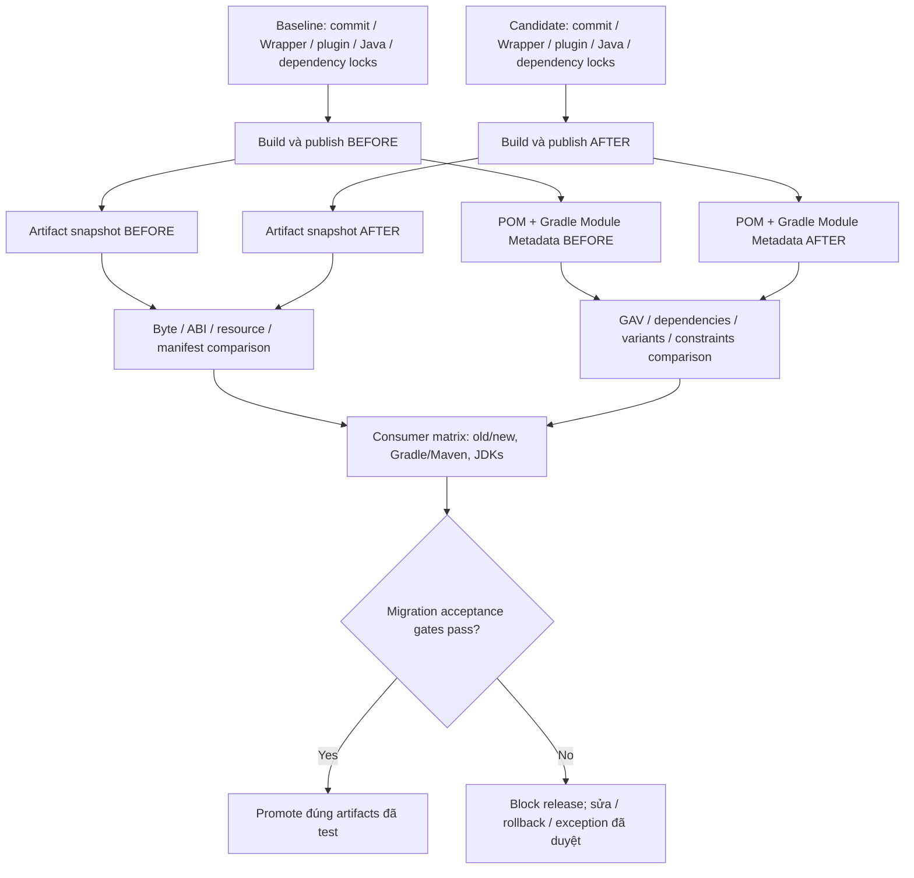

# So sánh artifact, metadata và consumer trước với sau khi nâng cấp hoặc di chuyển Gradle

Khi nâng Gradle Wrapper, thay plugin, chuyển từ `java` sang `java-library`, đổi cách publish hoặc phát hành một phiên bản thư viện mới, câu “`./gradlew build` đã xanh” chỉ nói **producer build chạy thành công trong cấu hình hiện tại**. Nó **chưa chứng minh** file JAR/ZIP được phát hành có nội dung đúng, Maven POM và Gradle Module Metadata không đổi ngoài dự kiến, hay các dự án **consumer** biên dịch và chạy đúng với phiên bản mới.

Ba bề mặt cần kiểm riêng:

1. **Artifact** — các byte thực được tạo, nội dung file, package/classes/resources, manifest, Java bytecode, classifier, checksums, signatures.
2. **Metadata** — tọa độ phát hành (group/artifact/version), POM, Gradle `.module`, variants/attributes, dependencies, constraints, capabilities, target JVM, sources/javadoc và publication repository.
3. **Consumer** — dự án/sản phẩm nhận module: dependency resolution, compile classpath, runtime classpath, source compatibility, binary compatibility, runtime behavior, platform/toolchain và integration tests.

Bài Knowledge **“So sánh artifact, metadata và consumer trước với sau”**, thuộc nhóm **Nâng cấp và di chuyển** của **Build Tool Gradle**, hướng dẫn cách lập baseline, đối chiếu ba lớp, thử consumer cũ/mới, kiểm chứng phiên bản đã publish và quyết định rollout/rollback. Bài có **lab Gradle 8.10.2 + Java 17 chạy được**: hai producers cùng tọa độ thư viện với version `1.0.0` và `2.0.0`, Maven repository local dành riêng cho bài, hai consumers, kiểm tra `jar`/`javap`/SHA-256/POM/`.module`, kiểm nghiệm API breaking change, Groovy và Kotlin DSL cùng lệnh `javac`/`java`.

**Nguyên tắc xuyên suốt:** so sánh phải có **baseline, tiêu chí pass/fail, kết quả thực tế của consumer và bằng chứng file đã phát hành**. “Build xanh”, “POM trông giống” hoặc “JAR vẫn tồn tại” đều chỉ là **một phần** của bằng chứng.

## 1. Vì sao cần so sánh ba lớp, không chỉ build output?

Giả sử thư viện v1 có:

```java
public static String greet(String name)
```

Phiên bản v2 đổi thành:

```java
public static String welcome(String name)
```

Producer v2 compile và publish thành công. POM và Gradle Module Metadata có thể chỉ đổi version, còn dependency graph, JVM target và variant attributes gần như giữ nguyên. Nhưng consumer cũ vẫn gọi `Greeter.greet(String)`: nó sẽ **không compile** với v2; nếu biên dịch từ v1 rồi thay JAR v2 ở runtime, nó có thể ném `NoSuchMethodError`.

Điều đó cho thấy:

- **Artifact thay đổi**: class file và public method khác.
- **Metadata chỉ đổi version**: không thể hiện đầy đủ mọi Java method signature.
- **Consumer thất bại**: source/binary compatibility không được bảo toàn.

Một kiểm thử chỉ parse POM sẽ bỏ sót lỗi. Một kiểm thử chỉ chạy consumer mới có thể bỏ sót khả năng consumer cũ không nâng cấp được. Một kiểm thử chỉ so SHA-256 thấy khác nhưng không cho biết khác có hợp lệ hay không.

## 2. Pipeline trước/sau: chứng cứ ở từng lớp



**Cần giữ hai snapshots riêng**. Nếu publish v2 đè lên tọa độ v1 hoặc chỉ còn thư mục output cuối, bạn không còn baseline đáng tin để so sánh. Bản release bất biến phải được tham chiếu theo version/digest hoặc lưu tại snapshot namespace riêng.

### Ba câu hỏi kiểm tra tối thiểu

- **Artifact:** “Consumer nhận **file nào**, SHA-256 nào, public API và resource nào?”
- **Metadata:** “Resolver nhìn thấy **những phiên bản, dependencies, variants và JVM requirements nào**?”
- **Consumer:** “Một application đã dùng v1 **biên dịch, resolve và chạy** với v2 ra sao?”

Cả ba câu đều cần câu trả lời khi chuẩn bị migration lớn.

## 3. Artifact là gì trong bài này?

Trong Gradle, artifact có nhiều tầng:

| Loại | Ví dụ | Tại sao phải so? |
| --- | --- | --- |
| Build task output | `build/libs/api-before-1.0.0.jar` | Kiểm producer thật tạo gì trong workspace |
| Published binary | `greeter-api-1.0.0.jar` trong Maven repository | Consumer thực tế tải file nào |
| Sources/Javadoc JAR | `-sources.jar`, `-javadoc.jar` nếu bật | Developer experience, nguồn gốc và metadata |
| Resources/manifest | `META-INF/MANIFEST.MF`, JSON, config | Runtime behavior, service discovery |
| Native/application dist | ZIP/TAR, Docker image | Launcher, transitive libraries, native ABI |
| Metadata descriptors | POM, `.module`, Ivy XML | Xác định cách dependency được tiêu thụ |
| Integrity evidence | SHA-256, signature, attestation | Byte identity/provenance |

**Artifact build output** và **published artifact** có thể có tên khác dù cùng payload: `jar` task thường đặt tên theo project, trong khi `MavenPublication` có thể gắn `artifactId` khác. Vì thế khi so migration, đừng chỉ xem `build/libs`; hãy kiểm file **trong repository đang cung cấp cho consumers**.

### SHA-256 có và không chứng minh gì?

- Nếu hai hashes bằng nhau và bytes của file được đọc đúng, nội dung binary bằng nhau.
- Nếu hashes khác, **chỉ** biết có thay đổi. Có thể là thay method, resource, manifest hoặc ZIP timestamp.
- Digest khác không tự chứng minh có breaking change.
- Digest giống không chứng minh metadata/consumer resolution giống, vì POM/`.module` có thể khác.
- Checksum đi cùng một artifact không thay thế signature/provenance đáng tin nếu có nguy cơ attacker sửa cả hai.

## 4. Metadata: Maven POM và Gradle Module Metadata

Một publication Java được cấu hình bằng `maven-publish` thường gồm:

- Primary JAR và các artifacts phụ đã được cấu hình.
- Maven POM `*.pom`: module identity và dependencies theo Maven model/scopes.
- Gradle Module Metadata `*.module`: variants, attributes, dependencies, capabilities, constraints và additional features của Gradle.
- Checksums/metadata repository cần thiết.

**Gradle Module Metadata được publish cùng với Maven POM**, không phải thay POM. Gradle consumers thường có thể dùng `.module` khi repository và marker trong POM cho biết module metadata hiện diện, còn Maven consumers đọc POM. Hai consumers vì vậy có thể quan sát **mô hình dependency khác nhau** dù tải cùng JAR.

### Các trường cần so

| Thành phần | POM | Gradle Module Metadata |
| --- | --- | --- |
| Group / artifact / version | Có | Có |
| Dependencies | Có với Maven scopes | Có theo variants |
| `api` vs `implementation` | Thường map compile/runtime scopes | Phân tách compile/runtime variants rõ hơn |
| JVM target attributes | Thông tin Maven có giới hạn | `org.gradle.jvm.version` và attributes phù hợp |
| Rich version constraints | Chỉ có thể map một phần | Hỗ trợ đầy đủ hơn |
| Dependency constraints | Maven dependencyManagement có semantics khác | Native constraints/variants |
| Capabilities | Không biểu diễn tương đương đầy đủ | Có |
| Feature variants | Maven optional/classifiers có giới hạn | Variants/capabilities rõ hơn |
| Files/hashes | POM + files trong repo | Variant files với hashes/size nếu được phát hành |

**Không chỉ `diff` text POM rồi kết luận contract giống nhau.** Một thay đổi trong `.module` có thể làm Gradle chọn variant khác, trong khi Maven vẫn chọn cùng primary JAR. Ngược lại, Java ABI có thể gãy mà cả hai metadata files không mô tả trực tiếp.

## 5. Consumer: chính là kiểm thử acceptance cuối cùng

Một consumer có thể là:

- Một Gradle Java app dùng `implementation 'group:artifact:version'`.
- Một `java-library` khác export dependency bằng `api`.
- Một Maven project dùng POM scopes.
- Một Spring Boot application hoặc CLI runtime.
- Một plugin Gradle consumer, với Gradle API/JVM compatibility riêng.
- Một Android/Kotlin Multiplatform project dùng variant attributes khác.
- Một runtime/deployment dùng JAR, ZIP, image hoặc native binary.

Ít nhất phải kiểm:

1. **Resolution:** chọn đúng version/repository/variant, không bị dependency conflict hoặc substitution.
2. **Source compatibility:** code consumer cũ có compile với artifact mới?
3. **Binary compatibility:** bytecode đã compile từ cũ có linkage được khi runtime đổi JAR?
4. **Behavior compatibility:** outputs, exceptions, performance và side effects có còn đúng contract?
5. **Environment compatibility:** minimum Java version/OS/architecture/toolchain.
6. **Transitive dependencies:** runtime classpath có đủ/thừa module, version khác không?
7. **Publishing compatibility:** Gradle consumer có dùng `.module`, Maven consumer dùng POM, một bên có fail không?
8. **Release reproducibility:** binary consumer đã test có đúng bản publish/deploy không?

Một library producer “build xanh” **không đảm bảo** bất kỳ tiêu chí nào ở trên nếu không có consumer tests.

## 6. Compatibility matrix trước khi bắt tay làm lab

Đặt câu hỏi theo trục:

| Producer version | Consumer source/bytecode | Kỳ vọng |
| --- | --- | --- |
| v1 | Consumer cũ gọi `Greeter.greet` | **PASS** |
| v2 | Consumer mới gọi `Greeter.welcome` | **PASS** |
| v2 | Consumer cũ gọi `Greeter.greet` và compile lại | **FAIL** do method đã bị xóa |
| v1 | Consumer mới gọi `Greeter.welcome` và compile lại | **FAIL** do method chưa tồn tại |
| v2 | Bytecode consumer cũ compile với v1 | **FAIL runtime**, thường `NoSuchMethodError` |

**Đây là intentional breaking change để học**, không phải cách nâng cấp an toàn khuyến nghị. SemVer major `1.0.0 → 2.0.0` phù hợp với thay đổi phá compatibility; trong release thật, team có thể giữ API cũ tạm thời, deprecate và migrate consumer theo giai đoạn.

## 7. Lab Java 17: hai phiên bản thư viện, hai consumers, một Maven fixture repository

Ta tạo **một Gradle multi-project build** gồm bốn project:

- `:api-before` phát hành `lab.example:greeter-api:1.0.0`.
- `:api-after` phát hành **cùng group/artifact** version `2.0.0`.
- `:consumer-old` phụ thuộc version `1.0.0` mặc định, gọi `greet`.
- `:consumer-new` phụ thuộc version `2.0.0` mặc định, gọi `welcome`.

Hai versions được publish vào `fixture-repo/` dưới root; **không ghi `~/.m2/repository`**, không cần network/Maven Central. Plugin `java-library`, `application`, `maven-publish` là core Gradle plugins. Consumer sẽ resolve module **đã publish** từ file-based Maven repository, không tự dùng project dependency, để bài kiểm thật đầy đủ lớp artifact + metadata.

### Điều kiện

- **Gradle Wrapper 8.10.2** từ nguồn đáng tin.
- **JDK 17** có compiler/launcher; dùng Java toolchain 17.
- Filesystem writable trong workspace lab.
- Không có repository khác chứa trùng module `lab.example:greeter-api`, vì consumer chỉ khai báo fixture repo.
- Dùng một DSL nhất quán trong một lượt: Groovy trước; Kotlin DSL thay thế ở phần sau.
- Không sửa test repository cùng lúc từ jobs khác.

### 7.1. Cây file

```text
artifact-migration-lab/
├── settings.gradle
├── gradlew
├── gradlew.bat
├── gradle/wrapper/
│   ├── gradle-wrapper.jar
│   └── gradle-wrapper.properties
├── api-before/
│   ├── build.gradle
│   └── src/main/java/lab/example/api/Greeter.java
├── api-after/
│   ├── build.gradle
│   └── src/main/java/lab/example/api/Greeter.java
├── consumer-old/
│   ├── build.gradle
│   └── src/main/java/lab/example/client/App.java
├── consumer-new/
│   ├── build.gradle
│   └── src/main/java/lab/example/client/App.java
└── fixture-repo/                 # Gradle tạo khi publish, không commit
    └── lab/example/greeter-api/
        ├── 1.0.0/...
        └── 2.0.0/...
```

Không cần root `build.gradle`; root `settings.gradle` chỉ khai báo bốn subprojects. `fixture-repo/` phải có trong `.gitignore` nếu dùng Git. Giữ source của v1/v2 trong hai modules khác nhau giúp tạo **hai publications độc lập** mà không sửa source qua lại trong cùng build.

### 7.2. Root settings.gradle

```groovy
rootProject.name = 'artifact-migration-lab'

include 'api-before', 'api-after',
        'consumer-old', 'consumer-new'
```

Dấu phẩy cuối dòng không làm đổi tên projects. Bốn subprojects mặc định lấy project directory đúng theo tên.

### 7.3. Producer v1: api-before/build.gradle

```groovy
plugins {
    id 'java-library'
    id 'maven-publish'
}

group = 'lab.example'
version = '1.0.0'

java {
    toolchain {
        languageVersion = JavaLanguageVersion.of(17)
    }
    withSourcesJar()
}

tasks.withType(JavaCompile).configureEach {
    options.encoding = 'UTF-8'
    options.release = 17
}

tasks.withType(AbstractArchiveTask).configureEach {
    preserveFileTimestamps = false
    reproducibleFileOrder = true
}

publishing {
    publications {
        mavenJava(MavenPublication) {
            groupId = 'lab.example'
            artifactId = 'greeter-api'
            from components.java
        }
    }
    repositories {
        maven {
            name = 'fixture'
            url = uri(rootProject.file('fixture-repo'))
        }
    }
}
```

**Phân tích:**

- `java-library` công bố component `java` với `apiElements`/`runtimeElements` variants.
- `maven-publish` tạo publication tên `mavenJava`.
- `groupId` và `artifactId` cố định; `version` lấy từ project `1.0.0`.
- `withSourcesJar()` bổ sung sources artifact/variant, thuận tiện đối chiếu.
- `AbstractArchiveTask` flags giúp giảm nondeterminism từ timestamps/file order trong Gradle 8.10.2.
- `url = uri(rootProject.file('fixture-repo'))` sử dụng **file-based Maven repository** riêng trong workspace. Nó không phải network server và không có credentials.
- `from components.java` giữ metadata do Java component cung cấp; không tạo arbitrary raw JAR publication làm mất variant metadata.

### 7.4. Producer v1 source

`api-before/src/main/java/lab/example/api/Greeter.java`:

```java
package lab.example.api;

public final class Greeter {
    private Greeter() {
    }

    public static String greet(String name) {
        return "Hello, " + name + "!";
    }
}
```

Method public `greet(String)` là một phần Java API/ABI mà consumers có thể link.

### 7.5. Producer v2: api-after/build.gradle

```groovy
plugins {
    id 'java-library'
    id 'maven-publish'
}

group = 'lab.example'
version = '2.0.0'

java {
    toolchain {
        languageVersion = JavaLanguageVersion.of(17)
    }
    withSourcesJar()
}

tasks.withType(JavaCompile).configureEach {
    options.encoding = 'UTF-8'
    options.release = 17
}

tasks.withType(AbstractArchiveTask).configureEach {
    preserveFileTimestamps = false
    reproducibleFileOrder = true
}

publishing {
    publications {
        mavenJava(MavenPublication) {
            groupId = 'lab.example'
            artifactId = 'greeter-api'
            from components.java
        }
    }
    repositories {
        maven {
            name = 'fixture'
            url = uri(rootProject.file('fixture-repo'))
        }
    }
}
```

Script giống v1, **chỉ version project khác**; API change nằm trong Java source. Điều này cố ý minh họa vì sao nhìn diff metadata có thể không thấy method bị đổi tên.

### 7.6. Producer v2 source

`api-after/src/main/java/lab/example/api/Greeter.java`:

```java
package lab.example.api;

public final class Greeter {
    private Greeter() {
    }

    public static String welcome(String name) {
        return "Welcome, " + name + "!";
    }
}
```

Public method `greet(String)` đã **bị xóa**. Với Java linkage, đây là binary incompatible; một consumer cũ yêu cầu phương thức đó không thể tự map sang `welcome`.

### 7.7. Consumer cũ: consumer-old/build.gradle

```groovy
plugins {
    id 'application'
}

java {
    toolchain {
        languageVersion = JavaLanguageVersion.of(17)
    }
}

tasks.withType(JavaCompile).configureEach {
    options.encoding = 'UTF-8'
    options.release = 17
}

repositories {
    maven {
        url = uri(rootProject.file('fixture-repo'))
    }
}

def greeterVersion = providers.gradleProperty('greeterVersion')
    .orElse('1.0.0')

dependencies {
    implementation 'lab.example:greeter-api:' + greeterVersion.get()
}

application {
    mainClass = 'lab.example.client.App'
}
```

`greeterVersion` cho phép test nâng cấp qua `-PgreeterVersion=2.0.0` **mà không sửa source**; việc gọi `get()` tại configuration để tạo dependency notation là có chủ đích, không phải một tác dụng phụ ghi file.

Consumer cũ dùng external module notation `group:artifact:version`, **không dùng** `implementation project(':api-before')`. Nhờ vậy, thử nghiệm thực sự đọc published POM/`.module` và JAR từ fixture Maven repository.

### 7.8. Consumer cũ source

`consumer-old/src/main/java/lab/example/client/App.java`:

```java
package lab.example.client;

import lab.example.api.Greeter;

public final class App {
    private App() {
    }

    private record Output(String text) {
    }

    public static void main(String[] args) {
        System.out.println(
            new Output(Greeter.greet("Gradle")).text()
        );
    }
}
```

Nested `record` cho thấy Java 17 được sử dụng thực sự. Stdout mong đợi với v1:

```text
Hello, Gradle!
```

### 7.9. Consumer mới: consumer-new/build.gradle

```groovy
plugins {
    id 'application'
}

java {
    toolchain {
        languageVersion = JavaLanguageVersion.of(17)
    }
}

tasks.withType(JavaCompile).configureEach {
    options.encoding = 'UTF-8'
    options.release = 17
}

repositories {
    maven {
        url = uri(rootProject.file('fixture-repo'))
    }
}

def greeterVersion = providers.gradleProperty('greeterVersion')
    .orElse('2.0.0')

dependencies {
    implementation 'lab.example:greeter-api:' + greeterVersion.get()
}

application {
    mainClass = 'lab.example.client.App'
}
```

Khác biệt với consumer cũ là **default version** và Java source gọi API mới. Consumer mới không được coi là bằng chứng tương thích với consumer cũ: chúng là **hai codebases/nhánh API consumption khác nhau**.

### 7.10. Consumer mới source

`consumer-new/src/main/java/lab/example/client/App.java`:

```java
package lab.example.client;

import lab.example.api.Greeter;

public final class App {
    private App() {
    }

    private record Output(String text) {
    }

    public static void main(String[] args) {
        System.out.println(
            new Output(Greeter.welcome("Gradle")).text()
        );
    }
}
```

Stdout với v2:

```text
Welcome, Gradle!
```

### 7.11. Tạo Gradle Wrapper

Nếu mới tạo project và máy đã cài một **trusted Gradle installation**:

```bash
gradle wrapper --gradle-version 8.10.2 --distribution-type bin
```

Commit `gradlew`, `gradlew.bat` và hai files trong `gradle/wrapper`. Không tạo `gradle-wrapper.jar` giả hay quên kiểm distribution/Wrapper integrity. Wrapper của production nên pin SHA-256 đúng Gradle release.

### 7.12. Publish v1/v2 rồi chạy consumers

Linux/macOS từ root:

```bash
./gradlew :api-before:publish :api-after:publish \
  --console=plain

./gradlew -q :consumer-old:run
./gradlew -q :consumer-new:run
```

PowerShell:

```powershell
.\gradlew.bat :api-before:publish :api-after:publish --console=plain
.\gradlew.bat -q :consumer-old:run
.\gradlew.bat -q :consumer-new:run
```

Điều kiện **bắt buộc**: publish cả hai versions **trước** consumer invocation, vì consumer resolve từ file repository. Đừng gộp mọi task publish/run vào một invocation rồi giả định Gradle tự suy luận task dependencies giữa **external Maven GAV** và producer projects.

Stdout chính xác của **hai lệnh consumer run theo thứ tự**, không tính task logs:

```text
Hello, Gradle!
Welcome, Gradle!
```

Nếu bản publish thiếu, consumer báo dependency resolution error; nếu Java 17 chưa có, toolchain/JavaExec có thể fail. Đây là lỗi thiết lập lab, không phải thay đổi kỳ vọng stdout.

## 8. Xác định output thật trước khi so sánh

Sau publish, file repo thường có cấu trúc:

```text
fixture-repo/lab/example/greeter-api/
├── maven-metadata.xml
├── 1.0.0/
│   ├── greeter-api-1.0.0.jar
│   ├── greeter-api-1.0.0-sources.jar
│   ├── greeter-api-1.0.0.pom
│   ├── greeter-api-1.0.0.module
│   └── ... checksum sidecars
└── 2.0.0/
    ├── greeter-api-2.0.0.jar
    ├── greeter-api-2.0.0-sources.jar
    ├── greeter-api-2.0.0.pom
    ├── greeter-api-2.0.0.module
    └── ... checksum sidecars
```

**Tên các file chính ở đây xác định** vì đã cấu hình Maven coordinates. Số/đuôi checksum sidecars và metadata repository có thể thay đổi theo Gradle version/repository behavior. Nếu chạy Gradle publish theo library, `build/libs/api-before-1.0.0.jar` thường là *local task output*, còn trong Maven repo là `greeter-api-1.0.0.jar`. So đúng published artifacts.

`maven-publish` sinh tasks như:

```text
:api-before:generatePomFileForMavenJavaPublication
:api-before:generateMetadataFileForMavenJavaPublication
:api-before:publishMavenJavaPublicationToFixtureRepository
:api-before:publish
```

Đây là task names theo `mavenJava` publication và `fixture` repository đã định nghĩa. Có thể xem task list:

```bash
./gradlew :api-before:tasks --all
```

**Không dùng `publishToMavenLocal` cho lab**: thao tác đó ghi vào Maven Local (`~/.m2/repository`) của tài khoản và có thể tạo side effect khó kiểm soát với projects khác. File-based fixture repo giữ thí nghiệm trong workspace.

## 9. Lớp thứ nhất: so sánh JAR, hashes, classes và public ABI

### 9.1. Inventory files của hai bản

Linux/macOS:

```bash
find fixture-repo/lab/example/greeter-api/1.0.0 -maxdepth 1 -type f -print
find fixture-repo/lab/example/greeter-api/2.0.0 -maxdepth 1 -type f -print
```

PowerShell:

```powershell
Get-ChildItem -File fixture-repo/lab/example/greeter-api/1.0.0
Get-ChildItem -File fixture-repo/lab/example/greeter-api/2.0.0
```

Lưu cả **filename, file size, checksum, classifier, extension**. Nếu v1 có `-sources.jar` còn v2 không có, đó có thể là regression về publication even if primary JAR works.

### 9.2. SHA-256: không hard-code checksum giả

Linux/macOS:

```bash
sha256sum fixture-repo/lab/example/greeter-api/1.0.0/greeter-api-1.0.0.jar
sha256sum fixture-repo/lab/example/greeter-api/2.0.0/greeter-api-2.0.0.jar
```

Windows PowerShell:

```powershell
Get-FileHash -Algorithm SHA256 fixture-repo/lab/example/greeter-api/1.0.0/greeter-api-1.0.0.jar
Get-FileHash -Algorithm SHA256 fixture-repo/lab/example/greeter-api/2.0.0/greeter-api-2.0.0.jar
```

Kỳ vọng hai digests **khác** vì Java class implementations khác. **Không ghi một giá trị hash cố định** trong README: checksum thực tế phải được tính từ bytes tạo ra trên máy/build xác định. Hash của JAR local và JAR publication cũng nên được so nếu bạn cần bảo đảm publication không biến đổi payload ngoài ý muốn.

### 9.3. JAR entries

```bash
jar --list --file fixture-repo/lab/example/greeter-api/1.0.0/greeter-api-1.0.0.jar
jar --list --file fixture-repo/lab/example/greeter-api/2.0.0/greeter-api-2.0.0.jar
```

Với cả hai, nên thấy `META-INF/MANIFEST.MF` và `lab/example/api/Greeter.class`. **Entry list giống nhau không chứng minh ABI giống nhau**: method bytes bên trong `Greeter.class` đã đổi.

Kiểm cả resources/services ở dự án thật:

- `META-INF/services/*` cho `ServiceLoader`.
- `META-INF/MANIFEST.MF`, automatic module name, `Main-Class`.
- Spring configuration, property files, schema/migrations.
- Resource paths được consumers hard-code.
- Multi-release JAR structure `META-INF/versions/*`.
- JNI/native libraries và platform classifiers nếu có.

Một resource bị đổi tên có thể gây runtime break dù public Java methods giữ nguyên.

### 9.4. So public methods bằng javap

```bash
javap -public -classpath fixture-repo/lab/example/greeter-api/1.0.0/greeter-api-1.0.0.jar lab.example.api.Greeter
javap -public -classpath fixture-repo/lab/example/greeter-api/2.0.0/greeter-api-2.0.0.jar lab.example.api.Greeter
```

Tập chữ ký **quan trọng** trong output:

v1:

```text
public static java.lang.String greet(java.lang.String);
```

v2:

```text
public static java.lang.String welcome(java.lang.String);
```

Các dòng về `Compiled from`, tên class, access modifiers/format tổng thể có thể khác theo compiler. `javap -public` là công cụ đọc nhanh public declarations, **không phải ABI checker hoàn chỉnh**: nó không phát hiện mọi behavioral change, generic signatures, annotations, Kotlin metadata, serialization contract hoặc native ABI.

### 9.5. Bytecode target

```bash
javap -verbose -classpath fixture-repo/lab/example/greeter-api/2.0.0/greeter-api-2.0.0.jar lab.example.api.Greeter
```

Tìm dòng `major version: 61` cho class Java 17. Đây là Java class file version, không phải version Gradle hay version Maven artifact. Nếu migration vô tình nâng `--release`, consumer chạy Java cũ có thể gặp `UnsupportedClassVersionError` trước cả khi test business logic.

## 10. Lớp thứ hai: so POM, Gradle .module và variant contract

### 10.1. Xem POM thật được phát hành

Linux/macOS:

```bash
cat fixture-repo/lab/example/greeter-api/1.0.0/greeter-api-1.0.0.pom
cat fixture-repo/lab/example/greeter-api/2.0.0/greeter-api-2.0.0.pom
```

PowerShell:

```powershell
Get-Content fixture-repo/lab/example/greeter-api/1.0.0/greeter-api-1.0.0.pom
Get-Content fixture-repo/lab/example/greeter-api/2.0.0/greeter-api-2.0.0.pom
```

Identity của v1 được kỳ vọng là:

```xml
<groupId>lab.example</groupId>
<artifactId>greeter-api</artifactId>
<version>1.0.0</version>
```

v2 tương ứng `<version>2.0.0</version>`. Các dòng trên là **trích yếu fragment**, không phải một POM XML đầy đủ. Trong lab hai thư viện không khai báo external dependencies, nên POM dependency sections có thể vắng mặt. **Đừng nhầm absence của dependencies trong lab với bằng chứng POM luôn đơn giản khi nâng cấp Java library thật.**

### 10.2. Xem Gradle Module Metadata

```bash
cat fixture-repo/lab/example/greeter-api/1.0.0/greeter-api-1.0.0.module
cat fixture-repo/lab/example/greeter-api/2.0.0/greeter-api-2.0.0.module
```

Đây là JSON Gradle Module Metadata, không phải XML và không phải JAR. Các khối nên kiểm theo semantics:

- `component.group`, `component.module`, `component.version`.
- `variants[].name` như `apiElements`/`runtimeElements`, và sources variant khi bật.
- `variants[].attributes`: usage, category, library elements và target JVM.
- `variants[].files[]`: artifact names, sizes, hashes.
- `variants[].dependencies[]` hoặc constraints/capabilities khi có.
- `createdBy.gradle.version` là producer metadata của Gradle, không phải version Java library.

File `.module` có thể đổi hashes và tên file khi release version khác; những thay đổi đó **được mong đợi**. Điều cần xác định là có **unexpected difference** nào trong dependency/variant attributes hoặc semantics không.

### 10.3. Không coi raw diff là quyết định cuối

Linux/macOS có thể dùng:

```bash
diff -u \
  fixture-repo/lab/example/greeter-api/1.0.0/greeter-api-1.0.0.pom \
  fixture-repo/lab/example/greeter-api/2.0.0/greeter-api-2.0.0.pom

diff -u \
  fixture-repo/lab/example/greeter-api/1.0.0/greeter-api-1.0.0.module \
  fixture-repo/lab/example/greeter-api/2.0.0/greeter-api-2.0.0.module
```

`diff` thường trả exit code `1` khi files khác — **đây là kết quả so sánh, không phải Gradle build failure**. Đừng cho CI fail chỉ vì version/hashes khác khi nâng version; hãy chuẩn hóa/allowlist expected changes và reject unexpected changes.

PowerShell có thể dùng `Compare-Object` trên các dòng văn bản, nhưng để so ngữ nghĩa POM/JSON có cấu trúc, nên parse metadata rồi đối chiếu fields đã xác định. Thứ tự dòng/whitespace khác không nhất thiết đổi meaning. Với Maven metadata, compare XML elements; với `.module`, compare parsed variants/attributes/dependencies.

### 10.4. Kiểm outgoing variants ở producer

```bash
./gradlew :api-before:outgoingVariants
./gradlew :api-after:outgoingVariants
```

Gradle report giúp xem consumable variants/attributes của project. Nó hỗ trợ khoanh vùng vì sao một consumer chọn sai variant. Nhưng **report của producer project** không thay cho so published `.module` thật: publication có thể customize/suppress metadata hoặc dùng repository/coordinates khác.

## 11. Lớp thứ ba: kiểm chứng dependency resolution tại consumer

Từ root project:

```bash
./gradlew :consumer-old:dependencies --configuration compileClasspath
./gradlew :consumer-old:dependencies --configuration runtimeClasspath

./gradlew :consumer-new:dependencies --configuration compileClasspath
./gradlew :consumer-new:dependencies --configuration runtimeClasspath
```

Dữ liệu cần tìm:

- Consumer cũ resolve `lab.example:greeter-api:1.0.0`.
- Consumer mới resolve `lab.example:greeter-api:2.0.0`.
- Module được lấy từ đúng repository.
- Không xuất hiện version conflict/force/substitution ngoài dự kiến.
- Compile và runtime configurations dùng variants phù hợp.
- Nếu external dependencies có thêm ở dự án thật, chúng xuất hiện đúng scopes/versions.

Đi sâu một dependency:

```bash
./gradlew :consumer-old:dependencyInsight \
  --dependency greeter-api --configuration compileClasspath

./gradlew :consumer-new:dependencyInsight \
  --dependency greeter-api --configuration runtimeClasspath
```

`dependencyInsight` cho biết lý do chọn dependency/version trong một configuration. Tùy Gradle version và flags, có thể xem thêm variant details; ví dụ `--all-variants` khi hỗ trợ. **Không hard-code toàn bộ report**, vì task logging/metadata có thể khác sau Gradle upgrade.

**Lưu ý quan trọng:** `dependencies` và `dependencyInsight` kiểm resolver, không kiểm method `Greeter.greet`. Consumer phải compile/run thật.

## 12. Thử compatibility break một cách có kiểm soát

### 12.1. Đầu tiên xác nhận baseline pass

```bash
./gradlew :consumer-old:classes
./gradlew -q :consumer-old:run
```

Stdout:

```text
Hello, Gradle!
```

### 12.2. Thử binary consumer cũ với runtime JAR v2

**Đây là intentional failing test**, chỉ dùng trong lab. Trên Linux/macOS, sau khi consumer cũ đã compile từ v1:

```bash
java -cp "consumer-old/build/classes/java/main:fixture-repo/lab/example/greeter-api/2.0.0/greeter-api-2.0.0.jar" lab.example.client.App
```

Windows PowerShell: dấu phân cách classpath là dấu chấm phẩy, không phải dấu hai chấm:

```powershell
java -cp "consumer-old/build/classes/java/main;fixture-repo/lab/example/greeter-api/2.0.0/greeter-api-2.0.0.jar" lab.example.client.App
```

Vì `App.class` compile against `Greeter.greet(String)` trong v1, còn v2 không chứa method đó, JVM dự kiến ném:

```text
java.lang.NoSuchMethodError: 'java.lang.String lab.example.api.Greeter.greet(java.lang.String)'
```

Dòng này là **phần nhận diện lỗi** chứ không phải toàn bộ stack trace cố định; tên method/descriptor là điều quan trọng. Java process sẽ exit khác 0. Điều này chứng minh **binary compatibility**, khác với build consumer cũ compile lại.

### 12.3. Thử source consumer cũ với v2

```bash
./gradlew :consumer-old:compileJava \
  -PgreeterVersion=2.0.0 --no-build-cache --rerun-tasks \
  --console=plain
```

**Kỳ vọng FAIL có chủ đích** vì `Greeter.greet(String)` không tồn tại. `javac` thường báo `cannot find symbol` hoặc thông báo tương đương; dòng/format lỗi phụ thuộc JDK và Gradle, nên không in giả một log hoàn chỉnh.

**Lưu ý thứ tự thao tác:** chạy runtime mismatch test **trước** failing compile test này. Một `JavaCompile` task thất bại có thể làm output classes cũ mất/không dùng được; nếu cần chạy lại baseline sau đó, dùng `./gradlew :consumer-old:classes` **không có override `-P`** để compile với v1.

### 12.4. Consumer mới với v1 cũng phải fail

```bash
./gradlew :consumer-new:compileJava \
  -PgreeterVersion=1.0.0 --no-build-cache --rerun-tasks \
  --console=plain
```

Kỳ vọng fail vì v1 không có `Greeter.welcome(String)`. Chạy lại `./gradlew :consumer-new:run` không override để trở về v2.

### 12.5. Phân biệt ba kiểu thất bại

| Lỗi | Khi nào? | Ví dụ |
| --- | --- | --- |
| **Dependency resolution** | Trước compile, repository/metadata/variant không đáp ứng | Could not find `lab.example:greeter-api:2.0.0` |
| **Source compatibility** | Compile code consumer với API mới | `cannot find symbol: greet(String)` |
| **Binary linkage** | Chạy bytecode đã compile từ API cũ với JAR mới | `NoSuchMethodError` |
| **Behavior compatibility** | Code compile/link nhưng kết quả nghiệp vụ khác | Return value/exception/format thay đổi |
| **Runtime environment** | JDK/OS không đáp ứng binary | `UnsupportedClassVersionError` |

Không dùng một fix cho mọi lỗi. `--refresh-dependencies` không làm phương thức `greet` xuất hiện trở lại khi producer v2 đã xóa nó.

## 13. Chạy Java 17 độc lập bằng javac/java

Để test Java API mà không phụ thuộc Gradle resolution, ta compile trực tiếp producer+consumer source tương ứng.

Linux/macOS — baseline:

```bash
mkdir -p manual-v1
javac --release 17 -encoding UTF-8 -d manual-v1 \
  api-before/src/main/java/lab/example/api/Greeter.java \
  consumer-old/src/main/java/lab/example/client/App.java
java -cp manual-v1 lab.example.client.App
```

Stdout:

```text
Hello, Gradle!
```

V2:

```bash
mkdir -p manual-v2
javac --release 17 -encoding UTF-8 -d manual-v2 \
  api-after/src/main/java/lab/example/api/Greeter.java \
  consumer-new/src/main/java/lab/example/client/App.java
java -cp manual-v2 lab.example.client.App
```

Stdout:

```text
Welcome, Gradle!
```

Windows PowerShell:

```powershell
New-Item -ItemType Directory -Force manual-v1 | Out-Null
javac --release 17 -encoding UTF-8 -d manual-v1 api-before/src/main/java/lab/example/api/Greeter.java consumer-old/src/main/java/lab/example/client/App.java
java -cp manual-v1 lab.example.client.App

New-Item -ItemType Directory -Force manual-v2 | Out-Null
javac --release 17 -encoding UTF-8 -d manual-v2 api-after/src/main/java/lab/example/api/Greeter.java consumer-new/src/main/java/lab/example/client/App.java
java -cp manual-v2 lab.example.client.App
```

Hai lệnh `java` lần lượt in `Hello, Gradle!` và `Welcome, Gradle!`. Lệnh `javac` thuần **không tạo POM/`.module`, Gradle variant metadata hoặc published Maven artifact**; vì thế nó chỉ kiểm **Java source/API behavior**, không thay consumer tests dùng Gradle/Maven thật.

### Dùng javac trực tiếp để chứng minh incompatible API

Thử compile source consumer cũ với v2:

```bash
javac --release 17 -encoding UTF-8 -d manual-v2 \
  api-after/src/main/java/lab/example/api/Greeter.java \
  consumer-old/src/main/java/lab/example/client/App.java
```

Đây là **intentional FAIL** vì method `greet` không tồn tại. Không dùng output của lệnh compile thất bại làm JAR release.

## 14. Kotlin DSL đầy đủ cho cùng lab

Giữ nguyên bốn Java source files và Maven fixture repo behavior. Nếu dùng Kotlin DSL, **thay** `settings.gradle` bằng `settings.gradle.kts` và **thay cả bốn `build.gradle`** bằng `build.gradle.kts` tương ứng. Không mong Gradle trộn hai DSL files của cùng project.

### 14.1. Root settings.gradle.kts

```kotlin
rootProject.name = "artifact-migration-lab"

include(
    "api-before",
    "api-after",
    "consumer-old",
    "consumer-new"
)
```

### 14.2. api-before/build.gradle.kts

```kotlin
plugins {
    `java-library`
    `maven-publish`
}

group = "lab.example"
version = "1.0.0"

java {
    toolchain {
        languageVersion.set(JavaLanguageVersion.of(17))
    }
    withSourcesJar()
}

tasks.withType<JavaCompile>().configureEach {
    options.encoding = "UTF-8"
    options.release.set(17)
}

tasks.withType<AbstractArchiveTask>().configureEach {
    isPreserveFileTimestamps = false
    isReproducibleFileOrder = true
}

publishing {
    publications {
        create<MavenPublication>("mavenJava") {
            groupId = "lab.example"
            artifactId = "greeter-api"
            from(components["java"])
        }
    }
    repositories {
        maven {
            name = "fixture"
            url = uri(rootProject.file("fixture-repo"))
        }
    }
}
```

Dấu backtick trong Kotlin `plugins` block là cú pháp Kotlin DSL bắt buộc cho plugin IDs có dấu gạch nối; bài viết hiển thị lại đúng bằng backtick Markdown sau bước lưu.

### 14.3. api-after/build.gradle.kts

```kotlin
plugins {
    `java-library`
    `maven-publish`
}

group = "lab.example"
version = "2.0.0"

java {
    toolchain {
        languageVersion.set(JavaLanguageVersion.of(17))
    }
    withSourcesJar()
}

tasks.withType<JavaCompile>().configureEach {
    options.encoding = "UTF-8"
    options.release.set(17)
}

tasks.withType<AbstractArchiveTask>().configureEach {
    isPreserveFileTimestamps = false
    isReproducibleFileOrder = true
}

publishing {
    publications {
        create<MavenPublication>("mavenJava") {
            groupId = "lab.example"
            artifactId = "greeter-api"
            from(components["java"])
        }
    }
    repositories {
        maven {
            name = "fixture"
            url = uri(rootProject.file("fixture-repo"))
        }
    }
}
```

### 14.4. consumer-old/build.gradle.kts

```kotlin
plugins {
    application
}

java {
    toolchain {
        languageVersion.set(JavaLanguageVersion.of(17))
    }
}

tasks.withType<JavaCompile>().configureEach {
    options.encoding = "UTF-8"
    options.release.set(17)
}

repositories {
    maven {
        url = uri(rootProject.file("fixture-repo"))
    }
}

val greeterVersion = providers.gradleProperty("greeterVersion")
    .orElse("1.0.0")

dependencies {
    implementation("lab.example:greeter-api:" + greeterVersion.get())
}

application {
    mainClass.set("lab.example.client.App")
}
```

### 14.5. consumer-new/build.gradle.kts

```kotlin
plugins {
    application
}

java {
    toolchain {
        languageVersion.set(JavaLanguageVersion.of(17))
    }
}

tasks.withType<JavaCompile>().configureEach {
    options.encoding = "UTF-8"
    options.release.set(17)
}

repositories {
    maven {
        url = uri(rootProject.file("fixture-repo"))
    }
}

val greeterVersion = providers.gradleProperty("greeterVersion")
    .orElse("2.0.0")

dependencies {
    implementation("lab.example:greeter-api:" + greeterVersion.get())
}

application {
    mainClass.set("lab.example.client.App")
}
```

Tất cả CLI tasks tên `:api-before:publish`, `:consumer-old:run` vẫn giống nhau, vì project/plugin/task names không đổi. Các producer published versions và expected stdout cũng giữ nguyên.

**Lưu ý:** Plugin ID `maven-publish` trong Kotlin DSL không viết `id 'maven-publish'` theo Groovy; cần backtick token `maven-publish` trong `plugins` block như code trên. Điều này giúp ví dụ Kotlin compile thật thay vì chỉ dịch từng dấu nháy.

## 15. So sánh metadata có thể phát hiện vấn đề mà JAR diff bỏ sót

Giả sử binary JAR byte-identical, nhưng migration vô tình đổi:

- Maven `groupId`, `artifactId` hoặc `version`.
- Publication primary JAR classifier hoặc extension.
- `api` dependency thành `implementation`.
- `runtimeOnly` dependency bị loại khỏi runtime variant.
- Constraint/strict version trong Gradle Module Metadata.
- Target Java version attribute từ 17 lên 21.
- Published capability hoặc feature variant.
- Artifact `sourcesJar` biến mất.
- Repository URL và metadataSources strategy.
- Publication component từ `components.java` thành raw artifact không có variant details.

Khi đó **SHA-256 JAR giống chưa đủ**. Gradle consumer có thể mất compile-time type, runtime missing class hoặc variant mismatch. Maven consumer có thể có dependency graph khác Gradle consumer do cách POM map features.

### api vs implementation qua maven-publish

Với `java-library`, theo Gradle docs:

- `api` dependencies được expose trên consumer compile classpath và thường map Maven `compile` scope.
- `implementation` dependencies là nội bộ với compiler của library, thường không xuất hiện ở consumer compile classpath; trong publication được đưa tới runtime variant và map Maven `runtime` scope.
- `compileOnlyApi` phục vụ những API types chỉ cần ở compile time.
- `runtimeOnly` là dependencies cần khi chạy, không cần compile.

Ví dụ **minh họa khái niệm, không phải file thuộc lab runnable**:

```groovy
dependencies {
    api 'org.slf4j:slf4j-api:2.0.16'
    implementation 'org.apache.commons:commons-lang3:3.17.0'
}
```

Nếu một migration chuyển `slf4j-api` từ `api` xuống `implementation`, consumer có source import trực tiếp một type thuộc SLF4J có thể fail compile (nếu không khai báo dependency riêng). Artifact JAR của library vẫn có thể compile bình thường. Đây là lý do phải so **consumer compileClasspath** chứ không chỉ producer runtimeClasspath.

Các GAV/versions trong snippet là ví dụ của API concept, **không phải khuyến nghị luôn dùng những bản mới nhất** và không phải phần lab chính (lab không cần external dependencies).

## 16. Gradle Module Metadata vs POM: kiểm theo consumer loại nào

Gradle Metadata có thể biểu diễn:

- `apiElements` với `org.gradle.usage=java-api`.
- `runtimeElements` với `org.gradle.usage=java-runtime`.
- Attributes như `org.gradle.category`, `org.gradle.libraryelements`, `org.gradle.jvm.version`.
- Dependency constraints, rich version constraints, capabilities.
- Feature variants/classifiers, additional artifacts.

Maven POM không có mô hình variants/capabilities tương đương đầy đủ. Gradle sẽ cố map information sang POM khi có thể, nhưng **Maven-only consumer không nhận toàn bộ Gradle semantics**. Kiểm cả hai khi dùng hỗn hợp toolchains.

### Những consumer cần trong test matrix

| Consumer | Dữ liệu đọc/quan tâm |
| --- | --- |
| Gradle Java application | `.module` khi có và được repo cho phép, variant matching |
| Gradle Java library | Compile/runtime variant, API leakage |
| Maven Java project | POM dependencies/scopes, classifier |
| Kotlin/JVM | Kotlin metadata, nullability/API, target JVM |
| Android | Build type/flavor attributes, minSdk/desugaring và variants |
| Native/Multiplatform | Capabilities/platform-specific variants |
| Runtime binary cũ | Java linkage, method/class descriptors, serialized formats |
| Plugin consumer | Gradle API, plugin marker metadata, Gradle/JVM compatibility |

Bài lab chỉ chạy **Gradle/Java consumer**, còn Maven/Kotlin/Android được liệt kê để mở rộng migration thực tế. Không suy rằng một Java fixture chứng minh Android/KMP metadata correctness.

## 17. Ghi lại baseline trước nâng cấp

Một baseline tốt gồm:

- Source commit SHA của producer/consumer.
- Gradle Wrapper version và distribution checksum.
- Plugin versions/`build-logic` commit.
- Java compiler/toolchain/vendor/target bytecode.
- Dependency lockfile/version catalog/BOM versions.
- Publish GAV, repository URL, classifier và artifact list.
- SHA-256 binaries và file sizes.
- Public API signatures/compatibility report.
- POM và Gradle Module Metadata gốc.
- Consumer dependency graph theo compile/runtime configurations.
- Integration test outcomes và runtime behavior.
- CI job ID, timestamps/provenance, OS/arch/JDK matrix.
- Known intentional/expected differences đã review.

Khi so after, đổi **một nhóm biến tại một thời điểm** nếu có thể: nâng Gradle Wrapper trước rồi plugins, hoặc giữ producer code cố định khi đánh giá Gradle-only migration. Nếu đồng thời đổi JDK, Gradle, plugin, source API và publication registry, bạn khó gán nguyên nhân cho diffs.

### Chọn baseline từ đâu?

- Đối với **library version migration**: dùng đúng artifacts đã publish ở version hiện hành, không rebuild v1 tùy tiện với JDK khác.
- Đối với **Gradle upgrade**: build cùng source/dep pins dưới Wrapper trước và sau trong môi trường kiểm soát, rồi so artifacts/metadata/consumer.
- Đối với **repository move**: so tọa độ và hashes từ old/new repositories, consumer resolution và ACL.
- Đối với **plugin publication migration**: so plugin marker POM và implementation GAV bên cạnh JAR/`.module`.
- Đối với **application deployment**: so distribution/container image digest, launcher/runtime dependencies và behavior.

Không dùng một cache entry ngẫu nhiên như golden baseline; cache có thể bị evict và không có release contract.

## 18. Nâng Gradle Wrapper khác nâng dependency library

Hai kiểu upgrade có failure modes khác:

### Nâng Gradle từ 8.x sang 9.x

- Build scripts có thể sử dụng API deprecated/removed.
- Tasks có thể thay input/output semantics hoặc default archive behavior.
- Plugins cần tương thích Gradle/JVM mới.
- Kotlin DSL/Groovy/tool dependencies và daemon JVM requirements có thể khác.
- Generate POM/`.module` files có thể thay nội dung hoặc Gradle createdBy/version metadata.
- Artifact bytes có thể đổi do toolchain/ZIP implementation dù Java source giữ nguyên.
- Cần chạy deprecation checks như `--warning-mode=all` và đọc upgrade guides theo version.

Một số **Gradle metadata version fields** đổi chỉ do Gradle Wrapper version: đó có thể là expected difference. Nhưng nếu `org.gradle.jvm.version` tăng khiến consumer Java 17 không còn chọn được variant, đây là **compatibility regression** cần xử lý.

### Nâng library từ 1.0.0 sang 2.0.0

- Public API/ABI có thể đổi.
- Maven identity/version và module metadata đổi.
- Transitive dependency graph có thể đổi.
- Consumer code có thể cần migration.
- Runtime behavior và config format có thể đổi.
- Cần compatibility/migration guide và staged rollout.

**Đừng lẫn hai loại** khi phân tích output. Trong lab, Gradle Wrapper và Java target cố định, chỉ source API + version thư viện đổi — giúp giải thích chính xác vì sao consumers bị break.

## 19. Biện pháp tự động hóa so sánh trong CI

Một workflow migration có thể chia thành các jobs có nghĩa rõ:

```text
prepare-baseline:
  checkout trusted baseline source/tag hoặc download version đã release
  lưu artifact checksums + POM + module metadata

build-candidate:
  checkout candidate commit
  pin Wrapper/JDK/plugins/dependencies
  ./gradlew build publish (vào fixture repository tách biệt)
  thu artifacts + POM + module + reports

compare:
  inventory + hashes + jar entries
  javap hoặc API compatibility tooling
  compare parsed POM/Gradle metadata
  classify expected vs unexpected changes

consumer-tests:
  compile old consumer against new publication
  compile new consumer against new publication
  binary linkage test, integration/behavior tests
  Gradle and Maven resolution where supported

approval:
  chỉ promote candidate nếu gates pass hoặc intentional breaks đã duyệt
  release đúng byte/version/digest đã kiểm
```

Không bắt buộc tất cả jobs dùng cùng một CI platform. Artifact store để chuyển file giữa jobs là **CI artifacts**, không phải Gradle task output build cache. Consumer jobs nên tải **candidate đã build/publish** chứ không tự rebuild khác byte rồi gọi là bản đã được kiểm.

### CI nên thất bại ở đâu?

- Artifact missing hoặc version/coordinate bất ngờ → **FAIL**.
- Public method xóa ngoài danh sách API break được duyệt → **FAIL**.
- JVM target tăng vượt supported consumer target → **FAIL**.
- POM/`.module` missing hoặc mất expected variant → **FAIL**.
- Consumer old fail khi contract yêu cầu backward compatibility → **FAIL**.
- Consumer old fail nhưng migration là **major breaking release được phê duyệt**, có upgrade guide và toàn bộ consumers đã migrated → có thể chấp nhận theo policy.
- SHA-256 khác vì intentionally version/bytecode changed → **không tự FAIL**, cần phân loại.
- Diff chỉ do whitespace/ordering metadata tương đương → không nhất thiết FAIL nếu semantic parser cho kết quả như cũ.

**SemVer không phải bộ kiểm thử tự động.** Nhảy major version chỉ nói breaking change có thể hợp lệ về policy, không làm consumer cũ tự hoạt động.

## 20. Đặt acceptance criteria rõ ràng

| Bề mặt | Invariant thông thường | Khác biệt có thể chấp nhận | Cách kiểm |
| --- | --- | --- | --- |
| GAV | group/artifact ổn định, version theo release | Major version tăng có chủ đích | Inspect POM/`.module` |
| JAR structure | Main classes/resources tồn tại | Class mới, method mới | `jar --list`/`javap` |
| Binary compatibility | Public API giữ cho minor/patch | Breaking API ở major với migration plan | ABI checker + old bytecode test |
| Target Java | Không tăng ngoài supported matrix | JDK nâng có phê duyệt | `javap -verbose`/consumer JDK |
| Compile dependencies | Exported API dependencies ổn định | Thêm API type có policy | Compare compileClasspath/POM/.module |
| Runtime dependencies | Không thiếu transitive runtime deps | Upgrade dependency an toàn | Compare runtimeClasspath/integration |
| Variant metadata | Attributes/capabilities phù hợp | Variant mới được document | Inspect `.module`/outgoingVariants |
| Sources/Javadoc | Artifacts phụ vẫn publish | Thay classifier có thông báo | Inventory published files |
| Integrity | Hash thực tế được gắn release | Hash đổi do release đúng | SHA-256, signature, attestation |
| Consumer behavior | Contract kết quả giữ/đổi theo spec | Behavior breaking được version/document | Smoke/integration tests |
| Distribution | Launcher/runtime files đúng | Packaging format migration | ZIP/JAR manifest/runtime test |

**Không phải mọi dự án cần mọi cột**, nhưng acceptance matrix phải phản ánh loại artifact và consumer thực tế. Đối với Java library dùng Maven/Gradle, thiếu POM/`.module` hoặc consumer testing là khoảng trống lớn.

## 21. Semantic diff thay cho kiểm file-by-file mù quáng

Một “semantic metadata comparison” nên chuẩn hóa:

- XML namespace/ordering/comments khi không ảnh hưởng meaning.
- JSON object key ordering và whitespace.
- Version identity changes đã được duyệt.
- Hashes/sizes thay vì hard-code như invariant khi binary đã đổi.
- Gradle `createdBy` version khi Wrapper intentionally upgraded.
- Repositories/URL hosting thay vì coi mọi path là dữ liệu public API.

Sau đó so **các trường có ý nghĩa hợp đồng**:

- Published GAV/classifier/extension.
- Dependency group:name, constraints, requested version, scopes/variants.
- Variant name, attributes/capabilities, target JVM.
- Required/transitive artifacts.
- Dependency graph consumer và selected versions.
- Public API signatures + exception/behavior contract.

**Đừng xóa bớt trường trước khi so chỉ để diff xanh.** Whitelist expected fields phải có lý do và owner; version bump có thể hợp lệ nhưng mất `runtimeElements` chắc chắn cần điều tra.

### Có nên so raw JAR SHA-256 trong CI?

Có, để lưu **byte identity** và phát hiện unexpected change. Nhưng một Gradle/plugin/JDK migration có thể làm JAR bytes thay đổi do ZIP metadata hoặc compiler khác, nên hash diff cần phân tích tiếp. Nếu yêu cầu reproducibility, tạo hai builds của **cùng candidate** từ environment được pin và so digests, không so hash của version 1.0.0 với 2.0.0 rồi kết luận fail vì khác.

## 22. Binary compatibility không đồng nghĩa source compatibility

Một số ví dụ:

- Xóa/đổi tên public method → thường phá cả source và binary compatibility.
- Đổi method parameter/return type → có thể làm Java linkage thất bại.
- Thay class bằng interface hoặc đổi inheritance → có thể phá binary dù source đã compile lại.
- Thêm overloaded method → đôi khi source overload resolution trở nên ambiguous.
- Thêm `default` interface method → có thể có runtime conflict với hierarchy khác.
- Thêm checked exception → thay source compatibility, nhưng JVM method descriptor không đổi theo checked exception.
- Đổi behavioral contract hoặc exception behavior → binary/source compile vẫn pass nhưng integration fail.
- Đổi serialization format/schema → có thể gây failure khi giao tiếp giữa versions.
- Nâng bytecode target 17 → 21 → Java 17 consumer runtime có thể fail dù API methods giống.

Vì vậy nên dùng một **ABI compatibility tool** được duyệt (ví dụ japicmp/Revapi khi phù hợp, có version pin và policy), nhưng **đồng thời** chạy consumer compile/runtime/integration tests. API checker không thể chứng minh mọi business behavior.

## 23. Kịch bản thực tế ngoài lab

### 23.1. Chuyển `java` thành `java-library`

Producer vẫn tạo JAR nhưng tách `api`/`implementation` rõ hơn; metadata/POM scopes có thể đổi. Consumer compileClasspath có thể mất transitive dependency trước đây tình cờ xuất hiện. Cần compare compile/runtime classpaths và source builds của consumers.

### 23.2. Nâng Java target

Đổi toolchain/`options.release` có thể không đổi Maven GAV, nhưng `.module` và bytecode major version thay. Java consumer chạy runtime cũ có thể không dùng được artifact. Phải khai báo minimum supported JVM và chạy compatibility matrix.

### 23.3. Đổi Maven coordinates

Thay `groupId`/`artifactId` có thể làm consumer `Could not find` nếu chưa cấu hình migration. Maven relocation POM có thể hỗ trợ hướng dẫn tọa độ mới cho một số consumers, nhưng không thay thế publish artifact/digest contract. Kiểm versioning và repositories thực tế.

### 23.4. Chuyển publish từ script tự viết sang `maven-publish`

Raw JAR có thể bằng, nhưng POM/module metadata, source JAR classifier, variant attributes và checksums thay. Kiểm consumer Gradle và Maven, không chỉ inspect `build/libs`.

### 23.5. Tách module thành nhiều thư viện

Nếu consumer trước dùng một monolithic JAR, sau tách `api`/`impl` thành nhiều GAV, cần so transitive graph, dependency constraints, exclusions, split packages và runtime class loading. Một bản JAR nhỏ hơn không chứng minh migration tối ưu nếu consumers thiếu module.

### 23.6. Plugin Gradle

Published Gradle plugin cần phân biệt **plugin marker** và implementation module. Khi đổi plugin ID hoặc implementation coordinates, cần kiểm plugin resolution từ `plugins {}`, Gradle API compatibility và test fixture dùng Gradle TestKit; chỉ so Java classes trong implementation JAR chưa đủ.

### 23.7. Android/Kotlin/Multiplatform

Gradle Module Metadata có multiple variants/attributes. POM-only comparison bỏ sót platform-specific artifacts. Cần consumers theo platform/flavor/build type và toolchain. Một `java-library` lab không đại diện đầy đủ cho Android/KMP publications.

## 24. Bảo toàn artifact đã kiểm khi release và rollback

Quy trình nên:

1. Publish candidate vào **isolated staging Maven repository** hoặc namespace.
2. Kiểm thực tế file JAR, POM, `.module` và SHA-256.
3. Chạy consumer matrix với **candidate đã publish**.
4. Phân loại intentional/unexpected diffs.
5. Khi pass, promote **đúng artifact bytes** tới release repository; tránh rebuild ngầm khi promotion.
6. Lưu source commit, Gradle/JDK/plugins, checksums, approvals và provenance.
7. Tránh overwrite tọa độ version đã release (immutability).
8. Với lỗi, rollback consumer dependency tới **version đã lưu trong registry** hoặc deploy lại đúng digest đã test, theo policy.
9. Không xem Gradle cache là nơi giữ release lâu dài; cache có thể bị evict.
10. Đảm bảo consumer vẫn có thể download old artifact cho rollback trong retention period.

**Không lẫn `fixture-repo/` của lab với production Maven registry.** Đây chỉ là một file repository tạm để test GAV/metadata/consumers mà không gây side effect ra `~/.m2` hoặc network.

### Vì sao publish và test trong cùng workspace có giới hạn?

Lab dùng file repository chung dưới root để học. Trong CI thật, nên test từ **staging registry độc lập**, clean consumer workspace và kiểm digest/repository provenance. Một consumer ở cùng workspace có thể vô tình dùng project substitution, stale outputs hoặc caches; thử nghiệm cần tách biệt enough để phát hiện lỗi publish.

## 25. Runbook khi so before/after thất bại

| Triệu chứng | Có thể là lớp nào | Cách điều tra |
| --- | --- | --- |
| JAR có hash khác | Byte/content/manifest/timestamp | `jar --list`, `javap`, archive metadata |
| JAR giống nhưng consumer fail resolve | POM, `.module`, repository/GAV | Inspect metadata, repository URL |
| Gradle consumer fail nhưng Maven pass | Variant/attribute/capability khác biệt | Compare `.module`/dependencyInsight |
| Maven consumer fail nhưng Gradle pass | POM scopes/classifiers bị thiếu | Inspect POM, Maven effective dependencies |
| Consumer compile fail `cannot find symbol` | Public API/source compatibility | `javap -public`, source migration |
| Runtime `NoSuchMethodError` | Binary ABI mismatch | Check actual classpath/JAR versions |
| Runtime `ClassNotFoundException` | Missing runtime dependency/resource | Compare runtimeClasspath/POM scopes |
| `UnsupportedClassVersionError` | Java bytecode target quá cao | `javap -verbose`, JVM version |
| Compile resolves v1 thay vì v2 | Version constraint/conflict/lockfile | `dependencyInsight`/locking |
| Consumer chạy code bất ngờ | Classpath duplicate/shadowing | Inspect dependency graph + JAR order |
| `sources.jar` biến mất | Publication/`withSourcesJar()` | Compare fixture repo inventory |
| `.module` thiếu | Publishing bị tắt/suppress metadata | Check Maven publication setup |
| Variant mismatch | JVM/category/usage attributes đổi | `outgoingVariants`/metadata |
| Chỉ fail trên CI JDK khác | Toolchain/JVM alignment | Pin Gradle Wrapper/JDK |
| `publish` thành công nhưng artifact path sai | Publication GAV/repository config | Inspect repo files, checksums |
| Consumer old fail ở major upgrade | Có thể intentional breaking change | Versioned migration guide/approval |
| Staging pass, production fail | Artifact không được promote đúng bytes | Compare digest/registry provenance |

### Thứ tự chẩn đoán ít phá hủy nhất

1. Kiểm **file repo thực** và tọa độ, không xóa Gradle caches ngay.
2. Ghi SHA-256/JAR content/POM/`.module`.
3. Chạy `dependencyInsight` đúng consumer configuration.
4. So public ABI bằng `javap` hoặc công cụ chuyên dụng.
5. Chạy consumer source/binary/runtime tests.
6. Nếu nghi stale dependency metadata, xét `--refresh-dependencies` đúng scope; đừng dùng nó thay fix GAV/API sai.
7. Kiểm Wrapper/JDK/plugin versions.
8. Nếu regression chưa được duyệt, block publish/deploy hoặc rollback candidate.
9. Lưu artifacts/logs sau redaction để có audit trail.

## 26. Anti-pattern làm việc nâng cấp thiếu an toàn

| Anti-pattern | Vì sao sai? | Thay bằng |
| --- | --- | --- |
| `build` xanh là publish thành công | Build và publish khác lifecycle | Kiểm published repository thật |
| Chỉ so `build/libs` | Artifact name/POM/.module ở repo có thể khác | So published GAV files |
| Chỉ so POM | Gradle variants/constraints khác POM | So POM **và** `.module` |
| Chỉ so `.module` | Maven consumer không có đầy đủ Gradle semantics | Test Maven consumer khi hỗ trợ |
| Chỉ so SHA-256 | Hash khác không cho biết compatibility | JAR ABI + metadata + consumer matrix |
| Chỉ test consumer mới | Bỏ sót consumers chưa migrate | Test old/new consumer matrix |
| Consumer dùng `project(':api-after')` khi kiểm release | Bỏ qua published metadata/repository | Dùng external GAV từ fixture repo |
| Rebuild artifact ở deploy job | Có thể tạo bytes khác bản đã test | Promote đúng digest |
| Publish v2 đè vào tọa độ v1 | Phá tính bất biến và baseline | Version mới/staging namespace |
| Bỏ test runtime binary cũ | `NoSuchMethodError` có thể lọt | Linkage/run tests |
| Dùng `--refresh-dependencies` để chữa method bị xóa | Không thay Java API của v2 | Update source/compatibility policy |
| Tắt `.module` chỉ để Maven POM pass | Mất Gradle variant info | Sửa publication model, review warning |
| Sao chép POM từ release cũ mà không cập nhật | Metadata không phản ánh artifact thật | Generate từ components và verify |
| Hard-code một digest ví dụ như expected output | Digest không phản ánh file thật | Compute SHA-256 và so trusted baseline |
| Ignore Java target attribute | Java consumer runtime có thể fail | JVM compatibility matrix |
| Bỏ warnings của `maven-publish` | Có thể mất thông tin khi map variants → POM | Phân tích warnings |
| Chỉ test một OS/JDK | Bỏ platform/API compatibility | Matrix theo supported consumers |
| Dùng cache làm release store | Cache có eviction, không có release contract | Maven/OCI registry with retention |
| Đưa mọi diff vào allowlist | Che regression hợp đồng | Phân loại/approve từng loại |
| Chỉ test Gradle build local | CI/registry/mirror/credentials khác | Test staging publish + clean consumer |

## 27. Checklist trước khi chấp nhận migration

- [ ] Đã xác định baseline artifact gốc và source commit/Gradle/JDK/dependencies.
- [ ] Đã publish candidate vào isolated repository với GAV mới.
- [ ] Đã inventory tất cả artifacts, source/Javadoc classifiers và metadata.
- [ ] Đã tính/ghi SHA-256 cho từng binary quan trọng.
- [ ] Đã so archive entries, manifests, resources và bytecode target.
- [ ] Đã so public Java ABI, đánh dấu breaking changes có chủ đích.
- [ ] Đã parse/so POM group/artifact/version/dependency scopes.
- [ ] Đã parse/so Gradle `.module` variants/attributes/capabilities/constraints.
- [ ] Đã xem producer `outgoingVariants` và consumer dependencyInsight.
- [ ] Đã test consumer cũ compile với candidate nếu backward compatibility là yêu cầu.
- [ ] Đã test consumer mới compile/run với candidate.
- [ ] Đã test binary cũ chạy với JAR mới khi API backward compatibility là yêu cầu.
- [ ] Đã test runtime behavior/integration và Java/JVM matrix.
- [ ] Đã chạy Maven/Gradle consumers phù hợp với đối tượng sử dụng.
- [ ] Đã review versioning, publish coordinates, registry ACL và provenance.
- [ ] Đã phân loại expected vs unexpected diffs và có approval.
- [ ] Đã có rollback artifact/digest còn truy xuất được.
- [ ] Đã bảo đảm release promote **chính byte được test**, không rebuild khác.
- [ ] Đã giữ evidence CI/logs/artifacts theo retention phù hợp.

## 28. Bài tập tự kiểm tra và đáp án

**Câu 1.** Ba lớp cần so khi nâng cấp thư viện Gradle?

**Đáp án:** Artifact bytes/API/resources; publication metadata POM/`.module`; consumers resolution/compile/runtime/behavior.

**Câu 2.** Producer `build` xanh có chứng minh consumer cũ compile với version mới?

**Đáp án:** Không. Producer chỉ chứng minh build của nó trong context hiện tại.

**Câu 3.** SHA-256 khác có tự chứng minh breaking API không?

**Đáp án:** Không. Phải phân tích JAR/ABI/resources và consumer behavior.

**Câu 4.** SHA-256 JAR giống nhưng Gradle consumer fail có thể do đâu?

**Đáp án:** POM/Gradle metadata, variant attributes, dependencies/constraints hoặc repository resolution khác.

**Câu 5.** Gradle Module Metadata bổ sung gì so với POM?

**Đáp án:** Native variants/attributes, capabilities, dependency/rich constraints và feature semantics mà POM không mô tả đầy đủ.

**Câu 6.** Lab dùng tọa độ module gì?

**Đáp án:** `lab.example:greeter-api` với versions `1.0.0` và `2.0.0`.

**Câu 7.** Vì sao không dùng `publishToMavenLocal`?

**Đáp án:** Để tránh ghi `~/.m2/repository` ngoài bài; fixture file repository nằm trong workspace.

**Câu 8.** Task `publish` ở `:api-before` làm gì?

**Đáp án:** Publish Maven publication `mavenJava` đến repository `fixture` đã cấu hình, gồm JAR và metadata.

**Câu 9.** Mặc định consumer cũ dùng version nào?

**Đáp án:** `1.0.0` qua Provider `greeterVersion`.

**Câu 10.** Mặc định consumer mới dùng version nào?

**Đáp án:** `2.0.0`.

**Câu 11.** Stdout consumer cũ?

**Đáp án:**

```text
Hello, Gradle!
```

**Câu 12.** Stdout consumer mới?

**Đáp án:**

```text
Welcome, Gradle!
```

**Câu 13.** Trong v2, public method nào biến mất?

**Đáp án:** `Greeter.greet(String)`, thay bằng `welcome(String)`.

**Câu 14.** Consumer cũ compile lại với v2 thành công không?

**Đáp án:** Không; `javac` báo không tìm thấy `greet(String)`.

**Câu 15.** Bytecode consumer cũ compile từ v1 mà runtime dùng v2 thường lỗi gì?

**Đáp án:** `java.lang.NoSuchMethodError`.

**Câu 16.** `javap -public` giúp gì?

**Đáp án:** Inspect public Java class/method signatures để nhận biết thay đổi API/ABI nhanh.

**Câu 17.** `javap -public` có đủ để chứng minh behavior compatibility?

**Đáp án:** Không. Cần integration/consumer runtime tests, và API checker chuyên dụng khi phù hợp.

**Câu 18.** Java 17 class file major version là gì?

**Đáp án:** `61`.

**Câu 19.** Vì sao POM có thể gần như giống nhau dù source API v2 break?

**Đáp án:** POM mô tả module identity/dependencies, không liệt kê toàn bộ Java method signatures.

**Câu 20.** Vì sao consumer phải dùng external GAV của fixture repo thay vì project dependency?

**Đáp án:** Để kiểm published artifacts và metadata thực, không bypass publication/resolution.

**Câu 21.** `dependencyInsight` giúp điều tra gì?

**Đáp án:** Lý do chọn version/dependency trong một configuration, và variant selection details khi có.

**Câu 22.** `api` vs `implementation` ảnh hưởng gì?

**Đáp án:** API dependencies xuất hiện trên consumer compile classpath; implementation dependencies không nên leak vào compile classpath, nhưng cần cho runtime theo publishing model.

**Câu 23.** Consumer Maven có nhận mọi Gradle `.module` feature không?

**Đáp án:** Không. Maven đọc POM với scopes/optional mapping, không có native Gradle variants/capabilities đầy đủ.

**Câu 24.** Artifact đã publish có thể mang filename khác local `build/libs` không?

**Đáp án:** Có. MavenPublication `artifactId`/version quyết định tên published artifact, khác project-local JAR naming conventions.

**Câu 25.** Cách quan sát consumer runtime graph?

**Đáp án:** `./gradlew :consumer-old:dependencies --configuration runtimeClasspath` và `dependencyInsight`.

**Câu 26.** Có nên coi Gradle cache là store lưu phiên bản rollback không?

**Đáp án:** Không. Cache có thể bị evict, không có release retention/identity contract.

**Câu 27.** Nếu nâng Gradle Wrapper khiến `createdBy.gradle.version` đổi, có nhất thiết là compatibility break không?

**Đáp án:** Không; đó có thể là expected metadata diff. Vẫn phải kiểm variants/dependencies/artifact bytes/consumers.

**Câu 28.** Major version tăng có tự làm old consumers chạy được không?

**Đáp án:** Không. Nó chỉ biểu thị thay đổi có thể breaking; cần migration code và compatibility plan.

**Câu 29.** Để test đúng bản đã publish, CI nên làm gì?

**Đáp án:** Download/publish candidate có tọa độ/digest rõ, chạy consumers với nó rồi promote đúng bytes đã test.

**Câu 30.** Nguyên tắc một câu?

**Đáp án:** **So sánh bản trước/sau ở cả artifact, metadata và consumer — không suy rằng producer build xanh đồng nghĩa publication và compatibility đều đúng.**

## 29. Tài liệu tham khảo Gradle chính thức

- [Gradle — Maven Publish Plugin](https://docs.gradle.org/current/userguide/publishing_maven.html): `MavenPublication`, components, Maven repositories, `publish` và `publishToMavenLocal`.
- [Gradle — Publishing a Project as Module](https://docs.gradle.org/current/userguide/publishing_setup.html): artifacts + POM + Gradle Module Metadata, publication identity và repositories.
- [Gradle — Gradle Module Metadata](https://docs.gradle.org/current/userguide/publishing_gradle_module_metadata.html): variants, capabilities, dependency constraints, POM marker/interaction.
- [Gradle — Java Library Plugin](https://docs.gradle.org/current/userguide/java_library_plugin.html): API/implementation separation và consumer classpaths.
- [Gradle — Variants and Attributes](https://docs.gradle.org/current/userguide/variant_attributes.html): variant-aware selection và metadata mapping.
- [Gradle — Dependency Metadata Formats](https://docs.gradle.org/current/userguide/supported_metadata_formats.html): POM vs Gradle metadata và module requirements.
- [Gradle — Viewing and Debugging Dependencies](https://docs.gradle.org/current/userguide/viewing_debugging_dependencies.html): `dependencies`, `dependencyInsight`, configuration reports.
- [Gradle — Gradle Wrapper](https://docs.gradle.org/current/userguide/gradle_wrapper.html): pin Gradle version/verification.
- [Gradle — Upgrading within Gradle 8.x](https://docs.gradle.org/current/userguide/upgrading_version_8.html): các điểm cần kiểm khi migrate Gradle 8.x.
- [Gradle — Upgrading to Gradle 9](https://docs.gradle.org/current/userguide/upgrading_major_version_9.html): migration breaking changes nếu team chuyển major.
- [Gradle — Java Toolchains](https://docs.gradle.org/current/userguide/toolchains.html): Java 17 compiler/launcher và supported runtime.
- [Gradle — Working With Files](https://docs.gradle.org/current/userguide/working_with_files.html): archives, reproducible file order/timestamps.
- [Gradle — Dependency Verification](https://docs.gradle.org/current/userguide/dependency_verification.html): checksums/signatures và artifact integrity.
- [Gradle — Dependency Locking](https://docs.gradle.org/current/userguide/dependency_locking.html): pin resolved versions trong consumer test.
- [Gradle — Publishing Overview](https://docs.gradle.org/current/userguide/publishing_overview.html): release lifecycle/identity và publication concepts.

**Tóm kết:** Sau nâng cấp/di chuyển Gradle hoặc một thư viện, phải so **(1) artifact thực, (2) POM/Gradle Module Metadata, (3) consumer resolution/compile/runtime/behavior**. Trong lab, `1.0.0` và `2.0.0` đều publish thành công; metadata version hợp lệ và Java code producer chạy, nhưng consumer cũ không tương thích vì method `Greeter.greet` bị xóa. **Không có một chỉ báo duy nhất** như SHA-256, POM diff hoặc `BUILD SUCCESSFUL` thay thế kiểm chứng ba tầng. Chỉ phát hành khi diffs có chủ đích được chấp thuận, consumers đáp ứng compatibility policy và binary được promote là đúng artifact đã test.