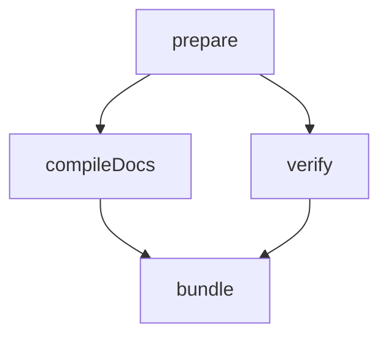

# Xem kế hoạch thực thi bằng --dry-run và loại task bằng -x

Khi chạy `./gradlew build`, Gradle không chỉ thực thi một lệnh duy nhất: nó chọn **một tập task**, xác định quan hệ phụ thuộc giữa chúng, rồi thực hiện những task cần thiết. Trước khi chạy thật, bạn thường muốn biết “Gradle định chạy những task nào?”. Trong một tình huống khác, bạn muốn “bỏ một task khỏi lần build này”.

Hai tùy chọn dòng lệnh phục vụ hai mục đích ấy:

- **`--dry-run` (viết tắt `-m`)**: xem các task sẽ được Gradle chọn, nhưng **không chạy action của các task**.
- **`-x <task>` (dạng dài `--exclude-task <task>`)**: **loại task được chỉ định** khỏi lịch thực thi; những task còn lại vẫn có thể được thực thi bình thường.

Đây là bài về **Gradle Command Line**. Các ví dụ dùng Gradle Wrapper (`./gradlew` trên Linux/macOS hoặc `gradlew.bat` trên Windows); nếu dùng `gradle` cài toàn máy, cú pháp các tùy chọn tương tự. Mục tiêu là đọc đúng kế hoạch task, hiểu tác động của loại trừ, biết giới hạn của chúng và áp dụng an toàn vào Java/Gradle.

## 1. Trước hết, hiểu “kế hoạch thực thi” là gì

Task là một đơn vị công việc trong Gradle, chẳng hạn `compileJava`, `test`, `jar`, `build` hoặc task tự đăng ký. Một task có thể **phụ thuộc** vào task khác bằng `dependsOn`. Yêu cầu thực hiện một task sẽ đưa các dependency cần thiết của nó vào **task graph**, chứ không chỉ chạy duy nhất tên task gõ trên dòng lệnh.

Ví dụ quan hệ:



Nếu yêu cầu `bundle`, Gradle cần `prepare`, `compileDocs`, `verify` và `bundle`. `prepare` phải xảy ra trước hai task phụ thuộc nó; `bundle` phải xảy ra sau `compileDocs` và `verify`. Tuy nhiên, giữa `compileDocs` và `verify` không có quan hệ thứ tự trong ví dụ nên không nên suy luận rằng chúng luôn chạy theo thứ tự đã viết.

Phân biệt ba khái niệm:

| Khái niệm | Ý nghĩa |
| --- | --- |
| **Task được chọn** | Thuộc tập task Gradle lên kế hoạch xử lý cho yêu cầu hiện tại. |
| **Task được thực thi** | Gradle thực sự xử lý task; action của nó có thể chạy hoặc không, tùy trạng thái. |
| **Task action** | Logic làm công việc, như `doLast { ... }`, biên dịch Java hoặc chạy test. |

Một task có thể được xét trong lần build thật nhưng có trạng thái `UP-TO-DATE`, `FROM-CACHE`, `NO-SOURCE` hoặc `SKIPPED`. Đừng nhầm các trạng thái đó với việc loại task hoàn toàn khỏi lịch bằng `-x`.

## 2. Dùng `--dry-run`: xem trước, không chạy action

Cú pháp:

```bash
./gradlew <task> --dry-run
./gradlew <task> -m
```

Hai lệnh tương đương về chế độ dry-run:

```bash
./gradlew build --dry-run
./gradlew build -m
```

Gradle vẫn phải thực hiện những bước cần thiết để xác định build và task: xử lý settings, cấu hình thích hợp, áp dụng plugin và lập kế hoạch task. Sau đó **action của các task được vô hiệu hóa**. Bạn sẽ thấy danh sách những task mà Gradle dự kiến xử lý; trong đầu ra dry-run, các task thường mang nhãn `SKIPPED`.

Ví dụ một phần đầu ra có thể như sau (đường dẫn và thứ tự thực tế tùy dự án):

```text
> Task :compileJava SKIPPED
> Task :processResources SKIPPED
> Task :classes SKIPPED
> Task :jar SKIPPED
> Task :assemble SKIPPED
> Task :compileTestJava SKIPPED
> Task :test SKIPPED
> Task :check SKIPPED
> Task :build SKIPPED
```

Đây là **minh họa** cho Java build có nguồn và test; không phải cam kết mọi dự án sẽ có đúng các task hoặc thứ tự ấy. Nếu `build.gradle(.kts)` không áp dụng Java plugin, chẳng hạn, các task Java có thể không tồn tại.

`SKIPPED` trong dry-run có nghĩa **action không chạy vì dry-run**. Không thể đọc nó thành “test đã chạy và bị bỏ qua vì không có test”, hoặc “mọi đầu ra build đều cập nhật”. Dry-run không tạo ra kết quả biên dịch, kiểm thử hay JAR mới qua những task action đó.

### Khi nào nên dùng dry-run?

- Trước một lệnh dài như `./gradlew clean build` để nhìn task sẽ bị ảnh hưởng.
- Khi thêm quan hệ `dependsOn` và muốn biết task liên quan được chọn chưa.
- Khi tìm hiểu lý do `./gradlew :app:build` kéo theo task từ project khác.
- Khi kiểm tra lệnh loại trừ `-x` có thực sự làm task biến mất khỏi kế hoạch.
- Trước khi chạy task có thể tốn nhiều thời gian như build, kiểm thử hoặc đóng gói.

Dry-run **không chứng minh** bản build thật sẽ thành công. Một dự án vẫn có thể lỗi Java compile, test, upload artifact hoặc thiếu file khi action thực sự chạy.

### Vì sao dry-run không đồng nghĩa “không có bất kỳ tác động nào”?

Dù action của task bị vô hiệu hóa, **settings/build script và plugin vẫn có thể thực thi logic trong giai đoạn cấu hình**. Ví dụ một `println` đặt trực tiếp ở đầu script có thể vẫn in ra; plugin có thể cần truy cập cấu hình hoặc giải quyết thông tin bên ngoài. Script cấu hình có logic ghi file, gọi tiến trình hay thao tác mạng theo cách không phù hợp cũng có thể có side effect ngoài task action.

Vì vậy:

1. Dùng dry-run để **khảo sát kế hoạch task**.
2. Đừng dùng nó như cơ chế cách ly bảo mật, sandbox hoặc bảo đảm mọi thứ chỉ đọc.
3. Muốn chắc chắn không xuất bản/xóa/tác động môi trường, phải hiểu cả logic trong giai đoạn cấu hình của build và plugin.

Một điểm quan trọng khác: `--dry-run` **khác** với `--offline`. `--offline` hạn chế sử dụng mạng để giải quyết dependency; còn dry-run bỏ qua task action. Hai tùy chọn giải quyết những vấn đề khác nhau.

## 3. Dùng `-x`: loại task ra khỏi lần chạy thật

Cú pháp:

```bash
./gradlew <task-đích> -x <task-cần-loại>
./gradlew <task-đích> --exclude-task <task-cần-loại>
```

Ví dụ quen thuộc trong Java:

```bash
./gradlew build -x test
./gradlew build --exclude-task test
```

Trong một dự án áp dụng Java plugin, task vòng đời `build` thường bao gồm `assemble` và `check`, còn `check` thường phụ thuộc `test`. Thông thường, `./gradlew build -x test` sẽ **bỏ task `test`** ra khỏi lịch thực thi nhưng vẫn tiếp tục các bước khác cần cho `build`, như biên dịch nguồn chính và đóng gói.

Khác với dry-run, khi chỉ dùng `-x`, **các action khác vẫn chạy**. Gradle vẫn có thể biên dịch file, xóa output khi có `clean`, tạo JAR, thực thi các test task khác hoặc tiến hành hành động phụ do build đã cấu hình.

### Tác động đến dependency của task bị loại

Giả sử:

```text
prepare → compileDocs ─┐
       ↘ verify ───────┴→ bundle
```

Khi chạy `bundle -x verify`:

- `verify` bị loại khỏi kế hoạch.
- `bundle` vẫn được yêu cầu, cùng với `compileDocs`.
- `prepare` **vẫn cần chạy**, vì `compileDocs` cũng phụ thuộc `prepare`.

Ngược lại, nếu chỉ riêng `verify` dùng một task phụ như `prepareVerifyFixtures`, task phụ đó có thể cũng không còn cần thiết và biến mất khỏi lịch. Quy tắc chung: dependency **chỉ** phục vụ nhánh bị loại có thể không được chọn; dependency **chia sẻ** với nhánh khác vẫn được chọn.

Gradle không bảo đảm kết quả còn hợp lệ về nghiệp vụ khi bạn loại một task quan trọng. Nếu `bundle` thực sự cần đầu ra mà `verify` hay task phụ của nó phải tạo, lệnh `-x` có thể làm `bundle` lỗi hoặc tạo artifact thiếu dữ liệu. Đây là lý do `-x` nên dùng có chủ đích để chẩn đoán hoặc cho ngoại lệ rõ ràng.

## 4. Ví dụ chạy được: nhìn trực tiếp các nhánh task

Tạo một thư mục độc lập có Gradle Wrapper phù hợp (chẳng hạn Gradle 8.5+), với hai file sau.

**`settings.gradle.kts`:**

```kotlin
rootProject.name = "task-options-demo"
```

**`build.gradle.kts`:**

```kotlin
tasks.register("prepare") {
    doLast {
        println("ACTION prepare")
    }
}

tasks.register("compileDocs") {
    dependsOn("prepare")
    doLast {
        println("ACTION compileDocs")
    }
}

tasks.register("verify") {
    dependsOn("prepare")
    doLast {
        println("ACTION verify")
    }
}

tasks.register("bundle") {
    dependsOn("compileDocs", "verify")
    doLast {
        println("ACTION bundle")
    }
}
```

Đây là **ví dụ task thuần**: `compileDocs` chỉ in chữ để minh họa, chưa thực sự biên dịch tài liệu. Vì vậy bạn có thể tập trung vào task graph mà không cần tải thêm plugin hoặc thư viện. Các task dùng `doLast`, nên dòng `ACTION ...` xuất hiện **chỉ khi action được thực thi**.

Nếu chưa có Wrapper, trên máy đã cài Gradle tương thích, tại root dự án có thể tạo một lần bằng `gradle wrapper --gradle-version 8.5`. Sau đó dùng script `gradlew` từ root.

### 4.1. Xem toàn bộ kế hoạch

```bash
./gradlew bundle --dry-run
```

Ví dụ các dòng task bạn sẽ thấy:

```text
> Task :prepare SKIPPED
> Task :compileDocs SKIPPED
> Task :verify SKIPPED
> Task :bundle SKIPPED
```

Lưu ý: `compileDocs` và `verify` có thể xuất hiện theo thứ tự khác nhau vì đều chỉ phụ thuộc `prepare`. Không có dòng `ACTION ...` nào từ `doLast`, bởi Gradle chưa thực thi action.

Nếu chạy thật:

```bash
./gradlew -q bundle
```

Một kết quả hợp lệ:

```text
ACTION prepare
ACTION compileDocs
ACTION verify
ACTION bundle
```

Thứ tự của hai dòng ở giữa có thể đổi, nhưng `prepare` đứng trước hai task cần nó và `bundle` đứng sau. `-q` chỉ giảm bớt log Gradle, giúp nhìn output của action; nó **không** thay đổi task graph.

### 4.2. Loại `verify` và chạy thật

```bash
./gradlew -q bundle -x verify
```

Với ví dụ này, stdout từ action là:

```text
ACTION prepare
ACTION compileDocs
ACTION bundle
```

Không còn `ACTION verify`. Đặc biệt, `ACTION prepare` vẫn xuất hiện vì `compileDocs` vẫn cần `prepare`.

### 4.3. Kết hợp `--dry-run` và `-x`

```bash
./gradlew bundle -x verify --dry-run
```

Những task còn lại trong kế hoạch:

```text
> Task :prepare SKIPPED
> Task :compileDocs SKIPPED
> Task :bundle SKIPPED
```

Dòng `:verify` **không có mặt**, vì `-x` đã loại task khỏi tập dự kiến thực hiện. Những task còn lại mang `SKIPPED` vì chúng đang ở chế độ dry-run. Không có `ACTION ...` nào được in.

Điểm khác biệt quan trọng: **task bị `-x` loại thường không xuất hiện trong danh sách task thực thi**, trong khi task được chọn ở dry-run vẫn hiện ra nhưng mang trạng thái `SKIPPED`.

### 4.4. Loại task dùng chung

```bash
./gradlew bundle -x prepare --dry-run
```

Giả sử Gradle cho phép loại `prepare` trong cấu hình minh họa, `compileDocs`, `verify` và `bundle` vẫn có thể nằm trong lịch, nhưng `prepare` không còn. Nếu những task còn lại thực sự dùng file do `prepare` tạo, chạy thật sẽ có nguy cơ thiếu file hoặc dữ liệu cũ. Vì vậy **xem được một lịch task không có lỗi** chưa đủ để khẳng định **lịch ấy vẫn đúng về mặt nghiệp vụ**.

## 5. Áp dụng với Java 17: `build`, `test`, `assemble`

Một dự án Java thông dụng có cấu trúc:

```text
java-dry-run-demo/
├── settings.gradle.kts
├── build.gradle.kts
├── src/main/java/demo/Message.java
└── src/test/java/demo/MessageTest.java
```

Giả định project có Gradle Wrapper ở root và JDK 17 khả dụng. Nếu Wrapper chưa có, tạo một lần với Gradle cài sẵn bằng `gradle wrapper --gradle-version 8.5`; lưu đầy đủ các file Wrapper vào source control khi dùng trong nhóm/CI.

**`settings.gradle.kts`:**

```kotlin
rootProject.name = "java-dry-run-demo"
```

**`build.gradle.kts`:**

```kotlin
plugins {
    java
}

java {
    toolchain {
        languageVersion.set(JavaLanguageVersion.of(17))
    }
}

repositories {
    mavenCentral()
}

dependencies {
    testImplementation("org.junit.jupiter:junit-jupiter:5.10.2")
    testRuntimeOnly("org.junit.platform:junit-platform-launcher:1.10.2")
}

tasks.test {
    useJUnitPlatform()
}
```

JUnit 5 được dùng để thử nghiệm tác động của `-x test`. Máy cần có khả năng lấy thư viện từ repository hoặc có artifact phù hợp trong cache. Kotlin DSL ở đây cấu hình **project Java**, không chuyển đổi cú pháp của Java source.

**`src/main/java/demo/Message.java`:**

```java
package demo;

public final class Message {
    private Message() {
    }

    public static String greeting(String name) {
        return "Hello, " + name + "!";
    }

    public static void main(String[] args) {
        System.out.println(greeting("Gradle"));
    }
}
```

**`src/test/java/demo/MessageTest.java`:**

```java
package demo;

import org.junit.jupiter.api.Test;

import static org.junit.jupiter.api.Assertions.assertEquals;

class MessageTest {
    @Test
    void greetingContainsName() {
        assertEquals("Hello, Gradle!", Message.greeting("Gradle"));
    }
}
```

Mã Java tương thích Java 17. Bạn cũng có thể kiểm tra riêng compiler không qua Gradle, nếu JDK 17 đã cài:

```bash
mkdir -p manual-classes
javac -d manual-classes src/main/java/demo/Message.java
java -cp manual-classes demo.Message
```

Kết quả chính xác của chương trình:

```text
Hello, Gradle!
```

Lệnh `mkdir -p` là cú pháp shell Unix; trên Windows CMD/PowerShell, dùng `mkdir manual-classes` nếu thư mục chưa tồn tại. Tên file và package phải khớp đường dẫn ví dụ.

### 5.1. Xem kế hoạch `build`

```bash
./gradlew build --dry-run
```

Bạn sẽ thấy các task liên quan như `compileJava`, `classes`, `jar`, `assemble`, `compileTestJava`, `test`, `check`, `build` nếu được Java plugin đưa vào kế hoạch. **Chúng chưa thực sự biên dịch hay chạy test** chỉ vì xuất hiện trong đầu ra. Ngay cả nếu terminal thông báo `BUILD SUCCESSFUL` cho dry-run, điều đó chỉ phản ánh yêu cầu mô phỏng đã xử lý thành công; không chứng minh nguồn Java hoặc test thực tế đã qua.

Nếu ngay sau dry-run bạn thử:

```bash
java -cp build/classes/java/main demo.Message
```

lệnh có thể thất bại nếu trước đó chưa biên dịch, bởi dry-run không tạo mới `.class`. Nếu tình cờ chạy được nhờ file build từ lần trước, đó là **đầu ra cũ**, không phải bằng chứng dry-run đã biên dịch.

### 5.2. Chạy kiểm thử thật

```bash
./gradlew test
```

Gradle thực hiện các task cần thiết, như biên dịch nguồn chính, biên dịch test và chạy JUnit. Với ví dụ đúng như trên, test `greetingContainsName` sẽ thành công nếu môi trường và dependency đáp ứng. Số task thực sự chạy có thể thay đổi do cache/up-to-date checks.

Nếu muốn thực hiện toàn bộ lifecycle thông dụng:

```bash
./gradlew build
```

Ở project Java plugin này, `build` bao gồm lắp ráp artifact và xác minh, trong đó thông thường có test. Output của Gradle không có stdout cố định; bạn có thể xem báo cáo test ở đường dẫn chuẩn `build/reports/tests/test/index.html` sau khi test thật chạy thành công.

### 5.3. Build nhưng loại `test`

```bash
./gradlew build -x test
```

Gradle có thể vẫn chạy `compileJava`, `classes`, `jar`, `assemble` cùng những task còn cần thiết. Task `test` và các dependency chỉ phục vụ riêng nó có thể không còn trong lịch. **JUnit test không được xác nhận** trong lần chạy này.

Để chủ động so sánh hai lịch:

```bash
./gradlew build --dry-run
./gradlew build -x test --dry-run
```

So sánh các dòng liên quan `:test` và `:compileTestJava`; chỉ các task thực sự phụ thuộc vào nhánh bị loại mới có thể biến mất, còn các task phục vụ nhánh khác vẫn được giữ.

Nếu chỉ muốn tạo artifact Java thông thường mà không cần vòng đời kiểm thử, có thể gọi task có mục tiêu phù hợp ngay từ đầu:

```bash
./gradlew assemble
```

Trong ví dụ chỉ áp dụng Java plugin, `assemble` dùng để tạo các artifact được cấu hình (như JAR) và không mặc định kéo task `test`. Cách này diễn đạt mục đích rõ hơn so với `build -x test`. Nếu plugin khác nối thêm task, hãy xem lịch thực tế bằng `--dry-run`.

Sau khi build thật đã sinh file `.class`, chạy:

```bash
java -cp build/classes/java/main demo.Message
```

Dòng do Java in:

```text
Hello, Gradle!
```

Chạy chương trình được **không thay thế** việc chạy test; nó chỉ kiểm tra một đường thực thi cụ thể.

## 6. So sánh kết quả khi dùng riêng và kết hợp hai tùy chọn

| Lệnh | Task được chọn | Action thực sự chạy? | Mục đích chính |
| --- | --- | --- | --- |
| `./gradlew build` | `build` và các dependency bắt buộc | Có, trừ khi task được tối ưu/bỏ qua theo trạng thái | Build/kiểm tra thật |
| `./gradlew build --dry-run` | Kế hoạch của `build` | **Không** chạy action task | Xem trước kế hoạch |
| `./gradlew build -x test` | Kế hoạch `build` **trừ task bị loại** và dependency không còn cần | **Có** đối với các task còn lại, tùy trạng thái | Build thật với một ngoại lệ |
| `./gradlew build -x test --dry-run` | Kế hoạch đã áp dụng loại trừ | **Không** chạy action task | Kiểm tra ngoại lệ trước khi chạy |
| `./gradlew test --dry-run` | Kế hoạch riêng cho `test` | **Không** chạy JUnit | Xem task cần để chạy test |
| `./gradlew assemble --dry-run` | Kế hoạch tạo artifact | **Không** chạy task action | Khảo sát đường đóng gói |

`--dry-run` là chế độ toàn build, trong khi `-x` tác động đến tập task được chọn. Khi dùng chung, **Gradle loại task theo `-x` rồi hiển thị kế hoạch các task còn lại ở chế độ dry-run**.

Một số tùy chọn khác dễ gây nhầm:

- **`--rerun-tasks`**: yêu cầu chạy lại task thay vì sử dụng kết quả up-to-date; không phải “xem trước”.
- **`--continue`**: sau khi một task thất bại, tiếp tục các task độc lập có thể thực thi; không phải bỏ một task theo tên.
- **`--offline`**: thay đổi cách Gradle sử dụng repository/cache; không ngăn task action.
- **`--test-dry-run`**: tùy chọn riêng của task `Test` trong các Gradle phiên bản có hỗ trợ, mô phỏng **việc chạy từng test** và có thể tạo báo cáo; khác với `--dry-run` của cả build, vốn không chạy action `test`.
- **`tasks` / `tasks --all`**: liệt kê task sẵn có, không thay thế `--dry-run` khi cần biết các task được chọn bởi một lệnh cụ thể.
- **`dependencies` / `dependencyInsight`**: điều tra **dependency thư viện** (JAR/module), không phải chính danh sách task sẽ chạy.

## 7. Multi-project: xác định đúng task và đường dẫn

Trong multi-project Gradle, một task có **đường dẫn đầy đủ**: `:app:test`, `:core:test`, `:service:compileJava`... Lệnh `./gradlew test` từ root có thể chọn task `test` trên nhiều subproject, trong khi `./gradlew :app:test` chỉ yêu cầu task của project `:app` (và các dependency cần thiết của nó).

Các lệnh khảo sát:

```bash
./gradlew projects
./gradlew :app:tasks --all
./gradlew :app:build --dry-run
```

Khi cần loại đúng task của một project, dùng **đường dẫn đầy đủ** thay vì đoán tên rút gọn:

```bash
./gradlew :app:build -x :app:test --dry-run
./gradlew :app:build -x :app:test
```

Lệnh thứ nhất kiểm tra kế hoạch; lệnh thứ hai mới chạy thật các task còn lại. Chỉ dùng ví dụ này khi thực tế có project `:app` và task `:app:test`. Trong build có nhiều module, cần xác nhận task nào còn được chọn sau loại trừ, nhất là khi có phụ thuộc chéo hoặc custom test task như `integrationTest`.

Cũng có thể loại nhiều task (khi thật sự cần), bằng cách lặp lại `-x`:

```bash
./gradlew build -x test -x integrationTest --dry-run
```

Lệnh này chỉ có ý nghĩa nếu task `integrationTest` tồn tại/được chọn trong build cụ thể. Đừng suy đoán `-x test` tự động loại mọi loại kiểm thử: Java plugin có task `test` thông dụng, nhưng integration, functional, smoke test và các task kiểm tra plugin khác có thể mang tên riêng.

## 8. Vì sao loại task có thể tạo kết quả sai dù build báo thành công?

Một ví dụ nguy hiểm trong CI:

```bash
./gradlew clean build -x test
```

Lệnh trên có thể kết thúc với `BUILD SUCCESSFUL` nếu các task còn lại thành công, nhưng **không có kết quả test task được loại trong lần chạy đó**. Nếu quy định để merge/release yêu cầu unit test, đây chưa phải bằng chứng đủ điều kiện. Bản build thành công chỉ nói rằng **tập task thực sự được chọn** đã hoàn thành theo tiêu chí của Gradle.

Ngoài test, hãy thận trọng khi loại:

- Task sinh mã nguồn hoặc sinh tài nguyên mà các task sau cần dùng.
- Task tạo metadata/checksum/tài liệu đóng gói mà quá trình phát hành trông đợi.
- Task kiểm tra chất lượng/độ tương thích/bảo mật vốn là điều kiện chấp nhận artifact.
- Task có quan hệ dependency phức tạp trong multi-project hoặc plugin tự đăng ký.

Một lỗi thường gặp là “chạy thành công vì còn file từ lần build trước”. Khi loại một task tạo output, task sau có thể đọc file tồn tại trong `build/` từ lần chạy cũ. Không coi đó là chứng cứ lệnh loại trừ đúng: trong môi trường sạch, file ấy có thể không tồn tại.

**Lựa chọn thay thế khi mục đích rõ ràng:** nếu bạn chỉ cần đóng gói, dùng `assemble`; nếu chỉ cần test, dùng `test`; nếu chỉ cần compile, dùng `classes` hoặc `compileJava` theo đúng nhu cầu. Nếu nhóm thường xuyên cần một chuỗi nhiệm vụ riêng, hãy định nghĩa **lifecycle task phù hợp** trong build script thay vì duy trì lệnh `-x` ngày càng dài.

## 9. Cách đọc output và phát hiện sai hiểu

| Quan sát | Diễn giải đúng | Cần kiểm tra gì tiếp? |
| --- | --- | --- |
| Dry-run in `:test SKIPPED` | Task `test` có trong kế hoạch nhưng action không chạy do dry-run. | Chạy test thật nếu cần xác minh chất lượng. |
| Dùng `-x test` không thấy `:test` | Task đã bị loại; không chạy test này. | Xem task `integrationTest` hoặc các kiểm tra khác còn không. |
| `:compileJava UP-TO-DATE` trong lần chạy thật | Gradle cho rằng đầu vào/đầu ra không đổi theo tracking của task. | Không nhầm với dry-run; xem `--rerun-tasks` nếu cần chạy lại. |
| `:jar FROM-CACHE` | Artifact được khôi phục từ build cache theo chính sách. | Nó không chứng minh action `jar` vừa chạy. |
| `:processResources NO-SOURCE` | Không có source/resource tương ứng để xử lý. | Kiểm tra đúng source set/thư mục nếu thiếu bất thường. |
| `BUILD SUCCESSFUL` sau `build -x test` | Những task **không bị loại** đã hoàn tất. | Không ghi nhận là đã vượt qua test task bị loại. |
| `--dry-run` lỗi ngay lúc cấu hình | Vẫn phải đánh giá settings/build/plugin đủ để lập kế hoạch. | Đọc log configuration, không kết luận tùy chọn dry-run hỏng. |
| `-x` loại nhầm task | Tên rút gọn/path chưa chính xác hoặc không kiểm tra kế hoạch. | Xem task path đầy đủ và chạy kết hợp `--dry-run`. |

Đừng dựa duy nhất vào một từ `SKIPPED`: trong lần chạy thật, task có thể bị bỏ qua vì `onlyIf` trả false hoặc bị vô hiệu hóa; còn khi dùng `-x`, task thường **không xuất hiện** trong task list sau loại trừ.

## 10. Quy trình sử dụng thực tế

Giả sử bạn muốn tạo artifact Java trước khi tạm thời tách phần kiểm thử để điều tra lỗi độc lập. Có thể làm theo thứ tự:

1. Xác nhận target và task hiện có: `./gradlew tasks --all`, hoặc `./gradlew :app:tasks --all` trong multi-project.
2. Chạy `./gradlew build --dry-run` để hiểu kế hoạch nguyên bản.
3. Chạy `./gradlew build -x test --dry-run` để xem kế hoạch sau loại trừ.
4. Đối chiếu các task bị mất với công việc thực sự cần. Nếu chỉ muốn artifact, cân nhắc `./gradlew assemble`.
5. Khi đã chấp nhận việc bỏ `test` cho **lần chạy này**, mới thực thi `./gradlew build -x test`.
6. Trước khi xác nhận thay đổi/merge/release, chạy lại `./gradlew test` hoặc `./gradlew build` đầy đủ theo quy định chất lượng của dự án.

Với task có thể thay đổi dữ liệu bên ngoài, luôn hiểu **task nào sẽ chạy thật** trước khi gọi. Dùng `--dry-run` để quan sát phần task action, nhưng vẫn phải xem logic cấu hình nếu bản thân nó có side effect.

## 11. Câu hỏi tự kiểm tra

**Câu 1.** `./gradlew build --dry-run` hiển thị `:test SKIPPED`. Có thể khẳng định JUnit đã chạy không?

**Đáp án:** Không. Chế độ dry-run vô hiệu hóa action của task; danh sách chỉ thể hiện kế hoạch.

**Câu 2.** `./gradlew build -x test` có hoàn toàn giống `./gradlew build --dry-run` không?

**Đáp án:** Không. `-x test` chỉ loại một task và các dependency không còn cần; những task còn lại vẫn có thể chạy thật. `--dry-run` ngăn thực thi action của **mọi task được chọn**.

**Câu 3.** Nếu `prepare` là dependency của cả `compileDocs` và `verify`, loại `verify` thì `prepare` có nhất thiết biến mất không?

**Đáp án:** Không. Trong ví dụ, `compileDocs` vẫn cần `prepare`, nên `prepare` vẫn được chọn.

**Câu 4.** Muốn xem kế hoạch build sau khi loại `:app:test`, mà chưa chạy compile, nên làm thế nào?

**Đáp án:** Khi project/task tồn tại, dùng `./gradlew :app:build -x :app:test --dry-run`.

**Câu 5.** `build -x test` thành công có nghĩa dự án đã vượt qua mọi kiểm thử chứ?

**Đáp án:** Không. Ít nhất task `test` đã bị loại; các task kiểm thử khác còn hay không tùy task graph.

**Câu 6.** Muốn biết toàn bộ thư viện JUnit, Jackson và các dependency bắc cầu đã được giải quyết thế nào, `--dry-run` có phải công cụ chính?

**Đáp án:** Không. `--dry-run` là kế hoạch **task**. Dùng `dependencies` và `dependencyInsight` để khảo sát đồ thị **library dependency**.

## 12. Tài liệu tra cứu

- [Gradle — Command-Line Interface](https://docs.gradle.org/current/userguide/command_line_interface.html): các tùy chọn `-m`, `--dry-run`, `-x`, `--exclude-task`, task path và lệnh chạy build.
- [Gradle — Controlling Task Execution](https://docs.gradle.org/current/userguide/controlling_task_execution.html): vì sao có thể loại task và lưu ý khi ảnh hưởng task phụ thuộc.
- [Gradle — Testing in Java & JVM Projects](https://docs.gradle.org/current/userguide/java_testing.html): hành vi `build -x test`, các lựa chọn bỏ qua test và task Test.
- [Gradle — Understanding Tasks](https://docs.gradle.org/current/userguide/more_about_tasks.html): `UP-TO-DATE`, `FROM-CACHE`, `NO-SOURCE`, `SKIPPED` và các đặc tính của task.

Tra cứu trang tài liệu tương ứng với phiên bản Gradle Wrapper của dự án nếu chi tiết tùy chọn thay đổi qua phiên bản.

**Ghi nhớ:** `--dry-run` giúp **quan sát** task graph mà không chạy action; `-x` **thay đổi** task graph cho một lần chạy. Dùng `--dry-run` cùng `-x` để xác minh task nào sẽ còn lại, rồi chỉ chạy thật khi bạn hiểu phần kiểm thử, artifact và công việc phụ thuộc đã bị ảnh hưởng ra sao.