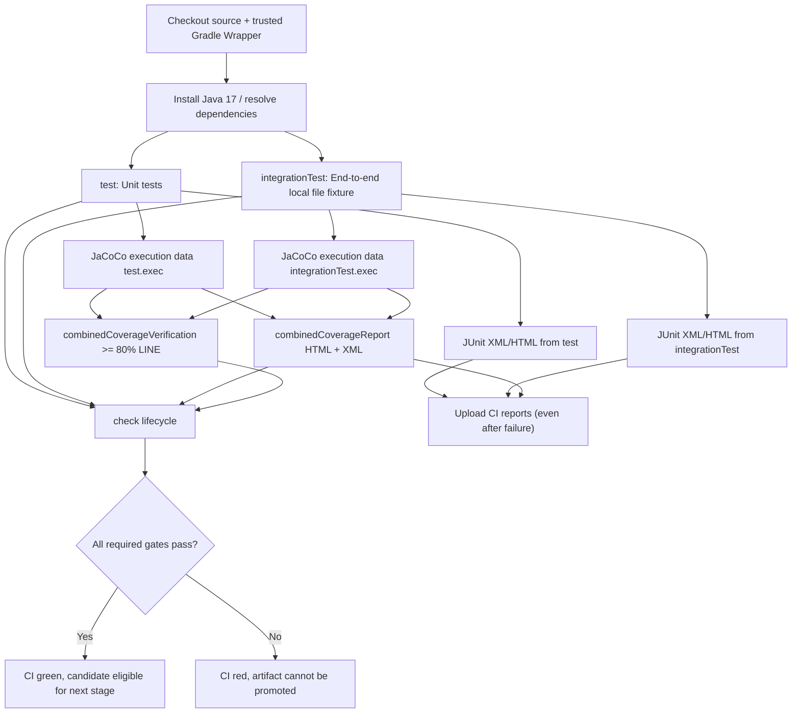

# Thiết lập integration test, quality gate và báo cáo trên CI với Gradle

Một build Java có thể biên dịch thành công và unit test chạy xanh, nhưng vẫn lỗi khi nhiều thành phần phối hợp: đọc/ghi dữ liệu, tương tác database, gọi HTTP, kết nối message queue, khởi động ứng dụng hoặc phân phối artifact. Trong CI/CD, điều cần đảm bảo không chỉ là `./gradlew test` thành công mà còn là **integration tests được thực thi đúng điều kiện, quality gates thật sự chặn lỗi, và kết quả kiểm thử có thể xem/tải được sau khi job kết thúc**.

Bài Knowledge **“Thiết lập integration test, quality gate và báo cáo trên CI”** thuộc nhóm **Thực hành tổng hợp** của **Build Tool Gradle**. Bài hướng dẫn cách xây dựng một chuỗi kiểm chứng có thể vận hành:

- Tách `src/test` khỏi `src/integrationTest`, hiểu task `test` và `integrationTest`.
- Khai báo `SourceSet`, dependency configurations, compile/runtime classpath và task type `Test`.
- Gắn `integrationTest` vào lifecycle `check` để CI không bỏ sót.
- Chạy JUnit Jupiter qua JUnit Platform với fixture tạm, không dựa vào tài nguyên/cổng/máy cố định.
- Thu dữ liệu **JaCoCo của cả unit và integration tests**, tạo HTML/XML report và gate theo coverage tối thiểu.
- Hiểu điều kiện gate và failure propagation: test fail, coverage fail, toolchain/dependency fail, report-upload fail.
- Cấu hình **GitHub Actions** và **GitLab CI** để chạy Gradle Wrapper, giữ JUnit XML/HTML/JaCoCo reports và không làm “xanh giả” khi test fail.
- Chạy lab **Java 17 + Gradle Wrapper 8.10.2**, có Groovy/Kotlin DSL đầy đủ, chương trình `javac`/`java` độc lập, lệnh xác minh và stdout đáng tin.
- Mở rộng sang integration tests dùng database, containers và services thật; quản lý fixture isolation, secrets, timeout, performance và flaky tests.

**Nguyên tắc:** Một integration test chỉ có giá trị như quality gate khi nó **được task graph gọi thật**, fail bằng exit code khi sai, có input/môi trường tái lập được, và evidence từ CI có thể truy xuất. Đặt một thư mục tên `integrationTest` trong source tree **không tự làm Gradle chạy nó**.

## 1. Phân biệt unit, integration và end-to-end tests

| Loại | Tập trung | Ví dụ | Mức cô lập |
| --- | --- | --- | --- |
| **Unit test** | Logic một đơn vị nhỏ | `CsvTotals.sum("10,20,30")` trả 60 | Ít hoặc không cần I/O |
| **Integration test** | Hai hay nhiều thành phần phối hợp | Java entry point → đọc CSV → parser → ghi báo cáo → kiểm file | File/database/HTTP/service fixture |
| **Contract test** | Hợp đồng producer–consumer | API schema, status code, event format | Có thể dùng stub hoặc provider thật |
| **System/E2E test** | Toàn bộ luồng người dùng/triển khai | Deploy ứng dụng và gọi API thật | Môi trường đầy đủ, thường chậm |
| **Smoke test** | Kiểm tra tối thiểu hệ thống còn dùng được | Khởi động và trả một response | Ngắn, nhưng không thay bộ test sâu |

Không có ranh giới tuyệt đối dựa vào tên thư mục. Một `integrationTest` chỉ mock một method có thể vẫn là unit test về bản chất; một test ở `src/test` mở database thực có thể là integration test. **Định nghĩa theo behavior, dependency và mục tiêu**, rồi dùng source set/task riêng để vận hành.

### Vì sao chia suite?

- Unit tests thường nhanh, chạy thường xuyên trong local IDE và pull requests.
- Integration tests có thể chậm hơn hoặc yêu cầu fixture như filesystem, database, test container.
- Có thể chạy `./gradlew test` nhanh khi đang phát triển, `./gradlew integrationTest` cho một suite riêng.
- Lệnh `./gradlew check` nên gom các kiểm chứng bắt buộc của project, gồm integration test khi policy yêu cầu.
- CI có reports riêng cho từng suite, giúp tìm nguồn lỗi thay vì trộn mọi thứ vào một log.

**`test` và `integrationTest` là hai task khác nhau**. Java plugin tự tạo `test`; custom `integrationTest` phải được khai báo và gắn lifecycle rõ ràng nếu không dùng JVM Test Suite DSL.

## 2. Kiến trúc pipeline chất lượng



Sơ đồ mô tả **quan hệ phụ thuộc**, không hứa một task coverage tổng hợp luôn chạy được sau khi test failed. Khi test task là dependency của report task và thất bại, Gradle có thể bỏ qua downstream report; **JUnit XML/HTML của test task đã chạy vẫn là bằng chứng chủ yếu**. CI upload phải được cấu hình chạy ngay cả sau failure và chấp nhận report chưa sinh.

### Những điều quality gate phải chứng minh

- **Tests có thực thi**: số test cases > 0 trong suite bắt buộc.
- **Tests có pass**: failures/errors = 0 với policy tương ứng.
- **Coverage đủ**: JaCoCo threshold đạt yêu cầu đã thỏa thuận, không “ignore violations”.
- **Kết quả có thể kiểm chứng**: JUnit XML, HTML, JaCoCo XML/HTML được upload khi có.
- **CI status đáng tin**: run command fail thì job fail, không thêm `|| true` hay `continue-on-error` để che.
- **Inputs được kiểm soát**: Wrapper/JDK/dependency versions, fixture isolation, secret boundaries.
- **Artifact promotion** (nếu có) chỉ xảy ra sau tất cả gates và dùng đúng binary đã kiểm.

## 3. Gradle Java plugin đã làm gì và chưa làm gì?

Khi áp `java`, `java-library` hoặc `application`, Gradle thường có:

- `sourceSets.main` cho production code/resources.
- `sourceSets.test` cho tests.
- Configurations như `testImplementation`, `testRuntimeOnly`.
- Task `compileJava`, `compileTestJava`, `test`, `check`, `build`.
- Convention JUnit XML/HTML reports dưới `build/test-results/test` và `build/reports/tests/test` khi `test` thực thi.

Nhưng Gradle **không tự đọc mọi thư mục có tên `src/integrationTest/java` và chạy tests ở đó**. Cần:

1. Một source set có classpaths.
2. Configurations để cung cấp JUnit, thư viện test và production dependencies.
3. Một `Test` task dùng `testClassesDirs` và `classpath` của source set đó.
4. `useJUnitPlatform()` nếu dùng JUnit Jupiter.
5. `check.dependsOn(integrationTest)` nếu integration tests là gate bắt buộc.

### Vì sao testClassesDirs và classpath không thể thiếu?

`testClassesDirs` cho Gradle biết **tìm class files được biên dịch từ source test ở đâu**. `classpath` chứa test classes, production classes, JUnit engine/launcher và dependencies khác để thực thi.

Nếu chỉ đăng ký:

```groovy
tasks.register('integrationTest', Test)
```

mà không cấu hình classes/classpath phù hợp, test task có thể `NO-SOURCE` hoặc chạy sai bộ test. Một job CI xanh khi `integrationTest NO-SOURCE` **không đồng nghĩa đã chạy integration tests**.

## 4. Source set và dependency scopes

Một `integrationTest` source set có thể có:

```text
src/main/java/                  production source
src/test/java/                  unit tests (test task)
src/integrationTest/java/       integration tests (integrationTest task)

build/classes/java/main/        production compiled classes
build/classes/java/test/        unit compiled classes
build/classes/java/integrationTest/  integration compiled classes
```

Gradle cũng tạo các configurations theo tên source set:

- `integrationTestImplementation` — thư viện cần để biên dịch/chạy integration tests.
- `integrationTestCompileOnly` — chỉ ở compile time.
- `integrationTestRuntimeOnly` — chỉ ở runtime.
- `integrationTestCompileClasspath`/`integrationTestRuntimeClasspath` — resolvable configurations.

Một integration test hay dùng các production classes và dependencies, nên source set phải nhìn thấy `sourceSets.main.output`. Với thư viện kiểm thử như JUnit, có thể cho `integrationTestImplementation` kế thừa `testImplementation`, còn runtime-only kế thừa `testRuntimeOnly`.

Không mặc định cho mọi suite kế thừa tất cả test dependencies nếu requirements khác; riêng lab này **cùng JUnit Jupiter cho unit/integration**, nên inheritance được chọn để tránh khai báo trùng.

### `shouldRunAfter` khác `dependsOn`

- `integrationTest.shouldRunAfter(test)`: nếu **cả hai task cùng nằm trong graph**, ưu tiên thực thi unit tests trước integration tests; **không tự đưa `test` vào graph**.
- `check.dependsOn(integrationTest)`: khi chạy `check`, bắt buộc có `integrationTest` trong graph.
- `integrationTest.dependsOn(test)`: sẽ ép chạy `test` cả khi gọi riêng integrationTest; không phải luôn cần.
- `--continue`: sau một task fail, Gradle có thể thử những tasks độc lập còn lại, nhưng **tasks phụ thuộc task fail vẫn có thể bị skip**.

Dùng `shouldRunAfter` thường hợp lý để tránh integration suite chậm chạy trước unit suite. **Không dùng ordering rule thay cho gate dependency.**

## 5. Lab thực hành: ứng dụng CSV nhỏ, integration test với filesystem thật

Ta dùng ứng dụng Java 17 không cần database/Docker/network ngoài, để mọi người có thể chạy trên laptop và CI giống nhau.

Chuỗi production:

1. `CsvTotals` parse chuỗi CSV số nguyên.
2. `FileReport` đọc input CSV từ file, gọi `CsvTotals`, ghi output UTF-8.
3. `Main` nhận hai đường dẫn và in `REPORT_OK` sau khi hoàn thành.
4. Unit tests kiểm logic parser và lỗi đầu vào.
5. Integration tests tạo directory tạm bằng JUnit `@TempDir`, gọi **entry point thật** và đọc file output, kiểm cả đường thành công và thất bại.
6. JaCoCo gom coverage từ hai `Test` tasks và yêu cầu LINE COVEREDRATIO ít nhất **0.80**.
7. CI upload JUnit XML/HTML và JaCoCo reports nếu có.

Đây là integration test **thực sự chạm filesystem và nhiều class**, dù không khởi động subprocess/container. Với ứng dụng có HTTP/DB, có thể thay file fixture bằng service fixture được quản lý tương tự.

### 5.1. Cấu trúc file

```text
gradle-quality-lab/
├── settings.gradle
├── build.gradle
├── gradle.properties
├── gradlew
├── gradlew.bat
├── gradle/
│   └── wrapper/
│       ├── gradle-wrapper.jar
│       └── gradle-wrapper.properties
├── src/
│   ├── main/java/demo/ci/
│   │   ├── CsvTotals.java
│   │   ├── FileReport.java
│   │   └── Main.java
│   ├── test/java/demo/ci/
│   │   └── CsvTotalsTest.java
│   └── integrationTest/java/demo/ci/
│       └── FileReportIntegrationTest.java
├── .github/workflows/gradle-quality.yml    # GitHub CI variant
└── .gitlab-ci.yml                           # GitLab CI variant
```

Hai file CI là **hai phương án cho hai nền tảng**: không cần dùng cả GitHub và GitLab nếu dự án chỉ ở một nơi. `gradle-wrapper.jar` là binary chính thức được sinh bằng Gradle wrapper task, **không tự tạo file rỗng**.

### 5.2. `settings.gradle`

```groovy
rootProject.name = 'gradle-quality-lab'
```

Single-project build giúp tập trung vào source sets, gates và reports. Với multi-project, phần mở rộng ở mục sau trình bày cách tổng hợp.

### 5.3. `gradle.properties`

```properties
org.gradle.caching=true
org.gradle.parallel=false
```

Đây là policy **minh họa cho lab**, không phải yêu cầu mọi repo tắt parallel. `org.gradle.caching` tăng tốc cacheable task outputs; nó **không có quyền quyết định QA pass/fail** và không phải nơi lưu CI artifacts. Test task có thể UP-TO-DATE nếu input/output và history hợp lệ; để thử tình huống clean, dùng `clean` trong CI.

### 5.4. `build.gradle` — Groovy DSL đầy đủ

```groovy
plugins {
    id 'application'
    id 'jacoco'
}

repositories {
    mavenCentral()
}

java {
    toolchain {
        languageVersion = JavaLanguageVersion.of(17)
    }
}

tasks.withType(JavaCompile).configureEach {
    options.encoding = 'UTF-8'
    options.release = 17
}

application {
    mainClass = 'demo.ci.Main'
}

jacoco {
    toolVersion = '0.8.12'
}

// Tách integration tests khỏi src/test.
sourceSets {
    integrationTest {
        java.srcDir file('src/integrationTest/java')
        resources.srcDir file('src/integrationTest/resources')
        compileClasspath += sourceSets.main.output
        runtimeClasspath += sourceSets.main.output
    }
}

// Integration tests cần cả app deps và bộ JUnit dùng trong unit tests.
configurations {
    integrationTestImplementation.extendsFrom implementation, testImplementation
    integrationTestRuntimeOnly.extendsFrom runtimeOnly, testRuntimeOnly
}

dependencies {
    testImplementation 'org.junit.jupiter:junit-jupiter:5.11.4'
    testRuntimeOnly 'org.junit.platform:junit-platform-launcher:1.11.4'
}

// Tất cả các task Test dùng JUnit Platform và tạo reports.
tasks.withType(Test).configureEach {
    useJUnitPlatform()
    reports {
        junitXml.required = true
        html.required = true
    }
    testLogging {
        events 'failed', 'skipped'
    }
}

tasks.register('integrationTest', Test) {
    group = 'verification'
    description = 'Run integration tests using a temporary filesystem'
    testClassesDirs = sourceSets.integrationTest.output.classesDirs
    classpath = sourceSets.integrationTest.runtimeClasspath
    shouldRunAfter tasks.named('test')
}

// Mỗi task Test có riêng file JaCoCo .exec.
// Thu thập qua configureEach thay vì gọi
// executionData(TaskCollection) ngay bên trong tasks.register.
def testTasks = tasks.withType(Test)
def coverageFiles = files()
testTasks.configureEach {
    def jacocoExt = extensions.getByType(JacocoTaskExtension)
    coverageFiles.from(provider { jacocoExt.destinationFile })
}

tasks.register('combinedCoverageReport', JacocoReport) {
    group = 'verification'
    description = 'HTML/XML JaCoCo report from unit and integration suites'
    dependsOn testTasks
    executionData coverageFiles
    sourceSets sourceSets.main
    reports {
        xml.required = true
        html.required = true
    }
}

tasks.register('combinedCoverageVerification', JacocoCoverageVerification) {
    group = 'verification'
    description = 'Fail if combined LINE coverage is below 80 percent'
    dependsOn testTasks
    executionData coverageFiles
    sourceSets sourceSets.main
    violationRules {
        rule {
            limit {
                counter = 'LINE'
                value = 'COVEREDRATIO'
                minimum = 0.80
            }
        }
    }
}

tasks.named('check') {
    dependsOn tasks.named('integrationTest')
    dependsOn tasks.named('combinedCoverageReport')
    dependsOn tasks.named('combinedCoverageVerification')
}
```

**Điểm quan trọng của file:**

- `application` kéo theo Java plugin và task `run`; `jacoco` instrument các Gradle `Test` tasks.
- `mavenCentral()` là nơi lấy JUnit Jupiter, JUnit Platform Launcher và JaCoCo; nếu CI offline cần repository mirror/cache đúng policy.
- `java.toolchain` và `options.release` pin target Java 17.
- `sourceSets.integrationTest` tạo compile task và các configurations riêng.
- `integrationTestImplementation.extendsFrom implementation, testImplementation` cho suite thấy cả production và unit-test dependencies; chỉ hợp lý nếu các dependencies đó được chấp thuận.
- `integrationTest` dùng **compiled classes và runtimeClasspath của integrationTest**, không vô tình lấy `sourceSets.test`.
- `shouldRunAfter` định thứ tự tương đối khi cả hai suites được yêu cầu, không thêm dependency giả.
- `check` bắt buộc integration tests **và** coverage report/verification. Gradle Java plugin đã gắn `test` với `check`.
- `JacocoReport` chỉ sinh report; `JacocoCoverageVerification` **thất bại khi coverage không đạt**. Không thay task verify bằng việc đọc file HTML thủ công.
- `sourceSets sourceSets.main` giới hạn coverage vào **production code**, không tính test classes.
- `testTasks.configureEach` gom executionData cho cả `test` và `integrationTest` theo hướng dẫn Gradle; không hard-code duy nhất `test.exec`.
- Ví dụ threshold 80% là **policy bài tập**, không phải Gradle default hay tiêu chuẩn bắt buộc cho mọi sản phẩm.

**Vì sao không chỉ dùng `jacocoTestReport`?** Task đó do JaCoCo plugin tạo cho built-in `test` suite; không tự hiểu rằng custom `integrationTest` phải được hợp nhất. Nếu chỉ nhìn report mặc định, bạn có thể thấy coverage từ unit tests mà không thấy những dòng chỉ được integration tests chạm tới.

### 5.5. `src/main/java/demo/ci/CsvTotals.java`

```java
package demo.ci;

public final class CsvTotals {
    public long sum(String csv) {
        if (csv == null || csv.isBlank()) {
            throw new IllegalArgumentException("CSV must not be blank");
        }

        long total = 0;
        for (String part : csv.split(",")) {
            total = Math.addExact(total, Long.parseLong(part.trim()));
        }
        return total;
    }
}
```

Class thuần Java, không I/O. `Math.addExact` ném `ArithmeticException` khi overflow; `Long.parseLong` ném `NumberFormatException` với giá trị không hợp lệ. Không âm thầm trả 0 khi đầu vào sai.

### 5.6. `src/main/java/demo/ci/FileReport.java`

```java
package demo.ci;

import java.io.IOException;
import java.nio.charset.StandardCharsets;
import java.nio.file.Files;
import java.nio.file.Path;

public final class FileReport {
    private final CsvTotals totals = new CsvTotals();

    public void write(Path input, Path output) throws IOException {
        String csv = Files.readString(input, StandardCharsets.UTF_8);
        String report = "TOTAL=" + totals.sum(csv) + "\n";
        Files.writeString(output, report, StandardCharsets.UTF_8);
    }
}
```

Đây là lớp **tích hợp filesystem và business logic**: đọc UTF-8, gọi parser và ghi file output. Nó không tạo parent directory, nên caller/test cần cung cấp đường dẫn output có parent tồn tại. Điều này giúp behavior đơn giản và đoán được trong bài tập.

### 5.7. `src/main/java/demo/ci/Main.java`

```java
package demo.ci;

import java.nio.file.Path;

public final class Main {
    private Main() {
    }

    public static void main(String[] args) throws Exception {
        if (args.length != 2) {
            throw new IllegalArgumentException(
                "Expected: input.csv output.txt"
            );
        }

        new FileReport().write(
            Path.of(args[0]),
            Path.of(args[1])
        );
        System.out.println("REPORT_OK");
    }
}
```

`Main` là entry point dùng thật khi chạy `./gradlew run --args=...` hoặc `java`. Chỉ in `REPORT_OK` **sau khi** xử lý thành công. Với input lỗi, exception làm Java process exit non-zero; CI không được nuốt lỗi bằng `|| true`.

### 5.8. Unit tests: `src/test/java/demo/ci/CsvTotalsTest.java`

```java
package demo.ci;

import org.junit.jupiter.api.Test;

import static org.junit.jupiter.api.Assertions.assertEquals;
import static org.junit.jupiter.api.Assertions.assertThrows;

class CsvTotalsTest {
    private final CsvTotals totals = new CsvTotals();

    @Test
    void sumsCsvValues() {
        assertEquals(60L, totals.sum("10, 20,30"));
    }

    @Test
    void rejectsBlankOrNull() {
        assertThrows(
            IllegalArgumentException.class,
            () -> totals.sum("")
        );
        assertThrows(
            IllegalArgumentException.class,
            () -> totals.sum(null)
        );
    }

    @Test
    void rejectsMalformedNumber() {
        assertThrows(
            NumberFormatException.class,
            () -> totals.sum("10,not-a-number")
        );
    }
}
```

JUnit 5 Jupiter cung cấp `@Test`, `assertEquals` và `assertThrows`. Unit tests tập trung vào `CsvTotals`, không tạo file và không phụ thuộc môi trường CI. Các tests không cố tình hard-code một tỷ lệ JaCoCo: coverage thực tế được Gradle tính từ class files và execution data.

### 5.9. Integration tests: `src/integrationTest/java/demo/ci/FileReportIntegrationTest.java`

```java
package demo.ci;

import java.nio.charset.StandardCharsets;
import java.nio.file.Files;
import java.nio.file.NoSuchFileException;
import java.nio.file.Path;

import org.junit.jupiter.api.Test;
import org.junit.jupiter.api.io.TempDir;

import static org.junit.jupiter.api.Assertions.assertEquals;
import static org.junit.jupiter.api.Assertions.assertFalse;
import static org.junit.jupiter.api.Assertions.assertThrows;

class FileReportIntegrationTest {
    @TempDir
    Path folder;

    @Test
    void entryPointCreatesReport() throws Exception {
        Path input = folder.resolve("amounts.csv");
        Path output = folder.resolve("summary.txt");
        Files.writeString(input, "10,20,30", StandardCharsets.UTF_8);

        Main.main(new String[] {
            input.toString(),
            output.toString()
        });

        assertEquals(
            "TOTAL=60\n",
            Files.readString(output, StandardCharsets.UTF_8)
        );
    }

    @Test
    void inputFileMustExist() {
        Path input = folder.resolve("missing.csv");
        Path output = folder.resolve("summary.txt");

        assertThrows(
            NoSuchFileException.class,
            () -> new FileReport().write(input, output)
        );
        assertFalse(Files.exists(output));
    }

    @Test
    void badCsvDoesNotProduceReport() throws Exception {
        Path input = folder.resolve("amounts.csv");
        Path output = folder.resolve("summary.txt");
        Files.writeString(input, "10,broken", StandardCharsets.UTF_8);

        assertThrows(
            NumberFormatException.class,
            () -> new FileReport().write(input, output)
        );
        assertFalse(Files.exists(output));
    }

    @Test
    void cliRequiresBothFilePaths() {
        assertThrows(
            IllegalArgumentException.class,
            () -> Main.main(new String[0])
        );
    }
}
```

**Đây là integration test có thật**, không chỉ unit test đặt lại tên: test gọi Java entry point, dùng thư mục tạm do JUnit cung cấp, xử lý file thật và kiểm artifact output. Test thất bại nếu không ghi đúng `TOTAL=60\n`. Các tình huống lỗi kiểm rằng thiếu file/sai CSV **không vô tình tạo report**.

Các tests chạy trên temp directory **riêng** do JUnit cung cấp qua `@TempDir`; không viết vào repo hoặc `/tmp/shared-test-data` cố định. Cách này tránh xung đột khi CI có nhiều jobs. Trong ứng dụng thật, integration test có thể thay file fixture bằng database/container nhưng vẫn phải cấp phát tài nguyên độc lập.

## 6. Tạo Wrapper và chạy lab

Với project mới trên máy có **Gradle installation được kiểm chứng**, tạo Wrapper:

```bash
gradle wrapper --gradle-version 8.10.2 --distribution-type bin
```

Commit đủ `gradlew`, `gradlew.bat`, `gradle/wrapper/gradle-wrapper.jar` và `gradle/wrapper/gradle-wrapper.properties`. Không tự tạo empty Wrapper JAR; trong CI nên validate Wrapper và `distributionSha256Sum` theo checksum đúng bản được pin.

### 6.1. Linux/macOS

```bash
./gradlew --version

# Unit tests riêng.
./gradlew test --console=plain

# Integration tests riêng.
./gradlew integrationTest --console=plain

# Tất cả các gates đã nối với check.
./gradlew clean check --console=plain

# Xem lại report/gate sau khi tests chạy.
./gradlew combinedCoverageReport combinedCoverageVerification --console=plain
```

Expected **task names** thấy trong output tùy tình trạng cache:

```text
> Task :compileJava
> Task :compileTestJava
> Task :test
> Task :compileIntegrationTestJava
> Task :integrationTest
> Task :combinedCoverageReport
> Task :combinedCoverageVerification
> Task :check
```

Đây là **danh sách minh họa** của những tasks liên quan; Gradle có thể thêm `processResources`, `classes`, `compileIntegrationTestJava` với outcome `UP-TO-DATE`/`FROM-CACHE`/`NO-SOURCE`, và thứ tự report/verify có thể khác. Không hard-code đoạn này làm stdout tuyệt đối của `gradlew`.

### 6.2. Windows PowerShell

```powershell
.\gradlew.bat --version
.\gradlew.bat test --console=plain
.\gradlew.bat integrationTest --console=plain
.\gradlew.bat clean check --console=plain
.\gradlew.bat combinedCoverageReport combinedCoverageVerification --console=plain
```

Cùng source, same quality gates và reports. Windows dùng `gradlew.bat`, không giả định `./gradlew` trong PowerShell dùng được như Bash. JDK 17 phải có compiler phù hợp hoặc toolchain provisioning.

### 6.3. Chạy ứng dụng bằng Gradle

Tạo file input nhỏ từ root:

Linux/macOS:

```bash
printf '10,20,30\n' > amounts.csv
./gradlew -q run --args="amounts.csv summary.txt"
cat summary.txt
```

Hai dòng **từ program stdout và lệnh cat theo thứ tự**:

```text
REPORT_OK
TOTAL=60
```

PowerShell:

```powershell
Set-Content -LiteralPath 'amounts.csv' -Value '10,20,30' -Encoding ASCII
.\gradlew.bat -q run --args="amounts.csv summary.txt"
Get-Content -LiteralPath summary.txt
```

Nội dung program/file giống nhau. `REPORT_OK` là stdout chương trình Java, `TOTAL=60` là nội dung `summary.txt` được in bởi `cat`/`Get-Content`. **Đừng nhầm log test task với stdout của app**: JUnit captures stdout của `Main.main` trong integration test theo cấu hình Gradle; thông thường nó không hiển thị nguyên trong output của `test` nếu chưa bật `showStandardStreams`.

### 6.4. Expected output file

```text
TOTAL=60
```

File `summary.txt` là UTF-8, có newline `\n` sau số 60 do `FileReport` viết. `cat` không thêm nội dung đó mà chỉ in. Trên Windows, `Files.writeString` vẫn ghi byte LF vì string có `\n` rõ ràng; `Get-Content` đọc hiển thị giá trị dòng.

### 6.5. Java 17 độc lập với Gradle/JUnit

Có thể compile **production Java** trực tiếp:

Linux/macOS:

```bash
mkdir -p manual-classes
javac --release 17 -encoding UTF-8 -d manual-classes \
    src/main/java/demo/ci/CsvTotals.java \
    src/main/java/demo/ci/FileReport.java \
    src/main/java/demo/ci/Main.java

printf '10,20,30\n' > manual-input.csv
java -cp manual-classes demo.ci.Main manual-input.csv manual-report.txt
cat manual-report.txt
```

Windows PowerShell:

```powershell
New-Item -ItemType Directory -Force -Path manual-classes | Out-Null
javac --release 17 -encoding UTF-8 -d manual-classes src/main/java/demo/ci/CsvTotals.java src/main/java/demo/ci/FileReport.java src/main/java/demo/ci/Main.java
Set-Content -LiteralPath 'manual-input.csv' -Value '10,20,30' -Encoding ASCII
java -cp manual-classes demo.ci.Main manual-input.csv manual-report.txt
Get-Content -LiteralPath manual-report.txt
```

Stdout từ Java rồi file content:

```text
REPORT_OK
TOTAL=60
```

**Giới hạn:** `javac`/`java` không tải JUnit, không tạo Gradle `Test` task, không sinh JUnit XML/HTML hay JaCoCo coverage. Nó chỉ chứng minh production code chạy được; integration test/quality gate/CI reports là công việc thêm của Gradle pipeline.

## 7. Những files báo cáo Gradle tạo

Sau khi `clean check` thành công, theo convention của Gradle Java/Test/JaCoCo plugin, có thể thấy:

```text
build/
├── test-results/
│   ├── test/
│   │   └── TEST-demo.ci.CsvTotalsTest.xml
│   └── integrationTest/
│       └── TEST-demo.ci.FileReportIntegrationTest.xml
├── reports/
│   ├── tests/
│   │   ├── test/index.html
│   │   └── integrationTest/index.html
│   └── jacoco/
│       └── combinedCoverageReport/
│           ├── html/index.html
│           └── combinedCoverageReport.xml
└── jacoco/
    ├── test.exec
    └── integrationTest.exec
```

**Đường dẫn là convention có thể thay** nếu project cấu hình `layout.buildDirectory` hoặc tùy biến report destination. Tên XML file có thể phụ thuộc Gradle report style/Test class naming. CI pattern dùng wildcard thay vì giả định một filename duy nhất.

### JUnit XML và HTML khác nhau

- **JUnit XML**: machine-readable, CI test report parser có thể hiển thị pass/fail/count/duration theo suite/case.
- **Gradle HTML test report**: người đọc có thể mở `index.html` để xem class/test failures, stacktrace, stdout/stderr theo chính sách logging.
- **JaCoCo HTML**: coverage theo package/class/source line/branch, hữu ích cho người review.
- **JaCoCo XML**: machine-readable cho coverage dashboard/quality platform, **không phải JUnit XML**.
- **JaCoCo .exec**: execution data binary dành cho JaCoCo, không mở trực tiếp như HTML; có thể giữ nội bộ CI để phân tích nếu policy cần.

Không upload nhầm `build/jacoco/*.exec` làm “JUnit report”. Và đừng nghĩ một HTML report có thể tự biến thành pass/fail gate: Gradle phải chạy `JacocoCoverageVerification`/test tasks để định status.

### Reports có thể chưa sinh nếu build fail rất sớm

- Nếu Java source không compile, task `test` không chạy → không có test XML.
- Nếu dependency resolution fail, report cũng có thể vắng.
- Nếu test chạy rồi assert fail, Gradle thường vẫn tạo test XML/HTML ghi failures.
- Nếu một `Test` task fail và `combinedCoverageReport` phụ thuộc nó, combined report có thể bị skip dù CI dùng `--continue`.
- Nếu upload step có `if: always()`, nó vẫn cố upload những files đã hiện diện; **không tự tạo report bị thiếu**.

CI phải chịu được tình huống không có report, nhưng **không được làm job xanh** nếu verification task đã thất bại.

## 8. Kotlin DSL đầy đủ cho cùng project

Nếu dùng Kotlin DSL, **thay** `settings.gradle` bằng `settings.gradle.kts` và `build.gradle` bằng `build.gradle.kts`; giữ nguyên năm Java source files và `gradle.properties`. Không giữ cả hai DSL scripts mong Gradle tự ghép.

### 8.1. `settings.gradle.kts`

```kotlin
rootProject.name = "gradle-quality-lab"
```

### 8.2. `build.gradle.kts`

```kotlin
import org.gradle.testing.jacoco.plugins.JacocoTaskExtension

plugins {
    application
    jacoco
}

repositories {
    mavenCentral()
}

java {
    toolchain {
        languageVersion.set(JavaLanguageVersion.of(17))
    }
}

tasks.withType<JavaCompile>().configureEach {
    options.encoding = "UTF-8"
    options.release.set(17)
}

application {
    mainClass.set("demo.ci.Main")
}

jacoco {
    toolVersion = "0.8.12"
}

val integrationTest by sourceSets.creating {
    java.srcDir("src/integrationTest/java")
    resources.srcDir("src/integrationTest/resources")
    compileClasspath += sourceSets.main.get().output
    runtimeClasspath += sourceSets.main.get().output
}

configurations[integrationTest.implementationConfigurationName].extendsFrom(
    configurations.implementation.get(),
    configurations.testImplementation.get()
)
configurations[integrationTest.runtimeOnlyConfigurationName].extendsFrom(
    configurations.runtimeOnly.get(),
    configurations.testRuntimeOnly.get()
)

dependencies {
    testImplementation("org.junit.jupiter:junit-jupiter:5.11.4")
    testRuntimeOnly("org.junit.platform:junit-platform-launcher:1.11.4")
}

tasks.withType<Test>().configureEach {
    useJUnitPlatform()
    reports {
        junitXml.required.set(true)
        html.required.set(true)
    }
    testLogging {
        events("failed", "skipped")
    }
}

val integrationTestTask by tasks.registering(Test::class) {
    group = "verification"
    description = "Run integration tests using a temporary filesystem"
    testClassesDirs = integrationTest.output.classesDirs
    classpath = integrationTest.runtimeClasspath
    shouldRunAfter(tasks.named("test"))
}

val testTasks = tasks.withType<Test>()
val coverageFiles = files()
testTasks.configureEach {
    val ext = extensions.getByType<JacocoTaskExtension>()
    coverageFiles.from(provider { ext.destinationFile })
}

val combinedCoverageReport by tasks.registering(JacocoReport::class) {
    group = "verification"
    description = "HTML/XML JaCoCo report from unit and integration suites"
    dependsOn(testTasks)
    executionData(coverageFiles)
    sourceSets(sourceSets.main.get())
    reports {
        xml.required.set(true)
        html.required.set(true)
    }
}

val combinedCoverageVerification by tasks.registering(
    JacocoCoverageVerification::class
) {
    group = "verification"
    description = "Fail if combined LINE coverage is below 80 percent"
    dependsOn(testTasks)
    executionData(coverageFiles)
    sourceSets(sourceSets.main.get())
    violationRules {
        rule {
            limit {
                counter = "LINE"
                value = "COVEREDRATIO"
                minimum = "0.80".toBigDecimal()
            }
        }
    }
}

tasks.named("check") {
    dependsOn(
        integrationTestTask,
        combinedCoverageReport,
        combinedCoverageVerification
    )
}
```

**Kotlin DSL lưu ý:**

- `sourceSets.creating` tạo đúng tên `integrationTest`; tên configurations được lấy từ `implementationConfigurationName`/`runtimeOnlyConfigurationName` thay vì đoán string.
- Gradle Kotlin DSL sử dụng accessor `configurations.implementation.get()` và `sourceSets.main.get()` do Java plugin cung cấp.
- `JacocoTaskExtension` được import rõ ràng để lấy agent `destinationFile` của từng Test task.
- `minimum = "0.80".toBigDecimal()` đúng kiểu decimal của Gradle DSL.
- `by tasks.registering` giữ lazy task registration; không gọi `tasks.getByName()` để eager realize.
- `sourceSets(sourceSets.main.get())` là API của JaCoCo report/verification, không phải gọi một method tự viết.
- Giữ JUnit/Jacoco versions, Java17 source và expected stdout như Groovy build.

### 8.3. Khi nào cân nhắc JVM Test Suite plugin?

Gradle Java plugin có sẵn cơ chế **JVM Test Suite**. DSL `testing { suites { ... } }` được dùng để mô hình nhiều suites và có thể quản lý configurations/targets rõ hơn, nhưng tài liệu Gradle mô tả nhiều API của JVM Test Suite là **incubating** theo phiên bản. Với migration lớn cần kiểm version compatibility.

Ví dụ **minh họa thay thế, không chạy đồng thời với custom sourceSet integrationTest trong lab**:

```kotlin
testing {
    suites {
        val integrationTest by registering(JvmTestSuite::class) {
            useJUnitJupiter()
            dependencies {
                implementation(project())
            }
            targets {
                all {
                    testTask.configure {
                        shouldRunAfter(tasks.named("test"))
                    }
                }
            }
        }
    }
}
tasks.named("check") {
    dependsOn(testing.suites.named("integrationTest"))
}
```

Đoạn trên là **phương án API khác** có conventions theo Gradle version; nó không thay đủ cấu hình report/gate JaCoCo của lab. Nếu chọn suite plugin, phải điều chỉnh phần coverage aggregation tương ứng. Không để một source set và test suite trùng `integrationTest` từ hai cơ chế cùng tồn tại.

## 9. Tại sao coverage phải gom cả unit + integration?

JaCoCo plugin tự gắn Java agent vào `Test` tasks khi áp dụng cùng Java plugin. Mỗi task tạo execution data riêng:

```text
build/jacoco/test.exec
build/jacoco/integrationTest.exec
```

Dữ liệu `test.exec` có thể chỉ phản ánh code được unit tests chạy; những lines chỉ đạt tới qua filesystem/file-report integration tests nằm ở `integrationTest.exec`. Nếu gate chỉ dựa `jacocoTestCoverageVerification` mặc định, tỷ lệ đo có thể khác policy **combined** mong muốn.

Trong lab, ta thu qua `tasks.withType(Test).configureEach` và `coverageFiles` rồi:

- `combinedCoverageReport` nhận tất cả existing execution data, tạo XML/HTML.
- `combinedCoverageVerification` nhận cùng dữ liệu, kiểm ngưỡng 80%.
- Cả hai `dependsOn testTasks` để bảo đảm test suites chạy **trước khi** đọc execution files.
- `check` phụ thuộc cả tests/gate/report.

Đây là mô hình được Gradle documentation hướng dẫn cho việc kết hợp coverage của nhiều Test tasks. **Không gọi `executionData(tasks.withType(Test))` trực tiếp trong `tasks.register { ... }`** trên các Gradle versions hiện hành có mutation guard; thu FileCollection ở ngoài và thêm thông qua `configureEach` như code chính.

### JaCoCo threshold có nghĩa chính xác gì?

`counter='LINE'` và `value='COVEREDRATIO'` với minimum 0.80 nghĩa là tối thiểu **80% lines có instrumentable bytecode** được execution data đánh dấu covered cho scope production classes. Nó:

- Không đòi hỏi 80% unit tests pass (test fail phải độc lập chặn).
- Không có nghĩa 80% branches.
- Không chứng minh code không có bug.
- Không đo external services, SQL migrations hoặc contract semantics nếu code không instrumented.
- Không tự kiểm security, CVEs, licensing hoặc API compatibility.

Sản phẩm thật có thể đặt per-package/class limits, branch coverage, changed-lines coverage hoặc coverage trend policy. **Đừng nâng threshold bằng cách loại bỏ code khó test khỏi classDirectories mà không được phê duyệt**.

### Tại sao lab có thể đạt ngưỡng 80%?

Unit tests đi qua parser success/blank/null/malformed; integration tests chạy entry point, đường file thành công và nhiều failure paths. Những statements chính trong `CsvTotals`, `FileReport` và `Main` đều được thực thi. Con số coverage **phải được tính từ report thực** chứ không nên hard-code một % dự đoán vào README; nếu môi trường/instrumentation khác, gate là nguồn quyết định.

## 10. Quality gate thật không được che lỗi

Một quality gate **đúng**:

```bash
./gradlew clean check --console=plain
```

sẽ fail exit code khi:

- `CsvTotalsTest` hoặc `FileReportIntegrationTest` có assertion fail.
- Test process không khởi động được (JDK, engine, JVM args).
- `combinedCoverageVerification` báo tỷ lệ dưới threshold.
- Task compile hoặc resolve dependency fail.
- Plugin/Gradle environment không cho phép chạy.

**Các anti-pattern:**

```bash
# Không dùng các lệnh này làm CI quality gate.
./gradlew check || true
./gradlew check; exit 0
./gradlew test -x integrationTest
```

`-x integrationTest` loại task khỏi invocation, làm gate không đúng ý định; test task khác có thể chạy, nhưng không chứng minh integration suite đã pass. Không dùng `ignoreFailures=true` trên Test task để CI xanh, trừ khi thiết kế một gate khác đáng tin để kiểm tra XML/failures và vẫn trả exit non-zero khi sai.

### `--continue` không phải “ignore failures”

```bash
./gradlew clean check --continue --console=plain
```

`--continue` cố gắng chạy những tasks **độc lập** còn có thể chạy khi một task fail, nhưng Gradle cuối cùng vẫn trả failure status. Những report tasks **phụ thuộc task đã fail** có thể bị skip. Đây là lý do CI upload reports phải được cấu hình chạy kể cả khi verification command thất bại, và có kế hoạch cho reports không tồn tại.

Nếu muốn **đảm bảo báo cáo coverage** ngay cả khi tests failed, phải thiết kế reporting stage và dependency/finalizer graph cẩn thận, có thể cần separate execution policy; không mặc định claim `--continue` bảo đảm mọi combined JaCoCo report luôn tạo ra.

## 11. GitHub Actions: chạy check và upload reports kể cả khi fail

Ví dụ workflow file `.github/workflows/gradle-quality.yml`. Tham khảo GitHub/Gradle current docs: `actions/checkout@v7`, `actions/setup-java@v6`, `gradle/actions/setup-gradle@v6` và `actions/upload-artifact@v7`. Trong production nên pin actions bằng **full commit SHA được review** và kiểm self-hosted runner compatibility/permissions khi nâng major.

```yaml
name: Gradle quality gate

on:
  push:
    branches: [main]
  pull_request:
  workflow_dispatch:

permissions:
  contents: read

jobs:
  verify:
    runs-on: ubuntu-latest

    steps:
      - name: Checkout
        uses: actions/checkout@v7

      - name: Install JDK 17
        uses: actions/setup-java@v6
        with:
          distribution: temurin
          java-version: '17'

      - name: Setup Gradle
        uses: gradle/actions/setup-gradle@v6

      - name: Verify unit, integration and coverage gates
        run: ./gradlew --no-daemon clean check --continue --console=plain

      - name: Upload verification reports
        if: always()
        uses: actions/upload-artifact@v7
        with:
          name: gradle-quality-reports
          path: |
            build/test-results/test/**/*.xml
            build/test-results/integrationTest/**/*.xml
            build/reports/tests/test/**
            build/reports/tests/integrationTest/**
            build/reports/jacoco/combinedCoverageReport/**
          if-no-files-found: warn
          retention-days: 14
```

**Giải thích từng phần:**

1. `checkout` lấy source và Wrapper files đã commit.
2. `setup-java` cài JDK 17; Gradle Java toolchain kiểm compiler version.
3. `setup-gradle` tối ưu Gradle User Home cache và validate Wrapper; nó **không upload JUnit XML** thay cho `upload-artifact`.
4. Verification command chạy cả unit/integration/coverage vì mọi dependencies được nối với `check`.
5. Không có `continue-on-error: true`; khi build fail, job vẫn **red**.
6. `--continue` giúp các tasks độc lập tiếp tục khi có failure; không che exit code.
7. `if: always()` cho bước upload cơ hội chạy dù verification command thất bại.
8. `if-no-files-found: warn` tránh khiến upload step thất bại chỉ vì compile fail trước khi có report; nó **không làm verification pass**.
9. `retention-days: 14` là retention **CI artifact**, không phải Gradle cache retention hoặc release retention.
10. Chỉ upload paths đã chọn, tránh đưa toàn `build/` chứa intermediates hoặc dữ liệu nhạy cảm.
11. Tên `gradle-quality-reports` chỉ có **một uploader trong một job**; với matrix hoặc nhiều jobs cần tên artifact riêng để tránh conflict.
12. Protected branch rules nên yêu cầu job `verify` pass trước khi merge/deploy.

### CI status và report upload là hai chiều khác nhau

Ngay cả khi `upload-artifact` thành công, **quality gate có thể thất bại** và CI vẫn phải chặn merge. Ngược lại, khi verification command pass nhưng upload report service fail, có thể cần cho job fail theo reporting SLA, nhất là nếu compliance bắt buộc evidence. `if-no-files-found: warn` chỉ là lựa chọn lab cho trường hợp build hỏng sớm; production policy có thể bắt upload tối thiểu một report hoặc fail riêng.

### Không double-cache Gradle User Home

Khi đã dùng `gradle/actions/setup-gradle`, không đồng thời bật `actions/setup-java cache: gradle` và một `actions/cache` rộng cho cùng `~/.gradle`. Nhiều cơ chế restore/save cùng dữ liệu có thể gây cache miss, credentials leakage và debugging khó khăn. Cache **không thay thế** CI artifact storage.

## 12. GitLab CI: test JUnit XML là report, HTML/JaCoCo là artifact

Ví dụ file `.gitlab-ci.yml` **thay thế workflow GitHub**, dùng JDK 17 image rồi Gradle Wrapper từ repository:

```yaml
image: eclipse-temurin:17-jdk

stages:
  - verify

verify_gradle:
  stage: verify

  script:
    - sh ./gradlew --no-daemon clean check --continue --console=plain

  artifacts:
    when: always
    expire_in: 14 days

    reports:
      junit:
        - build/test-results/test/TEST-*.xml
        - build/test-results/integrationTest/TEST-*.xml

    paths:
      - build/test-results/
      - build/reports/tests/
      - build/reports/jacoco/combinedCoverageReport/
```

**Ý nghĩa:**

- `artifacts:reports:junit` cho GitLab biết các JUnit XML để hiển thị test results trong pipeline/MR UI khi phù hợp.
- `artifacts:paths` lưu HTML và JaCoCo XML/HTML như files có thể tải xuống.
- `when: always` cố gắng lưu evidence ngay cả khi verification script fail.
- `expire_in: 14 days` là policy minh họa của CI artifact, không phải thời hạn lưu Gradle cache.
- Không có `allow_failure: true`: test/coverage failures làm job fail.
- `sh ./gradlew` không đòi executable bit của wrapper script (nhưng Wrapper và Java/runtime phải đáng tin).
- Không upload `~/.gradle`, credentials hay nguyên source tree vào test artifacts.

**Giới hạn đáng nêu:** GitLab `reports:junit` cần XML đúng format và paths thực sự có. Nếu build fail trước `test`, không có JUnit XML; upload step có thể cảnh báo missing files theo runner/version. Quality gate vẫn fail. Nếu CI instance có retention policy hoặc giới hạn artifacts riêng, kiểm cấu hình thực tế trước production use.

### Cache trên GitLab là việc khác

Có thể cache Gradle dependency artifacts theo runner policy, nhưng nếu set `GRADLE_USER_HOME` vào project workspace phải tránh restore cả `init.d`/`gradle.properties` chứa secrets. `cache:` chủ yếu phục vụ tăng tốc, `artifacts:reports`/`artifacts:paths` phục vụ results/evidence. Không coi cache hit là bằng chứng tests đã được chạy và báo cáo.

## 13. Đọc báo cáo JUnit XML trong CI

JUnit XML thường có:

- `testsuite`/`testsuites`: tổng tests, failures, errors, skipped, time.
- `testcase`: class/name/duration.
- `failure` hoặc `error` với message/stack trace khi test fail.
- Có thể có `system-out`/`system-err` tùy cấu hình test logging/report.

Ví dụ **mảnh XML minh họa format**, không phải XML thật được Gradle tạo trong một run cụ thể:

```xml
<testsuite name="demo.ci.CsvTotalsTest"
           tests="3" failures="0" errors="0" skipped="0">
  <testcase classname="demo.ci.CsvTotalsTest"
            name="sumsCsvValues"/>
  <testcase classname="demo.ci.CsvTotalsTest"
            name="rejectsBlankOrNull"/>
  <testcase classname="demo.ci.CsvTotalsTest"
            name="rejectsMalformedNumber"/>
</testsuite>
```

CI không nên parse JUnit XML bằng `grep "failure"` đơn giản vì XML có attributes/tags/escaping. Dùng report parser của platform hoặc XML parser đáng tin.

### Thông điệp cần xem

Khi integration suite fail, tìm:

- Tên test case chính xác.
- Assertion `expected vs actual`.
- Exception và stack trace.
- Fixture path/source state đã redacted.
- JDK/OS/Gradle versions và CI runner ID.
- Dependencies/container logs (nếu có), chỉ những logs được phép lưu.
- Test duration/flaky history.

Đừng chỉ chụp dòng cuối “BUILD FAILED”; report chi tiết giúp phân biệt compile error, test assertion, timeout và coverage violation.

## 14. Một gate có thể fail ngay cả khi tất cả tests pass

Ví dụ:

- Unit tests: 3/3 PASS.
- Integration tests: 4/4 PASS.
- JaCoCo LINE coverage: 0.73.
- Policy threshold: 0.80.

`combinedCoverageVerification` sẽ fail, làm `check` fail, dù các assertions đều xanh. Đây là behavior **đúng** nếu policy đã quyết 80%.

Ngược lại, coverage 95% nhưng một integration test fail vẫn phải chặn. Đừng coi tỷ lệ coverage cao là quyền bỏ qua defect.

### Nếu muốn thử gate fail trong lab

Trong `build.gradle` hoặc `build.gradle.kts` **chỉ của lab**, tăng threshold từ `0.80` lên `1.00` rồi chạy:

```bash
./gradlew clean check --console=plain
```

Không thể bảo đảm nó fail nếu thật sự đạt 100% coverage, nhưng thường threshold 100% khó đạt trong project thật. Để có một **negative test chắc chắn**, tạm sửa assertion trong `FileReportIntegrationTest` từ `"TOTAL=60\n"` thành `"TOTAL=999\n"`, chạy `integrationTest` và quan sát task failed/report. Sau thí nghiệm phải **khôi phục source**; không commit deliberately failing assertion.

### Gate không có tests chạy

CI xanh với `:integrationTest NO-SOURCE` có thể là false assurance. Kiểm:

```bash
./gradlew integrationTest --info
./gradlew tasks --all
```

Kiểm đúng `src/integrationTest/java`, package/classes, JUnit annotations, engine/launcher và `testClassesDirs`. Tối thiểu một integration test thực sự được phát hiện phải là acceptance criterion, không chỉ task tồn tại.

## 15. Test fixtures an toàn: cô lập và dọn tài nguyên

Lab dùng `@TempDir`; JUnit quản lý thư mục tạm theo scope test. Đây là lựa chọn ít side effect và dễ tái lập hơn paths hard-coded.

Với database, HTTP, Redis hoặc Kafka, cần thêm:

- **Resource isolation:** DB schema/container/topic/port riêng hoặc unique namespace per test run.
- **Lifecycle:** `@BeforeAll`/`@AfterAll` hoặc reusable fixture quản lý start/stop đúng; không để process sống sau build.
- **Readiness:** chờ health check hoặc event readiness, tránh `Thread.sleep(5000)` đoán thời gian.
- **Timeout:** giới hạn connect/read/test execution, để CI không treo vô hạn.
- **Deterministic seed:** dataset và transaction scope cố định.
- **Cleanup:** rollback transaction, remove temp resources/volumes, đóng socket/pool.
- **Network:** tránh gọi production endpoint từ PR test; dùng test environment phù hợp.
- **Secrets:** chỉ inject credentials cho job tin cậy, không ghi vào JUnit XML/log/cache.
- **Parallelism:** phân biệt maxParallelForks và JUnit parallel mode; tránh shared mutable state.
- **Clock/timezone/locale:** cố định hoặc dùng injectable Clock, tránh tests chỉ pass tại một timezone.
- **External rate limits:** không đẩy integration tests lên public SaaS endpoints không được phép.

### Testcontainers là tùy chọn, không phải yêu cầu của lab

Một hệ thống thật có thể dùng **Testcontainers** để khởi động PostgreSQL/Kafka bằng Docker, nhưng nó cần runtime Docker/compatible container service, network/image provenance và timeout policy. **Không đưa Testcontainers vào lab cơ bản** vì mục tiêu là chạy được với Java 17 + Gradle trên CI không cần daemon Docker. Khi thêm, xem docs Testcontainers/JUnit, pin image tag/digest và kiểm runner security permissions.

## 16. Flaky tests: không được chữa bằng retries vô hạn

Flaky test: cùng code và inputs mà lúc pass lúc fail do concurrency, timing, network, fixture race hoặc external system. Một chính sách đúng:

1. Lưu **test case/stack trace/duration** trong CI.
2. Tái hiện với seed và isolated fixture.
3. Điều tra shared ports, files, timezones, parallelism và timeouts.
4. Sửa race/teardown/readiness thực sự.
5. Nếu cần retry giới hạn, ghi rõ số lần và flag flaky trong reports.
6. Không tự chuyển test failed sang passed mà không có bằng chứng.
7. Với flaky test nghiêm trọng, quarantine có deadline/owner và quality risk acceptance, không âm thầm skip mãi.

**Không dùng `ignoreFailures` hoặc `|| true` để giấu flaky tests.** Có thể chạy tách `integrationTest` theo nightly nếu policy chấp nhận, nhưng PR branch protection phải phản ánh chính xác những gì đã kiểm tra.

## 17. Test caching, up-to-date và JaCoCo execution data

Gradle có các trạng thái:

| Trạng thái | Ý nghĩa | Lưu ý QA |
| --- | --- | --- |
| `EXECUTED` | Test task actions thực thi | Có runtime evidence cho invocation |
| `UP-TO-DATE` | Inputs/outputs history hợp lệ; không cần thực thi lại | Không có nghĩa “tests chạy lại lần này” |
| `FROM-CACHE` | Restored task outputs từ build cache nếu cacheable/được cấu hình | Không tự là chứng cứ test chạy trên runner hiện tại |
| `NO-SOURCE` | Không có test classes hợp lệ | Với integration suite bắt buộc: cần điều tra |
| `FAILED` | Execution/assertions/process lỗi | Phải chặn gate |
| `SKIPPED` | Logic/framework bỏ qua task/test | Cần phân biệt skip hợp lệ và gate bị vô hiệu hóa |

`./gradlew clean check` thường xóa build outputs trước khi chạy; tuy nhiên nếu build cache bật, một số task vẫn có thể `FROM-CACHE`. Nếu chính sách cần **thực thi tests trên từng PR** thay vì reuse outputs, xem test caching/up-to-date settings và runner policy rõ; có thể dùng `--rerun-tasks --no-build-cache` khi cần điều tra. Không nhất thiết áp nó cho mọi build, vì sẽ giảm incremental performance.

### Vì sao không đưa JaCoCo .exec vào Git?

`.exec` là binary execution data gắn với class files/instrumentation cụ thể. Nó nên được tạo lại từ build có cùng class bytecode; không commit vào source, không trộn .exec của các versions/classpaths khác rồi coi tỷ lệ coverage đúng. CI có thể lưu file này như diagnostic artifact nếu cần, nhưng report XML/HTML là hình thức tiêu thụ thông thường.

## 18. CI có nhiều module: báo cáo và task paths

Với multi-project:

```text
:
├── :core
├── :service
└── :web
```

Mỗi module có thể có `test`/`integrationTest` riêng. Khi gọi `./gradlew check` từ root, bạn phải bảo đảm các modules áp dụng convention plugin phù hợp để `check` của chúng phụ thuộc integration tests/coverage gates.

Các câu hỏi bắt buộc:

- `:core:integrationTest` có tồn tại và chạy đúng source set?
- `:service:integrationTest` có dùng database fixture riêng?
- Các report paths có tên module để tránh upload collision?
- Coverage aggregation tính tổng có bỏ sót module nào?
- Test suite names/attributes có nhất quán giữa subprojects?
- Gradle `--parallel` có làm DB/port fixtures đụng nhau?
- CI upstream artifact/matrix đã được lưu với identity riêng?

Gradle cung cấp **Test Report Aggregation plugin** và **JaCoCo Report Aggregation plugin** cho multi-project; chúng tương tác với JVM Test Suite variants, và coverage aggregation theo **suite name** không tự đồng nghĩa gom unit + integration suites thành một report chung. Phải đọc docs đúng Gradle version và model khi áp dụng.

### Paths trên multi-project

Không upload chỉ root `build/reports` nếu tests chạy dưới `service/build` và `core/build`. CI nên dùng patterns có scope rõ:

```text
core/build/test-results/**/*
core/build/reports/tests/**/*
service/build/test-results/**/*
service/build/reports/tests/**/*
```

Không đưa những patterns vào lab single-project nếu directory không tồn tại; trong ứng dụng thực, cấu hình uploader theo module layout.

## 19. Quality gates ngoài tests và coverage

“Quality gate” trong production thường là nhiều gates bổ sung:

| Gate | Ví dụ | Được chứng minh bởi |
| --- | --- | --- |
| Compile | Java 17 target/build không lỗi | `compileJava`, toolchain |
| Unit | Logic đúng với unit cases | `test`, JUnit XML |
| Integration | Các components phối hợp đúng | `integrationTest`, JUnit XML/HTML |
| Coverage | Minimum LINE/BRANCH theo policy | `JacocoCoverageVerification` |
| Static analysis | Checkstyle, SpotBugs, PMD | Plugin tasks/rules/report |
| Dependency supply chain | CVE/license/signature/lockfile | Security scanner và dependency verification |
| Formatting/lint | Style conventions | Formatter/linter CI task |
| API compatibility | Public ABI của release không bị break ngoài ý muốn | ABI tools + consumer tests |
| Performance | P95/budget được duyệt | Performance suite có môi trường ổn định |
| Secret scanning | Không commit credentials | Secret scanner |
| Artifact integrity | Build đúng file và digest | SHA-256/signature/attestation |

**Không thêm một plugin `checkstyle` chỉ để hiện tên gate**: nếu thêm vào build cần cả config, version, enforcement và report paths đúng. Lab cố ý chỉ dùng core Gradle/JUnit/JaCoCo để có thể chạy đầy đủ.

### Đừng dùng coverage làm security gate duy nhất

Coverage cao không chứng minh không có SQL injection, unsafe deserialization hoặc secrets leakage. Security checks và code review là các kiểm chứng độc lập. CI quality gate nên fail khi một gate bắt buộc không đạt, không lấy điểm số gate này bù gate khác trừ khi policy định rõ.

## 20. Quản trị reports: retention và thông tin nhạy cảm

- **JUnit XML** có thể chứa assertion messages, exception stacktraces, tên class và đôi khi stdout.
- **HTML test reports** có thể lộ test input hoặc đường dẫn nội bộ.
- **JaCoCo HTML** nêu source code lines/coverage, có thể là thông tin nội bộ.
- **CI artifact retention** cần đủ cho debug/audit nhưng không quá dài cho dữ liệu nhạy cảm.
- Hạn chế người có quyền download reports theo repository/project permissions.
- Không upload `gradle.properties` user-level, keystore, tokens, credential dumps hoặc nguyên `~/.gradle`.
- Khi dùng remote build scans, kiểm data collection/redaction/consent policy.
- Build logs và report artifacts có thể ở hai stores khác nhau; policy phải bao phủ cả hai.
- Với compliance cần lưu kết quả lâu dài, promote approved evidence vào storage phù hợp, không phụ thuộc hoàn toàn vào CI artifact đã hết hạn.

**Cache tăng tốc khác report artifact.** `gradle/actions/setup-gradle` hoặc GitLab `cache` có thể restore dependencies/build artifacts để nhanh hơn; `upload-artifact`/`artifacts:reports` giữ evidence của một run. Không dùng cache eviction như reporting retention policy.

## 21. Lỗi thường gặp và cách chẩn đoán

| Triệu chứng | Nguyên nhân có thể | Kiểm tra |
| --- | --- | --- |
| `integrationTest NO-SOURCE` | Thiếu `src/integrationTest/java` hoặc `testClassesDirs` sai | Xem sourceSets/task classpath |
| Integration tests không chạy khi `check` | Quên `check.dependsOn` | `./gradlew check --dry-run` và task graph |
| `ClassNotFoundException` JUnit engine | Runtime classpath thiếu launcher/Jupiter | Kiểm `integrationTestRuntimeClasspath` |
| Compile integration tests không import được production class | Thiếu `main.output` trên compileClasspath | Xem sourceSet configuration |
| JUnit annotations nhưng 0 tests | `useJUnitPlatform()`/engine/scanning sai | `--info`, compiled test classes |
| `test` chạy integration tests nhầm suite | Đặt integration source dưới `src/test` | Tách directory/source set |
| JUnit XML có nhưng JaCoCo report thiếu | Report task chưa chạy hoặc data files trống | `combinedCoverageReport` deps/.exec |
| Coverage chỉ tính unit tests | Chỉ dùng default `jacocoTestReport` | Gom `test` + `integrationTest` executionData |
| `executionData(TaskCollection)` mutation error | Gọi sai trong tasks.register | Dùng `configureEach` lấy .exec |
| JaCoCo verify 0% | Test process không instrument hoặc class dirs sai | Check `build/jacoco/*.exec`, classDirs |
| Test pass nhưng `check` fail | Coverage threshold không đạt | JaCoCo verification output |
| Report upload không chạy khi test failed | Thiếu `if: always()`/`when: always` | Chỉnh CI step policy |
| CI xanh giả | `|| true`/`ignoreFailures`/`allow_failure` | Loại lỗi che status |
| Test fail ngẫu nhiên trên CI | Shared file/port, timing, timezone | `@TempDir`, readiness, isolation |
| CI không có Java 17 | Toolchain/bootstrap sai | Setup Java and Wrapper |
| Report path sai | Customized buildDirectory/reports output | Inspect task report destination |
| Reports hết hạn trước review | Retention thấp | Set artifact retention theo policy |
| Cache restore kéo secrets | User Home được cache quá rộng | Exclude global config/credentials |
| CI report XML parser fail | Wrong format/paths | Dùng JUnit XML chứ không phải JaCoCo XML |
| Test quá chậm | Database startup/download mỗi test | Lifecycle fixtures, reuse trong trust boundary |
| Không kết nối Docker ở CI | Testcontainers runner thiếu daemon | Cấp approved container runtime hoặc chọn fixture khác |

### Lệnh điều tra hữu ích

```bash
./gradlew tasks --all
./gradlew integrationTest --info
./gradlew check --dry-run
./gradlew dependencies --configuration integrationTestRuntimeClasspath
./gradlew dependencyInsight --dependency junit-jupiter \
  --configuration integrationTestRuntimeClasspath
```

`--dry-run` cho xem task execution plan, **không chứng minh tests đã được chạy và pass**. `dependencies`/`dependencyInsight` giải thích classpath/version, không thay JUnit reports.

## 22. Runbook xử lý quality gate thất bại

1. **Xác định task fail**: `compileIntegrationTestJava`, `test`, `integrationTest`, `combinedCoverageVerification` hay report upload.
2. **Bảo toàn evidence**: JUnit XML/HTML, CI logs đã redacted, JaCoCo reports nếu sinh được.
3. **Tái hiện hẹp**: `./gradlew integrationTest --tests 'demo.ci.FileReportIntegrationTest'` hoặc tên test method phù hợp.
4. **Kiểm fixture**: temp paths, state tồn dư, file permissions, locale/timezone, JDK.
5. **Kiểm dependency/runtime classpath**: JUnit launcher và thư viện kết nối nếu có.
6. **Kiểm coverage**: report có nhận cả test.exec và integrationTest.exec không; threshold/counter/value đúng?
7. **Không hạ threshold để né bug** nếu chưa có change review; không thêm `ignoreFailures`.
8. **Kiểm CI status**: failure của Gradle command phải làm job fail dù reports upload thành công.
9. **Sửa đúng nguyên nhân**, rồi chạy lại `clean check` và so reports.
10. **Ghi nhận gate change**: nếu policy phải sửa, giải thích rationale, owner và expected impact.

### Debug test cụ thể

```bash
./gradlew integrationTest \
  --tests 'demo.ci.FileReportIntegrationTest.entryPointCreatesReport' \
  --console=plain --info
```

Câu lệnh filter chỉ chạy một test; coverage từ lần chạy đó **không đại diện** toàn suite. Không chấp nhận threshold report từ subset như một release quality gate cho toàn project.

## 23. Quy trình vận hành cho team và CI

Một policy có thể áp dụng:

**Trên local:**

- `./gradlew test` khi thay business logic nhỏ.
- `./gradlew integrationTest` khi thay I/O, adapters, persistence, HTTP contracts.
- `./gradlew check` trước push/PR review.
- Không coi `UP-TO-DATE` hay `NO-SOURCE` là bằng chứng test mới đã chạy.
- Khi nghi stale state, dùng `clean` hoặc targeted `--rerun-tasks` để xác minh.

**Trên pull request:**

- Required CI job chạy `clean check` hoặc tập checks tương đương đã được review.
- Lưu JUnit XML/HTML và coverage evidence.
- Thực thi integration tests với fixture độc lập, không dùng production endpoints.
- Không cung cấp publishing secrets cho untrusted fork PR.
- Không cho phép merge khi required job failed.
- Nếu suite cực chậm, quy định rõ suite nào là required PR gate và suite nào chạy nightly.

**Trên main/release:**

- Cân nhắc chạy bộ integration/security sâu hơn, nhiều JDK/OS/DB versions.
- Lưu report/artifact/provenance theo retention phù hợp.
- Chỉ promote đúng binary đã qua quality gates.
- Có rollback và kiểm tra compatibility với consumers.
- Theo dõi flaky tests, duration trend, coverage trend và CI artifact health.

## 24. Kiểm tra acceptance của bài thực hành

Trước khi đánh dấu bài lab đã đạt, xác nhận:

- [ ] `./gradlew --version` báo Wrapper 8.10.2 và môi trường Java phù hợp.
- [ ] `./gradlew test` chạy **3** methods của `CsvTotalsTest` qua JUnit Platform, không `NO-SOURCE`.
- [ ] `./gradlew integrationTest` chạy **4** methods của `FileReportIntegrationTest`.
- [ ] `./gradlew clean check` chạy cả hai suites và `combinedCoverageVerification`.
- [ ] JaCoCo report có `CsvTotals`, `FileReport` và `Main`, không chỉ test classes.
- [ ] JaCoCo XML/HTML thực sự có trên disk sau run thành công.
- [ ] Threshold LINE COVEREDRATIO tối thiểu `0.80` được thực thi.
- [ ] `build/test-results/test` và `build/test-results/integrationTest` có JUnit XML.
- [ ] `build/reports/tests/test/index.html` và `integrationTest/index.html` mở được.
- [ ] Java app độc lập in `REPORT_OK` và file kết quả chứa `TOTAL=60`.
- [ ] Một intentional failing assertion làm `integrationTest` và `check` fail.
- [ ] CI report upload được gọi sau failure, trong phạm vi artifacts có thật.
- [ ] Không có `|| true`, `allow_failure: true` hoặc `ignoreFailures=true` che kết quả.
- [ ] CI artifact paths/retention phù hợp và không lộ secrets.
- [ ] Java 17/toolchain/Wrapper/dependency versions được pin theo policy.

## 25. Bài tập tự kiểm tra có đáp án

**Câu 1.** `test` và `integrationTest` khác nhau ở điểm gì?

**Đáp án:** `test` có sẵn với Java plugin và dùng `src/test`; `integrationTest` trong lab là custom Test task đọc source set riêng `src/integrationTest`.

**Câu 2.** Tạo `src/integrationTest/java` có khiến Gradle tự chạy tests không?

**Đáp án:** Không. Cần SourceSet, classpaths, task Test và lifecycle wiring.

**Câu 3.** Hai thuộc tính tối thiểu của custom Test task để tìm/thi hành tests?

**Đáp án:** `testClassesDirs` và `classpath`.

**Câu 4.** `shouldRunAfter(test)` có tự đưa `test` vào graph khi chỉ gọi `integrationTest` không?

**Đáp án:** Không. Nó chỉ định ưu tiên thứ tự khi cả hai tasks được schedule.

**Câu 5.** `check.dependsOn(integrationTest)` có tác dụng gì?

**Đáp án:** Bắt buộc integration tests tham gia `check` lifecycle khi được yêu cầu.

**Câu 6.** Lab sử dụng Java version nào?

**Đáp án:** Java 17, Gradle Wrapper 8.10.2.

**Câu 7.** Lab có cần Docker hay external database không?

**Đáp án:** Không. Dùng JUnit `@TempDir`, filesystem và các Java classes thật.

**Câu 8.** `CsvTotals.sum("10,20,30")` bằng bao nhiêu?

**Đáp án:** `60L`.

**Câu 9.** Program stdout sau khi file được xử lý thành công?

**Đáp án:**

```text
REPORT_OK
```

**Câu 10.** Nội dung `summary.txt` là gì?

**Đáp án:** `TOTAL=60` kèm một byte LF cuối dòng.

**Câu 11.** `@TempDir` giúp gì?

**Đáp án:** JUnit quản lý directory tạm riêng cho fixture, giảm xung đột shared paths và hỗ trợ cleanup.

**Câu 12.** Unit tests trong lab có bao nhiêu `@Test` methods?

**Đáp án:** 3 methods: success, blank/null và malformed number.

**Câu 13.** Integration tests có bao nhiêu `@Test` methods?

**Đáp án:** 4 methods: full entry point success, missing file, malformed content và invalid CLI args.

**Câu 14.** JUnit `assertThrows` làm gì?

**Đáp án:** Pass nếu executable ném đúng loại exception; nếu không ném hoặc khác loại thì test fail.

**Câu 15.** Vì sao `jacocoTestReport` mặc định không đủ cho bài?

**Đáp án:** Nó gắn với built-in `test` suite, không tự gom execution data từ custom `integrationTest`.

**Câu 16.** Vì sao cần `coverageFiles` và `testTasks.configureEach`?

**Đáp án:** Để thu JaCoCo destination files của mọi Test task mà không gọi `executionData(TaskCollection)` sai ngữ cảnh trong lazy task registration.

**Câu 17.** Threshold `LINE COVEREDRATIO=0.80` có nghĩa gì?

**Đáp án:** Production code lines được JaCoCo đánh dấu covered phải đạt tối thiểu 80% theo phạm vi reporting.

**Câu 18.** Coverage 100% có chứng minh không có bug?

**Đáp án:** Không. Coverage là tín hiệu thực thi code, không kiểm đầy đủ behavior/security.

**Câu 19.** Test fail nhưng coverage tốt thì quality gate pass không?

**Đáp án:** Không. Test failure là gate độc lập.

**Câu 20.** Coverage fail nhưng tests pass thì `check` có pass không?

**Đáp án:** Không, nếu verification task là dependency của `check`.

**Câu 21.** `--continue` có làm Gradle trả exit 0 khi test fail không?

**Đáp án:** Không. Nó tiếp tục những tasks còn khả thi nhưng build cuối vẫn fail.

**Câu 22.** `--continue` có bảo đảm combinedCoverageReport sinh khi Test task đã fail không?

**Đáp án:** Không. Downstream task có failed dependency vẫn có thể skip.

**Câu 23.** File nào GitHub Actions upload để CI hiển thị test evidence?

**Đáp án:** JUnit XML dưới `build/test-results/test`, `build/test-results/integrationTest`, cùng HTML/JaCoCo reports tương ứng.

**Câu 24.** `if: always()` trong GitHub Actions có biến failed job thành green không?

**Đáp án:** Không. Nó chỉ cho upload step cố chạy sau failure, không xóa lỗi của verification.

**Câu 25.** GitLab `artifacts:reports:junit` dùng cho file nào?

**Đáp án:** JUnit XML, không phải JaCoCo HTML hoặc binary .exec.

**Câu 26.** Vì sao không dùng `ignoreFailures=true` cho required test gate?

**Đáp án:** Nó có thể biến failed tests thành task success, gây CI green giả.

**Câu 27.** `integrationTest NO-SOURCE` có phải pass không?

**Đáp án:** Không đủ bằng chứng; suite bắt buộc cần có tests thực sự được discover/chạy.

**Câu 28.** Khi test fail trước khi combined report chạy, CI còn có thể lưu gì?

**Đáp án:** JUnit XML/HTML do Test task đã chạy tạo; JaCoCo report tổng hợp có thể chưa có.

**Câu 29.** JaCoCo XML và JUnit XML khác nhau thế nào?

**Đáp án:** JaCoCo XML biểu diễn coverage metrics; JUnit XML biểu diễn suites/cases/pass/fail/time.

**Câu 30.** Quy tắc một câu của integration test gate trên CI?

**Đáp án:** **Tách đúng suite, nối vào check, fail thật khi sai và luôn giữ evidence có thể truy xuất từ pipeline.**

## 26. Nguồn tham khảo chính thức

- [Gradle — Testing in Java & JVM projects](https://docs.gradle.org/current/userguide/java_testing.html): `Test` task, source sets, integration test classpaths, ordering, JUnit reports.
- [Gradle — The JVM Test Suite Plugin](https://docs.gradle.org/current/userguide/jvm_test_suite_plugin.html): `testing.suites`, integration suite modeling và incubating APIs.
- [Gradle — The JaCoCo Plugin](https://docs.gradle.org/current/userguide/jacoco_plugin.html): test.exec, report/verification, aggregation across test suites với `configureEach`.
- [Gradle — The Test Report Aggregation Plugin](https://docs.gradle.org/current/userguide/test_report_aggregation_plugin.html): multi-project test aggregation và suites.
- [Gradle — JaCoCo Report Aggregation Plugin](https://docs.gradle.org/current/userguide/jacoco_report_aggregation_plugin.html): multi-project coverage theo suite.
- [Gradle — Java Plugin](https://docs.gradle.org/current/userguide/java_plugin.html): `test`/`check`/`build` lifecycle tasks, configurations.
- [Gradle — Java Toolchains](https://docs.gradle.org/current/userguide/toolchains.html): Java 17 compiler/launcher, Gradle JVM khác toolchain.
- [Gradle — Gradle Wrapper](https://docs.gradle.org/current/userguide/gradle_wrapper.html): pin Gradle 8.10.2 và Wrapper integrity.
- [Gradle — Command-Line Interface](https://docs.gradle.org/current/userguide/command_line_interface.html): `--continue`, `--tests`, `--info`, `--dry-run`, cache flags.
- [JUnit 5 — User Guide](https://junit.org/junit5/docs/current/user-guide/): JUnit Jupiter, `@TempDir`, lifecycle, assertions.
- [JaCoCo — Documentation](https://www.jacoco.org/jacoco/trunk/doc/): counters, coverage reports, agent behavior.
- [GitHub — Gradle on GitHub Actions](https://docs.gradle.org/current/userguide/github-actions.html): Gradle setup action, Wrapper validation và cache.
- [GitHub — setup-java](https://github.com/actions/setup-java): Java 17 provisioning và action caching.
- [GitHub — upload-artifact](https://github.com/actions/upload-artifact): `if-no-files-found`, `retention-days` và immutable artifacts.
- [GitLab — CI/CD Unit Test Reports](https://docs.gitlab.com/ci/testing/unit_test_reports/): `artifacts:reports:junit` và UI/report behavior.
- [GitLab — Job Artifacts](https://docs.gitlab.com/ci/jobs/job_artifacts/): `artifacts:when`, `artifacts:paths` và `expire_in`.

**Kết luận:** Thiết lập integration tests với Gradle cần **SourceSet + dependencies + Test task + check dependency**. JUnit `@TempDir` giúp fixture có thể tái tạo, JaCoCo combined report/verification phải thu dữ liệu từ cả unit và integration tasks, và **coverage gate phải fail thật khi dưới ngưỡng**. Trên CI, chạy `clean check` không che exit code, upload JUnit XML/HTML và coverage reports bằng cơ chế **always** khi có file, nhưng không hứa report chưa tạo sẽ tự xuất hiện. Với mỗi PR/release, giữ bằng chứng test count, pass/fail, coverage, toolchain và artifact identity theo policy thay vì chỉ nhìn “BUILD SUCCESSFUL”.