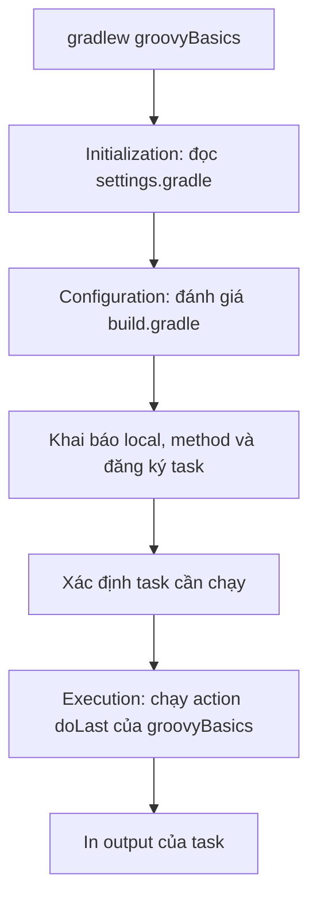

# Biến, phương thức, phạm vi và giá trị trả về ngầm định trong Groovy DSL

Khi đọc `build.gradle`, bạn thường gặp `def`, lời gọi như `repositories { mavenCentral() }`, khối `tasks.register('hello') { ... }` và những phương thức **không có từ khóa `return`**. Đây là những đặc trưng của **Groovy** được Gradle sử dụng để tạo **Groovy DSL**. Hiểu chúng sẽ giúp bạn đọc đúng cấu hình, viết logic build vừa đủ và tránh lỗi rất khó nhìn ra khi trộn biến cục bộ với thuộc tính của Gradle.

Bốn câu hỏi của bài học:

1. **Biến**: khai báo, gán và truyền giá trị như thế nào với `def` hoặc kiểu tường minh?
2. **Phương thức**: định nghĩa và gọi một hàm Groovy khác gì với gọi một phương thức DSL của Gradle?
3. **Phạm vi (scope)**: tên biến được nhìn thấy ở đâu; vì sao phương thức trong script đôi khi không đọc được biến `def` ở đầu file?
4. **Giá trị trả về ngầm định (implicit return)**: vì sao biểu thức cuối cùng của phương thức hoặc closure có thể trở thành kết quả mà không cần `return`?

Đối tượng chính là **`build.gradle` và `settings.gradle` viết bằng Groovy DSL**. Các ví dụ script độc lập chạy bằng Groovy CLI được ghi rõ; ví dụ Gradle đầy đủ chạy qua Gradle Wrapper. Đây không phải cú pháp Java: file `.gradle` không đem đi biên dịch trực tiếp bằng `javac`, dù build Java của bạn có thể dùng JDK 17 hoặc mới hơn.

## 1. Groovy là ngôn ngữ; Groovy DSL là cách Gradle sử dụng ngôn ngữ ấy

Groovy chạy trên JVM, có kiểu động, hỗ trợ cú pháp gần Java, các **closure** và khả năng gọi phương thức không viết dấu ngoặc trong những trường hợp nhất định. Gradle dùng những tính năng ấy để viết cấu hình ngắn gọn:

```groovy
// build.gradle — Groovy DSL
plugins {
    id 'java'
}

repositories {
    mavenCentral()
}

tasks.register('hello') {
    doLast {
        println 'Hello from Gradle'
    }
}
```

Đọc chính xác:

- `plugins { ... }`, `repositories { ... }`, `tasks.register(...)` là các lời gọi phương thức/API được Gradle cung cấp; dấu ngoặc nhọn truyền **closure** để cấu hình.
- `id 'java'` và `println '...'` dùng cú pháp gọi phương thức Groovy cho phép lược dấu ngoặc trong ngữ cảnh phù hợp.
- `doLast { ... }` đăng ký một **task action** để chạy khi task được thực thi, không có nghĩa `println` chạy ngay khi Gradle đọc toàn bộ script.
- Groovy DSL có vai trò **mô tả cấu hình/build**, không phải nơi chứa phần lớn nghiệp vụ Java của ứng dụng.

Trong Gradle, mỗi loại script có đối tượng được cấu hình riêng: `settings.gradle` chủ yếu làm việc với `Settings`, `build.gradle` với `Project`, còn init script với `Gradle`. Bên trong một block, Gradle có thể đặt `delegate` thành đối tượng như Task hoặc RepositoryHandler. Đó là lý do cùng một tên có thể được giải quyết khác nhau tùy vị trí.

## 2. Khai báo biến: `def`, kiểu tường minh và `final`

### 2.1. `def` nghĩa là gì?

Trong Groovy, `def` là cách khai báo khi không muốn ghi kiểu cụ thể tại vị trí đó:

```groovy
def count = 3
def title = 'Gradle'
def enabled = true

println count
println title
println enabled
```

Kết quả:

```text
3
Gradle
true
```

Một biến `def` có thể được gán lại giá trị thuộc kiểu khác trong Groovy động:

```groovy
def value = 10
value = 'ten'
assert value == 'ten'
```

Điều này **không có nghĩa** mọi thao tác đều an toàn: nếu gọi phương thức không tồn tại trên đối tượng thực tế, lỗi vẫn có thể xuất hiện khi thực thi. `def` trong khai báo biến gần với việc để Groovy xử lý giá trị dưới kiểu tổng quát; không đồng nghĩa với việc Gradle tự tạo một **Project property**.

### 2.2. Có thể khai báo kiểu rõ ràng

```groovy
int retries = 3
String moduleName = 'app'
boolean active = true
List<String> names = ['core', 'app']
Map<String, Integer> ports = [api: 8080, admin: 8081]
```

Dùng kiểu tường minh có lợi khi muốn người đọc hiểu hợp đồng dữ liệu và khi trình biên dịch/Groovy có thể kiểm tra hoặc ép kiểu. Groovy vẫn có nhiều quy tắc chuyển đổi động; không nên suy ra rằng chỉ cần khai báo `String` thì toàn bộ script đã được kiểm tra tĩnh như Java.

Bạn cũng có thể khóa **biến tham chiếu** bằng `final`:

```groovy
final String environment = 'dev'
final List<String> modules = ['api', 'core']
```

Không thể gán `environment` sang giá trị khác sau khi khai báo. Tuy nhiên `final` chỉ ngăn **gán lại tham chiếu**; bản thân danh sách trong `modules` vẫn có thể thay đổi nếu không dùng một cấu trúc bất biến.

### 2.3. Dấu nháy đơn và đôi: một khác biệt quan trọng

```groovy
def name = 'Gradle'
println 'Hello, $name!'
println "Hello, $name!"
```

Kết quả:

```text
Hello, $name!
Hello, Gradle!
```

- Chuỗi nháy đơn thông thường là literal `String`, không nội suy `$name`.
- Chuỗi nháy đôi có nội suy sẽ tạo **GString** trong quá trình đánh giá; Groovy chuyển nó sang chuỗi khi phù hợp với API.
- Viết `$name` cho biến/thuộc tính đơn giản, hoặc `${expression}` khi muốn đánh giá biểu thức như `${count * 2}`.

Trong build script, tránh nhầm `'version-$number'` với `"version-$number"`. Nếu tên artifact, đường dẫn hoặc thông báo được xây dựng từ biến, sai kiểu dấu nháy có thể làm Gradle dùng nguyên chuỗi chứa dấu đô la.

## 3. Phương thức Groovy: khai báo và gọi

Phương thức nhận tham số, thực hiện logic và có thể trả lại một giá trị.

```groovy
String greeting(String name) {
    "Hello, $name!"
}

int square(int number) {
    number * number
}

def describe(String name, int level) {
    "$name / level $level"
}

println greeting('Gradle')
println square(4)
println describe('core', 2)
```

Đầu ra:

```text
Hello, Gradle!
16
core / level 2
```

Ở ví dụ này:

- `String greeting(...)` khai báo kiểu trả về `String`.
- `int square(...)` khai báo kiểu trả về `int`.
- `def describe(...)` không ghi kiểu trả về tường minh.
- Tham số `name`, `number` và `level` chỉ có phạm vi trong phương thức tương ứng.
- Groovy cho phép **không viết `return`** khi muốn trả về giá trị của biểu thức cuối; phần này sẽ được giải thích kỹ ở mục 5.

Trong nhiều lời gọi Groovy, có thể bỏ dấu ngoặc nếu cú pháp không mơ hồ:

```groovy
println greeting('Gradle')
println('done')
```

Đó đều là lời gọi phương thức. Trong build script thực tế, nên **giữ dấu ngoặc** cho những lời gọi có nhiều tham số, nhiều tầng lồng nhau hoặc cần đọc rõ thứ tự; cú pháp ngắn không phải tiêu chí đúng sai.

### 3.1. Giá trị mặc định của tham số

```groovy
String welcome(String name, String prefix = 'Hi') {
    "$prefix, $name!"
}

assert welcome('Gradle') == 'Hi, Gradle!'
assert welcome('Gradle', 'Hello') == 'Hello, Gradle!'
```

Groovy hỗ trợ tham số có giá trị mặc định. Ở ví dụ này, `prefix` nhận `'Hi'` khi người gọi bỏ qua đối số thứ hai.

### 3.2. “Named arguments” thường được truyền như một Map

```groovy
String label(Map options) {
    options.name + ':' + options.level
}

println label(name: 'api', level: 2)
```

Kết quả:

```text
api:2
```

Đoạn `name: 'api', level: 2` được Groovy gom thành Map để truyền cho phương thức `label(Map)`. Đừng suy ra mọi method Groovy đều có “tham số có tên” như Kotlin: cú pháp named arguments trong Groovy gắn với cơ chế Map và cách API nhận đối số.

### 3.3. Phương thức Groovy khác một Gradle task

```groovy
String normalizeName(String name) {
    name.trim().toLowerCase()
}
```

Đây là phương thức Groovy của script, được gọi như một helper. Nó **không** tạo task mang tên `normalizeName` để chạy bằng `./gradlew normalizeName`.

Ngược lại:

```groovy
tasks.register('showName') {
    doLast {
        println 'demo'
    }
}
```

Đoạn này **đăng ký một task Gradle**. Có thể chạy bằng `./gradlew showName`. Tên task thuộc mô hình Gradle, còn tên method thuộc mã Groovy được biên dịch trong script.

## 4. Phạm vi của biến: local, method và closure

**Scope** là khu vực mà một tên biến tồn tại và có thể được truy cập. Trong Groovy, cần phân biệt ít nhất các trường hợp sau:

| Khai báo | Có thể truy cập ở đâu? | Điểm cần nhớ |
| --- | --- | --- |
| `def value = 1` trong method | Phạm vi cục bộ của method | Method khác không tự thấy biến này. |
| Tham số `int n` của method | Bên trong method | Giá trị do lời gọi truyền vào. |
| `def x = 1` ở script top level | Cục bộ trong phần thân script, gần với `run()` | Method khai báo ở top level **không tự thấy** `x`. |
| Biến local bên ngoài closure | Closure được định nghĩa trong phạm vi ấy có thể **capture** biến | Có thể đọc và trong trường hợp phù hợp có thể cập nhật biến bên ngoài. |
| `@Field` trên biến trong script | Field của script class được sinh ra | Method của cùng script có thể truy cập. |
| Extra property của Gradle Project | Qua API extra properties của Project tương ứng | Không phải biến local; phải quản lý phạm vi project/root rõ ràng. |

### 4.1. Local trong method

```groovy
int compute(int input) {
    def doubled = input * 2
    doubled + 1
}

assert compute(4) == 9
```

`input` và `doubled` có ý nghĩa trong phương thức `compute`; mã bên ngoài không tự đọc được `doubled`.

### 4.2. Closure có thể “bắt giữ” biến ở phạm vi bên ngoài

```groovy
def prefix = 'Hello'
def speak = { String person -> "$prefix, $person!" }

println speak.call('Gradle')

prefix = 'Hi'
println speak.call('Gradle')
```

Kết quả:

```text
Hello, Gradle!
Hi, Gradle!
```

Closure `speak` có thể tham chiếu biến `prefix` ở phạm vi lexical của nó. Khi `prefix` đổi, lần gọi sau thấy giá trị mới. Điều này khác với một **phương thức top level** trong Groovy script, vốn không tự capture biến cục bộ của phần thân script theo cách đó.

Đối với logic build, capture biến vừa giúp cấu hình gọn, vừa có thể gây lỗi nếu biến bị thay đổi sau thời điểm bạn nghĩ đã “chốt” cấu hình. Đặc biệt, tránh phụ thuộc trạng thái mutable bên ngoài hoặc trạng thái không khai báo làm đầu vào task; điều đó có thể ảnh hưởng khả năng tái lập và configuration cache.

### 4.3. Biến khai báo bên trong một closure không phải tài sản của mọi closure

```groovy
def generator = { int n ->
    def doubled = n * 2
    doubled
}

println generator.call(5)
```

Kết quả:

```text
10
```

`doubled` thuộc phần thân closure; bạn không thể dùng tên đó tùy tiện ở đầu file sau khi closure đã chạy. Một closure khác cũng không được quyền đọc trực tiếp biến local này nếu nó không được cung cấp thông qua phạm vi lồng nhau hoặc tham số.

## 5. Giá trị trả về ngầm định của method

Groovy cho phép phương thức trả về **giá trị của biểu thức cuối cùng được đánh giá** nếu không viết `return`.

```groovy
int add(int a, int b) {
    a + b
}

String grade(int score) {
    score >= 80 ? 'PASS' : 'RETRY'
}

assert add(2, 3) == 5
assert grade(90) == 'PASS'
assert grade(60) == 'RETRY'
```

Cấu trúc tương đương nếu viết rõ:

```groovy
int add(int a, int b) {
    return a + b
}

String grade(int score) {
    return score >= 80 ? 'PASS' : 'RETRY'
}
```

Ở hai phiên bản, `add(2, 3)` đều trả `5`, `grade(90)` trả `'PASS'`. Không có quy tắc “bắt buộc dùng `return` giống Java” cho những biểu thức cuối trong Groovy.

### 5.1. Nếu có nhiều câu lệnh thì câu nào là kết quả?

```groovy
int nextValue(int number) {
    def result = number + 1
    println 'Calculating'
    result
}

println nextValue(4)
```

Đầu ra:

```text
Calculating
5
```

Kết quả trả về là `result` vì đây là biểu thức cuối cùng. Nếu đặt `println` thành câu lệnh cuối, bạn không nên mong nó trả về `result`; `println` được gọi để tạo side effect trên stdout, không phải để làm giá trị kết quả.

### 5.2. Nhánh điều kiện và `return` tường minh

Có thể viết ngắn bằng toán tử điều kiện như ví dụ `grade`. Với nhiều nhánh hoặc khi muốn **thoát sớm**, `return` tường minh làm ý định rõ hơn:

```groovy
String classify(int value) {
    if (value < 0) {
        return 'negative'
    }
    if (value == 0) {
        return 'zero'
    }
    'positive'
}

assert classify(-1) == 'negative'
assert classify(0) == 'zero'
assert classify(2) == 'positive'
```

Hai nhánh đầu trả về ngay lập tức; nhánh cuối tận dụng implicit return. Cả ba đều hợp lệ. Trong method phức tạp, chọn cách thể hiện mà người đọc ít nhầm với giá trị của một câu lệnh `if` hoặc vòng lặp.

### 5.3. `void` và trường hợp không có giá trị hữu ích

```groovy
void logName(String name) {
    println "Name: $name"
}
```

`void` cho biết method không cung cấp giá trị trả về hữu ích. Đừng sử dụng implicit return như một kỹ thuật để biến lời gọi có mục đích ghi log thành nơi sản xuất dữ liệu.

**Lưu ý với Gradle:** giá trị trả về của một closure **task action** như `doLast { 1 + 2 }` không trở thành artifact, `TaskOutcome` hay đầu ra được Gradle theo dõi. Muốn có file output cho task, cần tạo file đúng cách và khai báo inputs/outputs phù hợp. Implicit return là cơ chế của ngôn ngữ Groovy, không thay thế cơ chế theo dõi task của Gradle.

## 6. Closure: giá trị hàm, tham số, `it` và implicit return

Closure là một đối tượng `groovy.lang.Closure` có thể chứa mã, nhận tham số và trả về kết quả. Hầu hết block cấu hình bạn thấy trong Groovy DSL đều dựa trên closure.

```groovy
def square = { int n -> n * n }
def upper = { it.toString().toUpperCase() }
def constant = { -> 42 }

println square.call(4)
println upper.call('groovy')
println constant.call()
```

Đầu ra:

```text
16
GROOVY
42
```

Phân biệt:

- `{ int n -> n * n }`: closure có **tham số khai báo rõ**, tên `n`, biểu thức cuối trả về kết quả.
- `{ it.toString().toUpperCase() }`: không khai báo danh sách tham số nên Groovy cung cấp tham số ngầm định tên **`it`** cho cách viết này.
- `{ -> 42 }`: dấu `->` với phần tham số trống khai báo closure **không nhận tham số**; phù hợp hơn khi muốn nói rõ không có input.
- `square.call(4)` tương đương với `square(4)` trong trường hợp này; viết `.call` giúp nhấn mạnh đây là **biến chứa closure**.

### 6.1. Closure cũng trả về biểu thức cuối

```groovy
def discount = { int price ->
    def fee = price / 10
    price - fee
}

assert discount.call(100) == 90
```

Kết quả của closure là biểu thức cuối `price - fee`. Với kiểu `int`, phép chia `/` của Groovy có thể tạo số thập phân; ở ví dụ này `100 / 10` có giá trị `10` và so sánh số đúng. Khi xử lý tiền thật, phải thiết kế rõ kiểu `BigDecimal`, đơn vị và quy tắc làm tròn, không coi đây là công thức tính tiền thực tế.

### 6.2. `return` trong closure không phải `break` của vòng lặp bên ngoài

```groovy
[1, 2, 3].each { int n ->
    if (n == 2) {
        return
    }
    println n
}
```

Đầu ra:

```text
1
3
```

`return` kết thúc **lần gọi closure hiện tại** khi `n == 2`; vòng `each` vẫn tiếp tục với `3`. Nếu cần dừng tìm kiếm sớm, cân nhắc phương thức collection phù hợp như `find`, `any`, hoặc vòng lặp `for` với `break`. Tránh mặc định suy luận `return` trong closure tác động giống `return` trong phương thức bao ngoài.

### 6.3. Method và closure khác nhau như thế nào?

| Đặc điểm | Method | Closure |
| --- | --- | --- |
| Khai báo | `String greet(String n) { ... }` | `def greet = { String n -> ... }` |
| Bản chất | Thành viên của class/script được sinh ra | Đối tượng `Closure` có thể lưu trong biến và truyền đi |
| Capture biến local từ nơi khai báo | Không theo cách closure capture | Có, theo phạm vi lexical |
| Tham số và return | Có, kèm kiểu trả về nếu cần | Có, kết quả thường là biểu thức cuối |
| Trong Gradle DSL | Helper script hoặc phương thức API Gradle | Block cấu hình và task action (`doLast`) |
| Cách gọi | `greet('A')` | `greet.call('A')` hoặc `greet('A')` |

Nhiều lời gọi “trông giống method” trong Gradle thực chất **là method nhận closure**, ví dụ `repositories { ... }` hoặc `tasks.register('name') { ... }`.

## 7. Bẫy quan trọng: biến `def` top level trong script không tự đi vào method

Groovy script được biên dịch thành một lớp script. Các câu lệnh đứng ở phần thân file được đặt trong logic chạy của script; những method khai báo trong file trở thành **method riêng của lớp**.

Ví dụ sau **sai có chủ đích**:

```groovy
// WrongScope.groovy — minh họa lỗi, KHÔNG phải chương trình thành công
def prefix = 'Hello'

String message(String name) {
    "$prefix, $name!"
}

println message('Gradle')
```

Trong script Groovy thông thường, `def prefix` ở phần thân script là **biến cục bộ của phần chạy script**. Method `message` không tự thấy biến local ấy. Khi truy cập `prefix` trong method, Groovy có thể báo `MissingPropertyException` (không tìm được thuộc tính tương ứng của script).

Có ít nhất hai cách giải quyết đúng.

### Cách A — truyền giá trị qua tham số (thường rõ ràng nhất)

```groovy
// FixedByParameter.groovy
String message(String prefix, String name) {
    "$prefix, $name!"
}

def prefix = 'Hello'
println message(prefix, 'Gradle')
```

Đầu ra:

```text
Hello, Gradle!
```

Phương thức nhận đủ input từ tham số, dễ kiểm thử và tái sử dụng.

### Cách B — dùng `@Field` trong script Groovy độc lập

```groovy
// FixedByField.groovy
import groovy.transform.Field

@Field String prefix = 'Hello'

String message(String name) {
    "$prefix, $name!"
}

println message('Gradle')
```

Đầu ra:

```text
Hello, Gradle!
```

`@Field` biến khai báo thành **field của script class**, nên method của script truy cập được. Nó **không tự tạo Project property** để những project khác trong Gradle nhìn thấy.

Một cơ chế khác của Groovy script độc lập là **script Binding**: tên được gán mà không khai báo local có thể đi vào binding và được các method giải quyết như thuộc tính động. Tuy nhiên **không nên dùng gán tên chưa khai báo như một cách ngầm chia sẻ cấu hình trong Gradle**, vì Gradle bổ sung cơ chế property/delegate riêng. Ưu tiên truyền tham số, closure capture, hoặc API property tường minh.

> Các file `*.groovy` ở ba ví dụ trên chạy bằng `groovy FixedByParameter.groovy` / `groovy FixedByField.groovy` khi đã cài Groovy CLI tương thích. **Gradle Wrapper không cung cấp lệnh `groovy` trong terminal**, dù Gradle sử dụng Groovy để đọc script `.gradle`.

## 8. Phạm vi trong Gradle: biến local khác Project property

Xét hai đoạn sau trong `build.gradle`:

```groovy
def localVersion = '1.2.0'
version = localVersion
```

Dòng đầu tạo **biến local** của script; dòng thứ hai gán vào thuộc tính **`version` của Project** thông qua DSL Gradle. Bạn có thể dùng `project.version` để đọc giá trị project:

```groovy
tasks.register('showVersion') {
    doLast {
        println project.version
    }
}
```

Nếu bạn chỉ viết `def localVersion = '1.2.0'` thì **không có nghĩa** `project.version` đã được đổi. Đây là lỗi thiết kế thường gặp khi xem mọi biến đầu script như “biến toàn project”.

### 8.1. Extra properties khi thật sự muốn có property của Project

Gradle có **ExtraPropertiesExtension**, thường truy cập bằng `ext` trong Groovy DSL:

```groovy
// build.gradle
ext.releaseChannel = 'dev'

tasks.register('printChannel') {
    doLast {
        println project.extensions.extraProperties.get('releaseChannel')
    }
}
```

Lệnh `./gradlew -q printChannel` in:

```text
dev
```

Khác với `def releaseChannel = 'dev'`, `ext.releaseChannel` là thuộc tính mở rộng gắn với **Project**. Nếu thiết kế multi-project, phải xác định bạn muốn property thuộc root hay thuộc subproject nào. `rootProject.ext` chỉ rõ một scope khác với `project.ext`; chúng không tự đồng bộ.

Với dự án lớn, nên dùng `gradle.properties`, convention plugin hoặc typed extension/provider API phù hợp cho cấu hình cần chia sẻ, kiểm tra và theo dõi; extra property không phải thay thế cho mọi cơ chế cấu hình có kiểu.

### 8.2. Gán nhầm có thể tạo hoặc chỉnh một thuộc tính không mong muốn

```groovy
// Không suy diễn rằng đây là local variable:
someName = 'value'
```

Trong Groovy script độc lập, gán tên chưa khai báo có thể tương tác với `Binding`. Trong Gradle build script, cơ chế resolve property của script và `Project` cũng tham gia. Câu lệnh không có `def`/kiểu tường minh **không đồng nghĩa** “tạo một biến local mới”; tùy đối tượng/độ dài scope, có thể đổi project property, dẫn đến lỗi property hoặc hành vi khó đoán.

Hãy khai báo local rõ ràng:

```groovy
def reportTitle = 'Summary'
```

Và khi cần cấu hình Project thì truy cập rõ API:

```groovy
project.version = '1.2.0'
project.ext.reportTitle = 'Summary'
```

Quy ước này giúp tránh trùng tên với các property Gradle có sẵn như `version`, `group`, `name`, `description`.

## 9. `this`, `owner`, `delegate`: vì sao block Gradle đọc được các tên đặc biệt?

Một Groovy closure có ba liên hệ quan trọng:

- **`this`**: đối tượng của lớp bao quanh nơi closure được khai báo, thường là instance script nếu closure được khai báo ngay trong script.
- **`owner`**: đối tượng/closure bao trực tiếp theo cấu trúc khai báo. Với closure lồng nhau, owner có thể là closure bên ngoài.
- **`delegate`**: đối tượng khác mà closure có thể dùng để resolve property/method; mặc định thường trỏ đến owner, nhưng Gradle **cấu hình lại delegate** cho các block DSL.

Đây là lý do Groovy DSL có thể viết:

```groovy
tasks.register('printProject') {
    group = 'learning'
    description = 'Print project name'

    doLast {
        println project.name
    }
}
```

Trong block cấu hình task, `group` và `description` được resolve thành các thuộc tính Task. Bên trong `doLast`, `project.name` là cách truy cập rõ ràng project sở hữu task. Lệnh `./gradlew -q printProject` sẽ in tên project hiện tại.

**Không hiểu `delegate` là biến toàn cục.** Mỗi loại closure DSL có đối tượng đích riêng; trong `repositories { mavenCentral() }`, phương thức `mavenCentral()` thuộc API repository handler, còn trong `dependencies { implementation '...' }`, Gradle resolve `implementation` theo configuration/dependency handler của project. Không thể đặt tùy ý mọi lệnh vào mọi block.

Groovy có `resolveStrategy` ảnh hưởng cách tra cứu tên ở owner/delegate; Gradle và plugin có thể đặt chiến lược phù hợp cho block riêng. Khi tên trùng nhau hoặc đoạn DSL phức tạp, dùng tham chiếu như `project.version`, `tasks.named('...')` và API cụ thể để tránh dựa vào resolution ngầm.

### 9.1. Cấu hình task và thực thi task là hai thời điểm khác nhau

```groovy
def message = 'Hello'

tasks.register('sayHello') {
    doLast {
        println message
    }
}
```

`message` là local trong phần script và được closure action sử dụng qua lexical capture. Việc đăng ký `sayHello` tạo task trong mô hình Gradle; lời gọi `println message` bên trong `doLast` chỉ chạy khi task action được thực thi, ví dụ `./gradlew sayHello`.

Gradle có **task configuration avoidance**, nên block cấu hình `tasks.register(...){...}` cũng có thể được thực thi khi task được hiện thực hóa (realized), không nhất thiết ngay lập tức ở mọi lần chạy build. Tránh viết các side effect trong phần cấu hình, và không dùng biến mutable không được khai báo là input để lưu trạng thái giữa các task.

## 10. Ví dụ Gradle Groovy DSL hoàn chỉnh, chạy được

Dựng một project nhỏ:

```text
groovy-dsl-scope/
├── settings.gradle
├── build.gradle
├── gradlew
├── gradlew.bat
└── gradle/
    └── wrapper/
        ├── gradle-wrapper.jar
        └── gradle-wrapper.properties
```

**`settings.gradle`:**

```groovy
rootProject.name = 'groovy-dsl-scope'
```

**`build.gradle`:**

```groovy
// Biến local của script; closure có thể capture chúng.
def prefix = 'Hello'
def greet = { String name -> "$prefix, $name!" }
def twice = { int n -> n * 2 }

// Phương thức top level của script; chỉ dùng tham số.
String uppercaseName(String name) {
    name.toUpperCase(java.util.Locale.ROOT)
}

// Thuộc tính mở rộng của Project, không phải biến local.
ext.course = 'Groovy DSL'

tasks.register('groovyBasics') {
    group = 'learning'
    description = 'Show variables, methods, scopes, and returns'

    doLast {
        def count = 3
        println greet.call('Gradle')
        println 'twice=' + twice.call(count)
        println 'uppercase=' + this.uppercaseName('gradle')
        println 'project=' + project.name
        println 'course=' + project.extensions.extraProperties.get('course')
    }
}
```

Lệnh trên dùng cả **method**, **closure** và **biến local**:

- `prefix` là local của script; `greet` là closure có thể capture nó.
- `twice` là closure trả về `n * 2` ngầm định.
- `uppercaseName` là method Groovy của script, nhận input qua tham số và implicit return `String`.
- `ext.course` là Project extra property, được đọc qua API tường minh.
- `count` là local của action `doLast`, không phải Project property.
- `group`/`description` trong block của `tasks.register` được Gradle gắn với Task.

Nếu máy chưa có Wrapper, hãy tạo bằng một bản Gradle phù hợp rồi commit các file Wrapper:

```bash
gradle wrapper --gradle-version 8.5
```

Gradle 8.5 có thể chạy với JDK 17 phù hợp; dự án ví dụ không yêu cầu plugin ngoài hoặc Java source. Trong thư mục gốc, trên Linux/macOS chạy:

```bash
./gradlew -q groovyBasics
```

Trên Windows chạy `gradlew.bat -q groovyBasics`. Khi build được chạy trong môi trường phù hợp, các dòng do task action in ra là:

```text
Hello, Gradle!
twice=6
uppercase=GRADLE
project=groovy-dsl-scope
course=Groovy DSL
```

`-q` giảm thông báo Gradle để output của action dễ đọc; nó không khiến task chạy dưới một ngôn ngữ khác. Bài thực hành này minh họa Groovy **được Gradle nhúng sẵn để xử lý `.gradle`**, nên không cần cài riêng lệnh `groovy` để thực thi task qua Wrapper.

### 10.1. Thử thay đổi có kiểm soát

Đổi:

```groovy
def prefix = 'Hi'
```

Chạy lại `./gradlew -q groovyBasics` sẽ làm dòng đầu thành:

```text
Hi, Gradle!
```

Vì `greet` capture `prefix`. Không cần sửa method `uppercaseName` vì method đó chỉ nhận `name` và không phụ thuộc local `prefix`.

Sau đó đổi:

```groovy
ext.course = 'Gradle Groovy'
```

Dòng cuối thành:

```text
course=Gradle Groovy
```

Đây là thay đổi **Project extra property**, không phải thay đổi local `prefix`.

### 10.2. Tại sao không dùng kết quả trả về của `doLast`?

Giả sử action viết:

```groovy
tasks.register('calculate') {
    doLast {
        1 + 2
    }
}
```

Closure có thể đánh giá biểu thức cuối thành `3`, nhưng Gradle **không hiển thị `3` chỉ vì closure trả nó về**, và cũng không biến `3` thành artifact của task. Muốn nhìn kết quả, cần side effect được thiết kế rõ như `println 1 + 2`; muốn Gradle theo dõi đầu ra, dùng file/task properties và khai báo outputs theo API thích hợp. Phân biệt **giá trị trả về của đoạn mã Groovy** với **kết quả công việc của Gradle task**.

## 11. Phạm vi biến theo script và giai đoạn Gradle

Một build Gradle thông thường có ba giai đoạn: initialization, configuration, execution.



Sự khác nhau rất quan trọng:

| Thành phần | Thời điểm thường liên quan | Ví dụ |
| --- | --- | --- |
| Top-level assignment trong `build.gradle` | Khi script được đánh giá trong cấu hình | `def prefix = 'Hello'` |
| Method khai báo trong script | Định nghĩa có sẵn khi script được biên dịch; body chỉ chạy khi được gọi | `String uppercaseName(...) { ... }` |
| Closure cấu hình task | Khi Gradle cấu hình/realize task theo cơ chế của nó | `tasks.register('name') { group = '...' }` |
| Closure task action | Khi Gradle thực thi task action | `doLast { println '...' }` |
| Giá trị trả về của method/closure | Khi lời gọi tương ứng hoàn tất | `twice.call(3)` trả `6` |

Nếu log chứa một dòng `println` top level, dòng ấy có thể xuất hiện khi cấu hình dù bạn chạy một task khác. Nếu `println` nằm trong `doLast`, nó chỉ được chạy khi action thực thi. Từ đó bạn biết nơi đặt logic tính cấu hình đơn giản và nơi đặt công việc thực tế như tạo file.

## 12. Lỗi thường gặp và cách sửa

### Lỗi 1 — Nhầm `def` với thuộc tính Gradle Project

```groovy
def currentVersion = '2.0'
```

Câu này tạo local; không đổi `project.version`. Muốn đặt version:

```groovy
version = '2.0'
```

Hoặc viết rõ `project.version = '2.0'`. Đừng suy đoán project property từ tên local.

### Lỗi 2 — Method đọc biến local ở đầu script

```groovy
def greeting = 'Hello'

String message(String who) {
    "$greeting $who"
}
```

Method không capture `greeting` như closure và có thể bị `MissingPropertyException`. Sửa bằng cách truyền `greeting` như tham số; với Groovy script độc lập cũng có thể cân nhắc `@Field` theo mục 7. Không giải quyết bằng cách xóa `def` ngẫu nhiên trong Gradle script.

### Lỗi 3 — Giả định closure và method có cùng semantics

```groovy
def greeting = 'Hello'
def message = { String who -> "$greeting $who" }
```

Closure có thể capture `greeting`. Thay closure bằng một method top level mà không chuyển `greeting` thành tham số sẽ thay đổi scope và có thể gây lỗi.

### Lỗi 4 — Tưởng biểu thức cuối `doLast` là output Gradle

```groovy
tasks.register('foo') {
    doLast {
        'result'
    }
}
```

Giá trị `'result'` không trở thành task output mà Gradle publish, cache hay in tự động. Muốn file output cần file và khai báo output chính xác; muốn hiển thị cần `println`.

### Lỗi 5 — Trùng tên với thuộc tính Task hoặc Project

```groovy
tasks.register('example') {
    group = 'demo'
}
```

`group` cấu hình Task. Nếu định dùng biến local trùng tên `group`, người đọc sẽ khó phân biệt binding. Dùng tên cụ thể như `groupLabel`, truy cập `project.group` hoặc `task.group` một cách tường minh khi cần.

### Lỗi 6 — Gọi API Gradle ở sai đối tượng

```groovy
repositories {
    mavenCentral()
}
```

`mavenCentral()` là lời gọi DSL phù hợp với repository handler. Không thể chuyển nguyên lời gọi này sang closure bất kỳ rồi giả định delegate giống nhau. Cần biết Gradle đang cấu hình **đối tượng gì**, không chỉ nhìn cú pháp Groovy có dấu ngoặc nhọn.

### Lỗi 7 — Nhầm `return` trong `each` với thoát cả vòng lặp

Trong `list.each { ... }`, `return` kết thúc lần gọi closure hiện tại. Nếu muốn dừng toàn bộ tìm kiếm, chọn `find`, `any` hoặc vòng lặp thường với `break`.

### Lỗi 8 — Đổi `.gradle` thành `.gradle.kts` mà giữ `def`

`def`, closure Groovy, `println 'text'`, cú pháp `id 'java'` thuộc Groovy DSL. `build.gradle.kts` dùng **Kotlin DSL**, thường khai báo local bằng `val` hoặc `var` và gọi `id("java")`. Đây là ngôn ngữ khác; hai loại script không thể chuyển đổi chỉ bằng cách đổi phần mở rộng.

## 13. Quy tắc thực hành khi viết Groovy DSL dễ bảo trì

1. **Ưu tiên cấu hình khai báo rõ ràng.** Dùng `plugins`, `dependencies`, `tasks.register` và API của Gradle cho công việc build; chỉ thêm method/closure helper khi thực sự giảm lặp hoặc diễn đạt quy tắc.
2. **Đặt tên biến local có ý nghĩa.** `def targetDir` rõ hơn `def x`, tránh trùng `version`, `name`, `group` nếu thực sự muốn local.
3. **Truyền input cho method.** Method thuần nhận đủ tham số dễ hiểu và ít phụ thuộc vào script binding.
4. **Dùng closure khi cần callback hoặc capture local.** Đừng lợi dụng capture mutable state thay cho khai báo task inputs/outputs.
5. **Viết `return` rõ khi có nhiều nhánh hoặc thoát sớm.** Dùng implicit return cho helper ngắn, một biểu thức rõ ràng.
6. **Ghi rõ scope của property.** Nếu đó là cấu hình Gradle, dùng `project`, `rootProject`, `ext`, provider hay extension thích hợp; đừng xem `def` là phương thức chia sẻ cấu hình giữa các project.
7. **Hiểu delegate trước khi di chuyển code giữa block.** Một lời gọi trong `repositories` không nhất thiết hợp lệ trong `tasks` hoặc `dependencies`.
8. **Để action làm công việc ở execution.** Không tạo file/xóa file/đẩy bản phát hành ở top-level chỉ vì “cấu hình được phép chạy”; giữ build có thể dự đoán và dùng cơ chế Gradle quản lý task.
9. **Đọc lỗi ở đúng tầng.** `MissingPropertyException` thường gợi ý scope/property/delegate; `MissingMethodException` có thể chỉ phương thức không có trên đối tượng được resolve; lỗi syntax có thể do trộn Kotlin/Groovy DSL.
10. **Kiểm tra đúng Gradle Wrapper của dự án.** Gradle nhúng phiên bản Groovy phù hợp với bản Gradle đó; có thể xem thông tin bằng `./gradlew --version` thay vì giả định phiên bản Groovy CLI cài ngoài.

## 14. Tự kiểm tra hiểu bài

**Câu 1.** `def answer = 42` và `project.version = '1.0'` có cùng scope không?

**Đáp án:** Không. `answer` là biến local (ở phạm vi khai báo), còn `project.version` là thuộc tính của đối tượng Project Gradle.

**Câu 2.** Vì sao method top-level `say()` không thấy `def title` ở đầu Groovy script, nhưng closure `def show = { title }` có thể thấy?

**Đáp án:** Method là thành viên của script class, không tự capture local trong body script. Closure capture biến lexical của nơi nó được tạo.

**Câu 3.** Kết quả của `def twice = { int n -> n * 2 }; twice.call(7)` là gì?

**Đáp án:** `14`, do closure trả về biểu thức cuối mà không cần `return`.

**Câu 4.** Với `String label(String x) { x.toUpperCase() }`, Groovy có buộc viết `return` không?

**Đáp án:** Không. Biểu thức `x.toUpperCase()` ở cuối là giá trị trả về ngầm định. Nếu muốn nhấn mạnh hợp đồng, có thể viết `return x.toUpperCase()`.

**Câu 5.** Trong `tasks.register('hello') { group = 'learning' }`, `group` thuộc đối tượng nào?

**Đáp án:** Theo DSL cấu hình task, nó là thuộc tính Task được Gradle đặt làm đối tượng cấu hình của block, không tự động là biến local của script.

**Câu 6.** `doLast { 5 * 2 }` có khiến task in `10` hoặc tạo artifact `10` không?

**Đáp án:** Không. Implicit return của closure không tự được Gradle coi là output. Phải chủ động in hoặc tạo artifact qua các API task phù hợp.

**Câu 7.** `println 'Hello, $name'` và `println "Hello, $name"` có giống nhau không?

**Đáp án:** Không. Dấu nháy đơn giữ literal `$name`; dấu nháy đôi nội suy biến.

**Câu 8.** Nếu muốn chia sẻ thuộc tính cấu hình cho nhiều project, có nên chỉ khai báo `def sharedValue` ở root build script?

**Đáp án:** Không. Local root script không tự là thuộc tính của mọi subproject. Cần cơ chế Gradle rõ ràng phù hợp như convention plugin, property hay extension được quản lý theo scope; với cấu hình đơn giản có thể dùng extra property được truy cập tường minh.

## 15. Tài liệu tham khảo để học sâu hơn

- [Groovy Language Documentation](https://docs.groovy-lang.org/latest/html/documentation/) — định nghĩa biến, method, script binding, `@Field`, closure, `it`, `this`/`owner`/`delegate`.
- [Groovy Language Semantics](https://www.groovy-lang.org/semantics.html) — phạm vi, biến và cơ chế ngôn ngữ.
- [Gradle — A Groovy Build Script Primer](https://docs.gradle.org/current/userguide/groovy_build_script_primer.html) — cách Groovy trở thành DSL cho `Project`, method/property, local và closure.
- [Gradle — Writing Build Scripts](https://docs.gradle.org/current/userguide/writing_build_scripts_intermediate.html) — cấu trúc script, local variables, extra properties, receiver/delegate và giai đoạn cấu hình.

**Điểm cần nhớ:** `def` khai báo biến local, method nhận tham số và có thể trả kết quả qua biểu thức cuối, closure có thể capture biến ngoài và cũng có implicit return. Trong Gradle, tên thuộc tính hoặc phương thức còn phụ thuộc **đối tượng DSL đang được cấu hình**. Khi biết scope và ranh giới giữa **giá trị Groovy** với **task/output của Gradle**, bạn sẽ giải thích và sửa được phần lớn lỗi thường gặp trong các script `.gradle`.