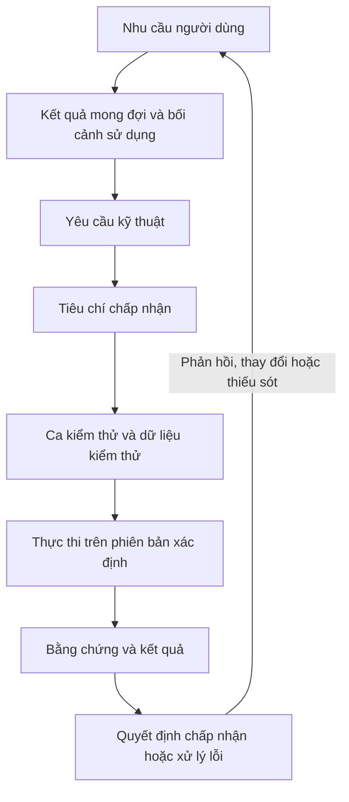

# Quan hệ giữa nhu cầu người dùng, yêu cầu kỹ thuật và bằng chứng kiểm thử

## Mục tiêu học tập

Sau bài học này, người học có thể:

- Phân biệt nhu cầu người dùng, yêu cầu kỹ thuật, tiêu chí chấp nhận, ca kiểm thử và bằng chứng kiểm thử.
- Giải thích cách nối một nhu cầu ban đầu với các yêu cầu có thể kiểm chứng và kết quả kiểm thử tương ứng.
- Xây dựng ma trận truy vết đơn giản để nhận ra yêu cầu chưa được kiểm thử hoặc kiểm thử không có căn cứ.
- Đánh giá xem bằng chứng hiện có đã đủ tin cậy để hỗ trợ quyết định chấp nhận hay chưa.

## 1. Vì sao cần nối ba yếu tố này?

Một sản phẩm có thể chạy đúng theo cách nhóm phát triển đã lập trình nhưng vẫn không giải quyết được vấn đề của người dùng. Ngược lại, một tính năng có vẻ hữu ích cũng chưa thể được đưa vào sử dụng nếu nhóm không chứng minh được nó đáp ứng các điều kiện kỹ thuật và chất lượng đã cam kết.

Trong phạm vi **VALIDATION_TESTING_STRATEGY**, chiến lược kiểm thử phải tạo được mối liên hệ có thể kiểm tra giữa:

1. **Nhu cầu người dùng**: vấn đề, mục tiêu hoặc kết quả mà người dùng cần đạt được. Đây là lý do sản phẩm hoặc tính năng tồn tại.
2. **Yêu cầu kỹ thuật**: những hành vi, quy tắc, giới hạn hoặc thuộc tính chất lượng mà hệ thống phải đáp ứng để giải quyết nhu cầu đó. Đây là điều nhóm phát triển cần xây dựng.
3. **Bằng chứng kiểm thử**: dữ liệu thu được khi kiểm tra một phiên bản hệ thống trong điều kiện xác định, cho thấy yêu cầu có được đáp ứng hay không. Đây là căn cứ để đánh giá kết quả.

Nếu thiếu mắt xích, quyết định về chất lượng sẽ yếu đi. Không có nhu cầu làm căn cứ, nhóm có thể kiểm thử những thứ không tạo ra giá trị. Không có yêu cầu rõ ràng, mỗi người có thể hiểu tiêu chí thành công theo một cách. Không có bằng chứng, kết luận “đã kiểm thử và đạt” chỉ là nhận định khó xác minh.

### Phân biệt validation và verification

Hai hoạt động này bổ trợ cho nhau:

- **Verification (xác minh)** hỏi: *Hệ thống có đáp ứng đúng yêu cầu đã đặc tả không?* Ví dụ: khi người dùng gửi biểu mẫu với địa chỉ giao hàng hợp lệ, API có tạo đơn hàng theo đúng quy tắc đã định không?
- **Validation (thẩm định)** hỏi: *Sản phẩm được xây dựng có thực sự đáp ứng nhu cầu và bối cảnh sử dụng của người dùng không?* Ví dụ: quy trình đặt hàng có giúp người mua hoàn tất việc mua hàng một cách dễ hiểu và phù hợp với cách họ làm việc không?

Một kết quả verification tốt không tự động chứng minh validation thành công. Nhóm có thể triển khai chính xác một yêu cầu được viết sai hoặc chưa phản ánh đúng nhu cầu. Vì vậy, chiến lược kiểm thử cần giữ được đường truy vết từ nhu cầu đến kết quả sử dụng, đồng thời kiểm tra tính đúng đắn của từng yêu cầu kỹ thuật.

## 2. Chuỗi truy vết từ nhu cầu đến bằng chứng

Mối quan hệ này thường được tổ chức thành một chuỗi có thể đi theo cả hai chiều:



Đi theo chiều từ trái sang phải giúp nhóm thiết kế kiểm thử có mục đích: mỗi ca kiểm thử cần trả lời một câu hỏi cụ thể về yêu cầu, và mỗi yêu cầu cần có lý do tồn tại từ nhu cầu hoặc ràng buộc đã biết. Đi ngược từ phải sang trái giúp người đánh giá trả lời: bằng chứng này đang hỗ trợ quyết định nào, kiểm tra yêu cầu nào, và yêu cầu đó phục vụ ai?

Các thành phần trong chuỗi không thể thay thế lẫn nhau:

| Thành phần | Câu hỏi cần trả lời | Ví dụ |
|---|---|---|
| Nhu cầu | Người dùng cần đạt điều gì và vì sao? | Người mua cần đặt hàng mà không phải nhập lại thông tin giỏ hàng. |
| Yêu cầu kỹ thuật | Hệ thống phải làm gì trong điều kiện nào? | Khi gửi đơn hàng hợp lệ, hệ thống tạo một đơn hàng gắn với giỏ hàng hiện tại. |
| Tiêu chí chấp nhận | Điều kiện quan sát được nào xác nhận yêu cầu đạt? | Phản hồi thành công chứa mã đơn hàng; giỏ hàng được chuyển sang trạng thái đã đặt. |
| Ca kiểm thử | Ta sẽ tạo điều kiện và thực hiện thao tác nào? | Gửi yêu cầu đặt hàng với giỏ hàng còn hiệu lực và địa chỉ hợp lệ. |
| Bằng chứng | Điều gì được ghi nhận sau lần chạy? | Mã phiên bản, dữ liệu đầu vào, phản hồi API, bản ghi đơn hàng và kết quả đối chiếu. |

## 3. Chuyển nhu cầu thành yêu cầu có thể kiểm chứng

Nhu cầu thường được diễn đạt bằng ngôn ngữ gần với người dùng: “đặt hàng nhanh”, “dễ sử dụng”, “an toàn”, hoặc “không mất dữ liệu”. Những câu này hữu ích để mô tả mong muốn nhưng chưa đủ cụ thể để thiết kế phép kiểm thử. Nhóm cần làm rõ người dùng, bối cảnh, kết quả mong đợi và điều kiện có thể quan sát.

Ví dụ, nhu cầu “người mua không phải nhập lại giỏ hàng khi đặt hàng” có thể được phân tích như sau:

- **Người dùng**: người mua đã thêm sản phẩm vào giỏ hàng.
- **Bối cảnh**: người mua gửi yêu cầu xác nhận đơn hàng và hệ thống xử lý thành công.
- **Kết quả mong đợi**: đơn hàng được tạo từ đúng các sản phẩm và số lượng đã xác nhận; người mua nhận được mã đơn hàng.
- **Ràng buộc cần làm rõ**: giỏ hàng có thể thay đổi trong lúc gửi yêu cầu không, yêu cầu gửi lặp lại được xử lý thế nào, và điều gì xảy ra nếu thanh toán thất bại.

Từ đó, nhóm có thể viết các yêu cầu nhỏ, độc lập và kiểm chứng được. Chẳng hạn:

- `REQ-CHECKOUT-01`: Khi nhận yêu cầu đặt hàng với giỏ hàng còn hiệu lực và dữ liệu giao hàng hợp lệ, hệ thống tạo đơn hàng từ đúng sản phẩm và số lượng trong giỏ hàng tại thời điểm xác nhận.
- `REQ-CHECKOUT-02`: Mỗi yêu cầu đặt hàng có cùng mã định danh chống gửi lặp chỉ được ghi nhận tối đa một đơn hàng.
- `REQ-CHECKOUT-03`: Khi dữ liệu giao hàng không hợp lệ, hệ thống từ chối tạo đơn hàng và trả về thông tin lỗi xác định được.

Đây là các yêu cầu minh họa; một dự án thực tế cần thống nhất quy tắc nghiệp vụ, cách định danh yêu cầu và ngưỡng đo lường với các bên liên quan.

Một yêu cầu tốt thường có các đặc điểm sau:

- **Rõ nghĩa**: người đọc hiểu cùng một hành vi hoặc quy tắc, không phải đoán các từ như “nhanh”, “tốt” hay “thân thiện”.
- **Đơn nghĩa và có phạm vi**: tập trung vào một hành vi hoặc thuộc tính chính; điều kiện và ngoại lệ quan trọng được nêu rõ.
- **Có thể kiểm chứng**: xác định được dữ liệu đầu vào, điều kiện, kết quả mong đợi hoặc phương pháp đo.
- **Có thể truy vết**: có mã hoặc liên kết đến nhu cầu, quyết định thiết kế và tiêu chí chấp nhận liên quan.
- **Nhất quán**: không mâu thuẫn với yêu cầu khác, quy tắc nghiệp vụ hoặc giới hạn của hệ thống.

Nếu một yêu cầu chưa thể chuyển thành câu hỏi kiểm thử có kết quả quan sát được, nhóm nên làm rõ yêu cầu trước khi xem nó là tiêu chí hoàn thành.

## 4. Chuyển yêu cầu thành tiêu chí và ca kiểm thử

Yêu cầu mô tả điều hệ thống phải làm; tiêu chí chấp nhận diễn đạt điều kiện cụ thể để xác định yêu cầu đã đạt. Ca kiểm thử sau đó mô tả cách tạo điều kiện, thao tác cần thực hiện và kết quả cần quan sát.

Với `REQ-CHECKOUT-01`, một tiêu chí chấp nhận có thể được viết theo cấu trúc Given–When–Then:

```gherkin
Given người mua có giỏ hàng còn hiệu lực gồm sản phẩm A với số lượng 2
And người mua cung cấp địa chỉ giao hàng hợp lệ
When người mua xác nhận đặt hàng
Then hệ thống tạo một đơn hàng
And đơn hàng chứa sản phẩm A với số lượng 2
And phản hồi chứa mã định danh đơn hàng vừa tạo
```

Tiêu chí này làm rõ điều kiện trước, hành động và kết quả. Nhóm có thể thiết kế nhiều ca kiểm thử để kiểm tra các khía cạnh khác nhau:

| Loại kiểm thử | Dữ liệu hoặc tình huống | Kết quả cần kiểm tra |
|---|---|---|
| Luồng thành công | Giỏ hàng hợp lệ, địa chỉ hợp lệ | Đơn hàng được tạo với đúng sản phẩm và số lượng. |
| Dữ liệu không hợp lệ | Thiếu trường địa chỉ bắt buộc | Hệ thống từ chối và trả lỗi; không tạo đơn hàng. |
| Biên và trạng thái | Giỏ hàng hết hiệu lực trước khi xác nhận | Hệ thống xử lý theo quy tắc hết hiệu lực đã thống nhất. |
| Gửi lặp | Gửi lại cùng yêu cầu với cùng mã chống gửi lặp | Không phát sinh đơn hàng trùng. |
| Tích hợp | Dịch vụ tạo đơn hàng tương tác với dịch vụ thanh toán | Trạng thái đơn hàng và kết quả thanh toán tuân theo quy tắc nghiệp vụ. |

Không nên chỉ kiểm tra luồng thành công. Nhu cầu người dùng có thể bị ảnh hưởng nghiêm trọng bởi dữ liệu sai, thao tác lặp, trạng thái chuyển tiếp, lỗi phụ thuộc hoặc điều kiện tải cao. Phạm vi kiểm thử cần phản ánh cả rủi ro lẫn các cách sử dụng thực tế.

Yêu cầu phi chức năng cũng cần tiêu chí có thể đo. Ví dụ, “trang xác nhận phải phản hồi nhanh” cần được chuyển thành ngưỡng thời gian, điều kiện tải, môi trường đo và cách tính đã được các bên thống nhất. “Dữ liệu phải an toàn” cần được phân rã thành các yêu cầu cụ thể như quyền truy cập, bảo vệ dữ liệu, xử lý phiên và kiểm tra bảo mật phù hợp. Không nên tự đặt ngưỡng trong ca kiểm thử nếu ngưỡng đó chưa được xác nhận là yêu cầu.

## 5. Bằng chứng kiểm thử là gì?

Bằng chứng kiểm thử là thông tin có thể xem xét lại để xác nhận một hoạt động kiểm thử đã diễn ra và cho biết hệ thống phản hồi ra sao trong điều kiện cụ thể. Bằng chứng có thể gồm:

- Kết quả chạy tự động, báo cáo kiểm thử và mã thoát của tiến trình.
- Yêu cầu và phản hồi API, sự kiện, log hoặc bản ghi dữ liệu liên quan.
- Ảnh chụp màn hình hoặc video ghi lại hành vi giao diện.
- Kết quả đo hiệu năng, tải, độ trễ hoặc mức sử dụng tài nguyên.
- Báo cáo phân tích bảo mật, khả năng truy cập hoặc kiểm tra tương thích.
- Biên bản kiểm thử chấp nhận, xác nhận của người dùng đại diện hoặc kết quả đánh giá theo kịch bản nghiệp vụ.

Một ca kiểm thử được viết ra chưa phải bằng chứng rằng ca đó đã chạy. Một lần chạy có trạng thái “Pass” cũng chưa đủ để người khác đánh giá nếu không biết nó chạy trên bản dựng nào, môi trường nào, với dữ liệu gì và theo tiêu chí nào.

Để bằng chứng có thể sử dụng được, hồ sơ thực thi nên ghi nhận tối thiểu:

1. **Định danh**: mã yêu cầu, mã tiêu chí và mã ca kiểm thử liên quan.
2. **Phiên bản**: commit, build hoặc phiên bản ứng dụng được kiểm tra.
3. **Điều kiện chạy**: môi trường, cấu hình quan trọng, thiết bị hoặc trình duyệt nếu có liên quan.
4. **Dữ liệu và thao tác**: dữ liệu đầu vào, bước thực hiện và trạng thái ban đầu cần thiết.
5. **Kết quả**: kết quả mong đợi, kết quả thực tế và trạng thái Pass, Fail, Blocked hoặc Inconclusive.
6. **Tài liệu hỗ trợ**: log, báo cáo, ảnh chụp, mã giao dịch hoặc liên kết đến lỗi phát hiện được.
7. **Thời điểm và người thực hiện**: đủ để xác định bối cảnh và hỗ trợ việc điều tra khi cần.

Mức chi tiết cần tương xứng với rủi ro. Một kiểm thử đơn vị đơn giản có thể được chứng minh bằng báo cáo chạy và log CI; một luồng thanh toán hoặc thay đổi dữ liệu quan trọng thường cần thêm mã giao dịch, đối chiếu trạng thái và log từ các dịch vụ liên quan. Ảnh chụp màn hình đơn lẻ thường không chứng minh được trạng thái dữ liệu phía máy chủ hoặc tính đúng đắn của toàn bộ luồng.

### Diễn giải trạng thái kết quả

- **Pass**: kết quả thực tế đáp ứng tiêu chí đã xác định trong điều kiện chạy được ghi nhận.
- **Fail**: kết quả thực tế không đáp ứng tiêu chí; cần lưu bằng chứng và liên kết đến lỗi hoặc vấn đề tương ứng.
- **Blocked**: không thể thực hiện hoặc hoàn tất kiểm thử do phụ thuộc, môi trường, dữ liệu hay quyền truy cập chưa sẵn sàng.
- **Inconclusive**: đã có hoạt động kiểm tra nhưng dữ liệu thu được chưa đủ để kết luận, chẳng hạn kết quả không ổn định hoặc phép đo không hợp lệ.

Không được tính Blocked hoặc Inconclusive thành Pass. Nếu kiểm thử thất bại do môi trường, cần ghi rõ nguyên nhân và lên kế hoạch chạy lại trong điều kiện phù hợp; nếu lỗi thuộc sản phẩm, cần theo dõi xử lý và kiểm thử lại sau khi sửa.

## 6. Ma trận truy vết giúp đánh giá độ bao phủ

Ma trận truy vết liên kết nhu cầu, yêu cầu, tiêu chí, ca kiểm thử và bằng chứng. Một ví dụ rút gọn:

| Nhu cầu | Yêu cầu | Tiêu chí | Ca kiểm thử | Bằng chứng cần lưu |
|---|---|---|---|---|
| `NEED-07`: không phải nhập lại giỏ hàng | `REQ-CHECKOUT-01`: tạo đơn từ giỏ hàng hợp lệ | `AC-01`: đơn hàng chứa đúng sản phẩm và số lượng | `TC-01`: đặt hàng với giỏ hàng hợp lệ | Phản hồi API, mã đơn hàng, bản ghi đơn hàng, kết quả đối chiếu |
| `NEED-07` | `REQ-CHECKOUT-02`: không tạo đơn trùng khi gửi lặp | `AC-02`: cùng mã chống gửi lặp chỉ tạo tối đa một đơn | `TC-02`: gửi hai lần cùng yêu cầu | Hai phản hồi, mã đơn hàng, số lượng bản ghi được tạo, log xử lý |
| `NEED-07` | `REQ-CHECKOUT-03`: từ chối dữ liệu giao hàng sai | `AC-03`: trả lỗi và không tạo đơn | `TC-03`: bỏ trống trường bắt buộc | Phản hồi lỗi và kết quả xác nhận không có đơn hàng mới |

Ma trận này hỗ trợ hai hướng kiểm tra:

- **Truy xuôi**: từ mỗi nhu cầu hoặc yêu cầu, tìm tiêu chí, ca kiểm thử và bằng chứng tương ứng. Nếu thiếu liên kết, có thể còn yêu cầu chưa được kiểm tra hoặc chưa có kết quả xác thực.
- **Truy ngược**: từ một ca kiểm thử hoặc bằng chứng, xác định nó đang chứng minh yêu cầu nào và nhu cầu nào. Nếu không tìm được liên kết hợp lý, có thể kiểm thử đang thừa, trùng lặp hoặc chưa có mục đích rõ ràng.

Độ bao phủ không nên chỉ được đo bằng số lượng ca kiểm thử đã chạy. Một yêu cầu có thể có nhiều ca kiểm thử nhưng vẫn bỏ sót điều kiện rủi ro cao; một ca chạy thành công cũng không chứng minh được yêu cầu nếu tiêu chí sai hoặc bằng chứng không gắn với phiên bản cần phát hành. Cần xem xét đồng thời độ bao phủ yêu cầu, độ bao phủ tình huống, kết quả thực thi và chất lượng bằng chứng.

## 7. Dùng rủi ro để quyết định mức kiểm thử và bằng chứng

Không phải yêu cầu nào cũng cần cùng một mức kiểm thử. Nhóm nên ưu tiên dựa trên tác động nếu xảy ra lỗi và khả năng lỗi xuất hiện. Những luồng ảnh hưởng đến tiền, dữ liệu cá nhân, quyền truy cập, tính toàn vẹn dữ liệu hoặc hoạt động cốt lõi thường cần kiểm thử sâu hơn và bằng chứng có khả năng truy nguyên tốt hơn.

Ví dụ với chức năng đặt hàng:

- Sai số lượng sản phẩm có thể gây thiệt hại tài chính hoặc mất niềm tin, nên cần kiểm tra cả dữ liệu đầu vào, dữ liệu lưu và kết quả hiển thị.
- Gửi yêu cầu lặp có thể tạo đơn trùng, nên cần kiểm thử đồng thời hoặc gửi lặp và xác minh trạng thái lưu trữ.
- Một thông báo giao diện hiển thị sai có thể ít nghiêm trọng hơn lỗi ghi nhận đơn, nhưng vẫn cần kiểm tra vì nó có thể khiến người dùng thao tác lại hoặc hiểu nhầm trạng thái.

Chiến lược có thể kết hợp nhiều cấp kiểm thử:

| Cấp kiểm thử | Trọng tâm | Vai trò trong chuỗi truy vết |
|---|---|---|
| Unit | Quy tắc hoặc hàm riêng lẻ | Kiểm tra các điều kiện kỹ thuật nhỏ, phản hồi nhanh khi logic sai. |
| Integration | Giao tiếp giữa thành phần hoặc dịch vụ | Xác nhận dữ liệu và trạng thái được truyền đúng qua ranh giới tích hợp. |
| System / End-to-end | Hành vi của hệ thống qua một luồng hoàn chỉnh | Kiểm tra nhiều yêu cầu phối hợp trong bối cảnh gần với sử dụng thực tế. |
| Acceptance | Kết quả nghiệp vụ từ góc nhìn người dùng hoặc bên chấp nhận | Xác nhận sản phẩm đáp ứng tiêu chí chấp nhận và nhu cầu đã thống nhất. |
| Operational monitoring | Hành vi sau khi triển khai | Theo dõi giả định thực tế, phát hiện vấn đề ngoài phạm vi môi trường kiểm thử. |

Các cấp này bổ sung cho nhau. Kiểm thử đơn vị có thể chứng minh một quy tắc tính toán, nhưng không đủ để chứng minh toàn bộ quy trình thanh toán. Kiểm thử end-to-end có thể kiểm tra luồng tổng thể, nhưng không nhất thiết xác định nhanh thành phần gây lỗi. Giám sát sau triển khai cung cấp tín hiệu từ môi trường thật, nhưng không thay thế việc kiểm thử trước khi phát hành.

## 8. Ví dụ xuyên suốt: xác nhận đơn hàng

Giả sử nhóm nhận được nhu cầu: “Tôi muốn xác nhận đơn hàng mà không bị tạo hai đơn nếu mạng chậm và tôi bấm nút nhiều lần.” Nhóm có thể xử lý theo trình tự sau:

1. **Làm rõ nhu cầu**: người mua cần biết đơn hàng đã được ghi nhận và không phải chịu hậu quả từ thao tác gửi lặp.
2. **Đặc tả yêu cầu**: mỗi lần xác nhận có một mã chống gửi lặp; các lần gửi lại cùng mã trong khoảng xử lý được quy định phải trả về cùng kết quả đơn hàng hoặc trạng thái tương ứng, không tạo đơn mới.
3. **Xác định tiêu chí**: gửi cùng mã hai lần chỉ có một đơn hàng được ghi nhận; phản hồi cho phép người mua nhận biết mã đơn hàng đã tạo.
4. **Thiết kế ca kiểm thử**: gửi một lần; gửi lại tuần tự; gửi đồng thời; mô phỏng mất kết nối sau khi máy chủ đã ghi đơn rồi gửi lại; kiểm tra trường hợp dùng mã khác.
5. **Thực thi và lưu bằng chứng**: ghi build, cấu hình, dữ liệu giỏ hàng, mã chống gửi lặp, thời điểm gửi, phản hồi từng lần, mã đơn hàng và số bản ghi trong hệ thống.
6. **Đánh giá**: nếu chỉ có một đơn hàng và phản hồi nhất quán với tiêu chí, kết quả hỗ trợ kết luận yêu cầu đạt trong phạm vi điều kiện đã thử. Nếu phát sinh hai đơn, lưu cả hai dấu vết và tạo lỗi liên kết với yêu cầu.

Ví dụ này cho thấy một nhu cầu có thể tạo ra nhiều yêu cầu và ca kiểm thử. Bằng chứng phải đủ để phân biệt “người dùng đã bấm hai lần”, “máy khách đã gửi hai yêu cầu” và “hệ thống đã ghi hai đơn hàng”. Nếu chỉ lưu ảnh giao diện cuối cùng, nhóm có thể không xác định được điều gì thực sự đã xảy ra.

## 9. Những sai lệch thường gặp

- **Kiểm thử không gắn với nhu cầu**: nhóm có nhiều kết quả Pass nhưng không giải thích được chúng chứng minh giá trị nào cho người dùng. Cần bổ sung liên kết và rà soát mục đích của từng yêu cầu.
- **Yêu cầu mơ hồ nhưng vẫn viết test**: người viết test tự suy diễn kết quả mong đợi. Cần thống nhất điều kiện, quy tắc và ngưỡng với chủ sở hữu nghiệp vụ trước khi chốt tiêu chí.
- **Đánh đồng test case với bằng chứng**: tài liệu mô tả cách kiểm thử không chứng minh rằng kiểm thử đã chạy. Cần lưu kết quả thực thi gắn với phiên bản cụ thể.
- **Bằng chứng thiếu bối cảnh**: log hoặc ảnh không có build, thời điểm, dữ liệu hay môi trường khiến người khác không thể tái hiện. Cần bổ sung thông tin định danh tối thiểu.
- **Chỉ đo số lượng test Pass**: con số cao có thể che khuất yêu cầu quan trọng chưa được kiểm tra. Cần xem ma trận truy vết, tình huống rủi ro và các kết quả chưa kết luận.
- **Dùng bằng chứng cũ cho bản dựng mới**: kết quả từ phiên bản trước không tự động chứng minh phiên bản hiện tại. Cần xác định lại phạm vi ảnh hưởng và chạy lại các kiểm thử phù hợp.
- **Bỏ qua phản hồi từ người dùng**: hệ thống có thể đạt yêu cầu kỹ thuật nhưng quy trình vẫn khó sử dụng. Cần đưa kết quả validation và phản hồi thực tế trở lại quá trình làm rõ nhu cầu.

## 10. Quy trình áp dụng trong một vòng kiểm thử

Trước khi bắt đầu, nhóm có thể dùng trình tự sau:

1. **Xác nhận nhu cầu và phạm vi**: ai gặp vấn đề, trong bối cảnh nào, kết quả nào có ý nghĩa và điều gì nằm ngoài phạm vi.
2. **Rà soát yêu cầu**: mỗi yêu cầu có định danh, điều kiện, kết quả mong đợi và cách kiểm chứng; các điểm chưa rõ được đưa ra làm rõ.
3. **Định nghĩa tiêu chí chấp nhận**: tiêu chí phải quan sát hoặc đo được và được người có trách nhiệm thống nhất.
4. **Thiết kế kiểm thử theo rủi ro**: bao gồm luồng bình thường, dữ liệu sai, giá trị biên, trạng thái, tích hợp và thuộc tính phi chức năng liên quan.
5. **Chuẩn bị môi trường và dữ liệu**: xác định phiên bản, cấu hình, dữ liệu, quyền truy cập và điều kiện cần thiết để kết quả có ý nghĩa.
6. **Thực thi và lưu bằng chứng**: ghi kết quả thực tế, trạng thái, dấu vết hỗ trợ và liên kết đến yêu cầu, ca kiểm thử hoặc lỗi.
7. **Đánh giá độ bao phủ và ngoại lệ**: rà soát yêu cầu chưa có test, test chưa chạy, kết quả Blocked/Fail/Inconclusive và rủi ro còn lại.
8. **Ra quyết định và phản hồi**: quyết định chấp nhận, sửa lỗi, kiểm thử lại hoặc chấp nhận rủi ro theo thẩm quyền; cập nhật yêu cầu khi bằng chứng hoặc phản hồi người dùng cho thấy giả định ban đầu chưa đúng.

Trước quyết định phát hành, người đánh giá cần có khả năng lần theo một yêu cầu quan trọng đến tiêu chí, ca kiểm thử, lần chạy và bằng chứng tương ứng. Khi phát hiện lỗi, đường truy vết cũng phải giúp xác định nhu cầu nào bị ảnh hưởng và kiểm thử hồi quy nào cần thực hiện sau khi sửa.

## 11. Tự kiểm tra

Hãy xem xét các câu hỏi sau khi lập hoặc đánh giá chiến lược kiểm thử:

- Mỗi nhu cầu quan trọng có ít nhất một yêu cầu kỹ thuật cụ thể để hiện thực hóa không?
- Mỗi yêu cầu có tiêu chí chấp nhận rõ ràng và có thể kiểm chứng không?
- Mỗi tiêu chí có ca kiểm thử phù hợp, bao gồm điều kiện lỗi hoặc biên cần thiết không?
- Mỗi kết quả kiểm thử có bằng chứng gắn với đúng phiên bản, môi trường và dữ liệu không?
- Có thể truy ngược từ bằng chứng đến yêu cầu và nhu cầu mà nó hỗ trợ không?
- Các yêu cầu rủi ro cao đã được kiểm tra đủ sâu chưa, và rủi ro còn lại đã được ghi nhận chưa?
- Phản hồi của người dùng hoặc kết quả vận hành có làm thay đổi hiểu biết về nhu cầu ban đầu không?

## Kết luận

Nhu cầu người dùng xác định lý do cần xây dựng tính năng; yêu cầu kỹ thuật chuyển nhu cầu thành điều hệ thống phải đáp ứng; bằng chứng kiểm thử cho thấy hệ thống đã phản hồi thế nào trong những điều kiện được ghi nhận. Chiến lược kiểm thử có hiệu quả khi ba yếu tố được liên kết hai chiều, có thể truy vết và đủ rõ để hỗ trợ quyết định. Khi đó, nhóm không chỉ biết một phép kiểm thử đã Pass hay Fail mà còn hiểu kết quả ấy có ý nghĩa gì đối với người dùng và chất lượng sản phẩm.
