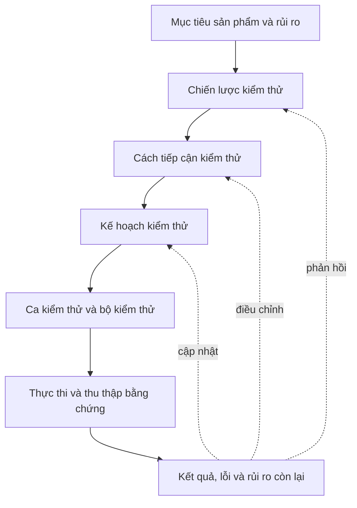

# Phân biệt chiến lược, cách tiếp cận, kế hoạch và ca kiểm thử

**Chương:** Tổng quan  
**Phạm vi module:** `VALIDATION_TESTING_STRATEGY`

Trong kiểm thử phần mềm, các cụm từ *chiến lược kiểm thử* (test strategy), *cách tiếp cận kiểm thử* (test approach), *kế hoạch kiểm thử* (test plan) và *ca kiểm thử* (test case) thường xuất hiện cùng nhau. Chúng có liên quan chặt chẽ, nhưng mô tả những quyết định ở các mức khác nhau. Nếu dùng chúng thay thế cho nhau, nhóm dễ nhầm lẫn giữa định hướng chất lượng, lựa chọn kỹ thuật, việc tổ chức thực hiện và nội dung cần xác minh.

Bài học này phân biệt bốn khái niệm theo mục đích sử dụng. Cách đặt tên và ranh giới giữa các tài liệu có thể khác nhau giữa các tổ chức; điều quan trọng là nhóm thống nhất ý nghĩa, phạm vi và cách liên kết của chúng.

Sau bài học, người học có thể:

- Giải thích mục đích và phạm vi của chiến lược, cách tiếp cận, kế hoạch và ca kiểm thử.
- Nhận biết loại quyết định nào thuộc về từng khái niệm.
- Theo dõi mối liên hệ từ mục tiêu chất lượng đến hoạt động kiểm thử và kết quả xác minh.
- Chọn đúng mức tài liệu khi mô tả một quyết định hoặc một hoạt động kiểm thử.

## 1. Bốn khái niệm trả lời bốn câu hỏi khác nhau

Có thể ghi nhớ sự khác nhau bằng bốn câu hỏi:

| Khái niệm | Câu hỏi chính | Trọng tâm |
|---|---|---|
| Chiến lược kiểm thử | Vì sao cần kiểm thử và cần ưu tiên bảo đảm điều gì? | Mục tiêu chất lượng, rủi ro, nguyên tắc và định hướng chung |
| Cách tiếp cận kiểm thử | Sẽ kiểm thử đối tượng cụ thể bằng cách nào? | Phương pháp, kỹ thuật, mức kiểm thử, tự động hóa và phạm vi bao phủ |
| Kế hoạch kiểm thử | Ai thực hiện việc gì, khi nào và với nguồn lực nào? | Phạm vi công việc, lịch, trách nhiệm, môi trường, nguồn lực và điều kiện hoàn thành |
| Ca kiểm thử | Cần thực hiện những bước nào để xác minh một điều kiện cụ thể? | Tiền điều kiện, dữ liệu, bước thực hiện và kết quả mong đợi |

Hãy hình dung nhóm đang chuẩn bị kiểm thử chức năng thanh toán của một cửa hàng trực tuyến. Chiến lược xác định rủi ro mất tiền hoặc thu tiền hai lần phải được ưu tiên. Cách tiếp cận chọn kiểm thử API, kiểm thử tích hợp với cổng thanh toán và kiểm thử giao diện cho luồng mua hàng quan trọng. Kế hoạch phân công người phụ trách, chuẩn bị môi trường, dữ liệu và lịch chạy. Một ca kiểm thử mô tả chính xác cách gửi lại yêu cầu thanh toán sau khi bị hết thời gian chờ và kết quả cần quan sát.

## 2. Chiến lược kiểm thử (test strategy)

Chiến lược kiểm thử là định hướng cấp cao cho cách một tổ chức, sản phẩm, dự án hoặc nhóm sẽ đạt được mục tiêu chất lượng thông qua kiểm thử. Nó đặt ra các ưu tiên và nguyên tắc để những quyết định chi tiết hơn được đưa ra nhất quán.

Chiến lược thường trả lời những câu hỏi như:

- Chất lượng cần bảo đảm phục vụ mục tiêu kinh doanh hoặc người dùng nào?
- Những rủi ro nào có tác động lớn nhất nếu lỗi xảy ra?
- Các mức và loại kiểm thử nào cần được chú trọng?
- Nhóm áp dụng nguyên tắc nào để quyết định phạm vi, độ sâu và thứ tự kiểm thử?
- Tự động hóa, kiểm thử thủ công, đánh giá độc lập và báo cáo chất lượng đóng vai trò ra sao?
- Những nguyên tắc hoặc ngưỡng chất lượng nào được dùng để đánh giá khả năng phát hành?

### 2.1. Nội dung thường có trong chiến lược

Tùy quy mô và cách quản trị, chiến lược có thể bao gồm:

1. **Mục tiêu kiểm thử:** các thuộc tính chất lượng cần chú trọng, chẳng hạn tính đúng đắn, độ tin cậy, hiệu năng, bảo mật, khả năng sử dụng hoặc khả năng tương thích.
2. **Định hướng dựa trên rủi ro:** cách nhận diện, đánh giá và ưu tiên rủi ro; mức độ kiểm thử tương ứng với xác suất và tác động của lỗi.
3. **Phạm vi và mức kiểm thử:** vai trò của kiểm thử đơn vị, tích hợp, hệ thống, chấp nhận và các mức phù hợp khác.
4. **Nguyên tắc thiết kế kiểm thử:** cách chọn kỹ thuật, mức bao phủ, dữ liệu và trường hợp biên.
5. **Nguyên tắc tự động hóa:** phần nào nên tự động hóa, tiêu chí lựa chọn, cách duy trì và vị trí chạy trong quy trình phát triển.
6. **Quản trị và báo cáo:** cách theo dõi rủi ro, lỗi, tiến độ và bằng chứng chất lượng; cách phối hợp giữa các vai trò.

Chiến lược không nhất thiết là một tài liệu dài hoặc một tệp riêng. Ở dự án nhỏ, các nguyên tắc có thể nằm trong một phần của kế hoạch kiểm thử. Ở tổ chức lớn, chiến lược có thể áp dụng cho nhiều nhóm hoặc sản phẩm. Dù được lưu ở đâu, nội dung của nó vẫn cần thể hiện định hướng và lý do đằng sau các quyết định.

### 2.2. Ví dụ về một quyết định mang tính chiến lược

Với chức năng thanh toán, nhóm xác định lỗi thu tiền hai lần có tác động nghiêm trọng đến khách hàng và uy tín doanh nghiệp. Chiến lược vì vậy quy định:

- Ưu tiên kiểm thử các luồng có liên quan đến tiền, trạng thái đơn hàng và tính nhất quán dữ liệu.
- Đánh giá cả tình huống bình thường lẫn lỗi mạng, phản hồi chậm và yêu cầu được gửi lại.
- Cần có bằng chứng kiểm thử ở các ranh giới tích hợp quan trọng, không chỉ kiểm tra giao diện.
- Các lỗi nghiêm trọng liên quan đến giao dịch phải được xử lý trước khi xem xét phát hành.

Đây là định hướng. Nó chưa quy định chính xác dùng công cụ nào, ai chạy kiểm thử vào ngày nào hoặc từng bước của một ca kiểm thử.

## 3. Cách tiếp cận kiểm thử (test approach)

Cách tiếp cận kiểm thử chuyển định hướng thành lựa chọn cụ thể cho một sản phẩm, thành phần, tính năng, bản phát hành hoặc thay đổi. Nó giải thích nhóm sẽ tổ chức và thực hiện kiểm thử như thế nào trong bối cảnh đã xác định.

Nếu chiến lược trả lời “điều gì quan trọng và vì sao”, cách tiếp cận tập trung vào “chúng ta sẽ kiểm tra điều đó bằng cách nào”.

### 3.1. Những lựa chọn thường thuộc cách tiếp cận

- **Mức kiểm thử:** phần nào được kiểm thử ở mức đơn vị, tích hợp, hệ thống hoặc chấp nhận.
- **Loại kiểm thử:** kiểm thử chức năng, hồi quy, thăm dò, hiệu năng, bảo mật, khả năng tương thích hoặc các loại khác phù hợp với rủi ro.
- **Kỹ thuật thiết kế:** phân vùng tương đương, phân tích giá trị biên, bảng quyết định, chuyển trạng thái, kiểm thử theo cặp hoặc dựa trên kinh nghiệm.
- **Cách kết hợp thủ công và tự động:** kiểm thử nào cần phản hồi nhanh trong CI, kiểm thử nào cần quan sát của con người, và kiểm thử nào phù hợp để chạy theo lịch.
- **Phạm vi và dữ liệu:** luồng chính, luồng thay thế, trường hợp biên, dữ liệu hợp lệ và không hợp lệ.
- **Tích hợp và môi trường:** dùng dịch vụ thật, môi trường giả lập, stub, mock hoặc sandbox ở đâu; kiểm tra hợp đồng giữa các thành phần như thế nào.
- **Hồi quy:** chọn bộ kiểm thử nào để chạy khi có thay đổi và cách mở rộng bộ kiểm thử theo rủi ro.

Không phải dự án nào cũng cần ghi tất cả các mục trên. Cách tiếp cận cần đủ rõ để người thực hiện hiểu lựa chọn kỹ thuật và lý do lựa chọn, đồng thời đủ linh hoạt để điều chỉnh khi có thông tin mới.

### 3.2. Ví dụ về cách tiếp cận cho thanh toán

Từ định hướng ưu tiên tính đúng đắn của giao dịch, nhóm có thể chọn:

- Kiểm thử đơn vị cho quy tắc tính tổng tiền, thuế và chiết khấu.
- Kiểm thử API và tích hợp để xác minh dữ liệu đơn hàng được gửi đúng sang dịch vụ thanh toán.
- Kiểm thử hợp đồng để phát hiện thay đổi không tương thích giữa cửa hàng và cổng thanh toán.
- Kiểm thử giao diện tự động cho một số luồng mua hàng quan trọng.
- Kiểm thử thăm dò các tình huống mạng chập chờn, phản hồi chậm, hủy giao dịch và gửi lại yêu cầu.
- Kiểm thử hồi quy tập trung vào các quy tắc tính tiền và trạng thái giao dịch sau mỗi thay đổi liên quan.

Những lựa chọn này cụ thể hơn chiến lược, nhưng vẫn chưa phải lịch công việc hay hướng dẫn từng bước cho từng ca kiểm thử.

## 4. Kế hoạch kiểm thử (test plan)

Kế hoạch kiểm thử mô tả cách tổ chức công việc kiểm thử trong một phạm vi và khoảng thời gian xác định. Kế hoạch giúp nhóm phối hợp, dự trù nguồn lực, theo dõi tiến độ và biết khi nào có thể kết thúc hoặc cần điều chỉnh hoạt động kiểm thử.

Kế hoạch thường trả lời:

- Kiểm thử những hạng mục nào và không bao gồm những hạng mục nào?
- Ai chịu trách nhiệm cho từng hoạt động?
- Hoạt động diễn ra khi nào và phụ thuộc vào mốc công việc nào?
- Cần nhân lực, thiết bị, công cụ, môi trường và dữ liệu gì?
- Điều kiện bắt đầu, tạm dừng, tiếp tục và kết thúc kiểm thử là gì?
- Kết quả sẽ được ghi nhận, báo cáo và xử lý lỗi như thế nào?
- Những rủi ro về tiến độ hoặc nguồn lực có thể ảnh hưởng đến kế hoạch ra sao?

### 4.1. Thành phần thường gặp của kế hoạch

Một kế hoạch có thể gồm:

1. **Mục đích và phạm vi:** mục tiêu của đợt kiểm thử, hạng mục trong phạm vi và ngoài phạm vi.
2. **Tài liệu tham chiếu và đối tượng kiểm thử:** yêu cầu, thiết kế, phiên bản, dịch vụ hoặc thành phần cần kiểm tra.
3. **Cách tiếp cận áp dụng:** tóm tắt các mức, loại và kỹ thuật kiểm thử được chọn.
4. **Vai trò và trách nhiệm:** người chuẩn bị môi trường, người thiết kế và thực hiện kiểm thử, người xử lý lỗi, người phê duyệt kết quả.
5. **Lịch và mốc:** thời điểm chuẩn bị, thực hiện, hồi quy, báo cáo và đánh giá kết quả.
6. **Nguồn lực và môi trường:** công cụ, tài khoản, thiết bị, dữ liệu, cấu hình và dịch vụ phụ thuộc.
7. **Tiêu chí bắt đầu và kết thúc:** điều kiện để bắt đầu kiểm thử, điều kiện hoàn thành, ngưỡng lỗi còn tồn tại và quy trình chấp nhận rủi ro.
8. **Báo cáo và quản lý lỗi:** nơi lưu bằng chứng, cách phân loại lỗi, cách theo dõi và cách thông báo trạng thái.
9. **Rủi ro và phương án ứng phó:** ví dụ môi trường không ổn định, dịch vụ bên ngoài không sẵn sàng hoặc yêu cầu thay đổi muộn.

Kế hoạch có thể thay đổi khi phạm vi, lịch phát hành, nhân lực hoặc mức độ rủi ro thay đổi. Một kế hoạch tốt cho biết thay đổi nào cần được đánh giá lại và ai cần được thông báo.

### 4.2. Ví dụ về nội dung kế hoạch

Đối với đợt kiểm thử thanh toán trước khi phát hành, kế hoạch có thể quy định:

- **Trong phạm vi:** thanh toán bằng thẻ trong môi trường sandbox, xử lý phản hồi thành công/thất bại, gửi lại yêu cầu và cập nhật trạng thái đơn hàng.
- **Ngoài phạm vi:** đối soát tài chính cuối ngày do một hệ thống khác phụ trách.
- **Chuẩn bị:** triển khai phiên bản ứng viên, cấu hình sandbox, tạo tài khoản thử nghiệm và chuẩn bị dữ liệu đơn hàng.
- **Phân công:** một người kiểm tra API và tích hợp, một người kiểm tra luồng giao diện, người phụ trách tính năng hỗ trợ xử lý lỗi.
- **Điều kiện bắt đầu:** bản dựng được triển khai thành công, dịch vụ sandbox truy cập được và các lỗi chặn đã được xử lý.
- **Điều kiện kết thúc:** các ca kiểm thử ưu tiên cao đã chạy, không còn lỗi nghiêm trọng chưa được chấp nhận và kết quả đã được báo cáo.

Đây là ví dụ về cách tổ chức công việc. Các mốc, vai trò và tiêu chí thực tế phải được xác định theo dự án; không nên sao chép ví dụ thành quy định mặc định.

## 5. Ca kiểm thử (test case)

Ca kiểm thử là mô tả có cấu trúc về một điều kiện hoặc hành vi cần xác minh. Một ca kiểm thử nêu rõ trạng thái ban đầu, dữ liệu cần dùng, các bước thực hiện và kết quả mong đợi để người kiểm thử có thể đánh giá hệ thống đạt hay không đạt.

Một ca kiểm thử thường có các trường:

- **Mã và tên:** định danh duy nhất và mô tả ngắn gọn điều cần xác minh.
- **Mục tiêu hoặc liên kết:** yêu cầu, quy tắc, rủi ro hoặc lỗi mà ca kiểm thử bao phủ.
- **Tiền điều kiện:** trạng thái hệ thống và điều kiện cần có trước khi thực hiện.
- **Dữ liệu kiểm thử:** đầu vào, tài khoản, cấu hình hoặc dữ liệu liên quan.
- **Các bước:** hành động theo thứ tự đủ rõ để có thể thực hiện lại.
- **Kết quả mong đợi:** phản hồi hoặc trạng thái có thể quan sát và đối chiếu.
- **Mức ưu tiên:** mức quan trọng tương đối khi lựa chọn thứ tự thực hiện.

Khi thực thi, người kiểm thử ghi thêm kết quả thực tế, trạng thái đạt/không đạt, bằng chứng và mã lỗi nếu có. Những thông tin thực thi này tạo thành bản ghi lần chạy kiểm thử; chúng không thay thế phần mô tả điều kiện và kết quả mong đợi của ca kiểm thử.

### 5.1. Ví dụ ca kiểm thử: gửi lại yêu cầu thanh toán

Giả sử hệ thống sử dụng khóa định danh yêu cầu (idempotency key) để tránh tạo nhiều giao dịch khi cùng một yêu cầu được gửi lại.

| Trường | Nội dung |
|---|---|
| Mã | `TC-PAY-014` |
| Tên | Gửi lại yêu cầu thanh toán sau khi lần gửi đầu bị hết thời gian chờ |
| Liên kết | Rủi ro tạo giao dịch hoặc thu tiền trùng lặp |
| Tiền điều kiện | Đơn hàng đang chờ thanh toán; môi trường kiểm thử kết nối được với cổng thanh toán giả lập; khóa yêu cầu được giữ nguyên khi gửi lại |
| Dữ liệu | Một đơn hàng hợp lệ và một khóa yêu cầu `PAY-ORDER-014` |
| Bước 1 | Gửi yêu cầu thanh toán cho đơn hàng với khóa `PAY-ORDER-014` |
| Bước 2 | Giả lập tình huống cổng thanh toán đã xử lý yêu cầu nhưng phản hồi không đến được cửa hàng trước thời hạn chờ |
| Bước 3 | Gửi lại cùng yêu cầu với cùng khóa `PAY-ORDER-014` |
| Kết quả mong đợi | Hệ thống chỉ ghi nhận một giao dịch thanh toán; đơn hàng chỉ được cập nhật theo một kết quả thanh toán; lần gửi lại trả về kết quả của giao dịch đã tạo hoặc phản hồi tương đương theo hợp đồng API |

Ca kiểm thử này có thể được tự động hóa ở mức API hoặc tích hợp. Khi triển khai thực tế, nhóm cần điều chỉnh chi tiết theo hợp đồng của hệ thống và cổng thanh toán đang sử dụng.

### 5.2. Đặc điểm của một ca kiểm thử tốt

- **Rõ ràng:** tên và bước thực hiện không dùng các từ mơ hồ như “xử lý bình thường” hoặc “hoạt động tốt”.
- **Có thể kiểm chứng:** kết quả mong đợi mô tả trạng thái hoặc phản hồi quan sát được.
- **Có thể lặp lại:** tiền điều kiện, dữ liệu và cấu hình đủ để người khác thực hiện lại.
- **Có trọng tâm:** một ca kiểm thử nên tập trung vào một mục tiêu xác minh chính; nếu có nhiều kết quả độc lập, cân nhắc tách ca.
- **Có thể truy vết:** liên kết được với yêu cầu, rủi ro hoặc quy tắc nghiệp vụ.
- **Dễ bảo trì:** khi yêu cầu thay đổi, người đọc có thể xác định ca nào bị ảnh hưởng.

Ca kiểm thử không nhất thiết phải là một kịch bản tự động. Nó có thể được thực hiện thủ công, tự động hoặc kết hợp cả hai. Một *test script* là chỉ dẫn hoặc mã thực thi dùng để chạy kiểm thử; một ca kiểm thử mô tả điều kiện và kết quả cần xác minh. Hai khái niệm có thể liên kết với nhau nhưng không đồng nghĩa.

## 6. So sánh trực tiếp

| Tiêu chí | Chiến lược kiểm thử | Cách tiếp cận kiểm thử | Kế hoạch kiểm thử | Ca kiểm thử |
|---|---|---|---|---|
| Mức quyết định | Định hướng tổng thể | Lựa chọn phương pháp cho bối cảnh cụ thể | Tổ chức thực hiện trong phạm vi xác định | Xác minh một điều kiện cụ thể |
| Câu hỏi | Vì sao và ưu tiên điều gì? | Kiểm thử bằng cách nào? | Ai làm gì, khi nào, với nguồn lực nào? | Thực hiện gì và mong đợi gì? |
| Nội dung tiêu biểu | Mục tiêu, rủi ro, nguyên tắc | Mức kiểm thử, kỹ thuật, tự động hóa | Phạm vi, lịch, vai trò, môi trường, tiêu chí | Tiền điều kiện, dữ liệu, bước, kết quả |
| Đầu ra | Định hướng và nguyên tắc | Lựa chọn kỹ thuật có lý do | Công việc có thể phối hợp và theo dõi | Mô tả có thể thực thi và đánh giá |
| Khi thay đổi | Khi mục tiêu, rủi ro hoặc nguyên tắc thay đổi | Khi đặc điểm kỹ thuật hoặc rủi ro của đối tượng thay đổi | Khi phạm vi, lịch, nguồn lực hoặc phụ thuộc thay đổi | Khi yêu cầu, dữ liệu, hành vi hoặc lỗi liên quan thay đổi |

Một cách kiểm tra nhanh là xem nội dung đang viết cần quyết định điều gì. Nếu nội dung nói về ưu tiên và nguyên tắc chung, đó thường là chiến lược. Nếu nói về phương pháp và kỹ thuật, đó thường là cách tiếp cận. Nếu nói về phân công, thời gian và nguồn lực, đó thường là kế hoạch. Nếu mô tả tiền điều kiện, bước và kết quả mong đợi, đó là ca kiểm thử.

## 7. Mối liên hệ giữa bốn khái niệm

Trong một quy trình thông thường, các quyết định được cụ thể hóa dần từ định hướng đến hành động. Chiến lược cung cấp nguyên tắc; cách tiếp cận chọn phương pháp phù hợp; kế hoạch sắp xếp công việc; các ca kiểm thử mô tả điều kiện cần xác minh. Kết quả thực thi và thông tin về lỗi có thể làm nhóm xem xét lại các quyết định ở mức cao hơn.

Sơ đồ thể hiện quan hệ khái niệm, không phải chuỗi bàn giao cứng nhắc. Trong thực tế:

- Chiến lược có thể được xây dựng trước, nhưng vẫn được cập nhật khi rủi ro hoặc mục tiêu sản phẩm thay đổi.
- Cách tiếp cận có thể khác nhau giữa các thành phần của cùng một sản phẩm. Ví dụ, một API tính tiền cần nhiều kiểm thử dữ liệu và tích hợp, trong khi một trang hiển thị nội dung có thể cần chú trọng khả năng tương thích và trải nghiệm người dùng.
- Một kế hoạch có thể áp dụng nhiều cách tiếp cận cho các hạng mục khác nhau.
- Một ca kiểm thử có thể hỗ trợ xác minh nhiều yêu cầu liên quan; một yêu cầu hoặc rủi ro thường cần nhiều ca kiểm thử để bao phủ các điều kiện khác nhau.
- Kết quả kiểm thử có thể phát hiện rủi ro mới, làm thay đổi thứ tự ưu tiên, phương pháp, phạm vi hoặc lịch.

Vì vậy, mối liên hệ quan trọng là **khả năng truy vết**. Nhóm nên có cách lần theo mục tiêu hoặc rủi ro đến lựa chọn kiểm thử, kế hoạch thực hiện, ca kiểm thử và bằng chứng kết quả. Không cần tạo thêm tài liệu riêng nếu liên kết đó đã rõ trong công cụ quản lý hiện có.

## 8. Những nhầm lẫn thường gặp

### 8.1. Coi chiến lược và kế hoạch là một

Chiến lược giải thích định hướng và nguyên tắc; kế hoạch giải thích cách tổ chức công việc trong một phạm vi cụ thể. Một kế hoạch có thể chứa phần tóm tắt chiến lược hoặc tham chiếu đến chiến lược, nhưng lịch làm việc và phân công không tự tạo thành chiến lược.

### 8.2. Gọi mọi lựa chọn kỹ thuật là chiến lược

Quyết định dùng kiểm thử API, kiểm thử giao diện, kiểm thử thăm dò hoặc một kỹ thuật thiết kế cụ thể thường thuộc cách tiếp cận. Chúng chỉ trở thành nguyên tắc chiến lược khi được khái quát thành định hướng áp dụng rộng hơn và có lý do chất lượng rõ ràng.

### 8.3. Coi danh sách ca kiểm thử là toàn bộ kế hoạch

Danh sách ca cho biết nội dung cần xác minh. Nó không tự trả lời ai chuẩn bị môi trường, dữ liệu lấy ở đâu, khi nào chạy, xử lý phụ thuộc ra sao hoặc điều kiện nào cho phép kết thúc kiểm thử. Kế hoạch có thể tham chiếu đến danh sách ca nhưng có phạm vi quản lý rộng hơn.

### 8.4. Viết ca kiểm thử như một yêu cầu chung chung

Một câu như “kiểm tra thanh toán thành công” chưa đủ để thực thi và đánh giá nhất quán. Ca kiểm thử cần nêu trạng thái ban đầu, dữ liệu, hành động và kết quả quan sát được. Nếu mục tiêu chỉ là liệt kê ý tưởng kiểm tra ở mức cao, có thể đó là *test condition* hoặc mục trong checklist; chưa chắc đã là ca kiểm thử chi tiết.

### 8.5. Cho rằng các thuật ngữ luôn có ranh giới tài liệu cố định

Một số nhóm dùng “test strategy” cho định hướng toàn tổ chức, nhóm khác dùng thuật ngữ này ở cấp dự án hoặc gộp nội dung vào test plan. Sự khác biệt về cách đặt tên không nhất thiết là sai. Để tránh hiểu lầm, nhóm nên định nghĩa thuật ngữ trong dự án, ghi rõ phạm vi và bảo đảm người đọc tìm được quyết định cần thiết.

## 9. Cách rà soát từng loại nội dung

Trước khi hoàn tất tài liệu hoặc mô tả công việc, hãy dùng các câu hỏi sau để kiểm tra xem nội dung đã ở đúng mức chưa.

**Đối với chiến lược kiểm thử:**

- Mục tiêu chất lượng và rủi ro chính đã được nêu rõ chưa?
- Các ưu tiên có giải thích được bằng tác động đến người dùng hoặc sản phẩm không?
- Nguyên tắc có đủ rõ để hướng dẫn các quyết định ở cấp thấp hơn không?
- Chiến lược có được xem xét lại khi bối cảnh hoặc rủi ro thay đổi không?

**Đối với cách tiếp cận kiểm thử:**

- Phương pháp được chọn có phù hợp với rủi ro và đặc điểm kỹ thuật không?
- Các mức, loại, kỹ thuật và phạm vi kiểm thử đã được giải thích chưa?
- Quyết định về tự động hóa, dữ liệu và môi trường có khả thi không?
- Có thể chỉ ra cách tiếp cận này hỗ trợ mục tiêu chiến lược nào không?

**Đối với kế hoạch kiểm thử:**

- Phạm vi, phần ngoài phạm vi và sản phẩm bàn giao đã rõ chưa?
- Trách nhiệm, lịch, nguồn lực và phụ thuộc đã được xác định chưa?
- Điều kiện bắt đầu, kết thúc và báo cáo có thể kiểm tra được không?
- Rủi ro về tiến độ hoặc môi trường có phương án xử lý chưa?

**Đối với ca kiểm thử:**

- Tiền điều kiện và dữ liệu có đủ để thực hiện không?
- Các bước có rõ ràng và có thể lặp lại không?
- Kết quả mong đợi có quan sát và đánh giá được không?
- Ca kiểm thử có liên kết với yêu cầu, quy tắc hoặc rủi ro không?

## 10. Kết luận

Chiến lược kiểm thử xác định định hướng và ưu tiên chất lượng. Cách tiếp cận kiểm thử chọn phương pháp phù hợp để thực hiện định hướng đó. Kế hoạch kiểm thử tổ chức con người, phạm vi, thời gian và nguồn lực. Ca kiểm thử mô tả một điều kiện cụ thể cùng các bước và kết quả mong đợi để xác minh.

Khi đọc hoặc viết một nội dung kiểm thử, hãy xác định trước câu hỏi mà nội dung cần trả lời. Việc đặt đúng nội dung ở đúng mức giúp nhóm trao đổi chính xác, tránh bỏ sót quyết định cần thiết và duy trì liên kết từ rủi ro đến bằng chứng chất lượng.
