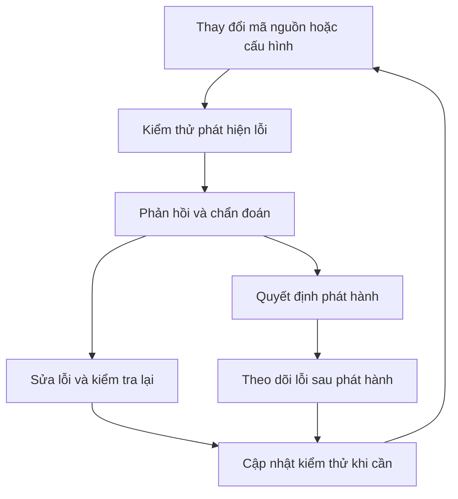

# Chi phí phát hiện lỗi, tốc độ phản hồi và chi phí duy trì

Một chiến lược kiểm thử tốt cần giúp nhóm phát hiện rủi ro đủ sớm, nhận được kết quả đủ nhanh và duy trì được các kiểm thử khi sản phẩm thay đổi. Ba mục tiêu này liên hệ chặt chẽ với nhau. Phát hiện lỗi sớm thường giảm công sức điều tra và sửa chữa; phản hồi nhanh giúp lập trình viên xử lý vấn đề khi ngữ cảnh còn rõ; nhưng một bộ kiểm thử được tối ưu chỉ để chạy nhanh có thể trở nên mong manh, khó đọc hoặc tốn kém để bảo trì.

Vì vậy, mục tiêu không phải là làm cho mọi kiểm thử chạy nhanh nhất có thể hay tăng số lượng kiểm thử bằng mọi giá. Mục tiêu là giảm tổng chi phí của vòng đời phát triển: chi phí tạo và duy trì kiểm thử, thời gian chờ phản hồi, công sức sửa lỗi, công sức kiểm tra lại và tổn thất khi lỗi đến được người dùng.

## 1. Hiểu ba loại chi phí và mối liên hệ giữa chúng

### Chi phí phát hiện lỗi

Chi phí phát hiện lỗi là nguồn lực cần thiết để nhận ra rằng một hành vi không đáp ứng yêu cầu. Nó bao gồm thời gian chạy kiểm thử, chuẩn bị dữ liệu và môi trường, phân tích kết quả, tái hiện lỗi, xác định nguyên nhân và xác nhận phạm vi ảnh hưởng. Một cảnh báo xuất hiện nhanh nhưng không thể tái hiện hoặc không chỉ ra được nguyên nhân vẫn có thể tạo ra chi phí điều tra lớn.

Chi phí này cũng cần được phân biệt với chi phí sửa lỗi. Một kiểm thử có thể phát hiện lỗi trong vài giây, nhưng việc sửa lỗi có thể mất nhiều giờ nếu thông báo không rõ, lỗi phụ thuộc vào trạng thái hệ thống khó tái tạo hoặc nhiều nhóm cùng sở hữu phần liên quan.

### Tốc độ phản hồi

Tốc độ phản hồi là khoảng thời gian từ khi một thay đổi được đưa vào quy trình kiểm thử đến khi người thực hiện nhận được kết quả đủ tin cậy để quyết định bước tiếp theo. Có thể mô hình hóa đơn giản như sau:

\[
T_{feedback}=T_{queue}+T_{setup}+T_{execution}+T_{report}+T_{triage}
\]

Trong đó:

- `T_queue`: thời gian chờ máy chạy, runner hoặc tài nguyên dùng chung.
- `T_setup`: thời gian dựng môi trường, cài phụ thuộc và chuẩn bị dữ liệu.
- `T_execution`: thời gian thực thi kiểm thử.
- `T_report`: thời gian tổng hợp và hiển thị kết quả.
- `T_triage`: thời gian để người nhận hiểu kết quả và xác định hành động.

Do đó, chỉ giảm thời gian thực thi chưa chắc cải thiện đáng kể trải nghiệm phản hồi. Nếu hàng đợi CI dài, môi trường khởi tạo chậm hoặc báo cáo khó đọc, nhóm vẫn phải chờ lâu mới biết thay đổi có an toàn hay không.

### Chi phí duy trì

Chi phí duy trì là công sức cần thiết để giữ cho bộ kiểm thử hữu ích qua nhiều lần thay đổi sản phẩm. Chi phí này gồm cập nhật kiểm thử khi yêu cầu đổi, sửa dữ liệu và fixture, nâng cấp môi trường, xử lý kiểm thử chập chờn, điều chỉnh pipeline và điều tra các lỗi giả.

Một kiểm thử có giá trị khi nó phát hiện được rủi ro thực tế với tín hiệu đáng tin cậy. Nếu kiểm thử thường xuyên thất bại vì nguyên nhân không liên quan đến sản phẩm, nhóm phải chạy lại hoặc bỏ qua cảnh báo. Khi đó chi phí duy trì tăng lên và niềm tin vào toàn bộ bộ kiểm thử giảm xuống.

Ba đại lượng tạo thành một vòng phản hồi:

Nếu kiểm thử phát hiện lỗi muộn, chi phí sửa và kiểm tra lại thường tăng. Nếu phản hồi chậm, thay đổi tiếp theo có thể được thực hiện trước khi lỗi cũ được xử lý, làm tăng số nguyên nhân cần xem xét. Nếu bộ kiểm thử khó duy trì, nhóm có xu hướng giảm phạm vi kiểm tra hoặc bỏ qua kết quả, khiến lỗi dễ đi xa hơn trong quy trình.

## 2. Vì sao thời điểm phát hiện lỗi ảnh hưởng đến chi phí

Ở giai đoạn sớm, người viết thường vừa thay đổi đoạn mã liên quan và còn nhớ mục đích của thay đổi. Phạm vi cần điều tra tương đối nhỏ, dữ liệu đầu vào dễ kiểm soát và chưa có nhiều thành phần phụ thuộc vào hành vi sai. Khi lỗi được phát hiện sau khi tích hợp hoặc phát hành, nhóm có thể phải truy tìm thay đổi qua nhiều dịch vụ, kiểm tra dữ liệu đã ghi, phối hợp với nhiều người, khôi phục phiên bản hoặc xử lý ảnh hưởng đến người dùng.

Ví dụ, một hàm tính tổng đơn hàng áp dụng sai quy tắc làm tròn:

1. **Trong kiểm thử đơn vị:** một trường hợp đầu vào biên cho thấy kết quả sai ngay tại hàm tính tiền. Người viết có thể sửa thuật toán và chạy lại một nhóm kiểm thử nhỏ.
2. **Trong kiểm thử tích hợp:** lỗi xuất hiện khi giỏ hàng, mã giảm giá và dịch vụ tính thuế phối hợp. Nhóm cần xác định dữ liệu nào đã được biến đổi sai và thành phần nào chịu trách nhiệm.
3. **Sau khi phát hành:** đơn hàng có thể đã được tạo với số tiền sai. Nhóm cần xác định đơn hàng bị ảnh hưởng, đánh giá tác động tài chính, phối hợp hỗ trợ khách hàng và có thể điều chỉnh dữ liệu hoặc hoàn tiền.

Chi phí tăng không chỉ vì sửa mã khó hơn. Nó còn tăng do phạm vi ảnh hưởng, thời gian phối hợp, việc kiểm tra dữ liệu đã phát sinh và nghĩa vụ xử lý với người dùng.

Không nên áp dụng một hệ số cố định kiểu “sửa lỗi ở giai đoạn sau luôn đắt gấp N lần”. Mức chênh lệch phụ thuộc vào kiến trúc, loại lỗi, mức độ tự động hóa, dữ liệu đã phát sinh, yêu cầu pháp lý và tác động kinh doanh. Một lỗi giao diện ít ảnh hưởng có thể dễ sửa sau phát hành; một lỗi phân quyền hoặc tính tiền có thể gây hậu quả lớn ngay cả khi chỉ tồn tại trong thời gian ngắn.

Nguyên tắc thực hành là đưa những kiểm tra có thể phát hiện lỗi sớm về gần nơi tạo ra thay đổi nhất, đồng thời giữ các kiểm tra ở tầng cao để phát hiện những lỗi chỉ xuất hiện khi nhiều thành phần phối hợp.

## 3. Chọn tầng kiểm thử để cân bằng độ phủ và tốc độ

Mỗi tầng kiểm thử có phạm vi quan sát, tốc độ và chi phí bảo trì khác nhau. Bảng sau mô tả xu hướng thường gặp; thời gian thực tế phụ thuộc vào hệ thống và cách triển khai.

| Tầng kiểm thử | Phạm vi chính | Tốc độ phản hồi thường gặp | Chi phí duy trì cần chú ý |
|---|---|---|---|
| Đơn vị (unit) | Hàm, lớp hoặc mô-đun nhỏ | Rất nhanh | Mock quá sâu, kiểm thử phụ thuộc chi tiết cài đặt |
| Thành phần (component) | Một thành phần cùng các phụ thuộc được kiểm soát | Nhanh | Fixture, trạng thái giao diện, cấu hình thành phần |
| Tích hợp/API | Giao tiếp giữa mô-đun, dịch vụ hoặc cơ sở dữ liệu | Trung bình | Dữ liệu, môi trường, thứ tự chạy và phụ thuộc bên ngoài |
| Hợp đồng (contract) | Sự tương thích giữa bên cung cấp và bên sử dụng API | Nhanh đến trung bình | Hợp đồng lỗi thời, quản lý phiên bản và kỳ vọng không đồng nhất |
| Đầu cuối (end-to-end, E2E) | Luồng nghiệp vụ qua nhiều thành phần thực | Thường chậm hơn | Môi trường, dữ liệu dùng chung, độ chập chờn và thay đổi giao diện |
| Thăm dò thủ công | Hành vi bất ngờ, trải nghiệm và rủi ro khó mô tả trước | Phụ thuộc người kiểm thử | Công sức lặp lại, ghi nhận bằng chứng và khả năng tái hiện |

Kiểm thử đơn vị thường rẻ để chạy và dễ khoanh vùng lỗi, nhưng không chứng minh được rằng các thành phần giao tiếp đúng với nhau. Kiểm thử E2E xác nhận được một luồng gần với cách người dùng sử dụng sản phẩm, nhưng khi thất bại có thể khó xác định nguyên nhân và tốn thời gian chuẩn bị môi trường. Hai tầng này bổ sung cho nhau.

Có thể dùng hình kim tự tháp kiểm thử như một gợi ý: nhiều kiểm thử nhỏ và nhanh ở đáy, ít kiểm thử tích hợp ở giữa, và một tập kiểm thử E2E có chọn lọc ở đỉnh. Đây không phải tỷ lệ bắt buộc. Một hệ thống xử lý giao dịch có thể cần nhiều kiểm thử tích hợp và hợp đồng; một sản phẩm giao diện phức tạp có thể cần thêm kiểm thử thành phần. Tỷ lệ phù hợp phải xuất phát từ rủi ro và kiến trúc thực tế.

Khi quyết định đặt một kiểm tra ở tầng nào, hãy xem xét:

- Lỗi cần phát hiện có thể được biểu diễn ở tầng nhỏ hơn không?
- Tầng nhỏ hơn có thể kiểm tra cùng quy tắc với tín hiệu đáng tin cậy không?
- Có rủi ro phát sinh từ giao tiếp, cấu hình hoặc môi trường mà chỉ tầng cao mới quan sát được không?
- Chi phí tạo và duy trì kiểm thử ở tầng được chọn có tương xứng với hậu quả của lỗi không?

Ví dụ, quy tắc tính chiết khấu nên có kiểm thử đơn vị cho các trường hợp biên. Việc dịch vụ đơn hàng gửi đúng thông tin sang dịch vụ thanh toán cần kiểm thử hợp đồng hoặc tích hợp. Một luồng người dùng chọn sản phẩm, thanh toán và nhận xác nhận có thể được kiểm tra bằng một số kịch bản E2E trọng yếu.

## 4. Thiết kế các vòng phản hồi theo thời điểm làm việc

Không phải kiểm thử nào cũng cần chạy ở mọi thời điểm. Có thể chia bộ kiểm thử thành các vòng có mục đích rõ ràng:

| Thời điểm | Kiểm tra nên ưu tiên | Mục đích |
|---|---|---|
| Khi lập trình trên máy cá nhân | Unit và component nhỏ, lint, kiểm tra kiểu | Phản hồi tức thì trước khi gửi thay đổi |
| Trước hoặc trong review pull request | Unit, component, contract và tích hợp quan trọng | Phát hiện lỗi có thể chặn việc hợp nhất |
| Sau khi hợp nhất vào nhánh chính | Bộ tích hợp rộng hơn, một số E2E cốt lõi | Xác nhận các thay đổi phối hợp được với nhau |
| Theo lịch hoặc trước phát hành | Hồi quy rộng, kiểm thử hiệu năng, bảo mật và thăm dò | Tìm rủi ro cần nhiều thời gian hoặc môi trường chuyên biệt |
| Sau phát hành | Health check, synthetic monitoring và quan sát vận hành | Phát hiện vấn đề chỉ xuất hiện trong môi trường thực |

Một pipeline hiệu quả thường có một nhóm kiểm thử nhanh làm cổng phản hồi sớm và các nhóm kiểm thử rộng hơn chạy ở giai đoạn tiếp theo. Cổng nhanh cần đủ tin cậy để quyết định có nên hợp nhất thay đổi. Bộ kiểm thử rộng hơn giúp phát hiện những tương tác mà cổng nhanh không bao phủ.

Để giảm thời gian chờ mà vẫn giữ độ tin cậy, có thể áp dụng một số kỹ thuật:

- **Chạy song song có kiểm soát:** chia nhóm kiểm thử độc lập cho nhiều runner. Cần tránh tranh chấp dữ liệu, cổng mạng hoặc tài nguyên dùng chung khiến kết quả không ổn định.
- **Chạy theo phạm vi ảnh hưởng:** ưu tiên kiểm thử liên quan đến mô-đun thay đổi, nhưng vẫn chạy các bộ hồi quy rộng theo lịch hoặc tại những mốc tích hợp phù hợp. Phân tích phụ thuộc sai có thể bỏ sót kiểm thử cần thiết.
- **Tách nhóm theo mục đích:** gắn nhãn cho kiểm thử nhanh, kiểm thử tích hợp, E2E, hiệu năng hoặc kiểm thử cần môi trường đặc biệt. Nhãn phải được quản lý để không làm một kiểm thử quan trọng bị loại khỏi mọi cổng.
- **Tái sử dụng môi trường hợp lý:** lưu cache phụ thuộc và chuẩn bị runner nhất quán. Cache cần có khóa phù hợp để tránh sử dụng nhầm phiên bản cũ.
- **Dừng sớm khi có lỗi chặn:** nếu một bước nền tảng thất bại, không cần tiêu tốn tài nguyên cho các bước phụ thuộc vào kết quả đó. Tuy nhiên, vẫn nên thu thập đủ log để chẩn đoán.
- **Làm cho báo cáo có thể hành động:** hiển thị tên kiểm thử, đầu vào quan trọng, bước thất bại, log liên quan và liên kết đến bằng chứng. Thông báo “pipeline failed” đơn lẻ không tạo ra phản hồi hữu ích.

Không nên tối ưu bằng cách bỏ qua ngẫu nhiên các kiểm thử chậm hoặc tự động chạy lại mọi lỗi cho đến khi xanh. Cách làm đó có thể che khuất lỗi thật. Nếu cần chạy lại, hệ thống nên ghi nhận lần chạy đầu, nguyên nhân chạy lại và kết quả cuối cùng để nhóm nhận diện kiểm thử chập chờn.

## 5. Giảm chi phí duy trì mà vẫn giữ kiểm thử có giá trị

Chi phí duy trì tăng mạnh khi kiểm thử phụ thuộc vào chi tiết dễ thay đổi, trạng thái dùng chung hoặc môi trường khó kiểm soát. Một số thực hành giúp giữ bộ kiểm thử ổn định:

### Kiểm tra hành vi có ý nghĩa

Ưu tiên xác nhận kết quả mà người dùng hoặc thành phần gọi thực sự phụ thuộc vào. Nếu kiểm thử một hàm xử lý đơn hàng, hãy kiểm tra số tiền, trạng thái và tác động nghiệp vụ quan trọng. Tránh xác nhận quá nhiều lời gọi nội bộ hoặc thứ tự gọi hàm nếu đó không phải hợp đồng cần giữ. Kiểm thử gắn chặt với cấu trúc nội bộ sẽ thất bại mỗi khi nhóm tái cấu trúc dù hành vi bên ngoài vẫn đúng.

### Kiểm soát dữ liệu và trạng thái

Mỗi kiểm thử nên tự chuẩn bị dữ liệu cần thiết và dọn dẹp trạng thái do nó tạo ra. Không để kết quả phụ thuộc vào việc một kiểm thử khác đã chạy trước đó. Dùng dữ liệu riêng hoặc định danh duy nhất khi nhiều kiểm thử chạy song song. Với dữ liệu thời gian, số ngẫu nhiên hoặc dịch vụ bên ngoài, hãy kiểm soát đầu vào hoặc thay thế phụ thuộc bằng một ranh giới kiểm thử phù hợp.

### Tránh chờ đợi tùy ý

Trong kiểm thử giao diện hoặc bất đồng bộ, lệnh chờ cố định như `sleep(5000)` vừa làm chậm trường hợp thành công vừa có thể thất bại trên máy chậm. Nên chờ điều kiện có ý nghĩa, chẳng hạn phần tử xuất hiện, trạng thái chuyển đổi hoặc phản hồi API hoàn tất, đồng thời đặt thời hạn chờ hợp lý để lỗi được báo rõ ràng.

### Xử lý kiểm thử chập chờn như một vấn đề cần sửa

Kiểm thử chập chờn (flaky test) cho kết quả khác nhau dù mã và điều kiện đầu vào không thay đổi. Nguyên nhân thường gặp gồm tranh chấp trạng thái, phụ thuộc thời gian, mạng không ổn định, dữ liệu dùng chung và chờ đợi không đúng điều kiện. Mỗi lần chạy lại tốn tài nguyên và làm giảm niềm tin của nhóm.

Khi phát hiện kiểm thử chập chờn, cần ghi nhận tần suất, xác định phạm vi ảnh hưởng, tìm nguyên nhân và giao người chịu trách nhiệm. Nếu phải tạm cách ly kiểm thử để bảo vệ luồng phát triển, cần có lý do, người phụ trách và thời hạn xử lý. Không nên để một danh sách kiểm thử bị bỏ qua tồn tại vô thời hạn.

### Duy trì cấu trúc dễ đọc

Đặt tên kiểm thử theo hành vi và điều kiện quan trọng; dùng helper hoặc fixture khi chúng làm rõ ý định và giảm lặp lại. Tránh tạo một lớp trừu tượng quá tổng quát khiến người đọc phải đi qua nhiều tầng mới hiểu dữ liệu được chuẩn bị thế nào. Khi yêu cầu thay đổi, xóa hoặc viết lại kiểm thử đã lỗi thời thay vì giữ chúng chỉ vì đã đầu tư công sức trước đó.

## 6. Đo lường để biết chiến lược có đang hiệu quả

Không có một chỉ số đơn lẻ đại diện cho chất lượng chiến lược kiểm thử. Nên kết hợp các chỉ số về tốc độ, độ tin cậy, khả năng phát hiện và công sức duy trì:

| Chỉ số | Câu hỏi cần trả lời | Cách diễn giải |
|---|---|---|
| Thời gian phản hồi P50/P95 | Phần lớn thay đổi và các trường hợp chậm phải chờ bao lâu? | P95 tăng có thể cho thấy hàng đợi hoặc một nhóm kiểm thử đang gây nghẽn |
| Thời gian chạy theo tầng | Tầng nào đang tiêu tốn thời gian nhiều nhất? | Giúp tìm điểm nghẽn để tối ưu đúng chỗ |
| Tỷ lệ kiểm thử chập chờn | Bao nhiêu kết quả thất bại không ổn định? | Tỷ lệ cao làm giảm niềm tin và tăng công sức chạy lại |
| Tỷ lệ lỗi lọt ra sau phát hành | Những loại lỗi nào không được phát hiện trước phát hành? | Cho biết khoảng trống trong phạm vi hoặc tầng kiểm thử |
| Thời gian điều tra và sửa lỗi | Từ cảnh báo đến khi xác định và khắc phục nguyên nhân mất bao lâu? | Phản ánh chất lượng thông báo, khả năng tái hiện và quyền sở hữu |
| Công sức duy trì kiểm thử | Nhóm dành bao nhiêu thời gian sửa fixture, môi trường và kiểm thử lỗi thời? | Giúp nhận biết bộ kiểm thử đang trở thành gánh nặng |

Nên xem cả trung vị (P50) và phân vị cao (P95) của thời gian phản hồi. Trung vị cho biết trải nghiệm phổ biến; P95 cho thấy những lần chờ rất lâu mà có thể làm gián đoạn công việc. Theo dõi xu hướng theo thời gian và theo tầng thường hữu ích hơn một con số tổng hợp.

Độ phủ mã nguồn (code coverage) có thể chỉ ra phần mã chưa được thực thi trong kiểm thử, nhưng không chứng minh rằng hành vi quan trọng đã được xác nhận. Một kiểm thử có thể chạy qua mọi dòng mã mà không kiểm tra kết quả đúng. Vì vậy, không nên đặt mục tiêu tăng coverage như thước đo duy nhất hoặc khuyến khích viết kiểm thử chỉ để đạt tỷ lệ.

Khi một chỉ số xấu đi, hãy tìm nguyên nhân trước khi thay đổi chính sách. Ví dụ, thời gian pipeline tăng có thể đến từ hàng đợi runner chứ không phải bản thân kiểm thử; tỷ lệ thất bại cao có thể là lỗi sản phẩm thật hoặc kiểm thử không ổn định. Phân loại đúng nguyên nhân giúp chọn biện pháp phù hợp.

## 7. Ví dụ áp dụng: chiến lược kiểm thử cho luồng thanh toán

Giả sử một hệ thống thương mại điện tử có luồng chọn sản phẩm, áp dụng mã giảm giá, tính thuế, thanh toán và tạo đơn hàng. Một lỗi trong luồng này có thể ảnh hưởng trực tiếp đến doanh thu và niềm tin của khách hàng. Có thể phân bổ kiểm thử như sau:

| Rủi ro hoặc hành vi | Kiểm thử phù hợp | Thời điểm phản hồi |
|---|---|---|
| Làm tròn giá, tính thuế, điều kiện áp dụng giảm giá | Unit cho các trường hợp biên và tổ hợp đầu vào | Khi lập trình và trong pull request |
| Thành phần giỏ hàng hiển thị đúng tổng tiền và thông báo | Component với dữ liệu kiểm soát | Khi lập trình và trong pull request |
| Dịch vụ đơn hàng gửi đúng số tiền, tiền tệ và mã đơn sang cổng thanh toán | Contract và integration | Trong pull request hoặc sau hợp nhất |
| Đơn hàng chuyển trạng thái đúng khi thanh toán thành công hoặc thất bại | Integration với phản hồi thanh toán mô phỏng có kiểm soát | Trong pull request hoặc sau hợp nhất |
| Người dùng hoàn thành một giao dịch từ đầu đến cuối | Một số kịch bản E2E cốt lõi | Sau hợp nhất và trước phát hành |
| Mất kết nối, thanh toán chậm, gửi yêu cầu lặp lại | Integration, kiểm thử khả năng chịu lỗi và thăm dò | Theo lịch hoặc trước phát hành |

Trong ví dụ này, kiểm thử đơn vị giúp phát hiện sớm sai lệch trong công thức. Contract và integration kiểm tra cách các dịch vụ trao đổi dữ liệu. E2E xác nhận luồng chính hoạt động khi ghép các thành phần. Kiểm thử thăm dò tập trung vào những tình huống khó liệt kê hết, chẳng hạn người dùng làm mới trang trong lúc chờ thanh toán.

Nếu toàn bộ kịch bản được triển khai bằng E2E, phản hồi có thể chậm và lỗi khó khoanh vùng. Nếu chỉ có unit test, nhóm có thể bỏ sót lỗi cấu hình hoặc giao tiếp giữa dịch vụ. Phân bổ kiểm thử theo rủi ro giúp phát hiện lỗi ở tầng rẻ nhất có thể mà vẫn giữ được kiểm tra cho những rủi ro xuyên suốt hệ thống.

## 8. Quy trình ra quyết định khi thêm hoặc thay đổi kiểm thử

Trước khi thêm một kiểm thử mới hoặc chuyển kiểm thử sang một tầng khác, nhóm có thể lần lượt trả lời các câu hỏi sau:

1. **Rủi ro cần giảm là gì?** Mô tả hành vi sai có thể xảy ra và hậu quả của nó.
2. **Có thể phát hiện rủi ro ở tầng nào sớm nhất?** Chọn tầng có thể quan sát hành vi cần xác nhận mà không phải dựng thêm nhiều phụ thuộc.
3. **Tín hiệu có đáng tin cậy không?** Kiểm thử phải tái hiện được, có đầu ra rõ và ít phụ thuộc vào trạng thái bên ngoài.
4. **Phản hồi có đến đúng lúc không?** Đặt kiểm thử vào vòng chạy phù hợp với mức độ nghiêm trọng và thời gian cần thiết.
5. **Ai duy trì kiểm thử?** Xác định quyền sở hữu, dữ liệu, môi trường và cách xử lý khi yêu cầu đổi.
6. **Có bằng chứng cho thấy kiểm thử tạo ra giá trị không?** Theo dõi lỗi được phát hiện, thời gian điều tra, lỗi lọt và công sức duy trì để điều chỉnh.

Một kiểm thử mới nên có mục đích rõ ràng và đóng góp vào việc giảm rủi ro. Nếu hai kiểm thử xác nhận cùng một hành vi ở cùng tầng nhưng một kiểm thử thường xuyên lỗi thời, nhóm nên cân nhắc hợp nhất hoặc loại bỏ kiểm thử dư thừa. Nếu một lỗi đã lọt ra sản xuất, hãy tìm khoảng trống trong chiến lược và bổ sung kiểm tra ở tầng phù hợp; không mặc định rằng phải thêm một kịch bản E2E cho mọi lỗi.

## Kết luận

Chi phí phát hiện lỗi, tốc độ phản hồi và chi phí duy trì cần được tối ưu cùng nhau. Phát hiện sớm giúp giảm phạm vi điều tra và tác động của lỗi; phản hồi nhanh giữ cho vòng phát triển liên tục; kiểm thử ổn định, dễ hiểu và có người sở hữu giúp duy trì giá trị lâu dài. Một chiến lược phù hợp kết hợp nhiều tầng kiểm thử, đặt chúng vào đúng thời điểm, đo cả tốc độ lẫn độ tin cậy và thường xuyên điều chỉnh theo rủi ro thực tế của sản phẩm.
