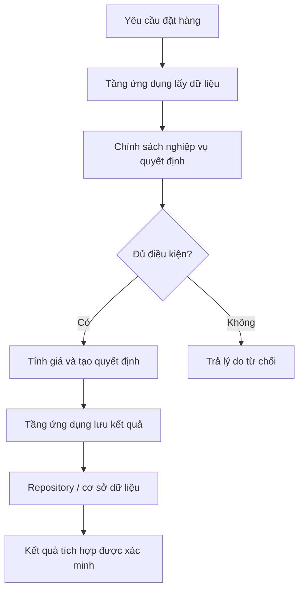
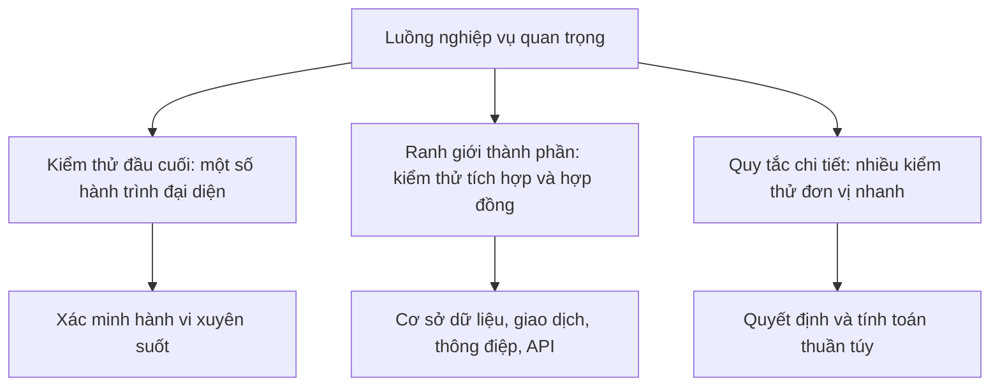

# Đưa quy tắc nghiệp vụ chi tiết vào tầng kiểm tra phù hợp

**Chương:** Đơn vị và tích hợp  
**Phạm vi module:** `VALIDATION_TESTING_STRATEGY`

Một hệ thống có thể chứa hàng trăm quy tắc nghiệp vụ: điều kiện áp dụng khuyến mãi, giới hạn số lượng đặt hàng, cách tính phí, quyền chuyển trạng thái, thời điểm ghi nhận giao dịch và cách xử lý yêu cầu lặp. Nếu chỉ kiểm tra các luồng tổng thể, nhiều tổ hợp điều kiện có thể không được xác minh. Nếu chỉ kiểm tra từng hàm riêng lẻ, nhóm lại có thể bỏ sót lỗi khi các thành phần phối hợp với cơ sở dữ liệu, hàng đợi hoặc dịch vụ bên ngoài.

Vì vậy, cần đưa mỗi quy tắc vào tầng kiểm tra phù hợp với nơi quy tắc được quyết định và các phụ thuộc mà quy tắc cần dùng. Quy tắc thuần túy, có đầu vào và đầu ra xác định, thường phù hợp với kiểm thử đơn vị. Quy tắc phụ thuộc vào giao dịch dữ liệu, ràng buộc cơ sở dữ liệu hoặc tương tác giữa các thành phần cần được kiểm tra thêm bằng kiểm thử tích hợp. Những luồng quan trọng nhất có thể cần kiểm thử đầu cuối để xác minh hành vi xuyên suốt.

Bài học này trình bày cách phân rã quy tắc nghiệp vụ, chọn tầng kiểm tra, thiết kế dữ liệu và bằng chứng, đồng thời tránh cả hai tình trạng: kiểm thử quá nhiều ở tầng chậm và kiểm thử quá ít ở ranh giới tích hợp.

Sau bài học, người học có thể:

- Phân biệt quy tắc nghiệp vụ thuần túy với quy tắc phụ thuộc vào hạ tầng hoặc tương tác hệ thống.
- Chọn kiểm thử đơn vị, tích hợp, hợp đồng hoặc đầu cuối theo hành vi cần chứng minh.
- Chuyển quy tắc nhiều điều kiện thành các trường hợp kiểm thử có thể đọc và bảo trì.
- Kiểm tra tính nhất quán, giao dịch, tính lặp an toàn và hành vi khi có lỗi ở ranh giới tích hợp.
- Dùng test double đúng mục đích và nhận biết giới hạn của chúng.
- Xây dựng bộ kiểm thử cân bằng giữa tốc độ phản hồi, độ tin cậy và mức độ bao phủ rủi ro.

## 1. Bắt đầu từ quy tắc nghiệp vụ, không bắt đầu từ tên tầng kiểm thử

Quy tắc nghiệp vụ mô tả điều kiện, giới hạn hoặc quyết định mà sản phẩm phải tuân theo để đáp ứng mục tiêu của tổ chức và người dùng. Ví dụ:

- Mã giảm giá chỉ áp dụng khi đơn hàng đạt giá trị tối thiểu và mã còn hiệu lực.
- Khách hàng không thể đặt số lượng vượt quá giới hạn được phép.
- Một đơn hàng chỉ được chuyển sang trạng thái đã thanh toán khi nhận được xác nhận hợp lệ.
- Một yêu cầu thanh toán gửi lại không được tạo giao dịch mới nếu đó là cùng một thao tác.
- Chỉ người có vai trò phù hợp mới được hủy đơn hàng đã xác nhận.

Trước khi chọn tầng kiểm thử, hãy viết rõ:

1. **Điều kiện đầu vào:** những dữ kiện nào ảnh hưởng đến quyết định?
2. **Quyết định hoặc hành vi:** hệ thống phải cho phép, từ chối, tính toán hay chuyển trạng thái như thế nào?
3. **Kết quả quan sát được:** giá trị trả về, trạng thái, bản ghi hoặc sự kiện nào chứng minh quy tắc đã được áp dụng?
4. **Phụ thuộc:** quyết định cần dữ liệu đã lưu, đồng hồ, dịch vụ bên ngoài, giao dịch hoặc nhiều thành phần phối hợp hay không?
5. **Rủi ro nếu sai:** lỗi có gây sai số tiền, mất dữ liệu, vượt quyền, đặt hàng vượt tồn kho hoặc vi phạm cam kết không?

Tên tầng kiểm thử không quyết định bản chất của quy tắc. Một quy tắc “không được bán hàng khi hết tồn kho” có thể có phần quyết định thuần túy, nhưng việc bảo đảm không bán vượt tồn kho khi hai yêu cầu đồng thời đến lại phụ thuộc vào đồng bộ và giao dịch dữ liệu. Cần kiểm tra cả hai khía cạnh ở nơi phù hợp.

## 2. Phân biệt các tầng kiểm tra

### 2.1. Kiểm thử đơn vị (unit test)

Kiểm thử đơn vị xác minh một phần nhỏ của chương trình trong phạm vi có thể cô lập, thường là một hàm, phương thức, đối tượng hoặc nhóm đối tượng có trách nhiệm rõ ràng. Mục tiêu là kiểm tra hành vi cụ thể với đầu vào xác định và kết quả mong đợi.

Kiểm thử đơn vị thường phù hợp với:

- Quy tắc tính toán như tổng tiền, thuế, chiết khấu và phí.
- Điều kiện đủ tư cách, giới hạn, phân loại và ưu tiên.
- Quy tắc chuyển trạng thái có thể mô tả bằng đầu vào và trạng thái hiện tại.
- Xử lý giá trị biên, dữ liệu không hợp lệ và tổ hợp điều kiện.
- Các bất biến trong miền nghiệp vụ, chẳng hạn số tiền không âm hoặc ngày kết thúc không trước ngày bắt đầu.

Một kiểm thử đơn vị tốt thường chạy nhanh, độc lập với mạng và cơ sở dữ liệu, có thể lặp lại và chỉ thất bại khi hành vi cần kiểm tra bị sai.

### 2.2. Kiểm thử tích hợp (integration test)

Kiểm thử tích hợp xác minh nhiều thành phần hoạt động đúng khi kết nối với nhau. Tùy phạm vi, các thành phần có thể gồm mã ứng dụng và cơ sở dữ liệu thật, repository, bộ quản lý giao dịch, hàng đợi, bộ tuần tự hóa hoặc dịch vụ phụ thuộc trong môi trường kiểm thử.

Kiểm thử tích hợp phù hợp khi cần chứng minh:

- Truy vấn và ánh xạ dữ liệu hoạt động đúng với cơ sở dữ liệu.
- Ràng buộc, chỉ mục, khóa ngoại và giao dịch bảo vệ được bất biến dữ liệu.
- Một thao tác cập nhật nhiều bản ghi được commit hoặc rollback đúng.
- Sự kiện được phát ra hoặc lưu vào outbox theo cùng giao dịch nghiệp vụ.
- Callback, yêu cầu lặp hoặc thông điệp trùng được xử lý an toàn.
- Cấu hình, chuyển đổi dữ liệu và giao tiếp giữa các thành phần đúng như thiết kế.

Kiểm thử tích hợp thường chậm và cần môi trường chuẩn bị kỹ hơn unit test. Tuy nhiên, nó cung cấp bằng chứng về hành vi thật tại ranh giới mà test cô lập không thể chứng minh.

### 2.3. Kiểm thử hợp đồng và kiểm thử đầu cuối

**Kiểm thử hợp đồng (contract test)** xác minh các bên giao tiếp tuân thủ cấu trúc và quy tắc trao đổi đã thống nhất. Nó hữu ích khi dịch vụ được phát triển độc lập hoặc API có nhiều bên sử dụng.

**Kiểm thử đầu cuối (end-to-end test)** xác minh một luồng quan trọng qua nhiều lớp của hệ thống, từ điểm vào của người dùng đến kết quả cuối cùng. Ví dụ: người mua tạo đơn, áp dụng khuyến mãi, thanh toán và nhận xác nhận.

Hai loại kiểm thử này bổ sung cho unit test và integration test. Không nên dùng một số ít kiểm thử đầu cuối để thay thế việc kiểm tra chi tiết các quy tắc ở tầng thấp hơn, vì khi thất bại, việc tìm nguyên nhân thường khó và tốn thời gian hơn.

### 2.4. So sánh theo bằng chứng cần có

| Câu hỏi cần chứng minh | Tầng phù hợp để bắt đầu | Bằng chứng chính |
|---|---|---|
| Quy tắc tính giá cho đầu vào cụ thể có đúng không? | Đơn vị | Kết quả tính toán và các trường hợp biên |
| Tổ hợp điều kiện khuyến mãi có được xử lý đúng không? | Đơn vị | Bảng trường hợp đầu vào và quyết định áp dụng/từ chối |
| Dữ liệu được lưu và đọc lại đúng không? | Tích hợp | Bản ghi trong cơ sở dữ liệu sau thao tác |
| Hai yêu cầu đồng thời có thể vượt giới hạn tồn kho không? | Tích hợp với cơ sở dữ liệu và giao dịch thực | Trạng thái kho và kết quả của cả hai yêu cầu |
| Dịch vụ gửi và nhận thông điệp có tuân thủ hợp đồng không? | Hợp đồng và tích hợp | Payload, mã phản hồi và hành vi tương thích |
| Khách hàng có thể hoàn tất luồng đặt hàng quan trọng không? | Đầu cuối | Kết quả xuyên suốt từ giao diện đến trạng thái cuối |

## 3. Đặt quy tắc thuần túy ở nơi dễ kiểm tra

Quy tắc thuần túy (pure business rule) tạo ra quyết định hoặc kết quả từ dữ liệu đầu vào mà không cần truy cập trực tiếp vào cơ sở dữ liệu, mạng, hệ thống tệp hay trạng thái toàn cục. Cùng một đầu vào sẽ cho cùng một kết quả.

Ví dụ, chính sách giảm giá có thể nhận tổng tiền hàng, loại khách hàng, thông tin mã khuyến mãi và ngày đánh giá rồi trả về quyết định áp dụng cùng số tiền giảm. Nếu chính sách cần biết ngày hiện tại, hãy truyền ngày đánh giá vào như một đầu vào để kiểm thử không phụ thuộc đồng hồ thật.

### 3.1. Tách quyết định khỏi thao tác hạ tầng

Một thiết kế dễ kiểm tra có thể phân chia trách nhiệm như sau:

- **Miền nghiệp vụ:** xác định quy tắc, điều kiện hợp lệ và quyết định.
- **Tầng ứng dụng:** điều phối luồng, lấy dữ liệu cần thiết, gọi quy tắc và yêu cầu lưu kết quả.
- **Tầng hạ tầng:** truy cập cơ sở dữ liệu, hàng đợi, đồng hồ hệ thống và dịch vụ bên ngoài.

Ví dụ, chính sách khuyến mãi nên quyết định một đơn hàng có đủ điều kiện hay không. Repository chịu trách nhiệm lấy lịch sử sử dụng mã. Tầng ứng dụng kết hợp dữ liệu rồi gọi chính sách. Kiểm thử đơn vị xác minh chính sách; kiểm thử tích hợp xác minh repository và việc ghi nhận sử dụng mã không vượt giới hạn.



Sơ đồ thể hiện một cách phân chia trách nhiệm. Kiến trúc thực tế có thể khác, nhưng ranh giới giữa quyết định nghiệp vụ và thao tác hạ tầng nên đủ rõ để kiểm tra từng phần.

### 3.2. Ví dụ unit test cho chính sách giảm giá

Giả sử quy tắc gồm các điều kiện:

- Mã phải đang hoạt động trong khoảng ngày hiệu lực.
- Đơn hàng phải đạt giá trị tối thiểu.
- Khách hàng phải thuộc nhóm được áp dụng.
- Một số danh mục sản phẩm bị loại trừ.
- Số tiền giảm không vượt quá mức tối đa.

Ta có thể kiểm tra chính sách bằng các đầu vào cụ thể. Đoạn mã dưới đây minh họa cấu trúc với Java và JUnit 5; kiểu dữ liệu và API thực tế phụ thuộc vào dự án.

```java
enum CustomerTier { GUEST, MEMBER }

record DiscountInput(
    long subtotal,
    CustomerTier tier,
    boolean containsExcludedCategory,
    LocalDate evaluationDate,
    LocalDate startsOn,
    LocalDate endsOn,
    long minimumSubtotal,
    long maximumDiscount
) {}

record DiscountDecision(boolean eligible, long discount, String reason) {}

final class DiscountPolicy {
    DiscountDecision evaluate(DiscountInput input) {
        if (input.evaluationDate().isBefore(input.startsOn())
                || input.evaluationDate().isAfter(input.endsOn())) {
            return new DiscountDecision(false, 0, "OUTSIDE_VALIDITY_PERIOD");
        }
        if (input.subtotal() < input.minimumSubtotal()) {
            return new DiscountDecision(false, 0, "BELOW_MINIMUM");
        }
        if (input.tier() == CustomerTier.GUEST) {
            return new DiscountDecision(false, 0, "TIER_NOT_ELIGIBLE");
        }
        if (input.containsExcludedCategory()) {
            return new DiscountDecision(false, 0, "EXCLUDED_CATEGORY");
        }

        long calculated = input.subtotal() * 10 / 100;
        long discount = Math.min(calculated, input.maximumDiscount());
        return new DiscountDecision(true, discount, "ELIGIBLE");
    }
}
```

Một vài trường hợp kiểm thử:

```java
class DiscountPolicyTest {
    private final DiscountPolicy policy = new DiscountPolicy();

    @Test
    void rejectsOrderBelowMinimum() {
        var input = new DiscountInput(
            90_000, CustomerTier.MEMBER, false,
            LocalDate.of(2026, 11, 16),
            LocalDate.of(2026, 11, 1), LocalDate.of(2026, 11, 30),
            100_000, 50_000
        );

        var decision = policy.evaluate(input);

        assertFalse(decision.eligible());
        assertEquals(0, decision.discount());
        assertEquals("BELOW_MINIMUM", decision.reason());
    }

    @Test
    void capsDiscountAtMaximumAmount() {
        var input = new DiscountInput(
            1_000_000, CustomerTier.MEMBER, false,
            LocalDate.of(2026, 11, 16),
            LocalDate.of(2026, 11, 1), LocalDate.of(2026, 11, 30),
            100_000, 60_000
        );

        var decision = policy.evaluate(input);

        assertTrue(decision.eligible());
        assertEquals(60_000, decision.discount());
    }
}
```

Ví dụ này minh họa việc truyền ngày đánh giá vào chính sách, nhờ đó kiểm thử không phụ thuộc ngày chạy thật. Điều kiện trong mã coi cả ngày bắt đầu và ngày kết thúc là hợp lệ. Số tiền `long` được hiểu là đơn vị tiền nhỏ nhất; phép chia nguyên trong ví dụ làm tròn xuống. Hệ thống thực tế phải thống nhất quy tắc làm tròn, kiểu số tiền và cách tránh tràn số. Cũng cần kiểm tra mức tối đa bằng 0, số tiền biên và trường hợp có danh mục bị loại trừ.

### 3.3. Dùng kiểm thử tham số hóa cho nhiều điều kiện

Khi một quy tắc có nhiều tổ hợp đầu vào, kiểm thử tham số hóa giúp tránh lặp mã và làm bảng trường hợp dễ đọc.

| Trường hợp | Khách hàng | Ngày đánh giá | Giá trị đơn hàng | Kết quả mong đợi |
|---|---|---|---:|---|
| Mã hợp lệ và đủ điều kiện | Thành viên | Trong thời hạn | Đạt ngưỡng | Áp dụng |
| Chưa đến ngày hiệu lực | Thành viên | Trước thời hạn | Đạt ngưỡng | Từ chối |
| Đã hết hạn | Thành viên | Sau thời hạn | Đạt ngưỡng | Từ chối |
| Không đạt giá trị tối thiểu | Thành viên | Trong thời hạn | Dưới ngưỡng | Từ chối |
| Nhóm khách hàng không đủ điều kiện | Khách | Trong thời hạn | Đạt ngưỡng | Từ chối |
| Đạt điều kiện nhưng vượt mức giảm tối đa | Thành viên | Trong thời hạn | Giá trị lớn | Giảm đúng mức trần |

Mỗi trường hợp nên có tên hoặc mã giúp người đọc hiểu quy tắc đang được xác minh. Với các tổ hợp rất lớn, không cần liệt kê mọi kết hợp một cách máy móc. Hãy dùng phân vùng tương đương, giá trị biên, bảng quyết định và phân tích rủi ro để chọn trường hợp có giá trị.

### 3.4. Kiểm tra bất biến và thuộc tính

Ngoài các ví dụ cụ thể, có thể xác minh các tính chất phải luôn đúng:

- Số tiền giảm không âm.
- Số tiền giảm không vượt quá mức tối đa hoặc giá trị đơn hàng theo quy tắc.
- Tổng tiền phải bằng tổng các thành phần theo cùng quy tắc làm tròn.
- Một chính sách được đánh giá với cùng đầu vào phải cho cùng quyết định.
- Áp dụng cùng một phép chuẩn hóa nhiều lần không làm thay đổi kết quả sau lần đầu.

Kiểm thử dựa trên thuộc tính (property-based testing) có thể sinh nhiều dữ liệu đầu vào để tìm trường hợp biên. Nó hữu ích khi miền dữ liệu lớn, nhưng thuộc tính phải phản ánh đúng quy tắc. Một thuộc tính sai sẽ tạo ra test xanh nhưng xác minh sai yêu cầu.

## 4. Khi nào quy tắc cần kiểm thử tích hợp?

Một quy tắc có thể được mô tả bằng một câu đơn giản nhưng việc thực thi lại phụ thuộc vào nhiều thành phần. Khi đó, unit test cho logic cục bộ là cần thiết nhưng chưa đủ.

### 4.1. Quy tắc phụ thuộc dữ liệu đã lưu

Ví dụ: mỗi khách hàng chỉ được sử dụng một mã khuyến mãi một lần. Chính sách có thể xác định một khách hàng đủ điều kiện nếu được truyền số lần đã sử dụng. Nhưng hệ thống phải chứng minh rằng:

- Lịch sử sử dụng được truy vấn đúng.
- Việc ghi nhận lần sử dụng được lưu bền vững.
- Hai yêu cầu đồng thời không cùng vượt qua kiểm tra rồi cùng ghi nhận sử dụng.
- Nếu lưu đơn hàng thất bại, trạng thái sử dụng mã không bị ghi lại sai.

Các hành vi này cần kiểm thử tích hợp với repository và cơ sở dữ liệu thực tế của môi trường kiểm thử.

### 4.2. Quy tắc phụ thuộc giao dịch và tính nhất quán

Giả sử khi tạo đơn hàng, hệ thống phải lưu đơn hàng, chi tiết hàng hóa, lần sử dụng khuyến mãi và bản ghi outbox để phát sự kiện. Nếu một thao tác bắt buộc thất bại, hệ thống không được để lại dữ liệu nửa chừng.

Unit test có thể xác minh tầng ứng dụng yêu cầu các thao tác theo đúng thứ tự, nhưng mock repository không chứng minh cơ sở dữ liệu thực sự rollback. Integration test cần xác minh:

- Khi tất cả thao tác thành công, dữ liệu liên quan được commit đầy đủ.
- Khi một thao tác giữa chừng thất bại, các thay đổi trong cùng giao dịch được rollback.
- Bản ghi outbox được lưu cùng giao dịch với thay đổi nghiệp vụ.
- Việc đọc lại dữ liệu sau commit phản ánh đúng trạng thái cuối.

### 4.3. Quy tắc phụ thuộc đồng thời

Quy tắc “không được bán nhiều hơn số lượng tồn kho” đặc biệt dễ bị kiểm tra thiếu. Một unit test tuần tự có thể chứng minh rằng một yêu cầu đơn lẻ bị từ chối khi tồn kho bằng 0. Nhưng nó không chứng minh hai yêu cầu đồng thời không cùng đọc một số lượng tồn kho cũ rồi cùng trừ hàng.

Để kiểm tra tình huống này, integration test cần dùng cơ sở dữ liệu và cơ chế giao dịch gần với thực tế. Tạo số lượng tồn kho nhỏ, gửi hai yêu cầu đặt hàng đồng thời và xác minh tổng số lượng được chấp nhận không vượt số lượng ban đầu. Kết quả cần kiểm tra gồm:

- Chỉ số lượng cho phép được đặt thành công.
- Số lượng tồn kho cuối cùng không âm.
- Không có bản ghi giữ chỗ hoặc đơn hàng mồ côi.
- Yêu cầu bị từ chối nhận lý do phù hợp.

Không nên giả định một kiểm thử với cơ sở dữ liệu giả lập trong bộ nhớ chứng minh được khóa, mức cô lập giao dịch hoặc hành vi đồng thời của cơ sở dữ liệu sản xuất. Cần dùng cùng loại công nghệ hoặc một môi trường đủ tương đồng để xác minh thuộc tính phụ thuộc hạ tầng.

### 4.4. Quy tắc phụ thuộc thời gian hoặc dịch vụ bên ngoài

Nếu quy tắc liên quan đến thời điểm hết hạn, lịch làm việc, múi giờ hoặc thời gian chờ, hãy kiểm soát nguồn thời gian. Unit test có thể truyền `Clock` hoặc thời điểm đánh giá giả định để xác minh logic. Integration test có thể xác minh cách lưu và truy vấn thời gian, chuyển đổi múi giờ và cấu hình thực tế.

Nếu quyết định phụ thuộc vào dịch vụ bên ngoài, unit test nên kiểm tra phần logic với dữ liệu đầu vào đã kiểm soát. Contract test hoặc integration test cần xác minh giao thức, ánh xạ phản hồi, lỗi, timeout và cách thử lại. Không nên gọi dịch vụ thật trong mọi unit test vì kết quả sẽ chậm, tốn kém và không ổn định.

## 5. Thiết kế integration test có ý nghĩa

Integration test cần xác minh một ranh giới thực sự có thể gây lỗi. Chạy nhiều thành phần cùng nhau không tự động làm cho test có giá trị; cần biết điều gì sẽ thất bại nếu tích hợp sai.

### 5.1. Chọn ranh giới tích hợp

Các ranh giới thường cần kiểm tra:

- Repository với cơ sở dữ liệu.
- Bộ quản lý giao dịch với nhiều thao tác ghi.
- Bộ tuần tự hóa và giải tuần tự hóa dữ liệu.
- API với bộ xác thực và phân quyền.
- Ứng dụng với hàng đợi hoặc hệ thống sự kiện.
- Dịch vụ nội bộ với API của nhà cung cấp.
- Bộ lập lịch với đồng hồ, múi giờ và lịch nghiệp vụ.

Mỗi test nên có một mục tiêu rõ. Nếu test bao gồm quá nhiều thành phần và nhiều hành vi, khi thất bại sẽ khó xác định ranh giới gây lỗi.

### 5.2. Chuẩn bị dữ liệu và trạng thái ban đầu

Test cần tự chuẩn bị dữ liệu hoặc dùng fixture có kiểm soát. Tránh phụ thuộc vào dữ liệu do test trước tạo ra hoặc thứ tự chạy. Nên dùng mã định danh riêng cho mỗi test, khởi tạo các bản ghi cần thiết và dọn dẹp sau khi chạy nếu môi trường cho phép.

Với cơ sở dữ liệu, cần lưu ý:

- Dùng migration và schema tương thích với ứng dụng.
- Chuẩn bị dữ liệu đủ để kiểm tra khóa ngoại, ràng buộc duy nhất và chỉ mục.
- Xác minh dữ liệu qua truy vấn hoặc API đọc lại, không chỉ dựa vào giá trị trả về trong bộ nhớ.
- Tránh dùng chung một cơ sở dữ liệu có trạng thái khó dự đoán giữa các test.
- Kiểm tra rollback và dọn dẹp khi test thất bại giữa chừng.

### 5.3. Kiểm tra cả kết quả và tác dụng phụ

Một thao tác có thể trả về kết quả đúng nhưng vẫn để lại tác dụng phụ sai. Ví dụ, API trả về “đặt hàng thành công” nhưng không tạo bản ghi tồn kho, hoặc tạo hai sự kiện thanh toán.

Với quy tắc nghiệp vụ quan trọng, hãy xác minh:

- Giá trị trả về hoặc mã trạng thái.
- Trạng thái của các bản ghi liên quan sau thao tác.
- Số lượng sự kiện hoặc thông điệp được tạo.
- Dữ liệu không được thay đổi khi thao tác thất bại.
- Khả năng đọc lại và đối soát sau commit.

### 5.4. Kiểm tra rollback và lỗi giữa chừng

Không chỉ kiểm tra đường thành công. Hãy cố ý làm một thao tác ở giữa thất bại để xác minh tính nguyên tử theo thiết kế. Ví dụ, nếu ghi đơn hàng thành công nhưng ghi chi tiết đơn hàng thất bại, giao dịch phải rollback toàn bộ phần dữ liệu thuộc cùng giao dịch.

Nếu một hành động gọi dịch vụ ngoài không thể rollback, cần xác minh cơ chế bù trừ (compensation), trạng thái trung gian hoặc quy trình đối soát. Không nên mô tả một quy trình phân tán như thể nó có một giao dịch ACID duy nhất.

### 5.5. Ví dụ integration test cho giới hạn tồn kho

Giả sử repository dùng cơ sở dữ liệu quan hệ và dịch vụ đặt hàng thực hiện cập nhật tồn kho trong giao dịch. Một integration test có thể:

1. Tạo sản phẩm có tồn kho bằng 1.
2. Chuẩn bị hai yêu cầu đặt cùng sản phẩm, mỗi yêu cầu một đơn vị.
3. Khởi chạy hai yêu cầu gần như đồng thời qua tầng ứng dụng.
4. Chờ cả hai hoàn tất và đọc lại tồn kho, đơn hàng cùng bản ghi giữ chỗ.
5. Xác minh chỉ một yêu cầu được chấp nhận, tồn kho bằng 0 và không có dữ liệu giữ chỗ dư thừa.

Kết quả chính xác của từng yêu cầu có thể phụ thuộc vào thứ tự thực thi, nhưng bất biến phải luôn đúng: tổng lượng được chấp nhận không vượt quá số lượng ban đầu. Test này cần được thiết kế để thật sự tạo cạnh tranh đồng thời, không chỉ gọi hai thao tác tuần tự rồi gọi đó là concurrency test.

## 6. Dùng test double đúng mục đích

Test double là đối tượng thay thế một phụ thuộc trong kiểm thử. Các dạng thường gặp gồm:

- **Stub:** trả về dữ liệu đã định trước để điều khiển tình huống.
- **Fake:** triển khai đơn giản nhưng có thể hoạt động, ví dụ repository lưu dữ liệu trong bộ nhớ.
- **Mock:** cho phép xác minh tương tác hoặc lời gọi được kỳ vọng.
- **Spy:** ghi nhận tương tác trong khi vẫn giữ một phần hành vi thật.

Test double hữu ích để cô lập logic và mô phỏng lỗi khó tái tạo. Tuy nhiên, chúng chỉ chứng minh hành vi của mã đang được kiểm tra trong điều kiện giả lập.

### 6.1. Khi nào nên dùng mock hoặc stub?

Nên cân nhắc khi:

- Cần mô phỏng timeout, lỗi mạng hoặc phản hồi hiếm của dịch vụ ngoài.
- Cần xác minh tầng ứng dụng yêu cầu một hành động hoặc truyền đúng dữ liệu.
- Cần kiểm soát thời gian hoặc dữ liệu đầu vào.
- Muốn cô lập quy tắc thuần túy khỏi phụ thuộc hạ tầng.

Ví dụ, unit test của dịch vụ đặt hàng có thể dùng stub cho cổng thanh toán để trả về thành công, từ chối hoặc timeout. Mục tiêu là kiểm tra cách dịch vụ ứng dụng phản ứng với từng kết quả.

### 6.2. Khi nào test double không đủ?

Mock repository có thể xác minh rằng phương thức `save` được gọi, nhưng không chứng minh:

- SQL được tạo đúng.
- Mapping giữa đối tượng và cột dữ liệu đúng.
- Ràng buộc duy nhất hoạt động.
- Transaction rollback khi lỗi.
- Mức cô lập giao dịch ngăn được cập nhật cạnh tranh.

Những thuộc tính này cần kiểm thử với thành phần thật hoặc một triển khai đủ tương đồng. Một fake repository có thể hữu ích cho unit test, nhưng không nên được coi là bằng chứng về hành vi của cơ sở dữ liệu sản xuất.

### 6.3. Tránh kiểm thử tương tác quá mức

Nếu unit test xác minh từng lời gọi nội bộ, test có thể thất bại khi nhóm tái cấu trúc mã dù hành vi nghiệp vụ không thay đổi. Hãy ưu tiên kiểm tra kết quả có ý nghĩa và các tương tác ở ranh giới quan trọng. Chỉ kiểm tra thứ tự hoặc số lần gọi khi đó là một phần của hợp đồng hoặc yêu cầu nghiệp vụ.

## 7. Chuyển quy tắc thành bộ trường hợp kiểm thử

Một quy tắc chi tiết thường cần nhiều trường hợp để bao phủ các điều kiện. Có thể dùng quy trình sau:

1. Viết quy tắc dưới dạng điều kiện và kết quả.
2. Xác định đầu vào, trạng thái và phụ thuộc ảnh hưởng đến quyết định.
3. Chia miền đầu vào thành các nhóm tương đương.
4. Chọn giá trị biên và tổ hợp điều kiện quan trọng.
5. Xác định tầng kiểm thử phù hợp cho từng phần hành vi.
6. Viết kết quả mong đợi có thể quan sát.
7. Liên kết test với yêu cầu hoặc rủi ro.
8. Bổ sung tình huống lỗi, cạnh tranh và phục hồi ở tầng tích hợp nếu cần.

### 7.1. Ví dụ bảng quyết định cho khuyến mãi

Giả sử một mã chỉ áp dụng cho thành viên, trong thời hạn, với đơn hàng đạt ngưỡng và không chứa sản phẩm bị loại trừ.

| Thành viên | Trong hạn | Đạt ngưỡng | Có sản phẩm loại trừ | Kết quả |
|---|---|---|---|---|
| Có | Có | Có | Không | Áp dụng |
| Không | Có | Có | Không | Từ chối |
| Có | Không | Có | Không | Từ chối |
| Có | Có | Không | Không | Từ chối |
| Có | Có | Có | Có | Từ chối hoặc chỉ tính phần đủ điều kiện theo quy tắc đã định |

Trường hợp cuối cần được nghiệp vụ làm rõ: chỉ cần một sản phẩm bị loại trừ thì từ chối toàn bộ mã, hay chỉ loại sản phẩm đó khỏi giá trị tính giảm? Không nên tự suy đoán rồi viết test theo giả định chưa được chấp thuận.

Các tổ hợp quyết định thuần túy có thể được kiểm tra bằng unit test. Nếu điều kiện “thành viên” hoặc “đã dùng mã” được lấy từ cơ sở dữ liệu, cần integration test xác minh việc truy xuất và ghi nhận dữ liệu đúng.

### 7.2. Bao phủ giá trị biên

Với ngưỡng tối thiểu 100.000 đồng, các trường hợp có giá trị cao:

- 99.999 đồng: dưới ngưỡng.
- 100.000 đồng: đúng ngưỡng.
- 100.001 đồng: trên ngưỡng.

Với thời hạn hiệu lực, cần xác định rõ ngày bắt đầu và kết thúc có bao gồm hay không, múi giờ nào được dùng và thời điểm hết hạn được tính theo ngày hay theo timestamp. Kiểm thử đơn vị có thể xác minh logic so sánh với thời điểm truyền vào; integration test có thể xác minh cách lưu và chuyển đổi thời gian.

### 7.3. Bao phủ chuyển trạng thái

Với quy tắc chuyển trạng thái đơn hàng, kiểm tra:

- Chuyển đổi hợp lệ.
- Chuyển đổi bị cấm.
- Chuyển đổi lặp.
- Sự kiện đến sai thứ tự.
- Hai sự kiện cạnh tranh.
- Lỗi xảy ra giữa lúc cập nhật trạng thái và phát sự kiện.

Logic quyết định chuyển trạng thái có thể được unit test. Việc lưu trạng thái, xử lý sự kiện lặp và bảo đảm tính nhất quán giữa dữ liệu với thông điệp cần integration test.

## 8. Cân bằng bộ kiểm thử theo rủi ro

Một bộ kiểm thử hiệu quả thường có nhiều kiểm thử đơn vị, một số lượng phù hợp kiểm thử tích hợp và một nhóm nhỏ kiểm thử đầu cuối cho luồng quan trọng. Đây là định hướng phổ biến, không phải tỷ lệ cứng cho mọi dự án.



Khi lựa chọn phạm vi, hãy cân nhắc:

- Mức độ nghiêm trọng nếu quy tắc sai.
- Khả năng xảy ra và phạm vi người dùng bị ảnh hưởng.
- Độ phức tạp của điều kiện và số lượng tổ hợp.
- Phụ thuộc vào dữ liệu, giao dịch hoặc dịch vụ ngoài.
- Khả năng phát hiện lỗi ở tầng thấp hơn.
- Chi phí và thời gian phản hồi của từng tầng.

Quy tắc tính tiền có nhiều giá trị biên nên có nhiều unit test. Quy tắc chống đặt vượt tồn kho cần thêm integration test về đồng thời. Luồng đặt hàng hoàn chỉnh cần một số test đầu cuối để xác minh các thành phần kết nối đúng. Mức độ kiểm thử phải phản ánh rủi ro chứ không chỉ số dòng mã.

## 9. Ví dụ xuyên suốt: đặt hàng, khuyến mãi và thanh toán

Giả sử một cửa hàng trực tuyến có các quy tắc:

1. Khách hàng phải có quyền đặt sản phẩm.
2. Số lượng đặt không vượt tồn kho có thể bán.
3. Mã giảm giá phải hợp lệ và không vượt giới hạn.
4. Tổng tiền được tính từ giá sản phẩm, thuế, phí và giảm giá theo thứ tự quy định.
5. Đơn hàng chỉ được đánh dấu đã thanh toán sau xác nhận hợp lệ.
6. Gửi lại yêu cầu thanh toán không được tạo giao dịch trùng.

Có thể phân chia hoạt động kiểm tra như sau:

| Quy tắc | Unit test | Integration / contract test | End-to-end test |
|---|---|---|---|
| Điều kiện đủ tư cách và mã giảm giá | Kiểm tra mọi điều kiện, ngày hiệu lực và giá trị biên | Kiểm tra lấy lịch sử sử dụng và ghi nhận giới hạn dùng | Một hành trình mua hàng có áp dụng mã |
| Tính tổng tiền | Kiểm tra thứ tự tính, làm tròn, thuế và phí | Kiểm tra dữ liệu giá và cấu hình được đọc đúng | Xác minh tổng tiền hiển thị và lưu cuối cùng |
| Giới hạn tồn kho | Kiểm tra quyết định với số lượng đã biết | Kiểm tra cập nhật đồng thời, giao dịch và ràng buộc dữ liệu | Một luồng đặt hàng đại diện |
| Chuyển trạng thái thanh toán | Kiểm tra chuyển đổi hợp lệ và bị cấm | Kiểm tra callback, lưu trạng thái và xử lý lặp | Xác minh đơn hàng hiển thị trạng thái cuối phù hợp |
| Hợp đồng cổng thanh toán | Kiểm tra logic ánh xạ phản hồi với đầu vào cố định | Kiểm tra schema, chữ ký, mã lỗi và timeout theo hợp đồng | Có thể dùng một luồng sandbox quan trọng nếu cần |

### 9.1. Kết quả mong đợi cần phân biệt theo tầng

Với quy tắc tồn kho, unit test có thể xác minh hàm quyết định từ chối số lượng lớn hơn lượng có thể bán. Integration test phải xác minh hai yêu cầu đồng thời không cùng được chấp nhận vượt quá tồn kho. End-to-end test chỉ cần xác minh một hành trình đặt hàng tiêu biểu qua giao diện và trạng thái cuối.

Nếu chỉ có end-to-end test, lỗi đồng thời có thể khó tái tạo và khó xác định nguyên nhân. Nếu chỉ có unit test, nhóm chưa có bằng chứng về hành vi khóa hoặc giao dịch. Kết hợp các tầng giúp mỗi test trả lời một câu hỏi cụ thể.

### 9.2. Theo dõi liên kết giữa quy tắc và bằng chứng

Với mỗi quy tắc quan trọng, ghi mã yêu cầu hoặc rủi ro, unit test liên quan, integration test liên quan và báo cáo thực thi. Khi quy tắc thay đổi, nhóm có thể xác định test nào cần cập nhật. Khi test thất bại, người xử lý hiểu hành vi nghiệp vụ nào đang bị ảnh hưởng.

Không cần tạo bảng truy vết thủ công nếu công cụ quản lý test hoặc mã nguồn đã cung cấp liên kết đáng tin cậy. Điều quan trọng là liên kết có thể tìm được, còn hiệu lực và được duy trì khi thay đổi.

## 10. Tổ chức dữ liệu, môi trường và độ ổn định

Tầng kiểm thử phù hợp vẫn có thể cho kết quả sai nếu dữ liệu hoặc môi trường không được kiểm soát.

### 10.1. Dữ liệu kiểm thử có ý nghĩa

Chuẩn bị dữ liệu đại diện cho các điều kiện quan trọng: khách hàng đủ và không đủ điều kiện, sản phẩm còn và hết hàng, mã đang hiệu lực và hết hạn, giao dịch thành công và thất bại. Tránh dùng một bộ dữ liệu duy nhất chỉ đại diện cho đường thành công.

Với dữ liệu nhạy cảm, sử dụng dữ liệu tổng hợp hoặc đã được xử lý theo chính sách. Không đưa thông tin bí mật hoặc dữ liệu cá nhân thật vào log và báo cáo nếu không có cơ sở cho phép.

### 10.2. Kiểm soát đồng hồ và múi giờ

Các quy tắc hết hạn, ngày làm việc và thời điểm chốt sổ cần dùng nguồn thời gian có thể kiểm soát. Unit test nên truyền thời điểm hoặc `Clock` giả định. Integration test cần xác minh cách lưu timestamp, múi giờ và truy vấn khoảng thời gian trong công nghệ thực tế.

### 10.3. Làm cho test độc lập và lặp lại được

- Mỗi test tự tạo dữ liệu cần thiết hoặc dùng fixture được quản lý rõ.
- Không dựa vào thứ tự chạy test.
- Dọn dẹp trạng thái sau test, kể cả khi có lỗi.
- Dùng định danh riêng để tránh xung đột giữa các test chạy song song.
- Ghi log và mã tương quan để tìm nguyên nhân khi thất bại.
- Theo dõi test không ổn định và phân biệt lỗi môi trường với lỗi sản phẩm.

### 10.4. Chọn môi trường tích hợp phù hợp

Test về SQL, khóa, transaction và mức cô lập nên dùng loại cơ sở dữ liệu phù hợp với sản xuất hoặc có hành vi đủ tương đồng. Test về message broker cần xác minh các đặc tính quan trọng của broker như giao nhận, thứ tự hoặc xác nhận thông điệp nếu chúng thuộc hợp đồng. Một mock đơn giản không thể chứng minh các đặc tính này.

## 11. Đánh giá chất lượng của bộ kiểm thử

Không nên chỉ đếm số lượng test. Một bộ test lớn vẫn có thể bỏ sót quy tắc quan trọng hoặc kiểm tra các chi tiết triển khai dễ thay đổi.

Hãy xem xét:

- **Độ bao phủ quy tắc:** mỗi quy tắc quan trọng có test và bằng chứng phù hợp không?
- **Độ bao phủ điều kiện:** các nhánh, giá trị biên và trường hợp bị từ chối có được xem xét không?
- **Độ tin cậy:** test có ổn định và lặp lại được không?
- **Khả năng chẩn đoán:** khi thất bại, thông báo có chỉ ra điều kiện hoặc ranh giới gây lỗi không?
- **Tốc độ phản hồi:** test có chạy đủ nhanh ở thời điểm cần thiết không?
- **Tính đại diện:** môi trường và dữ liệu có phản ánh các phụ thuộc quan trọng không?
- **Khả năng bảo trì:** test có mô tả hành vi nghiệp vụ hay phụ thuộc quá nhiều vào cấu trúc nội bộ?

Độ bao phủ mã (code coverage) có thể giúp nhận ra mã chưa được thực thi, nhưng không chứng minh rằng quy tắc đã được xác minh. Một nhánh có thể được chạy mà không có assertion đúng. Cần xem nội dung kiểm tra và kết quả mong đợi cùng với số liệu coverage.

## 12. Những sai lầm thường gặp

### 12.1. Đưa mọi quy tắc vào unit test

Unit test không chứng minh được ràng buộc cơ sở dữ liệu, giao dịch thật hoặc hành vi đồng thời nếu các phần đó đã bị thay thế bằng mock. Hãy bổ sung integration test cho các thuộc tính phụ thuộc hạ tầng.

### 12.2. Đưa mọi quy tắc vào end-to-end test

Test đầu cuối chậm, dễ bị ảnh hưởng bởi môi trường và khó chẩn đoán. Hãy kiểm tra chi tiết quy tắc ở unit test và ranh giới tích hợp; giữ end-to-end test cho hành trình quan trọng.

### 12.3. Kiểm tra lời gọi mock thay vì hành vi

Việc một phương thức được gọi không chứng minh kết quả nghiệp vụ đúng. Ưu tiên xác minh quyết định, trạng thái và tác dụng phụ quan trọng. Chỉ xác minh tương tác khi nó thuộc hợp đồng cần bảo vệ.

### 12.4. Dùng cơ sở dữ liệu giả để kết luận về cơ sở dữ liệu thật

Fake hoặc database trong bộ nhớ có thể không mô phỏng đúng kiểu dữ liệu, ràng buộc, transaction hoặc concurrency. Dùng công nghệ đủ tương đồng cho các test cần chứng minh thuộc tính đó.

### 12.5. Chỉ kiểm tra đường thành công

Quy tắc nghiệp vụ thường thể hiện rõ nhất ở trường hợp bị từ chối, biên và lỗi. Cần kiểm tra các nhánh này, nhất là khi hậu quả sai có thể ảnh hưởng tiền, dữ liệu hoặc quyền truy cập.

### 12.6. Trộn quá nhiều hành vi trong một test

Test kiểm tra nhiều quy tắc không liên quan thường khó chẩn đoán. Tách mục tiêu để mỗi test thất bại cung cấp thông tin rõ ràng. Có thể dùng một số test tổng thể để xác minh phối hợp, nhưng không nên biến chúng thành bằng chứng duy nhất.

### 12.7. Không xác định rõ nguồn dữ liệu và thời gian

Test phụ thuộc vào ngày chạy, múi giờ, dữ liệu cũ hoặc thứ tự chạy sẽ dễ thất bại ngẫu nhiên. Hãy truyền thời gian, chuẩn bị dữ liệu và cô lập trạng thái.

## 13. Danh sách rà soát khi chọn tầng kiểm thử

Trước khi quyết định một quy tắc sẽ được kiểm tra ở đâu, hãy rà soát:

- [ ] Quy tắc và kết quả mong đợi được mô tả rõ.
- [ ] Đầu vào, trạng thái và điều kiện biên đã được xác định.
- [ ] Phần quyết định thuần túy có thể được kiểm thử độc lập.
- [ ] Các phụ thuộc dữ liệu, giao dịch và dịch vụ ngoài được nhận diện.
- [ ] Unit test bao phủ điều kiện, nhánh và bất biến quan trọng.
- [ ] Integration test xác minh các ranh giới thực sự có rủi ro.
- [ ] Các thuộc tính đồng thời, rollback và xử lý lặp được kiểm tra khi cần.
- [ ] Contract test xác minh giao tiếp giữa các bên độc lập.
- [ ] End-to-end test tập trung vào một số hành trình quan trọng.
- [ ] Test double không bị dùng làm bằng chứng cho hành vi hạ tầng chưa được kiểm tra.
- [ ] Dữ liệu, thời gian, môi trường và trạng thái được kiểm soát.
- [ ] Kết quả test liên kết được với quy tắc, rủi ro và phiên bản.

## 14. Kết luận

Đưa quy tắc nghiệp vụ vào đúng tầng kiểm tra bắt đầu bằng việc hiểu quy tắc, đầu vào, kết quả và các phụ thuộc cần thiết. Quyết định thuần túy, tính toán, điều kiện và chuyển trạng thái có thể kiểm tra nhanh bằng unit test. Quy tắc liên quan đến dữ liệu đã lưu, giao dịch, tính đồng thời, thông điệp và dịch vụ bên ngoài cần integration test hoặc contract test để xác minh hành vi tại ranh giới thực. Một số hành trình quan trọng cần end-to-end test để chứng minh các thành phần phối hợp đúng.

Không có một tầng nào đủ để chứng minh mọi khía cạnh của quy tắc nghiệp vụ. Hãy để mỗi kiểm thử trả lời một câu hỏi cụ thể, dùng test double có chủ đích, kiểm tra các bất biến tại nơi chúng được bảo đảm và liên kết kết quả với yêu cầu hoặc rủi ro. Cách phân chia này tạo phản hồi nhanh mà vẫn cung cấp bằng chứng đáng tin cậy về hành vi của hệ thống.
