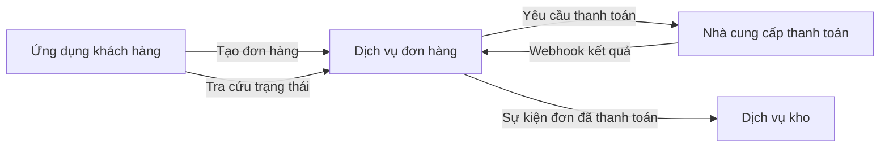

# Xác định hợp đồng tại ranh giới dịch vụ và đối tác

Khi các thành phần phần mềm giao tiếp với nhau, mỗi bên cần hiểu rõ bên kia có thể gửi gì, nhận gì, thực hiện hành động nào và phản hồi ra sao khi có vấn đề. Những kỳ vọng này tạo thành hợp đồng tại ranh giới dịch vụ (service boundary) hoặc ranh giới tích hợp với đối tác. Nếu hợp đồng mơ hồ, một thay đổi có thể làm hỏng hệ thống gọi, khiến dữ liệu bị hiểu sai, tạo giao dịch trùng hoặc làm quy trình nghiệp vụ bị gián đoạn dù từng dịch vụ vẫn chạy bình thường.

Xác định hợp đồng là bước quan trọng trong chiến lược kiểm thử vì nó biến kỳ vọng giữa các bên thành điều kiện có thể kiểm chứng. Nhóm cần xác định hợp đồng bao gồm cấu trúc dữ liệu, ý nghĩa nghiệp vụ, giao thức, lỗi, bảo mật, thứ tự và thời điểm xử lý, cùng các giới hạn vận hành. Sau đó, hợp đồng được dùng làm căn cứ cho kiểm thử API, kiểm thử hợp đồng, kiểm thử tích hợp và kiểm thử tương thích trước khi phát hành.

## 1. Hợp đồng API là gì và vì sao cần xác định rõ?

Hợp đồng API (API contract) là tập hợp các quy tắc mà bên cung cấp và bên sử dụng thống nhất khi trao đổi qua một giao diện. API có thể là HTTP/REST, RPC, GraphQL, giao tiếp qua hàng đợi, webhook, giao thức tệp hoặc một giao diện thư viện. Hợp đồng mô tả cả hình thức trao đổi lẫn ý nghĩa của hành vi.

Một hợp đồng tốt trả lời được các câu hỏi:

- Bên gọi có thể thực hiện thao tác nào và trong điều kiện nào?
- Dữ liệu đầu vào có cấu trúc, kiểu, định dạng và giới hạn gì?
- Bên cung cấp trả về dữ liệu nào, với ý nghĩa và trạng thái nào?
- Những lỗi nào có thể xảy ra và bên gọi cần xử lý ra sao?
- Yêu cầu cần xác thực, phân quyền và bảo vệ dữ liệu như thế nào?
- Có bảo đảm về thứ tự, tính lặp an toàn, thời gian phản hồi hoặc tính nhất quán không?
- Thay đổi phiên bản được thông báo và chuyển đổi như thế nào?

Hợp đồng không chỉ là tài liệu mô tả endpoint hoặc schema JSON. Hai hệ thống có thể trao đổi dữ liệu đúng cấu trúc nhưng vẫn hiểu sai ý nghĩa. Ví dụ, trường `amount` có thể là số nguyên nhưng một bên hiểu là đồng, bên kia hiểu là xu; trường `createdAt` có thể chứa timestamp nhưng không nêu múi giờ; trạng thái `SUCCESS` có thể có nghĩa là yêu cầu đã được tiếp nhận hoặc giao dịch đã hoàn tất. Những khác biệt ngữ nghĩa này thường gây lỗi nghiêm trọng hơn lỗi cú pháp.

### Lợi ích của hợp đồng rõ ràng

- **Giảm phụ thuộc ngầm:** bên sử dụng không cần suy đoán hành vi từ mã nguồn của bên cung cấp.
- **Phát hiện thay đổi phá vỡ sớm:** thay đổi schema, trạng thái hoặc quy tắc có thể được kiểm tra trước khi triển khai.
- **Cho phép phát triển độc lập:** các nhóm có thể xây dựng và kiểm thử theo hợp đồng đã thống nhất.
- **Cải thiện khả năng chẩn đoán:** lỗi được phân loại và diễn giải nhất quán giữa các bên.
- **Hỗ trợ tích hợp đối tác:** trách nhiệm, giới hạn, bảo mật và quy trình xử lý sự cố được xác định trước.
- **Tạo cơ sở cho tự động hóa:** schema validation, contract test và kiểm tra tương thích có thể chạy trong CI.

## 2. Xác định ranh giới và các bên tham gia

Trước khi viết hợp đồng, hãy xác định ranh giới nào đang được mô tả và ai chịu trách nhiệm ở mỗi phía. Một hệ thống lớn có thể có nhiều loại ranh giới: giữa mô-đun trong cùng ứng dụng, giữa các dịch vụ nội bộ, giữa nền tảng và nhà cung cấp bên ngoài, hoặc giữa sản phẩm và khách hàng tích hợp API.

### Phân biệt bên cung cấp và bên sử dụng

- **Bên cung cấp (provider):** công bố giao diện, tiếp nhận yêu cầu hoặc sự kiện, thực thi hành vi và trả kết quả theo hợp đồng.
- **Bên sử dụng (consumer):** gửi yêu cầu hoặc nhận sự kiện, dựa vào hợp đồng để xử lý kết quả và các tình huống lỗi.
- **Chủ sở hữu hợp đồng:** chịu trách nhiệm duy trì nội dung, phê duyệt thay đổi và phối hợp giữa các bên. Trong một số tổ chức, trách nhiệm này được chia sẻ.
- **Bên vận hành:** duy trì môi trường, xác thực, giám sát, giới hạn tài nguyên và quy trình phản ứng khi tích hợp gặp sự cố.

Một dịch vụ có thể vừa là provider vừa là consumer. Ví dụ, dịch vụ đơn hàng cung cấp API tra cứu cho giao diện khách hàng, đồng thời sử dụng API thanh toán của nhà cung cấp. Vì vậy, cần lập bản đồ các tương tác theo từng hướng, không chỉ nhìn một dịch vụ như một khối duy nhất.

### Vẽ luồng tương tác trước khi xác định hợp đồng

Với mỗi luồng nghiệp vụ quan trọng, ghi nhận:

- Thành phần khởi tạo tương tác và thành phần nhận.
- Giao thức hoặc cơ chế truyền tải.
- Dữ liệu được gửi và phản hồi được nhận.
- Thành phần chịu trách nhiệm xác thực, phân quyền và kiểm tra dữ liệu.
- Trạng thái được lưu ở mỗi bên và nguồn dữ liệu được coi là chuẩn.
- Cách xử lý timeout, retry, lỗi và các phản hồi đến trễ.
- Tác động nếu một bên ngừng hoạt động hoặc thay đổi phiên bản.

Ví dụ luồng thanh toán có thể gồm giao diện gọi dịch vụ đơn hàng, dịch vụ đơn hàng gọi cổng thanh toán, cổng thanh toán gửi webhook, rồi dịch vụ đơn hàng cập nhật trạng thái và phát sự kiện cho kho. Mỗi mũi tên là một ranh giới cần xác định hợp đồng. Webhook là một tương tác riêng, dù nó thuộc cùng nghiệp vụ thanh toán.



### Xác định phạm vi trách nhiệm

Hợp đồng cần làm rõ bên nào chịu trách nhiệm cho từng kiểm soát. Bên cung cấp thường xác thực dữ liệu và quyền truy cập trước khi xử lý; bên sử dụng vẫn phải gửi dữ liệu hợp lệ và xử lý phản hồi theo quy định. Với webhook, provider cần xác thực nguồn gửi và chính sách gửi lại; consumer cần xác minh chữ ký, chống xử lý trùng và quản lý sự kiện đến trễ.

Không nên giả định rằng một bên đã kiểm tra thì bên kia không cần kiểm tra. Ranh giới tin cậy cần được bảo vệ ở phía nhận, vì dữ liệu và yêu cầu có thể đến từ nhiều nguồn hoặc bị thay đổi trên đường truyền.

## 3. Những thành phần cần có trong hợp đồng

Một hợp đồng API nên mô tả đủ các khía cạnh cần thiết cho hành vi có thể dự đoán. Không phải giao diện nào cũng cần cùng mức chi tiết, nhưng các mục sau là điểm khởi đầu hữu ích.

### Định danh và mục đích

Ghi tên giao diện, phiên bản, mục đích nghiệp vụ, chủ sở hữu, các bên sử dụng và môi trường áp dụng. Định nghĩa rõ phạm vi: API này dùng để tạo yêu cầu, tra cứu trạng thái hay xác nhận một giao dịch đã hoàn tất.

### Giao thức và định dạng trao đổi

Mô tả giao thức, phương thức, đường dẫn, header, encoding, schema và cơ chế truyền tải. Với HTTP API, cần nêu method, path, content type, authentication scheme và mã trạng thái quan trọng. Với sự kiện, cần mô tả tên sự kiện, envelope, metadata, schema payload và cơ chế giao nhận.

### Dữ liệu đầu vào

Mỗi trường nên có:

- Tên và ý nghĩa nghiệp vụ.
- Kiểu dữ liệu, định dạng và đơn vị.
- Bắt buộc hay tùy chọn; giá trị mặc định nếu có.
- Giới hạn độ dài, miền giá trị, độ chính xác và quy tắc làm tròn.
- Quy tắc null, chuỗi rỗng, trường bị bỏ qua và trường không được hỗ trợ.
- Quy tắc kiểm tra, chuẩn hóa và mã hóa dữ liệu.
- Ví dụ hợp lệ và không hợp lệ.

Phân biệt trường không xuất hiện với trường có giá trị `null`. Một bên có thể hiểu trường bị bỏ qua là “giữ nguyên giá trị hiện tại”, trong khi `null` có nghĩa “xóa giá trị”. Nếu không nêu rõ, cập nhật một phần dữ liệu có thể gây mất thông tin.

### Dữ liệu đầu ra và ý nghĩa trạng thái

Mô tả schema phản hồi, trường bắt buộc, kiểu dữ liệu, đơn vị, thứ tự nếu có ý nghĩa và quan hệ giữa các trường. Định nghĩa rõ trạng thái nghiệp vụ. Ví dụ `ACCEPTED` chỉ xác nhận yêu cầu đã được tiếp nhận; nó không nhất thiết có nghĩa thanh toán đã thành công. Nếu xử lý bất đồng bộ, hợp đồng cần chỉ ra cách tra cứu hoặc nhận kết quả cuối cùng.

### Hành vi lỗi

Hợp đồng cần nêu các nhóm lỗi có thể xảy ra, cách biểu diễn lỗi, mã hoặc loại lỗi ổn định, thông tin có thể dùng để xử lý và trường hợp nào có thể thử lại. Không nên để bên gọi phải phân tích thông điệp văn bản tự do để quyết định hành động.

### Bảo mật và quyền riêng tư

Ghi rõ cơ chế xác thực, quyền cần có, phạm vi dữ liệu, quy tắc phân tách tenant, dữ liệu nhạy cảm, yêu cầu mã hóa, chữ ký thông điệp và chính sách lưu trữ. Không đưa token, khóa bí mật hoặc dữ liệu cá nhân thật vào ví dụ hợp đồng.

### Giới hạn và đặc tính vận hành

Xác định giới hạn kích thước payload, số lượng bản ghi, phân trang, rate limit, timeout, retry, thông lượng dự kiến, thời gian phản hồi, mức sẵn sàng và chính sách bảo trì nếu chúng ảnh hưởng đến bên sử dụng. Nêu rõ các cam kết là mục tiêu, giới hạn cứng hay chỉ số tham khảo.

## 4. Xác định hợp đồng cho API đồng bộ

API đồng bộ thường trả phản hồi trong cùng một tương tác. HTTP/REST là ví dụ phổ biến, nhưng các nguyên tắc cũng áp dụng cho RPC và giao diện gọi hàm qua mạng.

### Phương thức và ngữ nghĩa thao tác

Không chỉ ghi tên endpoint; hãy mô tả ý nghĩa và tác dụng phụ của thao tác. Với HTTP, các phương thức thường được dùng theo quy ước:

| Phương thức | Ý nghĩa thường gặp | Điểm cần xác định trong hợp đồng |
|---|---|---|
| GET | Đọc tài nguyên hoặc dữ liệu | Tham số lọc, phân trang, cache, quyền đọc và tính nhất quán |
| POST | Tạo tài nguyên hoặc thực hiện thao tác | Quy tắc tạo mới, xử lý yêu cầu lặp và mã phản hồi |
| PUT | Thay thế toàn bộ biểu diễn tài nguyên | Ý nghĩa trường bị bỏ qua, tính lặp an toàn và cập nhật đồng thời |
| PATCH | Cập nhật một phần tài nguyên | Ngữ nghĩa trường bị bỏ qua, null, phép cập nhật và xung đột |
| DELETE | Xóa hoặc đánh dấu xóa tài nguyên | Xóa vật lý hay logic, kết quả khi tài nguyên không tồn tại |

Không nên chỉ dựa vào tên method để suy ra toàn bộ hành vi. Ví dụ, API `POST /payments` có thể tạo yêu cầu thanh toán nhưng cần thêm mã idempotency để bên gọi có thể thử lại an toàn khi không nhận được phản hồi.

### Mã trạng thái và cấu trúc phản hồi

Định nghĩa mã HTTP và schema phản hồi theo tình huống. Ví dụ:

```http
POST /v1/orders
Content-Type: application/json
Idempotency-Key: 7d2a-example-key

{
  "customerId": "C-1024",
  "currency": "VND",
  "items": [
    { "productId": "P-18", "quantity": 2 }
  ]
}
```

Phản hồi khi đơn hàng được tạo:

```http
HTTP/1.1 201 Created
Content-Type: application/json

{
  "orderId": "O-9001",
  "status": "PENDING_PAYMENT",
  "currency": "VND",
  "totalAmount": 240000,
  "createdAt": "2026-11-16T09:30:00Z"
}
```

Ví dụ này cần được hiểu theo hợp đồng: `totalAmount` là đơn vị đồng hay đơn vị nhỏ hơn; `createdAt` sử dụng UTC; `PENDING_PAYMENT` có nghĩa đơn đã được tạo nhưng chưa được xác nhận thanh toán. Các giá trị ví dụ không thay thế định nghĩa trường và quy tắc nghiệp vụ.

### Phân trang, lọc và sắp xếp

Với API trả danh sách, hợp đồng nên mô tả:

- Cách truyền số trang hoặc cursor.
- Kích thước trang mặc định và tối đa.
- Trường nào được phép lọc và cú pháp lọc.
- Trường sắp xếp được hỗ trợ và thứ tự mặc định.
- Cách xử lý bản ghi thay đổi trong khi client đang duyệt nhiều trang.
- Metadata phân trang và điều kiện kết thúc.

Cursor pagination có thể ổn định hơn offset khi dữ liệu thay đổi liên tục, nhưng cần mô tả cursor có hết hạn không và có gắn với bộ lọc/sắp xếp cụ thể không. Không nên để client dựa vào thứ tự ngẫu nhiên nếu API không cam kết thứ tự.

### Tính lặp an toàn và cập nhật đồng thời

Tính lặp an toàn (idempotency) nghĩa là thực hiện cùng một yêu cầu nhiều lần tạo ra cùng hiệu quả nghiệp vụ như thực hiện một lần, trong phạm vi được định nghĩa. Điều này đặc biệt quan trọng với thao tác tạo thanh toán, đặt hàng hoặc chuyển tiền khi client có thể timeout và không biết server đã xử lý hay chưa.

Hợp đồng cần quy định:

- Header hoặc trường nào mang khóa idempotency.
- Phạm vi duy nhất của khóa và thời gian lưu khóa.
- Điều gì xảy ra khi cùng khóa được gửi với payload khác nhau.
- Kết quả được trả lại khi yêu cầu trùng được nhận.
- Cách xử lý hai yêu cầu đồng thời có cùng khóa.

Với cập nhật đồng thời, có thể dùng version, ETag hoặc cơ chế optimistic locking. Hợp đồng nên mô tả cách client nhận biết xung đột và hành động tiếp theo, thay vì âm thầm ghi đè dữ liệu.

## 5. Xác định hợp đồng cho API bất đồng bộ và sự kiện

Trong giao tiếp bất đồng bộ, bên gửi thường không nhận kết quả nghiệp vụ cuối cùng trong cùng một lần gọi. Thông điệp có thể được đưa vào hàng đợi, xử lý sau, gửi lại hoặc đến không đúng thứ tự. Hợp đồng phải mô tả các đặc tính này để bên nhận xây dựng xử lý phù hợp.

### Envelope và payload sự kiện

Một sự kiện thường có phần metadata chung (envelope) và phần dữ liệu nghiệp vụ (payload). Metadata có thể gồm:

- `eventId`: định danh duy nhất của sự kiện.
- `eventType`: loại sự kiện và phiên bản schema.
- `occurredAt`: thời điểm sự kiện xảy ra.
- `producer`: hệ thống phát sự kiện.
- `correlationId`: định danh luồng nghiệp vụ liên quan.
- `aggregateId`: định danh thực thể nghiệp vụ nếu có.
- `payload`: dữ liệu của sự kiện.

Ví dụ:

```json
{
  "eventId": "EV-30021",
  "eventType": "payment.completed.v1",
  "occurredAt": "2026-11-16T09:32:10Z",
  "producer": "payment-service",
  "correlationId": "REQ-8812",
  "aggregateId": "O-9001",
  "payload": {
    "orderId": "O-9001",
    "paymentId": "PAY-501",
    "amount": 240000,
    "currency": "VND"
  }
}
```

Hợp đồng cần định nghĩa đơn vị, trạng thái, trường bắt buộc, khả năng mở rộng và quy tắc tương thích của payload. `eventId` cần có ngữ nghĩa rõ để consumer nhận biết sự kiện đã xử lý; `occurredAt` không nhất thiết là thời điểm consumer nhận được thông điệp.

### Giao nhận, thứ tự và xử lý trùng

Không nên giả định thông điệp chỉ được giao đúng một lần nếu nền tảng không bảo đảm điều đó. Nhiều hệ thống sử dụng giao nhận ít nhất một lần (at-least-once), nghĩa là thông điệp có thể được gửi lại. Consumer thường cần xử lý idempotent bằng cách lưu dấu sự kiện đã xử lý hoặc dùng khóa nghiệp vụ duy nhất.

Hợp đồng cần trả lời:

- Giao nhận có thể là at-most-once, at-least-once hay có bảo đảm khác?
- Thứ tự được bảo đảm toàn cục, theo partition, theo aggregate hay không được bảo đảm?
- Chính sách retry, khoảng cách giữa các lần thử và số lần tối đa là gì?
- Thông điệp không xử lý được được chuyển đến đâu, chẳng hạn dead-letter queue?
- Consumer cần xác nhận (acknowledge) vào thời điểm nào?
- Sự kiện cũ hoặc đến trễ được xử lý thế nào?
- Có cơ chế phát lại (replay) và consumer cần chuẩn bị ra sao?

Nếu hai sự kiện `payment.completed` và `payment.refunded` đến sai thứ tự, consumer cần dùng version hoặc trạng thái nghiệp vụ để tránh đưa giao dịch từ `REFUNDED` quay lại `PAID`. Hợp đồng nên mô tả bất biến trạng thái và cách giải quyết sự kiện không hợp lệ.

### Webhook từ đối tác

Webhook là yêu cầu HTTP do bên cung cấp gửi đến endpoint của bên nhận khi một sự kiện xảy ra. Hợp đồng webhook cần quy định:

- Cấu trúc payload, tên sự kiện và phiên bản schema.
- Cách xác minh nguồn gửi, chẳng hạn chữ ký HMAC, timestamp và chống phát lại.
- Thời hạn bên nhận phải trả phản hồi xác nhận.
- Mã phản hồi nào được coi là đã nhận thành công.
- Chính sách retry, khoảng cách retry và thời hạn gửi lại.
- Khả năng gửi trùng, sai thứ tự và cách truy vấn lại sự kiện.
- Cách xoay vòng bí mật và thông báo thay đổi cấu hình endpoint.

Consumer nên xác minh chữ ký trước khi tin payload, kiểm tra timestamp theo cửa sổ cho phép và xử lý idempotent. Endpoint thường nên xác nhận đã nhận hợp lệ nhanh chóng rồi đưa công việc vào hàng đợi nội bộ; không nên giữ kết nối webhook quá lâu trong khi thực hiện nghiệp vụ nặng nếu hợp đồng của đối tác yêu cầu phản hồi nhanh.

## 6. Định nghĩa lỗi và cách phục hồi

Hợp đồng lỗi phải giúp bên gọi phân biệt lỗi do đầu vào, quyền truy cập, trạng thái tài nguyên, giới hạn, dịch vụ tạm thời hay lỗi nội bộ. Bên gọi cần biết lỗi nào có thể thử lại, lỗi nào cần sửa yêu cầu và lỗi nào cần chuyển cho người vận hành.

### Cấu trúc lỗi nhất quán

Một cấu trúc lỗi có thể gồm mã ổn định, thông điệp dành cho người đọc, chi tiết có thể hành động và mã tương quan. Ví dụ:

```json
{
  "error": {
    "code": "ORDER_VERSION_CONFLICT",
    "message": "Đơn hàng đã được cập nhật bởi một yêu cầu khác.",
    "details": {
      "currentVersion": 8
    },
    "correlationId": "REQ-8812"
  }
}
```

Thông điệp có thể thay đổi để dễ hiểu hơn, vì vậy client nên dựa vào `code` ổn định thay vì so khớp chuỗi `message`. Không trả stack trace, câu truy vấn, bí mật hoặc dữ liệu nội bộ nhạy cảm trong phản hồi công khai.

### Phân loại lỗi và hành vi thử lại

| Nhóm lỗi | Ví dụ | Hành động thường phù hợp |
|---|---|---|
| Đầu vào không hợp lệ | Thiếu trường bắt buộc, sai định dạng | Sửa dữ liệu; không retry cùng payload |
| Không xác thực hoặc không đủ quyền | Token hết hạn, vai trò không được phép | Làm mới thông tin xác thực hoặc xử lý quyền; không lặp vô hạn |
| Không tìm thấy hoặc xung đột trạng thái | Tài nguyên không tồn tại, version không khớp | Kiểm tra trạng thái và quyết định nghiệp vụ |
| Bị giới hạn | Rate limit hoặc quota | Tuân thủ `Retry-After` hoặc chính sách giới hạn |
| Lỗi tạm thời | Timeout, dịch vụ phụ thuộc không sẵn sàng | Retry có giới hạn và backoff nếu thao tác an toàn |
| Lỗi nội bộ không xác định | Lỗi server không dự kiến | Ghi nhận correlation ID, xử lý theo chính sách và tránh retry vô hạn |

Retry chỉ an toàn khi hợp đồng xác định rõ tính lặp an toàn hoặc thao tác không tạo tác dụng phụ. Với thao tác không idempotent, timeout không cho biết server đã thực hiện hay chưa. Client cần truy vấn trạng thái hoặc dùng khóa idempotency trước khi gửi lại.

### Timeout, retry và backoff

Hợp đồng hoặc tài liệu tích hợp nên quy định timeout hợp lý cho kết nối và phản hồi, số lần thử lại, khoảng chờ, jitter và điều kiện dừng. Retry đồng loạt không có khoảng chờ có thể làm dịch vụ đang quá tải càng quá tải hơn. Exponential backoff cùng jitter thường giúp phân tán các lần thử lại, nhưng giá trị cụ thể cần phù hợp với giới hạn của dịch vụ và thời hạn nghiệp vụ.

Nếu API trả `429 Too Many Requests` hoặc `503 Service Unavailable`, hợp đồng có thể dùng `Retry-After` để hướng dẫn thời điểm thử lại. Bên gọi cần tôn trọng giới hạn và không tự đặt chính sách retry vượt quá khả năng của provider.

## 7. Bảo mật, định danh và ranh giới tin cậy

Hợp đồng cần mô tả cách các bên nhận diện nhau, xác minh quyền và bảo vệ dữ liệu. Bảo mật không nên chỉ được ghi chung là “dùng HTTPS”; cần xác định ai được gọi thao tác nào và dữ liệu nào được phép truy cập.

### Xác thực và phân quyền

Phân biệt xác thực (authentication) với phân quyền (authorization). Xác thực xác định bên gọi là ai; phân quyền xác định bên đó được làm gì với tài nguyên nào. Hợp đồng cần ghi cơ chế token, chứng thư hoặc chữ ký, phạm vi quyền (scope), thời hạn, cách làm mới và cách thu hồi nếu có.

Với hệ thống nhiều khách hàng (multi-tenant), cần định nghĩa cách xác định tenant và bảo đảm mọi truy vấn, thao tác, sự kiện và cache đều giữ đúng phạm vi. Không nên tin một `tenantId` do client tự gửi nếu danh tính đã xác thực không có quyền với tenant đó.

### Bảo vệ dữ liệu

Hãy xác định trường nào là dữ liệu cá nhân, tài chính hoặc bí mật; trường nào được phép trả về; trường nào cần che hoặc loại bỏ khỏi log. Ghi rõ yêu cầu mã hóa khi truyền và khi lưu nếu thuộc phạm vi hợp đồng, thời hạn lưu, mục đích sử dụng và quy tắc xóa hoặc xuất dữ liệu.

### Chữ ký và chống phát lại

Với webhook hoặc callback, chữ ký số/HMAC có thể giúp xác minh thông điệp đến từ bên gửi hợp lệ và chưa bị thay đổi. Để chống phát lại, hợp đồng nên quy định timestamp, nonce hoặc event ID, cửa sổ thời gian chấp nhận và cách quản lý khóa. Xác minh chữ ký cần thực hiện trên đúng nội dung byte theo quy tắc đã thống nhất; tự chuẩn hóa JSON khác nhau có thể khiến hai bên tính chữ ký không khớp.

### Không tiết lộ thông tin nhạy cảm

Phản hồi lỗi và log cần tránh token, mật khẩu, khóa API, thông tin thẻ, dữ liệu cá nhân hoặc payload đầy đủ khi không cần thiết. Dùng mã tương quan để điều tra giữa các bên. Nếu đối tác cần bằng chứng, cung cấp thông tin tối thiểu đã được phép chia sẻ.

## 8. Hợp đồng phi chức năng và giới hạn vận hành

Một API có thể đúng về schema nhưng không thể sử dụng nếu phản hồi quá chậm, thường xuyên bị giới hạn hoặc không có cách phục hồi. Vì vậy, hợp đồng tại ranh giới dịch vụ và đối tác cần ghi nhận các đặc tính vận hành quan trọng.

| Chủ đề | Nội dung cần xác định | Kiểm thử hoặc bằng chứng |
|---|---|---|
| Độ trễ | Mục tiêu P50/P95/P99, timeout và điều kiện tải | Kiểm thử hiệu năng và theo dõi latency theo endpoint |
| Thông lượng | Số yêu cầu hoặc sự kiện trong một khoảng thời gian | Kiểm thử tải, burst và khả năng mở rộng |
| Rate limit | Giới hạn theo khóa, người dùng, tenant hoặc endpoint | Kiểm thử ngưỡng, phản hồi 429 và Retry-After |
| Kích thước | Giới hạn payload, tệp, số phần tử và độ dài trường | Kiểm thử kích thước biên và payload quá lớn |
| Sẵn sàng | Mục tiêu uptime, cửa sổ bảo trì và thông báo sự cố | Kiểm thử health check, failover và giám sát |
| Nhất quán | Thời gian dữ liệu trở nên nhất quán và nguồn dữ liệu chuẩn | Kiểm thử đọc sau ghi, cập nhật trễ và đối soát |
| Khôi phục | RPO/RTO hoặc thời hạn phục hồi nếu có cam kết | Diễn tập backup/restore và phục hồi tích hợp |
| Hỗ trợ | Kênh liên hệ, thời gian phản hồi và quy trình escalation | Diễn tập sự cố và xác nhận quy trình phối hợp |

Không nên đưa con số tùy ý vào hợp đồng. Ngưỡng phải dựa trên nhu cầu nghiệp vụ, khả năng kỹ thuật, tải dự kiến và thỏa thuận giữa các bên. Phân biệt rõ mục tiêu dịch vụ (SLO), cam kết dịch vụ (SLA) và chỉ số theo dõi nội bộ nếu tổ chức sử dụng các khái niệm này.

## 9. Quản lý phiên bản và khả năng tương thích

Hợp đồng có vòng đời. Provider có thể cần thêm trường, thay đổi quy tắc, loại bỏ endpoint hoặc sửa lỗi. Consumer cũng có thể cần thời gian triển khai. Quản lý phiên bản giúp thay đổi diễn ra có kiểm soát.

### Thay đổi tương thích và phá vỡ tương thích

Một thay đổi tương thích (backward-compatible) cho phép consumer hiện tại tiếp tục hoạt động theo hợp đồng cũ trong điều kiện đã cam kết. Một thay đổi phá vỡ (breaking change) khiến consumer có thể phải sửa mã hoặc thay đổi hành vi.

Ví dụ thường gặp:

| Thay đổi | Tác động tiềm tàng | Cần đánh giá |
|---|---|---|
| Thêm trường phản hồi tùy chọn | Thường tương thích nếu consumer bỏ qua trường chưa biết | Client có parser nghiêm ngặt hay không |
| Thêm giá trị enum | Có thể phá vỡ consumer giả định chỉ có các giá trị cũ | Client có xử lý giá trị không nhận diện không |
| Đổi tên hoặc xóa trường | Thường là breaking change | Các consumer đang sử dụng trường đó |
| Đổi kiểu hoặc đơn vị trường | Có thể làm sai dữ liệu mà không gây lỗi cú pháp | Kiểu, đơn vị, độ chính xác và ngữ nghĩa |
| Thay đổi mã lỗi hoặc ý nghĩa trạng thái | Có thể làm thay đổi logic xử lý | Client phân nhánh theo mã và trạng thái |
| Thay đổi thứ tự hoặc giao nhận sự kiện | Có thể phá vỡ xử lý trạng thái | Consumer phụ thuộc thứ tự hoặc giả định giao một lần |

Thêm trường không phải lúc nào cũng an toàn. Consumer có thể dùng giải tuần tự nghiêm ngặt hoặc coi mọi giá trị enum mới là lỗi. Hợp đồng nên yêu cầu consumer xử lý trường và giá trị chưa biết theo chính sách được thống nhất, hoặc provider cần dùng phiên bản mới khi không thể bảo đảm tương thích.

### Chiến lược phiên bản

Các chiến lược phổ biến gồm phiên bản trong URL như `/v1/orders`, header phiên bản, schema version cho sự kiện hoặc phiên bản theo nội dung hợp đồng. Không có một cách duy nhất phù hợp mọi hệ thống. Điều quan trọng là xác định:

- Cách consumer chọn phiên bản.
- Phiên bản được hỗ trợ trong bao lâu.
- Cách thông báo thay đổi và thời hạn ngừng hỗ trợ.
- Cách chạy song song phiên bản cũ và mới.
- Cách chuyển dữ liệu hoặc sự kiện đang tồn đọng.
- Tiêu chí kết thúc hỗ trợ phiên bản cũ.

### Quy trình thay đổi hợp đồng

1. Đề xuất thay đổi cùng lý do nghiệp vụ hoặc kỹ thuật.
2. Xác định các consumer, provider và luồng tích hợp chịu ảnh hưởng.
3. Phân loại mức tương thích và rủi ro.
4. Cập nhật schema, tài liệu, ví dụ và kiểm thử hợp đồng.
5. Chạy kiểm tra với các consumer/provider liên quan.
6. Thông báo, triển khai theo thứ tự an toàn và theo dõi lỗi.
7. Ngừng phiên bản cũ theo kế hoạch đã thống nhất.

Với thay đổi phá vỡ, cách triển khai thường an toàn hơn khi provider hỗ trợ cả phiên bản cũ và mới trong một giai đoạn chuyển tiếp. Consumer chuyển sang phiên bản mới, xác nhận bằng telemetry, rồi provider mới loại bỏ phiên bản cũ sau khi hết thời hạn và không còn bên sử dụng.

## 10. Kiểm thử hợp đồng giữa provider và consumer

Kiểm thử hợp đồng (contract testing) xác nhận một bên giao tiếp đáp ứng kỳ vọng được định nghĩa tại ranh giới. Mục tiêu là phát hiện sai lệch giữa các bên mà không phải luôn chạy toàn bộ hệ thống tích hợp.

### Kiểm thử hợp đồng provider

Provider test xác nhận dịch vụ cung cấp đáp ứng hợp đồng đã công bố. Kiểm thử có thể gửi yêu cầu mẫu và xác nhận mã phản hồi, schema, trường bắt buộc, quy tắc lỗi, bảo mật và các hành vi quan trọng.

Ví dụ với API tra cứu đơn hàng, provider test có thể xác nhận:

- Đơn hàng tồn tại trả đúng cấu trúc và trạng thái.
- Đơn hàng không tồn tại trả mã lỗi theo hợp đồng.
- Người dùng không có quyền không thể đọc đơn hàng của tenant khác.
- Trường tiền tệ và số tiền có đơn vị, kiểu và độ chính xác đúng.
- Trường bổ sung không làm thay đổi ý nghĩa của trường hiện tại.

### Kiểm thử hợp đồng consumer

Consumer test xác nhận cách consumer sử dụng provider và những kỳ vọng mà consumer thực sự phụ thuộc. Trong consumer-driven contract testing, consumer mô tả các tương tác cần thiết và chia sẻ hợp đồng kỳ vọng với provider. Provider chạy xác minh để bảo đảm các tương tác đó vẫn được hỗ trợ.

Consumer test cần tránh khóa chặt các chi tiết không thuộc hợp đồng. Nếu consumer chỉ cần `orderId` và `status`, không nên yêu cầu provider trả mọi trường nội bộ không cần thiết. Hợp đồng nhỏ và tập trung giúp giảm phụ thuộc và làm thay đổi an toàn hơn.

### Kiểm thử tương thích schema

Schema validation xác nhận thông điệp phù hợp cấu trúc được định nghĩa. Tuy nhiên, schema validation không chứng minh đầy đủ ý nghĩa nghiệp vụ. Một trường `status` có thể đúng kiểu chuỗi nhưng mang giá trị không được consumer hiểu; một số tiền có thể đúng kiểu số nhưng sai đơn vị.

Do đó, nên kết hợp:

- Kiểm tra schema và kiểu dữ liệu.
- Kiểm tra quy tắc nghiệp vụ và bất biến.
- Kiểm tra mã lỗi và trạng thái.
- Kiểm tra tương thích giữa phiên bản.
- Kiểm tra hành vi khi dữ liệu thiếu, thừa, null hoặc có giá trị mới.

### Khi nào cần integration test?

Contract test thường nhanh và cô lập hơn nhưng không kiểm chứng toàn bộ hành vi mạng, cấu hình, xác thực thật hoặc trạng thái phân tán. Integration test vẫn cần cho các rủi ro như giao dịch dữ liệu, retry, timeout, serialization, hàng đợi, webhook và phụ thuộc thực tế. E2E test có chọn lọc xác nhận luồng nghiệp vụ hoàn chỉnh.

| Loại kiểm thử | Điều được xác nhận | Giới hạn chính |
|---|---|---|
| Schema test | Cấu trúc thông điệp đúng định nghĩa | Không xác nhận đầy đủ ngữ nghĩa và hành vi |
| Consumer contract test | Provider hỗ trợ tương tác consumer cần | Không kiểm tra mọi consumer hoặc mọi điều kiện vận hành |
| Provider contract test | Provider đáp ứng hợp đồng đã công bố | Không bảo đảm cấu hình triển khai và mạng thực tế |
| Integration test | Các thành phần phối hợp trong môi trường tích hợp | Có thể chậm và khó cô lập nguyên nhân |
| E2E test | Luồng nghiệp vụ hoàn chỉnh qua nhiều thành phần | Tốn kém, dễ phụ thuộc môi trường và khó chẩn đoán |

## 11. Tài liệu hóa hợp đồng để có thể kiểm chứng

Hợp đồng nên được lưu ở định dạng dễ đọc, có thể kiểm soát phiên bản và có thể dùng cho công cụ. Với HTTP API, OpenAPI thường được dùng để mô tả endpoint, schema, security scheme và phản hồi. Với sự kiện, có thể dùng AsyncAPI hoặc schema registry và định dạng như JSON Schema, Avro hay Protobuf tùy hệ thống.

Một mô tả API nên có:

- Tên, mục đích, chủ sở hữu và phiên bản.
- Endpoint, method, header và cơ chế xác thực.
- Schema request/response với trường bắt buộc, tùy chọn và ví dụ.
- Mã trạng thái và cấu trúc lỗi.
- Ngữ nghĩa nghiệp vụ, đơn vị, trạng thái và bất biến.
- Giới hạn, timeout, retry, idempotency và phân trang.
- Quy tắc tương thích và chính sách ngừng hỗ trợ.
- Các trường hợp kiểm thử hoặc liên kết đến bộ contract test.

Tài liệu không nên chỉ được cập nhật sau khi mã đã thay đổi. Với thay đổi lớn, nhóm có thể dùng contract-first: thống nhất hợp đồng trước, review với consumer, tạo mock hoặc stub, rồi phát triển provider và consumer song song. Nếu triển khai theo code-first, cần tự động sinh hoặc cập nhật tài liệu từ mã và vẫn yêu cầu review các thay đổi ngữ nghĩa.

### Ví dụ schema đơn giản

```yaml
Order:
  type: object
  required:
    - orderId
    - status
    - currency
    - totalAmount
  properties:
    orderId:
      type: string
      description: Định danh duy nhất của đơn hàng
    status:
      type: string
      enum:
        - PENDING_PAYMENT
        - PAID
        - CANCELLED
    currency:
      type: string
      description: Mã tiền tệ ISO 4217
      example: VND
    totalAmount:
      type: integer
      minimum: 0
      description: Số tiền tính theo đơn vị nhỏ nhất được định nghĩa cho currency
```

Schema trên chỉ là ví dụ rút gọn. Trong hợp đồng thực tế, cần định nghĩa rõ đơn vị của `totalAmount`, quy tắc làm tròn, giá trị enum mới, trạng thái chuyển tiếp và các điều kiện có thể khiến đơn hàng chưa có tổng tiền cuối cùng.

## 12. Xác định hợp đồng với đối tác bên ngoài

Tích hợp đối tác thường có thêm rủi ro vì hai bên không cùng kiểm soát mã nguồn, lịch phát hành, hạ tầng và quy trình hỗ trợ. Hợp đồng cần bao gồm cả khía cạnh kỹ thuật lẫn trách nhiệm vận hành và phối hợp.

### Thông tin cần thống nhất trước tích hợp

- Môi trường sandbox, staging và production; cách cấp tài khoản và thông tin xác thực.
- Endpoint, IP allowlist hoặc yêu cầu mạng nếu có.
- Cơ chế xác thực, chữ ký, xoay vòng khóa và thu hồi quyền.
- Schema, ví dụ request/response và bộ mã lỗi.
- Giới hạn request, quota, timeout và chính sách retry.
- Cách xử lý webhook, sự kiện trùng, sai thứ tự và phát lại.
- Quy trình đối soát, xử lý giao dịch không rõ kết quả và hoàn tác.
- Lịch bảo trì, thông báo thay đổi, phiên bản và thời hạn ngừng hỗ trợ.
- Kênh hỗ trợ, mức độ ưu tiên sự cố và thời gian phản hồi.
- Yêu cầu bảo vệ dữ liệu, lưu trữ, xóa và thông báo vi phạm nếu áp dụng.

### Xử lý kết quả không rõ ràng

Một tình huống phổ biến là client gửi yêu cầu thanh toán, đối tác đã xử lý nhưng phản hồi bị mất. Client chỉ nhìn thấy timeout và không biết giao dịch thành công hay thất bại. Hợp đồng cần quy định cách truy vấn trạng thái bằng mã tham chiếu, sử dụng idempotency key, đối soát định kỳ hoặc liên hệ hỗ trợ. Không nên tự động tạo giao dịch mới chỉ vì không nhận được phản hồi.

### Kiểm thử tích hợp đối tác

Trước khi kết nối production, nên kiểm tra:

- Trường hợp thành công, từ chối, lỗi xác thực và dữ liệu không hợp lệ.
- Timeout ở các giai đoạn khác nhau và phản hồi không đúng định dạng.
- Retry, idempotency, webhook trùng, webhook trễ và sai thứ tự.
- Rate limit, quota, payload lớn và tải tăng đột biến.
- Chứng thư, chữ ký, thời hạn token và quy trình xoay vòng bí mật.
- Đối soát khi trạng thái hai bên khác nhau.
- Tương thích khi đối tác thêm trường hoặc thay đổi phiên bản.

Sandbox không phải lúc nào cũng mô phỏng đầy đủ production. Cần ghi rõ những hành vi không thể kiểm tra trong sandbox và bổ sung giám sát, giới hạn phát hành hoặc kiểm tra xác nhận sau khi triển khai.

## 13. Theo dõi và duy trì hợp đồng trong suốt vòng đời

Hợp đồng cần được xem là tài sản có chủ sở hữu. Khi API thay đổi, tài liệu, schema, test, ví dụ và thông tin consumer cần được cập nhật đồng bộ.

Một quy trình quản lý có thể gồm:

1. Lưu hợp đồng trong hệ thống kiểm soát phiên bản hoặc registry được quản lý.
2. Gắn chủ sở hữu và danh sách consumer/provider liên quan.
3. Review thay đổi hợp đồng như review mã nguồn.
4. Chạy schema validation và contract test trong CI.
5. Kiểm tra khả năng tương thích trước khi phát hành.
6. Theo dõi phiên bản đang được sử dụng và các consumer chưa chuyển đổi.
7. Thông báo thay đổi, thời hạn chuyển đổi và ngừng hỗ trợ theo kế hoạch.
8. Rà soát định kỳ các endpoint, sự kiện và trường dữ liệu không còn sử dụng.

### Quan sát hành vi thực tế

Log, metric và trace nên hỗ trợ nhận diện phiên bản API, consumer, mã lỗi, độ trễ và mã tương quan mà không tiết lộ dữ liệu nhạy cảm. Những tín hiệu này giúp phát hiện consumer vẫn gọi phiên bản cũ, tỷ lệ lỗi tăng sau thay đổi hoặc một đối tác không tuân thủ giới hạn.

Nên theo dõi:

- Tỷ lệ request thành công và thất bại theo endpoint, phiên bản và consumer.
- Phân vị độ trễ và số lượng timeout.
- Tỷ lệ retry, request trùng và webhook gửi lại.
- Số lượng lỗi schema hoặc giá trị enum không nhận diện.
- Tỷ lệ sử dụng phiên bản cũ và consumer chưa chuyển đổi.
- Chênh lệch đối soát giữa các hệ thống.

## 14. Ví dụ tổng hợp: hợp đồng giữa dịch vụ đơn hàng và đối tác thanh toán

Giả sử dịch vụ đơn hàng tích hợp với một nhà cung cấp thanh toán. Nhóm cần xác định hợp đồng cho cả API tạo thanh toán và webhook kết quả.

### Hợp đồng yêu cầu thanh toán

| Thành phần | Quy tắc cần thống nhất |
|---|---|
| Request | `orderId`, `amount`, `currency`, `returnUrl` và mã idempotency |
| Xác thực | Credential dịch vụ hoặc cơ chế ký được hai bên hỗ trợ |
| Thành công khi tiếp nhận | Trả `paymentId` và trạng thái `PENDING` hoặc URL chuyển hướng |
| Lỗi đầu vào | Mã lỗi ổn định cho số tiền, tiền tệ hoặc đơn hàng không hợp lệ |
| Timeout | Client tra cứu theo mã tham chiếu hoặc gửi lại cùng idempotency key |
| Tính lặp an toàn | Cùng key và cùng payload trả lại kết quả của giao dịch đã tạo; payload khác phải được xử lý theo quy tắc xung đột |

### Hợp đồng webhook

| Thành phần | Quy tắc cần thống nhất |
|---|---|
| Event ID | Định danh duy nhất để chống xử lý trùng |
| Event type | `payment.completed`, `payment.failed`, `payment.refunded` và phiên bản schema |
| Chữ ký | Xác minh HMAC hoặc cơ chế chữ ký theo đặc tả của đối tác |
| Timestamp | Thời điểm sự kiện xảy ra và cửa sổ chống phát lại |
| Retry | Điều kiện gửi lại, số lần và khoảng cách giữa các lần thử |
| Thứ tự | Không giả định thứ tự nếu đối tác không cam kết; kiểm tra trạng thái và version |
| Acknowledgement | Phản hồi xác nhận đã nhận hợp lệ trong thời gian quy định |

### Trường hợp kiểm thử quan trọng

1. Gửi yêu cầu hợp lệ và xác nhận trạng thái ban đầu là `PENDING`.
2. Gửi lại cùng idempotency key và payload; xác nhận không tạo thanh toán mới.
3. Gửi cùng key với payload khác; xác nhận provider trả lỗi xung đột theo hợp đồng.
4. Mô phỏng timeout sau khi provider đã tạo giao dịch; truy vấn trạng thái trước khi quyết định gửi lại.
5. Gửi webhook `payment.completed` hai lần; xác nhận đơn hàng chỉ chuyển trạng thái một lần.
6. Gửi webhook `payment.refunded` trước một sự kiện cũ `payment.completed`; xác nhận trạng thái không quay lùi.
7. Gửi webhook có chữ ký sai hoặc timestamp quá cũ; xác nhận bị từ chối và không thay đổi dữ liệu.
8. Mô phỏng đối tác bị giới hạn hoặc ngừng hoạt động; xác nhận retry, cảnh báo và đối soát hoạt động đúng.
9. Thêm trường mới vào payload; xác nhận consumer xử lý theo chính sách trường chưa biết.

### Bằng chứng để chấp thuận tích hợp

Trước khi phát hành, nhóm cần có schema và tài liệu đã thống nhất, kết quả provider/consumer contract test, kết quả integration test cho retry và webhook, xác nhận bảo mật, cấu hình timeout/rate limit, quy trình đối soát và kênh hỗ trợ sự cố. Những rủi ro không thể kiểm tra trong sandbox cần được ghi nhận cùng biện pháp giám sát hoặc giới hạn triển khai.

## 15. Những sai lầm thường gặp khi xác định hợp đồng

- **Chỉ mô tả cấu trúc JSON:** schema đúng không bảo đảm đơn vị, trạng thái và ý nghĩa nghiệp vụ đúng.
- **Không phân biệt tiếp nhận với hoàn tất:** phản hồi thành công ở tầng HTTP có thể chỉ xác nhận đã nhận yêu cầu.
- **Bỏ qua trường null và trường bị thiếu:** hai trạng thái có thể mang ý nghĩa cập nhật khác nhau.
- **Giả định thông điệp chỉ đến một lần hoặc đúng thứ tự:** hàng đợi và webhook có thể gửi trùng, trễ hoặc sai thứ tự.
- **Retry mọi lỗi:** retry không an toàn có thể tạo giao dịch trùng hoặc làm tăng tải khi dịch vụ đang quá tải.
- **Dùng message tự do làm mã lỗi:** thay đổi câu chữ có thể làm hỏng logic client.
- **Thêm enum mà không xem consumer:** consumer có thể thất bại khi nhận giá trị mới.
- **Không xác định chủ sở hữu và consumer:** thay đổi hợp đồng có thể không đến được các bên bị ảnh hưởng.
- **Chỉ kiểm thử với mock:** mock có thể không phản ánh serialization, xác thực, cấu hình và hành vi thật của provider.
- **Coi sandbox tương đương production:** một số giới hạn và sự cố chỉ xuất hiện trong môi trường thật.
- **Không có quy trình ngừng phiên bản:** consumer cũ có thể tiếp tục phụ thuộc vào API đã thay đổi.
- **Đưa dữ liệu nhạy cảm vào log hoặc ví dụ:** tài liệu và tín hiệu vận hành cũng cần tuân thủ chính sách bảo vệ dữ liệu.

## 16. Danh sách kiểm tra trước khi công bố hoặc thay đổi hợp đồng

**Phạm vi và trách nhiệm**

- Provider, consumer, chủ sở hữu và các luồng nghiệp vụ liên quan đã được xác định chưa?
- Ranh giới tin cậy và trách nhiệm kiểm tra ở mỗi phía đã rõ chưa?
- Nguồn dữ liệu chuẩn và trạng thái nghiệp vụ đã được thống nhất chưa?

**Schema và ngữ nghĩa**

- Trường bắt buộc, tùy chọn, null, kiểu, đơn vị và giới hạn đã được mô tả chưa?
- Mã trạng thái và lỗi có ý nghĩa ổn định, có thể xử lý bằng máy không?
- Hành vi đồng bộ, bất đồng bộ, retry, thứ tự và idempotency đã rõ chưa?

**Bảo mật và vận hành**

- Xác thực, phân quyền, chữ ký và chống phát lại đã được xác định chưa?
- Timeout, rate limit, kích thước payload và giới hạn thông lượng đã được thống nhất chưa?
- Log, metric, trace, đối soát và quy trình hỗ trợ có đủ để vận hành không?

**Tương thích và kiểm thử**

- Thay đổi có tương thích ngược không? Consumer nào chịu ảnh hưởng?
- Có schema validation, consumer/provider contract test và integration test phù hợp không?
- Phiên bản, thời hạn chuyển đổi và ngừng hỗ trợ đã được thông báo chưa?
- Có bằng chứng kiểm thử và người chấp nhận rủi ro còn lại không?

## Kết luận

Hợp đồng tại ranh giới dịch vụ và đối tác xác định cách các bên trao đổi dữ liệu, hiểu ý nghĩa nghiệp vụ, xử lý lỗi và đáp ứng các yêu cầu bảo mật cùng vận hành. Một hợp đồng đầy đủ cần mô tả schema, ngữ nghĩa, trạng thái, giao nhận, giới hạn, phiên bản và trách nhiệm của từng bên. Khi được quản lý như tài sản có chủ sở hữu và kiểm chứng bằng schema validation, contract test, integration test cùng giám sát vận hành, hợp đồng giúp các nhóm và đối tác thay đổi độc lập hơn mà vẫn duy trì khả năng tương thích và độ tin cậy của hệ thống.
