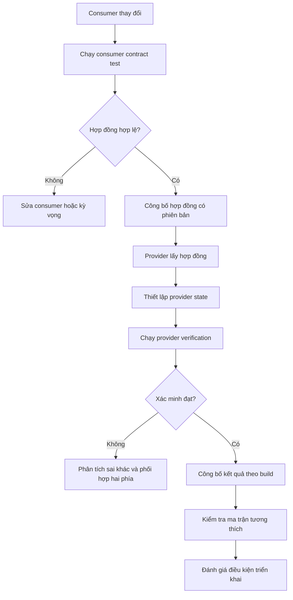

# Phối hợp kiểm thử từ phía cung cấp với phía sử dụng hợp đồng

Trong kiến trúc có nhiều dịch vụ, một thay đổi ở API hoặc thông điệp có thể làm hỏng hệ thống khác dù dịch vụ vừa thay đổi vẫn vượt qua kiểm thử nội bộ. Consumer (bên sử dụng) kỳ vọng một giao diện và hành vi cụ thể; provider (bên cung cấp) triển khai giao diện đó. Kiểm thử hợp đồng giúp hai phía xác minh rằng những kỳ vọng và khả năng cung cấp vẫn tương thích.

Để có bằng chứng đáng tin cậy, kiểm thử cần được phối hợp từ cả hai phía. Consumer mô tả các tương tác mà nó thực sự cần và kiểm tra cách ứng dụng sử dụng phản hồi. Provider xác minh triển khai thật đáp ứng những tương tác đã thỏa thuận trong các trạng thái dữ liệu phù hợp. Kết quả và phiên bản hợp đồng cần được chia sẻ để nhóm biết consumer nào tương thích với provider nào trước khi triển khai.

## 1. Hợp đồng API là gì?

Hợp đồng API mô tả cách hai hệ thống giao tiếp tại một ranh giới. Với API đồng bộ, hợp đồng thường xác định phương thức, đường dẫn, header, xác thực, định dạng yêu cầu, phản hồi, mã trạng thái, lỗi và các quy tắc dữ liệu. Với giao tiếp bất đồng bộ, hợp đồng có thể mô tả topic hoặc queue, schema thông điệp, metadata, khóa định tuyến, thứ tự, xác nhận và ngữ nghĩa xử lý.

Hợp đồng tập trung vào hành vi có thể quan sát được ở ranh giới. Nó không cần mô tả cách provider lưu dữ liệu hoặc tổ chức lớp bên trong, trừ khi chi tiết đó ảnh hưởng đến giao diện đã cam kết.

Ví dụ, một consumer cần lấy trạng thái đơn hàng có thể yêu cầu:

```http
GET /orders/ORD-42
Accept: application/json
Authorization: Bearer <token>
```

Và mong đợi phản hồi:

```http
HTTP/1.1 200 OK
Content-Type: application/json

{
  "id": "ORD-42",
  "status": "PAID",
  "total": 12500,
  "currency": "VND"
}
```

Hợp đồng cần làm rõ ý nghĩa của `status`, đơn vị của `total`, định dạng `currency`, hành vi khi đơn không tồn tại, yêu cầu xác thực và các trường có thể vắng mặt hoặc nhận giá trị null. Chỉ ghi một ví dụ JSON là chưa đủ nếu các quy tắc này vẫn mơ hồ.

## 2. Vai trò của consumer và provider

**Consumer** là ứng dụng hoặc dịch vụ gọi API hay nhận thông điệp từ provider. Consumer hiểu rõ dữ liệu và hành vi mà luồng nghiệp vụ của nó cần. Trách nhiệm chính gồm:

- Xác định các tương tác thực sự được sử dụng, không mô tả mọi khả năng của API nếu ứng dụng không phụ thuộc vào chúng.
- Đưa ra yêu cầu và phản hồi mong đợi, bao gồm trường bắt buộc, trường tùy chọn, kiểu dữ liệu và các trường hợp lỗi liên quan.
- Kiểm tra ứng dụng xử lý đúng phản hồi, lỗi và trạng thái được mô tả.
- Tạo và công bố hợp đồng có phiên bản để provider có thể xác minh.
- Cập nhật hợp đồng khi nhu cầu consumer thay đổi và phối hợp với provider về khả năng tương thích.

**Provider** là dịch vụ cung cấp API hoặc phát thông điệp cho consumer. Provider hiểu rõ dữ liệu, quy tắc nghiệp vụ và trạng thái nội bộ cần thiết để tạo ra phản hồi. Trách nhiệm chính gồm:

- Duy trì giao diện và hành vi đã công bố.
- Xác minh triển khai thật đáp ứng các hợp đồng consumer đã công bố.
- Chuẩn bị trạng thái dữ liệu kiểm thử đại diện cho các tình huống hợp đồng.
- Kiểm tra các thay đổi API, schema và hành vi lỗi trước khi phát hành.
- Trao đổi với consumer khi hợp đồng mâu thuẫn, quá chặt hoặc yêu cầu hành vi provider không thể cam kết.

Trong một tổ chức, một dịch vụ có thể vừa là consumer của dịch vụ khác vừa là provider cho nhiều consumer. Vì vậy, vai trò được xác định theo từng ranh giới giao tiếp, không phải theo tên đội hoặc sản phẩm.

## 3. Vì sao cần kiểm thử từ cả hai phía?

Consumer và provider nhìn cùng một giao diện từ hai góc độ khác nhau. Chỉ kiểm thử phía consumer thường sử dụng mock server hoặc test double được tạo từ kỳ vọng của chính consumer. Nó cho biết ứng dụng consumer xử lý một phản hồi giả định như thế nào, nhưng không chứng minh provider thật trả về phản hồi đó.

Chỉ kiểm thử phía provider có thể chứng minh endpoint đáp ứng một số kiểm thử do provider thiết kế. Tuy nhiên, các kiểm thử đó có thể bỏ sót cách consumer thực sự gọi API hoặc những trường mà consumer phụ thuộc.

Phối hợp hai phía giúp khép kín khoảng trống này:

1. Consumer ghi nhận tương tác và dữ liệu mà ứng dụng cần.
2. Consumer chạy kiểm thử với phản hồi mô phỏng để xác minh cách sử dụng hợp đồng.
3. Hợp đồng được chia sẻ để provider lấy đúng kỳ vọng cần xác minh.
4. Provider chạy hợp đồng với triển khai thật và trạng thái dữ liệu được chuẩn bị.
5. Kết quả xác minh được công bố để consumer và quy trình phát hành tra cứu.
6. Hai phía kiểm tra khả năng tương thích giữa phiên bản consumer và provider dự kiến triển khai.

Quy trình này giảm nguy cơ hai phía tự giả định khác nhau về cùng một API. Nó cũng tạo phản hồi nhanh hơn so với việc chỉ phát hiện sai khác trong một bài kiểm thử đầu cuối lớn sau khi nhiều dịch vụ đã được triển khai cùng nhau.

## 4. Consumer-driven contract testing

Consumer-driven contract testing (kiểm thử hợp đồng do consumer dẫn dắt) bắt đầu từ nhu cầu của ứng dụng sử dụng API. Mỗi consumer mô tả những tương tác cần thiết và công bố hợp đồng để provider xác minh.

Ví dụ, một dịch vụ giao diện đơn hàng chỉ cần đọc mã đơn, trạng thái và tổng tiền. Hợp đồng của consumer có thể không phụ thuộc vào các trường nội bộ khác mà provider trả về. Khi đó, provider có thể thêm trường mới mà không làm hỏng consumer, miễn là các quy tắc tương thích được giữ nguyên.

Ưu điểm của cách tiếp cận này:

- Hợp đồng phản ánh cách consumer thực sự sử dụng API.
- Provider có thể biết thay đổi nào sẽ ảnh hưởng đến từng consumer.
- Tránh yêu cầu mọi consumer phải kiểm tra toàn bộ schema lớn nếu chỉ dùng một phần nhỏ.
- Có thể chạy xác minh tự động trong CI trước khi hợp nhất hoặc phát hành.

Điểm cần quản lý là hợp đồng phải phản ánh đúng nhu cầu và không được biến thành bản sao tùy tiện của mock. Nếu consumer ghi kỳ vọng quá rộng hoặc đưa chi tiết triển khai vào hợp đồng, provider sẽ bị ràng buộc bởi những điều không phải cam kết giao diện.

## 5. Quy trình tạo hợp đồng từ phía consumer

Một quy trình thực hành phía consumer có thể gồm các bước:

1. **Xác định tương tác:** chọn API hoặc thông điệp mà một luồng nghiệp vụ thực sự sử dụng.
2. **Mô tả yêu cầu:** xác định phương thức, đường dẫn, header, xác thực, tham số, kiểu dữ liệu và các trường bắt buộc.
3. **Mô tả phản hồi:** xác định trạng thái thành công, cấu trúc dữ liệu, trường tùy chọn, lỗi và điều kiện xuất hiện của từng phản hồi.
4. **Chuẩn bị dữ liệu ví dụ:** tạo ví dụ nhỏ, rõ nghĩa, đủ đại diện cho hành vi consumer cần.
5. **Chạy consumer test:** sử dụng mock server hoặc công cụ kiểm thử hợp đồng để kiểm tra consumer gửi đúng yêu cầu và xử lý phản hồi như mong đợi.
6. **Sinh và công bố hợp đồng:** lưu hợp đồng có định danh, phiên bản consumer, provider, môi trường hoặc nhánh nguồn phù hợp.
7. **Yêu cầu provider xác minh:** chia sẻ hợp đồng cùng ngữ cảnh và trạng thái cần chuẩn bị.

Ví dụ, consumer có thể kiểm tra rằng khi nhận `200 OK` với `status: PAID`, ứng dụng hiển thị đơn đã thanh toán; khi nhận `404`, ứng dụng hiển thị thông báo đơn không tồn tại; khi nhận `503`, ứng dụng đưa ra trạng thái thử lại phù hợp. Những phản hồi cần có phải xuất phát từ luồng nghiệp vụ và cách ứng dụng xử lý thật.

Consumer test không nên chỉ kiểm tra rằng mock được gọi. Nó cần xác minh yêu cầu được tạo đúng và ứng dụng phản ứng đúng với phản hồi đã mô tả. Với các trường không ảnh hưởng đến consumer, tránh tạo ràng buộc không cần thiết.

## 6. Quy trình xác minh hợp đồng từ phía provider

Provider lấy hợp đồng đã công bố và chạy chúng với triển khai provider thực tế. Một quy trình thường gồm:

1. **Lấy phiên bản hợp đồng:** xác định consumer, phiên bản hợp đồng, nhánh hoặc build đang được kiểm tra.
2. **Chuẩn bị provider state:** tạo dữ liệu và trạng thái ban đầu để phản hồi có thể được tái tạo. Ví dụ, chuẩn bị đơn `ORD-42` ở trạng thái `PAID`.
3. **Khởi chạy provider:** dùng cấu hình và thành phần thật phù hợp với mục tiêu kiểm thử; các phụ thuộc khác có thể được kiểm soát nếu không thuộc ranh giới đang đánh giá.
4. **Phát lại tương tác:** gửi yêu cầu được mô tả trong hợp đồng và so sánh phản hồi thực tế với kỳ vọng.
5. **Kiểm tra các trường hợp lỗi:** xác minh phản hồi lỗi và hành vi liên quan như xác thực, không tìm thấy dữ liệu hoặc phụ thuộc không sẵn sàng.
6. **Công bố kết quả:** gắn kết quả với phiên bản provider, hợp đồng và build cụ thể để quy trình triển khai có thể tra cứu.
7. **Xử lý sai khác:** phân tích xem lỗi nằm ở consumer expectation, hợp đồng, dữ liệu kiểm thử hay triển khai provider; thống nhất thay đổi với bên liên quan.

### Provider state

Provider state là điều kiện dữ liệu hoặc trạng thái được thiết lập trước khi chạy một tương tác hợp đồng. Nó mô tả bối cảnh cần có, ví dụ:

- Đơn hàng `ORD-42` tồn tại và đã thanh toán.
- Đơn hàng có mã không tồn tại.
- Người dùng có quyền đọc đơn hàng.
- Token đã hết hạn.
- Một giao dịch đang ở trạng thái chờ đối soát.

Provider state giúp kết quả kiểm thử không phụ thuộc vào thứ tự chạy hoặc dữ liệu còn sót lại từ trường hợp trước. Mỗi tương tác cần tự chuẩn bị và dọn dẹp trạng thái phù hợp. Không nên phụ thuộc vào dữ liệu production hoặc tài khoản cá nhân.

Provider state là cơ chế thiết lập dữ liệu kiểm thử, không phải một phần của API production. Việc thiết lập có thể thông qua fixture, API hỗ trợ kiểm thử, script hoặc hook của framework, tùy kiến trúc và công cụ.

## 7. Ví dụ hợp đồng và xác minh hai phía

Giả sử `Order Web` là consumer và `Order Service` là provider. Consumer cần lấy thông tin đơn hàng để hiển thị trạng thái.

Hợp đồng minh họa:

```yaml
consumer: OrderWeb
provider: OrderService
interaction: Read a paid order
providerState: An order exists with id ORD-42 and status PAID
request:
  method: GET
  path: /orders/ORD-42
  headers:
    Accept: application/json
response:
  status: 200
  headers:
    Content-Type: application/json
  body:
    id: ORD-42
    status: PAID
    total: 12500
    currency: VND
```

Đây là mô tả minh họa, không phải cú pháp bắt buộc của một công cụ cụ thể. Trong hợp đồng thực tế cần xác định rõ kiểu dữ liệu, quy tắc khớp, trường bắt buộc, header, xác thực và các giá trị có thể thay đổi.

Phía consumer chạy với mock server để xác minh rằng `OrderWeb` gọi `GET /orders/ORD-42`, gửi header cần thiết và xử lý phản hồi `PAID` đúng. Phía provider thiết lập provider state có đơn `ORD-42`, sau đó chạy tương tác với endpoint thật của `Order Service` để kiểm tra phản hồi có đáp ứng hợp đồng không.

Nếu consumer test đạt nhưng provider verification thất bại vì trường `currency` bị thiếu, hai phía cần xác định đây là trường provider đã cam kết hay kỳ vọng consumer mới được thêm. Nếu consumer thực sự cần trường này và provider có thể cung cấp, cập nhật triển khai hoặc hợp đồng. Nếu yêu cầu chưa được thống nhất, cần làm rõ hợp đồng trước khi thay đổi mã.

## 8. Kiểm thử hợp đồng đồng bộ và bất đồng bộ

### API đồng bộ

Với HTTP hoặc RPC, hợp đồng thường mô tả yêu cầu, phản hồi và các trường hợp lỗi. Các điểm cần xác minh gồm:

- Phương thức, đường dẫn hoặc tên phương thức RPC.
- Header, metadata, xác thực và quyền truy cập.
- Kiểu, định dạng, đơn vị, giới hạn và quy tắc null của dữ liệu.
- Mã trạng thái hoặc loại lỗi và ý nghĩa của chúng.
- Các trường bắt buộc, tùy chọn và giá trị mặc định.
- Hành vi khi tài nguyên không tồn tại, yêu cầu không hợp lệ hoặc phụ thuộc gặp lỗi.

### Thông điệp bất đồng bộ

Với message broker hoặc event stream, producer và consumer không trao đổi một yêu cầu và phản hồi trực tiếp. Hợp đồng cần xác định cấu trúc thông điệp và ngữ nghĩa xử lý.

Ví dụ, `Order Service` phát sự kiện `OrderPaid`; `Billing Service` tiêu thụ sự kiện đó để tạo chứng từ. Hợp đồng có thể mô tả:

- Tên sự kiện và phiên bản schema.
- ID sự kiện, ID đơn hàng, thời điểm, tiền tệ và số tiền.
- Trường bắt buộc, trường tùy chọn và quy tắc mở rộng.
- Khóa partition hoặc routing nếu có ý nghĩa với thứ tự xử lý.
- Ngữ nghĩa giao nhận, xử lý trùng lặp và khả năng thử lại.
- Hành vi khi consumer nhận trường chưa biết hoặc schema không hợp lệ.

Kiểm thử hợp đồng có thể xác minh producer phát đúng cấu trúc và consumer có thể phân tích thông điệp theo hợp đồng. Tuy nhiên, cần thêm kiểm thử tích hợp với broker để xác minh cấu hình topic, serialization thực tế, acknowledgement, retry và dead-letter queue.

## 9. Quản lý thay đổi và tương thích phiên bản

Một hợp đồng không chỉ là tài liệu tại một thời điểm. Nó cần được quản lý cùng phiên bản consumer, provider và các lần phát hành. Khi API thay đổi, nhóm phải biết consumer nào đang sử dụng giao diện và phiên bản nào còn được hỗ trợ.

### Thay đổi thường tương thích

Trong nhiều thiết kế, các thay đổi sau có thể tương thích ngược nếu quy tắc hợp đồng cho phép:

- Thêm trường phản hồi tùy chọn mà consumer cũ bỏ qua được.
- Thêm endpoint mới mà không thay đổi endpoint hiện có.
- Thêm loại thông tin mà consumer không cần hiểu vẫn xử lý được.
- Mở rộng khả năng xử lý ở provider mà không thay đổi ý nghĩa của dữ liệu cũ.

Không nên mặc định mọi trường hợp đều tương thích. Một consumer có thể từ chối trường lạ, schema có thể cấm thuộc tính bổ sung hoặc trường mới có thể thay đổi ý nghĩa nghiệp vụ. Cần xác minh theo quy tắc parser và hợp đồng thực tế.

### Thay đổi có nguy cơ phá vỡ tương thích

Các thay đổi sau thường cần phối hợp và kế hoạch chuyển đổi:

- Xóa hoặc đổi tên trường mà consumer đang sử dụng.
- Đổi kiểu dữ liệu, định dạng, đơn vị hoặc ý nghĩa của trường.
- Làm một trường tùy chọn trở thành bắt buộc.
- Đổi mã trạng thái hoặc cấu trúc lỗi mà consumer phụ thuộc.
- Thay đổi quy tắc xác thực, quyền truy cập hoặc yêu cầu header.
- Xóa endpoint, đổi đường dẫn hoặc thay đổi phương thức.
- Đổi schema thông điệp theo cách consumer cũ không thể phân tích.

Với thay đổi phá vỡ tương thích, có thể dùng chiến lược:

1. Thêm giao diện hoặc trường mới trong khi giữ hành vi cũ.
2. Cập nhật consumer để đọc hoặc chuyển sang giao diện mới.
3. Kiểm thử cả consumer cũ và mới với provider trong giai đoạn chuyển tiếp.
4. Theo dõi mức sử dụng giao diện cũ và thông báo thời điểm ngừng hỗ trợ.
5. Chỉ loại bỏ giao diện cũ khi các consumer đã chuyển đổi hoặc có quyết định rõ ràng về ngoại lệ.

### Ma trận tương thích

Trước khi phát hành provider, nhóm nên xác định những phiên bản consumer nào phải tiếp tục hoạt động. Có thể dùng ma trận tương thích để ghi nhận kết quả:

| Provider version | Consumer A v1 | Consumer A v2 | Consumer B v3 |
| --- | --- | --- | --- |
| Provider v4 | PASS | PASS | PASS |
| Provider v5 candidate | PASS | PASS | Chưa xác minh |

Bảng trên chỉ là ví dụ về cách trình bày. Trạng thái phải lấy từ kết quả xác minh thực tế; không điền PASS khi chưa chạy kiểm thử. Ma trận giúp nhận diện trường hợp provider mới tương thích với một số consumer nhưng chưa có bằng chứng cho consumer khác.

## 10. Tích hợp kiểm thử hợp đồng vào CI/CD

Kiểm thử hợp đồng có thể được tích hợp vào pipeline để phát hiện sai khác sớm. Một luồng phổ biến:



Ở phía consumer, pipeline chạy khi thay đổi cách gọi API, xử lý dữ liệu hoặc kỳ vọng. Ở phía provider, pipeline có thể chạy khi thay đổi endpoint, schema, logic nghiệp vụ, xác thực hoặc phụ thuộc liên quan.

Kết quả cần được gắn với commit hoặc build, phiên bản hợp đồng, phiên bản provider, provider state và môi trường. Nếu chỉ lưu một nhãn “contract tests passed” mà không biết kiểm tra hợp đồng nào với phiên bản nào, kết quả khó hỗ trợ quyết định triển khai.

Với nhiều consumer, provider có thể lấy tất cả hợp đồng đang được hỗ trợ từ một kho hoặc broker hợp đồng. Pipeline nên xác minh tập hợp hợp đồng cần thiết theo chính sách tương thích. Cần quản lý hợp đồng lỗi thời, nhánh chưa phát hành và consumer đã ngừng hoạt động để tránh kiểm tra nhầm phiên bản.

## 11. Công cụ và cách tổ chức

Có nhiều công cụ hỗ trợ kiểm thử hợp đồng. Ví dụ, Pact hỗ trợ consumer-driven contract testing và provider verification; OpenAPI có thể mô tả hợp đồng HTTP; AsyncAPI có thể mô tả giao tiếp dựa trên thông điệp. Việc chọn công cụ phụ thuộc giao thức, kiến trúc, cách quản lý phiên bản và pipeline hiện có.

Không nên xem một định dạng tài liệu hoặc công cụ là bằng chứng tự động rằng hai hệ thống tương thích. Cần chạy kiểm thử với hợp đồng, triển khai và trạng thái dữ liệu cụ thể. Một tài liệu OpenAPI hợp lệ có thể không phản ánh chính xác hành vi hiện tại nếu không được kiểm tra với implementation.

Để phối hợp hiệu quả, nhóm có thể thống nhất:

- Nơi lưu trữ hợp đồng và quy tắc đặt tên.
- Cách định danh consumer, provider, phiên bản và nhánh.
- Ai được quyền công bố hoặc thay đổi hợp đồng.
- Cách chuẩn bị provider state và dữ liệu kiểm thử.
- Điều kiện pipeline cần đạt trước khi merge hoặc deploy.
- Thời hạn lưu kết quả và cách loại bỏ hợp đồng không còn sử dụng.
- Quy trình thông báo khi thay đổi phá vỡ tương thích.

## 12. Giới hạn của kiểm thử hợp đồng

Kiểm thử hợp đồng cung cấp bằng chứng tại ranh giới giao tiếp. Nó không thay thế mọi loại kiểm thử khác.

- Nó không chứng minh toàn bộ luồng nghiệp vụ giữa tất cả dịch vụ hoạt động đúng trong production.
- Nó không tự xác minh cấu hình mạng, DNS, TLS, firewall, broker hoặc hạ tầng triển khai nếu các thành phần đó không nằm trong môi trường kiểm thử.
- Nó không chứng minh hiệu năng, khả năng chịu tải, bảo mật toàn diện hoặc độ tin cậy dài hạn.
- Nó không bảo đảm mọi consumer đã công bố hợp đồng đều đại diện cho toàn bộ consumer đang hoạt động.
- Nó không bảo đảm ngữ nghĩa nghiệp vụ đúng nếu hợp đồng được viết sai hoặc quá hẹp.
- Nó không thay thế kiểm thử tích hợp, hệ thống, kiểm thử bảo mật và giám sát vận hành.

Vì vậy, nên kết hợp kiểm thử hợp đồng với kiểm thử thành phần, kiểm thử tích hợp có chọn lọc, kiểm thử đầu cuối cho luồng rủi ro cao và giám sát sau triển khai. Hợp đồng giúp thu hẹp khoảng trống tại giao diện; các hoạt động khác cung cấp bằng chứng cho hành vi và điều kiện ngoài phạm vi đó.

## 13. Những sai lầm thường gặp khi phối hợp hai phía

- **Consumer chỉ kiểm thử với mock:** provider thật có thể trả về schema hoặc mã trạng thái khác với mock.
- **Provider chỉ kiểm thử endpoint theo dữ liệu nội bộ:** có thể bỏ sót cách consumer thực sự gọi hoặc xử lý phản hồi.
- **Hợp đồng mô tả toàn bộ schema dù consumer không dùng:** làm tăng ràng buộc và khiến thay đổi không cần thiết trở nên khó khăn.
- **Provider state phụ thuộc dữ liệu dùng chung:** kết quả không ổn định theo thứ tự chạy hoặc môi trường.
- **Không kiểm tra lỗi và quyền truy cập:** hợp đồng chỉ bao phủ phản hồi thành công nên bỏ qua các trường hợp consumer phải xử lý.
- **Không quản lý phiên bản:** không biết hợp đồng thuộc build nào hoặc consumer nào còn sử dụng.
- **Xóa API ngay sau khi provider verification mới đạt:** consumer cũ có thể vẫn đang triển khai và cần thời gian chuyển đổi.
- **Coi contract test là end-to-end test:** bỏ qua các rủi ro về hạ tầng, cấu hình và chuỗi nghiệp vụ thực tế.
- **Không có chủ sở hữu khi hợp đồng thất bại:** hai phía đổ lỗi cho nhau thay vì cùng xác định kỳ vọng, trạng thái dữ liệu và phản hồi thực tế.

## 14. Checklist phối hợp kiểm thử hợp đồng

**Phía consumer**

- [ ] Tương tác được chọn phản ánh một luồng nghiệp vụ thực sự sử dụng API hoặc thông điệp.
- [ ] Yêu cầu, phản hồi, lỗi, header, xác thực và quy tắc dữ liệu được mô tả rõ.
- [ ] Consumer test xác minh cả yêu cầu được gửi và cách ứng dụng xử lý phản hồi.
- [ ] Hợp đồng được công bố với định danh và phiên bản có thể truy nguyên.

**Phía provider**

- [ ] Provider verification chạy với triển khai provider thực tế.
- [ ] Provider state tạo dữ liệu xác định, độc lập và có thể tái tạo.
- [ ] Các trường hợp thành công, lỗi và quyền truy cập cần thiết được xác minh.
- [ ] Kết quả gắn với phiên bản provider, hợp đồng và build cụ thể.

**Phối hợp và phát hành**

- [ ] Có nơi chia sẻ hợp đồng và kết quả cho cả hai phía.
- [ ] Ma trận tương thích bao gồm các consumer còn được hỗ trợ.
- [ ] Thay đổi có nguy cơ phá vỡ tương thích có kế hoạch chuyển đổi.
- [ ] Pipeline có điều kiện rõ ràng trước khi merge hoặc deploy.
- [ ] Giới hạn của kiểm thử hợp đồng được bổ sung bằng kiểm thử tích hợp, hệ thống hoặc giám sát phù hợp.

## 15. Những điểm cần ghi nhớ

- Hợp đồng mô tả hành vi giao tiếp có thể quan sát được giữa consumer và provider.
- Consumer xác định những tương tác ứng dụng thực sự cần; provider xác minh triển khai thật đáp ứng các tương tác đó.
- Consumer test với mock server không thay thế provider verification; provider test riêng cũng không thay thế hợp đồng phản ánh nhu cầu consumer.
- Provider state tạo điều kiện dữ liệu xác định để phát lại tương tác hợp đồng.
- Cần quản lý phiên bản hợp đồng, phiên bản consumer/provider và ma trận tương thích trước khi triển khai.
- Với thông điệp bất đồng bộ, hợp đồng cần mô tả schema và ngữ nghĩa xử lý; kiểm thử broker vẫn cần thiết cho các đặc tính hạ tầng.
- Kiểm thử hợp đồng tập trung vào ranh giới giao tiếp, không chứng minh toàn bộ hành vi end-to-end, hiệu năng hoặc bảo mật.

## Câu hỏi tự kiểm tra

1. Vì sao cần phối hợp kiểm thử từ phía consumer và provider thay vì chỉ kiểm thử một phía?
2. Hợp đồng API cần mô tả những thông tin nào ngoài một ví dụ JSON phản hồi?
3. Provider state là gì và vì sao mỗi tương tác nên tự chuẩn bị trạng thái dữ liệu?
4. Một consumer test đạt với mock server nhưng provider verification thất bại. Bạn sẽ điều tra những khả năng nào?
5. Hãy phân biệt thay đổi API thường tương thích với thay đổi có nguy cơ phá vỡ consumer hiện tại.
6. Với một sự kiện bất đồng bộ, hợp đồng cần mô tả những gì và những hành vi nào vẫn cần kiểm thử tích hợp với broker?
7. Vì sao contract testing không thể thay thế kiểm thử end-to-end hoặc kiểm thử hiệu năng?
8. Hãy đề xuất một luồng CI/CD để công bố hợp đồng, xác minh provider và kiểm tra ma trận tương thích trước khi triển khai.
