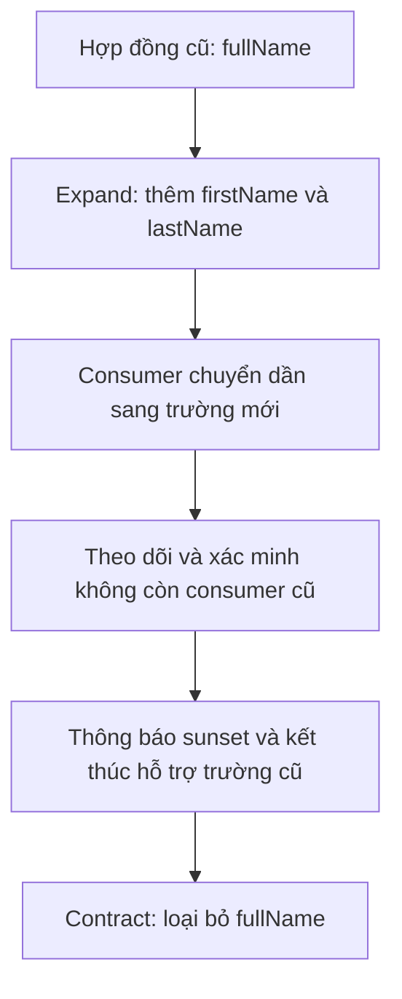

# Quản lý phiên bản hợp đồng và phối hợp lịch phát hành

Hợp đồng API mô tả cách một hệ thống cung cấp khả năng cho hệ thống khác sử dụng: endpoint hoặc kênh trao đổi, cấu trúc dữ liệu, kiểu và ý nghĩa của trường, quy tắc xác thực, mã lỗi, cơ chế xác thực, thứ tự sự kiện và các cam kết liên quan. Khi nhà cung cấp API thay đổi hợp đồng, các ứng dụng tiêu thụ (consumer) có thể cần cập nhật theo. Nếu hai phía triển khai lệch thời điểm hoặc hiểu khác nhau về thay đổi, hệ thống có thể ngừng giao tiếp dù từng thành phần vẫn hoạt động riêng lẻ.

**Quản lý phiên bản hợp đồng** xác định cách nhận diện, công bố, thay đổi và duy trì các phiên bản của giao diện. **Phối hợp lịch phát hành** bảo đảm nhà cung cấp, consumer, nhóm kiểm thử và vận hành thống nhất thời điểm chuẩn bị, triển khai, chuyển đổi và ngừng hỗ trợ phiên bản cũ.

Mục tiêu là cho phép các nhóm phát triển độc lập nhưng vẫn duy trì khả năng tương thích và có đủ thời gian xác minh. Việc tăng số phiên bản không tự động giải quyết vấn đề phối hợp. Nhóm cần hiểu tác động của thay đổi, có chính sách tương thích rõ ràng, kiểm thử hợp đồng tự động và một kế hoạch chuyển đổi có thể theo dõi.

## 1. Hợp đồng API là gì và vì sao cần quản lý phiên bản?

Hợp đồng API là thỏa thuận kỹ thuật giữa bên cung cấp và bên sử dụng. Với REST API, hợp đồng thường mô tả đường dẫn, phương thức HTTP, tham số, header, request body, response body, mã trạng thái, cơ chế xác thực và quy tắc lỗi. Với API bất đồng bộ, hợp đồng còn có thể mô tả tên sự kiện, schema message, khóa định tuyến, thứ tự, khả năng gửi lặp và cách consumer xử lý sự kiện.

Ví dụ, một API tạo đơn hàng có thể công bố:

```http
POST /api/orders
Content-Type: application/json
Authorization: Bearer <token>

{
  "customerId": "C-1024",
  "items": [
    { "productId": "P-01", "quantity": 2 }
  ]
}
```

Hợp đồng cần nói rõ trường nào bắt buộc, `quantity` phải là số nguyên dương, lỗi xác thực trả về dạng nào, việc gửi lại request có thể tạo đơn thứ hai hay được bảo vệ bằng idempotency key, và response chứa định danh đơn hàng ở trường nào. Chỉ ghi ví dụ JSON mà không mô tả ngữ nghĩa và hành vi lỗi sẽ chưa tạo thành một hợp đồng đủ rõ.

Hợp đồng cần được quản lý phiên bản vì:

- Nhà cung cấp và consumer có thể được phát triển, kiểm thử và triển khai vào các thời điểm khác nhau.
- Một thay đổi cấu trúc hoặc ngữ nghĩa có thể làm consumer hiện tại phân tích dữ liệu sai hoặc thất bại.
- Nhiều phiên bản ứng dụng có thể cùng tồn tại trong quá trình triển khai dần, đặc biệt ở hệ thống phân tán hoặc ứng dụng di động.
- Consumer bên ngoài có thể không được nhóm cung cấp kiểm soát trực tiếp.
- Nhóm cần biết phiên bản nào được hỗ trợ, đã lỗi thời hoặc đã ngừng hoạt động.
- Khi xảy ra sự cố, thông tin phiên bản giúp xác định phía nào đang gửi và nhận hợp đồng nào.

Phiên bản hợp đồng là một phần của quản lý vòng đời API. Nó cần gắn với tài liệu, schema, kiểm thử, mã triển khai, lịch phát hành và thông báo cho consumer.

## 2. Phân loại thay đổi theo tác động tương thích

Trước khi chọn cách tăng phiên bản, hãy phân loại thay đổi theo ảnh hưởng đến consumer. Một thay đổi tương thích ngược (backward-compatible) cho phép consumer hiện tại tiếp tục hoạt động mà không phải sửa ngay, trong phạm vi các hành vi đã cam kết. Thay đổi phá vỡ tương thích (breaking change) có thể làm consumer hiện tại không biên dịch, không phân tích được dữ liệu hoặc thay đổi hành vi theo cách không còn đúng.

### 2.1. Các thay đổi thường tương thích ngược

Tùy hợp đồng và cách consumer được triển khai, các thay đổi sau thường có thể tương thích:

- Thêm endpoint mới mà không thay đổi endpoint cũ.
- Thêm trường tùy chọn vào response, nếu consumer được yêu cầu bỏ qua trường không biết.
- Thêm một giá trị mặc định hoặc khả năng mới mà không thay đổi ý nghĩa trường hiện có.
- Mở rộng tài liệu và ví dụ mà không thay đổi hành vi thực tế.
- Thêm một mã lỗi mới khi hợp đồng quy định consumer phải xử lý mã chưa biết theo cách an toàn.

Không được mặc định rằng mọi thay đổi “chỉ thêm” đều an toàn. Nếu consumer dùng schema nghiêm ngặt từ chối trường lạ, thêm trường response có thể làm nó lỗi. Nếu thêm một giá trị enum mới nhưng consumer giả định chỉ có các giá trị cũ, logic xử lý có thể không đầy đủ. Cần kiểm tra cách consumer thực sự xử lý dữ liệu chưa biết.

### 2.2. Các thay đổi thường phá vỡ tương thích

Những thay đổi sau thường cần phiên bản mới hoặc một quá trình chuyển đổi có kiểm soát:

- Xóa trường, endpoint, phương thức hoặc loại sự kiện đang được sử dụng.
- Đổi tên trường hoặc thay đổi kiểu dữ liệu, định dạng, đơn vị đo hay ý nghĩa của trường.
- Chuyển một trường tùy chọn thành bắt buộc.
- Thay đổi cấu trúc lồng nhau hoặc kiểu dữ liệu theo cách consumer cũ không thể đọc.
- Thay đổi quy tắc xác thực, phân quyền hoặc cách diễn giải mã trạng thái làm thay đổi hành vi đã cam kết.
- Thu hẹp miền giá trị hợp lệ hoặc thay đổi ý nghĩa của một giá trị enum hiện có.
- Thay đổi ngữ nghĩa nghiệp vụ, chẳng hạn trước đây `total` là tổng đã gồm thuế nhưng nay trở thành tổng chưa gồm thuế.
- Thay đổi thứ tự hoặc bảo đảm giao nhận sự kiện nếu consumer phụ thuộc vào thứ tự hoặc cách giao nhận cũ.

Ngữ nghĩa thường nguy hiểm hơn thay đổi hình thức. Một trường vẫn có tên `status` và vẫn là chuỗi nhưng đổi cách hiểu từ “đã nhận yêu cầu” sang “đã hoàn tất nghiệp vụ” có thể làm consumer hoạt động sai mà không có lỗi schema.

### 2.3. Ma trận ví dụ

| Thay đổi | Tác động tiềm tàng | Cách xử lý thường dùng |
|---|---|---|
| Thêm trường tùy chọn vào response | Consumer nghiêm ngặt có thể từ chối trường lạ | Kiểm tra hành vi parser; cập nhật hợp đồng và test consumer |
| Thêm giá trị enum | Consumer có nhánh xử lý không đầy đủ | Quy định cách xử lý giá trị chưa biết và kiểm thử fallback |
| Xóa trường response | Consumer đang đọc trường có thể lỗi | Thay thế, deprecate và chuyển đổi trước khi xóa |
| Đổi kiểu `amount` từ số nguyên sang chuỗi | Consumer có thể lỗi parse hoặc tính toán | Tạo hợp đồng tương thích mới và kế hoạch migration |
| Đổi đơn vị từ đồng sang nghìn đồng | Cấu trúc vẫn hợp lệ nhưng kết quả sai nghiêm trọng | Xem là thay đổi ngữ nghĩa phá vỡ; công bố rõ và kiểm thử đối chiếu |
| Thêm endpoint mới | Consumer cũ thường không bị ảnh hưởng | Công bố trong phiên bản hiện tại nếu chính sách cho phép |
| Thay đổi quy tắc retry hoặc idempotency | Consumer có thể tạo tác dụng phụ khác dự kiến | Đánh giá hành vi, thông báo và kiểm thử tích hợp |

Phân loại cần dựa trên hợp đồng đã công bố và cách sử dụng thực tế. Khi không chắc một thay đổi có tương thích hay không, hãy xem đó là thay đổi cần đánh giá tác động trước khi phát hành.

## 3. Chính sách đánh số phiên bản

Một chính sách phiên bản tốt giúp consumer nhận biết mức độ thay đổi và biết cần làm gì. Tổ chức cần chọn một quy ước nhất quán, ghi rõ trong tài liệu và áp dụng cho cả API, schema sự kiện và các tài liệu liên quan.

### 3.1. Phiên bản theo đường dẫn

Một cách phổ biến với REST API là đưa phiên bản chính vào URL:

```text
/api/v1/orders
/api/v2/orders
```

Ưu điểm là dễ quan sát, định tuyến và vận hành song song nhiều phiên bản. Nhược điểm là có thể tạo ra nhiều endpoint cần duy trì và tài liệu dễ phân tán nếu nhóm không có quy tắc rõ.

### 3.2. Phiên bản qua header hoặc media type

Phiên bản có thể được chỉ định qua header hoặc kiểu nội dung:

```http
GET /api/orders/123
Accept: application/vnd.example.orders-v2+json
```

Cách này giữ URL ổn định nhưng cần quy định rõ cách định tuyến, cache, ghi log và kiểm tra phiên bản. Các proxy hoặc công cụ quan sát cũng cần lưu header liên quan để hỗ trợ chẩn đoán.

### 3.3. Phiên bản schema cho message hoặc event

Với hệ thống sự kiện, schema có thể được lưu trong registry và gắn số phiên bản hoặc định danh schema. Consumer cần biết cách đọc schema mới, cách xử lý trường không biết và quy tắc tương thích của topic hoặc event type.

Ví dụ:

```json
{
  "eventType": "order.created",
  "schemaVersion": 2,
  "eventId": "E-9001",
  "data": {
    "orderId": "O-2048",
    "currency": "VND",
    "totalAmount": 250000
  }
}
```

Trường `schemaVersion` giúp nhận biết cấu trúc message, nhưng không thay thế tài liệu về ngữ nghĩa, khả năng giao nhận, thứ tự và cách xử lý lỗi.

### 3.4. Quy ước major, minor và patch

Một số tổ chức dùng quy ước tương tự Semantic Versioning:

- **Major:** Có thay đổi phá vỡ tương thích hoặc thay đổi lớn cần consumer chủ động chuyển đổi.
- **Minor:** Bổ sung khả năng tương thích ngược theo chính sách đã công bố.
- **Patch:** Sửa tài liệu hoặc lỗi triển khai không làm thay đổi hợp đồng quan sát được.

Ví dụ `2.4.1` có thể biểu thị major 2, minor 4 và patch 1. Tuy nhiên, không phải mọi API đều áp dụng SemVer trực tiếp. Có nơi chỉ công bố phiên bản major cho consumer, nơi khác đánh số schema theo registry, hoặc gắn phiên bản với ngày phát hành. Điều quan trọng là định nghĩa rõ ý nghĩa từng phần và không tăng phiên bản patch để che giấu thay đổi phá vỡ.

### 3.5. Tránh phiên bản hóa không cần thiết

Không nên tạo phiên bản mới cho mọi thay đổi nhỏ nếu hợp đồng có thể mở rộng tương thích. Quá nhiều phiên bản làm tăng chi phí kiểm thử, tài liệu, giám sát và hỗ trợ. Ngược lại, cố duy trì một phiên bản duy nhất dù ngữ nghĩa đã thay đổi có thể khiến consumer hoạt động sai mà không nhận ra.

Quyết định tạo phiên bản mới cần dựa trên tác động tương thích, khả năng chuyển đổi và chi phí duy trì song song.

## 4. Quản lý vòng đời phiên bản

Mỗi phiên bản hợp đồng cần có trạng thái rõ ràng để consumer biết có thể sử dụng và kỳ vọng hỗ trợ đến khi nào. Một vòng đời có thể gồm:

1. **Draft:** Đang thiết kế và trao đổi; chưa phải cam kết ổn định cho consumer.
2. **Published/Active:** Đã công bố và được hỗ trợ theo chính sách.
3. **Deprecated:** Vẫn hoạt động nhưng đã có thông báo sẽ thay thế hoặc ngừng hỗ trợ vào một thời điểm xác định.
4. **Sunset/Retired:** Đã ngừng phục vụ hoặc không còn được hỗ trợ; consumer phải chuyển sang phương án được chỉ định.

Tên trạng thái có thể khác nhau, nhưng cần nêu rõ ý nghĩa, quyền sử dụng và mốc thời gian. “Deprecated” không có nghĩa endpoint đã bị xóa ngay. Trong giai đoạn này, nhà cung cấp vẫn cần giữ hành vi đã cam kết cho consumer hiện tại, trừ khi có thỏa thuận khác hoặc có vấn đề an toàn cần xử lý khẩn cấp.

### 4.1. Chính sách deprecation

Thông báo deprecation nên cung cấp:

- Phiên bản hoặc phần hợp đồng bị ảnh hưởng.
- Lý do thay đổi và lợi ích của phiên bản thay thế.
- Phiên bản hoặc endpoint thay thế.
- Hướng dẫn chuyển đổi, ví dụ request/response trước và sau.
- Ngày bắt đầu deprecation và ngày dự kiến ngừng hỗ trợ.
- Nhóm hoặc kênh liên hệ khi gặp vấn đề.
- Cách kiểm tra consumer đã chuyển đổi.

Không nên công bố ngày ngừng hỗ trợ khi nhóm chưa đánh giá được số lượng consumer, mức độ phụ thuộc và khả năng migration. Với API công khai hoặc có consumer không được quản lý trực tiếp, cần thời gian thông báo và quy trình hỗ trợ phù hợp.

### 4.2. Chính sách hỗ trợ nhiều phiên bản

Khi có phiên bản mới, nhà cung cấp có thể phải duy trì phiên bản cũ trong một khoảng thời gian. Chính sách cần xác định:

- Phiên bản nào đang được hỗ trợ chính thức.
- Thời gian hỗ trợ tối thiểu sau khi công bố phiên bản thay thế.
- Phiên bản nào nhận bản vá bảo mật hoặc sửa lỗi.
- Điều kiện ngoại lệ để ngừng hỗ trợ sớm.
- Người chịu trách nhiệm phê duyệt việc kết thúc hỗ trợ.

Hỗ trợ nhiều phiên bản làm tăng chi phí vận hành. Nhóm cần cân nhắc số lượng phiên bản đang hoạt động, độ phức tạp định tuyến, số bộ kiểm thử, giám sát riêng và năng lực hỗ trợ. Chính sách vòng đời giúp tránh tình trạng phiên bản cũ tồn tại vô thời hạn.

## 5. Phối hợp giữa nhà cung cấp và consumer

Nhà cung cấp kiểm soát cách triển khai API; consumer kiểm soát thời điểm cập nhật ứng dụng của họ. Trong hệ thống nội bộ, hai nhóm có thể cùng thuộc một tổ chức nhưng vẫn có backlog, lịch phát hành và người chịu trách nhiệm khác nhau. Với API bên ngoài, mức độ phối hợp còn phụ thuộc hợp đồng dịch vụ và kênh thông báo.

Để phối hợp hiệu quả, hãy duy trì danh mục consumer (consumer inventory) có tối thiểu:

| Thông tin | Mục đích |
|---|---|
| Tên consumer và chủ sở hữu | Biết nhóm hoặc đối tác cần liên hệ |
| API, endpoint, event hoặc schema đang dùng | Xác định phạm vi ảnh hưởng |
| Phiên bản hợp đồng đang sử dụng | Biết consumer cần nâng cấp đến đâu |
| Mức độ quan trọng và luồng nghiệp vụ phụ thuộc | Ưu tiên consumer theo rủi ro |
| Môi trường và lịch phát hành | Lập kế hoạch kiểm thử, triển khai và chuyển đổi |
| Đầu mối kỹ thuật và vận hành | Điều phối câu hỏi và xử lý sự cố |
| Trạng thái migration | Theo dõi đã đánh giá, đang phát triển, đang kiểm thử hay đã chuyển đổi |

Nếu không biết ai đang sử dụng phiên bản cũ, nhà cung cấp khó đánh giá tác động và không thể xác nhận migration đã hoàn tất. Có thể thu thập thông tin từ gateway, log request, registry hoặc đăng ký consumer, nhưng cần quản lý dữ liệu này có trách nhiệm và tránh lưu thông tin nhạy cảm không cần thiết.

### 5.1. Thống nhất thay đổi trước khi triển khai

Với thay đổi có tác động, nhà cung cấp nên chia sẻ bản dự thảo hợp đồng và ví dụ sớm. Consumer cần xác nhận cách hiểu, nêu các trường hợp phụ thuộc và đánh giá công sức chuyển đổi. Những bất đồng về ngữ nghĩa phải được giải quyết trước khi hợp đồng được coi là ổn định.

Một buổi trao đổi thay đổi có thể trả lời:

- Consumer nào bị ảnh hưởng và họ dùng phần nào của hợp đồng?
- Thay đổi có phá vỡ tương thích không? Có thể thiết kế theo hướng mở rộng tương thích không?
- Consumer có thể triển khai trước hay cần chờ nhà cung cấp?
- Có thể chạy hai phiên bản song song không?
- Dữ liệu hoặc trạng thái được chuyển đổi như thế nào?
- Điều kiện nào chứng minh migration thành công?
- Kế hoạch quay lui hoặc xử lý khi một phía triển khai thất bại là gì?

### 5.2. Thỏa thuận trách nhiệm

| Công việc | Nhà cung cấp | Consumer | Nhóm kiểm thử/vận hành |
|---|---|---|---|
| Đề xuất thay đổi | Mô tả hợp đồng mới và lý do | Nêu nhu cầu và phụ thuộc | Tư vấn rủi ro và khả năng kiểm chứng |
| Đánh giá tương thích | Phân tích hành vi phía cung cấp | Kiểm tra cách consumer sử dụng hợp đồng | Thiết kế kiểm thử hợp đồng và tích hợp |
| Chuẩn bị migration | Cung cấp hướng dẫn và môi trường | Lập kế hoạch sửa đổi ứng dụng | Chuẩn bị dữ liệu, môi trường và giám sát |
| Kiểm thử | Xác nhận phiên bản API mới | Xác nhận ứng dụng với hợp đồng mới | Chạy kiểm thử provider, consumer và end-to-end cần thiết |
| Phát hành | Triển khai và theo dõi API | Triển khai phiên bản consumer theo lịch | Theo dõi lỗi, metric, trace và điều kiện rollback |
| Ngừng phiên bản cũ | Thông báo, kiểm tra mức sử dụng và thực hiện sunset | Chuyển đổi và xác nhận không còn phụ thuộc | Xác minh điều kiện kết thúc và lưu bằng chứng |

Trách nhiệm cụ thể cần được ghi trong kế hoạch dự án hoặc thỏa thuận tích hợp. Bảng này là gợi ý phân công; một tổ chức có thể gộp hoặc tách vai trò.

## 6. Phối hợp lịch phát hành

Lịch phát hành hợp đồng cần tính đến cả thời gian kỹ thuật lẫn thời gian phối hợp. Chỉ lên lịch triển khai API mới mà không dành thời gian cho consumer cập nhật và kiểm thử sẽ tạo ra khoảng thời gian không tương thích.

Một lịch phối hợp thường có các mốc:

1. **Thông báo và đề xuất:** Nhà cung cấp mô tả mục tiêu, phạm vi và tác động dự kiến.
2. **Rà soát hợp đồng:** Consumer và chuyên gia liên quan kiểm tra schema, ngữ nghĩa, lỗi và tính tương thích.
3. **Đóng băng hợp đồng cho đợt phát hành:** Phiên bản ứng viên được chốt để các nhóm triển khai và kiểm thử dựa trên cùng một nội dung.
4. **Sẵn sàng môi trường:** Nhà cung cấp triển khai phiên bản mới lên môi trường thử nghiệm hoặc sandbox.
5. **Tích hợp và kiểm thử:** Consumer kiểm tra hợp đồng, tích hợp và luồng nghiệp vụ liên quan.
6. **Triển khai có kiểm soát:** Triển khai theo nhóm consumer, tỷ lệ lưu lượng hoặc giai đoạn đã thống nhất.
7. **Theo dõi và xác nhận:** Kiểm tra lỗi, độ trễ, tỷ lệ thành công và các chỉ báo tương thích.
8. **Deprecation và sunset:** Chỉ ngừng phiên bản cũ khi đạt các điều kiện đã công bố và được phê duyệt.

Ví dụ một lịch đơn giản:

| Mốc | Thời điểm minh họa | Kết quả cần có |
|---|---|---|
| Công bố bản dự thảo | Tuần 1 | Consumer nhận tài liệu và danh sách thay đổi |
| Hoàn tất rà soát hợp đồng | Tuần 2 | Phân loại tương thích và thống nhất ngữ nghĩa |
| Có môi trường thử nghiệm | Tuần 3 | Provider và consumer có thể tích hợp |
| Hoàn tất kiểm thử | Tuần 4 | Bằng chứng kiểm thử đạt, lỗi quan trọng được xử lý |
| Phát hành theo giai đoạn | Tuần 5 | Consumer đầu tiên chuyển đổi và được giám sát |
| Rà soát chuyển đổi | Sau phát hành | Xác nhận mức sử dụng phiên bản mới và kế hoạch sunset |

Thời lượng thực tế phụ thuộc số lượng consumer, mức độ phá vỡ, chu kỳ phát hành và yêu cầu vận hành. Các mốc trên chỉ minh họa cách lập kế hoạch, không phải thời gian chuẩn áp dụng cho mọi API.

### 6.1. Chọn thứ tự triển khai

Với thay đổi phá vỡ tương thích, thứ tự triển khai phụ thuộc khả năng chạy song song:

- Nếu nhà cung cấp có thể phục vụ cả phiên bản cũ và mới, thường triển khai phiên bản provider mới trước, xác nhận hoạt động, sau đó chuyển từng consumer.
- Nếu consumer mới cần một endpoint chưa tồn tại, provider phải công bố endpoint và xác nhận sẵn sàng trước khi consumer chuyển sang dùng.
- Nếu thay đổi chỉ tương thích khi hai phía triển khai đồng thời, cần một cửa sổ phát hành phối hợp, kế hoạch rollback và kiểm tra chặt chẽ; đây thường là phương án có rủi ro cao hơn.
- Với event schema, producer và consumer có thể được triển khai theo thứ tự phụ thuộc vào cách đọc message mới và cũ. Cần kiểm tra khả năng tương thích với cả message đã tồn tại trong hàng đợi.

Quy tắc “provider trước” hoặc “consumer trước” không đúng trong mọi trường hợp. Hãy xác định khả năng tương thích ở từng trạng thái trung gian của quá trình rollout.

## 7. Mẫu triển khai mở rộng rồi thu hẹp (expand and contract)

Một kỹ thuật hữu ích khi thay đổi cấu trúc dữ liệu hoặc API là chia thay đổi phá vỡ thành nhiều bước tương thích. Mẫu này thường được gọi là expand and contract.

Giả sử API cũ trả về trường `fullName`, nhưng phiên bản mới muốn tách thành `firstName` và `lastName`.

**Giai đoạn 1 – Expand:** Provider bổ sung `firstName` và `lastName`, vẫn giữ `fullName`. Tất cả consumer cũ tiếp tục đọc `fullName`; consumer mới có thể bắt đầu đọc các trường mới.

**Giai đoạn 2 – Migrate:** Consumer được cập nhật để dùng hai trường mới. Nhóm theo dõi request, lỗi parse và kết quả nghiệp vụ để xác nhận các consumer đã chuyển đổi.

**Giai đoạn 3 – Verify:** Kiểm tra danh mục consumer, log sử dụng và kiểm thử để xác nhận không còn consumer phụ thuộc `fullName`. Có thể phát cảnh báo nếu request vẫn dùng phiên bản hoặc trường cũ.

**Giai đoạn 4 – Contract:** Sau thời gian thông báo và khi đạt điều kiện sunset, provider ngừng cung cấp `fullName` trong phiên bản hoặc endpoint cũ theo kế hoạch.

Sơ đồ trình tự:



Mẫu này giảm nhu cầu triển khai đồng thời, nhưng chỉ hoạt động nếu provider có thể duy trì hai dạng dữ liệu trong giai đoạn chuyển tiếp và ngữ nghĩa không mâu thuẫn. Nếu hai trường mới không thể được suy ra chính xác từ trường cũ, cần thiết kế migration dữ liệu và xử lý trường hợp không thể chuyển đổi.

## 8. Kiểm thử hợp đồng trong quy trình phát triển

Kiểm thử hợp đồng giúp phát hiện sớm khi provider và consumer không còn thống nhất. Nó đặc biệt hữu ích khi các nhóm phát hành độc lập.

### 8.1. Kiểm thử phía consumer

Consumer xác định các tương tác mà ứng dụng thực sự cần: request được gửi ra sao, trường nào được đọc, mã lỗi nào được xử lý và hành vi nào được kỳ vọng. Các kỳ vọng này có thể được lưu thành consumer contract và kiểm tra khi thay đổi ứng dụng hoặc hợp đồng.

Kiểm thử phía consumer giúp nhà cung cấp hiểu những phần nào của API đang được sử dụng. Tuy nhiên, consumer contract không nên biến mọi chi tiết triển khai tình cờ thành cam kết. Chỉ ghi nhận các hành vi thực sự cần thiết cho consumer.

### 8.2. Kiểm thử phía provider

Provider xác minh API thực tế đáp ứng các hợp đồng đã công bố hoặc đã được consumer chấp nhận. Kiểm thử có thể chạy trên bản dựng mới trong CI, môi trường tích hợp hoặc môi trường thử nghiệm.

Nếu một provider phục vụ nhiều consumer, cần kiểm tra tập hợp các hợp đồng đang được hỗ trợ. Việc chỉ kiểm tra consumer chính có thể bỏ sót một ứng dụng ít được sử dụng nhưng vẫn đang hoạt động.

### 8.3. Kiểm tra tương thích schema

Với OpenAPI, JSON Schema, Avro, Protobuf hoặc định dạng schema khác, có thể dùng công cụ tự động để so sánh phiên bản và phát hiện thay đổi có khả năng phá vỡ tương thích. Kết quả công cụ cần được xem xét cùng ngữ nghĩa và hành vi thực tế; công cụ có thể không hiểu mọi quy tắc nghiệp vụ hoặc cách parser của consumer xử lý dữ liệu.

Một quy trình CI có thể gồm:

```text
Khi có thay đổi hợp đồng:
  1. Kiểm tra cú pháp và tính hợp lệ của schema.
  2. So sánh với phiên bản đã công bố.
  3. Phân loại thay đổi tương thích / có nguy cơ phá vỡ.
  4. Chạy kiểm thử provider.
  5. Chạy consumer contract tests liên quan.
  6. Yêu cầu phê duyệt nếu có breaking change.
  7. Công bố tài liệu và kế hoạch migration khi được chấp thuận.
```

Không nên bỏ qua cảnh báo tương thích chỉ để pipeline xanh. Nếu thay đổi có chủ đích phá vỡ tương thích, cần có phiên bản phù hợp, danh sách consumer bị ảnh hưởng, kế hoạch chuyển đổi và phê duyệt theo chính sách.

### 8.4. Kiểm thử tích hợp và đầu cuối

Kiểm thử hợp đồng xác nhận giao tiếp ở ranh giới theo các tương tác được mô tả. Nó không thay thế hoàn toàn kiểm thử tích hợp hoặc đầu cuối. Những vấn đề như quyền thực tế, timeout, retry, độ trễ, thứ tự sự kiện, giới hạn tốc độ và trạng thái dữ liệu cần được kiểm tra trong môi trường phù hợp.

Nên kết hợp:

- Kiểm thử schema và hợp đồng nhanh trong CI.
- Kiểm thử tích hợp với provider hoặc sandbox thực tế cho các ranh giới có rủi ro cao.
- Kiểm thử đầu cuối có chọn lọc cho luồng nghiệp vụ quan trọng.
- Kiểm thử hồi quy trong suốt giai đoạn hỗ trợ song song nhiều phiên bản.

## 9. Quản lý thay đổi đối với API bất đồng bộ và sự kiện

API không chỉ là request/response đồng bộ. Với message broker hoặc event stream, một thay đổi schema có thể ảnh hưởng đến consumer đọc message ngay lập tức hoặc nhiều giờ sau đó. Message cũ có thể còn nằm trong hàng đợi khi producer đã phát hành schema mới.

Khi thay đổi event, cần xem xét:

- Consumer có bỏ qua trường không biết hay từ chối message?
- Trường mới có bắt buộc không và producer cũ có thể tạo message thiếu trường đó không?
- Consumer có thể nhận cả phiên bản message cũ và mới trong thời gian chuyển đổi không?
- Có cần giữ khả năng đọc lại event lịch sử không?
- Thay đổi có ảnh hưởng thứ tự, partition key, idempotency hoặc khả năng gửi lặp không?
- Có cần chạy lại message trong môi trường thử nghiệm để xác nhận consumer mới không?

Ví dụ, producer thêm trường `currency` vào event `order.created`. Nếu consumer cũ bỏ qua trường lạ và vẫn hiểu `totalAmount` theo đơn vị đã thống nhất, thay đổi có thể tương thích. Nhưng nếu consumer mới bắt buộc `currency` và các message cũ trong hàng đợi không có trường này, consumer phải có cách xử lý dữ liệu cũ hoặc migration trước khi triển khai.

Với event, chính sách tương thích của schema registry cần được cấu hình và kiểm tra rõ. Các chế độ như backward, forward hoặc full compatibility có ý nghĩa khác nhau tùy hệ thống và thứ tự triển khai. Nhóm cần hiểu chiều tương thích đang áp dụng: consumer mới đọc được dữ liệu cũ, consumer cũ đọc được dữ liệu mới, hay cả hai.

## 10. Theo dõi tiến độ migration và quyết định sunset

Kế hoạch migration cần có tiêu chí hoàn thành có thể xác minh. Không nên kết luận tất cả consumer đã chuyển đổi chỉ vì các nhóm đã báo “đã phát hành”. Một consumer có thể vẫn chạy phiên bản cũ ở một vùng triển khai, một tác vụ nền hoặc một ứng dụng di động chưa được cập nhật.

Một bảng theo dõi có thể gồm:

| Consumer | Chủ sở hữu | Phiên bản hiện tại | Trạng thái | Mốc dự kiến | Bằng chứng hoàn tất |
|---|---|---|---|---|---|
| Web checkout | Nhóm cửa hàng | v1 | Đang cập nhật | Tuần 4 | Test tích hợp và log request v2 |
| Mobile app | Nhóm ứng dụng | v1 | Chờ phát hành | Tuần 6 | Phiên bản ứng dụng phát hành và tỷ lệ sử dụng v2 |
| Order service | Nhóm đơn hàng | v2 | Đã chuyển đổi | Tuần 3 | Contract test đạt và không còn request v1 |
| Partner integration | Nhóm đối tác | v1 | Chưa xác nhận | Chưa chốt | Xác nhận từ đầu mối đối tác và log sử dụng |

Trước khi sunset, cần kiểm tra:

- Danh sách consumer đã được rà soát đầy đủ.
- Không còn lưu lượng hợp lệ trên phiên bản cũ, hoặc mọi ngoại lệ đã được chấp nhận.
- Consumer quan trọng đã kiểm thử và xác nhận phiên bản thay thế.
- Tài liệu migration, thông báo và thời gian deprecation đã được thực hiện.
- Có người có thẩm quyền phê duyệt việc ngừng hỗ trợ.
- Dashboard, cảnh báo và log có thể phát hiện consumer còn gọi phiên bản cũ.
- Có phương án xử lý nếu phát hiện consumer bị bỏ sót.

Nếu vẫn có consumer chưa chuyển đổi, nhóm cần quyết định gia hạn hỗ trợ, hỗ trợ chuyển đổi hoặc chấp nhận ngừng dịch vụ theo thỏa thuận. Quyết định phải ghi rõ tác động và người chịu trách nhiệm.

## 11. Rollout, rollback và giám sát

Phát hành hợp đồng mới nên được triển khai theo cách giảm thiểu phạm vi ảnh hưởng. Tùy kiến trúc, nhóm có thể dùng canary, blue-green, feature flag, định tuyến theo consumer hoặc triển khai theo vùng.

Trước rollout, cần xác định:

- Tập consumer hoặc lưu lượng được chuyển trước.
- Chỉ số theo dõi: tỷ lệ lỗi, mã trạng thái, độ trễ, tỷ lệ parse thất bại, số request theo phiên bản và số lần retry.
- Ngưỡng dừng rollout và người có quyền quyết định.
- Cách quay lại phiên bản trước hoặc chuyển traffic về endpoint cũ.
- Khả năng tương thích dữ liệu sau khi rollback.

Rollback không phải lúc nào cũng chỉ là đổi binary. Nếu phiên bản mới đã ghi dữ liệu theo cấu trúc hoặc ngữ nghĩa mới, phiên bản cũ có thể không đọc được. Vì vậy, migration dữ liệu và thay đổi hợp đồng cần được thiết kế để các trạng thái trung gian vẫn an toàn hoặc có bước khôi phục rõ ràng.

Sau khi triển khai, cần theo dõi cả phía provider lẫn consumer. Provider có thể trả mã thành công nhưng consumer vẫn diễn giải sai nội dung. Theo dõi nên bao gồm kết quả nghiệp vụ, không chỉ mã HTTP hoặc trạng thái message broker.

## 12. Ví dụ xuyên suốt: nâng cấp API đơn hàng từ v1 lên v2

Giả sử API v1 trả về:

```json
{
  "orderId": "O-2048",
  "fullName": "Nguyen Van An",
  "total": 250000
}
```

API v2 muốn tách tên khách hàng và làm rõ đơn vị tiền tệ:

```json
{
  "orderId": "O-2048",
  "firstName": "Van An",
  "lastName": "Nguyen",
  "totalAmount": 250000,
  "currency": "VND"
}
```

Thay đổi này có thể phá vỡ consumer vì trường `fullName` và `total` không còn, đồng thời cách tách tên cần thống nhất ngữ nghĩa. Nhóm không nên chỉ đổi schema rồi triển khai đồng thời.

Một kế hoạch có kiểm soát:

1. **Khám phá consumer:** Xác định mọi ứng dụng đang đọc `fullName` và `total`, kể cả tác vụ nền và tích hợp đối tác.
2. **Thống nhất ngữ nghĩa:** Làm rõ cách tách tên, ý nghĩa `totalAmount`, đơn vị và cách xử lý dữ liệu thiếu.
3. **Công bố hợp đồng v2:** Cung cấp schema, ví dụ, mã lỗi, chính sách xác thực và hướng dẫn chuyển đổi.
4. **Triển khai provider:** Phục vụ v1 và v2 song song hoặc dùng expand-and-contract nếu có thể duy trì cả hai dạng trường.
5. **Kiểm thử:** Chạy schema compatibility, provider tests, consumer contract tests và kiểm thử tích hợp cho các consumer quan trọng.
6. **Chuyển consumer:** Mỗi nhóm cập nhật, kiểm thử trong môi trường thử nghiệm và triển khai theo lịch đã thống nhất.
7. **Theo dõi:** Quan sát lưu lượng theo phiên bản, lỗi parse, kết quả nghiệp vụ và consumer còn dùng v1.
8. **Sunset v1:** Chỉ ngừng v1 khi đạt tiêu chí hoàn thành, thông báo đã được thực hiện và người có thẩm quyền phê duyệt.

Nếu một consumer chưa thể chuyển đổi, nhóm cần hiểu nguyên nhân, đánh giá mức ảnh hưởng và quyết định hỗ trợ thêm hoặc thay đổi lịch. Việc giữ v1 lâu hơn có chi phí, nhưng ngừng v1 khi còn consumer quan trọng có thể gây gián đoạn nghiệp vụ.

## 13. Những sai lầm thường gặp

- **Tăng phiên bản mà không phân loại thay đổi:** Patch hoặc minor có thể vô tình chứa thay đổi phá vỡ tương thích.
- **Chỉ so sánh schema:** Ngữ nghĩa, đơn vị đo, quy tắc lỗi và hành vi retry cũng là một phần của hợp đồng.
- **Không biết consumer nào đang sử dụng API:** Dễ bỏ sót ứng dụng cũ hoặc tích hợp bên ngoài.
- **Triển khai provider và consumer không xét trạng thái trung gian:** Một phía có thể gửi cấu trúc mà phía kia chưa hiểu.
- **Không công bố thời gian deprecation:** Consumer không thể lập kế hoạch nâng cấp và hỗ trợ bị kéo dài vô hạn.
- **Ngừng phiên bản cũ theo ngày lịch mà không kiểm tra sử dụng:** Có thể làm gián đoạn consumer chưa chuyển đổi.
- **Chỉ chạy kiểm thử provider:** API có thể đáp ứng schema nhưng không tương thích với cách consumer thực sự sử dụng.
- **Bỏ qua message tồn đọng:** Consumer mới có thể gặp schema cũ còn trong hàng đợi hoặc kho lưu trữ.
- **Không có rollback hoặc rollback không xét dữ liệu:** Phiên bản cũ có thể không đọc được dữ liệu đã được phiên bản mới ghi.
- **Coi phát hành thành công là migration hoàn tất:** Cần bằng chứng sử dụng thực tế và kết quả nghiệp vụ.

## 14. Checklist quản lý phiên bản và lịch phát hành

Trước khi công bố một thay đổi hợp đồng, nhóm có thể dùng checklist sau:

- [ ] Hợp đồng hiện tại và phiên bản mới được lưu trữ, định danh rõ ràng.
- [ ] Thay đổi đã được phân loại theo tương thích cấu trúc và ngữ nghĩa.
- [ ] Chính sách major/minor/patch hoặc quy ước phiên bản tương đương được áp dụng nhất quán.
- [ ] Consumer bị ảnh hưởng và chủ sở hữu đã được xác định.
- [ ] Schema, ví dụ, lỗi, xác thực và hành vi retry đã được cập nhật.
- [ ] Provider và consumer contract tests đã được xác định và chạy.
- [ ] Lịch thử nghiệm, phát hành và migration được các nhóm thống nhất.
- [ ] Có kế hoạch hỗ trợ song song, deprecation và sunset nếu cần.
- [ ] Có chỉ số giám sát, ngưỡng dừng rollout và phương án rollback.
- [ ] Điều kiện hoàn tất migration và người phê duyệt sunset đã rõ.

Quản lý phiên bản hợp đồng và phối hợp lịch phát hành giúp các nhóm duy trì giao tiếp ổn định khi hệ thống phát triển độc lập. Khi thay đổi được phân loại đúng, consumer được nhận diện, kiểm thử hợp đồng được tự động hóa và quá trình migration có mốc cùng bằng chứng rõ ràng, nhóm có thể đưa API mới vào sử dụng mà vẫn kiểm soát rủi ro đối với các ứng dụng đang hoạt động.
