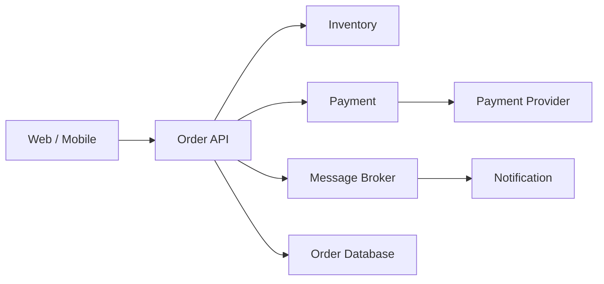

# Xác định thành phần thật và phần được mô phỏng trong từng môi trường

Trong module `VALIDATION_TESTING_STRATEGY`, kiểm thử hệ thống và kiểm thử đầu cuối (E2E) thường đi qua nhiều dịch vụ, hạ tầng và hệ thống bên ngoài. Tuy nhiên, một môi trường kiểm thử hiếm khi giống hoàn toàn môi trường sản xuất. Một số thành phần chạy bằng mã thật của sản phẩm; một số phụ thuộc được thay bằng mock, stub, fake, service virtualization hoặc sandbox; dữ liệu, cấu hình và luồng xử lý nền cũng có thể được giản lược.

Vì vậy, khi đọc kết quả kiểm thử, nhóm cần biết **thành phần nào thực sự tham gia, thành phần nào được mô phỏng và phần nào nằm ngoài phạm vi**. Một hành trình E2E có thể hoàn tất nhưng chỉ xác nhận ứng dụng phối hợp đúng với mock. Kết quả đó hữu ích để kiểm tra luồng ứng dụng, nhưng chưa chứng minh tích hợp thật với nhà cung cấp bên ngoài hoạt động đúng.

Bài học này hướng dẫn cách lập bản đồ thành phần thật và thành phần mô phỏng theo từng môi trường, lựa chọn mức độ trung thực phù hợp với mục tiêu và rủi ro, kiểm tra độ tin cậy của mô phỏng và ghi rõ giới hạn bằng chứng. Mục tiêu là giúp nhóm biết chính xác điều gì đã được xác nhận trước khi đưa ra kết luận về chất lượng hệ thống.

## 1. Vì sao phải phân biệt thành phần thật và thành phần mô phỏng?

### 1.1. Môi trường kiểm thử không nhất thiết là bản sao của sản xuất

Một môi trường kiểm thử được tạo ra để phục vụ một mục tiêu nhất định: phát triển nhanh, xác nhận hợp đồng, kiểm tra tích hợp, chạy hồi quy, kiểm tra trước phát hành hoặc giám sát sau triển khai. Tùy mục tiêu, môi trường có thể khác sản xuất về:

- Phiên bản ứng dụng và cấu hình.
- Số lượng dịch vụ được triển khai thật.
- Hạ tầng, mạng, hàng đợi và cơ sở dữ liệu.
- Nhà cung cấp bên ngoài và endpoint tích hợp.
- Dữ liệu, tài khoản, quyền và trạng thái ban đầu.
- Tốc độ xử lý, giới hạn tải và cơ chế mở rộng.
- Đồng hồ hệ thống, lịch chạy và xử lý bất đồng bộ.
- Công cụ giám sát, log, tracing và cảnh báo.

Những khác biệt này có thể là lựa chọn có chủ đích. Ví dụ, trong kiểm thử đơn vị hoặc kiểm thử thành phần, thay một dịch vụ thanh toán bằng fake giúp kiểm tra nhiều kết quả nhanh và lặp lại. Trong kiểm thử tích hợp, dùng sandbox của nhà cung cấp giúp xác nhận giao thức thật trong môi trường giao dịch thử. Trước phát hành, nhóm có thể cần một tập hành trình đi qua các dịch vụ nội bộ thật và những phụ thuộc bên ngoài đã được cấu hình an toàn.

Điều quan trọng là biết mục tiêu của môi trường và không suy rộng kết quả vượt quá những thành phần đã tham gia.

### 1.2. Một hành trình thành công chưa chứng minh mọi tích hợp đều đúng

Giả sử E2E thực hiện hành trình đặt hàng và thanh toán thành công. Nếu cổng thanh toán trong môi trường đó là mock, bài kiểm thử chỉ chứng minh ứng dụng gửi đúng yêu cầu theo mô hình mock và xử lý phản hồi mô phỏng. Nó chưa chứng minh:

- Endpoint thật có thể truy cập.
- Chứng thư, chữ ký hoặc cơ chế xác thực với nhà cung cấp hoạt động.
- Request thực tế tương thích với phiên bản API của nhà cung cấp.
- Thời gian chờ, retry và thông báo webhook hoạt động đúng.
- Trạng thái giao dịch được đối soát theo hành vi thực của nhà cung cấp.

Mock vẫn có giá trị. Nó có thể kiểm tra logic ứng dụng một cách ổn định và cho phép mô phỏng những tình huống hiếm. Vấn đề chỉ xuất hiện khi báo cáo kết quả mock như bằng chứng đã xác nhận tích hợp thật.

### 1.3. Phân biệt phạm vi thực thi và phạm vi bằng chứng

Với mỗi kết quả kiểm thử, cần biết:

- **Phạm vi thực thi:** những thành phần, dịch vụ và luồng nào thực sự được chạy.
- **Phạm vi mô phỏng:** những phụ thuộc nào được thay thế hoặc điều khiển.
- **Phạm vi quan sát:** dữ liệu và trạng thái nào có thể kiểm tra được.
- **Phạm vi kết luận:** yêu cầu hoặc rủi ro nào có thể được xem là đã xác nhận từ bằng chứng đó.

Ví dụ, một kiểm thử có thể chạy qua giao diện thật, API đơn hàng thật và cơ sở dữ liệu thử nghiệm thật, nhưng dùng stub cho dịch vụ vận chuyển. Khi đó, nhóm có bằng chứng về luồng đặt đơn trong các thành phần nội bộ đã triển khai, còn hành vi tích hợp vận chuyển thật vẫn cần được xác nhận ở một kiểm thử khác.

## 2. Hiểu các loại thành phần thật và mô phỏng

### 2.1. Thành phần thật

Một thành phần được xem là thật trong phạm vi kiểm thử khi kiểm thử tương tác với triển khai thực của thành phần đó, theo phiên bản và cấu hình được xác định. Ví dụ:

- Dịch vụ ứng dụng được triển khai từ mã nguồn của sản phẩm.
- Cơ sở dữ liệu thật của môi trường kiểm thử.
- Hàng đợi hoặc message broker thật.
- API gateway, dịch vụ xác thực hoặc dịch vụ nội bộ thật.
- Endpoint sandbox chính thức của nhà cung cấp bên ngoài.

“Thật” không có nghĩa là đang chạy trên môi trường sản xuất. Một dịch vụ nội bộ triển khai bằng mã sản phẩm trong môi trường staging vẫn là thành phần thật đối với kiểm thử ở môi trường đó. Dữ liệu tổng hợp trong cơ sở dữ liệu thật của môi trường thử nghiệm cũng không làm cơ sở dữ liệu đó trở thành mock.

### 2.2. Thành phần được mô phỏng

Thành phần mô phỏng là một thay thế có chủ đích cho phụ thuộc hoặc hành vi khác nhằm kiểm soát điều kiện kiểm thử. Các dạng phổ biến:

| Loại | Ý nghĩa | Ví dụ sử dụng |
|---|---|---|
| Stub | Trả về phản hồi đã định trước cho lời gọi cụ thể | Trả về kết quả thanh toán thành công trong một bài kiểm thử |
| Mock | Mô phỏng phụ thuộc và thường cho phép xác minh lời gọi, tham số hoặc số lần gọi | Xác nhận dịch vụ gửi đúng mã giao dịch sang cổng thanh toán |
| Fake | Triển khai đơn giản nhưng có hành vi thực ở mức cần thiết | Kho dữ liệu trong bộ nhớ dùng cho kiểm thử thành phần |
| Service virtualization | Mô phỏng hành vi của dịch vụ hoặc hệ thống phức tạp qua giao diện giao tiếp | Mô phỏng API đối tác khi sandbox không sẵn sàng |
| Emulator | Mô phỏng một nền tảng hoặc thiết bị với một phần hành vi của môi trường thật | Mô phỏng thiết bị hoặc dịch vụ nền tảng |
| Simulator | Mô phỏng hành vi hoặc điều kiện của hệ thống theo mô hình | Mô phỏng tải, thiết bị hoặc điều kiện mạng |
| Sandbox | Môi trường thử nghiệm do nhà cung cấp hoặc nền tảng cung cấp | Gửi giao dịch thử tới cổng thanh toán mà không dùng luồng giao dịch sản xuất |

Các thuật ngữ mock, stub và fake đôi khi được dùng không hoàn toàn thống nhất giữa các nhóm. Trong tài liệu dự án, hãy mô tả hành vi thay thế thực tế thay vì chỉ ghi tên loại test double.

### 2.3. Sandbox không đồng nghĩa với mock

Sandbox thường là một triển khai hoặc môi trường thử nghiệm của nhà cung cấp. Nó có thể thực hiện giao thức, xác thực, schema và một phần logic gần với dịch vụ thật, nhưng dùng dữ liệu và luồng giao dịch thử. Mock hoặc stub thường do nhóm kiểm thử kiểm soát, trả về hành vi được cấu hình trước.

| Đặc điểm | Mock / Stub nội bộ | Sandbox nhà cung cấp |
|---|---|---|
| Chủ sở hữu | Nhóm phát triển hoặc kiểm thử | Nhà cung cấp hoặc nền tảng |
| Hành vi | Có thể được điều khiển chính xác theo kịch bản | Theo khả năng và quy tắc sandbox |
| Giao thức | Có thể mô phỏng một phần hợp đồng | Thường dùng giao thức tích hợp của nhà cung cấp |
| Tính sẵn sàng | Có thể chạy cục bộ hoặc trong CI | Phụ thuộc dịch vụ bên ngoài |
| Độ trung thực | Phụ thuộc mức độ mô hình hóa | Thường gần hơn với tích hợp thật nhưng vẫn có giới hạn |
| Tình huống hiếm | Dễ cấu hình lỗi, timeout và phản hồi bất thường | Có thể không hỗ trợ mọi tình huống lỗi |
| Bằng chứng | Xác nhận logic ứng dụng với mô hình đã định | Xác nhận tương tác với môi trường thử của nhà cung cấp |

Sandbox không bảo đảm mọi đặc tính giống sản xuất. Có thể khác về dữ liệu, giới hạn, độ trễ, cơ chế chống gian lận, xử lý settlement hoặc webhook. Hãy đọc tài liệu sandbox và ghi lại giới hạn đã biết.

### 2.4. Dữ liệu giả lập và thành phần mô phỏng là hai việc khác nhau

Một môi trường có thể chạy toàn bộ dịch vụ thật nhưng sử dụng dữ liệu tổng hợp. Ngược lại, một môi trường có thể sử dụng bản sao dữ liệu đã được làm sạch nhưng thay một số dịch vụ bằng mock.

Cần ghi riêng:

- Dữ liệu thật, dữ liệu tổng hợp, dữ liệu đã ẩn danh hoặc dữ liệu được biến đổi.
- Dịch vụ thật, sandbox, fake, mock hoặc stub.
- Cấu hình và bí mật được cấp cho môi trường.
- Quy trình tạo, làm mới và dọn dữ liệu.

Không nên kết luận một hệ thống là “mô phỏng” chỉ vì dữ liệu là tổng hợp. Cũng không nên coi môi trường có dữ liệu gần sản xuất là đủ trung thực nếu các dịch vụ quan trọng đều được thay bằng stub.

## 3. Lập bản đồ thành phần theo hành trình

Trước khi thiết kế kiểm thử hệ thống hoặc E2E, hãy xác định hành trình cần kiểm chứng và các thành phần đi qua hành trình đó.

### 3.1. Xác định ranh giới của hành trình

Với mỗi hành trình, ghi:

- Tác nhân và mục tiêu nghiệp vụ.
- Điểm bắt đầu và điều kiện ban đầu.
- Các bước xử lý chính.
- Thành phần nội bộ và hệ thống bên ngoài tham gia.
- Điểm trao đổi dữ liệu hoặc sự kiện.
- Kết quả cuối cùng và nguồn bằng chứng.
- Các nhánh lỗi, retry, timeout và phục hồi cần xác nhận.

Ví dụ hành trình mua hàng:



Sơ đồ là bản đồ ban đầu. Trong môi trường kiểm thử cụ thể, mỗi nút có thể là triển khai thật, sandbox hoặc thành phần mô phỏng. Cần ghi rõ điều đó thay vì chỉ vẽ sơ đồ kiến trúc chung.

### 3.2. Lập danh mục thành phần và chế độ sử dụng

| Thành phần | Vai trò trong hành trình | Chế độ có thể dùng | Bằng chứng cần có |
|---|---|---|---|
| Web / Mobile | Kênh người dùng | Ứng dụng thật của bản dựng kiểm thử | Phiên bản, giao diện, request được gửi |
| Order API | Xử lý đơn | Dịch vụ thật | Response, trạng thái đơn và log |
| Inventory | Kiểm tra hoặc giữ tồn kho | Dịch vụ thật hoặc fake có kiểm soát | Số lượng trước và sau |
| Payment | Điều phối thanh toán | Dịch vụ thật hoặc service virtualization | Request, trạng thái và mã giao dịch |
| Payment Provider | Xử lý thanh toán | Mock, sandbox hoặc endpoint sản xuất được phê duyệt | Chế độ endpoint, phản hồi và đối soát |
| Message Broker | Truyền sự kiện | Broker thật hoặc broker giả lập | Event ID, thời điểm và trạng thái xử lý |
| Notification | Gửi email/SMS/push | Dịch vụ thật trong sandbox hoặc stub | Nội dung, người nhận thử và trạng thái gửi |
| Database | Lưu dữ liệu nghiệp vụ | Database thật của môi trường | Bản ghi, transaction và trạng thái cuối |

Mỗi thành phần nên có một chủ sở hữu hoặc nhóm chịu trách nhiệm xác nhận chế độ sử dụng. Nếu không biết một phụ thuộc là thật hay mô phỏng, hãy đánh dấu chưa xác định và làm rõ trước khi đưa ra kết luận về phạm vi.

### 3.3. Ghi rõ điểm thay thế và ranh giới bị bỏ qua

Một thành phần mô phỏng có thể thay thế một hoặc nhiều lớp. Ví dụ, mock Payment Provider có thể thay toàn bộ nhà cung cấp bên ngoài nhưng vẫn giữ Payment service thật. Trong trường hợp khác, toàn bộ Payment service cũng có thể được stub, nghĩa là luồng ứng dụng không kiểm tra logic điều phối thanh toán.

Ghi cụ thể:

- Thành phần nào bị thay thế?
- Thay thế từ điểm giao tiếp nào?
- Logic nào vẫn chạy thật?
- Logic nào được mô phỏng?
- Có hợp đồng nào được xác minh riêng không?
- Rủi ro nào không thể phát hiện trong cấu hình đó?

Không chỉ ghi “Payment mock”. Hãy ghi “Payment Provider được thay bằng mock HTTP tại ranh giới outbound; Payment service và Order service chạy bản dựng thật; không xác minh xác thực hoặc webhook của nhà cung cấp”.

## 4. Phân biệt thành phần theo từng môi trường

Một sản phẩm có thể có nhiều môi trường, mỗi môi trường phục vụ một loại bằng chứng khác nhau. Không nên giả định tất cả dự án có cùng tên hoặc cấu hình môi trường. Bảng sau là ví dụ để thiết kế ma trận của dự án.

### 4.1. Môi trường phát triển cục bộ

Mục tiêu thường là phản hồi nhanh và cô lập lỗi trong khi lập trình.

| Thành phần | Cấu hình thường gặp | Mục tiêu và giới hạn |
|---|---|---|
| Ứng dụng | Bản dựng cục bộ | Kiểm tra nhanh thay đổi đang phát triển |
| Database | Container hoặc database cục bộ | Kiểm tra truy vấn và trạng thái với dữ liệu riêng |
| Dịch vụ nội bộ khác | Fake, stub hoặc một số dịch vụ chạy cục bộ | Cô lập phụ thuộc và giảm thời gian khởi động |
| Nhà cung cấp ngoài | Mock hoặc sandbox nếu cần | Tránh giao dịch thật và phụ thuộc mạng không ổn định |
| Message broker | Local broker hoặc fake | Kiểm tra luồng sự kiện trong phạm vi đã mô phỏng |
| Dữ liệu | Dữ liệu tổng hợp | Tạo tình huống nhanh và có thể đặt lại |

Kết quả từ môi trường cục bộ phù hợp để xác nhận logic và tương tác được cấu hình. Nó thường không đủ để kết luận tích hợp triển khai, năng lực tải hoặc cấu hình bảo mật của môi trường gần sản xuất.

### 4.2. Môi trường CI

CI cần chạy tự động, lặp lại và có thời gian phản hồi phù hợp với pipeline.

| Thành phần | Cấu hình thường gặp | Mục tiêu và giới hạn |
|---|---|---|
| Ứng dụng | Bản dựng từ commit hoặc pull request | Kiểm tra đúng phiên bản đang tích hợp |
| Database và broker | Container hoặc dịch vụ ephemeral | Cô lập dữ liệu giữa các lần chạy |
| Phụ thuộc nội bộ | Dịch vụ thật trong test environment hoặc test double | Cân bằng giữa độ trung thực và tốc độ |
| Nhà cung cấp ngoài | Mock, virtualization hoặc sandbox ổn định | Tránh CI phụ thuộc vào dịch vụ bên ngoài không ổn định |
| Dữ liệu | Fixture hoặc dữ liệu tạo theo từng lần chạy | Có thể tái tạo và dọn tự động |

Nếu dùng mock cho một tích hợp quan trọng trong CI, cần có một tầng kiểm thử khác xác nhận hợp đồng hoặc tích hợp thật. Nếu CI chỉ chạy mock, báo cáo phải nêu rõ giới hạn này.

### 4.3. Môi trường tích hợp

Môi trường tích hợp thường dùng để kiểm tra phối hợp giữa các dịch vụ đã triển khai và các ranh giới giao tiếp.

| Thành phần | Cấu hình thường gặp | Mục tiêu và giới hạn |
|---|---|---|
| Ứng dụng và dịch vụ nội bộ | Bản dựng tích hợp thật | Xác nhận tương tác giữa các thành phần |
| Database và broker | Hạ tầng của môi trường | Kiểm tra transaction, event và xử lý bất đồng bộ |
| Dịch vụ nội bộ phụ thuộc | Triển khai thật nếu khả thi | Xác nhận giao tiếp và cấu hình thực tế |
| Nhà cung cấp ngoài | Sandbox hoặc virtualization | Kiểm tra tích hợp theo khả năng môi trường |
| Dữ liệu | Dữ liệu tổng hợp có quan hệ giữa các hệ thống | Kiểm tra luồng xuyên dịch vụ |

Cần theo dõi phiên bản của từng dịch vụ. Một lỗi có thể do các dịch vụ không cùng phiên bản hợp đồng dự kiến, không nhất thiết do logic mới.

### 4.4. Môi trường staging hoặc pre-production

Mục tiêu thường là xác nhận bản dựng và cấu hình gần với phát hành. Mức độ tương đồng với sản xuất cần được mô tả rõ, không chỉ dựa trên tên môi trường.

| Thành phần | Cấu hình có thể gặp | Mục tiêu và giới hạn |
|---|---|---|
| Ứng dụng và dịch vụ nội bộ | Bản dựng ứng viên phát hành | Xác nhận luồng trên phiên bản gần sản xuất |
| Hạ tầng | Cấu hình gần sản xuất | Kiểm tra routing, TLS, gateway, queue và quan sát |
| Database | Cấu hình tương đương nhưng dữ liệu thử | Kiểm tra migration và truy vấn trong điều kiện gần thực |
| Nhà cung cấp ngoài | Sandbox hoặc endpoint thử nghiệm | Xác nhận tích hợp ngoài trong giới hạn được cấp |
| Dữ liệu | Dữ liệu tổng hợp hoặc đã xử lý theo chính sách | Bảo đảm an toàn và có tính đại diện |
| Giám sát | Logging, metrics và tracing tương tự sản xuất | Xác nhận khả năng phát hiện và điều tra |

Nếu một dịch vụ quan trọng vẫn được mô phỏng ở staging, hãy ghi rõ. Môi trường staging không tự động chứng minh mọi tích hợp thật đã hoạt động.

### 4.5. Môi trường sản xuất

Kiểm thử trên sản xuất cần được kiểm soát chặt chẽ vì có thể tác động đến người dùng, dữ liệu và giao dịch thật. Mục tiêu thường là smoke test, synthetic monitoring hoặc xác nhận sau triển khai với phạm vi được phê duyệt.

Có thể sử dụng:

- Endpoint và dịch vụ thật đang phục vụ người dùng.
- Tài khoản hoặc tenant thử nghiệm được phê duyệt.
- Hành trình synthetic có dữ liệu nhận diện và cơ chế dọn.
- Kiểm tra read-only hoặc truy vấn trạng thái an toàn.
- Giám sát phản hồi, log và trace trong giới hạn quyền truy cập.

Không nên thực hiện giao dịch, gửi thông báo đến người dùng thật hoặc thay đổi dữ liệu sản xuất chỉ để kiểm thử nếu chưa có phê duyệt và biện pháp kiểm soát. Nếu một phần phụ thuộc vẫn được mô phỏng, phải ghi rõ phạm vi sản xuất thực tế đã được kiểm tra.

### 4.6. Ma trận môi trường tổng hợp

| Thành phần | Local | CI | Integration | Staging / Pre-prod | Production |
|---|---|---|---|---|---|
| Ứng dụng | Bản dựng cục bộ | Bản dựng commit | Bản dựng tích hợp | Ứng viên phát hành | Bản đã triển khai |
| Dịch vụ nội bộ | Một phần local/fake | Thật hoặc test double | Thường thật | Thường thật | Thật |
| Database | Local/container | Ephemeral | DB môi trường | Cấu hình gần thực | DB sản xuất |
| Broker / queue | Fake hoặc local | Container/ephemeral | Broker môi trường | Cấu hình gần thực | Broker sản xuất |
| Dịch vụ ngoài | Mock hoặc sandbox | Mock/virtualization | Sandbox hoặc virtualized | Sandbox hoặc endpoint được duyệt | Endpoint thật |
| Dữ liệu | Tổng hợp | Fixture riêng | Tổng hợp liên hệ | Tổng hợp/đã xử lý | Dữ liệu thật theo quyền |
| Mục tiêu | Phát triển nhanh | Phản hồi tự động | Xác nhận tích hợp | Xác nhận trước phát hành | Xác nhận vận hành có kiểm soát |

Đây là mẫu khởi đầu, không phải cấu hình bắt buộc. Dự án cần điền chế độ thực tế, phiên bản và giới hạn cho từng thành phần.

## 5. Chọn thành phần thật hay mô phỏng theo mục tiêu kiểm thử

Không có quy tắc rằng thành phần thật luôn tốt hơn mô phỏng. Chọn chế độ dựa trên câu hỏi cần trả lời và rủi ro cần kiểm soát.

### 5.1. Khi nên dùng thành phần thật

Ưu tiên thành phần thật khi cần xác nhận:

- Tương thích giữa các dịch vụ được triển khai.
- Cấu hình endpoint, DNS, TLS, chứng thư và xác thực.
- Serialization, protocol và hợp đồng thực tế.
- Transaction, consistency và trạng thái dữ liệu.
- Cơ chế hàng đợi, webhook và xử lý bất đồng bộ.
- Hiệu năng, giới hạn tài nguyên và năng lực mở rộng.
- Hành vi của nhà cung cấp hoặc hệ thống bên ngoài mà sandbox có thể đại diện.
- Khả năng quan sát, giám sát và phục hồi ở môi trường gần sản xuất.

Thành phần thật đặc biệt quan trọng khi rủi ro nằm ở chính ranh giới tích hợp hoặc ở cấu hình triển khai. Tuy nhiên, cần bảo đảm môi trường, dữ liệu và quyền truy cập đủ an toàn.

### 5.2. Khi nên mô phỏng

Mô phỏng hữu ích khi cần:

- Kiểm tra nhiều phản hồi và nhánh lỗi một cách xác định.
- Tái tạo timeout, mất kết nối, thông báo lặp hoặc phản hồi sai thứ tự.
- Kiểm tra phụ thuộc hiếm khi xảy ra hoặc khó điều khiển.
- Chạy kiểm thử nhanh và ổn định trong CI.
- Cô lập lỗi của thành phần đang phát triển.
- Tránh giao dịch thật, chi phí hoặc tác dụng phụ với bên ngoài.
- Kiểm thử khi sandbox hoặc dịch vụ bên ngoài không sẵn sàng.
- Tạo tải hoặc trạng thái mà môi trường thật không cho phép tạo an toàn.

Mô phỏng cần có hợp đồng rõ và được kiểm tra để tránh mô hình thay thế khác xa hành vi thật.

### 5.3. Dùng cách tiếp cận kết hợp

Một chiến lược thường hiệu quả là:

- Dùng mock hoặc fake để kiểm tra nhiều quy tắc và nhánh lỗi nhanh.
- Dùng contract test để xác nhận mô hình mô phỏng không lệch hợp đồng.
- Dùng dịch vụ thật hoặc sandbox để xác nhận tích hợp quan trọng.
- Dùng một số E2E đại diện để kiểm tra kết quả xuyên hành trình.
- Dùng giám sát hoặc kiểm tra sau triển khai để xác nhận vận hành trong phạm vi được phép.

Ví dụ, kiểm tra 20 mã lỗi thanh toán có thể thực hiện qua service virtualization; một số kịch bản tích hợp với sandbox xác nhận request, xác thực và webhook; một hành trình E2E xác nhận đơn hàng và thanh toán được đối soát.

### 5.4. Ma trận quyết định

| Mục tiêu | Lựa chọn thường phù hợp | Lý do |
|---|---|---|
| Kiểm tra logic ứng dụng với nhiều kết quả | Mock / fake | Nhanh, điều khiển được |
| Xác nhận schema và cấu trúc giao tiếp | Contract test và provider thật trong phạm vi phù hợp | Kiểm tra hợp đồng giữa hai phía |
| Xác nhận xác thực, TLS và endpoint | Thành phần thật hoặc sandbox | Phụ thuộc cấu hình thực tế |
| Tạo timeout và lỗi hiếm | Virtualization hoặc fault injection có kiểm soát | Có thể tái tạo điều kiện |
| Kiểm tra dữ liệu và transaction | Database thật của môi trường | Xác nhận hành vi lưu trữ thực |
| Kiểm tra hiệu năng | Hạ tầng đại diện và thành phần thật phù hợp | Mock không phản ánh chi phí thực của phụ thuộc |
| Kiểm tra giao dịch bên ngoài an toàn | Sandbox | Dùng quy trình thử của nhà cung cấp |
| Xác nhận hành trình cốt lõi | E2E với các thành phần thật ở ranh giới quan trọng | Bằng chứng về phối hợp xuyên hệ thống |

### 5.5. Không dùng độ trung thực như một nhãn chung

Độ trung thực (fidelity) cần được đánh giá theo từng đặc tính. Một sandbox có thể trung thực về schema nhưng không trung thực về độ trễ; một fake database có thể giữ đúng CRUD nhưng không mô phỏng transaction hoặc concurrency; một mock có thể trả đúng mã lỗi nhưng không mô phỏng retry và trạng thái sau timeout.

Hãy ghi rõ đặc tính nào được mô phỏng tốt, đặc tính nào không được mô phỏng và cách bổ sung bằng chứng.

## 6. Kiểm tra độ tin cậy của phần mô phỏng

Một test double có thể tạo cảm giác kiểm thử thành công trong khi mô hình thay thế đã sai hoặc quá đơn giản. Cần quản lý mô phỏng như một thành phần kiểm thử có hợp đồng và chủ sở hữu.

### 6.1. Mô phỏng phải phản ánh hợp đồng cần kiểm tra

Với mỗi mock, stub hoặc service virtualization, ghi:

- API hoặc giao diện được mô phỏng.
- Schema request và response.
- Mã trạng thái và cấu trúc lỗi.
- Quy tắc nghiệp vụ được mô hình hóa.
- Trạng thái và chuyển trạng thái có hỗ trợ.
- Timeout, retry và phản hồi bất đồng bộ.
- Phiên bản hợp đồng hoặc fixture.
- Những hành vi không được mô phỏng.

Nếu provider thay đổi hợp đồng, mô hình mô phỏng cần được cập nhật. Có thể dùng schema validation hoặc contract test trong CI để phát hiện fixture không còn phù hợp.

### 6.2. Tránh mô phỏng quá đơn giản

Một stub luôn trả về thành công chỉ kiểm tra được một nhánh. Nó không thể chứng minh ứng dụng xử lý đúng khi:

- Nhà cung cấp từ chối.
- Phản hồi đến trễ.
- Client timeout sau khi server đã xử lý.
- Webhook được gửi lặp.
- Response thiếu trường hoặc chứa giá trị không hợp lệ.
- Dịch vụ phục hồi sau một khoảng gián đoạn.
- Cùng một request được gửi lại.

Hãy xây dựng các kịch bản mô phỏng theo rủi ro. Không cần tái tạo toàn bộ nhà cung cấp, nhưng cần mô hình hóa các hành vi mà ứng dụng dựa vào.

### 6.3. So sánh hành vi mô phỏng với thành phần thật

Định kỳ chạy một tập kiểm thử chung hoặc contract suite trên cả mock và sandbox/provider thật. So sánh:

- Request được gửi.
- Response và mã trạng thái.
- Error code và cấu trúc lỗi.
- Trạng thái sau thao tác.
- Hành vi idempotency và retry.
- Thời gian xử lý trong phạm vi có thể so sánh.
- Sự kiện hoặc webhook phát sinh.

Không nhất thiết mọi đặc tính phải giống hệt. Cần biết những điểm khác biệt có chủ đích và tác động đến kết luận.

### 6.4. Quản lý fixture và kịch bản

Fixture nên có tên theo tình huống, phiên bản và kết quả mong đợi. Ví dụ:

```text
payment/
  success.json
  declined.json
  timeout-before-processing.json
  timeout-after-processing.json
  duplicate-webhook.json
  malformed-response.json
```

Mỗi fixture cần được rà soát khi hợp đồng thay đổi. Tránh để một file phản hồi chung được dùng cho nhiều tình huống khác nhau khiến kịch bản khó hiểu và khó bảo trì.

## 7. Xác định bằng chứng theo thành phần và môi trường

Bằng chứng phải cho biết kết quả đến từ thành phần nào và chế độ nào. Nếu không, nhóm có thể nhầm response của mock với response của dịch vụ thật.

### 7.1. Những thông tin nên ghi cho mỗi lần chạy

- Tên môi trường và thời điểm chạy.
- Phiên bản ứng dụng và từng dịch vụ quan trọng.
- Endpoint hoặc chế độ kết nối: thật, sandbox, mock, stub, fake.
- Cấu hình và feature flag liên quan.
- Dữ liệu hoặc mã định danh của lần chạy.
- Các thành phần đã được mô phỏng.
- Các thành phần không thể truy cập hoặc không được kiểm tra.
- Kết quả, log, trace, event ID và bản ghi cần thiết.
- Giới hạn bằng chứng và rủi ro còn lại.

Không ghi secret, token hoặc dữ liệu nhạy cảm vào báo cáo. Dùng mã tham chiếu và hệ thống lưu trữ bằng chứng được phê duyệt.

### 7.2. Gắn mã tương quan xuyên hệ thống

Khi hành trình đi qua nhiều dịch vụ, dùng correlation ID, trace ID hoặc mã giao dịch để nối các dấu vết. Một kết quả E2E nên giúp nhóm truy ra:

- Request từ client.
- Lời gọi giữa các dịch vụ.
- Event được phát và được tiêu thụ.
- Bản ghi được tạo hoặc cập nhật.
- Phản hồi từ nhà cung cấp hoặc sandbox.
- Kết quả cuối mà người dùng quan sát.

Nếu một thành phần mô phỏng, ghi rõ dấu vết đó được tạo bởi test double. Điều này giúp điều tra chính xác và không nhầm log mô phỏng với log từ provider.

### 7.3. Báo cáo phạm vi kết luận

Ví dụ cách báo cáo rõ:

> Hành trình tạo đơn đã chạy qua Web, Order API, Inventory và database thật của môi trường integration. Payment Provider được thay bằng service virtualization theo hợp đồng phiên bản đã ghi nhận. Kết quả xác nhận luồng tạo đơn, cập nhật tồn kho và xử lý phản hồi thanh toán mô phỏng. Chưa xác nhận TLS, xác thực và webhook với nhà cung cấp thật; các nội dung này được kiểm tra trong sandbox ở bộ tích hợp riêng.

Cách báo cáo này giúp người đọc hiểu cả điều đã chứng minh và phần còn cần bằng chứng.

## 8. Ví dụ tổng hợp: kiểm thử thanh toán trong nhiều môi trường

Giả sử hệ thống thương mại điện tử có Web, Order API, Payment service, Inventory service, database, message broker và một nhà cung cấp thanh toán.

### 8.1. Ma trận cấu hình minh họa

| Thành phần | Local | CI | Integration | Staging |
|---|---|---|---|---|
| Web | Bản dựng cục bộ | Bản dựng commit | Bản dựng tích hợp | Ứng viên phát hành |
| Order API | Thật | Thật | Thật | Thật |
| Payment service | Thật | Thật | Thật | Thật |
| Inventory service | Fake hoặc local | Fake hoặc service container | Thật | Thật |
| Database | Local container | Ephemeral database | Database môi trường | Cấu hình gần sản xuất |
| Message broker | Local hoặc fake | Container | Broker môi trường | Broker môi trường |
| Payment Provider | Mock | Virtualization | Sandbox | Sandbox hoặc endpoint được phê duyệt |
| Notification | Stub | Stub | Sandbox | Sandbox |

Đây chỉ là ví dụ. Ma trận của dự án phải dựa trên cấu hình triển khai thực tế.

### 8.2. Mục tiêu của từng môi trường

**Local:** kiểm tra nhanh logic điều phối thanh toán và các nhánh thành công, từ chối, timeout bằng mock. Có thể lặp lại mà không tạo giao dịch bên ngoài.

**CI:** chạy kiểm thử tự động với database và broker riêng. Virtualization trả các phản hồi xác định để kiểm tra retry, idempotency và xử lý lỗi. Contract test kiểm tra mô hình theo schema đã công bố.

**Integration:** Payment service và Inventory service chạy thật, kết nối đến sandbox thanh toán. Kiểm tra xác thực, request thực tế, webhook và đối soát trong phạm vi sandbox hỗ trợ.

**Staging:** chạy ứng viên phát hành với cấu hình gần sản xuất, database và broker của môi trường, cùng endpoint thanh toán thử đã được phê duyệt. Kiểm tra hành trình đại diện và khả năng quan sát.

### 8.3. Phân bổ kiểm thử

| Kiểm thử | Môi trường | Thành phần thật / mô phỏng | Kết luận có thể rút ra |
|---|---|---|---|
| Tính toán số tiền và phí | Local / CI | Logic ứng dụng thật, provider mock | Logic tính toán đúng với dữ liệu kiểm tra |
| Retry sau timeout | CI | Payment service thật, provider virtualized | Logic retry và idempotency đúng theo mô hình |
| Xác thực với nhà cung cấp | Integration | Payment service thật, provider sandbox | Cấu hình và giao thức tích hợp hoạt động trong sandbox |
| Webhook thanh toán | Integration | Provider sandbox, dịch vụ nhận webhook thật | Luồng webhook hoạt động trong phạm vi sandbox |
| Hành trình đặt hàng | Staging | Các dịch vụ nội bộ thật, provider sandbox | Hành trình phối hợp đúng trong cấu hình staging |
| Kiểm tra vận hành sau triển khai | Production có kiểm soát | Dịch vụ thật và tài khoản thử được duyệt | Những điểm được phép kiểm tra đang hoạt động trên bản triển khai |

### 8.4. Những điều chưa thể kết luận

Nếu tất cả kiểm thử trước phát hành chỉ dùng mock, nhóm chưa có bằng chứng về tích hợp với sandbox. Nếu staging dùng sandbox, nhóm vẫn chưa chứng minh được hành vi của luồng thanh toán sản xuất như chống gian lận, settlement hoặc các giới hạn riêng của endpoint thật, trừ khi có bằng chứng phù hợp.

Cần ghi rõ những khác biệt đó và xác định biện pháp kiểm soát, chẳng hạn contract test, xác nhận từ nhà cung cấp, kiểm tra cấu hình hoặc giám sát sau triển khai. Không nên mở rộng kết luận từ sandbox sang sản xuất nếu hai môi trường có khác biệt đáng kể.

## 9. Quản lý an toàn dữ liệu và tác dụng phụ

Việc dùng thành phần thật trong môi trường kiểm thử có thể tạo ra tác dụng phụ thật trong phạm vi môi trường đó. Ngay cả sandbox cũng có thể gửi email thử, tạo giao dịch giả lập hoặc tiêu thụ quota.

### 9.1. Dữ liệu và tài khoản

- Dùng dữ liệu tổng hợp hoặc dữ liệu đã được xử lý theo chính sách.
- Không sao chép dữ liệu cá nhân hoặc bí mật từ sản xuất nếu chưa được phép.
- Dùng tài khoản, tenant và credential riêng cho từng môi trường.
- Giới hạn quyền theo nguyên tắc cần thiết tối thiểu.
- Đặt tên dữ liệu thử để nhận diện và dọn đúng.
- Không chia sẻ tài khoản giữa các kịch bản chạy song song nếu có trạng thái dùng chung.

### 9.2. Tác dụng phụ của tích hợp

Trước khi dùng thành phần thật hoặc sandbox, xác định:

- Có tạo giao dịch, thông báo, đơn hàng hoặc sự kiện bên ngoài không?
- Có phát sinh phí, tiêu thụ quota hoặc gửi dữ liệu đến bên thứ ba không?
- Có thể hủy, hoàn tác hoặc dọn dữ liệu không?
- Có giới hạn tần suất hoặc khung giờ không?
- Có cần phê duyệt hoặc tài khoản thử riêng không?
- Khi kiểm thử thất bại giữa chừng, ai chịu trách nhiệm đối soát?

Đối với sản xuất, chỉ thực hiện hành trình có tác dụng phụ khi có phê duyệt và biện pháp kiểm soát cụ thể. Một thao tác được gọi là synthetic vẫn có thể tạo dữ liệu hoặc thông báo thật nếu không được thiết kế riêng.

### 9.3. Cô lập và dọn môi trường

Mỗi lần chạy nên có phạm vi dữ liệu rõ ràng. Dùng mã chạy hoặc tenant riêng để tránh xóa nhầm dữ liệu của người khác. Dọn dữ liệu theo API hoặc quy trình được hỗ trợ, không xóa trực tiếp dữ liệu sản xuất hoặc dữ liệu dùng chung ngoài phạm vi được phép.

## 10. Những sai lầm thường gặp

1. **Gọi mọi môi trường là production-like:** không ghi các khác biệt về dịch vụ, cấu hình và dữ liệu.
2. **Nhầm sandbox với hệ thống sản xuất:** suy luận rằng tích hợp sandbox thành công đồng nghĩa mọi hành vi sản xuất đã được xác nhận.
3. **Không ghi thành phần được mock:** báo cáo E2E đạt nhưng người đọc không biết các ranh giới quan trọng đã bị thay thế.
4. **Mô phỏng quá đơn giản:** chỉ trả thành công và bỏ qua timeout, retry, lỗi hoặc trạng thái bất đồng bộ.
5. **Không đồng bộ mô hình mô phỏng với hợp đồng:** mock vẫn dùng schema cũ trong khi provider đã thay đổi.
6. **Dùng dữ liệu thật không kiểm soát:** tạo rủi ro quyền riêng tư, bảo mật và tác dụng phụ.
7. **Cho rằng thành phần thật luôn tốt hơn:** làm kiểm thử phụ thuộc bên ngoài, khó lặp lại và khó tái tạo lỗi.
8. **Dùng mock để kết luận hiệu năng:** không phản ánh độ trễ, giới hạn và chi phí của phụ thuộc thật.
9. **Không ghi phiên bản từng dịch vụ:** khó tái hiện kết quả khi môi trường có nhiều bản dựng khác nhau.
10. **Không tách phạm vi thực thi khỏi phạm vi kết luận:** khẳng định tích hợp đã được xác nhận dù chỉ kiểm tra một phần.
11. **Dọn dữ liệu không an toàn:** làm ảnh hưởng đến kịch bản khác hoặc dữ liệu dùng chung.
12. **Không có người sở hữu ma trận môi trường:** cấu hình thay đổi nhưng tài liệu kiểm thử không được cập nhật.

## 11. Checklist xác định thành phần thật và phần mô phỏng

- [ ] Đã xác định mục tiêu và ranh giới của hành trình cần kiểm chứng.
- [ ] Đã liệt kê các dịch vụ, hạ tầng, dữ liệu và hệ thống ngoài tham gia.
- [ ] Với từng thành phần, đã ghi chế độ thật, sandbox, mock, stub, fake hoặc virtualization.
- [ ] Đã ghi rõ điểm thay thế và logic nào vẫn chạy thật.
- [ ] Đã lập ma trận riêng cho từng môi trường đang sử dụng.
- [ ] Đã ghi phiên bản, cấu hình, endpoint và feature flag liên quan.
- [ ] Đã phân biệt dữ liệu tổng hợp với thành phần mô phỏng.
- [ ] Đã đánh giá độ trung thực theo từng đặc tính, không chỉ dùng một nhãn chung.
- [ ] Các mô hình mô phỏng được kiểm tra với hợp đồng và cập nhật theo phiên bản.
- [ ] Đã chọn thành phần thật cho những ranh giới và rủi ro cần xác nhận trực tiếp.
- [ ] Đã dùng mô phỏng có chủ đích cho các tình huống khó tái tạo hoặc cần điều khiển.
- [ ] Đã xác định bằng chứng và mã tương quan cho mỗi lần chạy.
- [ ] Đã ghi rõ điều đã xác nhận, điều chưa kiểm tra và rủi ro còn lại.
- [ ] Dữ liệu, tài khoản, credential và tác dụng phụ được kiểm soát.
- [ ] Có người chịu trách nhiệm cập nhật ma trận khi môi trường thay đổi.

Khi biết rõ thành phần nào chạy thật và phần nào được mô phỏng trong từng môi trường, nhóm có thể diễn giải kết quả kiểm thử đúng phạm vi. Kết hợp mô phỏng để kiểm tra sâu và lặp lại với thành phần thật để xác nhận các ranh giới quan trọng sẽ tạo ra bằng chứng đáng tin cậy hơn cho kiểm thử hệ thống và E2E.
