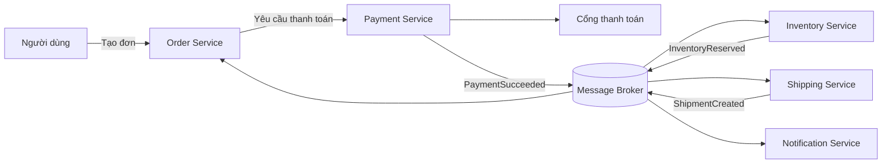
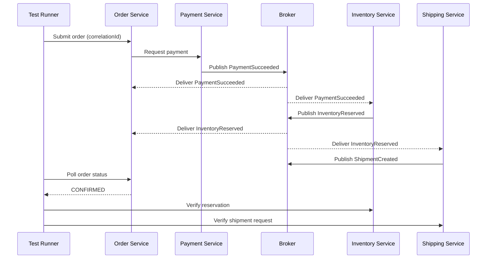

# Lập phạm vi cho luồng bất đồng bộ hoặc đi qua nhiều dịch vụ

Kiểm thử hệ thống và kiểm thử đầu cuối (end-to-end, E2E) trở nên khó thiết kế khi một nghiệp vụ không diễn ra trong một lời gọi duy nhất. Một hành động của người dùng có thể tạo yêu cầu vào dịch vụ đầu tiên, phát sự kiện lên hàng đợi, kích hoạt nhiều consumer, cập nhật dữ liệu ở các hệ thống khác nhau và chỉ hoàn tất sau một khoảng thời gian. Nếu phạm vi kiểm thử quá hẹp, nhóm có thể bỏ sót lỗi phối hợp; nếu phạm vi quá rộng, kiểm thử dễ chậm, không ổn định và khó xác định nguyên nhân.

Muốn lập phạm vi phù hợp, nhóm cần bắt đầu từ kết quả nghiệp vụ cần chứng minh, lần theo các tương tác và trạng thái quan trọng, rồi chọn những ranh giới cần chạy cùng nhau. Với luồng bất đồng bộ, kiểm thử còn phải xác định thời điểm được xem là hoàn tất, cách liên kết các sự kiện, cách xử lý thử lại và thông điệp trùng lặp. Mục tiêu là thu thập đủ bằng chứng cho rủi ro quan trọng với chi phí và độ phức tạp có thể quản lý.

## 1. Hiểu luồng nghiệp vụ trước khi chọn phạm vi

Luồng nghiệp vụ là chuỗi hành động, quyết định và chuyển trạng thái dẫn đến một kết quả mà người dùng hoặc tổ chức quan tâm. Luồng có thể đi qua một dịch vụ hoặc nhiều dịch vụ, sử dụng giao tiếp đồng bộ, bất đồng bộ hoặc kết hợp cả hai.

Ví dụ, khi người dùng đặt hàng:

1. Giao diện gửi yêu cầu tạo đơn hàng.
2. Order Service xác thực giỏ hàng và tạo đơn ở trạng thái `PENDING_PAYMENT`.
3. Payment Service xử lý thanh toán với nhà cung cấp bên ngoài.
4. Khi thanh toán thành công, một sự kiện `PaymentSucceeded` được phát lên broker.
5. Order Service nhận sự kiện và chuyển đơn sang `PAID`.
6. Inventory Service giữ hoặc trừ hàng tồn kho.
7. Shipping Service tạo yêu cầu giao hàng và phát sinh trạng thái vận chuyển.
8. Notification Service gửi xác nhận cho người dùng.

Một kiểm thử chỉ xác minh API tạo đơn trả về `202 Accepted` chưa chứng minh đơn đã thanh toán, hàng đã được giữ hoặc thông báo đã được gửi. Ngược lại, một kiểm thử duy nhất cố gắng xác minh mọi dịch vụ, mọi trạng thái lỗi và toàn bộ hạ tầng trong một kịch bản có thể trở nên rất khó bảo trì.

Trước khi chọn phạm vi, hãy mô tả:

- **Mục tiêu nghiệp vụ:** người dùng hoặc hệ thống muốn đạt được điều gì?
- **Điểm bắt đầu:** hành động hoặc sự kiện nào kích hoạt luồng?
- **Kết quả cuối:** trạng thái hoặc tác động nào chứng minh nghiệp vụ đã hoàn thành?
- **Các bước trung gian:** dịch vụ nào xử lý, sự kiện nào được phát và dữ liệu nào thay đổi?
- **Các nhánh quan trọng:** thành công, từ chối, timeout, hủy, thử lại hoặc xử lý một phần?
- **Điều kiện hoàn tất:** kết quả phải xuất hiện ngay hay có thể hội tụ sau một khoảng thời gian?

## 2. Phân biệt kiểm thử hệ thống, E2E và kiểm thử tích hợp

Ba loại kiểm thử có thể cùng tham gia đánh giá một luồng, nhưng trả lời những câu hỏi khác nhau.

| Loại kiểm thử | Phạm vi thường gặp | Câu hỏi chính |
| --- | --- | --- |
| Kiểm thử tích hợp | Một ranh giới hoặc nhóm thành phần cụ thể, như service với database, broker hoặc API khác | Các thành phần có giao tiếp và xử lý dữ liệu đúng tại ranh giới này không? |
| Kiểm thử hệ thống | Một hệ thống hoặc một phần hệ thống được tích hợp trong phạm vi xác định | Hệ thống có đáp ứng các yêu cầu chức năng và phi chức năng trong điều kiện đã chọn không? |
| Kiểm thử đầu cuối (E2E) | Một hành trình nghiệp vụ xuyên qua các thành phần cần thiết từ điểm kích hoạt đến kết quả người dùng hoặc hệ thống | Toàn bộ hành trình quan trọng có tạo ra kết quả đúng không? |

Ranh giới giữa kiểm thử hệ thống và E2E có thể khác nhau theo tổ chức. Điều quan trọng là ghi rõ những thành phần thật, thành phần mô phỏng, điểm bắt đầu, điểm kết thúc và điều gì được xem là bằng chứng.

Ví dụ, kiểm thử tích hợp có thể xác minh Order Service phát đúng sự kiện `OrderCreated` và broker nhận thông điệp. Kiểm thử hệ thống có thể xác minh Order Service xử lý trạng thái đơn và lưu dữ liệu đúng. Kiểm thử E2E có thể bắt đầu từ thao tác đặt hàng của người dùng và kết thúc khi giao diện hiển thị đơn đã được xác nhận sau khi các dịch vụ liên quan hoàn thành.

Không phải mọi dịch vụ đều phải chạy thật trong mọi kiểm thử E2E. Một dịch vụ bên ngoài có thể được mô phỏng nếu rủi ro của nhà cung cấp đã được kiểm tra ở phạm vi khác và mục tiêu của kịch bản hiện tại không phụ thuộc vào nó. Cần ghi rõ phần nào đã được thay thế để không kết luận vượt quá bằng chứng.

## 3. Vẽ ranh giới và luồng phụ thuộc

Để xác định phạm vi, hãy lập sơ đồ từ điểm kích hoạt đến kết quả, bao gồm cả các luồng dữ liệu và sự kiện. Đánh dấu:

- Các dịch vụ hoặc thành phần sở hữu trạng thái.
- Các giao diện đồng bộ như HTTP, RPC hoặc truy vấn dữ liệu.
- Các kênh bất đồng bộ như queue, topic hoặc event stream.
- Các phụ thuộc bên ngoài và thành phần được mô phỏng.
- Nơi lưu dữ liệu và nơi có thể quan sát trạng thái.
- Các điểm có thể phát sinh retry, timeout, lỗi một phần hoặc xử lý trùng.

Ví dụ luồng đặt hàng có thể được mô tả như sau:



Sơ đồ này cho thấy một nghiệp vụ có nhiều nhánh và nhiều điểm hoàn tất. Nhóm cần quyết định E2E nào xác minh kết quả đặt hàng, E2E nào xác minh giao hàng, và kiểm thử tích hợp nào xác minh riêng hợp đồng của broker hoặc nhà cung cấp.

Không nên đưa mọi phụ thuộc xuất hiện trên sơ đồ vào một bài E2E lớn. Hãy xác định ranh giới theo câu hỏi và rủi ro: những tương tác nào cần chạy thật cùng nhau để chứng minh kết quả; những tương tác nào có thể được xác minh riêng bằng kiểm thử hợp đồng hoặc tích hợp.

## 4. Chọn điểm bắt đầu và điểm kết thúc có ý nghĩa

Một phạm vi kiểm thử cần có điểm bắt đầu và điều kiện kết thúc quan sát được.

**Điểm bắt đầu** có thể là:

- Người dùng gửi yêu cầu qua giao diện hoặc API công khai.
- Một thông điệp được đưa vào queue.
- Một lịch chạy kích hoạt tác vụ nền.
- Một webhook từ hệ thống bên ngoài.

**Điểm kết thúc** có thể là:

- Trạng thái cuối được ghi nhận trong hệ thống sở hữu dữ liệu.
- Một sự kiện kết quả được phát và có thể quan sát.
- Người dùng nhận được thông báo hoặc nhìn thấy trạng thái đúng.
- Một tác vụ hoàn tất và các hệ thống liên quan đạt trạng thái nhất quán theo quy tắc nghiệp vụ.

Điểm kết thúc phải gắn với mục tiêu kiểm thử. Nếu chỉ kiểm tra API đầu vào, kết quả HTTP có thể là đủ. Nếu kiểm tra toàn bộ nghiệp vụ, cần xác minh kết quả ở nơi sở hữu trạng thái cuối, chẳng hạn đơn hàng đã chuyển sang `PAID` và kho đã giữ hàng.

Không nên chỉ dựa vào việc một thông điệp đã được gửi để kết luận consumer đã xử lý thành công. Broker xác nhận nhận thông điệp và ứng dụng hoàn tất nghiệp vụ là hai sự kiện khác nhau. Tương tự, một thông báo đã được đưa vào hàng đợi gửi email không chứng minh email đã được nhà cung cấp chấp nhận hoặc người dùng đã nhận.

## 5. Xử lý tính bất đồng bộ và eventual consistency

Trong hệ thống bất đồng bộ, một dịch vụ có thể hoàn thành phần việc của mình trước khi các dịch vụ khác cập nhật trạng thái. Trong khoảng thời gian chuyển tiếp, dữ liệu ở các hệ thống có thể tạm thời khác nhau. Đây là eventual consistency: nếu các bước tiếp tục được xử lý thành công và không có thay đổi mới mâu thuẫn, các trạng thái liên quan sẽ hội tụ theo quy tắc hệ thống.

Vì vậy, kiểm thử cần phân biệt:

- **Trạng thái tức thời:** điều gì đúng ngay sau khi yêu cầu được chấp nhận?
- **Trạng thái trung gian:** những trạng thái nào hợp lệ trong khi các consumer đang xử lý?
- **Trạng thái cuối:** điều kiện nào cho biết luồng đã hội tụ hoặc thất bại dứt điểm?

Ví dụ, ngay sau khi tạo đơn, trạng thái `PENDING_PAYMENT` là hợp lệ. Sau khi cổng thanh toán xác nhận nhưng trước khi Order Service xử lý sự kiện, đơn vẫn có thể tạm thời ở trạng thái chờ. Kiểm thử không nên thất bại chỉ vì trạng thái cuối chưa xuất hiện trong vài mili giây đầu tiên.

### Chờ theo điều kiện thay vì chờ cố định

Không nên dùng một khoảng `sleep` cố định làm cơ chế đồng bộ chính. Thời gian xử lý có thể thay đổi theo tải, lịch chạy và môi trường. Chờ quá ngắn tạo lỗi không ổn định; chờ quá lâu làm pipeline chậm.

Ưu tiên chờ theo điều kiện có thời hạn:

1. Gửi yêu cầu và nhận mã tương quan hoặc định danh nghiệp vụ.
2. Thăm dò một điểm quan sát ổn định, hoặc chờ sự kiện thông báo kết quả.
3. Dừng khi điều kiện cuối được thỏa mãn.
4. Nếu vượt thời hạn, kết thúc thất bại với thông tin chẩn đoán.

Ví dụ giả mã:

```text
orderId = submitOrder(validCart)

await until timeout 30s:
    order = queryOrder(orderId)
    if order.status == PAID:
        assert inventory.isReserved(orderId)
        return PASS
    if order.status in [REJECTED, CANCELLED]:
        return FAIL with order.status

return FAIL with lastObservedState
```

Thời hạn phải dựa trên mục tiêu dịch vụ và đặc điểm môi trường. Có thể dùng polling với khoảng cách tăng dần, callback hoặc sự kiện quan sát được. Cần tránh truy vấn quá dày làm tăng tải hoặc thay đổi hành vi hệ thống.

## 6. Theo dõi nguyên nhân và liên kết các bước trong luồng

Khi một luồng đi qua nhiều dịch vụ, cần biết sự kiện nào thuộc về yêu cầu ban đầu. Có thể dùng:

- **Correlation ID:** định danh dùng để liên kết log, trace hoặc sự kiện của cùng một luồng nghiệp vụ.
- **Trace ID và span ID:** định danh trong distributed tracing để kết nối các thao tác qua nhiều tiến trình.
- **Business ID:** định danh nghiệp vụ ổn định, chẳng hạn `orderId` hoặc `paymentId`.
- **Event ID:** định danh duy nhất cho một sự kiện cụ thể, giúp nhận biết thông điệp trùng.

Không nên dùng một định danh duy nhất cho mọi mục đích. `orderId` có thể liên kết nghiệp vụ qua nhiều sự kiện, trong khi `eventId` phân biệt từng lần phát và trace ID gắn với một lần thực thi hoặc một trace theo cách hệ thống quan sát định nghĩa.

Trong môi trường kiểm thử, hãy ghi lại các định danh này cùng thời điểm, phiên bản dịch vụ và trạng thái quan sát được. Khi kiểm thử thất bại, nhóm có thể tìm trace và log của đúng luồng thay vì dò toàn bộ dữ liệu.

Thông tin quan sát nên đủ để chẩn đoán nhưng không chứa bí mật hoặc dữ liệu cá nhân không cần thiết. Token, thông tin xác thực và dữ liệu thanh toán nhạy cảm cần được che hoặc loại khỏi log.

## 7. Lập phạm vi cho retry, thông điệp trùng và thứ tự xử lý

Giao tiếp bất đồng bộ thường có thể gửi lại thông điệp khi consumer không xác nhận đúng hạn hoặc gặp lỗi tạm thời. Điều này tạo ra các trường hợp mà kiểm thử E2E cần xem xét.

### Retry

Retry có thể xảy ra ở client, service, thư viện HTTP hoặc broker. Cần xác định:

- Lỗi nào được xem là tạm thời và có thể thử lại?
- Lỗi nào là lỗi nghiệp vụ hoặc lỗi vĩnh viễn cần dừng?
- Số lần thử, khoảng cách giữa các lần và giới hạn tổng thời gian?
- Hệ thống có giới hạn retry để tránh tạo tải dây chuyền không?
- Sau khi hết lượt thử, thông điệp đi đâu và ai xử lý?

Kiểm thử nên mô phỏng lỗi tạm thời rồi thành công, lỗi kéo dài đến khi hết lượt thử và lỗi vĩnh viễn. Cần xác minh không có tác động nghiệp vụ bị nhân đôi.

### Thông điệp trùng lặp và idempotency

Trong nhiều hệ thống, giao nhận thông điệp có thể là at-least-once: một thông điệp có thể được giao nhiều lần. Consumer cần xử lý lặp an toàn nếu cùng một sự kiện đến lại.

Ví dụ, nhận hai lần `PaymentSucceeded` không được làm giảm tồn kho hai lần hoặc tạo hai vận đơn. Kiểm thử có thể gửi cùng `eventId` nhiều lần và xác minh kết quả nghiệp vụ chỉ được áp dụng một lần theo quy tắc.

Idempotency không chỉ là bỏ qua mọi lần gọi thứ hai. Cần xác định khóa idempotency, phạm vi lưu khóa, thời hạn, cách xử lý khi cùng khóa nhưng payload khác và hành vi khi lần đầu đang xử lý dở.

### Thứ tự sự kiện

Không phải broker hoặc hệ thống phân tán nào cũng bảo đảm thứ tự toàn cục. Nếu nghiệp vụ phụ thuộc thứ tự, cần xác định phạm vi bảo đảm, chẳng hạn theo partition key hoặc theo từng đơn hàng.

Ví dụ, `OrderCancelled` đến trước `PaymentSucceeded` có thể cần xử lý khác với thứ tự ngược lại. Kiểm thử nên xác minh các chuyển trạng thái được phép, sự kiện đến muộn, sự kiện trùng và sự kiện không hợp lệ. Không nên giả định thứ tự từ một lần chạy thành công.

## 8. Kiểm tra lỗi một phần và các nhánh nghiệp vụ

Trong luồng nhiều dịch vụ, một bước có thể thành công trong khi bước khác thất bại. Đây là lỗi một phần (partial failure). Kiểm thử cần tập trung vào cách hệ thống giữ tính toàn vẹn và hoàn tất, bù trừ hoặc chuyển sang trạng thái có thể xử lý.

Các tình huống thường cần xem xét:

- Một dịch vụ không phản hồi hoặc phản hồi sau timeout.
- Broker tạm thời không sẵn sàng.
- Consumer xử lý xong nhưng không gửi acknowledgement.
- Cơ sở dữ liệu ghi thành công nhưng phát sự kiện thất bại, hoặc ngược lại.
- Một bước thành công, bước tiếp theo thất bại.
- Webhook được gửi lại hoặc đến sai thứ tự.
- Dịch vụ khởi động lại trong lúc đang xử lý.
- Thông điệp bị chuyển vào dead-letter queue (DLQ).

Với quy trình dài có nhiều bước, hệ thống có thể dùng Saga. Saga điều phối chuỗi giao dịch cục bộ và các hành động bù trừ khi một bước thất bại. Ví dụ, nếu thanh toán đã thành công nhưng không thể giữ hàng, hệ thống có thể khởi tạo hoàn tiền hoặc chuyển đơn sang trạng thái cần xử lý.

Kiểm thử Saga cần xác minh cả đường thành công và đường bù trừ: bước nào đã hoàn tất, hành động bù nào được thực hiện, trạng thái cuối là gì và liệu retry có tạo ra hành động bù lặp hay không. Không nên chỉ kiểm tra rằng một thông điệp lỗi đã được phát.

## 9. Chọn phạm vi kiểm thử theo rủi ro

Không phải mọi đường đi đều cần một E2E bao phủ toàn bộ dịch vụ. Nên chọn phạm vi dựa trên hậu quả nếu luồng thất bại, khả năng xảy ra và độ khó phát hiện.

Có thể dùng các tiêu chí:

- **Giá trị nghiệp vụ:** luồng có ảnh hưởng đến tiền, dữ liệu, quyền truy cập, đơn hàng hoặc nghĩa vụ quan trọng không?
- **Tần suất sử dụng:** luồng có được nhiều người dùng hoặc hệ thống gọi thường xuyên không?
- **Số lượng ranh giới:** càng nhiều dịch vụ và giao thức, càng có nhiều cơ hội không tương thích.
- **Tính bất đồng bộ:** có retry, trễ, thứ tự, consumer độc lập hoặc trạng thái hội tụ không?
- **Khả năng phục hồi:** nếu một bước thất bại, hệ thống có thể tiếp tục, bù trừ hoặc khôi phục không?
- **Mức độ quan sát:** nhóm có thể liên kết và chẩn đoán các bước không?
- **Chi phí chạy và bảo trì:** môi trường, dữ liệu và thời gian cần thiết có phù hợp với tần suất chạy không?

Phân bổ bằng chứng theo nhiều tầng:

| Phạm vi | Mục tiêu | Ví dụ |
| --- | --- | --- |
| Kiểm thử thành phần | Xác minh logic và quy tắc từng dịch vụ | Chuyển trạng thái đơn, xử lý trùng `eventId`, tính số tiền |
| Kiểm thử tích hợp | Xác minh giao diện và hạ tầng tại ranh giới | Serialization, broker acknowledgement, transaction, API provider |
| Kiểm thử hệ thống | Xác minh hành vi của một hệ thống tích hợp | Order Service nhận sự kiện và cập nhật trạng thái chính xác |
| E2E có chọn lọc | Xác minh hành trình nghiệp vụ quan trọng qua nhiều dịch vụ | Đặt đơn, thanh toán, giữ hàng và xác nhận đơn |

Các kiểm thử thành phần và tích hợp cung cấp phản hồi nhanh, dễ khoanh vùng. E2E nên tập trung vào một số hành trình có giá trị cao để xác minh sự phối hợp thật. Không có tỷ lệ cố định giữa các tầng; phạm vi phải dựa trên kiến trúc và rủi ro.

## 10. Môi trường, dữ liệu và phụ thuộc bên ngoài

Kiểm thử nhiều dịch vụ đòi hỏi môi trường có thể tái tạo. Trước khi chạy, cần xác định:

- Phiên bản hoặc build của từng dịch vụ.
- Cấu hình broker, database, queue, topic và subscription.
- Các endpoint bên ngoài đang dùng thật hay sandbox.
- Dữ liệu ban đầu, tài khoản và quyền truy cập.
- Cách tạo dữ liệu, dọn dẹp và tránh xung đột giữa các lần chạy.
- Thời hạn xử lý và giới hạn tài nguyên.

### Dữ liệu kiểm thử

Dữ liệu nên được tạo theo từng kịch bản và có định danh riêng. Tránh phụ thuộc vào một đơn hàng dùng chung hoặc dữ liệu còn sót lại từ lần chạy trước. Cần có cơ chế dọn dẹp trạng thái ở database, queue, cache và hệ thống phụ thuộc khi kiểm thử kết thúc.

Nếu cần kiểm thử sự kiện đến muộn hoặc retry, không nên xóa dữ liệu trước khi consumer đã hoàn tất. Việc dọn dẹp cần hiểu vòng đời của thông điệp và các tác vụ nền.

### Mô phỏng phụ thuộc

Có thể mô phỏng một dịch vụ bên ngoài khi mục tiêu là kiểm tra phản ứng của luồng với các kết quả có kiểm soát. Ví dụ, Payment Gateway sandbox hoặc server giả lập có thể trả về thành công, từ chối, timeout và lỗi kết nối.

Tuy nhiên, nếu rủi ro nằm ở giao thức hoặc hành vi thật của nhà cung cấp, cần có kiểm thử hợp đồng hoặc tích hợp riêng với sandbox chính thức. Nếu thay thế một dịch vụ trong E2E, phải ghi rõ phạm vi đã mô phỏng và không dùng kết quả đó để khẳng định dịch vụ thật đã được xác minh.

## 11. Quan sát và chẩn đoán khi E2E thất bại

Kiểm thử E2E thất bại có thể bắt nguồn từ nhiều dịch vụ. Để giảm thời gian điều tra, mỗi kịch bản nên thu thập:

- ID nghiệp vụ, correlation ID, trace ID và event ID khi có.
- Thời điểm gửi yêu cầu, thời điểm phát và nhận sự kiện, thời điểm cập nhật trạng thái.
- Log có cấu trúc từ các dịch vụ liên quan.
- Trace phân tán và span lỗi nếu hệ thống hỗ trợ.
- Trạng thái queue, số lần retry, thông điệp DLQ và consumer lag nếu có liên quan.
- Phiên bản dịch vụ, cấu hình và môi trường.
- Trạng thái cuối cùng quan sát được và thời hạn đã chờ.

Khi timeout, báo cáo nên chỉ ra trạng thái cuối cùng đã thấy, bước gần nhất đã hoàn tất và các định danh để tra cứu. Một thông báo chung như “E2E timeout” không đủ giúp nhóm phân biệt broker chậm, consumer lỗi hay assertion đang chờ sai trạng thái.

Không nên để kiểm thử phụ thuộc vào nội dung log không ổn định nếu có thể xác minh qua API trạng thái, dữ liệu có kiểm soát hoặc trace. Log và trace nên hỗ trợ chẩn đoán, còn assertion chính cần dựa trên hợp đồng hoặc trạng thái nghiệp vụ đã xác định.

## 12. Ví dụ thực hành: kiểm thử luồng đặt hàng bất đồng bộ

Giả sử yêu cầu nghiệp vụ là: khi người dùng đặt hàng và thanh toán thành công, hệ thống giữ hàng, tạo yêu cầu giao hàng và hiển thị đơn đã được xác nhận. Nếu không đủ hàng sau khi thanh toán, hệ thống phải khởi tạo quy trình hoàn tiền hoặc chuyển sang trạng thái xử lý ngoại lệ.

### Phạm vi chính

- **Điểm bắt đầu:** gửi yêu cầu tạo đơn qua API công khai.
- **Kết quả cần xác minh:** đơn đạt trạng thái `CONFIRMED`, hàng được giữ đúng một lần và có yêu cầu giao hàng tương ứng.
- **Dịch vụ trong phạm vi:** Order, Payment, Inventory, Shipping và broker.
- **Phụ thuộc có thể mô phỏng:** cổng thanh toán sandbox hoặc giả lập trong kịch bản kiểm tra nhánh lỗi.
- **Điều kiện hoàn tất:** trạng thái cuối được quan sát trong thời hạn đã định, không chỉ xác nhận thông điệp đã được publish.

### Các kịch bản quan trọng

| Kịch bản | Điều kiện | Kết quả mong đợi |
| --- | --- | --- |
| Thanh toán và giữ hàng thành công | Cổng thanh toán chấp nhận, tồn kho đủ | Đơn `CONFIRMED`, thanh toán `PAID`, hàng được giữ một lần và yêu cầu giao hàng được tạo |
| Thanh toán bị từ chối | Gateway trả về từ chối | Đơn chuyển sang trạng thái phù hợp, không giữ hàng và không tạo vận đơn |
| Sự kiện thanh toán được gửi trùng | Cùng `eventId` được giao nhiều lần | Trạng thái thanh toán và số lượng hàng chỉ được cập nhật theo một lần xử lý nghiệp vụ |
| Consumer tạm thời lỗi | Inventory Service lỗi ở lần đầu rồi hoạt động lại | Retry xử lý thành công trong giới hạn, không giữ hàng trùng |
| Không đủ hàng sau thanh toán | Payment thành công, Inventory từ chối giữ hàng | Saga thực hiện hành động bù trừ hoặc chuyển sang trạng thái ngoại lệ đã quy định |
| Sự kiện đến muộn | Sự kiện cũ đến sau khi đơn đã hủy | Không làm đơn quay về trạng thái không hợp lệ; sự kiện được xử lý hoặc ghi nhận theo quy tắc |
| Hết thời hạn xử lý | Consumer không hoàn tất trong thời hạn | Kiểm thử thất bại với trạng thái và trace để chẩn đoán; hệ thống cảnh báo hoặc chuyển DLQ theo thiết kế |

### Luồng kiểm thử



Test Runner nên lưu `orderId` và `correlationId`, sau đó chờ trạng thái cuối theo điều kiện và thời hạn. Các bước xác minh nên đọc từ nguồn dữ liệu hoặc API kiểm thử ổn định của từng dịch vụ. Nếu cần kiểm tra sự kiện trùng, test runner hoặc broker test fixture gửi lại cùng event ID theo kịch bản đã xác định.

Không nhất thiết một bài E2E phải chạy mọi kịch bản ở trên. Có thể giữ một hành trình thành công đại diện và một số nhánh rủi ro cao; các trường hợp retry, thứ tự, DLQ và bù trừ được kiểm tra sâu hơn ở kiểm thử tích hợp hoặc kiểm thử hệ thống theo từng dịch vụ. E2E chỉ cần bao phủ những nhánh xuyên dịch vụ mà kết quả nghiệp vụ phụ thuộc.

## 13. Tiêu chí hoàn tất và cách báo cáo

Một kịch bản đa dịch vụ nên định nghĩa tiêu chí đạt trước khi chạy. Ví dụ:

- Yêu cầu đầu vào được chấp nhận và có định danh nghiệp vụ.
- Mọi trạng thái trung gian quan sát được đều thuộc tập trạng thái hợp lệ.
- Trạng thái cuối xuất hiện trong thời hạn được thống nhất.
- Các tác động nghiệp vụ chỉ xảy ra số lần đúng theo quy tắc.
- Không có thông điệp liên quan bị kẹt ở DLQ ngoài dự kiến.
- Các dịch vụ và sự kiện liên quan có thể truy nguyên qua định danh.
- Dữ liệu và tài nguyên kiểm thử được dọn dẹp an toàn.

Báo cáo nên ghi:

1. Mục tiêu và ranh giới của kịch bản.
2. Các dịch vụ, phiên bản, môi trường và phụ thuộc thật hoặc mô phỏng.
3. Dữ liệu ban đầu, định danh nghiệp vụ và correlation ID.
4. Trạng thái trung gian và trạng thái cuối quan sát được.
5. Thời gian hoàn tất, số lần retry và các lỗi phát sinh.
6. Bằng chứng như log, trace, trạng thái queue và kết quả truy vấn.
7. Những phần chưa kiểm tra hoặc giới hạn của môi trường.

Trạng thái `PASS` chỉ có nghĩa là kịch bản đạt tiêu chí trong điều kiện đã chạy. Nó không chứng minh mọi thứ tự sự kiện, mọi mức tải hoặc mọi tình huống lỗi đều đúng.

## 14. Những lỗi thường gặp khi lập phạm vi

- **Chỉ xác minh phản hồi đầu vào:** API trả về thành công nhưng các bước bất đồng bộ phía sau chưa hoàn tất.
- **Chờ một khoảng thời gian cố định:** tạo kiểm thử chập chờn và không giải thích được vì sao chậm.
- **Không có định danh tương quan:** khó liên kết log và sự kiện của một lần chạy qua nhiều dịch vụ.
- **Giả định sự kiện chỉ đến một lần:** bỏ sót retry và giao nhận trùng lặp.
- **Giả định thứ tự toàn cục:** kiểm thử đạt tình cờ trong môi trường đơn giản nhưng thất bại khi tải hoặc partition thay đổi.
- **Chỉ kiểm tra trạng thái cuối:** bỏ qua tác động lặp như trừ tồn kho hai lần hoặc phát nhiều yêu cầu giao hàng.
- **Dùng mock cho mọi dịch vụ:** không có bằng chứng tại các ranh giới thật có rủi ro cao.
- **Đưa mọi dịch vụ vào một E2E:** thời gian chạy dài, môi trường phức tạp và lỗi khó định vị.
- **Không chuẩn bị dữ liệu và dọn dẹp:** các lần chạy ảnh hưởng lẫn nhau hoặc để lại thông điệp tồn đọng.
- **Không ghi giới hạn:** kết luận bị hiểu rộng hơn phần hệ thống đã thực sự được kiểm tra.

## 15. Checklist lập phạm vi

- [ ] Mục tiêu nghiệp vụ và rủi ro cần xác minh được mô tả rõ.
- [ ] Điểm bắt đầu, các bước quan trọng và điều kiện kết thúc được xác định.
- [ ] Các dịch vụ, giao diện đồng bộ, queue, topic và phụ thuộc bên ngoài được liệt kê.
- [ ] Trạng thái trung gian và trạng thái cuối hợp lệ được xác định.
- [ ] Có correlation ID, business ID hoặc event ID để truy nguyên khi cần.
- [ ] Retry, thông điệp trùng, sự kiện đến muộn và thứ tự xử lý được xem xét.
- [ ] Lỗi một phần, timeout, DLQ và hành động bù trừ được đưa vào phạm vi phù hợp.
- [ ] Thành phần thật và thành phần mô phỏng được ghi rõ.
- [ ] Dữ liệu kiểm thử độc lập, có thể tái tạo và có cách dọn dẹp.
- [ ] Điều kiện chờ có thời hạn và không dựa chủ yếu vào sleep cố định.
- [ ] Assertion kiểm tra kết quả nghiệp vụ và số lần tác động, không chỉ việc publish thông điệp.
- [ ] Báo cáo có phiên bản, môi trường, trạng thái, thời gian và bằng chứng chẩn đoán.

## 16. Những điểm cần ghi nhớ

- Lập phạm vi từ mục tiêu nghiệp vụ và kết quả cuối, sau đó lần theo các dịch vụ và sự kiện cần thiết.
- Kiểm thử tích hợp xác minh ranh giới; kiểm thử hệ thống đánh giá một hệ thống tích hợp; E2E xác minh một hành trình nghiệp vụ xuyên các thành phần được chọn.
- Với luồng bất đồng bộ, cần xác định trạng thái trung gian, trạng thái cuối và thời hạn hoàn tất.
- Dùng correlation ID, trace ID, business ID và event ID phù hợp để truy nguyên luồng.
- Kiểm tra retry, giao nhận trùng, thứ tự sự kiện, lỗi một phần và hành động bù trừ theo rủi ro.
- Chờ theo điều kiện có thời hạn, chuẩn bị dữ liệu riêng và dọn dẹp tài nguyên có kiểm soát.
- Không đưa mọi dịch vụ vào một bài E2E; phân bổ bằng chứng giữa kiểm thử thành phần, tích hợp, hệ thống và E2E.
- Báo cáo phải nêu rõ phạm vi, môi trường, thành phần mô phỏng, kết quả và giới hạn của bằng chứng.

## Câu hỏi tự kiểm tra

1. Vì sao phản hồi `202 Accepted` từ API tạo đơn chưa đủ để kết luận luồng đặt hàng đã hoàn tất?
2. Hãy phân biệt kiểm thử tích hợp, kiểm thử hệ thống và E2E bằng một luồng đi qua nhiều dịch vụ.
3. Với một luồng bất đồng bộ, bạn xác định điểm bắt đầu, trạng thái trung gian và điều kiện kết thúc như thế nào?
4. Vì sao chờ theo điều kiện có thời hạn thường đáng tin cậy hơn sleep cố định?
5. Correlation ID, business ID và event ID giúp chẩn đoán các vấn đề khác nhau ra sao?
6. Hãy thiết kế trường hợp kiểm thử cho thông điệp được giao hai lần và sự kiện đến sai thứ tự.
7. Trong một Saga, cần xác minh điều gì khi bước giữ hàng thất bại sau khi thanh toán đã thành công?
8. Hãy lập phạm vi E2E cho một luồng nghiệp vụ trong hệ thống của bạn, nêu rõ dịch vụ thật, phụ thuộc mô phỏng, điều kiện hoàn tất và giới hạn bằng chứng.
