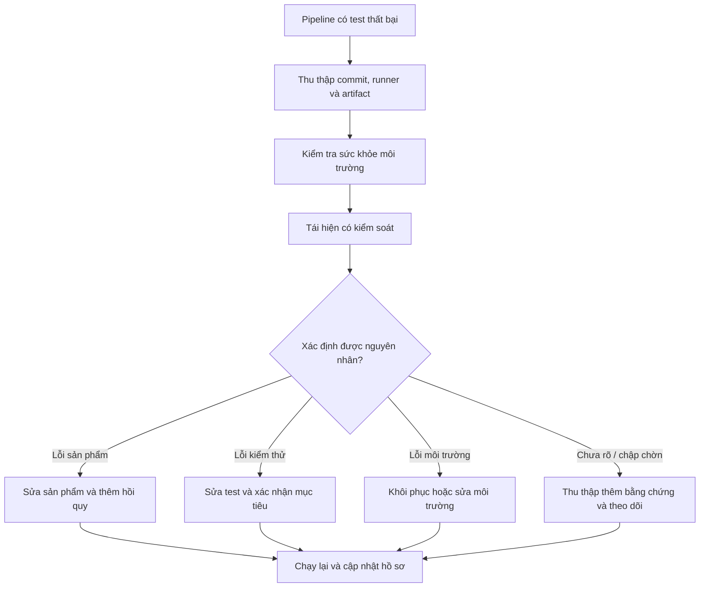

# Đánh giá độ ổn định và chi phí môi trường của nhóm kiểm thử rộng

Bộ kiểm thử diện rộng giúp xác nhận nhiều thành phần hoạt động cùng nhau trong những luồng gần với cách hệ thống được sử dụng thực tế. Nó có thể bao gồm kiểm thử tích hợp xuyên dịch vụ, kiểm thử hệ thống, kiểm thử đầu cuối (end-to-end, E2E), hồi quy trên nhiều cấu hình và các kịch bản hiệu năng hoặc phục hồi. Giá trị của bộ kiểm thử phụ thuộc vào việc kết quả có đáng tin cậy hay không và nhóm có thể duy trì môi trường để chạy chúng với chi phí hợp lý hay không.

Một bộ kiểm thử thường xuyên thất bại do môi trường, dữ liệu dùng chung hoặc thời gian chờ không ổn định sẽ làm nhóm mất niềm tin vào kết quả. Ngược lại, một môi trường quá lớn, khó dựng hoặc phải giữ hoạt động liên tục có thể làm chi phí kiểm thử tăng cao, kéo dài thời gian phản hồi và hạn chế số lần xác minh mà nhóm có thể thực hiện. Vì vậy, cần đánh giá đồng thời độ ổn định của kiểm thử, chất lượng môi trường và chi phí tạo ra một kết quả có thể hành động.

## 1. Hiểu độ ổn định của bộ kiểm thử diện rộng

Độ ổn định (stability) mô tả khả năng bộ kiểm thử tạo ra kết quả nhất quán khi mã nguồn, dữ liệu đầu vào và điều kiện được kiểm soát không thay đổi. Nếu một kiểm thử lúc đạt, lúc thất bại trong cùng điều kiện, kết quả của nó khó được dùng làm bằng chứng cho quyết định hợp nhất hoặc phát hành.

Độ ổn định không đồng nghĩa với việc mọi lần chạy đều xanh. Một kiểm thử đáng tin cậy phải thất bại khi sản phẩm thực sự vi phạm yêu cầu và đạt khi hành vi đúng. Nếu kiểm thử luôn xanh vì assertion quá yếu hoặc tình huống không còn được thực thi, nó ổn định về mặt thống kê nhưng không có giá trị phát hiện lỗi.

Một bộ kiểm thử rộng cần được đánh giá qua nhiều khía cạnh:

- **Tính lặp lại:** cùng phiên bản và điều kiện có tạo ra cùng kết quả không?
- **Tính độc lập:** một kiểm thử có phụ thuộc vào thứ tự hoặc trạng thái do kiểm thử khác để lại không?
- **Khả năng tái hiện:** khi thất bại, nhóm có thể chạy lại với cùng dữ liệu và điều kiện để điều tra không?
- **Khả năng chẩn đoán:** log, trace, ảnh chụp và thông tin môi trường có giúp xác định nguyên nhân không?
- **Tính đại diện:** môi trường có đủ gần với môi trường mục tiêu ở những đặc tính liên quan không?
- **Tính kịp thời:** kết quả có đến đủ sớm để hỗ trợ quyết định phát triển và phát hành không?
- **Khả năng duy trì:** bộ kiểm thử và môi trường có thể được cập nhật khi kiến trúc, dữ liệu và phụ thuộc thay đổi không?

Một nhóm E2E có thể kiểm tra luồng nghiệp vụ quan trọng nhưng vẫn không ổn định nếu dùng chung tài khoản, phụ thuộc dịch vụ bên ngoài hoặc chạy trên runner quá tải. Cần đánh giá nguyên nhân của sự không ổn định thay vì chỉ nhìn tỷ lệ pass tổng thể.

## 2. Phân biệt lỗi sản phẩm, lỗi kiểm thử và lỗi môi trường

Khi một kiểm thử thất bại, trước tiên cần xác định loại vấn đề. Nếu mọi lần thất bại đều được coi là lỗi sản phẩm, nhóm có thể điều tra sai hướng. Nếu mọi lần chạy lại thành công đều được coi là kiểm thử chập chờn, lỗi thật có thể bị che khuất.

| Loại kết quả | Dấu hiệu thường gặp | Hướng xử lý |
|---|---|---|
| Lỗi sản phẩm | Hành vi sai có thể tái hiện; log hoặc dữ liệu cho thấy vi phạm quy tắc | Ghi nhận lỗi, xác định phạm vi ảnh hưởng, sửa và bổ sung hồi quy |
| Lỗi kiểm thử | Assertion sai, dữ liệu chuẩn không đúng, selector lỗi thời hoặc giả định không còn hợp lệ | Sửa trường hợp kiểm thử và xác minh lại mục tiêu kiểm tra |
| Lỗi môi trường | Dịch vụ không sẵn sàng, cấu hình sai, runner hết tài nguyên hoặc phụ thuộc không truy cập được | Khôi phục hoặc sửa môi trường, sau đó chạy lại có kiểm soát |
| Kiểm thử chập chờn | Cùng commit và điều kiện nhưng kết quả thay đổi giữa các lần chạy | Điều tra nguyên nhân không xác định và giảm tính không tất định |
| Kết quả chưa rõ | Thiếu log, dữ liệu bị thay đổi hoặc không xác định được trạng thái phụ thuộc | Thu thập bằng chứng, tái hiện và phân loại trước khi kết luận |

Một lần chạy thất bại có thể chứa nhiều vấn đề. Ví dụ, runner chậm làm kiểm thử hết thời gian chờ; nhưng thời hạn chờ quá ngắn cũng là vấn đề trong cách thiết kế kiểm thử. Nhóm cần xem xét cả điều kiện môi trường lẫn giả định trong test.

### Không dùng retry để che giấu thất bại

Chạy lại có thể giúp phân biệt lỗi nhất thời với lỗi có thể tái hiện, nhưng không nên tự động xóa kết quả lần đầu khi lần sau thành công. Hệ thống nên lưu:

- Kết quả lần chạy đầu tiên.
- Số lần chạy lại và lý do chạy lại.
- Kết quả từng lần cùng thời gian, runner và môi trường.
- Log, trace, ảnh chụp hoặc dữ liệu liên quan.
- Kết quả cuối cùng và phân loại nguyên nhân nếu đã xác định.

Nếu chỉ báo cáo kết quả xanh cuối cùng, nhóm không biết bộ kiểm thử đang tiêu tốn bao nhiêu lần chạy lại và mức độ đáng tin cậy đang giảm ra sao. Retry nên có giới hạn và phục vụ chẩn đoán; kiểm thử chập chờn vẫn cần được xử lý như một vấn đề kỹ thuật.

## 3. Nhận diện nguyên nhân gây mất ổn định

Kiểm thử diện rộng thường có nhiều phụ thuộc và trạng thái hơn kiểm thử đơn vị. Một lỗi nhỏ trong cách quản lý dữ liệu, thời gian hoặc tài nguyên có thể khiến kết quả thay đổi theo máy chạy, thứ tự thực thi hoặc tải của hệ thống.

### Phụ thuộc thời gian và đồng bộ bất đồng bộ

Các kiểm thử có thể thất bại khi giả định một thao tác sẽ hoàn tất trong một khoảng thời gian cố định. Ví dụ, kiểm thử đặt hàng chờ đúng ba giây rồi xác nhận thông báo đã được xử lý. Nếu hàng đợi chậm hơn trong một lần chạy, test thất bại dù sản phẩm vẫn hoạt động đúng.

Nên chờ một điều kiện có ý nghĩa như trạng thái đơn hàng chuyển sang `PAID`, sự kiện xuất hiện hoặc API trả về kết quả mong đợi. Điều kiện chờ cần có timeout tối đa, khoảng polling hợp lý và thông báo rõ khi hết thời gian. Tránh chờ cố định quá dài vì nó làm chậm trường hợp thành công và vẫn không bảo đảm trường hợp chậm hơn sẽ đạt.

Các nguồn không tất định khác gồm đồng hồ hệ thống, múi giờ, lịch chạy, thời điểm hết hạn token, độ trễ mạng và thứ tự sự kiện. Có thể kiểm soát đồng hồ trong kiểm thử khi mục tiêu cho phép, dùng timestamp rõ múi giờ và xác nhận trạng thái theo điều kiện thay vì dựa vào thời gian ngủ tùy ý.

### Dữ liệu và trạng thái dùng chung

Hai kiểm thử có thể tác động lên cùng tài khoản, đơn hàng, mã giảm giá, hàng đợi hoặc bản ghi cơ sở dữ liệu. Khi chạy song song, một test xóa dữ liệu mà test khác đang dùng; khi chạy nối tiếp, kết quả có thể phụ thuộc thứ tự.

Biện pháp phù hợp gồm:

- Tạo dữ liệu riêng cho mỗi lần chạy hoặc mỗi worker bằng định danh duy nhất.
- Chuẩn bị trạng thái ban đầu rõ ràng và dọn dẹp dữ liệu do test tạo ra.
- Không dựa vào dữ liệu được tạo bởi một test khác.
- Dùng transaction, namespace hoặc tenant riêng khi có thể.
- Làm cho thao tác khởi tạo và dọn dẹp có thể chạy lặp an toàn.
- Tránh xóa toàn bộ môi trường hoặc dữ liệu dùng chung khi các test khác vẫn đang chạy.

### Phụ thuộc bên ngoài

API đối tác, email, SMS, cổng thanh toán, bản đồ, dịch vụ định danh hoặc kho lưu trữ có thể chậm, giới hạn tần suất hoặc thay đổi dữ liệu. Dùng dịch vụ thật giúp kiểm tra tích hợp thực tế nhưng làm tăng chi phí và tạo thêm nguồn biến động.

Nên chọn mức mô phỏng theo mục tiêu:

- Dùng stub hoặc fake để kiểm tra logic consumer và các phản hồi cụ thể.
- Dùng contract test để xác nhận định dạng và kỳ vọng giữa hai bên.
- Dùng sandbox hoặc môi trường tích hợp thật cho các luồng cần xác minh xác thực, serialization và giao tiếp thực tế.
- Giữ một số kiểm tra E2E với phụ thuộc thật ở thời điểm phù hợp, có giới hạn và giám sát.

Không nên mô phỏng mọi thứ rồi cho rằng tích hợp đã được xác nhận. Cũng không nên gọi mọi dịch vụ production bên ngoài trong mỗi lần chạy hồi quy nếu kiểm thử đó không cần bằng chứng thực tế tương ứng.

### Khác biệt cấu hình và môi trường

Kiểm thử có thể chạy trên các phiên bản cơ sở dữ liệu, trình duyệt, hệ điều hành, biến môi trường hoặc cấu hình mạng khác nhau. Nếu môi trường không được mô tả và quản lý nhất quán, nhóm khó biết lỗi đến từ thay đổi sản phẩm hay khác biệt cấu hình.

Hãy quản lý phiên bản runtime, container image, schema, feature flag và cấu hình dịch vụ. Ghi nhận phiên bản môi trường trong kết quả test. Với ma trận trình duyệt hoặc hệ điều hành rộng, chọn cấu hình theo nhóm người dùng và rủi ro thay vì chạy mọi tổ hợp ở mọi commit.

### Cạn tài nguyên và tranh chấp runner

Chạy nhiều kiểm thử song song có thể làm tăng thông lượng, nhưng cũng có thể khiến CPU, bộ nhớ, kết nối cơ sở dữ liệu, cổng mạng hoặc dung lượng đĩa bị tranh chấp. Khi đó thời gian phản hồi tăng, timeout xuất hiện và test trở nên chập chờn.

Theo dõi mức sử dụng tài nguyên, hàng đợi, thời gian khởi tạo và số test đồng thời. Tăng số worker chỉ có ích khi hạ tầng và dịch vụ phụ thuộc còn đủ khả năng đáp ứng. Nếu cơ sở dữ liệu là nút thắt, thêm runner có thể làm tình hình xấu hơn.

## 4. Thiết kế môi trường cho kiểm thử hệ thống và E2E

Môi trường kiểm thử là tập hợp hạ tầng, dịch vụ, cấu hình, dữ liệu và quyền truy cập cần thiết để thực hiện một nhóm kiểm thử. Môi trường tốt phải đủ gần với mục tiêu để cung cấp bằng chứng hữu ích, đồng thời dễ tạo, dễ làm sạch, dễ quan sát và có chi phí phù hợp.

### Các thành phần của môi trường

Một môi trường hệ thống có thể gồm:

- Ứng dụng và các dịch vụ phụ thuộc.
- Cơ sở dữ liệu, cache, hàng đợi và kho tệp.
- Gateway, DNS, chứng thư, mạng và cơ chế xác thực.
- Cấu hình, feature flag, secret và tài khoản kiểm thử.
- Dữ liệu nghiệp vụ và trạng thái ban đầu.
- Công cụ giám sát, log, trace và thu thập bằng chứng.
- Runner, trình duyệt, thiết bị hoặc agent thực thi kiểm thử.

Không phải mọi thành phần đều cần chạy trong một cụm riêng cho mỗi test. Hãy xác định những phần cần cô lập để tránh tranh chấp và những phần có thể dùng chung mà không ảnh hưởng đến kết quả.

### Môi trường dùng chung

Môi trường dùng chung được nhiều người hoặc nhiều pipeline sử dụng. Nó có thể giảm chi phí hạ tầng và dễ giữ các tích hợp thực tế hoạt động liên tục. Tuy nhiên, nó dễ phát sinh xung đột dữ liệu, thay đổi cấu hình bất ngờ, lịch triển khai chồng lấn và khó xác định ai gây ra trạng thái lỗi.

Nếu dùng môi trường chung, cần có:

- Lịch sử dụng hoặc cơ chế đặt chỗ cho kiểm thử có trạng thái.
- Phân vùng dữ liệu theo nhóm, test run hoặc tenant.
- Quy tắc triển khai và thay đổi cấu hình có thông báo.
- Kiểm tra sức khỏe trước khi chạy và theo dõi trong lúc chạy.
- Quy trình khôi phục, reset dữ liệu và người chịu trách nhiệm.
- Cách ngăn các test phá hủy trạng thái của nhau.

### Môi trường tạm thời theo lần chạy

Môi trường tạm thời (ephemeral environment) được tạo cho một nhánh, pull request hoặc lần chạy kiểm thử, rồi hủy khi không còn cần. Cách này giúp cô lập dữ liệu và cấu hình, hỗ trợ chạy song song và giảm phụ thuộc vào trạng thái tồn tại từ trước.

Để sử dụng hiệu quả, cần tự động hóa việc tạo và hủy, dùng image và cấu hình có phiên bản, tạo dữ liệu ban đầu lặp lại được và bảo đảm dọn sạch tài nguyên kể cả khi pipeline thất bại. Nếu thời gian dựng môi trường quá dài hoặc phải khởi tạo nhiều dịch vụ nặng, chi phí có thể cao hơn lợi ích.

### Mô hình kết hợp

Nhiều nhóm dùng mô hình kết hợp: môi trường dùng chung cho tích hợp lâu dài hoặc kiểm tra phụ thuộc đặc biệt; môi trường tạm thời cho test hồi quy cần cô lập; môi trường gần production cho một số kiểm tra trước phát hành. Cách phân chia nên dựa trên mức cô lập cần thiết, chi phí, thời gian khởi tạo và giá trị của bằng chứng.

| Mô hình | Ưu điểm | Hạn chế | Phù hợp khi |
|---|---|---|---|
| Dùng chung | Chi phí hạ tầng ban đầu thấp, luôn có sẵn một số tích hợp | Tranh chấp trạng thái, khó cô lập và khó quy trách nhiệm | Nhóm nhỏ, kiểm thử có lịch hoặc phụ thuộc khó tạo tạm thời |
| Tạm thời theo lần chạy | Cô lập tốt, dễ chạy song song, trạng thái có thể tái tạo | Tốn thời gian và tài nguyên tạo/hủy, cần tự động hóa tốt | Pull request, hồi quy diện rộng và kiểm thử cần dữ liệu riêng |
| Kết hợp | Cân bằng giữa cô lập và chi phí, giữ được tích hợp cần thiết | Cần quy định rõ test nào chạy ở đâu | Hệ thống nhiều dịch vụ và nhiều loại kiểm thử |

## 5. Quản lý dữ liệu kiểm thử và trạng thái môi trường

Dữ liệu kiểm thử là một trong những nguyên nhân phổ biến làm môi trường trở nên khó dự đoán. Dữ liệu có thể bị thay đổi bởi người dùng, test khác, tác vụ nền hoặc quy trình làm sạch. Một bộ E2E đáng tin cậy cần biết dữ liệu nào được tạo, ai sở hữu và khi nào có thể xóa.

### Tạo dữ liệu theo mục đích

Nên tạo dữ liệu riêng cho từng lần chạy với các đặc tính cần thiết: tài khoản có vai trò cụ thể, đơn hàng ở trạng thái xác định, dữ liệu biên, khối lượng đại diện hoặc quan hệ giữa các bản ghi. Dùng factory, fixture hoặc API chuẩn bị dữ liệu để việc tạo trạng thái được mô tả rõ và có thể tái hiện.

Tránh phụ thuộc vào các bản ghi cố định đã tồn tại lâu trong môi trường. Một người khác có thể chỉnh sửa hoặc xóa chúng, khiến test thất bại không liên quan đến thay đổi đang kiểm tra.

### Cô lập và dọn dẹp

Mỗi test nên tự chịu trách nhiệm cho dữ liệu mà nó tạo ra. Có thể dùng mã định danh theo test run, schema riêng, database riêng hoặc tenant riêng tùy chi phí. Dọn dẹp cần an toàn khi chạy nhiều lần và không xóa dữ liệu thuộc lần chạy khác.

Nếu không thể xóa dữ liệu ngay, hãy dùng TTL hoặc tác vụ dọn dẹp định kỳ có giới hạn phạm vi. Ghi lại các tài nguyên tạo ra để có thể thu hồi khi test bị hủy giữa chừng.

### Bảo vệ dữ liệu nhạy cảm

Không dùng dữ liệu production chứa thông tin cá nhân hoặc bí mật trong môi trường kiểm thử nếu chưa có cơ sở và biện pháp bảo vệ phù hợp. Ưu tiên dữ liệu tổng hợp hoặc dữ liệu đã ẩn danh, chỉ giữ đặc tính cần cho kiểm thử như phân bố kích thước, quan hệ, giá trị biên và mẫu trạng thái.

Thông tin xác thực cho môi trường kiểm thử cần tách khỏi production, được cấp quyền tối thiểu và quản lý bằng secret store. Không ghi token, mật khẩu hoặc payload nhạy cảm vào log, ảnh chụp hay artifact CI.

### Reset và seed dữ liệu

Có thể reset toàn bộ dữ liệu cho môi trường tạm thời, nhưng với môi trường dùng chung nên reset theo phạm vi test run hoặc tenant. Seed dữ liệu cần có phiên bản và có thể chạy lại an toàn. Khi schema thay đổi, cần xác nhận fixture và script seed vẫn tương thích.

## 6. Đo chi phí môi trường và chi phí thực thi

Chi phí của bộ kiểm thử rộng không chỉ là hóa đơn máy chủ. Nó còn bao gồm thời gian chờ, công sức vận hành, thời gian điều tra thất bại, license, dữ liệu, mạng và chi phí cơ hội khi developer phải đợi kết quả.

### Các thành phần chi phí

1. **Hạ tầng thực thi:** CPU, bộ nhớ, đĩa, container, máy ảo, runner và tài nguyên mạng.
2. **Dịch vụ phụ trợ:** database, cache, queue, object storage, môi trường sandbox và dịch vụ bên ngoài.
3. **Tạo và hủy môi trường:** thời gian provisioning, image pull, cài phụ thuộc, seed dữ liệu và cleanup.
4. **Thời gian chờ:** hàng đợi runner, chờ môi trường sẵn sàng và chờ các bước phụ thuộc.
5. **Chi phí chạy lại:** tài nguyên tiêu thụ bởi flaky test, retry và điều tra kết quả không rõ.
6. **Vận hành:** người duy trì cấu hình, chứng thư, tài khoản, dữ liệu, pipeline và xử lý sự cố môi trường.
7. **Công cụ và license:** nền tảng quản lý test, trình duyệt, thiết bị, phân tích hoặc dịch vụ có tính phí.

### Mô hình chi phí đơn giản

Có thể ước lượng chi phí một chu kỳ kiểm thử bằng cách cộng các thành phần có thể đo:

\[
C_{cycle}=C_{compute}+C_{services}+C_{provision}+C_{storage}+C_{licenses}+C_{operations}
\]

Nếu cần đánh giá tổng chi phí theo tháng, hãy nhân phần chi phí biến đổi với số lần chạy và cộng chi phí cố định. Không nên tính trùng tài nguyên dùng chung hoặc coi toàn bộ thời gian máy chờ là chi phí compute nếu nền tảng tính phí theo cách khác.

Ngoài chi phí tiền tệ, nên theo dõi thời gian từ lúc gửi thay đổi đến khi nhận được kết quả đáng tin cậy. Một pipeline có compute rẻ nhưng chờ runner lâu có thể làm chậm vòng phát triển và tăng chi phí nhân lực.

### Đánh giá chi phí trên một tín hiệu đáng tin cậy

Một phép so sánh hữu ích là chi phí để tạo ra một kết quả kiểm thử có thể hành động. Nếu bộ test cần nhiều lần chạy lại, nhiều giờ điều tra và thường xuyên thất bại do môi trường, chi phí thực tế cao hơn thời gian chạy danh nghĩa.

Nhóm có thể so sánh các phương án theo:

- Chi phí trung bình mỗi lần chạy và mỗi pull request.
- Tỷ lệ lần chạy cho kết quả có thể kết luận ngay.
- Thời gian từ khi bắt đầu đến khi có kết quả cuối cùng.
- Công sức con người dùng để phân loại và xử lý thất bại.
- Số rủi ro quan trọng được kiểm chứng trong mỗi chu kỳ.

Không nên giảm chi phí bằng cách bỏ kiểm tra rủi ro cao mà không đánh giá hậu quả. Mục tiêu là loại bỏ lãng phí và đặt kiểm thử vào nơi phù hợp, giữ lại bằng chứng cần thiết cho quyết định phát hành.

## 7. Chỉ số đánh giá độ ổn định và chi phí

Nên kết hợp chỉ số về kết quả, thời gian, tài nguyên và công sức duy trì. Mỗi chỉ số cần có định nghĩa nhất quán để so sánh giữa các phiên bản hoặc môi trường.

| Chỉ số | Cách hiểu | Điều cần quan sát |
|---|---|---|
| First-run pass rate | Tỷ lệ lần chạy đạt ngay ở lần đầu trên tổng số lần chạy hợp lệ | Mức độ đáng tin cậy của kết quả đầu tiên |
| Flaky test rate | Tỷ lệ test có kết quả không nhất quán trong các lần chạy cùng điều kiện | Khu vực gây mất niềm tin và tốn công chạy lại |
| Rerun rate | Tỷ lệ test hoặc job cần chạy lại | Tài nguyên và thời gian bị tiêu tốn để có kết luận |
| Failure classification rate | Tỷ lệ thất bại được phân loại rõ nguyên nhân | Khả năng chẩn đoán và chất lượng artifact |
| Pipeline duration P50/P95 | Thời gian chạy trung vị và ở phân vị cao | Trải nghiệm phổ biến và các lần chờ lâu |
| Queue time | Thời gian chờ runner hoặc môi trường | Năng lực hạ tầng và lịch sử dụng tài nguyên |
| Environment provisioning time | Thời gian từ yêu cầu tạo đến khi môi trường sẵn sàng | Hiệu quả tự động hóa và chi phí khởi tạo |
| Resource utilization | Mức dùng CPU, bộ nhớ, đĩa, kết nối và dịch vụ | Nút thắt, lãng phí hoặc quá tải |
| Environment cost per run | Chi phí môi trường cho một lần chạy | So sánh mô hình dùng chung và tạm thời |
| Maintenance effort | Công sức cập nhật dữ liệu, cấu hình, test và xử lý môi trường | Chi phí dài hạn của bộ kiểm thử |

### Định nghĩa chỉ số rõ ràng

Flaky test rate có thể được đo theo số test được xác nhận là chập chờn trên tổng số test đã quan sát trong một khoảng thời gian. First-run pass rate đo kết quả lần đầu, không nên thay bằng tỷ lệ xanh sau nhiều lần retry. Khi tính rerun rate, cần phân biệt chạy lại do lỗi sản phẩm, do môi trường và do kiểm thử không ổn định.

P50 cho biết thời gian điển hình; P95 cho thấy những trường hợp chậm. Một pipeline có P50 thấp nhưng P95 rất cao có thể vẫn gây gián đoạn lớn. Hãy phân tích theo tầng kiểm thử, runner, nhánh, thời điểm và loại môi trường để tìm nguyên nhân.

### Không dùng chỉ số làm mục tiêu tách rời

Tỷ lệ pass cao có thể đến từ việc giảm phạm vi test. Chi phí thấp có thể đến từ việc bỏ môi trường tích hợp thật. Thời gian pipeline ngắn có thể do kiểm thử bị bỏ qua. Vì vậy, mỗi cải thiện cần được đối chiếu với mức bao phủ rủi ro, lỗi lọt, khả năng chẩn đoán và độ tin cậy của kết quả.

## 8. Tăng độ ổn định của bộ kiểm thử rộng

Ổn định cần được cải thiện từ nguyên nhân gốc. Việc tăng timeout hoặc chạy lại nhiều lần chỉ có thể che một phần biểu hiện.

### Làm cho kiểm thử độc lập

- Mỗi test tự chuẩn bị dữ liệu và không phụ thuộc test khác.
- Không dùng chung tài khoản hoặc bản ghi có thể bị thay đổi đồng thời.
- Dọn dẹp tài nguyên theo định danh của lần chạy.
- Không phụ thuộc thứ tự test; chạy ngẫu nhiên có kiểm soát để phát hiện phụ thuộc ẩn.
- Có thể chạy lại riêng một test mà không cần thực hiện trước toàn bộ bộ test.

### Loại bỏ thời gian chờ tùy ý

Thay `sleep` cố định bằng chờ điều kiện với timeout tối đa. Thông báo khi timeout nên nêu điều kiện chưa đạt, trạng thái quan sát được và mã tương quan. Timeout cần dựa trên đặc tính dịch vụ và môi trường, có đủ khoảng dự phòng nhưng không quá lớn đến mức che giấu sự cố.

### Kiểm soát đầu vào không tất định

Đồng hồ, số ngẫu nhiên, thứ tự dữ liệu và các phản hồi phụ thuộc mạng có thể khiến test không tái hiện được. Khi phù hợp, dùng clock giả, seed ngẫu nhiên cố định, dữ liệu có thứ tự xác định và stub cho những phản hồi không phải mục tiêu của kiểm thử. Nếu cần kiểm tra ngẫu nhiên hoặc fuzzing, hãy lưu seed và đầu vào gây lỗi để tái hiện.

### Cải thiện khả năng quan sát

Khi test thất bại, cần thu thập đủ bằng chứng trước khi môi trường bị hủy:

- Log của ứng dụng và dịch vụ phụ thuộc trong khoảng thời gian liên quan.
- Trace hoặc correlation ID để liên kết các lời gọi xuyên dịch vụ.
- Ảnh chụp màn hình, video hoặc DOM snapshot đối với kiểm thử giao diện nếu phù hợp.
- Trạng thái dữ liệu, hàng đợi và các tác vụ nền liên quan.
- Phiên bản image, cấu hình, runner và thời gian bắt đầu/kết thúc.
- Kết quả từng bước và assertion thất bại.

Artifact cần loại bỏ bí mật và dữ liệu cá nhân không cần thiết. Có chính sách lưu trữ phù hợp với mục đích điều tra và quyền truy cập.

### Xử lý flaky test có thời hạn

Nếu một test liên tục chập chờn và làm nghẽn pipeline, có thể tạm cách ly nó khỏi cổng chặn chính trong khi điều tra. Việc cách ly phải có mã theo dõi, người phụ trách, lý do, biện pháp thay thế nếu rủi ro quan trọng và thời hạn xem xét. Không nên để test bị bỏ qua vô thời hạn hoặc xóa test chỉ vì khó sửa.

## 9. Kiểm soát chi phí mà vẫn giữ bằng chứng cần thiết

Sau khi bộ kiểm thử đủ ổn định, nhóm có thể tối ưu chi phí bằng cách chọn môi trường, thời điểm và phạm vi chạy phù hợp.

### Chia bộ kiểm thử thành các vòng

Không phải mọi kiểm thử hệ thống và E2E đều cần chạy ở mọi pull request. Có thể tổ chức:

| Vòng | Phạm vi | Thời điểm phù hợp |
|---|---|---|
| Nhanh | Kiểm thử API/component quan trọng, một số luồng E2E cốt lõi | Mỗi pull request |
| Hồi quy tích hợp | Luồng xuyên dịch vụ, dữ liệu và phụ thuộc quan trọng | Sau hợp nhất hoặc theo lịch ngắn |
| Hồi quy rộng | Ma trận nghiệp vụ, trình duyệt, cấu hình và biến thể dữ liệu | Theo lịch hoặc trước phát hành |
| Chuyên sâu | Tải lớn, sức chịu đựng, phục hồi, failover và kiểm tra dài | Theo lịch, trước mốc phát hành hoặc sau thay đổi hạ tầng |

Phạm vi của vòng nhanh phải đủ để bảo vệ rủi ro nghiêm trọng và phát hiện lỗi phổ biến. Việc chuyển một kiểm thử sang vòng chạy muộn hơn cần có căn cứ, vì thời điểm phát hiện muộn có thể làm tăng chi phí sửa lỗi.

### Chạy song song và chia shard

Chia bộ kiểm thử thành các nhóm nhỏ (shards) và chạy song song có thể giảm thời gian tổng thể. Tuy nhiên, cần cân bằng số worker với khả năng của database, queue, API và runner. Mỗi shard cần dữ liệu và trạng thái cô lập; nếu không, chạy song song có thể tạo lỗi mà chạy tuần tự không có.

Chia shard nên cân bằng thời gian thực thi thay vì chỉ chia số lượng test bằng nhau. Một nhóm có nhiều E2E chậm có thể trở thành nút thắt. Theo dõi thời gian từng shard và phân bố lại khi bộ test thay đổi.

### Chạy theo phạm vi ảnh hưởng

Phân tích phụ thuộc có thể chọn các test liên quan đến mô-đun thay đổi. Cách này giảm thời gian và tài nguyên, nhưng có nguy cơ bỏ sót tương tác gián tiếp nếu đồ thị phụ thuộc không đầy đủ. Nên giữ các đợt hồi quy rộng theo lịch và chạy đầy đủ khi thay đổi ranh giới chung, schema, xác thực, dữ liệu hoặc kiến trúc.

Không nên dùng danh sách tệp thay đổi đơn giản để quyết định bỏ toàn bộ kiểm thử. Một thay đổi cấu hình hoặc thư viện dùng chung có thể ảnh hưởng đến nhiều luồng không nằm trong cùng thư mục.

### Tối ưu vòng đời môi trường

- Dùng image đã dựng sẵn để giảm thời gian cài phụ thuộc.
- Cache artifact và dependency với khóa gắn phiên bản, tránh dùng nhầm cache cũ.
- Tạo môi trường theo nhu cầu và tự động hủy sau khi hoàn tất.
- Giữ lại môi trường khi thất bại nghiêm trọng cần điều tra, theo thời hạn và quyền truy cập được kiểm soát.
- Dùng dịch vụ giả lập cho kiểm tra không cần phụ thuộc thật; giữ kiểm tra tích hợp thật ở vòng phù hợp.
- Tự động hóa seed, reset, cleanup và thu hồi tài nguyên bị bỏ quên.

### Tái sử dụng tài nguyên có kiểm soát

Tái sử dụng runner hoặc môi trường có thể giảm chi phí khởi tạo, nhưng cần làm sạch trạng thái giữa các lần chạy và xác minh phiên bản cấu hình. Nếu một runner giữ lại cache, process hoặc dữ liệu từ lần trước, test sau có thể nhận kết quả không nhất quán. Tài nguyên dùng chung cần có giới hạn tải và cơ chế phân vùng rõ ràng.

## 10. Quy trình điều tra một lần chạy thất bại

Khi pipeline thất bại, nhóm cần đi theo trình tự để giảm thời gian tìm nguyên nhân:

1. **Xác nhận phạm vi:** commit, test, shard, runner, môi trường và thời điểm chạy.
2. **Xem kết quả lần đầu:** xác định test thất bại, bước thất bại và có chạy lại hay không.
3. **Kiểm tra sức khỏe môi trường:** dịch vụ, database, queue, mạng, tài nguyên và cấu hình.
4. **Đọc artifact:** log, trace, screenshot, trạng thái dữ liệu và thông báo assertion.
5. **Tái hiện có kiểm soát:** chạy riêng test với cùng phiên bản, seed và điều kiện nếu có thể.
6. **Phân loại nguyên nhân:** lỗi sản phẩm, lỗi test, lỗi môi trường, flaky hoặc chưa rõ.
7. **Chọn hành động:** sửa sản phẩm, sửa test, khôi phục môi trường hoặc tiếp tục thu thập bằng chứng.
8. **Cập nhật hồi quy và hồ sơ:** ghi nhận nguyên nhân, người phụ trách và biện pháp ngăn tái diễn.

Nếu môi trường tạm thời bị hủy ngay sau pipeline, cần lưu artifact trước khi teardown. Nếu lỗi chỉ xảy ra trong môi trường dùng chung, hãy ghi nhận các lần triển khai hoặc hoạt động khác diễn ra cùng thời điểm để tìm xung đột.

## 11. Ví dụ: đánh giá bộ E2E cho hệ thống đặt hàng

Giả sử một hệ thống thương mại điện tử có 120 kịch bản E2E, chạy trên ba dịch vụ chính, một database, một hàng đợi và sandbox thanh toán. Bộ test chạy khoảng 45 phút khi môi trường ổn định, nhưng gần đây thường mất hơn một giờ do hàng đợi runner, timeout và chạy lại.

Nhóm quan sát thấy:

- Một số test dùng chung tài khoản khách hàng và cùng cập nhật giỏ hàng.
- Test thanh toán gọi sandbox thật ở mọi lần chạy, dù phần lớn chỉ cần xác nhận logic đơn hàng.
- Một số test chờ cố định để đợi webhook.
- Môi trường tích hợp được nhiều nhánh sử dụng và đôi khi được triển khai giữa lúc test đang chạy.
- Pipeline chỉ hiển thị kết quả cuối sau retry nên không thấy tỷ lệ thất bại lần đầu.

### Đánh giá độ ổn định

Nhóm phân loại các thất bại theo test, nguyên nhân và môi trường. Họ xác định test dùng chung dữ liệu có kết quả không nhất quán khi chạy song song; test chờ cố định thất bại khi webhook đến chậm; một số lỗi khác do sandbox giới hạn tần suất. Đây là các nguyên nhân khác nhau nên cần giải pháp riêng.

### Thay đổi thiết kế

1. Mỗi test tạo khách hàng và giỏ hàng riêng theo mã test run.
2. Thay thời gian chờ cố định bằng polling trạng thái webhook với timeout rõ ràng.
3. Dùng fake hoặc stub cho các kịch bản kiểm tra logic nội bộ; giữ một nhóm kiểm tra sandbox thật cho xác thực và luồng tích hợp trọng yếu.
4. Đưa môi trường tích hợp về quy trình triển khai có lịch hoặc tạo môi trường tạm thời cho pull request cần cô lập.
5. Lưu kết quả lần chạy đầu, số lần retry và artifact trước khi môi trường bị hủy.
6. Chia bộ E2E thành nhóm cốt lõi chạy mỗi pull request và hồi quy rộng chạy sau hợp nhất hoặc theo lịch.

### Đánh giá chi phí

Nhóm đo thời gian provisioning, thời gian chờ runner, thời gian chạy, số lần retry và mức sử dụng database. Họ phát hiện tăng số runner không giúp giảm tổng thời gian vì database và sandbox đã quá tải. Sau khi chuyển các test không cần sandbox thật sang stub, cô lập dữ liệu và cân bằng shard, thời gian chạy và số lần retry giảm mà vẫn giữ nhóm kiểm tra tích hợp thực tế.

Khi so sánh trước và sau, nhóm cần kiểm tra cả mức bao phủ rủi ro, lỗi phát hiện, first-run pass rate và chi phí. Nếu chỉ nhìn thời gian pipeline giảm, chưa thể kết luận chiến lược tốt hơn.

## 12. Thiết lập chính sách vận hành cho bộ kiểm thử rộng

Độ ổn định và chi phí cần được theo dõi liên tục, vì bộ kiểm thử và kiến trúc thay đổi theo thời gian. Một chính sách vận hành nên xác định:

- Chủ sở hữu từng nhóm test và môi trường.
- Mức độ quan trọng của test và vòng chạy tương ứng.
- Tiêu chí sức khỏe môi trường trước khi bắt đầu.
- Quy tắc cô lập dữ liệu và quyền sử dụng tài nguyên chung.
- Cách lưu artifact, log, trace và thời hạn lưu trữ.
- Giới hạn retry và cách ghi nhận kết quả lần đầu.
- Cách cách ly flaky test, người phụ trách và thời hạn khắc phục.
- Ngưỡng theo dõi về thời gian, chi phí, queue và độ ổn định.
- Quy trình thay đổi cấu hình, nâng cấp image và cập nhật phụ thuộc.
- Điều kiện chạy hồi quy rộng, kiểm thử chuyên sâu và kiểm tra trước phát hành.

### Đặt ngưỡng và hành động rõ ràng

Không cần áp dụng một ngưỡng giống nhau cho mọi hệ thống. Nhóm có thể đặt mục tiêu nội bộ cho first-run pass rate, thời gian pipeline P95, thời gian dựng môi trường và tỷ lệ flaky. Mỗi ngưỡng cần gắn với hành động: khi nào điều tra, khi nào tạm dừng chạy song song, khi nào cách ly test hoặc khi nào cần bổ sung năng lực môi trường.

Không nên dùng một lần vi phạm ngưỡng để tự động bỏ qua kiểm thử. Cần xác minh nguyên nhân và đánh giá rủi ro. Với test bảo vệ luồng nghiệp vụ nghiêm trọng, việc tạm dừng cổng phát hành có thể phù hợp cho đến khi kết quả đáng tin cậy trở lại.

### Rà soát theo thay đổi

Nên đánh giá lại môi trường và bộ test khi:

- Thêm dịch vụ, database, queue hoặc nhà cung cấp mới.
- Tăng đáng kể số lượng E2E hoặc phạm vi cấu hình.
- Chuyển nền tảng CI, runner hoặc cách triển khai môi trường.
- Thay đổi mô hình dữ liệu, cơ chế xác thực hoặc luồng bất đồng bộ.
- Tỷ lệ retry, flaky hoặc thời gian P95 tăng liên tục.
- Chi phí hạ tầng tăng mà số rủi ro được kiểm chứng không tăng tương ứng.

## 13. Những sai lầm thường gặp

- **Chỉ xem tỷ lệ pass cuối cùng:** kết quả sau retry có thể che giấu độ không ổn định của lần chạy đầu.
- **Tăng timeout cho mọi test:** cách này có thể làm pipeline chậm mà không sửa nguyên nhân đồng bộ hoặc phụ thuộc.
- **Tăng số runner khi hệ thống phụ thuộc đã quá tải:** chạy song song quá mức có thể làm tỷ lệ lỗi tăng.
- **Dùng chung dữ liệu và tài khoản:** test có thể ảnh hưởng lẫn nhau và không tái hiện độc lập.
- **Giữ môi trường dùng chung không có chủ sở hữu:** thay đổi cấu hình hoặc dữ liệu không được kiểm soát sẽ làm kết quả khó tin cậy.
- **Mô phỏng toàn bộ phụ thuộc:** có thể bỏ sót lỗi giao tiếp, xác thực và khác biệt của nhà cung cấp thật.
- **Gọi dịch vụ bên ngoài trong mọi test:** làm tăng chi phí, phụ thuộc mạng và giới hạn tần suất dù không cần thiết cho mục tiêu test.
- **Hủy môi trường trước khi lưu bằng chứng:** làm mất log, trạng thái và dữ liệu cần cho điều tra.
- **Cách ly test không thời hạn:** rủi ro quan trọng có thể bị loại khỏi cổng kiểm tra mà không ai theo dõi.
- **Chạy chọn lọc dựa trên thư mục thay đổi đơn giản:** có thể bỏ sót tác động gián tiếp qua API, schema hoặc thư viện dùng chung.
- **Tối ưu chi phí bằng cách giảm kiểm tra quan trọng:** tiết kiệm trước mắt có thể làm tăng chi phí lỗi lọt và phục hồi.

## 14. Danh sách kiểm tra đánh giá bộ kiểm thử diện rộng

**Độ ổn định**

- Kết quả lần chạy đầu có được lưu và theo dõi không?
- Test có độc lập với thứ tự, dữ liệu và trạng thái của test khác không?
- Các điều kiện bất đồng bộ có được chờ theo trạng thái thay vì thời gian cố định không?
- Đồng hồ, dữ liệu ngẫu nhiên và phụ thuộc bên ngoài có được kiểm soát hoặc ghi nhận không?
- Khi thất bại, log, trace, screenshot và thông tin môi trường có đủ để chẩn đoán không?
- Flaky test có người phụ trách, lý do cách ly và thời hạn xử lý không?

**Môi trường và dữ liệu**

- Môi trường có đúng phiên bản cấu hình và đủ gần với mục tiêu không?
- Test dùng chung có cơ chế đặt lịch, phân vùng dữ liệu và tránh tranh chấp không?
- Môi trường tạm thời có thể tạo, reset và hủy tự động không?
- Dữ liệu có đại diện, được cô lập và không làm lộ thông tin nhạy cảm không?
- Artifact có được lưu trước khi cleanup không?

**Chi phí và hiệu quả**

- Có đo thời gian queue, provisioning, execution và cleanup không?
- Có theo dõi chi phí compute, dịch vụ, license và vận hành không?
- Số runner có phù hợp với giới hạn của các dịch vụ phụ thuộc không?
- Việc chia vòng và chọn test có giữ được kiểm chứng cho rủi ro nghiêm trọng không?
- Có so sánh first-run pass rate, flaky rate, lỗi lọt và chi phí trên kết quả đáng tin cậy không?

**Quản trị**

- Mỗi nhóm test và môi trường có chủ sở hữu không?
- Chính sách retry, cách ly, lưu artifact và nâng cấp cấu hình có rõ không?
- Có điều kiện rà soát lại khi kiến trúc, tải hoặc chi phí thay đổi không?

## Kết luận

Độ ổn định và chi phí môi trường là hai yếu tố quyết định giá trị của bộ kiểm thử diện rộng. Kết quả cần lặp lại, có thể tái hiện và dễ chẩn đoán; môi trường cần đủ đại diện, được cô lập hợp lý và có vòng đời kiểm soát được. Bằng cách phân loại đúng nguyên nhân thất bại, quản lý dữ liệu và phụ thuộc, đo thời gian cùng chi phí, rồi phân bổ kiểm thử theo rủi ro và vòng phản hồi, nhóm có thể duy trì bằng chứng hệ thống đáng tin cậy mà không lãng phí tài nguyên cho các lần chạy lại hoặc môi trường không cần thiết.
