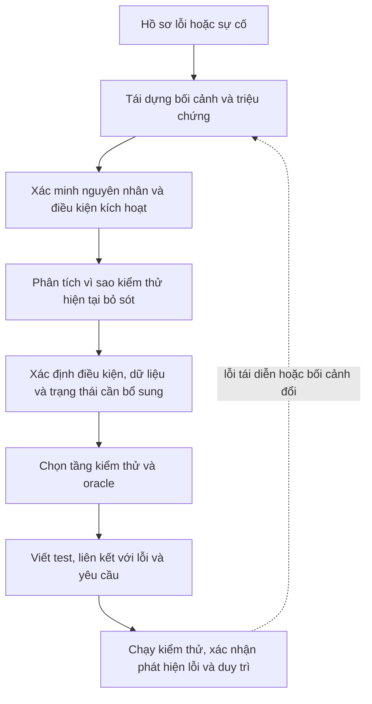

# Sử dụng lỗi lịch sử để bổ sung điều kiện kiểm thử

**Chương:** Thiết kế bao phủ  
**Phạm vi module:** `VALIDATION_TESTING_STRATEGY`

Các lỗi đã từng xảy ra là nguồn thông tin quan trọng để cải thiện thiết kế kiểm thử. Một lỗi trong quá khứ cho biết hệ thống đã thất bại ở một điều kiện cụ thể, một giả định đã sai hoặc một điểm kiểm soát chưa đủ. Nếu chỉ sửa mã rồi đóng lỗi, nhóm có thể gặp lại vấn đề đó ở lần thay đổi sau hoặc ở một thành phần khác có cùng nguyên nhân.

Sử dụng lỗi lịch sử để bổ sung điều kiện kiểm thử nghĩa là phân tích các lỗi đã ghi nhận, tìm ra điều kiện làm lỗi xuất hiện hoặc khiến lỗi lọt qua, rồi chuyển những hiểu biết đó thành điều kiện, dữ liệu, trạng thái và tiêu chí xác minh mới. Mục tiêu là làm cho bộ kiểm thử phản ánh kinh nghiệm thực tế của sản phẩm và giảm khả năng tái diễn lỗi.

Bài học này trình bày cách thu thập và phân tích dữ liệu lỗi, phân biệt triệu chứng với nguyên nhân, chọn mức kiểm thử phù hợp và chuyển kết quả phân tích thành bộ điều kiện có thể truy vết. Lỗi lịch sử là đầu vào cho việc cải thiện bao phủ; mỗi trường hợp vẫn cần được đánh giá theo bối cảnh và rủi ro hiện tại.

Sau bài học, người học có thể:

- Thu thập và chuẩn hóa thông tin từ lỗi, sự cố và phản hồi người dùng.
- Phân tích điều kiện, nguyên nhân và đường đi khiến lỗi xuất hiện hoặc lọt qua.
- Chuyển một lỗi lịch sử thành một hoặc nhiều điều kiện kiểm thử có thể xác minh.
- Chọn tầng kiểm thử, dữ liệu và oracle phù hợp với nguyên nhân lỗi.
- Ưu tiên bổ sung kiểm thử dựa trên tác động, khả năng tái diễn và phạm vi ảnh hưởng.
- Theo dõi hiệu quả của các điều kiện mới và cập nhật chúng khi sản phẩm thay đổi.

## 1. Vì sao lỗi lịch sử giúp cải thiện bao phủ?

Các mô hình thiết kế kiểm thử như phân vùng tương đương, phân tích giá trị biên, bảng quyết định và kiểm thử chuyển trạng thái giúp dự đoán nhiều điều kiện có thể gây lỗi. Tuy nhiên, nhóm vẫn có thể bỏ sót những tình huống chỉ xuất hiện trong môi trường thực tế: dữ liệu có dạng bất thường, sự kiện đến sai thứ tự, người dùng thao tác rất nhanh, cấu hình triển khai khác biệt hoặc hai hệ thống diễn giải cùng một hợp đồng theo cách khác nhau.

Lỗi lịch sử cung cấp bằng chứng về những điểm yếu đã bộc lộ trong sản phẩm. Chúng giúp trả lời:

- Điều kiện nào thực sự đã làm hệ thống thất bại?
- Giả định nào của người viết yêu cầu, người thiết kế, người phát triển hoặc người kiểm thử đã không đúng?
- Kiểm thử hiện có đã thiếu dữ liệu, trạng thái, nhánh, phụ thuộc hay tiêu chí nào?
- Lỗi có thể tái diễn ở những đường đi hoặc thành phần nào khác?
- Cần thêm điều kiện kiểm thử ở tầng nào để phát hiện lỗi sớm và đáng tin cậy?

Ví dụ, hệ thống từng tính sai tổng tiền khi đơn hàng có chiết khấu phần trăm và phí vận chuyển. Thêm một test với đúng đơn hàng từng gây lỗi có thể ngăn tái diễn trực tiếp. Nhưng phân tích sâu hơn có thể phát hiện vấn đề nằm ở thứ tự làm tròn, kiểu dữ liệu tiền tệ hoặc việc áp dụng chiết khấu trước/sau thuế. Khi đó, nhóm cần bổ sung các điều kiện kiểm thử cho nhiều giá trị biên và tổ hợp liên quan, không chỉ lưu lại một ví dụ duy nhất.

Lỗi lịch sử đặc biệt hữu ích khi được kết hợp với mô hình rủi ro và kiến thức miền nghiệp vụ. Một lỗi nhỏ nhưng lặp lại thường xuyên có thể cần kiểm thử hồi quy; một lỗi hiếm nhưng ảnh hưởng nghiêm trọng đến dữ liệu, quyền truy cập hoặc giao dịch có thể cần điều kiện kiểm tra chuyên biệt và kiểm soát bổ sung.

## 2. Phân biệt các khái niệm trong hồ sơ lỗi

Trước khi phân tích, cần dùng thuật ngữ nhất quán. Trong thực tế, công cụ quản lý có thể dùng các từ “bug”, “defect”, “incident” hoặc “problem” với ý nghĩa khác nhau. Nhóm nên định nghĩa cách sử dụng trong quy trình của mình.

- **Lỗi/khuyết tật (defect):** sai sót trong yêu cầu, thiết kế, mã nguồn, cấu hình hoặc dữ liệu có thể dẫn đến hành vi không đúng.
- **Thất bại (failure):** hành vi quan sát được khi hệ thống không thực hiện đúng điều được mong đợi trong một tình huống cụ thể.
- **Sự cố (incident):** sự kiện vận hành ảnh hưởng đến dịch vụ hoặc người dùng; một sự cố có thể do một hay nhiều defect gây ra.
- **Triệu chứng:** biểu hiện nhìn thấy được, chẳng hạn trang trả lỗi 500, tổng tiền hiển thị sai hoặc đơn hàng bị treo.
- **Nguyên nhân gốc (root cause):** điều kiện hoặc cơ chế nền tảng tạo ra lỗi, sau khi phân tích đủ sâu để giải thích vì sao lỗi xảy ra.
- **Điều kiện kiểm thử (test condition):** khía cạnh, quy tắc hoặc tình huống cần được xác minh.
- **Ca kiểm thử (test case):** tập hợp tiền điều kiện, dữ liệu, bước thực hiện và kết quả mong đợi dùng để xác minh một hoặc nhiều điều kiện.

Một sự cố có thể tạo ra nhiều triệu chứng. Một defect có thể gây ra nhiều failure ở các luồng khác nhau. Một điều kiện kiểm thử cũng có thể phát hiện nhiều defect có cùng kiểu nguyên nhân.

Ví dụ, khách hàng nhìn thấy đơn hàng ở trạng thái “đang xử lý” dù thanh toán đã thành công. Triệu chứng là trạng thái đơn hàng không cập nhật. Nguyên nhân có thể là callback đến trước khi giao dịch được lưu, callback bị gửi lại nhưng bị loại sai, hoặc một lỗi xử lý thông điệp khiến cập nhật trạng thái không được commit. Mỗi nguyên nhân đòi hỏi điều kiện kiểm thử khác nhau.

## 3. Thu thập và chuẩn hóa dữ liệu lỗi

Nguồn lỗi lịch sử không chỉ là danh sách bug trong công cụ theo dõi. Nhóm có thể cần kết hợp dữ liệu từ nhiều nơi để hiểu đầy đủ bối cảnh.

### 3.1. Nguồn thông tin có thể sử dụng

- Báo cáo lỗi do kiểm thử viên tạo trong các chu kỳ trước.
- Sự cố được ghi nhận bởi hệ thống giám sát và đội vận hành.
- Phản hồi, yêu cầu hỗ trợ và khiếu nại của người dùng.
- Báo cáo sau sự cố (post-incident review) và phân tích nguyên nhân.
- Pull request, commit hoặc thay đổi đã sửa lỗi.
- Log, trace, số liệu giám sát, ảnh chụp và dữ liệu tái hiện được lưu theo chính sách.
- Lỗi được phát hiện trong kiểm thử hồi quy, kiểm thử chấp nhận hoặc sau phát hành.
- Vấn đề được nhà cung cấp hoặc hệ thống tích hợp thông báo.

Không phải mọi nguồn đều có cùng độ tin cậy. Một báo cáo người dùng có thể mô tả chính xác tác động nhưng thiếu thông tin kỹ thuật. Log có thể cho thấy chuỗi sự kiện nhưng không giải thích mục tiêu nghiệp vụ. Hãy kết hợp nguồn và ghi rõ đâu là dữ kiện đã xác minh, đâu là giả thuyết.

### 3.2. Trường thông tin nên giữ

Một hồ sơ lỗi hữu ích cho phân tích kiểm thử thường có:

| Trường | Nội dung |
|---|---|
| Mã lỗi/sự cố | Định danh duy nhất và liên kết đến nguồn gốc |
| Mô tả triệu chứng | Điều gì đã xảy ra và người dùng nhìn thấy gì |
| Hành vi mong đợi | Hệ thống lẽ ra phải làm gì |
| Phạm vi ảnh hưởng | Người dùng, dữ liệu, chức năng, dịch vụ và môi trường bị ảnh hưởng |
| Điều kiện tái hiện | Dữ liệu, trạng thái, thao tác, thời điểm và cấu hình liên quan |
| Phiên bản | Phiên bản ứng dụng, schema, cấu hình hoặc dịch vụ phụ thuộc |
| Nguyên nhân đã xác minh | Cơ chế tạo ra lỗi; ghi rõ nếu chưa xác định |
| Cách sửa | Thay đổi đã thực hiện hoặc biện pháp giảm thiểu |
| Cách phát hiện | Tầng hoặc hoạt động đã tìm thấy lỗi |
| Lỗi lọt qua | Vì sao các kiểm tra trước đó không phát hiện được |
| Mức độ nghiêm trọng và ưu tiên | Tác động và mức cần xử lý theo quy ước của nhóm |
| Trạng thái xử lý | Đã sửa, đang theo dõi, chấp nhận rủi ro hoặc chưa giải quyết |

Không phải hồ sơ nào cũng có đủ tất cả trường. Nếu thiếu thông tin quan trọng, hãy ghi “chưa biết” hoặc “chưa xác minh” thay vì tự suy đoán.

### 3.3. Chuẩn hóa trước khi phân tích

Danh sách lỗi lịch sử thường có bản ghi trùng, tên gọi khác nhau hoặc mức độ chi tiết không đồng đều. Trước khi tìm xu hướng, hãy:

1. Gộp các bản ghi trùng cùng một nguyên nhân hoặc sự cố nếu có thể xác minh.
2. Chuẩn hóa tên thành phần, môi trường, loại lỗi và mức độ nghiêm trọng.
3. Phân biệt lỗi sản phẩm với lỗi môi trường kiểm thử hoặc dữ liệu thử nghiệm.
4. Liên kết lỗi với phiên bản và thay đổi đã tạo hoặc sửa lỗi nếu có bằng chứng.
5. Giữ nguyên liên kết đến hồ sơ gốc để có thể kiểm tra lại.
6. Xác định khoảng thời gian và phạm vi dữ liệu đang phân tích.

Khi thống kê, cần tránh đếm nhiều triệu chứng của cùng một sự cố như nhiều lỗi độc lập nếu mục tiêu là tìm nguyên nhân gốc. Ngược lại, nếu mục tiêu là đo số lần người dùng bị ảnh hưởng, cần giữ số sự kiện thực tế. Câu hỏi phân tích quyết định cách nhóm dữ liệu.

## 4. Phân tích một lỗi để tìm điều kiện bị bỏ sót

Không nên chuyển thẳng mô tả lỗi thành một test case mà chưa hiểu cơ chế. Cần tái dựng bối cảnh, xác định điều kiện kích hoạt, tìm nguyên nhân và xem xét vì sao kiểm thử hiện tại không phát hiện.

### 4.1. Tái hiện bối cảnh

Thu thập các thông tin cần thiết:

- Phiên bản ứng dụng và cấu hình khi lỗi xuất hiện.
- Dữ liệu đầu vào và trạng thái ban đầu.
- Vai trò, quyền và loại tài khoản.
- Trình tự thao tác hoặc sự kiện.
- Thời điểm, múi giờ, độ trễ và các yếu tố đồng thời.
- Hành vi của dịch vụ phụ thuộc.
- Kết quả thực tế và kết quả mong đợi.

Nếu lỗi chỉ xảy ra một lần và không thể tái hiện, vẫn có thể phân tích trace, log, dữ liệu đã ẩn danh hoặc báo cáo sự cố. Hãy phân biệt điều đã quan sát với giả thuyết về nguyên nhân.

### 4.2. Phân biệt triệu chứng và nguyên nhân

Ví dụ: hệ thống hiển thị sai số tiền khi khách hàng áp dụng mã giảm giá.

- **Triệu chứng:** tổng tiền trên trang xác nhận thấp hơn số tiền được ghi nhận ở hệ thống thanh toán.
- **Nguyên nhân có thể:** giao diện và backend dùng thứ tự tính thuế/chiết khấu khác nhau; một bên làm tròn theo từng dòng, bên kia làm tròn sau khi cộng; dữ liệu tiền tệ bị chuyển sang kiểu số thực không phù hợp.
- **Điều kiện kích hoạt:** đơn hàng có nhiều dòng sản phẩm, tỷ lệ chiết khấu tạo ra phần lẻ, thuế được tính sau giảm giá hoặc tiền tệ có số chữ số thập phân khác nhau.
- **Điều kiện bị bỏ sót:** tổ hợp nhiều dòng hàng và giá trị làm tròn ở ranh giới.

Test chỉ lặp lại đúng đơn hàng đã lỗi có thể không phát hiện các biến thể cùng nguyên nhân. Cần xác định quy tắc tính toán và miền dữ liệu liên quan để thiết kế thêm các trường hợp biên.

### 4.3. Dùng kỹ thuật phân tích nguyên nhân

Một số kỹ thuật hữu ích:

- **5 Whys:** hỏi “vì sao?” nhiều lần để đi từ triệu chứng đến nguyên nhân có thể hành động. Không nhất thiết phải đủ năm lần; dừng khi có bằng chứng và xác định được biện pháp phù hợp.
- **Sơ đồ xương cá:** nhóm nguyên nhân theo con người, quy trình, công nghệ, dữ liệu, môi trường và phụ thuộc.
- **Phân tích cây lỗi (fault tree):** phân rã sự kiện không mong muốn thành các nguyên nhân kết hợp hoặc thay thế.
- **Timeline/sơ đồ tuần tự:** tái dựng thứ tự sự kiện, đặc biệt với lỗi bất đồng bộ, timeout và concurrency.
- **Phân tích thay đổi:** đối chiếu commit, cấu hình, migration hoặc thay đổi nhà cung cấp trước thời điểm lỗi.

Các kỹ thuật này hỗ trợ điều tra, không tự chứng minh nguyên nhân. Kết luận cần dựa trên bằng chứng như tái hiện, log, trace, kiểm tra mã hoặc thử nghiệm có kiểm soát.

### 4.4. Xác định vì sao lỗi lọt qua

Sau khi hiểu nguyên nhân, hãy xem lại hệ thống kiểm tra đã có:

- Yêu cầu hoặc tiêu chí chấp nhận có mô tả điều kiện này không?
- Có ca kiểm thử tương ứng không?
- Dữ liệu kiểm thử có chứa giá trị hoặc trạng thái gây lỗi không?
- Test chạy ở tầng nào và có đi qua thành phần tạo ra lỗi không?
- Oracle có đủ mạnh để phát hiện kết quả sai không?
- Test có bị bỏ qua, không chạy, không ổn định hoặc có ngoại lệ không?
- Báo cáo có đủ bằng chứng để người rà soát nhận ra sai lệch không?

Lỗi có thể lọt qua vì chưa có điều kiện, có điều kiện nhưng thiếu dữ liệu, có test nhưng đặt sai tầng, hoặc có test nhưng assertion không kiểm tra kết quả quan trọng. Mỗi nguyên nhân cần một hành động khác nhau.

## 5. Chuyển lỗi lịch sử thành điều kiện kiểm thử

Một lỗi lịch sử có thể dẫn đến một hay nhiều điều kiện kiểm thử. Điều kiện mới cần mô tả điều gì phải được xác minh, trong hoàn cảnh nào và bằng chứng nào cho thấy hành vi đúng.

### 5.1. Quy trình chuyển đổi

### 5.2. Một lỗi có thể tạo nhiều điều kiện

Giả sử một callback thanh toán bị xử lý hai lần khiến đơn hàng tạo hai bản ghi giao dịch. Sau phân tích, nhóm xác định có ba điều kiện cần kiểm tra:

1. Cùng một callback được gửi lại với cùng mã sự kiện phải được xử lý idempotent.
2. Hai callback giống nhau đến gần như đồng thời không được tạo hai giao dịch có hiệu lực.
3. Callback đến sau khi giao dịch đã ở trạng thái cuối không được làm trạng thái quay ngược.

Điều kiện thứ nhất có thể được kiểm tra bằng unit test cho logic nhận diện sự kiện đã xử lý. Điều kiện thứ hai cần integration test với cơ sở dữ liệu và cạnh tranh đồng thời. Điều kiện thứ ba cần kiểm tra chuyển trạng thái và cập nhật dữ liệu tại ranh giới tích hợp.

### 5.3. Một điều kiện có thể ngăn nhiều lỗi

Nếu nhiều lỗi khác nhau cùng bắt nguồn từ việc so sánh thời gian không nhất quán, một nhóm điều kiện kiểm thử về múi giờ, thời điểm biên, giờ mùa hè (nếu áp dụng), độ chính xác timestamp và đồng hồ giả lập có thể ngăn nhiều lỗi tái diễn.

Vì vậy, không nên áp dụng quy tắc “một lỗi bằng một test”. Hãy xây dựng test theo điều kiện và nguyên nhân. Một test có thể bảo vệ nhiều lỗi cùng cơ chế; một lỗi phức tạp có thể cần nhiều test ở các tầng khác nhau.

### 5.4. Phân biệt kiểm thử tái hiện và kiểm thử phòng ngừa

- **Kiểm thử tái hiện (reproduction test):** tái tạo điều kiện gần với lỗi ban đầu để xác nhận lỗi đã được sửa.
- **Kiểm thử phòng ngừa/mở rộng:** kiểm tra các biến thể và điều kiện lân cận có cùng nguyên nhân để giảm nguy cơ lỗi tương tự.

Kiểm thử tái hiện thường là bước đầu tiên. Sau đó cần đánh giá xem có nên thêm các biến thể dữ liệu, trạng thái, vai trò, thời gian, thứ tự sự kiện hoặc cấu hình để bao phủ cơ chế rộng hơn.

## 6. Chọn tầng kiểm thử theo nguyên nhân

Điều kiện mới cần được đặt ở tầng có thể chứng minh hành vi liên quan một cách đáng tin cậy và với chi phí hợp lý.

| Nguyên nhân hoặc loại điều kiện | Tầng kiểm thử phù hợp | Ví dụ bằng chứng |
|---|---|---|
| Sai công thức hoặc nhánh điều kiện thuần túy | Unit test | Kết quả tính toán, nhánh được kiểm tra, giá trị biên |
| Sai ánh xạ dữ liệu hoặc câu truy vấn | Integration test | Dữ liệu lưu/đọc lại trên cơ sở dữ liệu thực tế của môi trường test |
| Thiếu ràng buộc duy nhất hoặc lỗi transaction | Integration test | Không tạo bản ghi trùng; rollback đúng khi lỗi |
| API hai bên hiểu khác hợp đồng | Contract test và integration test | Schema, mã phản hồi, trường bắt buộc và tương thích |
| Lỗi quyền truy cập xuyên vai trò | Unit/API/system test tùy điểm thực thi | Yêu cầu bị từ chối và không rò rỉ dữ liệu |
| Sự kiện đến sai thứ tự hoặc bị lặp | Unit test cho quy tắc; integration test cho xử lý thực | Trạng thái cuối hợp lệ, không phát sinh tác dụng phụ trùng |
| Hành trình nhiều thành phần bị hỏng | System hoặc E2E test | Kết quả nghiệp vụ xuyên suốt và trạng thái liên quan |
| Cấu hình môi trường hoặc triển khai sai | Kiểm tra cấu hình, deployment test, system test | Cấu hình hiệu lực, health check và hành vi trên môi trường |

Không nên nâng mọi lỗi lên E2E. Nếu nguyên nhân là một phép tính thuần túy, unit test thường cho phản hồi nhanh và chẩn đoán rõ hơn. Ngược lại, nếu lỗi chỉ xuất hiện do cơ sở dữ liệu xử lý đồng thời, mock repository không đủ để chứng minh đã khắc phục.

## 7. Các chiều điều kiện thường bị bỏ sót trong lỗi lịch sử

Khi xem xét một lỗi, hãy kiểm tra xem điều kiện kích hoạt có thuộc một trong các chiều sau không. Đây là danh mục gợi ý để mở rộng phân tích, không phải yêu cầu phải tạo test cho mọi mục.

### 7.1. Giá trị biên và dữ liệu bất thường

Nhiều lỗi xuất hiện ở ranh giới: bằng ngưỡng, ngay dưới hoặc ngay trên ngưỡng; chuỗi rỗng; độ dài tối đa; số âm; số rất lớn; độ chính xác thập phân; ký tự Unicode; dữ liệu thiếu hoặc trường tùy chọn.

Khi một lỗi lịch sử liên quan dữ liệu, hãy hỏi:

- Có kiểm tra đúng giá trị biên đã gây lỗi không?
- Có các giá trị liền kề để xác minh ranh giới không?
- Có phân biệt null, rỗng, thiếu trường và giá trị mặc định không?
- Có kiểu dữ liệu hoặc định dạng khác có thể tạo cùng lỗi không?
- Có cần kiểm tra dữ liệu đã được chuẩn hóa hay chưa?

### 7.2. Trạng thái và chuyển trạng thái

Lỗi có thể xảy ra khi đối tượng ở một trạng thái hiếm hoặc chuyển qua một chuỗi trạng thái không được kiểm thử. Hãy xem xét trạng thái ban đầu, trạng thái đích, chuyển đổi bị cấm, chuyển đổi lặp và sự kiện đến sai thứ tự.

Ví dụ, đơn hàng đã hủy không được chuyển sang đã giao chỉ vì một webhook giao hàng đến muộn. Cần kiểm tra cả quy tắc chuyển trạng thái thuần túy và cách hệ thống lưu trạng thái sau khi nhận sự kiện.

### 7.3. Thời gian, múi giờ và lịch

Lỗi có thể phụ thuộc thời điểm hết hạn, ranh giới ngày, múi giờ người dùng, thời gian máy chủ, lịch làm việc hoặc tác vụ chạy qua nửa đêm. Hãy bổ sung test cho thời điểm ngay trước, đúng tại và ngay sau ranh giới; kiểm tra cả chuyển đổi múi giờ và độ chính xác timestamp khi có liên quan.

Để test lặp lại được, truyền đồng hồ hoặc thời điểm giả định vào logic thay vì phụ thuộc thời gian thật. Với hệ thống lưu trữ, cần kiểm tra thêm cách serialize, truy vấn và chuyển đổi thời gian.

### 7.4. Thứ tự sự kiện và tính đồng thời

Các lỗi race condition thường không tái hiện bằng thao tác tuần tự. Xem xét:

- Hai yêu cầu cùng cập nhật một bản ghi.
- Callback trùng đến gần như đồng thời.
- Sự kiện hoàn tất đến trước sự kiện bắt đầu.
- Retry xảy ra khi lần đầu đã được xử lý nhưng phản hồi bị mất.
- Một tiến trình đọc dữ liệu cũ trong khi tiến trình khác vừa cập nhật.

Test cần tạo được điều kiện cạnh tranh có kiểm soát và xác minh bất biến cuối cùng. Không nên chỉ chạy hai lời gọi liên tiếp rồi kết luận đã kiểm tra concurrency.

### 7.5. Quyền, danh tính và ranh giới dữ liệu

Lỗi phân quyền có thể xuất hiện khi vai trò ít dùng, người dùng thuộc tổ chức khác, tài nguyên được chia sẻ hoặc quyền thay đổi trong lúc phiên còn hiệu lực. Hãy kiểm tra cả hành động được phép và hành động phải bị từ chối, bao gồm truy cập chéo tenant hoặc chủ sở hữu.

Kết quả cần xác minh không chỉ là mã 403 hoặc 404, mà còn là dữ liệu nhạy cảm không được trả về, không bị thay đổi và không xuất hiện trong log ngoài chính sách.

### 7.6. Tích hợp và cấu hình

Lỗi có thể phụ thuộc phiên bản API, thứ tự trường, mã lỗi, chứng thư, cấu hình timeout, retry hoặc thông tin định danh. Xem xét các biến thể tương thích, lỗi dịch vụ, phản hồi chậm, dữ liệu không đầy đủ và thay đổi cấu hình giữa môi trường.

### 7.7. Khả năng phục hồi và tác dụng phụ

Một lỗi có thể chỉ xuất hiện sau khi hệ thống đã thử lại, rollback, khởi động lại hoặc khôi phục từ backup. Hãy xem xét việc phát lại thông điệp, thao tác bù trừ, dữ liệu chưa commit, trạng thái trung gian và các tác dụng phụ như gửi email hoặc tạo giao dịch.

## 8. Ví dụ phân tích lỗi lịch sử và bổ sung điều kiện

### 8.1. Lỗi tính tổng tiền khi có chiết khấu

**Mô tả lỗi:** một số đơn hàng có nhiều dòng sản phẩm hiển thị tổng tiền khác với số tiền được gửi sang cổng thanh toán.

**Điều tra:** log cho thấy giao diện làm tròn chiết khấu ở từng dòng, trong khi backend cộng các giá trị chưa làm tròn rồi mới làm tròn tổng. Khi đơn hàng chỉ có một dòng, sai lệch không xuất hiện.

**Nguyên nhân đã xác minh:** hai thành phần áp dụng quy tắc làm tròn ở thời điểm khác nhau.

**Vì sao lọt qua:** bộ kiểm thử chỉ dùng đơn hàng một dòng và giá trị chiết khấu tạo ra số nguyên; không có tiêu chí so sánh tổng tiền ở ranh giới giữa giao diện, backend và yêu cầu thanh toán.

**Điều kiện cần bổ sung:**

1. Đơn hàng có nhiều dòng và chiết khấu tạo ra phần lẻ.
2. Giá trị mỗi dòng nằm gần ranh giới làm tròn.
3. Kết hợp thuế, phí và chiết khấu theo thứ tự nghiệp vụ đã thống nhất.
4. So sánh tổng tiền hiển thị, tổng tiền backend lưu và số tiền gửi đến cổng thanh toán.
5. Kiểm tra các loại tiền tệ có quy tắc số chữ số thập phân khác nhau nếu sản phẩm hỗ trợ.

**Tầng kiểm thử:** unit test cho hàm tính tiền và quy tắc làm tròn; integration/contract test để xác minh số tiền được serialize và gửi đúng; một E2E đại diện để kiểm tra hành trình đặt hàng hiển thị đúng tổng tiền.

### 8.2. Lỗi callback thanh toán bị xử lý lặp

**Mô tả lỗi:** nhà cung cấp gửi lại callback do phản hồi đầu tiên bị timeout; hệ thống tạo hai bản ghi giao dịch.

**Nguyên nhân đã xác minh:** thao tác kiểm tra sự kiện đã xử lý và thao tác ghi giao dịch không được bảo vệ nguyên tử. Hai callback có thể cùng vượt qua bước kiểm tra trước khi một bản ghi được commit.

**Vì sao lọt qua:** test hiện có chỉ gửi callback một lần và dùng mock repository, nên không kiểm tra ràng buộc dữ liệu hoặc cạnh tranh đồng thời.

**Điều kiện cần bổ sung:**

1. Gửi cùng callback lần thứ hai sau khi lần đầu đã commit.
2. Gửi hai callback giống nhau đồng thời.
3. Làm mất phản hồi sau khi xử lý thành công rồi gửi lại yêu cầu.
4. Gửi callback đến sai thứ tự so với trạng thái hiện tại.
5. Xác minh chỉ có một giao dịch có hiệu lực và trạng thái đơn hàng không lùi hoặc tiến sai.

**Tầng kiểm thử:** unit test cho quy tắc idempotency và chuyển trạng thái; integration test với cơ sở dữ liệu thật của môi trường kiểm thử để xác minh unique constraint/transaction; contract test cho callback và E2E hoặc system test cho một hành trình đại diện.

### 8.3. Lỗi truy cập dữ liệu giữa hai khách hàng

**Mô tả lỗi:** khách hàng có thể xem chi tiết đơn hàng thuộc tài khoản khác khi thay mã đơn trong URL.

**Nguyên nhân đã xác minh:** API kiểm tra người dùng đã đăng nhập nhưng không xác minh quyền sở hữu tài nguyên ở phía máy chủ.

**Vì sao lọt qua:** kiểm thử chỉ xác minh tài khoản hợp lệ có thể xem đơn hàng của chính mình; không có trường hợp truy cập chéo chủ sở hữu hoặc tenant.

**Điều kiện cần bổ sung:**

1. Người dùng A đọc đơn hàng của A và được phép.
2. Người dùng A thử đọc đơn hàng của B và bị từ chối theo chính sách.
3. Người dùng A thử sửa hoặc hủy đơn hàng của B và không tạo thay đổi.
4. Người dùng có vai trò hỗ trợ được phép truy cập theo phạm vi quyền đã phê duyệt.
5. Không có dữ liệu nhạy cảm bị trả về trong phản hồi hoặc ghi vào log trái chính sách.

**Tầng kiểm thử:** unit test cho quyết định phân quyền nếu logic được tách riêng; API/system test để xác minh kiểm soát ở điểm vào thực; E2E cho luồng người dùng có vai trò khác nhau khi cần chứng minh hành vi xuyên suốt.

Ba ví dụ cho thấy cùng một phương pháp phân tích có thể dẫn đến các tầng và loại điều kiện khác nhau. Không nên chọn tầng chỉ dựa vào nơi lỗi được báo cáo; hãy chọn theo nơi nguyên nhân được tạo ra và nơi cần bằng chứng.

## 9. Ưu tiên điều kiện kiểm thử được bổ sung

Không phải mọi lỗi lịch sử đều cần tạo một bộ test lớn. Nhóm nên ưu tiên theo tác động, khả năng tái diễn, mức độ phổ biến của nguyên nhân và chi phí phát hiện muộn.

### 9.1. Các yếu tố đánh giá

- **Mức độ nghiêm trọng:** ảnh hưởng đến dữ liệu, tài chính, bảo mật, an toàn, tuân thủ và hoạt động.
- **Tần suất hoặc khả năng tái diễn:** lỗi đã xảy ra bao nhiêu lần hoặc nguyên nhân còn tồn tại ở đâu.
- **Phạm vi ảnh hưởng:** số người dùng, thành phần, phiên bản hoặc tenant có thể bị tác động.
- **Khả năng lọt qua:** lỗi có khó phát hiện bằng kiểm tra hiện tại không.
- **Mức lan truyền:** nguyên nhân có thể ảnh hưởng nhiều luồng hoặc dịch vụ không.
- **Chi phí khắc phục muộn:** sửa lỗi sau phát hành có gây gián đoạn, mất dữ liệu hoặc xử lý thủ công lớn không.
- **Khả năng kiểm thử:** có thể tạo điều kiện lặp lại và oracle đáng tin cậy không.

### 9.2. Dùng ma trận ưu tiên có giải thích

Nhóm có thể phân loại thành mức rất cao, cao, trung bình hoặc thấp. Nếu dùng điểm số, cần định nghĩa thang và tránh coi tích các điểm thứ bậc là xác suất chính xác.

| Mức | Dấu hiệu | Hành động gợi ý |
|---|---|---|
| Rất cao | Lỗi ảnh hưởng nghiêm trọng đến dữ liệu, tiền, quyền hoặc nghĩa vụ; nguyên nhân còn khả năng tái diễn | Bổ sung kiểm thử ở tầng phù hợp trước khi phát hành thay đổi liên quan; xem xét thêm kiểm soát và giám sát |
| Cao | Lỗi tái diễn, ảnh hưởng luồng chính hoặc có phạm vi rộng | Đưa vào bộ hồi quy bắt buộc của thành phần/luồng liên quan |
| Trung bình | Ảnh hưởng giới hạn, có cách phát hiện hoặc khôi phục tương đối rõ | Bổ sung vào bộ kiểm thử phù hợp và theo dõi xu hướng |
| Thấp | Tác động nhỏ, ít khả năng tái diễn hoặc đã được kiểm soát tốt | Ghi nhận, cân nhắc kiểm thử theo lịch hoặc khi thành phần thay đổi |

Rủi ro nghiêm trọng hoặc yêu cầu bắt buộc không được loại bỏ chỉ vì tần suất thấp. Một lỗi hiếm nhưng có thể gây mất dữ liệu hoặc truy cập trái phép vẫn cần được xử lý theo chính sách.

### 9.3. Cân nhắc chi phí duy trì

Một test E2E cần nhiều dữ liệu, môi trường và phụ thuộc có thể tốn công duy trì. Nếu nguyên nhân có thể được xác minh đáng tin cậy bằng unit hoặc integration test, hãy đặt phần kiểm tra chi tiết ở tầng đó và chỉ giữ E2E đại diện khi cần. Mục tiêu là có bằng chứng phù hợp với chi phí duy trì chấp nhận được.

## 10. Viết điều kiện và ca kiểm thử hồi quy

Sau khi chọn điều kiện, cần chuyển chúng thành test có thể thực thi và đánh giá. Một test tốt phải thể hiện được mối liên hệ với lỗi lịch sử và lý do điều kiện được thêm vào.

### 10.1. Mẫu mô tả điều kiện

Có thể dùng cấu trúc:

> Khi **[điều kiện/trạng thái/dữ liệu]**, và **[hành động hoặc sự kiện]** xảy ra, hệ thống phải **[hành vi mong đợi]**, được xác minh bằng **[kết quả hoặc bằng chứng]**.

Ví dụ:

> Khi hai callback có cùng mã giao dịch được tiếp nhận đồng thời, hệ thống chỉ ghi nhận một giao dịch có hiệu lực và giữ trạng thái đơn hàng nhất quán; xác minh bằng bản ghi giao dịch và trạng thái đọc lại từ cơ sở dữ liệu.

### 10.2. Mẫu liên kết lỗi với điều kiện kiểm thử

| Trường | Nội dung |
|---|---|
| Mã lỗi nguồn | `BUG-PAY-142` |
| Nguyên nhân | Kiểm tra sự kiện trùng và ghi giao dịch không nguyên tử |
| Điều kiện mới | Hai callback cùng định danh đến đồng thời |
| Tiền điều kiện | Giao dịch đang chờ; endpoint callback hoạt động; dữ liệu được cô lập |
| Hành động | Gửi hai callback hợp lệ giống nhau gần như đồng thời |
| Kết quả mong đợi | Chỉ một giao dịch có hiệu lực; không có tác dụng phụ trùng; trạng thái đơn hàng hợp lệ |
| Tầng | Integration test |
| Bằng chứng | Mã lần chạy, log tương quan, số bản ghi và trạng thái đọc lại |
| Chủ sở hữu | Nhóm phụ trách thanh toán |

Mã lỗi và tên nhóm trong ví dụ chỉ để minh họa. Trong dự án thật, dùng định danh và vai trò đang được quản lý trong hệ thống.

### 10.3. Xác minh test thực sự phát hiện lỗi

Sau khi viết test, cần xác nhận test có thể phát hiện hành vi sai. Một cách là chạy test với phiên bản trước khi sửa hoặc tạo một biến thể lỗi có kiểm soát trong môi trường phát triển. Nếu test vẫn đạt khi lỗi tái xuất hiện, assertion hoặc dữ liệu chưa đủ mạnh.

Không cần cố ý đưa lỗi vào môi trường dùng chung hoặc sản xuất. Việc xác minh khả năng phát hiện phải được thực hiện trong nhánh hoặc môi trường an toàn, với phạm vi rõ ràng.

### 10.4. Chọn assertion theo hành vi nghiệp vụ

Test nên kiểm tra kết quả có ý nghĩa với người dùng hoặc hệ thống, không chỉ kiểm tra một phương thức nội bộ đã được gọi. Với lỗi giao dịch trùng, assertion cần xác minh số giao dịch có hiệu lực, trạng thái đơn hàng và tác dụng phụ quan trọng. Với lỗi làm tròn, assertion cần đối chiếu số tiền cuối theo quy tắc được phê duyệt.

Nếu test chỉ xác minh “hàm save được gọi một lần” nhưng không kiểm tra dữ liệu đã commit, nó có thể không phát hiện lỗi ở cơ sở dữ liệu hoặc transaction.

## 11. Liên kết lỗi lịch sử với mô hình bao phủ

Điều kiện mới nên được liên kết với các yêu cầu, rủi ro, thành phần và tầng kiểm thử liên quan. Điều này giúp nhóm hiểu tại sao test tồn tại và biết phải xem lại test nào khi thay đổi hệ thống.

Một bản đồ truy vết có thể gồm:

| Lỗi lịch sử | Nguyên nhân/điều kiện | Yêu cầu hoặc rủi ro | Điều kiện kiểm thử | Tầng | Bằng chứng |
|---|---|---|---|---|---|
| Sai tổng tiền | Làm tròn nhiều dòng không nhất quán | Tính đúng đắn giao dịch | Nhiều dòng, giá trị thập phân, thuế và chiết khấu | Unit + integration | Tổng tiền tính lại và payload thanh toán |
| Callback trùng | Xử lý không nguyên tử | Không tạo giao dịch trùng | Hai callback đồng thời cùng định danh | Integration | Số giao dịch và trạng thái cuối |
| Truy cập chéo đơn hàng | Thiếu kiểm tra quyền sở hữu | Bảo mật dữ liệu khách hàng | Người A truy cập tài nguyên của B | API/system | Phản hồi, trạng thái dữ liệu và log |

Không cần tạo bảng thủ công nếu công cụ quản lý test hỗ trợ liên kết tương đương. Điều quan trọng là có thể lần từ lỗi đến nguyên nhân, từ nguyên nhân đến điều kiện, và từ điều kiện đến bằng chứng thực thi.

### 11.1. Tránh tạo liên kết chỉ để đủ hình thức

Một test được liên kết với một lỗi nhưng không còn kiểm tra nguyên nhân sau khi mã thay đổi sẽ tạo cảm giác bao phủ giả. Định kỳ rà soát xem:

- Điều kiện vẫn có thể xảy ra trong kiến trúc hiện tại không?
- Test còn chạy và có assertion có ý nghĩa không?
- Test có còn đặt ở tầng phù hợp không?
- Có thay đổi nào làm phát sinh biến thể hoặc rủi ro mới không?
- Lỗi nguồn có liên quan đến nhiều test trùng lặp không cần thiết không?

## 12. Đo hiệu quả của việc dùng lỗi lịch sử

Mục tiêu không phải tạo thật nhiều test từ danh sách bug. Cần xem việc bổ sung điều kiện có giúp phát hiện lỗi sớm hơn, giảm tái diễn và cải thiện khả năng chẩn đoán hay không.

Các chỉ số có thể theo dõi:

- **Tỷ lệ lỗi tái diễn:** số lỗi có nguyên nhân tương tự xuất hiện lại sau khi đã có biện pháp kiểm soát.
- **Tỷ lệ lỗi lọt qua:** số lỗi được phát hiện ở môi trường sau phát hành so với tổng lỗi có liên quan.
- **Tỷ lệ lỗi lịch sử có test hồi quy:** phần lỗi quan trọng đã được liên kết với điều kiện kiểm thử đang hoạt động.
- **Tỷ lệ test phát hiện đúng biến thể lỗi:** test có thất bại khi lỗi được tái tạo an toàn.
- **Thời gian phát hiện:** khoảng thời gian từ khi thay đổi gây lỗi đến khi kiểm thử phát hiện.
- **Chi phí duy trì:** thời gian xử lý test không ổn định, cập nhật dữ liệu và sửa test lỗi thời.
- **Chất lượng chẩn đoán:** mức độ rõ ràng của báo cáo khi test thất bại.

Các chỉ số cần được đọc cùng bối cảnh. Tỷ lệ lỗi tái diễn thấp có thể do kiểm soát tốt, nhưng cũng có thể do ít thay đổi hoặc dữ liệu báo cáo không đầy đủ. Tỷ lệ test hồi quy cao không có nghĩa mọi test đều có giá trị nếu assertion yếu.

### 12.1. Đánh giá theo xu hướng và nguyên nhân

Định kỳ nhóm có thể xem các lỗi mới và hỏi:

- Có nguyên nhân nào đã xuất hiện nhiều lần không?
- Điều kiện nào chưa được mô hình hóa trong bộ kiểm thử?
- Lỗi được phát hiện ở tầng nào và có thể phát hiện sớm hơn không?
- Có test nào thất bại nhưng không giúp chẩn đoán hoặc không tái hiện ổn định không?
- Một thay đổi kiến trúc có làm mất hiệu lực test cũ không?

Từ đó, cập nhật điều kiện và phân bổ công sức vào những khoảng trống có rủi ro lớn nhất.

## 13. Những sai lầm thường gặp

### 13.1. Chỉ sao chép bước tái hiện lỗi

Test tái hiện rất quan trọng nhưng có thể quá hẹp. Hãy phân tích nguyên nhân và thêm các điều kiện lân cận có khả năng tạo cùng lỗi.

### 13.2. Xem triệu chứng là nguyên nhân

Một thông báo lỗi hoặc mã HTTP không giải thích cơ chế gây lỗi. Nếu chỉ thêm test cho thông báo, nguyên nhân sâu hơn có thể vẫn tồn tại.

### 13.3. Mặc định lỗi cũ vẫn có thể xảy ra như trước

Kiến trúc, dữ liệu, nhà cung cấp và quy trình có thể đã thay đổi. Cần xác minh điều kiện còn phù hợp và cập nhật tầng kiểm thử theo hệ thống hiện tại.

### 13.4. Đưa mọi lỗi vào E2E

E2E thường chậm và khó chẩn đoán. Đặt điều kiện ở tầng thấp nhất có thể chứng minh nguyên nhân; chỉ thêm E2E khi cần xác minh hành vi xuyên suốt.

### 13.5. Không kiểm tra assertion

Test chạy thành công không chứng minh rằng nó có thể phát hiện lỗi. Cần xem assertion có kiểm tra đúng kết quả nghiệp vụ và có thất bại khi lỗi tái diễn hay không.

### 13.6. Chỉ nhìn số lượng lỗi

Một thành phần có nhiều lỗi được ghi nhận có thể chỉ vì được kiểm thử nhiều hơn. So sánh cần xét mức sử dụng, độ phức tạp, mức độ quan sát và cách ghi nhận lỗi.

### 13.7. Giữ test trùng lặp hoặc lỗi thời

Nhiều test giống nhau làm tăng chi phí chạy và bảo trì mà không tăng đáng kể khả năng phát hiện. Rà soát để gộp hoặc loại bỏ test khi có bằng chứng rằng hành vi vẫn được bảo vệ ở nơi phù hợp.

### 13.8. Dùng dữ liệu sản xuất nhạy cảm không phù hợp

Dữ liệu lịch sử có thể chứa thông tin cá nhân, bí mật hoặc dữ liệu tài chính. Chỉ dùng dữ liệu đã được phép, ẩn danh hoặc tổng hợp theo chính sách. Giữ các đặc tính cần tái hiện lỗi nhưng loại bỏ thông tin nhận dạng không cần thiết.

## 14. Quy trình vận hành cải thiện bao phủ từ lỗi lịch sử

Nhóm có thể đưa hoạt động này vào quy trình xử lý lỗi và rà soát sau phát hành:

1. **Chọn lỗi đáng phân tích:** ưu tiên lỗi nghiêm trọng, tái diễn, lọt đến người dùng hoặc có nguyên nhân có thể ảnh hưởng nhiều thành phần.
2. **Thu thập bằng chứng:** hồ sơ lỗi, log, trace, phiên bản, dữ liệu tái hiện và thay đổi liên quan.
3. **Xác minh nguyên nhân:** phân biệt dữ kiện với giả thuyết; dùng tái hiện hoặc phân tích kỹ thuật để kiểm chứng.
4. **Phân tích khoảng trống:** xác định vì sao yêu cầu, thiết kế, dữ liệu, test hoặc oracle hiện tại bỏ sót.
5. **Đề xuất điều kiện mới:** bao gồm điều kiện gốc và biến thể quan trọng theo rủi ro.
6. **Chọn tầng và bằng chứng:** unit, integration, contract, system hoặc E2E theo nguyên nhân.
7. **Viết và xác minh test:** kiểm tra test có thể phát hiện lỗi trong môi trường an toàn.
8. **Liên kết và duy trì:** gắn với lỗi, yêu cầu, rủi ro, thành phần và người sở hữu.
9. **Đánh giá lại:** xem xét lỗi tái diễn, thay đổi kiến trúc và hiệu quả của bộ test.

Quy trình này có thể được thực hiện trong buổi review lỗi, retrospective, phân tích sự cố hoặc khi cập nhật bộ hồi quy. Không cần đợi đến cuối dự án mới phân tích dữ liệu lỗi.

## 15. Danh sách rà soát trước khi thêm điều kiện kiểm thử

Trước khi hoàn tất một điều kiện được rút ra từ lỗi lịch sử, hãy kiểm tra:

- [ ] Hồ sơ lỗi và phạm vi ảnh hưởng có thể truy vết.
- [ ] Triệu chứng được tách khỏi nguyên nhân đã xác minh.
- [ ] Điều kiện, dữ liệu, trạng thái và trình tự kích hoạt lỗi được mô tả.
- [ ] Lý do lỗi lọt qua các kiểm tra hiện tại được xác định.
- [ ] Các biến thể lân cận có cùng nguyên nhân đã được xem xét.
- [ ] Tầng kiểm thử phù hợp với nơi nguyên nhân được tạo ra và nơi cần bằng chứng.
- [ ] Kết quả mong đợi và oracle có thể phát hiện hành vi sai.
- [ ] Test được xác minh có thể thất bại khi lỗi được tái tạo an toàn.
- [ ] Dữ liệu nhạy cảm được loại bỏ hoặc xử lý theo chính sách.
- [ ] Test được liên kết với lỗi, yêu cầu/rủi ro và phiên bản liên quan.
- [ ] Có người sở hữu và kế hoạch duy trì khi hệ thống thay đổi.

## 16. Kết luận

Lỗi lịch sử giúp nhóm nhìn thấy những điều kiện thực tế mà mô hình kiểm thử ban đầu có thể đã bỏ sót. Để biến chúng thành cải thiện bền vững, cần thu thập dữ liệu có ngữ cảnh, phân biệt triệu chứng với nguyên nhân, tìm hiểu vì sao lỗi lọt qua và chuyển cơ chế gây lỗi thành điều kiện kiểm thử có thể xác minh.

Một lỗi có thể cần nhiều điều kiện và nhiều tầng kiểm tra; một điều kiện tốt cũng có thể bảo vệ nhiều luồng cùng chia sẻ nguyên nhân. Hãy ưu tiên theo tác động và rủi ro, chọn tầng kiểm thử phù hợp, xác minh assertion có khả năng phát hiện lỗi và duy trì liên kết đến bằng chứng. Khi được thực hiện thường xuyên, việc học từ lỗi lịch sử giúp bộ kiểm thử phản ánh sát hơn cách hệ thống thực sự thất bại và giảm khả năng lặp lại những vấn đề đã biết.
