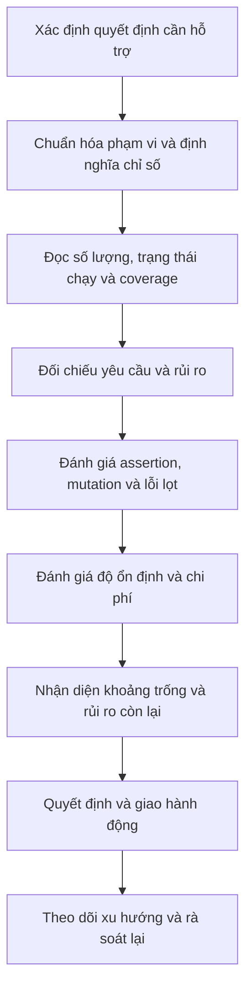

# Nhận diện giới hạn của số ca, tỷ lệ thành công và độ bao phủ mã

Khi đánh giá chất lượng kiểm thử, nhóm thường nhìn vào ba con số quen thuộc: số lượng ca kiểm thử, tỷ lệ ca chạy thành công và độ bao phủ mã nguồn. Các chỉ số này hữu ích để theo dõi quy mô, trạng thái thực thi và phần mã đã được chạy qua. Tuy nhiên, chúng không tự chứng minh rằng hệ thống đáp ứng đúng yêu cầu, các rủi ro quan trọng đã được kiểm tra hay lỗi nghiêm trọng sẽ được phát hiện trước khi phát hành.

Một bộ kiểm thử có hàng nghìn ca vẫn có thể bỏ sót một quy tắc nghiệp vụ quan trọng. Tỷ lệ pass 99% có thể che giấu một kiểm thử bảo mật trọng yếu đang thất bại hoặc nhiều ca bị bỏ qua. Độ bao phủ câu lệnh 100% vẫn có thể đạt được khi kiểm thử không xác nhận kết quả hoặc chỉ chạy một nhánh của điều kiện phức tạp. Vì vậy, cần hiểu mỗi chỉ số đo điều gì, không đo điều gì và nên kết hợp với bằng chứng nào.

Trong chiến lược kiểm thử, mục tiêu là tạo ra bằng chứng đáng tin cậy về các hành vi và rủi ro quan trọng. Số ca, tỷ lệ thành công và độ bao phủ mã chỉ là những tín hiệu hỗ trợ quyết định. Chúng cần được diễn giải trong bối cảnh yêu cầu, mức độ rủi ro, chất lượng assertion, tính ổn định của kiểm thử và kết quả vận hành.

## 1. Phân biệt ba chỉ số thường gặp

### Số lượng ca kiểm thử

Số lượng ca kiểm thử cho biết bộ kiểm thử có bao nhiêu trường hợp được định nghĩa hoặc thực thi. Nó có thể phản ánh phạm vi công việc đã tạo ra, nhưng không cho biết các trường hợp đó quan trọng đến đâu, có độc lập hay không, hoặc có kiểm tra được hành vi cần bảo vệ hay không.

Một nhóm có thể có nhiều ca kiểm thử vì tách một kịch bản thành nhiều trường hợp dữ liệu, kiểm tra nhiều biến thể hoặc tạo nhiều assertion. Một nhóm khác có thể dùng ít ca hơn nhưng bao phủ các rủi ro quan trọng bằng bảng quyết định, kiểm thử dựa trên thuộc tính hoặc kịch bản tích hợp có thiết kế tốt. Không thể kết luận bộ nào tốt hơn chỉ từ số lượng.

### Tỷ lệ thành công

Tỷ lệ thành công (pass rate) thường được tính bằng số ca đạt chia cho số ca đã thực thi và được tính vào mẫu số trong một lần chạy hoặc khoảng thời gian xác định. Nó phản ánh trạng thái của bộ kiểm thử tại thời điểm đo, nhưng không cho biết vì sao ca thất bại, các ca quan trọng có được chạy hay không hoặc assertion có đủ mạnh không.

Một tỷ lệ cao có thể là tín hiệu tốt nếu phạm vi kiểm thử đầy đủ, kết quả ổn định và mọi kiểm tra quan trọng đều thực thi. Nhưng tỷ lệ đó có thể gây hiểu nhầm nếu nhiều test bị bỏ qua, test chập chờn được chạy lại đến khi xanh, hoặc các assertion chỉ kiểm tra rằng chương trình không phát sinh ngoại lệ.

### Độ bao phủ mã nguồn

Độ bao phủ mã (code coverage) đo phần mã có thể thực thi đã được thực thi trong quá trình chạy kiểm thử, theo một tiêu chí nhất định. Các tiêu chí phổ biến gồm độ bao phủ câu lệnh, nhánh, điều kiện và đường đi. Chỉ số giúp tìm những phần mã chưa được chạy, nhưng không chứng minh phần mã đã chạy được kiểm tra đúng về mặt kết quả.

Ví dụ, một kiểm thử có thể gọi hàm tính chiết khấu và đi qua tất cả dòng lệnh nhưng không kiểm tra số tiền trả về. Coverage tăng, trong khi lỗi tính toán vẫn có thể tồn tại. Độ bao phủ mã cần được xem như bản đồ thực thi, không phải thước đo trực tiếp về tính đúng đắn.

| Chỉ số | Đo lường chính | Câu hỏi nó có thể hỗ trợ | Điều nó không tự chứng minh |
|---|---|---|---|
| Số ca kiểm thử | Quy mô bộ trường hợp | Nhóm đã xây dựng bao nhiêu trường hợp? | Các trường hợp có giá trị, độc lập và bao phủ rủi ro không? |
| Tỷ lệ pass | Kết quả thực thi | Bao nhiêu ca đạt trong phạm vi đo? | Hệ thống đúng, không có lỗi nghiêm trọng hoặc test đủ mạnh không? |
| Code coverage | Mã được thực thi | Phần nào của mã đã được chạy? | Kết quả đúng, yêu cầu được bao phủ hoặc lỗi có thể bị phát hiện không? |

## 2. Giới hạn của số lượng ca kiểm thử

### Nhiều ca không đồng nghĩa với nhiều bằng chứng

Số lượng có thể tăng mà giá trị phát hiện lỗi không tăng tương ứng. Ví dụ, một nhóm tạo 100 ca chỉ thay đổi tên khách hàng nhưng dùng cùng một đường xử lý và cùng một kiểu assertion. Nếu lỗi nằm ở quy tắc làm tròn giá hoặc phân quyền theo tổ chức, các ca đó có thể không phát hiện được vấn đề.

Một bộ kiểm thử có thể bị phình to do:

- Tạo nhiều trường hợp gần như trùng nhau mà không có khác biệt rủi ro rõ ràng.
- Chia quá nhỏ dữ liệu kiểm thử trong khi không thêm hành vi cần xác nhận.
- Giữ lại ca lỗi thời sau khi yêu cầu hoặc kiến trúc đã thay đổi.
- Tạo kiểm thử chỉ để tăng số lượng hoặc đạt mục tiêu báo cáo.
- Đếm từng tham số của một test parameterized như một ca riêng ở hệ thống này nhưng lại đếm cả bộ như một ca ở hệ thống khác.

Số lượng chỉ có ý nghĩa khi cách đếm được định nghĩa nhất quán và từng ca có mục tiêu kiểm tra rõ. Một test parameterized với 20 bộ dữ liệu có thể đại diện cho 20 lần thực thi, một định nghĩa test với 20 tham số hoặc một nhóm logic duy nhất. Báo cáo cần nêu đang đếm định nghĩa, trường hợp dữ liệu hay lần thực thi.

### Số lượng không phản ánh mức độ rủi ro

Một ca kiểm tra màu sắc của nhãn có thể được tính ngang với ca xác nhận người dùng không thể đọc dữ liệu của tenant khác. Nhưng hậu quả của hai lỗi khác nhau rất lớn. Nếu chỉ đặt mục tiêu tăng số lượng, nhóm dễ ưu tiên những trường hợp dễ tạo thay vì các kịch bản khó nhưng quan trọng.

Nên xem xét số lượng cùng với:

- Mức độ quan trọng của yêu cầu và mục tiêu chất lượng.
- Khả năng xảy ra và tác động của lỗi.
- Độ đa dạng của dữ liệu, trạng thái và môi trường.
- Tính độc lập và khả năng tái hiện của từng ca.
- Mức độ mạnh của assertion và khả năng phát hiện lỗi.
- Các rủi ro chưa có kiểm thử hoặc chưa có bằng chứng.

### Số lượng có thể che giấu khoảng trống

Một bộ kiểm thử lớn có thể tập trung quá nhiều vào luồng thành công và bỏ qua trường hợp lỗi, quyền truy cập, đồng thời, retry hoặc dữ liệu biên. Chỉ đếm số ca không cho thấy các nhóm tình huống nào đang thiếu.

Ví dụ, 80 ca E2E có thể đều tạo đơn hàng thành công. Nhưng hệ thống vẫn có thể xử lý sai khi thanh toán timeout sau khi đối tác đã thu tiền, khi webhook đến trễ hoặc khi hai yêu cầu cập nhật cùng một đơn hàng. Nhóm cần lập bản đồ ca kiểm thử theo rủi ro và loại hành vi thay vì chỉ xem tổng số.

### Số lượng tăng có thể làm chi phí tăng

Mỗi ca cần được đọc hiểu, cập nhật khi yêu cầu thay đổi, chuẩn bị dữ liệu và điều tra khi thất bại. Nhiều ca trùng lặp hoặc mong manh làm pipeline chậm và tăng chi phí duy trì. Bộ kiểm thử lớn nhưng khó bảo trì có thể khiến nhóm ngại sửa, bỏ qua cảnh báo hoặc giảm tần suất chạy.

Không nên xóa test chỉ để giảm số lượng. Trước khi hợp nhất hoặc loại bỏ, hãy xác định mục tiêu của test, mức độ trùng lặp, rủi ro nó bảo vệ và bằng chứng thay thế. Một test dài nhưng bảo vệ luồng trọng yếu có thể đáng giữ; nhiều test tương đương chỉ khác dữ liệu không mang thêm giá trị có thể được tổ chức lại.

## 3. Giới hạn của tỷ lệ thành công

### Mẫu số có thể làm thay đổi cách hiểu

Tỷ lệ pass cần định nghĩa rõ mẫu số. Nếu tính trên số ca đã thực thi, test bị skip hoặc không được lên lịch có thể không xuất hiện trong mẫu số. Nếu chỉ tính kết quả cuối sau retry, các lần thất bại đầu tiên có thể biến mất khỏi báo cáo.

Ví dụ, một bộ có 100 ca được lập kế hoạch: 90 ca pass, 5 fail và 5 bị skip. Nếu chỉ tính ca đã thực thi, pass rate là 90/95, khoảng 94,7%. Nếu tính trên toàn bộ kế hoạch và xem skip là chưa có bằng chứng, tỷ lệ hoàn thành đạt yêu cầu chỉ là 90/100, tức 90%. Cả hai phép tính có thể hữu ích nhưng trả lời hai câu hỏi khác nhau. Báo cáo phải nêu rõ cách tính và hiển thị số skip riêng.

Nên phân biệt ít nhất:

- **Pass:** ca đã chạy và đạt assertion.
- **Fail:** ca đã chạy và không đạt assertion.
- **Skipped:** ca bị bỏ qua theo điều kiện hoặc cấu hình.
- **Blocked / not run:** ca chưa chạy vì môi trường, phụ thuộc hoặc pipeline bị chặn.
- **Flaky / rerun:** ca có kết quả không nhất quán giữa các lần chạy.
- **Not applicable:** ca không áp dụng cho cấu hình hoặc phạm vi cụ thể, có lý do được ghi nhận.

Không nên gộp skipped, blocked và not applicable thành một trạng thái chung nếu chúng có ý nghĩa khác nhau. Test bị skip do cấu hình không hỗ trợ khác với test quan trọng không chạy được vì môi trường hỏng.

### Tỷ lệ pass cao có thể che giấu lỗi nghiêm trọng

Giả sử một bộ có 999 ca pass và một ca bảo mật thất bại. Pass rate là 99,9%, nhưng nếu ca đó kiểm tra khả năng truy cập dữ liệu trái phép thì quyết định phát hành không thể dựa trên tỷ lệ tổng hợp. Một số kiểm tra có tính chất bắt buộc hoặc bảo vệ rủi ro nghiêm trọng cần được xem như điều kiện riêng.

Nên báo cáo trạng thái theo nhóm quan trọng: bảo mật, toàn vẹn dữ liệu, thanh toán, quyền truy cập, khả năng phục hồi và luồng nghiệp vụ cốt lõi. Một tỷ lệ tổng thể có thể che khuất việc một nhóm kiểm thử quan trọng đang thất bại hoàn toàn.

### Retry có thể làm đẹp số liệu

Nếu pipeline tự động chạy lại test thất bại cho đến khi pass và chỉ hiển thị kết quả cuối, tỷ lệ pass sẽ không phản ánh độ ổn định của lần chạy đầu. Một test có xác suất thất bại ngẫu nhiên vẫn tạo ra chi phí, thời gian chờ và sự thiếu tin cậy dù cuối cùng có thể xanh.

Hãy lưu và báo cáo riêng:

- Tỷ lệ pass ở lần chạy đầu (first-run pass rate).
- Tỷ lệ test cần chạy lại (rerun rate).
- Tỷ lệ test được xác nhận là flaky.
- Kết quả cuối cùng sau retry.
- Số lần retry và tổng thời gian bị tiêu tốn.

Retry có thể dùng để thu thập thêm bằng chứng, nhưng không nên biến một lần chạy lại thành cơ chế xóa lịch sử thất bại. Với test có rủi ro cao, thất bại lần đầu vẫn cần được điều tra theo chính sách.

### Pass không đảm bảo assertion đủ mạnh

Một ca có thể pass vì kiểm tra quá ít. Ví dụ, test gọi API tạo thanh toán và chỉ xác nhận HTTP status là 200. API có thể trả trạng thái `FAILED` trong body, số tiền sai hoặc giao dịch bị tạo trùng mà test vẫn pass.

Assertion cần kiểm tra những kết quả có ý nghĩa với hợp đồng và nghiệp vụ, chẳng hạn:

- Mã trạng thái và cấu trúc phản hồi.
- Giá trị, đơn vị và trạng thái nghiệp vụ.
- Tác dụng phụ trong cơ sở dữ liệu hoặc sự kiện phát ra.
- Quyền truy cập và dữ liệu không được tiết lộ.
- Tính lặp an toàn và bất biến khi có retry.
- Thông báo, khả năng phục hồi và trạng thái sau lỗi.

Tỷ lệ pass chỉ đáng tin khi nhóm hiểu test đã xác nhận điều gì và assertion có khả năng phân biệt hành vi đúng với hành vi sai.

### Pass rate có thể biến động do phạm vi và môi trường

So sánh hai bản build chỉ hợp lý khi phạm vi test, dữ liệu, môi trường và quy tắc tính tương đương. Nếu một bản build chạy 500 test còn bản khác chạy 700 test, tỷ lệ pass có thể tăng chỉ vì nhóm test khó đã bị loại khỏi lần chạy. Nếu môi trường thay đổi, chênh lệch cũng có thể do runner, sandbox hoặc cấu hình chứ không phải sản phẩm.

Khi báo cáo theo thời gian, hãy ghi nhận commit, phiên bản test suite, môi trường, nhóm test và các thay đổi trong phạm vi. Phân biệt xu hướng chất lượng sản phẩm với thay đổi cách đo.

## 4. Giới hạn của độ bao phủ mã nguồn

### Statement coverage không đo chất lượng assertion

Statement coverage cho biết tỷ lệ câu lệnh có thể thực thi đã được chạy. Nó không cho biết đầu ra có được xác nhận hay không. Một test có thể gọi hàm, thực thi tất cả câu lệnh rồi kết thúc mà không kiểm tra kết quả.

Ví dụ:

```java
int calculateDiscount(int total, boolean premium) {
    int discount = 0;
    if (premium) {
        discount = total / 10;
    }
    return discount;
}
```

Một test gọi `calculateDiscount(1000, true)` nhưng không kiểm tra giá trị trả về có thể thực thi các câu lệnh và tăng coverage. Nếu hàm trả về 1000 thay vì 100, test vẫn pass nếu không có assertion. Vì vậy, cần xem test đang xác nhận điều gì, không chỉ xem dòng nào đã chạy.

### Branch coverage không đảm bảo mọi tổ hợp điều kiện

Branch coverage kiểm tra các nhánh điều khiển được thực thi, thường là kết quả đúng và sai của quyết định. Với điều kiện phức hợp, đạt branch coverage chưa chắc mọi điều kiện con đã được kiểm tra độc lập hoặc mọi tổ hợp có ý nghĩa đã được bao phủ.

```java
if (customer.isActive() && orderTotal >= minimumTotal) {
    approveDiscount();
}
```

Một bộ test có thể thực thi nhánh `true` khi cả hai điều kiện đều đúng và nhánh `false` khi khách hàng không hoạt động. Nhưng nó chưa kiểm tra trường hợp khách hàng hoạt động mà tổng tiền dưới ngưỡng. Nếu logic xử lý điều kiện con có lỗi, branch coverage có thể không chỉ ra khoảng trống này.

Với logic quan trọng, cần xem xét condition coverage, condition/decision coverage hoặc tiêu chí mạnh hơn như MC/DC tùy yêu cầu. Lựa chọn tiêu chí phải dựa trên rủi ro và chuẩn áp dụng, không phải chạy theo phần trăm cao hơn.

### Coverage không đo yêu cầu hoặc rủi ro đã được kiểm tra

Mã có thể được thực thi nhưng hành vi nghiệp vụ quan trọng vẫn chưa được xác nhận. Một nhánh xử lý thanh toán có thể chạy, nhưng test không kiểm tra số tiền, tiền tệ, trạng thái đối soát hoặc quyền truy cập. Ngược lại, một yêu cầu có thể được kiểm tra qua API hoặc E2E mà không làm tăng coverage ở một số đoạn mã do test đi qua đường xử lý khác.

Do đó, code coverage và requirement/risk coverage là hai góc nhìn khác nhau. Code coverage hỏi “mã nào đã chạy?”; requirement/risk coverage hỏi “hành vi hoặc rủi ro nào đã có bằng chứng kiểm tra?”. Cần liên kết chúng nhưng không thay thế chúng cho nhau.

### Coverage phụ thuộc cách công cụ đo

Các công cụ có thể xử lý khác nhau đối với mã sinh tự động, mã thư viện, mã không thể thực thi, nhánh ngoại lệ, lambda, macro hoặc mã được biên dịch. Cấu hình loại trừ cũng ảnh hưởng mẫu số. Vì vậy, báo cáo phải nêu phạm vi được đo, loại mã bị loại trừ, công cụ và tiêu chí coverage.

Một tỷ lệ 90% trên mã sản phẩm có thể có ý nghĩa khác với 90% trên toàn bộ repository gồm mã sinh tự động, migration và test helper. Không so sánh tỷ lệ nếu cách xác định phạm vi hoặc công cụ khác nhau mà không chuẩn hóa.

### Coverage cao vẫn có thể bỏ sót lỗi

Ngay cả khi statement và branch coverage cao, bộ test vẫn có thể thiếu:

- Giá trị biên và dữ liệu bất thường.
- Tổ hợp điều kiện và thứ tự sự kiện.
- Tình huống đồng thời, retry, timeout và lỗi phụ thuộc.
- Quy tắc phân quyền, cách ly dữ liệu và bảo mật.
- Bất biến dữ liệu, giao dịch và tác dụng phụ.
- Khác biệt môi trường, cấu hình và tích hợp thật.
- Kiểm tra đầu ra hoặc trạng thái sau khi thực thi.

Coverage cao cũng không chứng minh rằng mọi lỗi có thể có đều được phát hiện. Nó chỉ nói về phạm vi thực thi theo tiêu chí được chọn.

## 5. Các loại coverage và điều chúng thực sự đo

Hiểu rõ tiêu chí giúp nhóm chọn thước đo phù hợp thay vì chỉ nhìn một phần trăm tổng hợp.

| Loại coverage | Nội dung đo | Giới hạn cần nhớ |
|---|---|---|
| Statement coverage | Câu lệnh có thể thực thi đã chạy | Không chứng minh kết quả hoặc mọi nhánh đúng/sai đã được kiểm tra |
| Branch coverage | Các nhánh điều khiển đã được thực thi | Không nhất thiết bao phủ mọi điều kiện con độc lập |
| Condition coverage | Mỗi điều kiện con đã nhận giá trị true và false | Không luôn bảo đảm quyết định tổng thể có cả hai kết quả |
| Condition/decision coverage | Điều kiện con và quyết định tổng thể được kiểm tra theo tiêu chí | Có thể chưa đủ cho yêu cầu an toàn hoặc logic phức tạp đặc biệt |
| MC/DC | Mỗi điều kiện con được chứng minh có thể độc lập làm thay đổi kết quả quyết định | Cần thiết kế test và phân tích kỹ; áp dụng khi yêu cầu phù hợp |
| Path coverage | Các đường thực thi được chọn đã chạy | Số đường có thể tăng rất nhanh hoặc vô hạn do vòng lặp |
| Function/method coverage | Hàm hoặc phương thức được gọi | Không cho biết phần thân và các nhánh đã được kiểm tra thế nào |
| Requirement coverage | Yêu cầu có liên kết đến trường hợp kiểm thử và kết quả | Chất lượng phụ thuộc cách viết yêu cầu và tiêu chí hoàn thành |
| Risk coverage | Rủi ro có biện pháp kiểm soát và bằng chứng kiểm thử | Cần đánh giá rủi ro và mức độ bằng chứng, không chỉ đếm liên kết |

### Ví dụ về khác biệt giữa statement và branch coverage

```java
String accessLevel(boolean authenticated, boolean isAdmin) {
    if (authenticated && isAdmin) {
        return "ADMIN";
    }
    return "USER";
}
```

Nếu chỉ chạy trường hợp `authenticated = true` và `isAdmin = true`, các câu lệnh trong nhánh admin được thực thi, nhưng nhánh còn lại chưa được chạy. Thêm trường hợp `authenticated = false` có thể đạt branch coverage cho quyết định tổng thể, nhưng vẫn chưa kiểm tra trường hợp người dùng đã xác thực mà không phải admin. Tùy tiêu chí, cần thêm trường hợp để xác nhận mỗi điều kiện con và hành vi phân quyền.

### Không cộng các loại coverage thành một điểm duy nhất

Không nên cộng statement, branch, condition và requirement coverage thành một phần trăm chung nếu không có định nghĩa và trọng số có căn cứ. Chúng đo các đối tượng khác nhau. Một con số tổng hợp có thể che giấu việc code coverage cao nhưng requirement coverage thấp, hoặc ngược lại.

Hãy báo cáo từng loại cùng phạm vi, xu hướng và mục đích sử dụng. Nếu cần một chỉ số tổng hợp cho quản trị, phải công khai cách tính, trọng số và giới hạn diễn giải; không dùng nó thay cho việc xem từng rủi ro quan trọng.

## 6. Kết hợp chỉ số để có bức tranh chất lượng kiểm thử

Không có một chỉ số nào đủ để đánh giá chất lượng kiểm thử. Một bức tranh cân bằng cần xem cả đầu vào, thực thi, khả năng phát hiện và kết quả sau phát hành.

### Bản đồ yêu cầu và rủi ro

Mỗi yêu cầu hoặc rủi ro quan trọng nên liên kết với:

- Mục tiêu và tiêu chí chấp nhận.
- Một hoặc nhiều trường hợp kiểm thử.
- Tầng kiểm thử và môi trường thực thi.
- Kết quả chạy gắn với phiên bản cụ thể.
- Bằng chứng như log, trace, dữ liệu hoặc báo cáo.
- Rủi ro còn lại và người chấp nhận nếu chưa thể kiểm tra đầy đủ.

Liên kết này cho biết phạm vi nào đã có bằng chứng. Tuy nhiên, việc có một test liên kết chưa có nghĩa rủi ro đã được kiểm soát; cần xem test có assertion phù hợp, chạy ổn định và thực sự đại diện cho tình huống không.

### Mutation testing

Mutation testing đánh giá khả năng phát hiện lỗi của bộ kiểm thử bằng cách tạo những thay đổi nhỏ có chủ đích trong mã, gọi là mutant. Ví dụ, đổi `>=` thành `>`, thay `&&` bằng `||`, đổi một hằng số hoặc bỏ một điều kiện. Nếu kiểm thử phát hiện thay đổi và thất bại, mutant được xem là bị tiêu diệt (killed). Nếu bộ test vẫn đạt, mutant còn sống (survived), có thể cho thấy assertion chưa đủ mạnh hoặc thay đổi đó không ảnh hưởng đến hành vi được kiểm tra.

Mutation score thường được tính trên các mutant có thể đánh giá, sau khi xử lý mutant tương đương hoặc không thể thực thi theo quy ước của công cụ. Cần đọc định nghĩa mẫu số vì các công cụ có thể xử lý mutant bị timeout, lỗi biên dịch hoặc tương đương khác nhau.

Mutation testing bổ sung cho coverage: coverage cho biết mã đã chạy, mutation testing cung cấp tín hiệu về khả năng test phát hiện một số thay đổi sai. Tuy nhiên, mutation score cao cũng không chứng minh toàn bộ rủi ro nghiệp vụ được bao phủ; mutant được tạo ra chỉ đại diện cho một tập thay đổi nhất định.

### Defect leakage và lỗi tái diễn

Defect leakage hoặc escaped defects theo dõi lỗi được phát hiện sau khi sản phẩm đi qua một mốc kiểm thử hoặc phát hành. Lỗi lọt giúp nhóm xem xét những rủi ro mà bộ kiểm thử trước đó không phát hiện. Cần phân loại theo mức độ nghiêm trọng, loại lỗi, thành phần và nguyên nhân, không chỉ đếm tổng.

Lỗi tái diễn (recurrence) cho biết một vấn đề cùng loại hoặc cùng nguyên nhân quay trở lại. Nếu lỗi cũ tái diễn dù có test hồi quy, hãy xem lại dữ liệu, điều kiện kích hoạt, tầng kiểm thử và assertion. Có thể test chỉ kiểm tra ví dụ đã xảy ra mà chưa kiểm tra lớp điều kiện liên quan.

### Độ ổn định và khả năng chẩn đoán

Tỷ lệ flaky, tỷ lệ chạy lại, thời gian phản hồi, tỷ lệ lỗi được phân loại rõ và khả năng tái hiện là những tín hiệu quan trọng. Một bộ test có coverage tốt nhưng thường xuyên chập chờn không tạo ra bằng chứng đáng tin cậy. Khi kết quả khó chẩn đoán, nhóm có thể tốn nhiều thời gian hơn để xác định lỗi môi trường hay lỗi sản phẩm.

### Chỉ số theo rủi ro

Đối với rủi ro cao, nên theo dõi riêng:

- Rủi ro đã có test và bằng chứng đạt ở phiên bản hiện tại.
- Rủi ro chỉ có test nhưng chưa chạy hoặc test không ổn định.
- Rủi ro có kiểm soát thủ công hoặc giám sát thay cho kiểm thử tự động.
- Rủi ro chưa có kiểm soát hoặc còn giả định chưa được xác minh.
- Người có thẩm quyền chấp nhận rủi ro còn lại và thời điểm xem xét lại.

Một dashboard có thể hiển thị các nhóm này rõ hơn một tỷ lệ coverage tổng thể.

## 7. Xây dựng ma trận bao phủ có ý nghĩa

Ma trận bao phủ liên kết yêu cầu hoặc rủi ro với trường hợp kiểm thử, tầng, trạng thái và bằng chứng. Nó giúp nhìn ra khoảng trống và tránh coi số lượng test hoặc coverage mã là mục tiêu cuối cùng.

Ví dụ cho luồng đặt hàng:

| Yêu cầu / rủi ro | Test liên quan | Tầng | Trạng thái bằng chứng | Khoảng trống cần xem xét |
|---|---|---|---|---|
| Tính đúng tổng tiền | Giá trị biên, tổ hợp thuế và giảm giá | Unit / integration | Đạt | Cần kiểm tra làm tròn theo từng loại tiền tệ |
| Không xử lý thanh toán trùng | Retry cùng idempotency key, webhook trùng | Integration / E2E | Đạt một phần | Chưa kiểm tra hai worker đồng thời |
| Cách ly dữ liệu tenant | API đọc/ghi với vai trò và tenant khác nhau | API / security | Chưa chạy | Thiếu test cho endpoint xuất dữ liệu |
| Trạng thái đơn không quay lùi | Sự kiện đến sai thứ tự | Integration | Flaky | Dữ liệu dùng chung làm kết quả không ổn định |
| Người dùng nhận biết trạng thái | Luồng xem và xác nhận đơn hàng | E2E / usability | Đạt | Cần đánh giá với người dùng mới |

Ma trận không chỉ có trạng thái pass/fail. Có thể phân biệt chưa thiết kế, đã thiết kế nhưng chưa chạy, đạt, thất bại, bị chặn, flaky và được chấp nhận có điều kiện. Điều này tránh biến một ô có liên kết test thành dấu kiểm giả tạo.

### Đánh giá mức độ bao phủ theo rủi ro

Có thể dùng một thang định tính:

- **Được kiểm chứng:** có test phù hợp, chạy trên phiên bản hiện tại, kết quả đạt và bằng chứng đủ tin cậy.
- **Có kiểm tra nhưng chưa đủ:** có test nhưng thiếu tình huống, assertion hoặc môi trường cần thiết.
- **Chưa có bằng chứng:** chưa có test hoặc kiểm soát có thể xác minh.
- **Được chấp nhận có điều kiện:** rủi ro còn lại được người có thẩm quyền chấp nhận, có biện pháp theo dõi và thời hạn xem xét.

Không nên gán trọng số số học tùy ý để tạo một tỷ lệ “risk coverage” đẹp. Nếu tổ chức dùng điểm số, cần định nghĩa tiêu chí, trọng số và cách xử lý rủi ro bắt buộc. Với quyết định phát hành, các rủi ro nghiêm trọng thường cần được xem xét riêng thay vì bị trung bình hóa với nhiều rủi ro thấp.

## 8. Diễn giải dashboard và báo cáo kiểm thử

Dashboard tốt giúp người đọc trả lời được câu hỏi đang cần quyết định. Nó không chỉ hiển thị phần trăm lớn mà cần cho thấy phạm vi, xu hướng, trạng thái và các ngoại lệ.

### Những thông tin nên có

- Commit, phiên bản sản phẩm, phiên bản test suite và môi trường.
- Số ca được lập kế hoạch, thực thi, pass, fail, skip, blocked và not applicable.
- First-run pass rate, kết quả cuối sau retry và rerun rate.
- Coverage theo tiêu chí, phạm vi mã và phần loại trừ.
- Coverage yêu cầu/rủi ro và các rủi ro nghiêm trọng chưa có bằng chứng.
- Test flaky, thời gian phản hồi và thời gian điều tra.
- Lỗi mới, lỗi tái diễn, defect leakage và trạng thái khắc phục.
- Thay đổi trong phạm vi đo hoặc cấu hình công cụ so với lần trước.

### Xem xu hướng thay vì một lần chụp

Một lần chạy có thể bị ảnh hưởng bởi sự cố môi trường hoặc thay đổi phạm vi. Xu hướng qua nhiều phiên bản thường giúp nhận ra vấn đề bền vững hơn. Tuy nhiên, khi thay đổi công cụ, tiêu chí coverage, cấu hình loại trừ hoặc bộ test, cần đánh dấu mốc để người đọc không so sánh sai.

Nên xem phân vị thời gian chạy và tỷ lệ thất bại theo nhóm, không chỉ tổng hợp. Ví dụ, pass rate tổng thể ổn định nhưng nhóm kiểm thử thanh toán có thể giảm từ 100% xuống 70%. Phân tích theo rủi ro giúp phát hiện thay đổi quan trọng bị số trung bình che khuất.

### Ví dụ cách đọc một báo cáo

Giả sử dashboard hiển thị:

| Chỉ số | Giá trị | Diễn giải ban đầu |
|---|---:|---|
| Test definitions | 600 | Quy mô định nghĩa test suite |
| Executions | 720 | Có test parameterized hoặc chạy lại |
| First-run pass rate | 96% | Kết quả lần đầu chưa đạt toàn bộ |
| Final pass rate | 99,5% | Sau retry, nhiều ca đạt lại |
| Skipped / blocked | 24 | Cần xác định lý do và rủi ro chưa có bằng chứng |
| Statement coverage | 88% | Một phần mã chưa được thực thi |
| Branch coverage | 73% | Còn nhiều nhánh chưa được chạy |
| High-risk scenarios without evidence | 3 | Có khoảng trống cần xem xét trước quyết định phát hành |

Không thể kết luận chất lượng tốt chỉ vì final pass rate là 99,5%. Cần tìm 4% lần chạy đầu thất bại vì nguyên nhân gì, 24 ca bị bỏ qua thuộc phạm vi nào, 3 rủi ro cao chưa có bằng chứng là gì và các nhánh chưa chạy có liên quan đến chức năng quan trọng hay không. Cũng cần xem assertion, dữ liệu và tính ổn định của những test đã pass.

## 9. Tránh tối ưu sai mục tiêu và hiện tượng Goodhart

Khi một chỉ số trở thành mục tiêu duy nhất, nhóm có thể tối ưu con số thay vì cải thiện điều mà chỉ số được dùng để đại diện. Hiện tượng này thường được gọi là định luật Goodhart: khi một thước đo trở thành mục tiêu, nó có thể mất giá trị như một thước đo.

Một số hành vi tối ưu sai thường gặp:

- Tăng số ca bằng cách tạo nhiều trường hợp trùng lặp hoặc ít giá trị.
- Tăng pass rate bằng cách bỏ qua test thất bại, giảm assertion hoặc retry đến khi xanh.
- Tăng code coverage bằng cách gọi các hàm mà không kiểm tra kết quả.
- Giảm thời gian pipeline bằng cách loại bỏ kiểm thử chậm nhưng bảo vệ rủi ro cao.
- Giảm defect leakage bằng cách thay đổi cách phân loại hoặc không ghi nhận lỗi lọt.
- Đạt ngưỡng coverage bằng cách loại trừ phần mã khó kiểm tra mà không có lý do kỹ thuật.

Để giảm nguy cơ này:

1. Dùng nhiều chỉ số bổ sung và kiểm tra mâu thuẫn giữa chúng.
2. Gắn chỉ số với mục tiêu và quyết định cụ thể.
3. Công khai định nghĩa, mẫu số, phạm vi và cách loại trừ.
4. Đánh giá chất lượng bằng chứng và rủi ro còn lại, không chỉ điểm số.
5. Khuyến khích báo cáo lỗi và cảnh báo trung thực, không phạt nhóm vì phát hiện vấn đề.
6. Rà soát định kỳ xem chỉ số còn phản ánh điều cần đo không.

## 10. Ví dụ tổng hợp: cùng một hệ thống, ba chỉ số kể ba câu chuyện khác nhau

Giả sử nhóm phát triển hệ thống quản lý đơn hàng. Bộ test có 1.200 ca, pass rate 99% và statement coverage 95%. Các con số ban đầu có vẻ tích cực, nhưng phân tích sâu cho thấy:

- 300 ca kiểm tra các biến thể hiển thị gần giống nhau; chỉ một số ít kiểm tra quy tắc tính phí.
- 12 test thất bại lần đầu nhưng pass sau retry; phần lớn liên quan đến webhook và dữ liệu dùng chung.
- 40 ca bị skip trên môi trường CI do thiếu cấu hình sandbox.
- Coverage thấp tập trung ở nhánh xử lý lỗi thanh toán và hoàn tiền.
- Một test đạt 100% statement coverage cho hàm tính thuế nhưng không assertion kết quả thuế.
- Rủi ro truy cập dữ liệu chéo tenant chưa có test API cho endpoint xuất báo cáo.

Nhóm điều chỉnh cách đánh giá:

1. Lập ma trận yêu cầu và rủi ro để xác định hành vi còn thiếu bằng chứng.
2. Rà soát 300 ca gần trùng, hợp nhất các trường hợp tương đương và giữ dữ liệu biên có giá trị.
3. Điều tra test webhook chập chờn, cô lập dữ liệu và ghi nhận kết quả lần đầu.
4. Bổ sung assertion cho kết quả tính thuế, không chỉ thực thi hàm.
5. Bổ sung kiểm thử nhánh lỗi thanh toán, hoàn tiền và quyền truy cập tenant.
6. Khôi phục cấu hình sandbox hoặc thay thế bằng contract/integration test phù hợp; báo cáo rõ những ca chưa chạy.
7. Dùng mutation testing có chọn lọc cho logic tính tiền và phân quyền để đánh giá sức mạnh assertion.

Sau thay đổi, số lượng test có thể giảm, coverage câu lệnh có thể không tăng nhiều và pass rate lần đầu có thể tạm thời giảm do nhóm không còn che thất bại bằng retry. Tuy vậy, bằng chứng về rủi ro quan trọng có thể tốt hơn, test dễ chẩn đoán hơn và quyết định phát hành có căn cứ hơn. Đó mới là cải thiện có ý nghĩa.

## 11. Quy trình đánh giá chất lượng bộ kiểm thử

Có thể áp dụng quy trình sau trong một đợt rà soát chất lượng:

1. **Xác định mục tiêu:** cần quyết định điều gì, chẳng hạn chấp thuận pull request, phát hành hay đánh giá sức khỏe bộ test.
2. **Chuẩn hóa phạm vi đo:** phiên bản sản phẩm, test suite, môi trường, loại test, mã nguồn được tính và quy tắc loại trừ.
3. **Kiểm tra số lượng:** phân biệt định nghĩa test, bộ dữ liệu, lần thực thi và test trùng lặp.
4. **Phân tích kết quả:** xem pass, fail, skip, blocked, retry và flaky riêng biệt.
5. **Đọc coverage theo tiêu chí:** statement, branch, condition hoặc tiêu chí phù hợp; xem phần chưa chạy và chất lượng assertion.
6. **Đối chiếu yêu cầu và rủi ro:** xác định các hành vi quan trọng có bằng chứng đạt hay chưa.
7. **Xem khả năng phát hiện:** sử dụng lỗi lọt, lỗi tái diễn, mutation testing và đánh giá chất lượng test khi phù hợp.
8. **Đánh giá chi phí và độ ổn định:** thời gian chạy, chạy lại, khả năng chẩn đoán và công sức duy trì.
9. **Đưa ra quyết định:** ghi nhận điểm đạt, khoảng trống, rủi ro còn lại, người phụ trách và thời hạn.
10. **Theo dõi thay đổi:** so sánh xu hướng với cùng định nghĩa và đánh dấu các thay đổi về phạm vi đo.



## 12. Những câu hỏi cần đặt trước khi dùng chỉ số để ra quyết định

**Về số lượng ca**

- Đang đếm test definition, dữ liệu parameterized hay lần thực thi?
- Các ca có mục tiêu khác nhau hay chỉ lặp lại cùng một hành vi?
- Những rủi ro nghiêm trọng nào chưa có ca kiểm thử?
- Bộ test có chi phí duy trì tương xứng với giá trị phát hiện không?

**Về tỷ lệ pass**

- Mẫu số có bao gồm toàn bộ ca được lên kế hoạch không?
- Skipped, blocked, not applicable và flaky được báo cáo riêng chưa?
- Đây là tỷ lệ lần chạy đầu hay kết quả cuối sau retry?
- Các test quan trọng có đạt và có assertion đủ mạnh không?
- Phạm vi, dữ liệu và môi trường có tương đương với lần đo trước không?

**Về code coverage**

- Đang đo statement, branch, condition hay tiêu chí nào?
- Mã sinh tự động, mã bên thứ ba và phần loại trừ có được công khai không?
- Những nhánh chưa chạy có liên quan đến rủi ro cao không?
- Test có xác nhận kết quả, tác dụng phụ và trạng thái sau khi chạy không?
- Có dùng mutation testing hoặc đánh giá khác để kiểm tra sức mạnh assertion không?

**Về quyết định tổng thể**

- Các yêu cầu và rủi ro quan trọng có bằng chứng đạt ở đúng phiên bản không?
- Lỗi nghiêm trọng hoặc kiểm thử bắt buộc nào đang thất bại hoặc chưa chạy?
- Kết quả có ổn định và có thể chẩn đoán không?
- Rủi ro còn lại đã có người có thẩm quyền chấp nhận chưa?
- Chỉ số đang hỗ trợ quyết định hay đang khiến nhóm tối ưu con số?

## 13. Danh sách kiểm tra khi xây dựng báo cáo

Một báo cáo chất lượng kiểm thử có thể dùng danh sách sau:

**Phạm vi và định nghĩa**

- Ghi rõ commit, phiên bản sản phẩm, test suite và môi trường.
- Nêu cách đếm test definition, lần thực thi và test parameterized.
- Công khai mẫu số của pass rate và các trạng thái được tính.
- Ghi tiêu chí coverage, phạm vi mã và các phần loại trừ.

**Chất lượng thực thi**

- Báo cáo pass, fail, skip, blocked và not applicable riêng.
- Hiển thị first-run pass rate, retry rate và kết quả cuối.
- Phân loại flaky test và ghi nhận nguyên nhân đã xác nhận.
- Kiểm tra assertion và các kết quả nghiệp vụ quan trọng.

**Mức độ bao phủ**

- Liên kết yêu cầu và rủi ro với test và bằng chứng.
- Xem branch/condition chưa chạy ở các khu vực quan trọng.
- Kiểm tra dữ liệu biên, luồng lỗi, đồng thời và tích hợp.
- Dùng mutation testing hoặc kỹ thuật bổ sung khi có giá trị.

**Diễn giải và hành động**

- Không dùng một phần trăm đơn lẻ làm kết luận chất lượng.
- Nêu các rủi ro nghiêm trọng chưa có bằng chứng hoặc đang thất bại.
- Ghi rõ thay đổi phạm vi đo so với kỳ trước.
- Giao người phụ trách, hành động và thời hạn cho khoảng trống.

## Kết luận

Số lượng ca kiểm thử phản ánh quy mô, tỷ lệ pass phản ánh kết quả thực thi trong một phạm vi xác định, còn code coverage phản ánh phần mã đã được chạy theo một tiêu chí. Mỗi chỉ số hữu ích nhưng đều có giới hạn: số lượng không đo giá trị, pass rate có thể che giấu test bị bỏ qua hoặc assertion yếu, và coverage không chứng minh hành vi đúng hay rủi ro đã được kiểm tra. Đánh giá chất lượng cần kết hợp chúng với ma trận yêu cầu/rủi ro, chất lượng assertion, mutation testing, lỗi lọt, độ ổn định và bằng chứng vận hành. Quyết định tốt dựa trên những rủi ro quan trọng đã được kiểm chứng và rủi ro còn lại được hiểu rõ, không dựa vào một con số đẹp.
