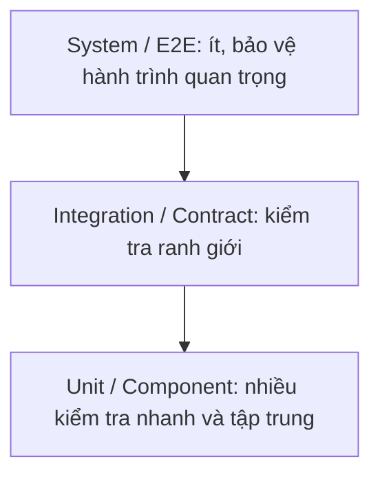
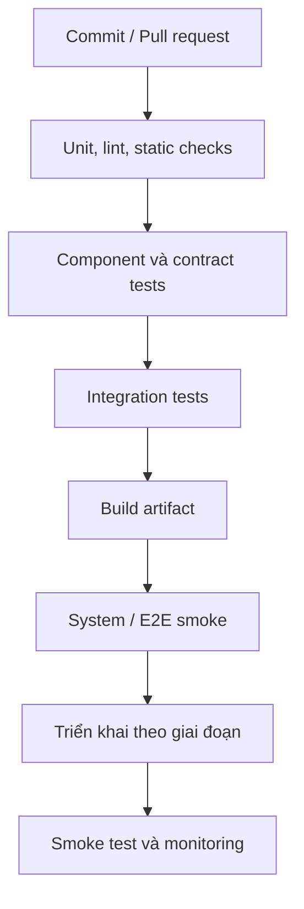

# Xác định mục tiêu tự động hóa và vấn đề cần cải thiện

## Mục tiêu học tập

Sau bài học này, người học có thể:

- Giải thích tự động hóa kiểm thử giải quyết vấn đề gì trong chiến lược kiểm thử.
- Phân biệt mục tiêu tự động hóa với việc đơn thuần chuyển các bước thủ công thành script.
- Xác định vấn đề hiện tại, nguyên nhân, đối tượng hưởng lợi và kết quả mong đợi trước khi chọn công cụ.
- Đánh giá ứng viên tự động hóa theo giá trị, tần suất, độ ổn định, khả năng kiểm tra và chi phí vòng đời.
- Chọn phạm vi phù hợp cho tự động hóa ở các cấp unit, component, contract, integration, system và end-to-end.
- Đặt chỉ số thành công có thể đo, thiết lập đường cơ sở và theo dõi hiệu quả sau triển khai.
- Lập kế hoạch thử nghiệm nhỏ, xác nhận giả định và mở rộng tự động hóa có kiểm soát.

## 1. Tự động hóa kiểm thử bắt đầu từ vấn đề cần giải quyết

Trong phạm vi **VALIDATION_TESTING_STRATEGY**, tự động hóa kiểm thử là việc sử dụng phần mềm, công cụ và quy trình có thể lặp lại để chuẩn bị điều kiện, thực thi kiểm tra, so sánh kết quả và lưu bằng chứng với mức can thiệp thủ công phù hợp. Mục tiêu là cải thiện khả năng phản hồi, tính nhất quán và độ bao phủ của hoạt động kiểm thử, từ đó hỗ trợ quyết định phát triển và phát hành.

Tự động hóa không phải mục tiêu độc lập. Một nhóm có thể sở hữu hàng nghìn script nhưng vẫn chậm phát hiện lỗi, phải sửa test liên tục hoặc không biết test nào bảo vệ yêu cầu nào. Ngược lại, một số kiểm tra tự động nhỏ, ổn định và chạy đúng thời điểm có thể loại bỏ công việc lặp lại, phát hiện lỗi sớm và giúp nhóm phát hành tự tin hơn.

Vì vậy, trước khi chọn framework hoặc viết script, cần xác định vấn đề hiện tại. Ví dụ:

- Mỗi lần phát hành, nhóm phải kiểm tra thủ công cùng một nhóm chức năng và thường bỏ sót do thiếu thời gian.
- Một thay đổi nhỏ cần nhiều giờ để chạy lại các kiểm tra hồi quy.
- Lỗi hợp đồng API chỉ được phát hiện khi các dịch vụ đã tích hợp.
- Việc chuẩn bị dữ liệu và môi trường kiểm thử lặp lại, dễ sai và phụ thuộc vào một cá nhân.
- Kết quả kiểm thử không nhất quán giữa máy phát triển và CI.
- Nhóm không có bằng chứng nhanh về các hành trình nghiệp vụ quan trọng sau mỗi build.
- Báo cáo được tổng hợp thủ công, khó truy nguyên kết quả đến phiên bản và cấu hình đã kiểm tra.

Mỗi vấn đề cần được diễn đạt cụ thể. “Cần tự động hóa nhiều hơn” chưa chỉ ra được nguyên nhân, giá trị hoặc cách đánh giá thành công. “Mỗi pull request cần 45 phút kiểm tra thủ công các quy tắc tính phí, trong đó 30 phút là thao tác lặp lại và kết quả phụ thuộc người thực hiện” là một mô tả có thể dùng để xác định mục tiêu.

## 2. Phân biệt mục tiêu, giải pháp và hoạt động

Khi thảo luận về tự động hóa, nhóm thường nhảy ngay đến công cụ hoặc loại test. Hãy tách ba khái niệm:

- **Vấn đề** là điều đang gây lãng phí, rủi ro hoặc chậm trễ. Ví dụ: lỗi phân quyền chỉ được phát hiện ở giai đoạn kiểm thử cuối.
- **Mục tiêu** là kết quả cần cải thiện. Ví dụ: phát hiện sớm các trường hợp truy cập trái quyền trong mỗi pull request.
- **Giải pháp/hoạt động** là cách đạt mục tiêu. Ví dụ: thêm bộ kiểm thử API tự động với nhiều vai trò và tenant, chạy trong CI.

Một giải pháp chỉ có giá trị nếu giải quyết được vấn đề đã nêu. Nếu nhóm chọn công cụ UI vì đang có sẵn license nhưng vấn đề thực tế là API contract thay đổi thường xuyên, giải pháp có thể không tác động đúng điểm yếu.

### 2.1. Viết mục tiêu theo kết quả

Một mục tiêu tự động hóa tốt nên mô tả:

1. **Đối tượng cần cải thiện**: quy trình, hành trình, loại lỗi hoặc hoạt động kiểm thử nào?
2. **Kết quả hiện tại**: thời gian, tỷ lệ lỗi, mức độ lặp lại hoặc chi phí đang ở mức nào?
3. **Kết quả mong đợi**: điều gì sẽ tốt hơn và trong phạm vi nào?
4. **Thời điểm phản hồi**: cần có kết quả sau commit, pull request, build, triển khai hay theo lịch?
5. **Bằng chứng**: đo bằng chỉ số, báo cáo hoặc quan sát nào?
6. **Giới hạn**: điều kiện nào không thuộc mục tiêu hoặc vẫn cần con người đánh giá?

Ví dụ:

> Tự động kiểm tra các quy tắc tính tổng tiền và giảm giá ở cấp unit khi có thay đổi mã, để phát hiện sai lệch trước review và giảm thời gian kiểm tra hồi quy thủ công từ khoảng 40 phút xuống dưới 10 phút cho mỗi lần xác minh.

Mục tiêu này nêu đối tượng, trigger, vấn đề và kết quả có thể đo. Nhóm vẫn cần xác minh rằng các test tự động có assertion đúng và bao phủ các quy tắc nghiệp vụ quan trọng.

### 2.2. Tránh mục tiêu chỉ đo số lượng

Các mục tiêu như “tự động hóa 80% test case” hoặc “tạo 500 script trong quý” có thể khuyến khích tăng số lượng mà không tăng giá trị. Nếu phải dùng chỉ số số lượng, hãy xem nó là thông tin về quy mô và kết hợp với các chỉ số về hiệu quả, độ ổn định, khả năng phát hiện lỗi và chi phí bảo trì.

## 3. Tìm nguyên nhân gốc của vấn đề

Trước khi tự động hóa, cần xác định nguyên nhân khiến hoạt động hiện tại chưa hiệu quả. Không phải mọi vấn đề đều được giải quyết bằng script.

### 3.1. Thu thập dữ liệu hiện trạng

Có thể quan sát một hoặc nhiều chu kỳ kiểm thử và thu thập:

- Thời gian chuẩn bị dữ liệu và môi trường.
- Thời gian thực hiện từng bước kiểm tra.
- Thời gian chờ người khác, hệ thống hoặc phê duyệt.
- Tần suất chạy lại cùng một kịch bản.
- Số lỗi phát hiện trước và sau phát hành.
- Số lần test thất bại do sản phẩm và do môi trường.
- Thời gian điều tra và sửa lỗi kiểm thử.
- Công sức cập nhật test khi giao diện, API hoặc yêu cầu thay đổi.
- Các bước yêu cầu phán đoán chuyên môn hoặc đánh giá trải nghiệm.

Nên thu thập dữ liệu từ nhiều lần chạy hoặc nhiều người thực hiện. Một lần kiểm tra bất thường không đại diện cho toàn bộ quy trình.

### 3.2. Phân loại nguyên nhân

| Nguyên nhân | Dấu hiệu | Hướng cải thiện có thể phù hợp |
|---|---|---|
| Thao tác lặp lại | Cùng bước và dữ liệu được nhập nhiều lần | Tự động hóa chuẩn bị, thực thi hoặc thu thập kết quả. |
| Thiếu chuẩn hóa | Mỗi người chuẩn bị môi trường khác nhau | Chuẩn hóa cấu hình, fixture, container hoặc quy trình setup. |
| Phản hồi chậm | Test chỉ chạy ở cuối chu kỳ | Đưa kiểm tra phù hợp vào CI sớm hơn hoặc chia suite theo tầng. |
| Thiếu khả năng quan sát | Khó biết bước nào lỗi và vì sao | Bổ sung log, trace, assertion và báo cáo có ngữ cảnh. |
| Môi trường không ổn định | Test lỗi dù sản phẩm không đổi | Cải thiện cô lập, dữ liệu, dependency và độ tin cậy môi trường. |
| Yêu cầu mơ hồ | Người kiểm thử phải tự suy diễn kết quả | Làm rõ yêu cầu và tiêu chí chấp nhận trước khi tự động hóa. |
| Quyết định cần chuyên môn | Kết quả phụ thuộc đánh giá con người | Hỗ trợ bằng công cụ, giữ bước đánh giá chuyên môn. |
| Quy trình phối hợp kém | Chờ dữ liệu, quyền hoặc nhóm khác | Cải thiện quyền truy cập, ownership và quy trình phối hợp. |

Nếu nguyên nhân là yêu cầu chưa rõ, tự động hóa một cách hiểu chưa được xác nhận có thể khiến lỗi bị lặp lại nhanh hơn. Nếu nguyên nhân là môi trường không ổn định, thêm script có thể làm tăng số lần thất bại giả. Hãy xử lý điều kiện nền trước hoặc song song với việc tự động hóa.

### 3.3. Dùng kỹ thuật hỏi “vì sao”

Ví dụ, nhóm thường phải chạy lại test hồi quy vào cuối tuần:

1. Vì sao phải chạy lại nhiều? Vì mỗi thay đổi có thể ảnh hưởng đến nhiều luồng.
2. Vì sao không biết sớm? Vì test được gom thành một đợt lớn trước phát hành.
3. Vì sao test không chạy sớm? Vì dữ liệu và môi trường khó chuẩn bị trên CI.
4. Vì sao chuẩn bị khó? Vì test dùng tài khoản và dữ liệu chung được tạo thủ công.

Vấn đề gốc có thể là thiếu cơ chế tạo dữ liệu cô lập và môi trường tái lập, chứ không chỉ là thiếu script. Mục tiêu tự động hóa cần bao gồm khả năng chuẩn bị điều kiện một cách nhất quán.

## 4. Chọn ứng viên tự động hóa theo giá trị

Không phải mọi hoạt động thủ công đều nên tự động hóa. Một ứng viên tốt thường có mục tiêu rõ, được thực hiện lặp lại, có kết quả xác định và có thể duy trì với chi phí hợp lý.

### 4.1. Các tiêu chí đánh giá

- **Tần suất**: hoạt động được chạy bao nhiêu lần trong một tuần, sprint hoặc đợt phát hành?
- **Mức độ lặp lại**: các bước và dữ liệu có ổn định hay thường cần điều chỉnh theo ngữ cảnh?
- **Giá trị phát hiện lỗi**: test có bảo vệ quy tắc hoặc rủi ro quan trọng không?
- **Khả năng xác định kết quả**: có thể định nghĩa Pass/Fail bằng assertion rõ ràng không?
- **Độ ổn định của giao diện**: API, schema, selector hoặc hành vi đã đủ ổn định chưa?
- **Khả năng chuẩn bị**: môi trường, dữ liệu, quyền và phụ thuộc có thể tạo tự động không?
- **Chi phí ban đầu**: công xây dựng, công cụ, hạ tầng và đào tạo.
- **Chi phí vòng đời**: công bảo trì, xử lý flaky, cập nhật khi sản phẩm thay đổi và vận hành pipeline.
- **Rủi ro khi không tự động hóa**: lỗi có thể lọt, phản hồi có thể chậm hoặc hoạt động có thể bị bỏ qua không?

### 4.2. Ma trận ưu tiên tham khảo

| Ứng viên | Tần suất | Giá trị phát hiện | Khả năng ổn định | Hướng xử lý |
|---|---|---|---|---|
| Quy tắc tính phí chạy trên mỗi thay đổi | Cao | Cao | Cao | Ưu tiên tự động hóa ở unit/component. |
| Kiểm tra tương thích API giữa hai dịch vụ | Trung bình đến cao | Cao | Cao nếu hợp đồng rõ | Ưu tiên contract test trong pipeline. |
| Luồng thanh toán qua sandbox | Trung bình | Cao | Phụ thuộc sandbox | Tự động hóa tập kịch bản đại diện; theo dõi độ ổn định phụ thuộc. |
| Đánh giá cảm nhận giao diện hoặc nội dung | Thấp đến trung bình | Có thể cao | Khó biểu diễn hoàn toàn bằng assertion | Hỗ trợ thu thập ảnh/chỉ số; giữ đánh giá con người. |
| Kiểm tra khám phá một tính năng mới, thay đổi liên tục | Không cố định | Cao trong giai đoạn đầu | Thấp | Thực hiện thủ công có cấu trúc trước; tự động hóa sau khi hành vi ổn định. |
| Test E2E trùng lặp, flaky và khó chẩn đoán | Cao | Thấp hoặc không rõ | Thấp | Sửa, thay thế hoặc loại bỏ sau khi đánh giá độ bao phủ. |

Ma trận chỉ hỗ trợ thảo luận. Một test có tần suất thấp vẫn có thể cần tự động hóa nếu hậu quả khi bỏ sót rất lớn hoặc cần bằng chứng bắt buộc. Ngược lại, một thao tác lặp nhiều nhưng kết quả phụ thuộc đánh giá chủ quan có thể chỉ nên tự động hóa một phần.

### 4.3. Ưu tiên theo rủi ro

Hãy ưu tiên các hành vi liên quan đến:

- Tiền, thanh toán, hóa đơn và đối soát.
- Quyền truy cập, xác thực và dữ liệu nhạy cảm.
- Tính toàn vẹn dữ liệu và các thao tác ghi/xóa quan trọng.
- Hành trình cốt lõi có tần suất sử dụng cao.
- Tích hợp nhiều dịch vụ hoặc phụ thuộc có lịch sử lỗi.
- Quy trình phát hành, migration, backup và phục hồi.

Với các phần này, tự động hóa nên tạo bằng chứng có thể truy nguyên đến yêu cầu và rủi ro. Không chỉ tự động nhấn nút; cần xác minh trạng thái cuối và hậu điều kiện.

## 5. Chọn đúng cấp tự động hóa

Tự động hóa có thể diễn ra ở nhiều cấp. Chọn cấp phù hợp giúp kiểm tra nhanh, ổn định và dễ chẩn đoán.

| Cấp | Ví dụ tự động hóa | Giá trị chính | Điểm cần cân nhắc |
|---|---|---|---|
| Unit | Kiểm tra hàm tính giá, quy tắc chuyển trạng thái | Nhanh, dễ chạy thường xuyên, định vị lỗi tốt | Cần assertion và dữ liệu biên có ý nghĩa. |
| Component | Kiểm tra một service với phụ thuộc được kiểm soát | Xác minh nhiều lớp nội bộ | Setup và fixture cần ổn định. |
| Contract | Xác minh schema và tương tác consumer/provider | Phát hiện sai lệch giao diện sớm | Hợp đồng phải được quản lý phiên bản. |
| Integration | Kiểm tra database, queue, API hoặc dịch vụ thật | Xác minh tương tác thực tế | Môi trường, dữ liệu và thời gian chạy tốn kém hơn. |
| System/E2E | Kiểm tra hành trình người dùng xuyên nhiều thành phần | Xác minh luồng hoàn chỉnh | Dễ nhạy với môi trường và chi phí bảo trì cao. |
| Non-functional | Kiểm thử tải, bảo mật, phục hồi hoặc khả năng truy cập | Đo thuộc tính chất lượng chuyên biệt | Cần dữ liệu, ngưỡng và môi trường đại diện. |

Không nên mặc định tự động hóa mọi test thủ công ở cấp E2E. Nhiều quy tắc có thể được kiểm tra đáng tin cậy hơn ở unit, component hoặc contract. E2E nên tập trung vào một số hành trình quan trọng cần xác minh sự phối hợp xuyên suốt.

### 5.1. Tự động hóa theo kim tự tháp kiểm thử

Mô hình kim tự tháp thường khuyến khích có nhiều kiểm tra nhanh ở cấp thấp, ít kiểm tra tích hợp hơn và một tập nhỏ kiểm tra đầu-cuối. Đây là nguyên tắc phân bổ phản hồi, không phải tỷ lệ bắt buộc. Kiến trúc và rủi ro cụ thể có thể làm thay đổi trọng tâm.

Một danh mục tự động hóa cân bằng cần có kiểm tra ở nhiều cấp để phát hiện lỗi sớm và xác minh những gì chỉ có thể quan sát khi tích hợp.

## 6. Xác định phạm vi và ranh giới tự động hóa

Trước khi triển khai, cần xác định rõ điều gì sẽ được tự động hóa và điều gì vẫn cần đánh giá thủ công hoặc chuyên môn.

### 6.1. Xác định trigger

Một hoạt động tự động có thể chạy:

- Khi lập trình viên tạo commit.
- Khi mở hoặc cập nhật pull request.
- Khi tạo build hoặc artifact.
- Khi triển khai lên môi trường tích hợp.
- Theo lịch hàng ngày hoặc hàng tuần.
- Trước một mốc phát hành hoặc sau thay đổi rủi ro cao.
- Sau triển khai bằng smoke test hoặc kiểm tra synthetic.

Trigger cần phù hợp với chi phí và giá trị phản hồi. Unit test thường phù hợp chạy thường xuyên; test tải lớn có thể chạy theo lịch hoặc trước mốc phát hành; E2E dài có thể chia thành tập nhanh cho pull request và tập đầy đủ hơn cho nightly build.

### 6.2. Xác định đầu vào và đầu ra

Mô tả rõ:

- Mã nguồn, artifact, cấu hình hoặc phiên bản cần kiểm tra.
- Môi trường, dịch vụ phụ thuộc và quyền truy cập.
- Dữ liệu đầu vào, fixture và cách tạo dữ liệu.
- Các bước được thực thi.
- Assertion hoặc ngưỡng quyết định Pass/Fail.
- Log, báo cáo, ảnh, trace hoặc artifact được lưu.
- Hành động khi thất bại: thông báo, chặn merge, tạo issue hoặc chuyển cấp.

Một script không có tiêu chí kết quả rõ ràng chỉ tự động hóa thao tác, chưa chắc đã tự động hóa việc kiểm chứng.

### 6.3. Xác định phần cần con người

Một số hoạt động khó tự động hóa hoàn toàn:

- Đánh giá trải nghiệm, tính dễ hiểu hoặc mức độ phù hợp với người dùng.
- Kiểm thử khám phá để tìm hành vi chưa được dự đoán.
- Đánh giá nội dung, hình ảnh hoặc kết quả mang tính ngữ cảnh.
- Quyết định chấp nhận rủi ro hoặc ngoại lệ phát hành.
- Xác nhận yêu cầu mơ hồ với chủ sở hữu nghiệp vụ.

Có thể tự động hóa việc chuẩn bị dữ liệu, ghi lại phiên, tạo báo cáo hoặc kiểm tra một số điều kiện khách quan để hỗ trợ người đánh giá. Không nên tạo một assertion giả tạo để thay thế phán đoán chuyên môn khi chưa có tiêu chí đáng tin.

## 7. Đặt chỉ số thành công cho mục tiêu tự động hóa

Mục tiêu cần được đánh giá bằng kết quả đo được. Chỉ số nên phản ánh cả tốc độ, chất lượng và chi phí.

### 7.1. Chỉ số thời gian và hiệu suất quy trình

- Thời gian từ commit đến kết quả kiểm thử hữu ích.
- Thời gian thực thi và thời gian chờ runner.
- Thời gian chuẩn bị dữ liệu và môi trường.
- Thời gian hồi quy thủ công được giảm hoặc chuyển sang hoạt động có giá trị cao hơn.
- Tần suất chạy kiểm thử phù hợp trong một chu kỳ phát triển.

### 7.2. Chỉ số chất lượng và phát hiện lỗi

- Số hoặc tỷ lệ lỗi có ý nghĩa được phát hiện trước phát hành.
- Các rủi ro hoặc yêu cầu trọng yếu có test tự động phù hợp.
- Tỷ lệ lỗi lọt qua các vòng kiểm thử, phân loại theo nguyên nhân.
- Khả năng phát hiện lại lỗi hồi quy khi test được chạy trên build mới.
- Tỷ lệ test có assertion rõ và liên kết được với yêu cầu hoặc rủi ro.

### 7.3. Chỉ số độ tin cậy và bảo trì

- Flaky rate: tỷ lệ kết quả không ổn định trong cùng điều kiện.
- Tỷ lệ thất bại do môi trường hoặc phụ thuộc ngoài sản phẩm.
- Số lần retry và số test cần chạy lại.
- Thời gian điều tra, sửa và cập nhật test.
- Tỷ lệ test lỗi thời, bị bỏ qua hoặc không còn liên kết với yêu cầu.
- Chi phí công cụ, runner, môi trường và lưu trữ kết quả.

### 7.4. Đặt đường cơ sở và mục tiêu

Trước khi triển khai, hãy đo quy trình hiện tại trong một khoảng thời gian đại diện. Sau đó đặt mục tiêu có phạm vi và thời hạn. Ví dụ:

| Chỉ số | Đường cơ sở minh họa | Mục tiêu minh họa |
|---|---:|---:|
| Thời gian xác minh quy tắc giá thủ công | 40 phút | Dưới 10 phút với bộ test tự động trong CI. |
| Thời gian phản hồi sau pull request | 35 phút | Dưới 15 phút cho tập kiểm tra nhanh. |
| Flaky rate của bộ test mới | Chưa có số liệu | Duy trì dưới ngưỡng nhóm thống nhất và điều tra mọi xu hướng tăng. |
| Rủi ro tính giá trọng yếu có kiểm tra tự động | 50% | 100% các quy tắc đã xác định trong phạm vi. |

Các con số chỉ minh họa cách thiết lập đường cơ sở và mục tiêu. Mỗi dự án cần xác định ngưỡng dựa trên dữ liệu, mức rủi ro và năng lực thực tế. Không nên đặt mục tiêu chỉ để đạt một con số đẹp nếu chất lượng test hoặc độ bao phủ rủi ro không cải thiện.

## 8. Đánh giá lợi ích và chi phí vòng đời

Tự động hóa thường có chi phí ban đầu và chi phí duy trì. Cần đánh giá toàn bộ vòng đời thay vì chỉ so sánh thời gian chạy một lần.

### 8.1. Chi phí ban đầu

- Lựa chọn và tích hợp công cụ.
- Xây dựng framework, fixture và thư viện dùng chung.
- Viết test, assertion và dữ liệu kiểm thử.
- Chuẩn bị môi trường, runner, quyền và secret.
- Đào tạo và chuyển giao cách sử dụng.
- Tích hợp pipeline, báo cáo và thông báo.

### 8.2. Chi phí duy trì

- Cập nhật test khi yêu cầu, API, schema hoặc UI thay đổi.
- Sửa flaky test và xử lý lỗi môi trường.
- Bảo trì framework, dependency và phiên bản công cụ.
- Quản lý dữ liệu, tài khoản, quyền và tài nguyên.
- Điều tra kết quả sai hoặc false failure.
- Lưu trữ báo cáo, log và artifact.

### 8.3. Lợi ích kỳ vọng

- Giảm thao tác lặp lại và giải phóng thời gian cho kiểm thử khám phá hoặc phân tích rủi ro.
- Có phản hồi sớm hơn sau thay đổi.
- Tăng tần suất kiểm tra các quy tắc và hành trình quan trọng.
- Tăng tính nhất quán giữa các lần chạy và giữa các môi trường.
- Giảm nguy cơ bỏ sót do quên bước thủ công.
- Tạo bằng chứng có thể truy nguyên và so sánh.

### 8.4. Ước lượng điểm hòa vốn

Một cách đơn giản là so sánh công sức thủ công được tiết kiệm với chi phí xây dựng và bảo trì tự động hóa trong một khoảng thời gian.

Ví dụ, nếu một hoạt động thủ công mất 30 phút và chạy 20 lần mỗi tháng, tổng công hiện tại là 10 giờ/tháng. Nếu tự động hóa cần 24 giờ ban đầu và 2 giờ bảo trì mỗi tháng, lợi ích ròng sau khi vận hành ổn định là khoảng 8 giờ/tháng trước khi tính chi phí hạ tầng và các yếu tố khác. Thời gian hòa vốn xấp xỉ 3 tháng sau khi tính chi phí ban đầu, nhưng phải điều chỉnh theo thời gian chạy, điều tra lỗi và công cập nhật thực tế.

Không nên chỉ tính tiết kiệm thời gian thao tác. Giá trị phát hiện lỗi sớm, giảm rủi ro phát hành và khả năng kiểm tra thường xuyên cũng cần được xem xét, dù khó quy đổi chính xác thành giờ công.

## 9. Tránh tự động hóa một quy trình chưa sẵn sàng

Tự động hóa một quy trình chưa ổn định có thể làm cho sự bất nhất diễn ra nhanh hơn và khó sửa hơn.

Trước khi đầu tư, cần kiểm tra:

- Yêu cầu và kết quả mong đợi đã rõ chưa?
- Quy trình có đủ ổn định để lặp lại không?
- Dữ liệu có thể tạo, cô lập và dọn dẹp an toàn không?
- Môi trường có thể được chuẩn bị tự động hoặc ít nhất có thể tái lập không?
- Có cách quan sát và chẩn đoán khi test thất bại không?
- Các phụ thuộc bên ngoài có sandbox, contract hoặc phương án mô phỏng không?
- Người sở hữu test và quy trình xử lý thất bại đã được xác định chưa?

Nếu câu trả lời còn thiếu, có thể bắt đầu bằng việc chuẩn hóa thủ công, viết checklist, làm rõ acceptance criteria hoặc xây dựng test harness nhỏ. Sau khi hành vi và điều kiện đã rõ hơn, hãy tự động hóa phần phù hợp.

### 9.1. Khi nào nên giữ kiểm thử thủ công?

Kiểm thử thủ công vẫn phù hợp khi:

- Cần khám phá hành vi chưa biết hoặc tương tác bất ngờ.
- Giao diện hoặc yêu cầu đang thay đổi nhanh.
- Kết quả cần đánh giá cảm nhận hoặc ngữ cảnh.
- Chi phí tự động hóa cao hơn lợi ích trong thời gian sử dụng dự kiến.
- Rủi ro có thể được đánh giá tốt hơn bằng review, phân tích hoặc chuyên gia.

Có thể kết hợp: con người khám phá và ghi nhận lỗi, sau đó chuyển các kịch bản hồi quy ổn định thành test tự động ở cấp thích hợp.

## 10. Xây dựng thử nghiệm nhỏ trước khi mở rộng

Thay vì tự động hóa toàn bộ quy trình ngay từ đầu, hãy chọn một vấn đề có giá trị rõ và phạm vi đủ nhỏ để kiểm chứng giả định.

### 10.1. Chọn pilot

Một pilot tốt thường có:

- Vấn đề hiện tại có thể đo được.
- Hành vi và kết quả mong đợi tương đối ổn định.
- Tần suất chạy đủ để quan sát lợi ích.
- Mức rủi ro hoặc giá trị nghiệp vụ đủ quan trọng.
- Dữ liệu và môi trường có thể kiểm soát.
- Người sở hữu chịu trách nhiệm triển khai và bảo trì.
- Phạm vi nhỏ để hoàn thành và đánh giá trong một chu kỳ ngắn.

### 10.2. Xác định giả thuyết

Ví dụ:

> Nếu tự động hóa kiểm tra các quy tắc tính giá ở cấp unit và chạy trên mỗi pull request, nhóm sẽ phát hiện sai lệch sớm hơn và giảm thời gian xác minh hồi quy mà không làm tăng đáng kể thời gian pipeline hoặc tỷ lệ flaky.

Giả thuyết nêu tác động kỳ vọng và rủi ro cần theo dõi. Pilot phải thu thập dữ liệu để xác nhận hoặc bác bỏ giả thuyết, không chỉ chứng minh script có thể chạy.

### 10.3. Đánh giá pilot

Sau một số chu kỳ chạy đại diện, hãy so sánh:

- Thời gian trước và sau tự động hóa.
- Số lỗi hoặc khoảng trống được phát hiện.
- Tỷ lệ chạy ổn định và số lần điều tra thất bại giả.
- Công bảo trì thực tế.
- Mức độ phù hợp của kết quả với mục tiêu ban đầu.
- Phản hồi của người phát triển, kiểm thử và vận hành.

Nếu pilot không đạt, hãy tìm nguyên nhân. Có thể công cụ không phù hợp, nhưng cũng có thể vấn đề ban đầu chưa được hiểu đúng, dữ liệu chưa cô lập hoặc test được đặt ở cấp quá cao. Điều chỉnh trước khi mở rộng.

## 11. Thiết kế tự động hóa có thể duy trì

Một giải pháp có giá trị khi nhóm có thể tin cậy và duy trì nó qua nhiều thay đổi.

### 11.1. Tách trách nhiệm trong test

Mỗi test nên có mục đích rõ, chuẩn bị điều kiện, thực hiện hành động và xác minh kết quả. Tránh một test E2E dài kiểm tra quá nhiều chức năng không liên quan, vì khi thất bại khó biết phần nào gây lỗi.

### 11.2. Dữ liệu và môi trường tái lập

- Tạo dữ liệu riêng cho mỗi test hoặc mỗi lần chạy.
- Dùng fixture có phiên bản và dữ liệu tổng hợp khi phù hợp.
- Cô lập tenant, schema, queue hoặc namespace.
- Dọn tài nguyên theo đúng phạm vi sở hữu.
- Khai báo cấu hình và dependency thay vì dựa vào máy cá nhân.
- Dùng sandbox hoặc test double có hợp đồng rõ với dịch vụ bên ngoài.

### 11.3. Assertion có ý nghĩa

Test cần xác minh hành vi, không chỉ thao tác. Ví dụ, sau khi tạo đơn hàng, cần kiểm tra mã đơn, tổng tiền, trạng thái và bản ghi liên quan. Chỉ xác minh nút “Đặt hàng” đã được nhấn hoặc trang đã chuyển không đủ để chứng minh giao dịch đúng.

### 11.4. Khả năng chẩn đoán

Khi thất bại, cần lưu:

- Test ID, build/commit và môi trường.
- Dữ liệu định danh an toàn.
- Bước thực hiện và assertion thất bại.
- Log, trace, screenshot hoặc response cần thiết.
- Thời điểm, phiên bản dịch vụ và trạng thái phụ thuộc.

Không ghi secret hoặc dữ liệu nhạy cảm vào báo cáo. Bằng chứng cần đủ để điều tra mà vẫn tuân thủ quy tắc bảo vệ dữ liệu.

### 11.5. Quản lý flaky test

Test không ổn định làm giảm niềm tin vào tự động hóa. Theo dõi tỷ lệ flaky, xác định nguyên nhân như sleep cố định, dữ liệu dùng chung, selector mong manh, phụ thuộc thứ tự hoặc môi trường không ổn định. Retry có thể được dùng để thu thập thêm bằng chứng trong một số trường hợp, nhưng không nên che giấu lần thất bại đầu tiên hoặc biến kết quả không ổn định thành Pass không điều kiện.

## 12. Tích hợp mục tiêu tự động hóa vào CI/CD

Tự động hóa tạo giá trị lớn khi kết quả đến đúng thời điểm để nhóm hành động.

Một cách tổ chức thường gặp:

Đây là ví dụ về luồng, không phải thứ tự bắt buộc. Một số contract test có thể chạy trước build; integration test có thể chạy song song theo service; kiểm thử tải hoặc bảo mật chuyên sâu có thể chạy theo lịch hoặc trước mốc phát hành.

### 12.1. Định nghĩa cổng chất lượng

Trước khi một kết quả tự động chặn merge hoặc phát hành, cần xác định:

- Nhóm test nào là bắt buộc.
- Thế nào là Pass, Fail, Blocked hoặc Inconclusive.
- Lỗi môi trường được phân loại và xử lý ra sao.
- Ai có quyền xem xét ngoại lệ và cách ghi nhận quyết định.
- Báo cáo và bằng chứng được lưu ở đâu, gắn với build nào.

Không nên để một test flaky không có chủ sở hữu chặn pipeline vô thời hạn. Cũng không nên bỏ qua toàn bộ suite khi có một lỗi môi trường; cần phân loại và cung cấp trạng thái rõ ràng.

### 12.2. Chọn tần suất chạy

Tần suất phụ thuộc chi phí và giá trị:

- Unit và static checks: thường chạy trên mỗi thay đổi.
- Contract và component: chạy khi thành phần hoặc hợp đồng thay đổi, thường trong pull request.
- Integration: chạy trên pull request, build chính hoặc khi có thay đổi ranh giới.
- E2E đại diện: chạy sau build tích hợp hoặc trước phát hành.
- Performance, resilience và security suite chuyên sâu: chạy theo lịch, theo thay đổi rủi ro hoặc trước mốc phát hành.

Mục tiêu là nhận phản hồi đủ sớm mà không làm pipeline quá chậm hoặc tốn tài nguyên không cần thiết.

## 13. Quản trị công cụ, quyền và dữ liệu

Tự động hóa thường cần truy cập repository, môi trường, database, API và dịch vụ ngoài. Phạm vi quyền phải được xác định rõ.

- Dùng credential riêng cho môi trường kiểm thử và cấp quyền tối thiểu.
- Không nhúng secret trực tiếp vào mã test hoặc repository.
- Quản lý secret bằng cơ chế được tổ chức phê duyệt và có quy trình luân chuyển.
- Hạn chế quyền xóa dữ liệu và giới hạn cleanup vào tài nguyên do test tạo.
- Không gửi giao dịch thật hoặc thông báo đến người dùng thật khi chưa được phép.
- Tuân thủ quota, rate limit và điều khoản sử dụng của dịch vụ phụ thuộc.
- Ghi nhận phiên bản công cụ, plugin và dependency để tái lập kết quả.
- Xác định người chịu trách nhiệm cập nhật framework và xử lý lỗ hổng của dependency.

Việc tự động hóa không làm giảm trách nhiệm bảo vệ dữ liệu. Một script có thể thực hiện thao tác nhanh hơn nhiều lần; do đó, lỗi cấu hình hoặc quyền quá rộng cũng có thể gây tác động lớn hơn.

## 14. Ví dụ xuyên suốt: tự động hóa hồi quy quy tắc giá

Giả sử nhóm thương mại điện tử mất nhiều thời gian kiểm tra thủ công cách tính giá khi có thay đổi khuyến mại. Một số lỗi làm tròn hoặc áp dụng mã giảm giá sai chỉ được phát hiện sau khi tích hợp.

### 14.1. Xác định vấn đề và mục tiêu

**Vấn đề hiện tại:** mỗi lần thay đổi giá, người kiểm thử mất khoảng 40 phút chạy các trường hợp thủ công; các giá trị biên và tổ hợp giảm giá đôi khi bị bỏ sót.

**Mục tiêu:** tự động kiểm tra quy tắc tính giá ở cấp unit/component trên mỗi pull request, giảm thời gian xác minh hồi quy xuống dưới 10 phút và phát hiện các sai lệch về làm tròn, điều kiện áp dụng và giới hạn khuyến mại trước khi hợp nhất.

### 14.2. Xác định phạm vi

- Bao gồm quy tắc giá cơ bản, thuế, phí, mã giảm giá, giới hạn tối thiểu/tối đa và quy tắc kết hợp.
- Dùng dữ liệu tổng hợp có thể tái tạo.
- Kiểm tra các phân vùng và giá trị biên.
- Xác minh kết quả tiền tệ chính xác bằng assertion.
- Chạy trong CI khi có thay đổi liên quan đến module giá.
- Không bao gồm đánh giá nội dung hiển thị hoặc trải nghiệm người dùng; các phần đó có thể cần kiểm tra UI riêng.

### 14.3. Chọn cấp và thiết kế test

Unit test kiểm tra các quy tắc thuần và giá trị biên. Component test kiểm tra dữ liệu khuyến mại được đọc và áp dụng đúng qua các lớp nội bộ. Một số integration test xác minh giá được lưu cùng đơn hàng và không bị thay đổi sai khi giao dịch đi qua các thành phần.

Không cần tạo một E2E cho mọi tổ hợp mã giảm giá nếu logic đã được kiểm tra đầy đủ ở cấp thấp. Có thể giữ một vài hành trình đại diện để xác nhận tổng tiền được truyền và hiển thị đúng trong quy trình đặt hàng.

### 14.4. Đo kết quả

Sau pilot, nhóm so sánh thời gian kiểm tra trước/sau, số trường hợp biên được bao phủ, lỗi được phát hiện, thời gian pipeline và công bảo trì. Nếu thời gian giảm nhưng test không phát hiện được lỗi làm tròn đã biết, cần xem lại dữ liệu và assertion thay vì kết luận tự động hóa thành công.

## 15. Những sai lầm thường gặp

- **Bắt đầu bằng công cụ**: chọn framework trước khi hiểu vấn đề. Hãy xác định mục tiêu và điều kiện trước.
- **Đo thành công bằng số lượng script**: số lượng tăng nhưng không cải thiện chất lượng. Hãy đo kết quả và giá trị phát hiện.
- **Tự động hóa yêu cầu chưa rõ**: script mã hóa một cách hiểu chưa được xác nhận. Hãy làm rõ acceptance criteria trước.
- **Chuyển mọi test thủ công thành E2E**: chi phí và độ flaky tăng. Hãy chọn cấp thấp nhất có thể chứng minh điều cần kiểm tra.
- **Tự động hóa quy trình chưa ổn định**: thay đổi liên tục khiến test nhanh chóng lỗi thời. Hãy chuẩn hóa hoặc bắt đầu bằng pilot nhỏ.
- **Không tính chi phí bảo trì**: chỉ tính thời gian viết script. Hãy tính cả cập nhật, môi trường, dữ liệu và điều tra.
- **Thiếu assertion**: script thao tác thành công nhưng không xác minh kết quả nghiệp vụ. Hãy kiểm tra hậu điều kiện.
- **Dùng retry để che flaky**: báo cáo Pass dù lần đầu thất bại. Hãy lưu lần thất bại và xử lý nguyên nhân.
- **Không có ownership**: test hỏng nhưng không ai sửa. Hãy giao trách nhiệm duy trì rõ ràng.
- **Không đo đường cơ sở**: không biết tự động hóa có cải thiện hay không. Hãy đo hiện trạng trước pilot.
- **Bỏ qua bảo mật và dữ liệu**: script có quyền rộng hoặc dùng dữ liệu thật không phù hợp. Hãy giới hạn credential và dữ liệu.

## 16. Quy trình xác định mục tiêu và triển khai tự động hóa

Nhóm có thể áp dụng trình tự sau:

1. **Mô tả vấn đề**: xác định thao tác lặp, phản hồi chậm, lỗi lọt, thiếu nhất quán hoặc rủi ro hiện tại.
2. **Tìm nguyên nhân gốc**: phân biệt vấn đề do thiếu script với vấn đề do yêu cầu, dữ liệu, môi trường, quyền hoặc quy trình.
3. **Xác định kết quả mong đợi**: mô tả phạm vi, đối tượng, trigger, chỉ số và giới hạn.
4. **Chọn ứng viên theo giá trị**: cân nhắc tần suất, rủi ro, khả năng ổn định, chi phí và giá trị phát hiện.
5. **Chọn cấp tự động hóa**: unit, component, contract, integration, system/E2E hoặc non-functional theo mục tiêu.
6. **Đặt đường cơ sở và chỉ số**: đo thời gian, chất lượng, flaky rate, chi phí và mức bao phủ hiện tại.
7. **Thực hiện pilot**: xây dựng phạm vi nhỏ, tích hợp trigger, dữ liệu, assertion và báo cáo.
8. **Đánh giá giả thuyết**: so sánh kết quả thực tế với mục tiêu; xác định lợi ích, giới hạn và chi phí duy trì.
9. **Mở rộng có kiểm soát**: chuẩn hóa pattern, phân công ownership và bổ sung các ứng viên có giá trị tiếp theo.
10. **Rà soát định kỳ**: loại bỏ hoặc sửa test lỗi thời, theo dõi độ tin cậy và cập nhật mục tiêu khi quy trình thay đổi.

## 17. Tự kiểm tra

Trước khi phê duyệt một sáng kiến tự động hóa, hãy tự hỏi:

- Vấn đề hiện tại có được mô tả bằng dữ liệu hoặc ví dụ cụ thể không?
- Đã xác định nguyên nhân gốc hay mới chỉ thấy một triệu chứng?
- Mục tiêu mô tả kết quả cần cải thiện hay chỉ mô tả công cụ và số lượng script?
- Ứng viên có tần suất, giá trị phát hiện và khả năng lặp lại phù hợp không?
- Có thể xác định Pass/Fail bằng assertion đáng tin cậy không?
- Đã chọn đúng cấp kiểm thử và trigger chạy chưa?
- Dữ liệu, môi trường, quyền và phụ thuộc có thể được kiểm soát không?
- Đường cơ sở, chỉ số thành công và chi phí vòng đời đã được xác định chưa?
- Có pilot để kiểm chứng giả thuyết trước khi mở rộng không?
- Ai chịu trách nhiệm duy trì, xử lý flaky và cập nhật khi sản phẩm thay đổi?
- Phần nào vẫn cần đánh giá thủ công hoặc chuyên môn?

## Kết luận

Tự động hóa kiểm thử có giá trị khi giải quyết một vấn đề cụ thể và cải thiện kết quả có thể đo. Nhóm cần hiểu hiện trạng, tìm nguyên nhân gốc, ưu tiên ứng viên theo rủi ro và giá trị phát hiện, rồi chọn cấp tự động hóa phù hợp. Đường cơ sở, chỉ số thành công, pilot và ownership giúp kiểm chứng lợi ích cũng như kiểm soát chi phí vòng đời. Khi tự động hóa được tích hợp đúng thời điểm và tạo ra bằng chứng đáng tin cậy, nó giúp nhóm phản hồi sớm hơn, giảm thao tác lặp lại và dành nhiều thời gian hơn cho những hoạt động kiểm thử cần phán đoán chuyên môn.
