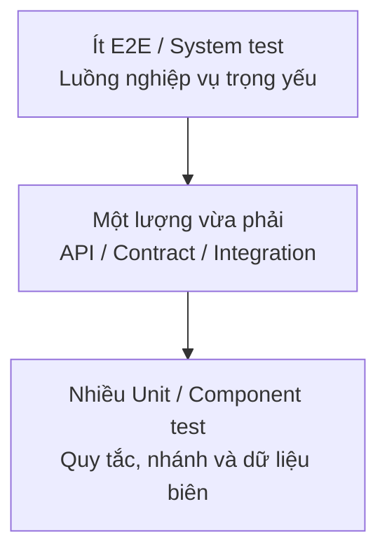
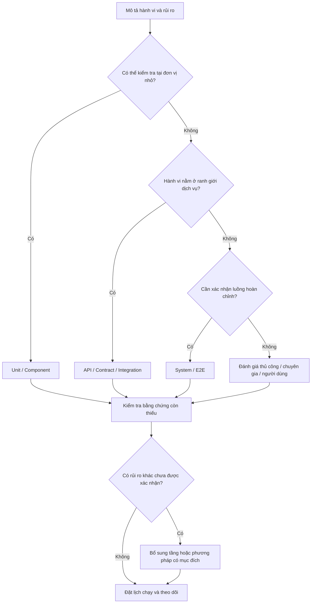

# Chọn tầng tự động hóa phù hợp với hành vi cần kiểm chứng

Tự động hóa kiểm thử giúp nhóm kiểm tra phần mềm lặp lại nhanh hơn, tạo phản hồi nhất quán và giảm công sức xác minh thủ công. Tuy nhiên, không phải mọi hành vi đều nên được tự động hóa ở cùng một tầng. Một quy tắc tính toán có thể được kiểm tra nhanh và rõ ràng ở cấp hàm; một hợp đồng giữa hai dịch vụ cần được xác nhận tại ranh giới giao tiếp; một luồng nghiệp vụ quan trọng cần được kiểm tra khi nhiều thành phần phối hợp; còn khả năng người dùng tìm thấy và hiểu một chức năng có thể cần quan sát trực tiếp.

Chọn tầng tự động hóa phù hợp nghĩa là đặt kiểm tra ở nơi có thể xác nhận hành vi cần bảo vệ với tín hiệu đáng tin cậy, tốc độ phản hồi hợp lý và chi phí duy trì chấp nhận được. Quyết định này nên xuất phát từ hành vi, rủi ro và ranh giới của hệ thống, không chỉ từ công cụ hoặc framework mà nhóm đang sử dụng.

## 1. Phân biệt hành vi cần kiểm chứng, loại kiểm thử và tầng tự động hóa

Ba khái niệm này có liên quan nhưng không đồng nghĩa.

- **Hành vi cần kiểm chứng** là điều hệ thống phải làm hoặc không được làm trong một tình huống cụ thể. Ví dụ: đơn hàng không được ghi nhận thanh toán hai lần khi cùng một yêu cầu được gửi lại.
- **Loại kiểm thử** mô tả mục tiêu hoặc đặc tính đang được kiểm tra, chẳng hạn kiểm thử chức năng, bảo mật, hiệu năng, khả năng phục hồi hoặc khả năng tương thích.
- **Tầng tự động hóa** là nơi kiểm tra được thực hiện và ranh giới mà nó quan sát, chẳng hạn unit, component, API, contract, integration hoặc end-to-end.

Một hành vi có thể được kiểm tra bằng nhiều loại test ở nhiều tầng. Ví dụ, quy tắc phân quyền có thể được kiểm tra bằng unit test cho hàm quyết định quyền, API test để xác nhận yêu cầu trái phép bị từ chối và E2E test cho luồng người dùng có vai trò khác nhau. Mỗi tầng cung cấp một loại bằng chứng riêng; không nhất thiết phải lặp nguyên vẹn cùng một assertion ở mọi tầng.

### Xác định hành vi trước khi chọn công cụ

Hãy mô tả hành vi theo cấu trúc:

1. Điều kiện ban đầu và vai trò liên quan.
2. Hành động hoặc sự kiện kích hoạt.
3. Kết quả mong đợi có thể quan sát.
4. Trạng thái và tác dụng phụ phải được giữ.
5. Các tình huống lỗi, biên hoặc bất thường có ý nghĩa.

Ví dụ: “Khi một khách hàng gửi yêu cầu thanh toán với mã idempotency đã dùng trước đó và cùng nội dung, hệ thống trả lại kết quả của giao dịch đã tạo, không tạo thêm giao dịch hoặc trừ tiền lần nữa.” Hành vi này gợi ý kiểm tra logic khóa ở tầng đơn vị, tính duy nhất và giao dịch ở tầng tích hợp, cùng một số kịch bản API hoặc E2E để xác nhận luồng thực tế.

Nếu mô tả chỉ là “kiểm thử thanh toán” thì chưa đủ để chọn tầng. Cần làm rõ đang xác nhận phép tính, hợp đồng với cổng thanh toán, trạng thái đơn hàng, trải nghiệm người dùng hay khả năng phục hồi khi timeout.

## 2. Các tầng tự động hóa thường dùng

Các tầng dưới đây mô tả phạm vi quan sát phổ biến. Tên gọi và ranh giới có thể khác giữa các tổ chức; điều quan trọng là thống nhất test đang kiểm tra gì, phụ thuộc nào được thay thế và bằng chứng nào được tạo ra.

### Unit test

Unit test kiểm tra một đơn vị nhỏ của mã, thường là hàm, phương thức hoặc lớp, trong phạm vi các phụ thuộc được kiểm soát. Nó phù hợp với quy tắc tính toán, chuyển đổi dữ liệu, quyết định nghiệp vụ và các trường hợp biên có đầu vào/đầu ra rõ.

Ưu điểm:

- Thường chạy nhanh và dễ chạy trên máy cá nhân.
- Khi thất bại, phạm vi điều tra tương đối nhỏ.
- Dễ tạo nhiều dữ liệu biên và tổ hợp điều kiện.
- Có thể chạy thường xuyên trong quá trình phát triển và pull request.

Giới hạn:

- Không tự chứng minh rằng các thành phần thật giao tiếp đúng.
- Mock quá nhiều có thể khiến test xác nhận cách mã được viết thay vì hành vi cần giữ.
- Có thể bỏ sót lỗi cấu hình, serialization, giao dịch hoặc phụ thuộc môi trường.

Unit test phù hợp khi hành vi có thể xác nhận ở một ranh giới nhỏ mà không cần dựng toàn bộ hệ thống. Không nên ép một luồng phân tán phức tạp thành unit test bằng cách mô phỏng mọi phụ thuộc rồi kết luận tích hợp đã an toàn.

### Component test

Component test kiểm tra một thành phần có ý nghĩa như module nghiệp vụ, service hoặc giao diện UI, thường thông qua giao diện công khai của thành phần. Các phụ thuộc bên ngoài có thể được thay thế có kiểm soát, trong khi phần lớn logic của thành phần chạy thật.

Ví dụ, kiểm tra component giỏ hàng có thể xác nhận việc thêm sản phẩm, thay đổi số lượng, áp dụng mã giảm giá và hiển thị tổng tiền bằng dữ liệu kiểm soát. Test có thể chạy thành phần giao diện hoặc service cùng các thành phần nội bộ thật, nhưng không cần triển khai toàn bộ hệ thống.

Component test hữu ích khi logic trải qua nhiều lớp nội bộ nhưng vẫn có thể cô lập thành phần. Nó thường tạo độ tin cậy cao hơn unit test cho tương tác nội bộ, với chi phí và thời gian ở mức trung gian.

### API test

API test gửi yêu cầu qua giao diện lập trình công khai và kiểm tra phản hồi, trạng thái dữ liệu hoặc tác dụng phụ. Nó phù hợp với hợp đồng request/response, quy tắc nghiệp vụ tại ranh giới dịch vụ, xác thực, phân quyền, dữ liệu đầu vào, lỗi và tính lặp an toàn.

API test thường ổn định và dễ chẩn đoán hơn kiểm thử giao diện trình duyệt vì không phụ thuộc vào bố cục, animation hoặc selector. Tuy nhiên, nó không xác nhận đầy đủ người dùng có thể tìm thấy và hiểu các thao tác trên giao diện.

### Contract test

Contract test xác nhận provider và consumer tuân thủ kỳ vọng tại ranh giới giao tiếp. Nó phù hợp khi nhiều nhóm phát triển dịch vụ độc lập, khi tích hợp đối tác hoặc khi thay đổi schema và phiên bản có thể gây lỗi tương thích.

Contract test có thể chạy nhanh hơn integration test đầy đủ vì chỉ xác minh các tương tác được định nghĩa. Tuy nhiên, nó không thay thế kiểm tra mạng, cấu hình, xác thực thật, giao dịch dữ liệu hoặc các lỗi chỉ xuất hiện khi các dịch vụ phối hợp trong môi trường thực.

### Integration test

Integration test xác nhận hai hay nhiều thành phần thực sự phối hợp qua ranh giới như cơ sở dữ liệu, hàng đợi, cache, API hoặc dịch vụ phụ thuộc. Nó phù hợp với giao dịch, serialization, migration, retry, timeout, xử lý đồng thời, thứ tự sự kiện và tính nhất quán dữ liệu.

Integration test có thể dùng dịch vụ phụ trợ thật trong container hoặc môi trường chuyên biệt. Nếu thay thế một phụ thuộc, cần nêu rõ test đang xác nhận logic consumer hay giao tiếp thật với provider. Một test dùng fake database không chứng minh truy vấn hoạt động đúng trên hệ quản trị cơ sở dữ liệu mục tiêu.

### System test và end-to-end test

System test kiểm tra hệ thống như một tổng thể theo các yêu cầu chức năng hoặc phi chức năng. E2E test kiểm tra một luồng hoàn chỉnh qua nhiều thành phần từ điểm bắt đầu đến kết quả nghiệp vụ có ý nghĩa, thường từ góc nhìn người dùng hoặc hệ thống gọi.

E2E phù hợp với một số luồng quan trọng như đăng nhập, tạo đơn, thanh toán, phê duyệt hoặc hoàn tất quy trình. Nó có thể phát hiện lỗi cấu hình và tương tác mà test ở tầng thấp không thấy. Tuy nhiên, E2E thường chậm hơn, phụ thuộc môi trường và dữ liệu nhiều hơn, đồng thời khó định vị nguyên nhân khi thất bại.

Không nên biến mọi biến thể đầu vào thành E2E. Những quy tắc tính toán hoặc trường hợp biên có thể được kiểm tra sâu hơn và nhanh hơn ở unit/API; E2E nên giữ cho những hành trình quan trọng cần bằng chứng xuyên suốt.

### Kiểm thử giao diện và trình duyệt

UI test tự động thao tác qua giao diện người dùng, chẳng hạn nhập liệu, nhấn nút, điều hướng và xác nhận nội dung. Nó phù hợp với các tương tác quan trọng mà API không thể xác nhận, như trạng thái hiển thị, điều hướng, phản hồi thông báo và hành vi trên trình duyệt được hỗ trợ.

UI test dễ bị ảnh hưởng bởi thay đổi bố cục, selector, thời gian tải, animation và khác biệt thiết bị. Nên dùng locator có ngữ nghĩa, chờ điều kiện thực tế, giữ kịch bản ngắn và chỉ tự động hóa những hành vi có tiêu chí quan sát rõ.

### Kiểm thử thủ công và thăm dò

Không phải mọi hành vi đều có thể được mô tả đầy đủ trước. Kiểm thử thăm dò, đánh giá khả năng sử dụng, kiểm tra nội dung và một số đánh giá chuyên môn cần con người quan sát, đặt giả thuyết và thích ứng theo kết quả. Tự động hóa có thể hỗ trợ chuẩn bị dữ liệu, ghi nhận bằng chứng và hồi quy các quy tắc rõ ràng, nhưng không thay thế toàn bộ phán đoán của con người.

## 3. Dùng mô hình kim tự tháp kiểm thử như một nguyên tắc tham khảo

Kim tự tháp kiểm thử (test pyramid) là mô hình gợi ý phân bổ nhiều kiểm thử nhỏ, nhanh ở tầng dưới, ít kiểm thử tích hợp ở giữa và một tập kiểm thử hệ thống/E2E có chọn lọc ở tầng trên.

Mô hình này giúp tạo phản hồi nhanh và giảm chi phí bảo trì. Khi phần lớn quy tắc được kiểm tra ở tầng nhỏ, nhóm có thể phát hiện và định vị lỗi sớm. Các tầng cao xác nhận những tương tác không thể được chứng minh đầy đủ bằng test cô lập.

Tuy nhiên, kim tự tháp không phải tỷ lệ bắt buộc cho mọi sản phẩm. Một hệ thống tích hợp nhiều dịch vụ có thể cần nhiều contract và integration test. Một sản phẩm UI có thể cần nhiều component test. Một thiết bị nhúng hoặc hệ thống phụ thuộc phần cứng có thể cần kiểm tra ở môi trường chuyên biệt. Hình dạng bộ test phải xuất phát từ kiến trúc, rủi ro và cách hệ thống được sử dụng.

### Tránh mô hình kim tự tháp ngược

Nếu phần lớn kiểm tra là E2E/UI, nhóm có thể gặp:

- Pipeline dài và phản hồi chậm.
- Lỗi khó định vị vì nhiều thành phần cùng tham gia.
- Chi phí dữ liệu, tài khoản và môi trường cao.
- Test dễ hỏng do thay đổi giao diện hoặc timing.
- Nhiều kiểm tra trùng lặp cùng một quy tắc ở tầng cao.

Điều này không có nghĩa phải giảm E2E bằng mọi giá. Nếu một rủi ro chỉ có thể được xác nhận qua luồng thật, cần giữ test đó và đầu tư làm nó ổn định. Mục tiêu là chọn đúng số lượng và vị trí kiểm tra, không ép bộ test khớp một hình minh họa.

## 4. Tiêu chí chọn tầng tự động hóa

Khi chọn tầng, hãy đánh giá ít nhất sáu yếu tố.

### Ranh giới quan sát được

Hỏi hành vi có thể được xác nhận ở ranh giới nhỏ nào. Nếu quy tắc có đầu vào và đầu ra rõ, unit test thường đủ. Nếu cần xác nhận serialization hoặc giao tiếp giữa hai dịch vụ, chọn contract hoặc integration. Nếu cần xác nhận nhiều bước của người dùng và trạng thái cuối, một E2E có thể phù hợp.

### Mức độ rủi ro và hậu quả

Rủi ro cao có thể cần nhiều lớp kiểm soát. Ví dụ, phân quyền dữ liệu cần test logic chính sách, API âm tính và một số luồng E2E theo vai trò. Không nhất thiết nhân bản mọi trường hợp ở mọi tầng; mỗi test phải bảo vệ một giả định hoặc ranh giới khác nhau.

### Tốc độ phản hồi và chi phí thực thi

Kiểm thử chạy thường xuyên nên có thời gian phản hồi phù hợp. Unit test thường rẻ để chạy trên mỗi thay đổi; E2E hoặc kiểm thử tải lớn có thể chạy sau hợp nhất hoặc theo lịch. Tuy nhiên, nếu lỗi có hậu quả cao và chỉ được phát hiện ở tầng cao, chi phí chạy chậm hơn có thể được chấp nhận.

### Độ ổn định và khả năng chẩn đoán

Một test chỉ có giá trị khi kết quả đáng tin cậy. Nếu test phụ thuộc quá nhiều vào timing, dữ liệu dùng chung hoặc dịch vụ bên ngoài, hãy cân nhắc chuyển phần logic có thể cô lập xuống tầng thấp hơn và giữ một số kiểm tra tích hợp thật để xác nhận ranh giới.

### Khả năng mô phỏng phụ thuộc

Mock, stub và fake giúp kiểm soát đầu vào và tạo tình huống lỗi, nhưng cũng có thể che giấu sai lệch với phụ thuộc thật. Cần xác định chính xác điều gì được thay thế và bằng chứng nào vẫn cần được kiểm tra với thành phần thật.

### Chi phí bảo trì

Xem xét độ nhạy với thay đổi giao diện, schema, cấu hình, dữ liệu và môi trường. Test càng gần chi tiết triển khai không ổn định càng dễ phải sửa khi tái cấu trúc. Ưu tiên kiểm tra hợp đồng và hành vi quan sát được, đồng thời giữ test cấu trúc nội bộ ở nơi chúng mang lại giá trị rõ ràng.

## 5. Ma trận gợi ý chọn tầng theo hành vi

Bảng sau là hướng dẫn ban đầu. Một hành vi có thể cần kết hợp nhiều tầng nếu mỗi tầng xác nhận một rủi ro khác nhau.

| Hành vi cần kiểm chứng | Tầng thường phù hợp | Tầng bổ sung khi cần | Lý do |
|---|---|---|---|
| Công thức tính giá, thuế, chiết khấu | Unit | API / integration cho dữ liệu và giao dịch | Nhiều trường hợp biên, phản hồi nhanh, dễ định vị |
| Quy tắc chuyển trạng thái đơn hàng | Unit / component | API / integration | Kiểm tra bảng trạng thái và tác dụng phụ |
| Validation request và mã lỗi API | API | Contract | Xác nhận hành vi công khai và tương thích |
| Schema request/response giữa hai dịch vụ | Contract | Integration | Kiểm tra kỳ vọng provider/consumer |
| Ghi dữ liệu qua ORM vào database thật | Integration | API | Xác nhận mapping, transaction và constraint thực tế |
| Xử lý webhook trùng hoặc đến trễ | Integration | E2E có chọn lọc | Kiểm tra retry, idempotency và trạng thái phân tán |
| Phân quyền theo tenant | Unit cho policy | API / security / E2E | Kiểm tra cả quyết định quyền và ranh giới truy cập thật |
| Người dùng hoàn tất quy trình đặt hàng | E2E | Component / API | Xác nhận luồng xuyên hệ thống |
| Nhãn, thông báo và trạng thái giao diện | Component / UI | Usability testing | Kiểm tra hiển thị và khả năng tương tác |
| Hành vi trên trình duyệt/thiết bị hỗ trợ | UI / compatibility | E2E | Cần xác nhận trên môi trường mục tiêu |
| Thời gian phản hồi của API dưới tải | Performance/API | System | Đo hiệu năng tại ranh giới chịu tải |
| Khôi phục khi database hoặc dịch vụ phụ thuộc lỗi | Integration / resilience | System / E2E | Kiểm tra tác động qua nhiều thành phần |
| Người dùng có tìm thấy chức năng không | Đánh giá với người dùng | UI test cho hồi quy rõ ràng | Khả năng tìm thấy cần quan sát hành vi thực |

## 6. Quy trình quyết định tầng tự động hóa

Có thể dùng quy trình sau cho từng hành vi hoặc rủi ro:

1. **Mô tả hành vi:** nêu điều kiện, hành động, kết quả và bất biến cần giữ.
2. **Xác định ranh giới:** tìm thành phần hoặc giao diện nhỏ nhất có thể quan sát hành vi.
3. **Đánh giá rủi ro:** xác định hậu quả, khả năng xảy ra và nhóm người dùng bị ảnh hưởng.
4. **Chọn tầng chính:** đặt test ở tầng có thể kiểm tra hành vi với độ tin cậy cao và chi phí phù hợp.
5. **Xác định bằng chứng còn thiếu:** xem test ở tầng chính có bỏ qua tương tác, cấu hình hoặc môi trường quan trọng nào không.
6. **Bổ sung tầng khác có mục đích:** thêm contract, integration hoặc E2E chỉ khi nó xác nhận một giả định khác có giá trị.
7. **Chọn thời điểm chạy:** test nhanh chạy thường xuyên; test nặng chạy ở mốc phù hợp với rủi ro và thời gian phản hồi.
8. **Đánh giá tính ổn định:** xác minh dữ liệu độc lập, điều kiện lặp lại và khả năng chẩn đoán.
9. **Rà soát sau thay đổi:** khi kiến trúc hoặc hành vi đổi, xem test còn nằm đúng tầng và có còn bằng chứng cần thiết không.

Quy trình này không phải cây quyết định cứng. Một luồng có thể cần unit test và E2E cùng lúc; một hành vi có thể không phù hợp với tự động hóa hoàn toàn. Cần giải thích vì sao mỗi tầng được chọn và bằng chứng nó bổ sung.

## 7. Thiết kế test ở tầng thấp mà vẫn bảo vệ hành vi

Đặt nhiều kiểm thử ở tầng thấp chỉ hữu ích khi chúng xác nhận hành vi có ý nghĩa. Test không nên khóa chặt mọi chi tiết nội bộ khiến việc tái cấu trúc hợp lý trở nên tốn kém.

### Kiểm tra qua đầu vào và đầu ra có ý nghĩa

Với một quy tắc nghiệp vụ, ưu tiên kiểm tra kết quả theo hợp đồng của đơn vị. Ví dụ, hàm tính phí giao hàng nên được kiểm tra bằng khu vực, trọng lượng và tổng đơn; assertion xác nhận phí và lỗi theo chính sách. Không cần xác nhận mọi lời gọi hàm nội bộ nếu thứ tự gọi không thuộc yêu cầu.

### Dùng test double đúng mục đích

Các test double gồm:

- **Dummy:** đối tượng truyền vào nhưng không được sử dụng trong test.
- **Stub:** cung cấp phản hồi đã định trước.
- **Fake:** triển khai đơn giản nhưng có hành vi hoạt động, ví dụ repository trong bộ nhớ.
- **Mock:** ghi nhận tương tác để xác nhận lời gọi hoặc tham số cụ thể.

Dùng stub để mô phỏng timeout hoặc lỗi của dịch vụ thanh toán có thể hữu ích cho unit/component test. Dùng fake repository có thể giúp kiểm tra quy tắc nghiệp vụ nhanh. Nhưng cần có integration test với database thật để xác nhận truy vấn, transaction và constraint.

Mock nên được dùng khi tương tác đó là một phần của hợp đồng cần xác nhận, chẳng hạn bảo đảm một giao dịch không được gửi hai lần. Tránh mock mọi lớp và xác nhận thứ tự gọi nội bộ nếu điều đó không ảnh hưởng đến hành vi bên ngoài.

### Tránh kiểm thử triển khai thay vì hành vi

Một test kiểm tra tên phương thức helper hoặc cấu trúc biến riêng có thể thất bại khi tái cấu trúc dù kết quả nghiệp vụ không đổi. Khi test tập trung vào hành vi quan sát được, nhóm có thể thay đổi cách triển khai mà vẫn giữ được bảo vệ cần thiết.

## 8. Chọn tầng cho các hành vi xuyên dịch vụ

Hệ thống nhiều dịch vụ thường có lỗi ở ranh giới: schema không tương thích, timeout, retry, sự kiện trùng, quyền không được truyền đúng hoặc dữ liệu cập nhật không nhất quán. Không thể giải quyết các rủi ro này chỉ bằng unit test.

### Bắt đầu từ hợp đồng

Nếu provider và consumer phát triển độc lập, contract test giúp xác nhận các tương tác quan trọng trước khi triển khai chung. Nó phù hợp để kiểm tra trường bắt buộc, kiểu dữ liệu, mã lỗi, giá trị enum và các kỳ vọng mà consumer thực sự sử dụng.

### Bổ sung integration cho hành vi thực

Integration test nên xác nhận những điều contract test không chứng minh, chẳng hạn:

- Serialization/deserialization thực tế.
- Transaction và ràng buộc database.
- Giao nhận message và acknowledgement.
- Retry, timeout và xử lý đồng thời.
- Cấu hình xác thực, mạng và chứng thư.
- Cache, nhất quán dữ liệu và xử lý sự kiện đến trễ.

### Giữ E2E cho luồng quan trọng

Một số E2E xác nhận rằng các dịch vụ được triển khai và cấu hình đúng để hoàn thành nghiệp vụ. Chẳng hạn, khách hàng tạo đơn, thanh toán và nhận trạng thái xác nhận. E2E nên kiểm tra kết quả nghiệp vụ và những điểm tương tác chính, không cần lặp mọi biến thể dữ liệu đã được kiểm tra sâu ở tầng thấp.

## 9. Chọn tầng cho giao diện người dùng

UI là nơi nhiều nhóm có xu hướng tự động hóa quá nhiều vì mọi hành vi đều có thể được thao tác bằng trình duyệt. Tuy nhiên, một thay đổi bố cục nhỏ có thể làm hỏng nhiều test dù logic nghiệp vụ không đổi.

### Ưu tiên component test cho logic giao diện

Component test phù hợp với trạng thái hiển thị, validation, thông báo, điều kiện enable/disable và tương tác cục bộ. Nó thường chạy nhanh hơn trình duyệt E2E và dễ kiểm tra nhiều trạng thái.

### Dùng UI/E2E cho hành trình cần xác nhận thực

Giữ test trình duyệt cho luồng quan trọng như đăng nhập, tìm kiếm, đặt hàng, gửi biểu mẫu và phê duyệt. Dùng locator theo role, label hoặc accessible name thay vì selector phụ thuộc cấu trúc CSS khi có thể. Chờ trạng thái hoặc điều kiện thực tế thay vì dùng thời gian ngủ cố định.

### Không tự động hóa phán đoán khả dụng

Test có thể xác nhận nút tồn tại, có nhãn truy cập và thông báo xuất hiện. Nhưng nó không thể tự kết luận người dùng có hiểu nhãn, tìm thấy chức năng hoặc cảm thấy tự tin hay không. Các câu hỏi đó cần đánh giá với người dùng đại diện hoặc chuyên gia phù hợp.

## 10. Xác định thời điểm chạy theo tầng

Tầng tự động hóa và thời điểm chạy là hai quyết định liên quan nhưng khác nhau. Một test API có thể chạy trên mỗi pull request nếu nhanh; một integration test cần database có thể chạy ở pull request hoặc sau hợp nhất tùy thời gian và độ ổn định; một E2E dài có thể chạy theo lịch hoặc trước phát hành.

| Thời điểm | Tầng thường phù hợp | Mục tiêu |
|---|---|---|
| Khi lập trình | Unit, component nhỏ, lint và kiểm tra kiểu | Phản hồi nhanh ngay tại nơi tạo thay đổi |
| Pull request | Unit, component, contract, API và integration quan trọng | Ngăn lỗi mới đi vào nhánh chính |
| Sau hợp nhất | Integration rộng, E2E cốt lõi | Xác nhận tương tác giữa các thay đổi đã tích hợp |
| Theo lịch | Hồi quy rộng, trình duyệt, cấu hình và kiểm thử dài | Tìm lỗi phụ thuộc môi trường hoặc tổ hợp ít chạy |
| Trước phát hành | E2E trọng yếu, hiệu năng, bảo mật và phục hồi | Xác nhận điều kiện phát hành và rủi ro còn lại |
| Sau phát hành | Smoke test, synthetic monitoring và kiểm tra nghiệp vụ | Xác nhận hệ thống thực tế đang hoạt động |

Không nên chuyển một test sang chạy muộn chỉ vì nó chậm nếu test đó bảo vệ rủi ro cần chặn trước hợp nhất. Hãy xem có thể làm test nhanh hơn, chia nhỏ hoặc chuyển phần logic xuống tầng thấp mà vẫn giữ kiểm tra ranh giới cần thiết không.

## 11. Ví dụ tổng hợp: tự động hóa quy trình đặt hàng

Giả sử một ứng dụng thương mại điện tử cho phép khách hàng chọn sản phẩm, áp dụng mã giảm giá, thanh toán và theo dõi đơn hàng. Nhóm xác định các hành vi quan trọng và phân bổ tầng như sau:

| Hành vi | Tầng chính | Kiểm tra bổ sung | Lý do chọn |
|---|---|---|---|
| Tính tổng tiền và thuế đúng | Unit | API với dữ liệu đại diện | Nhiều tổ hợp và giá trị biên, cần phản hồi nhanh |
| Mã giảm giá chỉ dùng khi đủ điều kiện | Unit / component | API | Quy tắc quyết định và thông báo lỗi |
| API tạo đơn từ chối dữ liệu không hợp lệ | API | Contract | Hợp đồng đầu vào và mã lỗi công khai |
| Dịch vụ đơn hàng tương thích với cổng thanh toán | Contract | Integration | Provider/consumer có thể phát triển độc lập |
| Thanh toán được ghi nhận một lần khi retry | Integration | E2E cho luồng thanh toán chính | Cần kiểm tra khóa idempotency, transaction và trạng thái |
| Webhook đến trễ không làm trạng thái quay lùi | Integration | Một kịch bản E2E có kiểm soát | Lỗi phụ thuộc thứ tự và xử lý sự kiện |
| Người dùng hoàn tất mua hàng | E2E | Component cho từng trạng thái giao diện | Xác nhận hành trình chính xuyên hệ thống |
| Người dùng hiểu đơn đang chờ hay đã thanh toán | Đánh giá khả năng sử dụng | UI test kiểm tra trạng thái và thông báo | Cần cả hành vi thực và kiểm tra hồi quy giao diện |

### Xác định các test cụ thể

**Unit:** kiểm tra hàm tính tổng tiền với giá trị biên, thuế, chiết khấu, tiền tệ và làm tròn. Kiểm tra điều kiện mã giảm giá hết hạn, vượt giới hạn hoặc không áp dụng cho sản phẩm.

**Component:** kiểm tra giỏ hàng cập nhật số lượng, hiển thị lỗi, tính lại tổng tiền và khóa nút thanh toán khi dữ liệu không hợp lệ.

**API:** gửi request tạo đơn hợp lệ, thiếu trường, sai kiểu, không đủ quyền và mã idempotency đã sử dụng. Xác nhận mã trạng thái, body, dữ liệu lưu và lỗi theo hợp đồng.

**Contract:** xác nhận provider thanh toán và dịch vụ đơn hàng thống nhất schema, mã lỗi, đơn vị tiền tệ, trạng thái và cách truyền mã tham chiếu.

**Integration:** dùng database và hàng đợi thật trong môi trường kiểm thử để gửi webhook trùng, trễ, sai thứ tự; mô phỏng timeout sau khi provider đã xử lý và xác nhận không tạo giao dịch trùng.

**E2E:** chạy một số hành trình trọng yếu từ chọn sản phẩm đến nhận trạng thái cuối. Không cần tạo E2E cho mọi tổ hợp thuế hoặc mã giảm giá vì chúng đã được kiểm tra sâu ở tầng thấp.

**Đánh giá với người dùng:** quan sát người dùng mới hoàn thành mua hàng và giải thích trạng thái thanh toán. Nếu họ hiểu sai thông báo, sửa nội dung và kiểm tra lại với người dùng phù hợp.

### Bằng chứng cần có trước phát hành

- Các quy tắc tính toán và điều kiện nghiệp vụ quan trọng có unit/component test đạt.
- Hợp đồng giữa dịch vụ đơn hàng và thanh toán được xác minh.
- Các rủi ro retry, webhook và trạng thái dữ liệu có integration test đáng tin cậy.
- Luồng mua hàng cốt lõi có E2E đạt trên môi trường phù hợp.
- Các vấn đề khả dụng quan trọng được đánh giá và có hành động xử lý.
- Rủi ro chưa thể kiểm chứng đầy đủ được ghi nhận và chấp nhận đúng thẩm quyền.

## 12. Đánh giá chất lượng của lựa chọn tầng

Sau khi triển khai bộ test, nhóm cần xem quyết định chọn tầng có tạo ra bằng chứng mong muốn hay không. Một số chỉ số và câu hỏi có thể hỗ trợ:

| Tín hiệu | Câu hỏi cần xem xét |
|---|---|
| Thời gian phản hồi theo tầng | Tầng nào đang làm chậm vòng phát triển? |
| Tỷ lệ flaky | Test ở tầng nào dễ bị ảnh hưởng bởi dữ liệu hoặc môi trường? |
| Khả năng định vị lỗi | Khi fail, có biết thành phần hoặc hợp đồng gây vấn đề không? |
| Lỗi lọt | Có loại lỗi nào chỉ xuất hiện sau khi tích hợp hoặc phát hành? |
| Test trùng lặp | Có nhiều test cùng xác nhận một hành vi mà không thêm bằng chứng không? |
| Chi phí bảo trì | Tầng nào thường xuyên phải sửa do thay đổi không liên quan đến hành vi? |
| Độ bao phủ rủi ro | Rủi ro quan trọng có test phù hợp và kết quả đáng tin cậy chưa? |

Nếu lỗi thường lọt từ ranh giới dịch vụ, có thể cần tăng contract hoặc integration test. Nếu E2E thường thất bại do selector nhưng component test đã đủ bảo vệ logic, hãy giảm phụ thuộc vào UI ở những trường hợp không cần trình duyệt. Nếu unit test quá nhiều mock và không phát hiện sai lệch tích hợp, cần thêm test với phụ thuộc thật ở ranh giới quan trọng.

Không nên đặt mục tiêu tỷ lệ test cố định như 70% unit, 20% integration và 10% E2E cho mọi hệ thống. Tỷ lệ phù hợp phụ thuộc kiến trúc, rủi ro, công nghệ và cách sử dụng sản phẩm. Theo dõi xu hướng và bằng chứng có giá trị hơn việc ép một hình dạng bộ test.

## 13. Những sai lầm thường gặp khi chọn tầng

- **Chọn tầng theo công cụ có sẵn:** framework quen thuộc không phải lý do đủ để đặt mọi kiểm tra ở tầng đó.
- **Đẩy mọi thứ lên E2E:** làm phản hồi chậm, tăng chi phí và khiến lỗi khó định vị.
- **Chỉ dùng unit test:** có thể bỏ sót serialization, cấu hình, giao tiếp và trạng thái phân tán.
- **Mock toàn bộ phụ thuộc:** test có thể chỉ chứng minh các mock hoạt động theo giả định của người viết.
- **Lặp lại cùng assertion ở mọi tầng:** tăng thời gian và bảo trì mà không tạo thêm bằng chứng đáng kể.
- **Đặt test quá sát chi tiết triển khai:** tái cấu trúc làm hỏng test dù hành vi công khai không đổi.
- **Dùng E2E để kiểm tra mọi dữ liệu biên:** các trường hợp đó thường hiệu quả hơn ở unit hoặc API.
- **Bỏ qua test thủ công hoặc đánh giá người dùng:** không phải mọi thuộc tính đều có tiêu chí tự động hóa đầy đủ.
- **Không xét thời điểm chạy:** test phù hợp nhưng chạy quá muộn có thể không hỗ trợ quyết định cần thiết.
- **Không rà soát lại khi kiến trúc thay đổi:** ranh giới và tầng phù hợp có thể đổi theo hệ thống.

## 14. Danh sách kiểm tra trước khi tự động hóa một hành vi

**Mục tiêu**

- Hành vi cần bảo vệ đã được mô tả rõ bằng điều kiện, hành động và kết quả chưa?
- Rủi ro và hậu quả nếu hành vi sai đã được xác định chưa?
- Assertion có phân biệt được kết quả đúng với kết quả sai không?

**Tầng kiểm thử**

- Ranh giới nhỏ nhất có thể xác nhận hành vi một cách đáng tin cậy là gì?
- Có cần kiểm tra hợp đồng, tích hợp thật hoặc luồng người dùng hoàn chỉnh không?
- Mỗi tầng bổ sung có đang bảo vệ một giả định khác nhau không?
- Có phần nào phù hợp hơn với đánh giá thủ công hoặc người dùng đại diện không?

**Phụ thuộc và dữ liệu**

- Phụ thuộc nào chạy thật, phụ thuộc nào được thay bằng stub/fake/mock?
- Việc thay thế có che khuất rủi ro giao tiếp hoặc cấu hình nào không?
- Dữ liệu có độc lập, có thể tái tạo và an toàn khi chạy song song không?
- Test có phụ thuộc vào thời gian, thứ tự hoặc trạng thái bên ngoài không?

**Vận hành và bảo trì**

- Thời gian chạy và thời điểm thực thi có phù hợp với vòng phản hồi không?
- Khi thất bại, log và thông tin có đủ để chẩn đoán không?
- Test có ổn định và dễ cập nhật khi yêu cầu thay đổi không?
- Có người sở hữu và tiêu chí loại bỏ hoặc thay thế test lỗi thời không?

## Kết luận

Chọn tầng tự động hóa phù hợp bắt đầu từ hành vi và rủi ro cần kiểm chứng. Unit và component test thường phù hợp với quy tắc và trạng thái cục bộ; API và contract test bảo vệ hành vi tại ranh giới; integration test xác nhận tương tác thật giữa các thành phần; system và E2E test bảo vệ những luồng nghiệp vụ xuyên suốt; đánh giá thủ công và với người dùng vẫn cần thiết cho các thuộc tính đòi hỏi quan sát và phán đoán. Kết hợp các tầng có mục đích, chọn thời điểm chạy phù hợp và đánh giá chất lượng bằng bằng chứng giúp bộ tự động hóa phản hồi nhanh, đáng tin cậy và có chi phí duy trì hợp lý.
