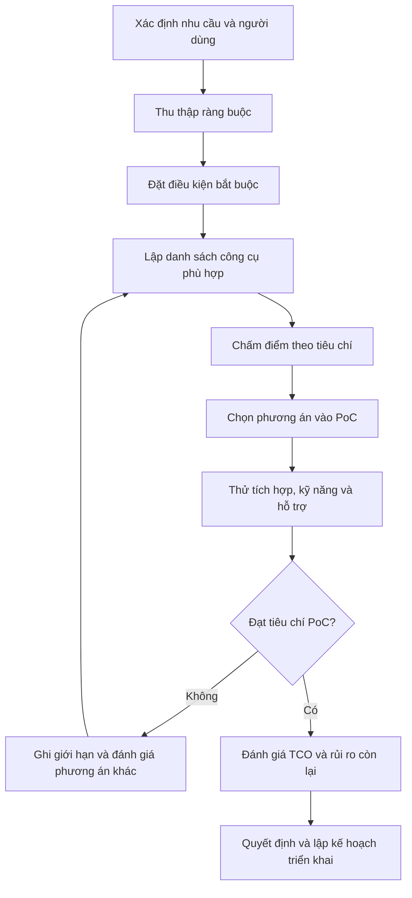

# Đánh giá công cụ theo khả năng tích hợp, kỹ năng và vòng đời hỗ trợ

Trong module **VALIDATION_TESTING_STRATEGY**, lựa chọn công cụ tự động hóa kiểm thử là quyết định ảnh hưởng lâu dài đến cách nhóm thiết kế, thực thi, bảo trì và sử dụng bằng chứng kiểm thử. Một công cụ có nhiều tính năng nhưng khó tích hợp vào pipeline, đòi hỏi kỹ năng hiếm hoặc sắp kết thúc hỗ trợ có thể làm tăng chi phí và rủi ro thay vì cải thiện chất lượng.

Đánh giá công cụ cần xem xét đồng thời ba khía cạnh: **khả năng tích hợp**, **kỹ năng và năng lực đội ngũ**, và **vòng đời hỗ trợ**. Khả năng tích hợp cho biết công cụ có phối hợp được với hệ thống phát triển và vận hành hiện có hay không. Kỹ năng cho biết nhóm có thể sử dụng, gỡ lỗi và duy trì công cụ một cách bền vững hay không. Vòng đời hỗ trợ cho biết công cụ có được cập nhật, bảo mật, tương thích và hỗ trợ đủ lâu cho nhu cầu sản phẩm hay không.

Bài học này hướng dẫn cách xác định nhu cầu trước khi chọn công cụ, thiết lập điều kiện bắt buộc và tiêu chí chấm điểm, kiểm chứng bằng thử nghiệm có mục tiêu, đánh giá chi phí vòng đời và ghi lại quyết định. Mục tiêu là chọn được công cụ phù hợp với chiến lược kiểm thử và khả năng vận hành của tổ chức, thay vì chỉ chọn theo danh sách tính năng hoặc xu hướng.

## 1. Xác định nhu cầu trước khi xem xét công cụ

### 1.1. Bắt đầu từ vấn đề cần giải quyết

Không nên bắt đầu bằng việc so sánh sản phẩm hoặc hỏi công cụ nào phổ biến nhất. Trước tiên, hãy xác định vấn đề hiện tại và kết quả mong muốn.

Ví dụ về nhu cầu:

- Bộ kiểm thử API cần chạy tự động trong CI và lưu được kết quả theo phiên bản.
- Nhóm cần tự động hóa một số hành trình web quan trọng nhưng phải giảm độ không ổn định của kiểm thử.
- Kiểm thử hiệu năng cần tạo tải có kiểm soát và xuất số liệu có thể phân tích.
- Nhóm cần quản lý dữ liệu kiểm thử và kết quả trên nhiều môi trường.
- Người kiểm thử nghiệp vụ cần tạo kịch bản dễ đọc mà không phải viết nhiều mã.
- Nhóm phát triển cần gỡ lỗi nhanh khi một kiểm thử tự động thất bại.

Một nhu cầu tốt mô tả người sử dụng, công việc, môi trường và kết quả có thể đo được. “Cần công cụ mạnh” chưa phải yêu cầu có thể đánh giá. “Có thể chạy 300 kiểm thử API trong pipeline, phân loại lỗi, lưu báo cáo theo commit và hoàn tất trong thời gian phản hồi đã thống nhất” rõ ràng hơn.

### 1.2. Xác định phạm vi sử dụng

Công cụ có thể phục vụ một hoặc nhiều mục tiêu:

| Phạm vi | Công việc cần hỗ trợ | Ví dụ đầu ra |
|---|---|---|
| Unit / component | Tạo, chạy và báo cáo kiểm thử ở cấp mã hoặc thành phần | Kết quả chạy, coverage, log |
| API / contract | Gửi request, kiểm tra response, schema và hợp đồng | Báo cáo contract, request/response đã làm sạch |
| Web / mobile UI | Điều khiển giao diện và xác minh hành trình | Video, ảnh, log, trạng thái kiểm thử |
| System / E2E | Điều phối hành trình xuyên nhiều dịch vụ | Kết quả theo journey và bằng chứng liên hệ |
| Performance | Tạo tải và đo phản hồi, thông lượng, lỗi | Metrics, biểu đồ, báo cáo tải |
| Security testing | Kiểm tra một số rủi ro bảo mật trong phạm vi được phép | Findings, mức độ và bằng chứng |
| Test management | Quản lý trường hợp, kế hoạch, truy vết và kết quả | Ma trận yêu cầu–test–release |
| CI orchestration | Lập lịch, chạy song song và quản lý pipeline | Trạng thái job, artifact, lịch sử |
| Reporting / analytics | Tổng hợp xu hướng và rủi ro | Dashboard và báo cáo theo phiên bản |

Không nhất thiết phải dùng một công cụ cho tất cả phạm vi. Một bộ công cụ chuyên biệt có thể phù hợp hơn, miễn là dữ liệu, kết quả và quy trình phối hợp được tích hợp hợp lý.

### 1.3. Xác định người dùng và nhóm liên quan

Liệt kê các vai trò sẽ dùng hoặc chịu ảnh hưởng từ công cụ:

- Developer viết và chạy kiểm thử gần mã nguồn.
- Tester thiết kế, thực thi và điều tra kiểm thử.
- QA lead quản lý chiến lược, độ bao phủ và báo cáo.
- DevOps / Platform engineer tích hợp pipeline, môi trường và quyền truy cập.
- Security hoặc compliance đánh giá rủi ro dữ liệu và chuỗi cung ứng.
- Product Owner hoặc nghiệp vụ sử dụng kết quả để đưa ra quyết định.
- Quản trị công cụ phụ trách cấu hình, giấy phép và hỗ trợ.

Mỗi vai trò có nhu cầu khác nhau. Công cụ dễ dùng cho người viết kịch bản có thể thiếu khả năng gỡ lỗi cần thiết cho developer. Công cụ phù hợp cho kỹ sư có thể đòi hỏi nhiều kỹ năng lập trình đối với nhóm nghiệp vụ. Cần xác định ai sẽ là người dùng thường xuyên và ai chịu trách nhiệm vận hành.

### 1.4. Ghi nhận bối cảnh và giới hạn hiện tại

Trước khi đánh giá, thu thập thông tin về:

- Ngôn ngữ, framework và nền tảng sản phẩm.
- Hệ thống quản lý mã nguồn và cách làm việc với nhánh.
- CI/CD, runner, container và môi trường thực thi.
- Công cụ quản lý lỗi, yêu cầu, test case và tài liệu.
- Cơ chế xác thực, SSO, secret và phân quyền.
- Hệ thống log, tracing, metrics và lưu artifact.
- Quy định về dữ liệu, vị trí lưu trữ và thời gian lưu.
- Ngân sách, giấy phép, hạ tầng và nhân lực.
- Các công cụ đang sử dụng và chi phí chuyển đổi.

Thông tin này giúp loại sớm các phương án không tương thích hoặc không đáp ứng điều kiện tổ chức.

## 2. Đánh giá khả năng tích hợp

Khả năng tích hợp là mức độ công cụ có thể tham gia vào quy trình phát triển, kiểm thử và vận hành mà không tạo ra quá nhiều thao tác thủ công hoặc điểm đứt gãy dữ liệu.

### 2.1. Tích hợp với hệ thống quản lý mã nguồn

Kiểm tra công cụ có thể:

- Làm việc với repository và quy trình branch hiện tại.
- Chạy kiểm thử theo commit, pull request hoặc tag.
- Nhận đúng phiên bản mã và cấu hình.
- Lưu kết quả liên kết với commit hoặc build.
- Quản lý script, cấu hình và fixture trong version control.
- Hỗ trợ review thay đổi đối với mã kiểm thử.
- Phân biệt kiểm thử chạy trên nhánh phát triển và bản phát hành.

Một công cụ chạy được từ máy cá nhân nhưng không thể tái tạo trong CI sẽ tạo khoảng cách giữa kết quả cục bộ và kết quả tích hợp.

### 2.2. Tích hợp với CI/CD

Đánh giá cách công cụ được gọi trong pipeline:

- Có CLI, API, plugin hoặc container runner phù hợp không?
- Có hỗ trợ chạy headless hoặc không cần giao diện tương tác không?
- Có thể cấu hình timeout, retry, parallelism và giới hạn tài nguyên không?
- Exit code có phản ánh kết quả để pipeline quyết định đúng không?
- Có thể lưu report, log, video và artifact không?
- Có hỗ trợ chia nhỏ bộ kiểm thử và chạy lại có kiểm soát không?
- Có thể chạy trong runner tự quản lý hoặc hạ tầng được phép không?
- Có hỗ trợ cache và tái sử dụng dependency mà vẫn bảo đảm tính tái lập không?

Cần thử cả trường hợp thành công và thất bại. Ví dụ, pipeline phải thất bại khi một kiểm thử quan trọng không đạt, nhưng cũng phải phân biệt được lỗi môi trường hoặc runner không sẵn sàng. Retry không nên biến một kiểm thử thất bại không ổn định thành tín hiệu đạt mà không lưu dấu vết.

### 2.3. Tích hợp với quản lý yêu cầu, lỗi và kiểm thử

Công cụ có thể cần liên kết với:

- Requirement hoặc user story.
- Acceptance criteria.
- Test case và test suite.
- Defect / issue.
- Build, release và phiên bản.
- Người thực hiện và trạng thái phê duyệt.

Đánh giá khả năng truy vết hai chiều: từ yêu cầu có thể thấy kiểm thử nào xác nhận; từ lỗi có thể truy ra yêu cầu, phiên bản và bằng chứng liên quan. Nếu công cụ không có tích hợp sẵn, kiểm tra API, webhook hoặc định dạng trao đổi có thể duy trì liên kết.

### 2.4. Tích hợp với môi trường, dữ liệu và dịch vụ phụ thuộc

Một công cụ tự động hóa cần phối hợp với môi trường kiểm thử:

- Khởi tạo hoặc chọn đúng môi trường.
- Cấp dữ liệu và tài khoản thử nghiệm.
- Đọc secret qua cơ chế quản lý được phê duyệt.
- Gọi API hoặc dịch vụ phụ thuộc.
- Chuẩn bị và dọn dữ liệu sau chạy.
- Điều khiển sandbox, mock hoặc service virtualization.
- Thu thập trạng thái và mã tương quan xuyên hệ thống.

Đặc biệt, xác định cách công cụ xử lý dữ liệu nhạy cảm. Request, response, ảnh chụp hoặc video có thể chứa thông tin cá nhân, token hoặc dữ liệu bí mật. Công cụ cần hỗ trợ che dữ liệu, giới hạn quyền truy cập và chính sách lưu trữ phù hợp.

### 2.5. Tích hợp với quan sát và báo cáo

Khi kiểm thử thất bại, nhóm cần tìm nguyên nhân nhanh. Kiểm tra khả năng xuất hoặc liên kết:

- Log của công cụ và ứng dụng.
- Trace ID / correlation ID.
- Metrics của hệ thống.
- Ảnh chụp, video và network trace.
- Report ở định dạng máy đọc được.
- Dashboard theo build, phiên bản và môi trường.
- Artifact phục vụ điều tra sau khi job kết thúc.

Báo cáo đẹp nhưng không có dữ liệu chi tiết để chẩn đoán có thể không đủ giá trị cho vận hành. Cần kiểm tra cả trải nghiệm xem báo cáo và khả năng xuất dữ liệu để tích hợp với hệ thống khác.

### 2.6. Đánh giá tích hợp bằng tình huống thực tế

Không chỉ đánh dấu “có hỗ trợ Git” hoặc “có plugin CI”. Hãy thử một luồng hoàn chỉnh:

1. Thay đổi mã kiểm thử trong repository.
2. Tạo pull request hoặc build thử.
3. Pipeline cài đặt và chạy công cụ.
4. Kiểm thử truy cập môi trường và dữ liệu.
5. Một trường hợp thành công và một trường hợp thất bại được thực thi.
6. Report và artifact được lưu.
7. Kết quả liên kết với commit hoặc build.
8. Lỗi có thể truy vết đến log và issue.

Luồng thử nghiệm này cho thấy tích hợp thực sự hoạt động và phát hiện điểm cần thao tác thủ công.

## 3. Đánh giá kỹ năng và năng lực đội ngũ

Công cụ chỉ tạo ra giá trị khi nhóm có thể sử dụng và duy trì nó. Chi phí học ban đầu là một phần của quyết định, nhưng cần xem cả năng lực dài hạn.

### 3.1. Mức kỹ năng cần thiết

Xem xét các kỹ năng để:

- Viết hoặc cấu hình kịch bản kiểm thử.
- Thiết kế dữ liệu và tiền điều kiện.
- Tổ chức bộ kiểm thử và tái sử dụng thành phần.
- Gỡ lỗi khi kiểm thử thất bại.
- Phân biệt lỗi sản phẩm, lỗi môi trường và lỗi test.
- Tích hợp pipeline và quản lý cấu hình.
- Xử lý đồng thời, bất đồng bộ và dữ liệu chia sẻ.
- Bảo trì khi ứng dụng hoặc framework thay đổi.
- Bảo vệ secret và dữ liệu trong artifact.

Một công cụ low-code có thể giảm yêu cầu lập trình khi tạo kịch bản, nhưng vẫn cần kỹ năng về quy tắc nghiệp vụ, dữ liệu, môi trường và chẩn đoán. Không nên đánh giá công cụ là “không cần kỹ năng” chỉ vì thao tác kéo thả.

### 3.2. Mức phù hợp với kỹ năng hiện có

Đánh giá:

- Ngôn ngữ công cụ sử dụng có quen thuộc với nhóm không?
- Nhóm có thể đọc và hiểu script do công cụ sinh ra không?
- Có người đủ năng lực quản trị và xử lý sự cố không?
- Có thể tuyển hoặc đào tạo người thay thế không?
- Kỹ năng đó có dùng lại được trong hệ sinh thái hiện tại không?
- Công cụ có tạo phụ thuộc vào một cá nhân hoặc chuyên gia duy nhất không?

Nếu công cụ đòi hỏi một ngôn ngữ hoặc nền tảng mới, cần tính cả chi phí đào tạo và rủi ro thiếu người duy trì. Một công cụ có hiệu năng tốt nhưng chỉ một người hiểu có thể trở thành điểm nghẽn.

### 3.3. Đường cong học tập và trải nghiệm phát triển

Trong proof of concept, quan sát người dùng thực hiện các tác vụ:

- Cài đặt và chạy kịch bản đầu tiên.
- Tạo fixture hoặc dữ liệu.
- Đọc và hiểu kết quả thất bại.
- Sửa một kịch bản bị lỗi.
- Chạy riêng một trường hợp và chạy cả suite.
- Thêm kiểm thử vào pipeline.
- Chia sẻ report với người khác.

Ghi lại thời gian, số bước, lỗi thao tác và mức hỗ trợ cần thiết. Không chỉ hỏi người dùng có thích công cụ hay không; hãy quan sát họ có thể hoàn thành công việc độc lập và lặp lại hay không.

### 3.4. Tài liệu, đào tạo và cộng đồng

Kiểm tra:

- Hướng dẫn cài đặt và bắt đầu có rõ ràng không?
- Tài liệu API và cấu hình có đầy đủ không?
- Có ví dụ cho framework và kiến trúc đang dùng không?
- Có hướng dẫn nâng cấp, di chuyển và xử lý lỗi không?
- Có khóa học, workshop hoặc chứng chỉ phù hợp không?
- Cộng đồng có hoạt động và câu trả lời có đáng tin cậy không?
- Có thể nhận hỗ trợ từ nhà cung cấp hoặc chuyên gia bên ngoài không?

Tài liệu cần khớp phiên bản đang sử dụng. Một hướng dẫn tốt nhưng chỉ áp dụng cho phiên bản cũ không giảm được rủi ro vận hành hiện tại.

### 3.5. Khả năng chia sẻ và chuyển giao kỹ năng

Một công cụ phù hợp nên cho phép nhiều người hiểu và đóng góp:

- Kịch bản có cấu trúc nhất quán.
- Có quy ước đặt tên và tổ chức suite.
- Có thể review thay đổi.
- Có thể tái sử dụng helper hoặc component.
- Có tài liệu nội bộ về cách chạy và gỡ lỗi.
- Có ít nhất một người dự phòng cho nhiệm vụ quản trị quan trọng.
- Kiến thức không bị khóa trong cấu hình riêng của một tài khoản cá nhân.

Đánh giá cả khả năng bàn giao khi người phụ trách rời nhóm hoặc thay đổi vai trò.

## 4. Đánh giá vòng đời hỗ trợ

Vòng đời hỗ trợ quyết định công cụ có tiếp tục an toàn, tương thích và có thể duy trì trong thời gian sản phẩm cần hay không.

### 4.1. Chu kỳ phát hành và cập nhật

Tìm hiểu:

- Tần suất phát hành phiên bản mới.
- Cách công bố thay đổi và breaking changes.
- Chính sách tương thích ngược.
- Thời gian hỗ trợ phiên bản cũ.
- Quy trình vá lỗi và lỗ hổng bảo mật.
- Khả năng rollback hoặc giữ phiên bản ổn định.
- Tính tương thích với ngôn ngữ, runtime, browser và CI hiện tại.

Phát hành thường xuyên không tự động là tốt nếu thay đổi phá vỡ tương thích hoặc không có tài liệu di chuyển. Ngược lại, ít phát hành cũng có thể là rủi ro nếu lỗ hổng và lỗi quan trọng không được xử lý.

### 4.2. Hỗ trợ kỹ thuật và cam kết dịch vụ

Nếu dùng công cụ thương mại hoặc dịch vụ đám mây, kiểm tra:

- Kênh hỗ trợ và giờ hoạt động.
- Thời gian phản hồi theo mức độ nghiêm trọng.
- SLA hoặc cam kết sẵn sàng nếu có.
- Quy trình xử lý sự cố và leo thang.
- Khả năng hỗ trợ trong múi giờ và ngôn ngữ cần thiết.
- Chính sách hỗ trợ phiên bản và thời hạn kết thúc hỗ trợ.
- Quyền truy cập chuyên gia khi xảy ra vấn đề phức tạp.

Với công cụ mã nguồn mở, đánh giá maintainer, hoạt động repository, tốc độ xử lý issue, lịch phát hành và mức độ phụ thuộc vào một nhóm nhỏ. Có thể không có SLA chính thức; khi đó cần kế hoạch nội bộ cho việc tự xử lý hoặc thuê hỗ trợ.

### 4.3. Kết thúc hỗ trợ và kế hoạch di chuyển

Cần biết trước:

- Khi nào phiên bản hiện tại hết hỗ trợ?
- Có thời gian chuyển tiếp không?
- Dữ liệu, script và cấu hình có thể xuất ra định dạng mở không?
- Có thể chạy lại bộ kiểm thử bằng công cụ khác không?
- Có phụ thuộc vào format hoặc dịch vụ độc quyền không?
- Chi phí chuyển đổi gồm viết lại script, đào tạo, dữ liệu và pipeline là bao nhiêu?

Công cụ có thể phù hợp hôm nay nhưng tạo rủi ro lớn nếu không thể xuất dữ liệu hoặc tái sử dụng kịch bản. Khả năng rời khỏi công cụ (exit strategy) cần được cân nhắc ngay khi lựa chọn, không đợi đến lúc kết thúc hỗ trợ.

### 4.4. Tính bền vững của nhà cung cấp hoặc dự án

Đánh giá tín hiệu dài hạn:

- Nhà cung cấp có công bố lộ trình sản phẩm không?
- Sản phẩm có được cập nhật phù hợp với nền tảng mục tiêu không?
- Có thông tin rõ về quyền sở hữu, điều khoản và thay đổi giá không?
- Dự án mã nguồn mở có maintainer và hoạt động phát triển ổn định không?
- Có nhiều tổ chức hoặc người dùng thực tế sử dụng không?
- Có nguy cơ ngừng sản phẩm, thay đổi giấy phép hoặc giảm hỗ trợ không?

Không thể dự đoán chắc chắn tương lai của nhà cung cấp. Mục tiêu là nhận diện phụ thuộc quan trọng, đánh giá khả năng giảm thiểu và không đặt toàn bộ quy trình vào một điểm không có phương án thay thế.

## 5. Đánh giá bảo mật, dữ liệu và tuân thủ

Khả năng tích hợp và hỗ trợ không đủ nếu công cụ không đáp ứng yêu cầu bảo mật của tổ chức.

### 5.1. Quản lý danh tính và quyền truy cập

Kiểm tra:

- SSO và cơ chế xác thực được tổ chức chấp thuận.
- Role-based access control (RBAC) hoặc mô hình quyền tương đương.
- Phân tách quyền quản trị, tạo kịch bản, chạy và xem kết quả.
- Audit log cho thao tác nhạy cảm.
- Quản lý token, key và credential.
- Thu hồi quyền khi người dùng rời nhóm.
- Tài khoản dịch vụ và quyền tối thiểu cho pipeline.

### 5.2. Bảo vệ dữ liệu kiểm thử và artifact

Xác định dữ liệu có thể xuất hiện trong:

- Request và response.
- Log và trace.
- Ảnh chụp màn hình, video.
- Report và file đính kèm.
- Fixture, dataset và bản sao cơ sở dữ liệu.
- Lịch sử thực thi và dashboard.

Kiểm tra khả năng mã hóa, che dữ liệu, phân vùng tenant, kiểm soát tải xuống và thời gian lưu. Nếu công cụ chạy trên cloud, cần xác nhận vị trí lưu trữ, xử lý dữ liệu và điều khoản phù hợp với chính sách.

### 5.3. Rủi ro chuỗi cung ứng và plugin

Công cụ có thể kéo theo plugin, package, browser driver, agent hoặc image container. Cần xem xét:

- Nguồn tải và xác minh tính toàn vẹn.
- Cập nhật dependency và xử lý lỗ hổng.
- Quyền của plugin và runner.
- Khả năng pin phiên bản.
- Chính sách bảo mật và quy trình phát hành.
- Cách tách môi trường chạy không tin cậy khỏi secret.

Không cài plugin hoặc extension không rõ nguồn chỉ để bổ sung một tính năng nhỏ nếu nó làm tăng quyền truy cập hoặc rủi ro chuỗi cung ứng đáng kể.

## 6. Đánh giá chi phí sở hữu tổng thể

Giá giấy phép chỉ là một phần của chi phí. Cần đánh giá tổng chi phí sở hữu (Total Cost of Ownership, TCO) trong khoảng thời gian dự kiến.

### 6.1. Các thành phần chi phí

| Nhóm | Ví dụ chi phí |
|---|---|
| Giấy phép | Theo người dùng, runner, lượt chạy, thiết bị hoặc dung lượng |
| Hạ tầng | Máy chạy, container, browser, thiết bị và lưu trữ |
| Tích hợp | Thiết lập CI, API, SSO, quản lý dữ liệu và báo cáo |
| Đào tạo | Học công cụ, viết hướng dẫn và hỗ trợ người dùng |
| Bảo trì | Sửa script, nâng cấp, xử lý flaky test và cập nhật framework |
| Vận hành | Quản trị tài khoản, runner, quyền và môi trường |
| Hỗ trợ | Gói hỗ trợ, chuyên gia hoặc dịch vụ tư vấn |
| Chuyển đổi | Di chuyển dữ liệu, viết lại test và đào tạo khi đổi công cụ |

Công cụ miễn phí có thể có TCO cao nếu cần nhiều công sức tích hợp và bảo trì. Công cụ trả phí có thể giảm thời gian vận hành nhưng cần kiểm tra chi phí tăng theo quy mô hoặc giới hạn sử dụng.

### 6.2. Ước lượng TCO theo giai đoạn

Có thể ước lượng:

```
TCO trong kỳ =
  Giấy phép
  + Hạ tầng
  + Tích hợp ban đầu
  + Đào tạo
  + Vận hành và bảo trì
  + Hỗ trợ
  + Chi phí chuyển đổi dự kiến
```

Ước lượng cần nêu giả định về số người dùng, số lần chạy, số runner, dung lượng artifact, thời gian bảo trì và chu kỳ nâng cấp. So sánh các công cụ trên cùng khoảng thời gian và cùng khối lượng công việc.

### 6.3. Tính đến chi phí cơ hội và lợi ích

Ngoài chi phí trực tiếp, xem xét:

- Thời gian phản hồi cho developer có giảm không?
- Tester có thể tập trung vào kiểm thử khám phá và rủi ro cao hơn không?
- Tỷ lệ kiểm thử ổn định có cải thiện không?
- Thời gian chẩn đoán lỗi có giảm không?
- Có giảm thao tác thủ công và sai sót lặp lại không?
- Có tăng khả năng truy vết và minh bạch khi phát hành không?

Không nên dùng một con số ROI thiếu dữ liệu. Có thể đo trước và sau proof of concept bằng các chỉ số như thời gian tạo một kiểm thử, thời gian chạy, thời gian điều tra lỗi, số bước thủ công và công bảo trì.

## 7. Thiết lập tiêu chí bắt buộc và ma trận chấm điểm

### 7.1. Tách điều kiện loại trừ khỏi tiêu chí so sánh

Một số điều kiện là bắt buộc. Nếu công cụ không đáp ứng, không nên bù bằng điểm cao ở các tiêu chí khác.

Ví dụ điều kiện bắt buộc:

- Chạy được trên hệ điều hành hoặc hạ tầng được tổ chức hỗ trợ.
- Đáp ứng yêu cầu bảo mật và vị trí lưu dữ liệu.
- Tích hợp được với pipeline bắt buộc.
- Hỗ trợ giao thức, ngôn ngữ hoặc framework sản phẩm cần.
- Có thể xuất bằng chứng theo định dạng được chấp nhận.
- Có hỗ trợ và vòng đời phù hợp với thời gian sử dụng dự kiến.

Sau khi loại phương án không đạt điều kiện bắt buộc, mới chấm điểm các phương án còn lại.

### 7.2. Ví dụ bộ tiêu chí có trọng số

Bảng sau chỉ là mẫu để nhóm điều chỉnh theo nhu cầu:

| Nhóm tiêu chí | Trọng số minh họa | Nội dung đánh giá |
|---|---:|---|
| Tích hợp | 30% | Repository, CI/CD, API, test management, dữ liệu và báo cáo |
| Kỹ năng và trải nghiệm | 20% | Mức phù hợp với kỹ năng, khả năng học, gỡ lỗi và chuyển giao |
| Vòng đời hỗ trợ | 20% | Cập nhật, tương thích, hỗ trợ, EOL và lộ trình |
| Bảo mật và tuân thủ | 15% | Danh tính, quyền, dữ liệu, audit và chuỗi cung ứng |
| TCO | 10% | Giấy phép, hạ tầng, đào tạo, vận hành và chuyển đổi |
| Khả năng phù hợp kỹ thuật | 5% | Độ ổn định, hiệu năng và khả năng mở rộng |

Trọng số cần được thống nhất trước khi chấm để tránh điều chỉnh tiêu chí theo công cụ đang được ưa thích.

### 7.3. Thang điểm và cách tính

Có thể dùng thang 1–5:

| Điểm | Diễn giải |
|---:|---|
| 1 | Không đáp ứng hoặc cần thay đổi lớn |
| 2 | Đáp ứng một phần, có giới hạn đáng kể |
| 3 | Đáp ứng yêu cầu chính với một số đánh đổi |
| 4 | Đáp ứng tốt, ít phụ thuộc bổ sung |
| 5 | Đáp ứng đầy đủ và có bằng chứng rõ trong thử nghiệm |

Điểm tổng có trọng số:

```
Điểm tổng = Σ (điểm tiêu chí × trọng số tiêu chí)
```

Ví dụ nếu tích hợp có trọng số 30% và công cụ đạt 4/5, phần điểm đóng góp là 4 × 0,30 = 1,20 trên thang tổng tối đa 5.

Không nên chấm điểm dựa trên tài liệu quảng bá nếu tiêu chí có thể kiểm chứng. Ghi bằng chứng, giả định và giới hạn bên cạnh từng điểm.

### 7.4. Ví dụ bảng so sánh

| Tiêu chí | Trọng số | Công cụ A | Công cụ B |
|---|---:|---:|---:|
| Tích hợp CI và repository | 0,30 | 4 | 5 |
| Kỹ năng phù hợp | 0,20 | 5 | 3 |
| Vòng đời và hỗ trợ | 0,20 | 3 | 4 |
| Bảo mật và tuân thủ | 0,15 | 4 | 4 |
| TCO | 0,10 | 4 | 3 |
| Khả năng kỹ thuật | 0,05 | 4 | 4 |

Tính theo mẫu trên:

- Công cụ A: 4×0,30 + 5×0,20 + 3×0,20 + 4×0,15 + 4×0,10 + 4×0,05 = 4,00.
- Công cụ B: 5×0,30 + 3×0,20 + 4×0,20 + 4×0,15 + 3×0,10 + 4×0,05 = 4,00.

Hai công cụ có điểm tổng bằng nhau nhưng đánh đổi khác nhau. Nhóm cần xem xét tiêu chí quan trọng nhất với mục tiêu, bằng chứng thực tế và rủi ro còn lại. Điểm số hỗ trợ quyết định chứ không thay thế phán đoán.

## 8. Thực hiện proof of concept có mục tiêu

Proof of concept (PoC) là thử nghiệm nhỏ để xác minh công cụ có thể giải quyết một số nhu cầu quan trọng trong bối cảnh thật của nhóm. PoC nên đủ đại diện để phát hiện giới hạn nhưng không mở rộng thành dự án triển khai hoàn chỉnh.

### 8.1. Chọn kịch bản PoC

Chọn một luồng bao gồm những điểm tích hợp và kỹ năng quan trọng:

1. Lấy mã kiểm thử từ repository.
2. Tạo và chạy một bộ kiểm thử đại diện.
3. Chạy trong CI với cấu hình của nhóm.
4. Truy cập môi trường và dữ liệu thử.
5. Cố ý tạo một trường hợp thất bại.
6. Thu thập log, report và artifact.
7. Liên kết kết quả với build hoặc issue.
8. Cho một thành viên khác đọc, sửa và chạy lại.
9. Nâng cấp hoặc thay đổi cấu hình nhỏ để đánh giá bảo trì.

Không chọn một ví dụ quá đơn giản chỉ chạy thành công trên máy cá nhân; nó không kiểm tra được khả năng tích hợp và vận hành.

### 8.2. Đặt tiêu chí thành công trước khi thử

Ví dụ:

- Có thể cài đặt và chạy theo hướng dẫn được ghi lại.
- Pipeline có thể chạy không cần thao tác tương tác.
- Kết quả có thể liên kết với commit.
- Khi kiểm thử thất bại, có đủ bằng chứng để điều tra.
- Một thành viên khác có thể sửa và chạy lại.
- Có thể quản lý secret và artifact theo chính sách.
- Thời gian chạy và bảo trì nằm trong giới hạn chấp nhận.
- Không phát sinh phụ thuộc hoặc giấy phép ngoài dự kiến.

Tiêu chí cần có ngưỡng cụ thể nếu có thể đo. Ví dụ, thời gian pipeline tối đa hoặc số phút cần để người mới thực hiện tác vụ đầu tiên.

### 8.3. Thử nghiệm nhiều hơn một vai trò

Cho ít nhất hai kiểu người dùng thử nếu công cụ sẽ được dùng bởi nhiều vai trò:

- Người thường xuyên viết mã kiểm thử.
- Người chủ yếu thiết kế và chạy kịch bản.
- Người quản trị pipeline hoặc môi trường.

Quan sát mức độ độc lập, khả năng gỡ lỗi và cách họ hiểu report. Một công cụ chỉ thuận tiện với người thiết lập ban đầu có thể khó bàn giao cho cả nhóm.

### 8.4. Ghi nhận kết quả và giới hạn

PoC nên lưu:

- Phiên bản công cụ và cấu hình.
- Kịch bản và dữ liệu đã dùng.
- Môi trường và tích hợp được kiểm tra.
- Thời gian thiết lập và chạy.
- Lỗi, workaround và thao tác thủ công.
- Kết quả theo từng tiêu chí.
- Giới hạn chưa kiểm chứng.
- Ước lượng chi phí triển khai và bảo trì.

Không nên xem PoC thành công trên một môi trường là bằng chứng rằng công cụ phù hợp với mọi dự án hoặc quy mô.

## 9. Quy trình ra quyết định và triển khai có kiểm soát

### 9.1. Quy trình lựa chọn



### 9.2. Ghi quyết định

Một bản ghi quyết định nên có:

- Vấn đề và mục tiêu cần giải quyết.
- Phạm vi sử dụng và người dùng.
- Điều kiện bắt buộc.
- Các công cụ đã xem xét.
- Tiêu chí, trọng số và bằng chứng.
- Kết quả PoC.
- TCO và đánh đổi.
- Rủi ro, giới hạn và biện pháp giảm thiểu.
- Lý do chọn hoặc loại phương án.
- Người phê duyệt và ngày xem xét lại.

Ghi cả lý do không chọn một công cụ. Điều này giúp tránh lặp lại quá trình đánh giá khi nhóm hoặc nhu cầu thay đổi.

### 9.3. Triển khai theo giai đoạn

Không nên chuyển toàn bộ quy trình kiểm thử sang công cụ mới ngay lập tức nếu chưa xác nhận khả năng vận hành.

Có thể triển khai theo giai đoạn:

1. Thử nghiệm với một bộ kiểm thử và nhóm nhỏ.
2. Chuẩn hóa cấu trúc repository, cấu hình và quy ước.
3. Tích hợp pipeline và quản lý quyền.
4. Đào tạo người dùng và người quản trị.
5. Mở rộng sang các bộ kiểm thử phù hợp.
6. Theo dõi độ ổn định, chi phí và hiệu quả.
7. Đánh giá lại sau một khoảng thời gian đã thống nhất.

Trong giai đoạn chuyển tiếp, có thể cần chạy song song công cụ cũ và mới. Hãy xác định thời gian, phạm vi và tiêu chí kết thúc chạy song song để tránh duy trì hai hệ thống vô thời hạn.

## 10. Quản lý rủi ro sau khi chọn công cụ

### 10.1. Phụ thuộc vào nhà cung cấp hoặc định dạng độc quyền

Rủi ro có thể gồm:

- Kịch bản không thể xuất hoặc chuyển sang công cụ khác.
- Dữ liệu kết quả bị khóa trong nền tảng.
- Giá giấy phép tăng theo quy mô.
- API tích hợp thay đổi.
- Dịch vụ ngừng hoặc giảm hỗ trợ.

Biện pháp:

- Lưu mã kiểm thử và cấu hình trong version control nếu được hỗ trợ.
- Dùng định dạng mở cho report và dữ liệu có thể xuất.
- Ghi lại API và giao diện tích hợp.
- Định kỳ kiểm tra khả năng export.
- Có kế hoạch chuyển đổi và ước lượng chi phí.

### 10.2. Công cụ không theo kịp công nghệ sản phẩm

Khi framework, browser, runtime hoặc hệ điều hành thay đổi, công cụ có thể không còn tương thích. Cần theo dõi ma trận tương thích và thử nâng cấp trong môi trường riêng trước khi áp dụng rộng.

### 10.3. Nợ kỹ thuật trong mã kiểm thử

Công cụ tốt không tự bảo đảm bộ kiểm thử tốt. Script có thể trùng lặp, phụ thuộc dữ liệu chia sẻ, selector mong manh hoặc chứa logic nghiệp vụ lặp lại. Cần có quy ước review, cấu trúc helper, ownership và lịch bảo trì.

### 10.4. Thiếu năng lực quản trị

Nếu không có người quản lý phiên bản, license, quyền, runner, plugin và secret, công cụ có thể trở thành rủi ro vận hành. Cần xác định chủ sở hữu kỹ thuật, người dự phòng và quy trình xử lý sự cố.

### 10.5. Không đánh giá lại theo nhu cầu thay đổi

Công cụ phù hợp với bộ kiểm thử nhỏ có thể không phù hợp khi số lượng suite, người dùng hoặc môi trường tăng. Đánh giá lại khi:

- Thay đổi kiến trúc hoặc framework.
- Mở rộng sang nền tảng mới.
- Số lần chạy hoặc người dùng tăng đáng kể.
- Chi phí giấy phép hoặc hạ tầng thay đổi.
- Có lỗ hổng, sự cố hỗ trợ hoặc thông báo EOL.
- Công cụ không còn đáp ứng thời gian phản hồi hoặc bằng chứng cần thiết.

## 11. Những sai lầm thường gặp

1. **Chọn theo số lượng tính năng:** không xác định tính năng nào giải quyết nhu cầu thật.
2. **Chỉ xem demo hoặc tài liệu quảng bá:** không thử tích hợp trong môi trường và pipeline của nhóm.
3. **Bỏ qua kỹ năng:** chọn công cụ mà nhóm không thể gỡ lỗi hoặc bảo trì độc lập.
4. **Đánh giá thấp vòng đời:** không kiểm tra lịch phát hành, hỗ trợ phiên bản và thời điểm EOL.
5. **Chỉ tính giá giấy phép:** bỏ qua hạ tầng, đào tạo, tích hợp, vận hành và chuyển đổi.
6. **Bỏ qua bảo mật dữ liệu:** để log, video hoặc report chứa secret và dữ liệu nhạy cảm.
7. **Không thử tình huống thất bại:** chỉ xác nhận chạy thành công mà không kiểm tra chẩn đoán và exit code.
8. **Chấm điểm sau khi đã chọn:** thay trọng số để hợp thức hóa phương án ưa thích.
9. **Không có người sở hữu:** không rõ ai quản trị công cụ và duy trì tích hợp.
10. **Triển khai toàn bộ quá sớm:** mở rộng trước khi PoC xác nhận tính ổn định và khả năng chuyển giao.
11. **Bỏ qua khả năng rời công cụ:** không kiểm tra export dữ liệu, script và report.
12. **Không đánh giá lại:** tiếp tục dùng công cụ dù công nghệ, nhu cầu hoặc điều kiện hỗ trợ đã thay đổi.

## 12. Checklist đánh giá công cụ theo tích hợp, kỹ năng và vòng đời hỗ trợ

- [ ] Đã xác định vấn đề, mục tiêu, người dùng và phạm vi tự động hóa.
- [ ] Đã ghi nhận ngôn ngữ, framework, CI/CD, repository và môi trường hiện có.
- [ ] Đã xác định điều kiện bắt buộc trước khi chấm điểm.
- [ ] Đã kiểm tra tích hợp với mã nguồn, pipeline, quản lý lỗi, yêu cầu và test management.
- [ ] Đã kiểm tra cách quản lý dữ liệu, secret, quyền và artifact.
- [ ] Đã đánh giá khả năng quan sát, log, trace, report và export.
- [ ] Đã đánh giá kỹ năng cần thiết để viết, chạy, gỡ lỗi và bảo trì.
- [ ] Đã kiểm tra tài liệu, đào tạo, cộng đồng và khả năng chuyển giao.
- [ ] Đã xem xét lịch phát hành, tương thích, hỗ trợ bảo mật và EOL.
- [ ] Đã đánh giá hỗ trợ kỹ thuật, SLA hoặc năng lực maintainer.
- [ ] Đã kiểm tra khả năng xuất dữ liệu và kế hoạch chuyển đổi.
- [ ] Đã đánh giá bảo mật, tuân thủ và rủi ro chuỗi cung ứng.
- [ ] Đã ước lượng TCO trong cùng khoảng thời gian và quy mô.
- [ ] Đã thống nhất trọng số và thang điểm trước khi so sánh.
- [ ] Đã thực hiện PoC với luồng thành công, thất bại và nhiều vai trò.
- [ ] Đã lưu bằng chứng, giới hạn, workaround và rủi ro còn lại.
- [ ] Đã ghi quyết định, người phê duyệt, chủ sở hữu và mốc đánh giá lại.

Một công cụ tự động hóa phù hợp phải hỗ trợ được quy trình thực tế, vừa sức với kỹ năng đội ngũ và có vòng đời đủ tin cậy để duy trì. Khi đánh giá cả khả năng tích hợp, năng lực con người, hỗ trợ dài hạn, bảo mật và tổng chi phí, nhóm có thể đưa ra quyết định có căn cứ và giảm rủi ro phải thay công cụ sau khi đã đầu tư lớn.
