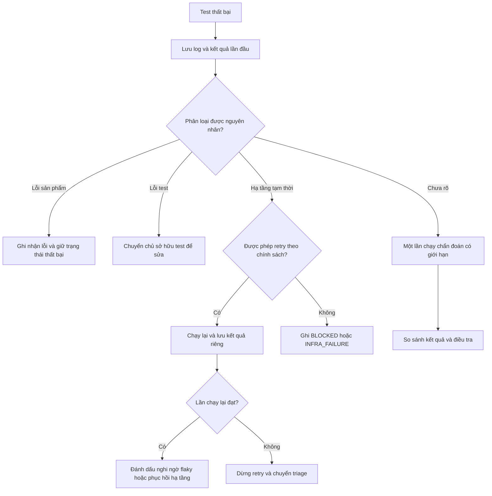

# Quản lý kiểm thử thiếu ổn định (flaky test) và chính sách chạy lại

**Chương:** Tự động hóa  
**Phạm vi module:** `VALIDATION_TESTING_STRATEGY`

Một kiểm thử tự động đáng tin cậy cần cho kết quả nhất quán khi được chạy lại với cùng phiên bản, dữ liệu, cấu hình và điều kiện môi trường tương đương. Tuy nhiên, có những test lúc đạt, lúc thất bại dù nhóm không thay đổi mã sản phẩm hoặc đầu vào có chủ đích. Hiện tượng này thường được gọi là *flaky test* — kiểm thử thiếu ổn định.

Flaky test làm giảm niềm tin vào pipeline. Người phát triển có thể bỏ qua cảnh báo, chạy lại nhiều lần cho đến khi thấy màu xanh hoặc trì hoãn xử lý lỗi thật vì không biết kết quả nào đáng tin. Nếu một chính sách chạy lại tự động che giấu lần thất bại đầu tiên, hệ thống có thể báo đạt trong khi vẫn tồn tại race condition, dữ liệu dùng chung hoặc lỗi phụ thuộc chưa được xử lý.

Bài học này giải thích cách nhận diện, phân loại, điều tra và giảm flaky test; cách thiết kế chính sách chạy lại có giới hạn; và cách báo cáo kết quả để lần chạy lại hỗ trợ chẩn đoán mà không làm sai lệch quyết định chất lượng.

Sau bài học, người học có thể:

- Phân biệt flaky test với lỗi sản phẩm có thể tái hiện, lỗi kiểm thử và lỗi hạ tầng.
- Nhận diện nguyên nhân thiếu ổn định trong mã test, ứng dụng, dữ liệu, môi trường và phụ thuộc.
- Thu thập bằng chứng để tái hiện và xác định nguyên nhân.
- Thiết kế chính sách chạy lại có giới hạn, có điều kiện và có khả năng truy vết.
- Quyết định khi nào test cần được sửa, cách ly tạm thời hoặc loại bỏ.
- Theo dõi tỷ lệ flaky, chi phí điều tra và ảnh hưởng đến pipeline.

## 1. Flaky test là gì?

Flaky test là kiểm thử có thể cho kết quả khác nhau giữa các lần chạy trong những điều kiện được xem là tương đương, mà sự khác biệt đó không được giải thích bởi thay đổi hợp lệ của sản phẩm hoặc dữ liệu đầu vào. Một lần thất bại rồi một lần thành công chưa đủ để kết luận chắc chắn test bị flaky; đó là tín hiệu cần điều tra.

Ví dụ, cùng một test đăng nhập trên cùng phiên bản ứng dụng và cùng dữ liệu:

- Lần chạy thứ nhất: test thất bại vì không tìm thấy nút xác nhận.
- Lần chạy thứ hai: test đạt mà không có thay đổi mã hoặc cấu hình.
- Lần chạy thứ ba: test lại thất bại do timeout khi chờ trạng thái đăng nhập.

Nếu kết quả thay đổi do điều kiện không ổn định như tải hệ thống, thứ tự chạy hoặc thời gian chờ, test có thể đang phụ thuộc vào một yếu tố không được kiểm soát.

### 1.1. Flaky test không phải là mọi test thất bại

Một test thất bại lặp lại với cùng đầu vào và cùng điều kiện có thể đang phát hiện một lỗi sản phẩm thật. Không nên gắn nhãn flaky chỉ vì lỗi khó chịu hoặc xảy ra không thường xuyên.

Phân biệt sơ bộ:

| Loại kết quả | Dấu hiệu | Cách xử lý ban đầu |
|---|---|---|
| Lỗi sản phẩm có thể tái hiện | Cùng điều kiện tạo ra cùng sai lệch | Mở hoặc liên kết lỗi sản phẩm; giữ test trong cổng chất lượng phù hợp |
| Flaky test | Cùng điều kiện tương đương nhưng kết quả không nhất quán; chưa xác định được thay đổi sản phẩm giải thích khác biệt | Thu thập bằng chứng, phân tích nguyên nhân và theo dõi nhiều lần chạy |
| Lỗi test | Assertion sai, dữ liệu chuẩn bị sai, locator lỗi hoặc logic test không đúng | Sửa test và xác minh lại |
| Lỗi hạ tầng | Runner, mạng, dịch vụ môi trường hoặc tài nguyên kiểm thử gặp sự cố | Ghi nhận trạng thái hạ tầng, khôi phục điều kiện và chạy lại theo chính sách |
| Bị chặn | Thiếu môi trường, quyền, dữ liệu hoặc phụ thuộc để thực hiện | Ghi lý do; không đánh dấu đạt |

Một lỗi sản phẩm cũng có thể xuất hiện không thường xuyên. Ví dụ, race condition trong ứng dụng có thể chỉ xảy ra khi hai yêu cầu đến gần như đồng thời. Nếu test phát hiện được lỗi đó, việc kết quả thay đổi theo lịch chạy không làm nó trở thành lỗi giả. Cần xác minh xem test có đang bộc lộ hành vi không đúng của sản phẩm hay bản thân test thiếu ổn định.

### 1.2. Flakiness là đặc tính cần quan sát qua nhiều lần chạy

Để phân loại flaky, nhóm cần xem các lần chạy có điều kiện tương đương, lưu kết quả ban đầu và tìm yếu tố giải thích khác biệt. Có thể một test ổn định trong môi trường cục bộ nhưng thiếu ổn định khi chạy song song trong CI. Vì vậy, cần ghi rõ môi trường và cấu hình khi báo cáo.

Không có số lần chạy cố định phù hợp cho mọi test. Với test rủi ro cao, có thể cần lặp lại có kiểm soát và kiểm tra nhiều điều kiện tải. Với test ít quan trọng, vài lần chạy bổ sung cùng log đầy đủ có thể đủ để quyết định bước điều tra tiếp theo. Việc chạy lại chỉ cung cấp bằng chứng; nó không tự xác định nguyên nhân.

## 2. Vì sao flaky test gây hại?

### 2.1. Làm giảm niềm tin vào kết quả tự động

Khi pipeline thường xuyên đỏ vì test thiếu ổn định, người phát triển khó phân biệt lỗi sản phẩm với nhiễu. Dần dần, nhóm có thể bỏ qua cảnh báo hoặc mặc định rằng lần chạy lại sẽ xanh. Một lỗi thật có thể bị chìm trong nhiều thất bại không đáng tin.

### 2.2. Tăng chi phí điều tra và thời gian phát hành

Mỗi lần thất bại cần người xem log, chạy lại, kiểm tra môi trường và quyết định có cần mở lỗi hay không. Nếu nhiều test flaky cùng xuất hiện, nhóm mất thời gian xử lý kết quả thay vì tập trung vào lỗi sản phẩm hoặc hoạt động kiểm thử có giá trị.

### 2.3. Che giấu lỗi có tính thời điểm hoặc đồng thời

Một retry thành công có thể làm biến mất dấu hiệu của race condition, lỗi timeout, mất dữ liệu hoặc vấn đề tải. Nếu nhóm chỉ lưu kết quả cuối cùng, thông tin quan trọng về lần thất bại ban đầu sẽ bị mất.

### 2.4. Làm sai lệch chỉ số chất lượng

Nếu hệ thống tính test chỉ cần đạt ở một trong nhiều lần chạy là thành công, tỷ lệ đạt có thể trông cao hơn độ tin cậy thực tế. Báo cáo cần giữ cả kết quả lần đầu, số lần chạy lại, nguyên nhân và kết quả cuối theo chính sách.

### 2.5. Làm tăng chi phí vận hành

Flaky test có thể tiêu thụ runner, thời gian CI, tài nguyên môi trường, dung lượng log và thời gian của người điều tra. Một test có thời gian chạy ngắn nhưng thường xuyên retry có thể tốn kém hơn một test ổn định chạy lâu hơn một chút.

## 3. Các nguyên nhân thường gặp

Flakiness có thể bắt nguồn từ mã test, sản phẩm, dữ liệu, môi trường hoặc phụ thuộc bên ngoài. Cần tìm nguyên nhân cụ thể trước khi chọn cách sửa.

### 3.1. Đồng bộ và thời gian chờ không đúng

Một nguyên nhân phổ biến là test giả định thao tác hoàn tất trong một khoảng thời gian cố định. Ví dụ, test bấm nút rồi ngủ hai giây trước khi kiểm tra kết quả. Nếu hệ thống phản hồi sau 2,1 giây, test thất bại dù hành vi vẫn đúng.

Các dấu hiệu:

- Test dùng `sleep` cố định thay vì chờ điều kiện.
- Thời gian phản hồi dao động theo tải.
- Test đọc trạng thái trước khi tác vụ bất đồng bộ hoàn tất.
- Test dựa vào thứ tự sự kiện không được bảo đảm.

Cách cải thiện là chờ điều kiện có thể quan sát với thời hạn tối đa rõ ràng, ví dụ trạng thái đơn hàng chuyển sang `CONFIRMED`, phần tử xuất hiện và có thể tương tác, hoặc thông điệp được ghi nhận. Khi hết thời hạn, lưu trạng thái và log để chẩn đoán.

### 3.2. Dữ liệu kiểm thử dùng chung hoặc không được dọn dẹp

Nhiều test dùng cùng tài khoản, mã giảm giá, sản phẩm hoặc bản ghi. Một test có thể thay đổi dữ liệu khiến test khác thất bại. Chạy tuần tự có thể đạt, nhưng chạy song song lại không ổn định.

Ví dụ:

- Test A sử dụng mã giảm giá một lần.
- Test B cũng dùng mã đó và kỳ vọng mã còn hiệu lực.
- Khi chạy song song, test B có thể thất bại tùy thứ tự ghi dữ liệu.

Nên tạo dữ liệu riêng cho mỗi lần chạy, dùng định danh duy nhất, chuẩn bị và dọn dẹp dữ liệu có kiểm soát. Nếu dữ liệu phải dùng chung, cần đồng bộ hoặc thiết kế test để không cạnh tranh ngoài mục tiêu kiểm tra.

### 3.3. Phụ thuộc vào thứ tự chạy

Một test có thể đạt chỉ vì test khác đã chuẩn bị dữ liệu hoặc cấu hình trước đó. Khi thứ tự thay đổi, chạy riêng lẻ hoặc chạy song song, kết quả sẽ khác.

Mỗi test nên tự thiết lập tiền điều kiện và kiểm tra trạng thái ban đầu. Không dựa vào trạng thái còn sót lại từ test trước. Nếu một nhóm test cần chung fixture, phải quản lý rõ vòng đời và quyền sở hữu fixture đó.

### 3.4. Chạy song song gây tranh chấp tài nguyên

Các test có thể cạnh tranh cùng một cổng, tệp, tài khoản, thiết bị, hàng đợi hoặc bản ghi. Runner thiếu CPU/bộ nhớ cũng làm thời gian phản hồi thay đổi.

Hãy kiểm tra:

- Mỗi worker có dữ liệu và tài nguyên riêng không?
- Tên tệp, cổng hoặc định danh có xung đột không?
- Có trạng thái toàn cục hoặc cache dùng chung không?
- Mức song song có vượt năng lực môi trường không?
- Test có giả định thứ tự hoặc thời gian thực thi không?

Nếu một test không an toàn khi chạy song song, có thể giới hạn song song tạm thời trong khi tìm nguyên nhân. Đây là biện pháp giảm thiểu; cần ghi rõ vì nó có thể làm tăng thời gian pipeline và không giải quyết nguyên nhân nền tảng.

### 3.5. Phụ thuộc vào mạng hoặc dịch vụ bên ngoài

Mạng, DNS, API đối tác, sandbox thanh toán, email, kho artifact hoặc message broker có thể chậm hay gián đoạn. Test dựa trực tiếp vào dịch vụ ngoài có thể thất bại dù mã sản phẩm không đổi.

Tùy mục tiêu:

- Dùng stub hoặc fake cho kiểm thử logic cần phản hồi ổn định.
- Dùng contract test để xác minh cấu trúc và quy tắc giao tiếp.
- Dùng sandbox hoặc môi trường tích hợp để kiểm tra ranh giới thực ở tần suất phù hợp.
- Ghi nhận lỗi phụ thuộc riêng, không gán mọi timeout cho sản phẩm hoặc cho test.

Không nên giả lập mọi phụ thuộc rồi tuyên bố đã xác minh tích hợp thực. Cần cân bằng giữa tính ổn định và bằng chứng về ranh giới thật.

### 3.6. Locator hoặc giao diện không ổn định

Test giao diện có thể dựa vào selector quá cụ thể, cấu trúc DOM sâu, vị trí phần tử hoặc văn bản thay đổi theo ngôn ngữ. Một thay đổi giao diện nhỏ có thể làm test thất bại dù nhiệm vụ người dùng vẫn hoạt động.

Ưu tiên locator theo vai trò, nhãn, tên truy cập hoặc thuộc tính kiểm thử ổn định. Tránh dùng vị trí pixel hoặc XPath phụ thuộc quá nhiều vào cấu trúc nội bộ nếu có lựa chọn tốt hơn. Khi giao diện thực sự thay đổi hành vi, test cần được cập nhật theo yêu cầu mới.

### 3.7. Đồng hồ, múi giờ và tính ngẫu nhiên

Test có thể phụ thuộc vào ngày hiện tại, giờ hết hạn, múi giờ, số ngẫu nhiên hoặc dữ liệu được sinh tự động. Kết quả có thể thay đổi khi chạy qua nửa đêm, vào ngày lễ hoặc theo seed khác.

Để kiểm soát:

- Truyền đồng hồ hoặc thời điểm đánh giá vào logic cần kiểm tra.
- Dùng seed cố định cho test cần tái lập và lưu seed trong báo cáo.
- Kiểm tra riêng hành vi với nhiều seed hoặc thời điểm khi đó là mục tiêu.
- Ghi múi giờ, timestamp và định dạng dữ liệu.
- Tránh phụ thuộc vào thời gian thật nếu không cần thiết.

### 3.8. Tác vụ nền và trạng thái bất đồng bộ

Email, webhook, hàng đợi và tiến trình nền thường hoàn tất sau hành động khởi tạo. Nếu test kiểm tra ngay lập tức, kết quả có thể phụ thuộc tốc độ môi trường.

Nên chờ điều kiện hoàn tất theo hợp đồng, dùng thời hạn tối đa hợp lý và lưu trạng thái trung gian. Không nên kéo dài timeout vô hạn để che một tác vụ bị treo.

### 3.9. Lỗi trong chính mã kiểm thử

Test có thể chứa lỗi như assertion sai, biến dùng chung không an toàn, cleanup không chạy khi có exception, xử lý retry lồng nhau hoặc bắt mọi exception rồi bỏ qua. Review mã test cần xem chất lượng và tính xác định của test như review mã sản phẩm.

## 4. Phân loại kết quả trước khi chạy lại

Một chính sách retry tốt bắt đầu bằng việc phân loại kết quả. Nếu mọi thất bại đều được chạy lại như nhau, hệ thống sẽ che khuất lỗi sản phẩm và tiêu tốn tài nguyên.

Có thể dùng các trạng thái vận hành:

| Trạng thái | Ý nghĩa | Hành động |
|---|---|---|
| PASS | Điều kiện được kiểm tra và kết quả đạt | Ghi bằng chứng và kết thúc |
| PRODUCT_FAILURE | Kết quả quan sát không đáp ứng yêu cầu | Tạo hoặc liên kết lỗi sản phẩm; không tự động đổi thành đạt chỉ vì retry xanh |
| TEST_FAILURE | Test hoặc dữ liệu test sai, không kiểm tra đúng mục tiêu | Sửa test; đánh giá lại kết quả bị ảnh hưởng |
| INFRA_FAILURE | Runner, mạng, môi trường hoặc dịch vụ kiểm thử không sẵn sàng | Ghi nhận sự cố hạ tầng; chạy lại khi điều kiện được khôi phục theo chính sách |
| BLOCKED | Thiếu điều kiện để thực hiện test | Ghi lý do và ảnh hưởng; không đánh dấu đạt |
| INCONCLUSIVE | Chưa đủ bằng chứng để kết luận | Thu thập thêm thông tin hoặc thực hiện lần chạy chẩn đoán có kiểm soát |

“Flaky” thường là phân loại về độ ổn định qua nhiều lần chạy, không nhất thiết là trạng thái kết quả của một lần chạy đơn lẻ. Một lần fail rồi pass có thể được gắn cờ `suspected_flaky` để điều tra, nhưng cần lưu cả hai kết quả.

### 4.1. Phân biệt lỗi sản phẩm không ổn định và flaky test

Giả sử một test thanh toán thất bại 1 trong 20 lần khi hai callback đến đồng thời. Nếu hệ thống tạo giao dịch trùng ở lần thất bại, test có thể đang phát hiện race condition thật. Không được gắn nhãn flaky chỉ vì lỗi khó tái hiện.

Ngược lại, nếu test chỉ thất bại do không chờ giao diện cập nhật, còn trạng thái nghiệp vụ luôn đúng, nguyên nhân có thể nằm ở đồng bộ test. Cần xác minh bằng log, trace và dữ liệu hậu điều kiện.

### 4.2. Ghi lại kết quả lần đầu và lần chạy lại

Mỗi lần chạy nên lưu:

- Kết quả lần đầu và các lần chạy tiếp theo.
- Lý do kích hoạt retry và người hoặc hệ thống quyết định.
- Phiên bản ứng dụng, test, framework và môi trường.
- Seed, dữ liệu, tài khoản và định danh lần chạy.
- Log, trace, ảnh chụp, video hoặc artifact có liên quan.
- Mã lỗi, thời điểm và thông tin tài nguyên runner.
- Kết quả cuối theo chính sách đã công bố.

Không ghi đè kết quả thất bại đầu tiên bằng kết quả lần chạy lại. Lịch sử đó là bằng chứng để phân tích tính ổn định.

## 5. Điều tra flaky test một cách có hệ thống

Khi phát hiện test có kết quả không nhất quán, hãy tìm cách tái hiện và thu thập bằng chứng trước khi thay đổi timeout hoặc thêm retry.

### 5.1. Xác nhận điều kiện có tương đương không

So sánh các lần chạy:

- Cùng phiên bản ứng dụng và mã test không?
- Cùng dữ liệu, tài khoản và trạng thái ban đầu không?
- Cùng seed, múi giờ và cấu hình không?
- Có chạy song song hoặc trên runner khác nhau không?
- Dịch vụ phụ thuộc có cùng trạng thái không?
- Có thay đổi tài nguyên hoặc tải hệ thống không?

Nếu đầu vào hoặc điều kiện khác nhau, khác biệt kết quả có thể là hành vi dự kiến. Cần chuẩn hóa hoặc ghi rõ điều kiện trước khi kết luận flaky.

### 5.2. Thu thập bằng chứng đủ để chẩn đoán

Với mỗi lần chạy, lưu các artifact phù hợp:

- Log ứng dụng và log test có timestamp.
- Trace hoặc mã tương quan xuyên các dịch vụ.
- Ảnh chụp hoặc video khi test giao diện thất bại.
- Snapshot dữ liệu trước và sau thao tác quan trọng.
- Request/response đã loại bỏ bí mật và dữ liệu nhạy cảm.
- Seed, cấu hình, phiên bản và tên worker.
- CPU, bộ nhớ, tải runner, độ trễ mạng và trạng thái dịch vụ.
- Thời điểm bắt đầu/kết thúc và bước cuối cùng đã hoàn tất.

Không lưu mật khẩu, token, khóa hoặc dữ liệu cá nhân không cần thiết trong log. Bằng chứng cần tuân theo chính sách bảo vệ dữ liệu và quyền truy cập của tổ chức.

### 5.3. Chạy lại có kiểm soát

Thay vì bấm chạy lại liên tục, hãy thay đổi một yếu tố mỗi lần:

1. Chạy riêng test trên cùng runner và dữ liệu để loại trừ ảnh hưởng từ test khác.
2. Chạy lại trên runner sạch để kiểm tra trạng thái còn sót.
3. Chạy với mức song song thấp rồi tăng dần để tìm tranh chấp.
4. Dùng seed cố định để tái lập dữ liệu ngẫu nhiên.
5. Thử tăng tải có kiểm soát nếu nghi ngờ tranh chấp tài nguyên.
6. So sánh trạng thái nghiệp vụ với trạng thái giao diện hoặc thông báo.

Mỗi lần chạy phải có mục đích chẩn đoán và ghi lại điều kiện. Chạy lặp không có giả thuyết sẽ tiêu tốn tài nguyên mà ít giúp xác định nguyên nhân.

### 5.4. Dùng phân tích thời gian và chuỗi sự kiện

Với lỗi bất đồng bộ, hãy lập timeline cho các sự kiện: yêu cầu gửi đi, máy chủ nhận, dữ liệu commit, thông điệp phát ra, phản hồi đến và assertion chạy. Điều này giúp phát hiện test kiểm tra quá sớm, sự kiện bị đảo thứ tự hoặc hệ thống chưa bảo đảm tính nhất quán.

### 5.5. Xác minh nguyên nhân bằng thử nghiệm có mục tiêu

Khi đã có giả thuyết, thiết kế thử nghiệm để xác nhận hoặc bác bỏ. Ví dụ, nếu nghi ngờ dữ liệu dùng chung gây lỗi, tạo dữ liệu riêng cho từng worker. Nếu test trở nên ổn định, kiểm tra thêm log để xác nhận không còn xung đột. Nếu nghi ngờ race condition trong sản phẩm, tăng khả năng tạo cạnh tranh và kiểm tra bất biến nghiệp vụ.

## 6. Giảm flaky test tại nguồn

Chạy lại chỉ xử lý một phần biểu hiện. Cần sửa nguyên nhân để cải thiện độ tin cậy lâu dài.

### 6.1. Chờ điều kiện thay vì ngủ cố định

Ví dụ không tốt:

```javascript
await page.getByRole("button", { name: "Submit" }).click();
await page.waitForTimeout(2000);
await expect(page.getByText("Order confirmed")).toBeVisible();
```

Đoạn mã chờ một khoảng cố định dù hệ thống có thể hoàn tất sớm hơn hoặc muộn hơn. Nên dùng cơ chế chờ điều kiện của framework:

```javascript
await page.getByRole("button", { name: "Submit" }).click();
await expect(page.getByRole("status")).toHaveText("Order confirmed", {
  timeout: 10000
});
```

Ví dụ chỉ minh họa cách chờ một trạng thái quan sát được. Locator và nội dung thực tế phải phù hợp với ứng dụng. Thời hạn tối đa cần dựa trên yêu cầu và đặc tính môi trường; không tăng timeout vô hạn để che lỗi treo.

### 6.2. Tạo dữ liệu độc lập và có thể dọn dẹp

- Dùng định danh duy nhất cho dữ liệu được tạo trong mỗi lần chạy.
- Chuẩn bị dữ liệu trong bước setup rõ ràng.
- Dọn dẹp trong cơ chế luôn chạy, kể cả khi assertion thất bại.
- Không phụ thuộc vào thứ tự test.
- Cô lập tài khoản và tài nguyên khi chạy song song.
- Dùng dữ liệu tổng hợp hoặc đã được xử lý theo chính sách.

### 6.3. Kiểm soát nguồn thời gian và ngẫu nhiên

Truyền `Clock`, timestamp hoặc seed vào thành phần cần kiểm tra. Ghi seed khi test thất bại để có thể tái tạo. Nếu mục tiêu là kiểm tra nhiều seed, chạy một tập seed có kiểm soát và lưu kết quả từng seed thay vì dùng ngẫu nhiên không thể truy vết.

### 6.4. Làm rõ hợp đồng bất đồng bộ

Xác định trạng thái nào có nghĩa tác vụ đã hoàn tất, thông điệp được xác nhận khi nào và timeout có ý nghĩa gì. Dùng polling có thời hạn hoặc sự kiện đồng bộ rõ ràng. Tránh kiểm tra dựa trên giả định rằng tác vụ nền sẽ hoàn tất ngay sau khi API trả về.

### 6.5. Cô lập phụ thuộc ngoài

Dùng stub/fake trong unit test khi cần kiểm soát phản hồi; contract test để xác minh schema; sandbox cho một số luồng tích hợp. Khi test phụ thuộc mạng thật, cần phân biệt timeout của dịch vụ với lỗi logic và lưu bằng chứng đủ để phân loại.

### 6.6. Giữ runner và môi trường có thể dự đoán

Chuẩn hóa image, phiên bản runtime, browser, driver, cấu hình locale, múi giờ và tài nguyên. Theo dõi tải và giới hạn mức song song. Khi runner quá tải, tăng timeout có thể chỉ làm pipeline chậm hơn mà không giải quyết nguyên nhân.

### 6.7. Review và tái cấu trúc mã test

Review test để tìm trạng thái dùng chung, bắt exception quá rộng, retry lồng nhau, cleanup thiếu, assertion yếu và phụ thuộc vào chi tiết không ổn định. Tách setup, hành động và assertion rõ ràng để lỗi dễ chẩn đoán.

## 7. Thiết kế chính sách chạy lại

Chính sách chạy lại (rerun/retry policy) xác định khi nào được phép chạy lại, chạy lại ở phạm vi nào, tối đa bao nhiêu lần, cách ghi nhận kết quả và ảnh hưởng đến cổng chất lượng.

### 7.1. Phân biệt retry và rerun

Hai thuật ngữ có thể được dùng khác nhau giữa công cụ, nhưng có thể phân biệt trong quy trình:

- **Retry:** tự động thử lại một thao tác hoặc test sau một thất bại, thường trong cùng job hoặc cùng phiên chạy.
- **Rerun:** khởi chạy lại test, nhóm test hoặc toàn bộ job như một lần thực thi mới, có thể trên runner hoặc môi trường được làm mới.

Retry ở cấp request có thể kiểm tra khả năng phục hồi của thao tác. Rerun một test có thể giúp xác định kết quả có tái hiện không. Cần ghi rõ phạm vi để người đọc hiểu lần chạy lại đã lặp lại điều gì.

### 7.2. Chỉ chạy lại khi có lý do xác định

Các trường hợp có thể cân nhắc chạy lại:

- Có tín hiệu lỗi hạ tầng tạm thời đã được nhận diện, chẳng hạn runner mất kết nối hoặc dịch vụ kiểm thử bị gián đoạn.
- Cần một lần chạy chẩn đoán để xác định thất bại có tái hiện không.
- Chính kịch bản kiểm thử đang xác minh hành vi retry của sản phẩm và lần chạy lại là một phần của mục tiêu.
- Có thay đổi điều kiện hợp lệ sau thất bại, chẳng hạn môi trường đã được khôi phục và lần chạy mới được ghi nhận là một lần thực thi khác.

Không nên tự động chạy lại mọi lỗi assertion hoặc mọi test thất bại mà không phân loại. Một lỗi sản phẩm thật không biến mất chỉ vì lần chạy sau tình cờ đạt.

### 7.3. Giới hạn số lần chạy lại

Đặt số lần retry tối đa thấp và rõ ràng. Ví dụ, cho phép một lần chạy lại chẩn đoán đối với test nghi ngờ flaky, đồng thời giữ kết quả lần đầu và gắn cờ cần điều tra. Số lần cụ thể phải phù hợp với thời gian pipeline, mức rủi ro và mục tiêu test.

Không dùng vòng lặp chạy đến khi đạt. Cách đó làm tăng chi phí, có thể che lỗi hiếm và khiến kết quả cuối không phản ánh xác suất thất bại thực tế.

### 7.4. Dùng backoff khi phụ thuộc tạm thời không sẵn sàng

Với lỗi hạ tầng hoặc giới hạn dịch vụ, có thể dùng khoảng chờ tăng dần (backoff) và jitter để tránh nhiều worker cùng retry một lúc. Cần đặt thời hạn tổng thể và số lần thử tối đa. Backoff phù hợp với lỗi tạm thời có thể phục hồi; không phù hợp để che một assertion sai hoặc lỗi nghiệp vụ.

### 7.5. Giữ nguyên kết quả lần đầu trong cổng chất lượng

Chính sách phải trả lời rõ: nếu lần đầu thất bại nhưng lần chạy lại đạt, pipeline sẽ báo gì? Một cách an toàn là:

- Lưu kết quả lần đầu là thất bại.
- Lưu lần chạy lại là đạt.
- Phân loại là `FLAKY_SUSPECTED` hoặc `INFRA_RETRY_RECOVERED` tùy bằng chứng.
- Gửi cảnh báo và tạo công việc điều tra theo mức rủi ro.
- Không đổi ngược lịch sử thành một lần đạt sạch.

Đối với kiểm tra quan trọng về bảo mật, dữ liệu, thanh toán hoặc an toàn, lần thất bại đầu tiên thường cần được xem xét trước khi cho phép phát hành. Với một lỗi hạ tầng đã được xác minh, quy trình có thể cho phép tiếp tục sau khi môi trường được khôi phục và có người hoặc cơ chế được ủy quyền xác nhận. Quyết định phải dựa trên chính sách đã công bố, không phải thao tác tùy tiện để làm pipeline xanh.

### 7.6. Không retry những lỗi có tác dụng phụ không an toàn

Nếu test gửi thanh toán, tạo đơn hàng, gửi email hoặc thay đổi dữ liệu bên ngoài, retry có thể tạo tác dụng phụ trùng. Chỉ retry khi thao tác có tính idempotent hoặc có cơ chế dọn dẹp/đối soát an toàn. Với thao tác không thể lặp an toàn, cần kiểm tra trạng thái trước khi thử lại.

## 8. Ví dụ chính sách chạy lại

Một chính sách cho pipeline có thể được mô tả như sau:

| Kết quả lần đầu | Hành động | Trạng thái báo cáo |
|---|---|---|
| PASS | Kết thúc; lưu bằng chứng | PASS |
| Assertion thất bại và có sai lệch nghiệp vụ | Không retry tự động để đổi trạng thái; tạo/liên kết lỗi | PRODUCT_FAILURE |
| Lỗi runner hoặc mất kết nối được xác minh | Cho phép tối đa một rerun trên runner sạch sau khi hạ tầng sẵn sàng | INFRA_RETRY_RECOVERED hoặc BLOCKED nếu chưa thể chạy |
| Lần đầu fail, lần chẩn đoán pass nhưng chưa rõ nguyên nhân | Giữ cả hai kết quả; tạo cờ điều tra | FLAKY_SUSPECTED / INCONCLUSIVE |
| Lần chạy lại tiếp tục fail cùng cách | Dừng retry; chuyển điều tra lỗi sản phẩm, test hoặc môi trường | FAILURE_PENDING_TRIAGE |
| Thiếu dữ liệu hoặc quyền | Không retry cho đến khi điều kiện được cung cấp | BLOCKED |

Ví dụ luồng quyết định:



Đây là mô hình tham khảo. Nhóm cần xác định rõ ai được quyền phân loại lỗi hạ tầng, trường hợp nào chặn phát hành và cách xử lý test có rủi ro cao.

### 8.1. Ví dụ cấu hình chính sách dạng dữ liệu

```yaml
retry_policy:
  max_diagnostic_reruns: 1
  preserve_first_result: true
  retry_only_when:
    - confirmed_infrastructure_failure
    - explicitly_requested_diagnostic_run
  never_retry_automatically:
    - business_assertion_failure
    - authorization_failure
    - data_integrity_failure
  require_triage_when:
    - first_attempt_failed_and_rerun_passed
    - same_test_failed_repeatedly
  release_gate:
    critical_test_first_failure_requires_review: true
```

Đây là ví dụ minh họa, không phải cấu hình cho một công cụ cụ thể. Công cụ thực tế có thể dùng tên trường khác. Điều quan trọng là chính sách phải có giới hạn, lưu lần đầu và xác định tác động đến cổng phát hành.

## 9. Cách xử lý test bị nghi ngờ flaky

Khi test fail rồi pass hoặc có kết quả không nhất quán, nhóm cần đưa nó vào quy trình xử lý có thời hạn.

### 9.1. Gắn nhãn và giao chủ sở hữu

Ghi mã test, nhóm chức năng, mức độ quan trọng, thời điểm phát hiện, kết quả lần đầu và người chịu trách nhiệm. Không nên dùng một nhãn chung khiến test bị quên trong danh sách.

### 9.2. Quarantine — cách ly có kiểm soát

Quarantine là tạm thời tách test thiếu ổn định khỏi cổng chặn chính để giảm ảnh hưởng đến luồng phát triển, trong khi vẫn theo dõi và điều tra.

Nếu cần cách ly, phải ghi:

- Lý do và bằng chứng dẫn đến quyết định.
- Người chịu trách nhiệm sửa.
- Ngày bắt đầu và thời hạn xem xét lại.
- Nơi test tiếp tục được chạy và cách báo cáo kết quả.
- Rủi ro còn lại và kiểm tra thay thế nếu test bảo vệ hành vi quan trọng.
- Điều kiện để đưa test trở lại cổng chính.

Không nên cách ly test quan trọng vô thời hạn hoặc xóa cảnh báo khỏi báo cáo. Nếu test bảo vệ giao dịch, phân quyền hoặc dữ liệu, cần có biện pháp kiểm soát khác trong thời gian cách ly và người có thẩm quyền chấp nhận rủi ro.

### 9.3. Sửa, thay thế hoặc loại bỏ

- **Sửa:** nguyên nhân đã rõ và có thể loại bỏ bằng đồng bộ, dữ liệu độc lập, locator ổn định hoặc cấu hình môi trường.
- **Thay thế:** thiết kế test hiện tại quá dễ hỏng; có thể kiểm tra cùng hành vi ở API, contract hoặc tầng phù hợp hơn.
- **Loại bỏ:** test trùng lặp, không còn bảo vệ yêu cầu hiện hành hoặc không có oracle đáng tin cậy; cần ghi lý do và bảo đảm hành vi quan trọng vẫn được kiểm tra ở nơi khác.

Không nên loại bỏ test chỉ vì nó thường xuyên thất bại. Trước tiên phải xác định test đang phát hiện lỗi thật hay bản thân nó thiếu ổn định.

### 9.4. Tiêu chí đưa test trở lại

Test có thể được đưa lại vào cổng chính khi:

- Nguyên nhân thiếu ổn định đã được sửa hoặc có bằng chứng kiểm soát.
- Test đạt qua số lần chạy đại diện trên các môi trường và chế độ song song liên quan.
- Không còn phụ thuộc vào dữ liệu hoặc trạng thái của test khác.
- Log và thông báo thất bại đủ để chẩn đoán.
- Chủ sở hữu xác nhận và trạng thái quarantine được đóng.

Không nên đặt một con số chạy đạt duy nhất làm bằng chứng tuyệt đối. Số lần và điều kiện xác minh phải tương xứng với rủi ro và kiểu nguyên nhân đã gặp.

## 10. Đo lường độ ổn định và hiệu quả của chính sách

Để quản lý flaky test, nhóm cần đo cả kết quả test và chi phí do sự thiếu ổn định tạo ra.

### 10.1. Tỷ lệ flaky theo lần chạy

Một cách định nghĩa là:

\[
\text{Tỷ lệ lần chạy flaky} = \frac{\text{Số lần chạy có kết quả không nhất quán được xác nhận}}{\text{Tổng số lần chạy đủ điều kiện}} \times 100\%
\]

Mẫu số cần loại trừ hoặc phân loại riêng những lần chạy bị hủy trước khi test thực thi, nếu chúng không phản ánh độ ổn định của test. Cần nêu rõ cách tính và khoảng thời gian.

### 10.2. Tỷ lệ test bị flaky

Có thể đo tỷ lệ test có ít nhất một lần bị xác nhận flaky trong kỳ:

\[
\text{Tỷ lệ test flaky} = \frac{\text{Số test bị xác nhận flaky trong kỳ}}{\text{Tổng số test đã chạy trong kỳ}} \times 100\%
\]

Chỉ số này khác tỷ lệ lần chạy flaky. Một test có thể chạy hàng nghìn lần nhưng chỉ có một số lần không ổn định; một nhóm nhỏ test có thể tạo ra phần lớn lần chạy lại.

### 10.3. Chỉ số bổ sung

- Số lần chạy lại trên mỗi pipeline.
- Tỷ lệ thất bại lần đầu nhưng đạt ở lần chạy lại.
- Tỷ lệ retry do hạ tầng đã xác minh.
- Thời gian từ lúc phát hiện đến khi test được sửa hoặc đưa khỏi quarantine.
- Số giờ điều tra flaky test mỗi sprint hoặc tháng.
- Tỷ lệ test quarantine quá thời hạn.
- Tỷ lệ test có log, trace và dữ liệu đủ để tái hiện.
- Thời gian pipeline bị kéo dài do retry.
- Số lỗi sản phẩm bị phát hiện trong các lần chạy lại.

Không nên đặt mục tiêu bằng 0 flaky bằng cách tắt hoặc loại bỏ mọi test khó. Mục tiêu nên là giảm thiếu ổn định, giữ khả năng phát hiện lỗi và làm cho mọi ngoại lệ minh bạch.

### 10.4. Phân tích theo nhóm nguyên nhân

Phân loại flaky test theo nguyên nhân giúp chọn biện pháp đúng:

| Nhóm nguyên nhân | Chỉ báo | Hướng cải thiện |
|---|---|---|
| Đồng bộ/thời gian | Timeout, trạng thái chưa sẵn sàng | Chờ điều kiện, xác định trạng thái hoàn tất |
| Dữ liệu | Trùng tài khoản, dữ liệu đã bị tiêu thụ | Dữ liệu riêng, fixture và cleanup |
| Song song | Chỉ fail khi chạy nhiều worker | Cô lập tài nguyên, kiểm tra race condition, điều chỉnh mức song song |
| Mạng/phụ thuộc | Timeout hoặc lỗi dịch vụ ngoài | Sandbox, contract test, retry có điều kiện |
| Giao diện | Locator thay đổi hoặc phần tử không ổn định | Locator theo vai trò/nhãn, cải thiện khả năng truy cập |
| Môi trường | Chỉ fail trên một runner hoặc image | Chuẩn hóa image, phiên bản và tài nguyên |
| Ngẫu nhiên/thời gian | Khác biệt theo seed, ngày hoặc múi giờ | Seed cố định, clock giả lập, ghi timestamp |

## 11. Ví dụ điều tra từ đầu đến cuối

Giả sử test `checkout_should_create_one_order` thỉnh thoảng thất bại khi pipeline chạy song song.

### 11.1. Triệu chứng

- Lần đầu: test thất bại vì nhận được hai đơn hàng có cùng dữ liệu giỏ.
- Lần chạy lại: test đạt.
- Chạy riêng lẻ trên máy cá nhân: thường đạt.
- Chạy song song trên CI: tỷ lệ thất bại tăng.

### 11.2. Giả thuyết

Nhóm đưa ra ba giả thuyết:

1. Hai worker đang dùng chung tài khoản và giỏ hàng.
2. Test gửi yêu cầu tạo đơn hai lần khi giao diện chưa phản hồi.
3. Ứng dụng không bảo đảm idempotency khi nhận yêu cầu lặp.

### 11.3. Thu thập bằng chứng

Nhóm lưu mã worker, tài khoản, mã giỏ hàng, request ID, timestamp, log API và trạng thái đơn hàng. So sánh các lần chạy cho thấy hai worker có cùng mã tài khoản và giỏ hàng dùng chung. Một worker đã thay đổi giỏ trong lúc worker còn lại đang xác nhận.

### 11.4. Xác minh nguyên nhân và sửa

Nhóm cấp tài khoản và giỏ hàng riêng cho từng lần chạy. Test tự tạo dữ liệu và dọn dẹp sau khi hoàn tất. Sau thay đổi, nhóm chạy test độc lập và song song trên runner CI. Tỷ lệ thất bại do xung đột dữ liệu giảm về mức không quan sát thấy trong phạm vi chạy thử.

Nhóm cũng bổ sung kiểm thử riêng cho idempotency ở API để xác minh rằng gửi lại cùng request ID không tạo đơn trùng. Điều này bảo vệ hành vi sản phẩm, độc lập với việc test UI đã được sửa.

### 11.5. Chính sách kết quả

Trong thời gian điều tra, lần fail đầu tiên vẫn được lưu và gắn cờ flaky nghi ngờ. Sau khi nguyên nhân dữ liệu dùng chung được sửa và có bằng chứng, test được đưa lại vào cổng chính. Báo cáo ghi rõ thời điểm, thay đổi và kết quả xác minh.

Ví dụ cho thấy cần tách lỗi do test, lỗi do sản phẩm và kiểm soát nghiệp vụ. Một test UI flaky không chứng minh ứng dụng không có lỗi idempotency; hai vấn đề có thể cùng tồn tại và cần kiểm tra riêng.

## 12. Quy trình quản lý flaky test trong nhóm

Có thể tổ chức quy trình vận hành như sau:

1. **Phát hiện:** hệ thống đánh dấu test có kết quả không nhất quán hoặc thất bại sau khi từng đạt trong điều kiện tương đương.
2. **Bảo toàn bằng chứng:** giữ lần chạy đầu, log, trace, seed, dữ liệu và cấu hình.
3. **Phân loại sơ bộ:** lỗi sản phẩm, lỗi test, lỗi hạ tầng, bị chặn hoặc chưa kết luận.
4. **Chạy lại có mục tiêu:** chỉ chạy lại trong giới hạn và ghi lý do.
5. **Tạo công việc điều tra:** chỉ định chủ sở hữu, mức ưu tiên và thời hạn.
6. **Giảm ảnh hưởng tạm thời:** điều chỉnh mức song song hoặc quarantine có thời hạn nếu cần.
7. **Sửa nguyên nhân:** cập nhật test, sản phẩm, dữ liệu hoặc môi trường theo bằng chứng.
8. **Xác minh:** chạy lại trên điều kiện đại diện, bao gồm các điều kiện từng gây lỗi.
9. **Đóng theo dõi:** đưa test về cổng phù hợp, cập nhật tài liệu và đo xu hướng.

Quy trình cần phân biệt trách nhiệm của người sở hữu test, người sở hữu sản phẩm và người vận hành môi trường. Không nên để test bị gắn nhãn flaky mà không có người nhận xử lý.

## 13. Những sai lầm thường gặp

### 13.1. Chạy lại cho đến khi test đạt

Điều này có thể che giấu lỗi thật và làm tăng thời gian pipeline. Hãy giới hạn số lần, giữ kết quả đầu tiên và ghi rõ lý do retry.

### 13.2. Coi lần chạy lại thành công là bằng chứng lỗi đã biến mất

Một lần đạt không chứng minh nguyên nhân đã được sửa. Cần phân tích điều kiện, xác minh thay đổi và theo dõi kết quả qua các lần chạy đại diện.

### 13.3. Tăng timeout để xử lý mọi thất bại

Timeout lớn hơn có thể làm pipeline chậm mà không giải quyết được race condition, deadlock hoặc tác vụ không hoàn tất. Hãy xác định điều kiện cần chờ và thời hạn dựa trên yêu cầu.

### 13.4. Quarantine không có thời hạn

Test bị cách ly lâu ngày có thể biến thành khoảng trống bao phủ. Mỗi test quarantine cần người sở hữu, ngày xem xét, rủi ro còn lại và điều kiện đưa trở lại.

### 13.5. Chỉ sửa test mà không kiểm tra sản phẩm

Nếu lỗi xuất phát từ race condition trong sản phẩm, thêm wait hoặc retry trong test có thể che hành vi sai. Cần kiểm tra trạng thái nghiệp vụ và bất biến hệ thống.

### 13.6. Bỏ qua lần thất bại đầu tiên trong báo cáo

Chỉ lưu kết quả cuối làm mất thông tin về độ ổn định. Lưu từng attempt và hiển thị trạng thái theo chính sách.

### 13.7. Dùng lại dữ liệu và tài khoản giữa các worker

Điều này tạo tranh chấp và phụ thuộc thứ tự. Cấp dữ liệu riêng hoặc cơ chế đồng bộ có chủ đích.

### 13.8. Tự động retry cả thao tác có tác dụng phụ

Retry một thao tác thanh toán hoặc gửi thông báo có thể tạo giao dịch hay thông điệp trùng. Kiểm tra idempotency và trạng thái trước khi lặp.

## 14. Danh sách rà soát flaky test và chính sách chạy lại

Trước khi đưa một test vào pipeline quan trọng, hãy kiểm tra:

- [ ] Tiền điều kiện và dữ liệu có thể tái lập.
- [ ] Test không phụ thuộc vào thứ tự chạy hoặc trạng thái test khác.
- [ ] Cơ chế đồng bộ chờ điều kiện quan sát được thay vì ngủ cố định.
- [ ] Thời gian, múi giờ và seed ngẫu nhiên được kiểm soát hoặc ghi nhận.
- [ ] Mức song song và tài nguyên dùng chung được quản lý.
- [ ] Phụ thuộc ngoài được phân loại và kiểm tra ở tầng phù hợp.
- [ ] Log, trace và artifact đủ để chẩn đoán thất bại.
- [ ] Chính sách retry có lý do, giới hạn và thời hạn rõ.
- [ ] Kết quả lần đầu được giữ nguyên sau khi chạy lại.
- [ ] Lỗi sản phẩm không bị đổi thành đạt chỉ vì retry thành công.
- [ ] Test quarantine có người sở hữu, thời hạn và biện pháp kiểm soát thay thế khi cần.
- [ ] Có tiêu chí xác minh trước khi đưa test trở lại cổng chính.
- [ ] Tỷ lệ flaky, giờ điều tra và thời gian pipeline được theo dõi.

## 15. Kết luận

Flaky test làm giảm niềm tin vào tự động hóa, kéo dài pipeline và có thể che giấu lỗi sản phẩm. Muốn xử lý hiệu quả, nhóm cần phân biệt kết quả không ổn định với lỗi sản phẩm có thể tái hiện, thu thập bằng chứng đầy đủ và tìm nguyên nhân trong mã test, ứng dụng, dữ liệu, môi trường hoặc phụ thuộc.

Chính sách chạy lại cần có điều kiện, giới hạn và khả năng truy vết. Kết quả lần đầu phải được giữ lại; một lần chạy lại thành công không tự động biến thất bại trước đó thành một lần đạt sạch. Quarantine chỉ nên là biện pháp tạm thời có chủ sở hữu và thời hạn. Khi nguyên nhân được sửa và test được xác minh trong điều kiện đại diện, nhóm có thể đưa test trở lại cổng phù hợp.

Quản lý flaky test là hoạt động liên tục: đo độ ổn định, phân loại nguyên nhân, giảm phụ thuộc không kiểm soát và cập nhật chính sách theo dữ liệu. Một bộ kiểm thử đáng tin cậy không phải bộ luôn xanh, mà là bộ cung cấp kết quả trung thực, có thể giải thích và hỗ trợ quyết định chất lượng.
