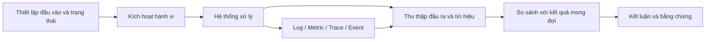

# Đánh giá khả năng điều khiển đầu vào và quan sát kết quả

## Mục tiêu học tập

Sau bài học này, người học có thể:

- Giải thích khả năng kiểm thử (testability) và vai trò của khả năng điều khiển (controllability) cùng khả năng quan sát (observability).
- Đánh giá mức độ dễ dàng thiết lập đầu vào, trạng thái và điều kiện cần thiết để kích hoạt hành vi.
- Đánh giá mức độ dễ dàng nhận biết kết quả, trạng thái cuối, lỗi và tác động phụ của một thao tác.
- Xác định các rào cản testability trong thiết kế, API, dữ liệu, môi trường và quy trình vận hành.
- Đề xuất cải tiến thiết kế để kiểm soát thời gian, dữ liệu, phụ thuộc và trạng thái một cách xác định.
- Thiết kế điểm quan sát qua assertion, trạng thái dữ liệu, log, metric, trace và sự kiện phù hợp.
- Cân bằng nhu cầu kiểm thử với bảo mật, quyền riêng tư và tính toàn vẹn của môi trường production.
- Lập đánh giá testability có bằng chứng và chuyển kết quả thành hành động cải tiến cụ thể.

## 1. Khả năng kiểm thử là gì?

Trong phạm vi **VALIDATION_TESTING_STRATEGY**, khả năng kiểm thử (testability) mô tả mức độ dễ dàng và đáng tin cậy để thiết lập một điều kiện, kích hoạt hành vi của hệ thống, quan sát kết quả và xác định hành vi đó có đáp ứng mong đợi hay không. Một hệ thống có testability tốt giúp nhóm tạo được tình huống cần kiểm tra, tái hiện lỗi, thu thập bằng chứng và định vị nguyên nhân với chi phí hợp lý.

Testability không chỉ là việc có thể viết test tự động. Một chức năng có thể được kiểm tra thủ công nhưng rất khó tự động hóa nếu trạng thái ban đầu không thể thiết lập, kết quả không thể quan sát hoặc phụ thuộc vào thời gian và dịch vụ bên ngoài không thể kiểm soát. Ngược lại, một thiết kế có giao diện rõ, trạng thái xác định và điểm quan sát phù hợp thường hỗ trợ cả kiểm thử thủ công, tự động, kiểm thử tích hợp lẫn điều tra sự cố.

Hai khía cạnh cốt lõi là:

- **Khả năng điều khiển (controllability)**: mức độ có thể đưa hệ thống vào trạng thái hoặc cung cấp đầu vào cần thiết để kích hoạt hành vi muốn kiểm tra.
- **Khả năng quan sát (observability)**: mức độ có thể suy ra trạng thái và hành vi bên trong từ đầu ra, sự kiện hoặc dữ liệu quan sát được.

Ví dụ, muốn kiểm tra xử lý đơn hàng khi thanh toán bị từ chối, nhóm cần điều khiển được kết quả phản hồi của nhà cung cấp hoặc dùng sandbox có kịch bản từ chối. Sau thao tác, nhóm cần quan sát được trạng thái đơn hàng, giao dịch, thông điệp phát ra và phản hồi trả về. Nếu chỉ thấy giao diện hiện thông báo chung mà không biết đơn hàng đã được ghi hay chưa, bằng chứng chưa đủ để kết luận.

Testability tốt giúp:

- Tạo các trường hợp thành công, lỗi và biên một cách có chủ đích.
- Giảm phụ thuộc vào dữ liệu hoặc trạng thái được chuẩn bị thủ công.
- Làm test ổn định, lặp lại và dễ chạy song song.
- Xác định chính xác bước và thành phần gây lỗi.
- Rút ngắn thời gian điều tra và sửa lỗi.
- Hỗ trợ kiểm tra các tình huống hiếm như timeout, retry, dữ liệu trùng hoặc phụ thuộc ngừng hoạt động.
- Tạo bằng chứng rõ ràng cho quyết định chất lượng và phát hành.

## 2. Khả năng điều khiển đầu vào (controllability)

Khả năng điều khiển là khả năng thiết lập các đầu vào, trạng thái và điều kiện môi trường để hệ thống thực hiện đúng đường đi cần kiểm tra. Đầu vào không chỉ là dữ liệu gửi trong request. Nó còn bao gồm danh tính, quyền, dữ liệu tồn tại trước đó, thời gian, cấu hình, trạng thái phụ thuộc, thứ tự sự kiện và điều kiện lỗi.

### 2.1. Các loại đầu vào cần điều khiển

| Loại đầu vào | Ví dụ | Câu hỏi đánh giá |
|---|---|---|
| Dữ liệu nghiệp vụ | Đơn hàng, tài khoản, số dư, sản phẩm | Có thể tạo dữ liệu hợp lệ và dữ liệu biên theo nhu cầu không? |
| Danh tính và quyền | Người dùng, vai trò, tenant, token | Có thể tạo danh tính với quyền cụ thể và thu hồi quyền an toàn không? |
| Trạng thái ban đầu | Đơn hàng đang chờ, giao dịch đã hoàn tất | Có thể đưa hệ thống vào trạng thái cần kiểm tra mà không phụ thuộc test khác không? |
| Thời gian | Token sắp hết hạn, lịch chạy, thời điểm callback | Có thể kiểm soát đồng hồ hoặc thời điểm mà không phải chờ thời gian thật không? |
| Phụ thuộc bên ngoài | Payment provider, email, API đối tác | Có thể mô phỏng phản hồi thành công, lỗi, chậm hoặc không sẵn sàng không? |
| Tải và đồng thời | Nhiều request, tranh chấp cập nhật | Có thể tạo mức tải và thứ tự cạnh tranh có thể lặp lại không? |
| Cấu hình | Feature flag, quota, giới hạn retry | Có thể đặt cấu hình rõ ràng cho test và khôi phục sau khi chạy không? |
| Sự kiện và thông điệp | Webhook, message queue, event | Có thể phát sự kiện đúng schema, lặp, trễ hoặc sai thứ tự không? |

Một hệ thống có controllability thấp thường khiến người kiểm thử phải chờ dữ liệu tự xuất hiện, dùng tài khoản chung, sửa trực tiếp database bằng thao tác thủ công hoặc phụ thuộc vào một dịch vụ bên ngoài không thể dự đoán. Những cách này làm test khó tái lập và tăng nguy cơ ảnh hưởng môi trường khác.

### 2.2. Điều khiển qua giao diện công khai

Ưu tiên sử dụng các giao diện và cơ chế được thiết kế cho việc cấu hình hoặc tương tác hợp lệ:

- API tạo dữ liệu kiểm thử trong môi trường test.
- Fixture hoặc factory tạo dữ liệu với trạng thái xác định.
- Dependency injection để thay thế clock, gateway hoặc client bên ngoài.
- Sandbox của nhà cung cấp với kịch bản phản hồi được tài liệu hóa.
- Cấu hình riêng theo môi trường và feature flag có kiểm soát.
- Công cụ quản lý dữ liệu test có quyền giới hạn và khả năng dọn dẹp.

Điều khiển qua giao diện công khai giúp test phản ánh cách hệ thống được sử dụng. Tuy nhiên, không phải mọi tình huống đều có thể tạo ra qua API người dùng. Một số trạng thái đặc biệt có thể cần test harness hoặc fixture nội bộ chỉ được bật trong môi trường kiểm thử.

### 2.3. Thiết lập trạng thái ban đầu một cách xác định

Test nên tự chuẩn bị trạng thái cần thiết thay vì dựa vào trạng thái còn lại từ lần chạy trước. Ví dụ, test kiểm tra hoàn tiền cần tạo hoặc chọn một giao dịch đã thanh toán hợp lệ; không nên giả định một test thanh toán khác đã chạy trước đó.

Các nguyên tắc hữu ích:

- Mỗi test sở hữu dữ liệu mà nó tạo ra.
- Dữ liệu có định danh riêng theo test hoặc lần chạy.
- Trạng thái ban đầu được mô tả rõ trong phần setup.
- Việc cleanup chỉ tác động đến tài nguyên do test sở hữu.
- Test có thể chạy riêng, lặp lại và đảo thứ tự mà không đổi kết quả.
- Các trạng thái khó tạo được cung cấp qua fixture hoặc API test có kiểm soát.

Không nên dùng một thao tác quản trị có quyền quá rộng để thiết lập trạng thái nếu có thể tạo dữ liệu bằng cơ chế giới hạn hơn. Nếu buộc phải thao tác trực tiếp với database trong kiểm thử tích hợp, cần quản lý schema, quyền, transaction và cleanup rõ ràng.

## 3. Khả năng quan sát kết quả (observability)

Khả năng quan sát là khả năng hiểu trạng thái và hành vi của hệ thống từ những tín hiệu mà hệ thống cung cấp. Đối với kiểm thử, observability giúp xác minh kết quả mong đợi và giải thích vì sao một test thất bại.

Đầu ra quan sát được có thể gồm:

- Giá trị trả về, HTTP status, response body hoặc giao diện hiển thị.
- Trạng thái dữ liệu trong database hoặc kho lưu trữ.
- Sự kiện được phát ra hoặc thông điệp được đưa vào queue.
- Log có cấu trúc và mã tương quan.
- Metric về số lượng, độ trễ, tỷ lệ lỗi và trạng thái tài nguyên.
- Distributed trace cho luồng đi qua nhiều thành phần.
- Trạng thái của tác vụ nền hoặc tiến trình bất đồng bộ.
- Audit record cho thao tác nhạy cảm hoặc thay đổi quan trọng.

Một hệ thống có observability thấp có thể chỉ trả về “đã nhận yêu cầu” trong khi tác vụ nền vẫn đang chờ, thất bại hoặc bị xử lý hai lần. Nếu không có cách xác minh trạng thái cuối, test có thể kết luận quá sớm hoặc phải chờ thủ công.

### 3.1. Phân biệt output, logging, monitoring và observability

- **Output** là kết quả trực tiếp của thao tác, chẳng hạn response hoặc trạng thái trả về.
- **Logging** ghi lại sự kiện và thông tin xảy ra tại một thời điểm.
- **Monitoring** theo dõi các chỉ số hoặc điều kiện đã xác định để phát hiện khi hệ thống lệch khỏi ngưỡng.
- **Observability** là khả năng sử dụng các tín hiệu đầu ra, log, metric, trace và ngữ cảnh để suy luận trạng thái hoặc nguyên nhân của hành vi, kể cả tình huống chưa dự đoán trước.

Một hệ thống có nhiều log chưa chắc có observability tốt. Nếu log thiếu mã tương quan, thiếu thông tin trạng thái hoặc chứa quá nhiều thông tin không liên quan, người kiểm thử vẫn khó nối các sự kiện thành một luồng hoàn chỉnh.

### 3.2. Quan sát kết quả nghiệp vụ

Không nên chỉ kiểm tra dấu hiệu kỹ thuật bề mặt. Ví dụ, HTTP 200 chỉ cho biết request được xử lý ở mức giao thức; nó không tự chứng minh đơn hàng đã được tạo đúng, tổng tiền chính xác hoặc giao dịch thanh toán chỉ xảy ra một lần.

Hãy xác định hậu điều kiện (postcondition) của hành vi:

- Bản ghi nào phải được tạo, cập nhật hoặc giữ nguyên?
- Trạng thái nào được phép xuất hiện?
- Sự kiện nào phải được phát ra và với định danh nào?
- Tác động phụ nào không được xảy ra?
- Có bất biến nghiệp vụ nào phải giữ sau thao tác không?

Với thao tác thanh toán, có thể cần kiểm tra response, trạng thái giao dịch, trạng thái đơn hàng, số lần ghi nhận thanh toán và sự kiện phát ra. Chọn mức quan sát phù hợp với mục tiêu; không cần kiểm tra chi tiết nội bộ không liên quan nếu assertion ở ranh giới công khai đã đủ chứng minh hành vi.

## 4. Mối quan hệ giữa controllability và observability

Hai khía cạnh bổ sung cho nhau. Controllability cho phép tạo điều kiện để hành vi xảy ra; observability cho phép biết điều gì đã xảy ra và kết quả có đúng không.



Có thể gặp bốn tình huống:

| Controllability | Observability | Hệ quả đối với kiểm thử |
|---|---|---|
| Cao | Cao | Dễ tạo tình huống, xác minh và chẩn đoán; phù hợp để xây dựng test ổn định. |
| Cao | Thấp | Có thể kích hoạt hành vi nhưng khó biết trạng thái cuối hoặc nguyên nhân thất bại. |
| Thấp | Cao | Có thể quan sát hệ thống nhưng khó tạo đúng điều kiện để kiểm tra một trường hợp cụ thể. |
| Thấp | Thấp | Khó thiết lập, khó xác minh và khó tái hiện; chi phí kiểm thử và điều tra cao. |

Ví dụ, nhóm có thể gửi một webhook thanh toán bất kỳ nhưng không thể yêu cầu sandbox trả về lỗi cụ thể. Observability của phản hồi có thể tốt, nhưng controllability đối với tình huống lỗi thấp. Ngược lại, một test harness có thể buộc service đi vào nhánh lỗi nhưng không cung cấp trạng thái, log hoặc mã giao dịch để xác minh; khi đó controllability cao nhưng observability thấp.

## 5. Đánh giá testability theo hành trình kiểm thử

Để đánh giá có hệ thống, hãy đi qua một hành trình từ lúc chuẩn bị đến lúc kết luận.

### 5.1. Chuẩn bị điều kiện

Hỏi:

- Có thể tạo danh tính, quyền và dữ liệu cần thiết không?
- Có thể thiết lập trạng thái ban đầu mà không chạy một test khác không?
- Có thể điều khiển clock, random seed, feature flag và cấu hình không?
- Phụ thuộc ngoài có thể được mô phỏng hoặc dùng sandbox không?
- Môi trường và dữ liệu có thể được khôi phục sau test không?

### 5.2. Kích hoạt hành vi

Hỏi:

- Có giao diện ổn định để kích hoạt hành vi không?
- Có thể gửi dữ liệu biên, dữ liệu sai và yêu cầu lặp không?
- Có thể tạo đồng thời hoặc thứ tự sự kiện cần thiết không?
- Có thể mô phỏng timeout, lỗi mạng, phản hồi chậm hoặc dependency unavailable không?
- Test có cần thao tác thủ công hoặc chờ một sự kiện bên ngoài không kiểm soát không?

### 5.3. Quan sát và xác minh

Hỏi:

- Có thể nhận biết kết quả cuối và trạng thái trung gian quan trọng không?
- Có thể xác minh tác động đến dữ liệu và các dịch vụ liên quan không?
- Log, metric và trace có nối được các bước của cùng một giao dịch không?
- Test có phân biệt được lỗi sản phẩm, lỗi môi trường và timeout của test không?
- Khi thất bại, có đủ bằng chứng để xác định bước và thành phần liên quan không?

### 5.4. Tái lập và dọn dẹp

Hỏi:

- Có thể chạy lại với cùng điều kiện và thu kết quả nhất quán không?
- Test có độc lập với thứ tự chạy và test khác không?
- Dữ liệu và tài nguyên có được dọn dẹp an toàn không?
- Có thể chạy song song trong phạm vi tài nguyên được phân vùng không?
- Kết quả có gắn với commit, phiên bản, cấu hình và dữ liệu đã dùng không?

## 6. Thiết kế để tăng khả năng điều khiển

Testability nên được xem xét trong thiết kế sản phẩm. Một số quyết định nhỏ có thể giảm đáng kể chi phí kiểm thử.

### 6.1. Dependency injection và thay thế phụ thuộc

Thay vì để logic nghiệp vụ tự tạo kết nối hoặc gọi trực tiếp dịch vụ ngoài, hãy đưa phụ thuộc qua constructor hoặc giao diện rõ ràng. Test có thể cung cấp implementation giả để điều khiển phản hồi.

```java
interface PaymentGateway {
    PaymentResult charge(PaymentRequest request);
}

final class OrderService {
    private final PaymentGateway paymentGateway;

    OrderService(PaymentGateway paymentGateway) {
        this.paymentGateway = paymentGateway;
    }

    PaymentResult pay(PaymentRequest request) {
        return paymentGateway.charge(request);
    }
}
```

Trong unit/component test, có thể thay `PaymentGateway` bằng fake hoặc mock để mô phỏng thành công, từ chối, timeout hoặc exception. Integration test vẫn cần xác minh adapter thật và hợp đồng với môi trường phù hợp. Không nên dùng mock để thay thế toàn bộ bằng chứng tích hợp.

### 6.2. Tiêm clock thay vì đọc giờ hệ thống trực tiếp

Logic hết hạn, lịch chạy hoặc thời gian chờ sẽ khó kiểm tra nếu gọi đồng hồ hệ thống ở nhiều nơi. Tiêm một abstraction thời gian giúp test điều khiển thời điểm.

```java
final class TokenPolicy {
    private final Clock clock;

    TokenPolicy(Clock clock) {
        this.clock = clock;
    }

    boolean isExpired(Instant expiresAt) {
        return !clock.instant().isBefore(expiresAt);
    }
}

Clock testClock = Clock.fixed(
    Instant.parse("2026-02-10T09:00:00Z"),
    ZoneOffset.UTC
);
TokenPolicy policy = new TokenPolicy(testClock);
```

Test có thể kiểm tra thời điểm ngay trước, đúng tại và ngay sau thời hạn mà không phải chờ thực tế. Cần xác định rõ múi giờ và quy tắc so sánh tại biên.

### 6.3. Điều khiển tính ngẫu nhiên

Nếu thuật toán dùng random, hãy cung cấp seed hoặc abstraction tạo số ngẫu nhiên để test có thể tái hiện kết quả. Trong production, nguồn ngẫu nhiên vẫn phải đáp ứng yêu cầu bảo mật phù hợp; không dùng seed cố định cho mục đích bảo mật chỉ để dễ test.

Với ID ngẫu nhiên, test có thể kiểm tra định dạng và tính duy nhất theo hợp đồng, không nên phụ thuộc vào một giá trị cụ thể trừ khi ID generator được thay thế có chủ đích trong test.

### 6.4. Điều khiển phụ thuộc và lỗi

Đối với HTTP client, queue consumer hoặc storage adapter, cần có cách cấu hình endpoint, timeout và phản hồi trong môi trường test. Có thể sử dụng:

- Fake server hoặc stub HTTP.
- Test container cho database, broker hoặc cache.
- Sandbox do nhà cung cấp cung cấp.
- Fault injection có kiểm soát để mô phỏng chậm, ngắt kết nối hoặc lỗi.
- Adapter thay thế ở cấp unit/component.

Phải xác định rõ phép test nào dùng phụ thuộc giả và phép test nào xác minh phụ thuộc thật. Nếu chỉ dùng fake, test không chứng minh cấu hình mạng, xác thực hoặc tương thích runtime với dịch vụ thật.

### 6.5. Cung cấp cơ chế tạo trạng thái và dữ liệu

Factory, builder, fixture hoặc API test có thể tạo trạng thái phức tạp nhanh và nhất quán. Ví dụ, `OrderFixture.paidOrder()` có thể tạo đơn hàng đã thanh toán hợp lệ cho test hoàn tiền. Fixture nên mô tả trạng thái được tạo, không che giấu quá nhiều hành vi hoặc tạo dữ liệu dùng chung khó kiểm soát.

Nếu cần một endpoint chỉ dành cho test để tạo trạng thái, endpoint đó phải được giới hạn trong môi trường test hoặc được bảo vệ bằng cơ chế phân quyền chặt chẽ. Không để một đường truy cập đặc biệt có thể bị sử dụng trong production để bỏ qua quy trình nghiệp vụ.

## 7. Thiết kế để tăng khả năng quan sát

Hệ thống nên cung cấp đủ tín hiệu để xác minh kết quả và điều tra khi có sai lệch.

### 7.1. Trả về kết quả rõ ràng

API nên có response và mã trạng thái phản ánh đúng kết quả theo hợp đồng. Với tác vụ bất đồng bộ, response “đã tiếp nhận” cần được phân biệt với “đã hoàn tất”. Có thể trả về operation ID hoặc resource ID để client và test truy vấn trạng thái sau đó.

Không nên dùng HTTP 200 cho mọi tình huống nếu body không cho biết thao tác thành công, đang xử lý hay thất bại. Cũng không nên để test phụ thuộc vào thông báo lỗi nội bộ không ổn định; hãy xác minh hợp đồng lỗi công khai.

### 7.2. Log có cấu trúc và correlation ID

Log có cấu trúc giúp lọc theo trường thay vì phân tích chuỗi tự do. Một giao dịch đi qua nhiều service nên có correlation ID hoặc trace ID để nối các log và trace liên quan.

Ví dụ một sự kiện log có thể chứa:

```json
{
  "event": "payment_status_updated",
  "correlationId": "test-run-42-order-17",
  "orderId": "order-17",
  "paymentStatus": "DECLINED",
  "service": "payment-adapter"
}
```

Đây là dữ liệu minh họa. Không đưa token, thông tin thẻ, mật khẩu, secret hoặc dữ liệu cá nhân không cần thiết vào log. ID tương quan nên là định danh kỹ thuật, không chứa thông tin nhạy cảm.

### 7.3. Metric và trạng thái có thể đo

Metric hữu ích có thể gồm:

- Số yêu cầu thành công, thất bại và timeout.
- Độ trễ theo endpoint hoặc loại giao dịch.
- Số tác vụ đang chờ và tuổi của tác vụ cũ nhất.
- Số lần retry, số lần mở circuit breaker và trạng thái dependency.
- Tỷ lệ xử lý thông điệp, số thông điệp dead-letter.
- Số bản ghi hoặc giao dịch được tạo theo loại kết quả.

Metric tổng hợp hỗ trợ đánh giá xu hướng, nhưng thường không đủ để xác minh một test case riêng. Để xác minh một giao dịch cụ thể, cần kết hợp ID, trạng thái dữ liệu, event hoặc trace tương ứng.

### 7.4. Distributed tracing

Với luồng qua nhiều dịch vụ, trace cho biết các span và thời gian của từng bước. Nó giúp xác định một giao dịch dừng ở gateway, service, database hay nhà cung cấp. Để trace hữu ích, context cần được truyền xuyên các ranh giới và các span cần có tên, thuộc tính và trạng thái nhất quán.

Trace không nên chứa payload nhạy cảm hoặc dữ liệu có thể định danh cá nhân nếu không cần thiết. Cần áp dụng chính sách lấy mẫu phù hợp để không tạo chi phí hoặc lưu trữ vượt mức.

### 7.5. Sự kiện và trạng thái cuối

Với hệ thống bất đồng bộ, một sự kiện phát ra không đồng nghĩa nghiệp vụ đã hoàn tất. Test cần có cách truy vấn trạng thái cuối hoặc chờ điều kiện có giới hạn thời gian.

Ví dụ, sau khi gửi lệnh hoàn tiền, hệ thống có thể trả về trạng thái `PENDING`. Test cần chờ trạng thái chuyển sang `COMPLETED` hoặc `FAILED` theo thời hạn được định nghĩa. Không dùng sleep cố định rồi giả định công việc đã xong.

## 8. Kiểm thử các tình huống khó điều khiển hoặc khó quan sát

Một số tình huống cần thiết kế testability có chủ đích vì hiếm khi xảy ra hoặc khó tái hiện.

### 8.1. Timeout và lỗi mạng

Điều khiển timeout bằng fake server hoặc adapter có thể trì hoãn phản hồi, đóng kết nối hoặc trả lỗi. Quan sát cần xác minh:

- Client có kết thúc trong timeout đã cấu hình không?
- Có retry đúng số lần và đúng loại lỗi không?
- Retry có dùng backoff hoặc jitter theo thiết kế không?
- Thao tác có bị thực hiện lặp gây tác động phụ không?
- Trạng thái cuối và thông báo cho người dùng có phù hợp không?

### 8.2. Thông điệp trùng hoặc sai thứ tự

Với queue hoặc webhook, cần có cách phát lại cùng message ID, phát sự kiện đến trễ hoặc đảo thứ tự. Quan sát trạng thái cuối, số lần xử lý và các bất biến nghiệp vụ. Test cần chứng minh hệ thống xử lý idempotent hoặc từ chối sự kiện không hợp lệ theo hợp đồng.

### 8.3. Cạnh tranh và cập nhật đồng thời

Để kiểm tra race condition, cần điều khiển thời điểm hoặc điểm đồng bộ để hai thao tác cùng tranh chấp một tài nguyên. Có thể dùng barrier, latch hoặc test hook trong môi trường kiểm thử. Tránh dựa vào sleep ngẫu nhiên vì kết quả khó tái lập.

Quan sát cần bao gồm trạng thái cuối, số bản ghi, ràng buộc duy nhất, lock hoặc version. Một test chỉ xác minh cả hai request đều nhận response thành công chưa chứng minh dữ liệu nhất quán.

### 8.4. Dữ liệu hiếm và trạng thái lỗi

Factory và fixture nên tạo được dữ liệu sát giới hạn, dữ liệu thiếu, dữ liệu cũ, trạng thái bị khóa hoặc bản ghi liên quan không tồn tại. Nếu một trạng thái chỉ có thể xuất hiện sau hàng loạt bước phức tạp, hãy xem xét cung cấp fixture rõ ràng hoặc tách logic để kiểm tra ở cấp phù hợp.

### 8.5. Lỗi trong tác vụ nền

Job nền cần cung cấp trạng thái, thời điểm bắt đầu/kết thúc, số lần thử và kết quả cuối. Test có thể kích hoạt job với dữ liệu riêng, chờ operation ID hoặc trạng thái cụ thể, rồi xác minh tác động. Cần có cách làm sạch hàng đợi và ngăn job của test này xử lý dữ liệu của test khác.

## 9. Ví dụ xuyên suốt: đánh giá testability của luồng đặt hàng

Giả sử người dùng gửi yêu cầu tạo đơn hàng. Order service kiểm tra tồn kho, gọi Payment service và phát sự kiện để Notification service gửi xác nhận.

### 9.1. Hành vi cần kiểm tra

- Đơn hàng được tạo với đúng sản phẩm, số lượng và tổng tiền.
- Thanh toán thành công làm đơn hàng chuyển sang trạng thái phù hợp.
- Thanh toán bị từ chối không tạo trạng thái đã thanh toán.
- Yêu cầu gửi lặp không tạo đơn hoặc giao dịch trùng.
- Notification được phát sau khi trạng thái nghiệp vụ phù hợp được ghi nhận.
- Lỗi từ một dependency được xử lý theo quy tắc và có thể quan sát.

### 9.2. Đánh giá controllability

| Điều kiện cần tạo | Cơ chế hỗ trợ | Bằng chứng về khả năng điều khiển |
|---|---|---|
| Người mua và quyền phù hợp | API/fixture tạo user và role riêng | Có thể tạo người dùng ở tenant xác định. |
| Sản phẩm còn hàng hoặc hết hàng | Product fixture hoặc API test | Có thể thiết lập tồn kho ở giá trị xác định. |
| Payment thành công/từ chối/timeout | Fake gateway hoặc sandbox scenario | Có thể chọn kết quả phản hồi theo test case. |
| Callback lặp | Webhook test client hoặc message fixture | Có thể gửi cùng event ID nhiều lần. |
| Thời gian xử lý và hết hạn | Clock abstraction hoặc scheduler test | Có thể tiến thời gian có kiểm soát. |
| Hai request đồng thời | Barrier hoặc load/concurrency harness | Có thể đồng bộ điểm bắt đầu để tạo tranh chấp. |

### 9.3. Đánh giá observability

| Kết quả cần biết | Điểm quan sát | Assertion hoặc bằng chứng |
|---|---|---|
| Đơn hàng đã tạo | API response và order repository | Có đúng một order ID và đúng dữ liệu. |
| Thanh toán đã hoàn tất | Payment state và order state | Trạng thái phù hợp với kết quả gateway. |
| Callback được xử lý một lần | Payment record, event log hoặc audit | Không có giao dịch hoặc side effect trùng. |
| Notification đã được phát | Queue/event test consumer | Có event đúng schema và correlation ID. |
| Dependency thất bại | Error response, log, metric và trace | Có loại lỗi, số lần retry và trạng thái cuối rõ. |
| Hành trình kết thúc | Trạng thái đơn hàng cuối | Trạng thái phù hợp với quy tắc nghiệp vụ. |

### 9.4. Nhận diện khoảng trống

Nếu nhóm có thể giả lập Payment gateway nhưng không thể xác minh đơn hàng có bị tạo trước khi thanh toán thành công hay không, observability còn thiếu ở trạng thái dữ liệu. Nếu có thể đọc database nhưng không thể buộc gateway trả về timeout, controllability còn thiếu ở phụ thuộc ngoài. Cải tiến cần giải quyết đúng khoảng trống, chẳng hạn bổ sung fake gateway có kịch bản và truy vấn trạng thái đơn hàng qua repository hoặc API kiểm thử được kiểm soát.

## 10. Đánh giá testability theo các cấp kiểm thử

Mỗi cấp kiểm thử cần mức điều khiển và quan sát khác nhau.

| Cấp kiểm thử | Điều khiển cần có | Quan sát cần có |
|---|---|---|
| Unit | Đầu vào, clock, random, dependency giả | Giá trị trả về, exception, tương tác được kỳ vọng |
| Component | Cấu hình thành phần, fixture, dependency ngoài ranh giới | Trạng thái thành phần, dữ liệu và sự kiện đầu ra |
| Contract | Request, response, schema và phiên bản hợp đồng | Sai lệch schema, status, payload và compatibility result |
| Integration | Database, queue, API, cấu hình và dữ liệu cô lập | Trạng thái lưu trữ, message, log, metric và trace |
| System/E2E | Danh tính, dữ liệu, môi trường và các phụ thuộc trong hành trình | Kết quả cuối của người dùng và trạng thái xuyên hệ thống |
| Performance | Workload, tốc độ đến, dữ liệu và thời gian chạy | Latency, throughput, lỗi, tài nguyên và kết quả nghiệp vụ |
| Security | Vai trò, quyền, dữ liệu và điều kiện tấn công trong phạm vi được phép | Quyết định truy cập, audit, response và dấu hiệu vi phạm |

Không cần phơi bày mọi chi tiết nội bộ cho mọi test. Một test E2E nên ưu tiên giao diện và kết quả mà người dùng hoặc hệ thống tích hợp nhìn thấy. Test cấp thấp có thể quan sát chi tiết hơn để chẩn đoán logic. Cần chọn mức quan sát vừa đủ cho câu hỏi kiểm thử và tránh phụ thuộc vào implementation detail không ổn định.

## 11. Các mẫu thiết kế giúp tăng testability

### 11.1. Pure function và logic ít side effect

Logic nhận đầu vào và trả kết quả mà không đọc/ghi trạng thái toàn cục thường dễ kiểm tra. Tách phần tính toán thuần khỏi phần truy cập mạng, database hoặc đồng hồ giúp unit test xác định và nhanh.

### 11.2. Ports and adapters

Định nghĩa giao diện cho các phụ thuộc như payment gateway, email sender, clock hoặc storage. Logic nghiệp vụ sử dụng giao diện; adapter cụ thể đảm nhiệm giao tiếp với công nghệ. Test có thể thay adapter bằng fake ở cấp phù hợp và vẫn có integration test cho adapter thật.

### 11.3. API trạng thái và operation ID

Với tác vụ bất đồng bộ, cung cấp định danh thao tác và một giao diện truy vấn trạng thái có quyền phù hợp. Điều này giúp client, test và vận hành biết công việc đang chờ, hoàn tất hay thất bại.

### 11.4. Correlation ID xuyên dịch vụ

Truyền một mã tương quan qua gateway, service, queue và worker để kết nối log và trace. Test có thể dùng mã riêng để tìm đúng sự kiện của lần chạy, tránh phải tìm bằng thời gian hoặc dữ liệu chung.

### 11.5. Test fixture và factory có hợp đồng rõ

Fixture nên nêu trạng thái tạo ra và dữ liệu mặc định. Tránh factory ẩn nhiều side effect hoặc tự gọi dịch vụ thật. Các factory có thể cung cấp phương thức cụ thể như `pendingOrder()`, `paidOrder()` hoặc `customerWithoutPermission()` để test dễ đọc.

### 11.6. Fault injection và test seam

Test seam là điểm trong thiết kế cho phép thay đổi hoặc quan sát hành vi trong một phạm vi kiểm thử. Fault injection đưa vào lỗi có chủ đích như timeout, lỗi kết nối hoặc phản hồi sai định dạng. Các cơ chế này giúp kiểm tra nhánh lỗi mà không cần chờ sự cố thật.

Test seam phải được kiểm soát: chỉ hoạt động trong môi trường test hoặc qua quyền được giới hạn, có audit và không tạo đường bỏ qua bảo vệ trong production.

## 12. Ranh giới an toàn khi tăng khả năng điều khiển và quan sát

Tăng testability không có nghĩa mở mọi trạng thái hoặc dữ liệu cho bất kỳ ai. Các cơ chế hỗ trợ kiểm thử cần tuân thủ nguyên tắc bảo mật và quyền riêng tư.

- Không tạo endpoint production cho phép tùy ý đổi trạng thái thanh toán, quyền hoặc dữ liệu.
- Không dùng credential production trong test nếu không có quy trình được phê duyệt.
- Không ghi token, mật khẩu, dữ liệu thẻ hoặc payload nhạy cảm vào log và trace.
- Dùng dữ liệu tổng hợp hoặc dữ liệu đã được xử lý phù hợp.
- Cấp quyền tối thiểu cho test runner và tài khoản kiểm thử.
- Giới hạn fault injection vào môi trường và thời gian đã cho phép.
- Phân biệt rõ sandbox, fake, mock và dependency thật trong báo cáo.
- Đảm bảo cleanup không xóa dữ liệu ngoài phạm vi của test.
- Theo dõi các thao tác test có thể tạo side effect như email, SMS, thanh toán hoặc webhook.

Một điểm quan sát tốt cung cấp đủ bằng chứng mà không làm lộ dữ liệu không cần thiết. Một điểm điều khiển tốt tạo đúng điều kiện mà không bỏ qua các quy tắc bảo vệ đang được kiểm tra.

## 13. Đo lường và ghi nhận mức độ testability

Testability khó quy về một con số duy nhất. Có thể dùng đánh giá định tính kết hợp dữ liệu quan sát để so sánh giữa các thành phần hoặc theo dõi cải thiện qua thời gian.

### 13.1. Các chiều đánh giá

| Chiều đánh giá | Câu hỏi | Ví dụ bằng chứng |
|---|---|---|
| Khả năng thiết lập dữ liệu | Có thể tạo đầu vào và trạng thái cần thiết không? | Fixture, API test, thời gian chuẩn bị dữ liệu. |
| Khả năng điều khiển phụ thuộc | Có thể mô phỏng phản hồi và lỗi của dependency không? | Fake server, sandbox scenario, test container. |
| Khả năng điều khiển thời gian và đồng thời | Có thể tái hiện timeout, expiry và race condition không? | Clock abstraction, barrier, scheduler test. |
| Khả năng quan sát kết quả | Có thể xác minh trạng thái cuối và tác động phụ không? | Assertion, repository/API query, event. |
| Khả năng chẩn đoán | Có thể nối các bước và tìm nguyên nhân khi thất bại không? | Correlation ID, log có cấu trúc, trace. |
| Khả năng tái lập | Test có chạy riêng và lặp lại ổn định không? | Kết quả nhiều lần chạy, order/parallel test. |
| Khả năng dọn dẹp | Tài nguyên có được thu hồi an toàn không? | Cleanup hook, namespace, kiểm tra dữ liệu tồn. |

### 13.2. Chỉ số hỗ trợ

Nhóm có thể theo dõi:

- Thời gian chuẩn bị dữ liệu và trạng thái ban đầu.
- Tỷ lệ test có thể chạy độc lập.
- Tỷ lệ test flaky hoặc phụ thuộc thứ tự.
- Thời gian từ test Fail đến khi xác định nguyên nhân.
- Tỷ lệ lỗi được phân loại rõ là lỗi sản phẩm, môi trường hay test.
- Tỷ lệ hành vi quan trọng có điểm quan sát đủ để xác minh.
- Thời gian tạo lại một tình huống lỗi đã biết.
- Số thao tác setup/cleanup còn phải làm thủ công.

Các chỉ số này phản ánh những khía cạnh khác nhau. Ví dụ, tỷ lệ test độc lập cao không chứng minh log và trace đủ tốt; thời gian điều tra thấp có thể do test đơn giản chứ không phải observability của cả hệ thống cao. Hãy đọc số liệu cùng bối cảnh và bằng chứng cụ thể.

### 13.3. Hồ sơ đánh giá testability

Một hồ sơ ngắn có thể gồm:

- Thành phần, hành trình hoặc API được đánh giá.
- Hành vi và rủi ro cần kiểm thử.
- Đầu vào/trạng thái cần thiết và cách tạo.
- Phụ thuộc có thể điều khiển và phần chưa thể điều khiển.
- Đầu ra, trạng thái và tín hiệu có thể quan sát.
- Khó khăn khi tái hiện hoặc chẩn đoán.
- Giới hạn bảo mật, quyền và môi trường.
- Cải tiến đề xuất, người phụ trách và bằng chứng hoàn thành.

Không nên chấm điểm rồi kết luận một thành phần “testable” mà không nêu điều kiện. Hãy mô tả hành vi nào dễ kiểm tra, hành vi nào còn khó và rủi ro nào cần xử lý.

## 14. Quy trình cải thiện testability

Nhóm có thể áp dụng trình tự sau:

1. **Chọn hành vi quan trọng**: xác định yêu cầu, hành trình hoặc rủi ro cần kiểm thử.
2. **Mô tả điều kiện đầu vào**: liệt kê dữ liệu, danh tính, quyền, thời gian, cấu hình, trạng thái và phụ thuộc.
3. **Đánh giá controllability**: xác định cách tạo từng điều kiện và điểm nào còn phụ thuộc thủ công hoặc bên ngoài.
4. **Mô tả kết quả cần quan sát**: xác định output, trạng thái cuối, dữ liệu, event và tác động phụ.
5. **Đánh giá observability**: kiểm tra tín hiệu có đủ rõ, liên kết được và an toàn không.
6. **Thử tái hiện**: chạy test riêng, lặp lại, đảo thứ tự hoặc tạo lỗi có kiểm soát để xác minh khả năng điều khiển và quan sát.
7. **Xác định khoảng trống**: phân loại vấn đề do thiết kế, dữ liệu, môi trường, phụ thuộc hoặc thiếu điểm quan sát.
8. **Đề xuất cải tiến nhỏ**: thêm fixture, dependency injection, clock, test seam, operation ID, assertion hoặc correlation ID phù hợp.
9. **Kiểm tra ranh giới an toàn**: xác nhận cơ chế test không mở quyền hoặc làm lộ dữ liệu ngoài phạm vi.
10. **Đo lại và ghi nhận**: so sánh thời gian chuẩn bị, độ ổn định, thời gian chẩn đoán và bằng chứng sau cải tiến.

## 15. Những sai lầm thường gặp

- **Chỉ nghĩ đầu vào là request**: bỏ qua trạng thái, quyền, thời gian và phụ thuộc. Hãy lập danh sách mọi điều kiện ảnh hưởng đến hành vi.
- **Dùng dữ liệu chung**: test phụ thuộc thứ tự hoặc thay đổi kết quả. Hãy tạo dữ liệu riêng và quản lý ownership.
- **Dựa vào thời gian thật**: test hết hạn hoặc bất đồng bộ phải chờ lâu và dễ flaky. Hãy điều khiển clock hoặc chờ điều kiện có timeout.
- **Không thể mô phỏng lỗi dependency**: nhánh timeout và từ chối khó được kiểm tra. Hãy dùng fake, sandbox hoặc fault injection có kiểm soát.
- **Chỉ kiểm tra HTTP status**: bỏ sót trạng thái dữ liệu và tác động phụ sai. Hãy xác minh hậu điều kiện nghiệp vụ.
- **Log quá nhiều nhưng thiếu ngữ cảnh**: khó nối sự kiện của một giao dịch. Hãy dùng log có cấu trúc và correlation ID.
- **Chỉ quan sát trạng thái nội bộ**: test bị gắn chặt với implementation detail. Hãy chọn ranh giới quan sát phù hợp với mục tiêu.
- **Tạo test hook không được bảo vệ**: cơ chế kiểm thử có thể bị sử dụng để thay đổi trạng thái production. Hãy giới hạn môi trường và quyền.
- **Dùng mock thay mọi tích hợp**: test không chứng minh cấu hình và hợp đồng thật. Hãy bổ sung contract/integration test cần thiết.
- **Không kiểm tra cleanup**: dữ liệu và tài nguyên tồn tại gây ảnh hưởng test sau. Hãy giới hạn cleanup theo tài nguyên sở hữu.
- **Đánh giá testability bằng cảm giác**: không có bằng chứng về thời gian chuẩn bị hoặc khả năng tái hiện. Hãy thử chạy và ghi nhận kết quả.

## 16. Tự kiểm tra

Trước khi kết luận một thành phần có khả năng kiểm thử phù hợp, hãy tự hỏi:

- Có thể tạo mọi đầu vào, danh tính, quyền và trạng thái cần thiết không?
- Có thể điều khiển thời gian, random, cấu hình và phụ thuộc bên ngoài không?
- Có thể tạo timeout, lỗi, dữ liệu biên, thông điệp lặp và thao tác đồng thời không?
- Mỗi test có tự chuẩn bị điều kiện và chạy độc lập không?
- Có thể quan sát kết quả cuối và các tác động phụ quan trọng không?
- Output, trạng thái, log, metric và trace có đủ ngữ cảnh để xác minh không?
- Có thể liên kết các sự kiện của cùng một giao dịch không?
- Khi test thất bại, có thể phân biệt lỗi sản phẩm với lỗi môi trường hoặc lỗi test không?
- Dữ liệu và tài nguyên có được dọn dẹp an toàn không?
- Các điểm điều khiển và quan sát có tuân thủ bảo mật, quyền riêng tư và phân quyền không?
- Có bằng chứng trước/sau để xác nhận cải tiến testability có hiệu quả không?

## Kết luận

Khả năng kiểm thử phụ thuộc vào việc nhóm có thể chủ động tạo điều kiện và quan sát kết quả một cách xác định hay không. Controllability giúp thiết lập dữ liệu, trạng thái, thời gian và phản hồi của phụ thuộc; observability giúp xác minh đầu ra, trạng thái cuối, sự kiện và nguyên nhân khi có lỗi. Khi thiết kế có giao diện phụ thuộc rõ, fixture tái lập, clock có thể điều khiển, điểm quan sát có ngữ cảnh và ranh giới bảo mật phù hợp, các cấp kiểm thử trở nên ổn định, dễ chẩn đoán và ít tốn công hơn. Đánh giá testability cần dựa trên hành vi cụ thể và bằng chứng, sau đó chuyển khoảng trống thành cải tiến thiết kế có thể kiểm chứng.
