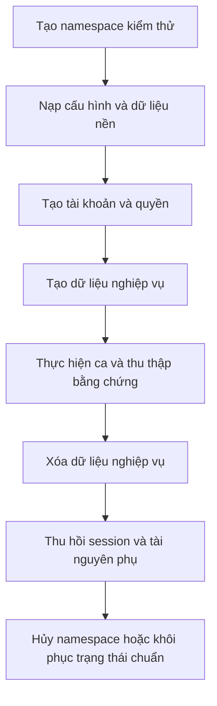

# Xác định cơ chế chuẩn bị và đặt lại trạng thái kiểm thử

Một ca kiểm thử đáng tin cậy cần bắt đầu từ trạng thái đã biết và kết thúc theo cách không làm ảnh hưởng đến lần chạy tiếp theo. Nếu kết quả phụ thuộc vào dữ liệu còn sót, thứ tự chạy, cache cũ, message chưa xử lý hoặc một thao tác của người kiểm thử trước đó, cùng một ca có thể lúc đạt lúc thất bại dù mã sản phẩm không thay đổi.

**Chuẩn bị trạng thái kiểm thử (test setup)** là quá trình tạo điều kiện ban đầu cần thiết trước khi thực hiện ca kiểm thử. **Đặt lại hoặc dọn trạng thái (reset/teardown)** là quá trình đưa môi trường và dữ liệu về trạng thái xác định sau khi kiểm thử, hoặc chuẩn bị lại trạng thái đó trước lần chạy tiếp theo. Hai hoạt động này cần được thiết kế cùng nhau: cách tạo dữ liệu phải đi kèm cách quản lý vòng đời dữ liệu; cách khởi tạo dịch vụ phải đi kèm cách dừng và làm sạch dịch vụ.

Trong chiến lược kiểm thử xác thực, trạng thái ban đầu và trạng thái cuối là một phần của điều kiện kiểm thử. Nhóm cần chọn cơ chế phù hợp với loại trạng thái, mức độ cô lập, tốc độ, độ tin cậy và khả năng tái hiện. Không có một cách reset duy nhất phù hợp cho mọi hệ thống; có thể kết hợp fixture, factory, transaction rollback, dữ liệu seed, API quản trị dành cho kiểm thử, container dùng một lần, snapshot hoặc thao tác bù trừ.

## 1. Trạng thái kiểm thử gồm những gì?

Trạng thái kiểm thử là toàn bộ điều kiện có thể ảnh hưởng đến hành vi hoặc kết quả của ca. Nó không chỉ là một vài bản ghi trong cơ sở dữ liệu. Tùy hệ thống, trạng thái có thể gồm:

| Nhóm trạng thái | Ví dụ | Rủi ro nếu không kiểm soát |
|---|---|---|
| Dữ liệu nghiệp vụ | Người dùng, đơn hàng, số dư, tồn kho, hồ sơ | Ca phụ thuộc dữ liệu do lần chạy trước tạo ra |
| Cơ sở dữ liệu | Bản ghi, sequence, transaction, constraint, schema | Dữ liệu trùng, sai trạng thái hoặc thứ tự chạy ảnh hưởng kết quả |
| Cache | Session cache, Redis, cache ứng dụng, CDN | Đọc dữ liệu cũ hoặc trạng thái không đồng nhất |
| Hàng đợi và sự kiện | Message đang chờ, sự kiện đã xử lý, retry queue | Ca sau nhận message của ca trước hoặc xử lý trùng |
| Tệp và object storage | Tệp tải lên, báo cáo, ảnh, tài liệu | Tệp cũ làm sai kết quả hoặc dung lượng tích lũy |
| Danh tính và quyền | Tài khoản, vai trò, token, session | Ca chạy với quyền hoặc phiên đăng nhập không mong đợi |
| Cấu hình | Feature flag, biến môi trường, giới hạn, endpoint | Hành vi khác nhau giữa các lần chạy |
| Thời gian và tính ngẫu nhiên | Đồng hồ, timezone, seed, lịch chạy | Kết quả thay đổi theo thời điểm hoặc giá trị ngẫu nhiên |
| Phụ thuộc bên ngoài | Sandbox thanh toán, dịch vụ email, API đối tác | Dữ liệu và tác dụng phụ nằm ngoài quyền kiểm soát trực tiếp |
| Tài nguyên hạ tầng | Container, cổng mạng, tiến trình, thư mục tạm | Xung đột tài nguyên, rò rỉ tiến trình hoặc môi trường không sạch |

Trước khi thiết kế setup/reset, hãy lập danh sách các trạng thái mà ca thực sự đọc hoặc thay đổi. Không cần làm sạch toàn bộ hệ thống nếu ca chỉ cần một tài khoản và một đơn hàng riêng. Ngược lại, chỉ xóa bản ghi chính có thể chưa đủ nếu ca còn tạo cache, message hoặc tệp liên quan.

## 2. Nguyên tắc của trạng thái kiểm thử đáng tin cậy

Một cơ chế chuẩn bị và đặt lại tốt nên đáp ứng các nguyên tắc sau:

1. **Trạng thái ban đầu rõ ràng:** Ca biết dữ liệu, quyền, cấu hình và điều kiện nào đang tồn tại trước khi chạy.
2. **Tái tạo được:** Cùng phiên bản và cùng đầu vào có thể tạo lại điều kiện tương đương.
3. **Độc lập:** Ca không cần dựa vào việc một ca khác đã chạy trước đó.
4. **Có thể lặp lại:** Chạy nhiều lần không tạo dữ liệu trùng hoặc làm trạng thái ngày càng lệch.
5. **Cô lập:** Một ca không làm thay đổi dữ liệu hoặc tài nguyên của ca khác.
6. **Dọn dẹp có kiểm soát:** Trạng thái được tạo ra được xóa, hoàn tác hoặc cách ly sau khi dùng.
7. **Có thể chẩn đoán:** Nếu setup hoặc reset thất bại, nhóm biết bước nào và tài nguyên nào bị ảnh hưởng.
8. **An toàn:** Không xóa dữ liệu ngoài phạm vi, không dùng bí mật hoặc dữ liệu cá nhân không được phép.

Một ca kiểm thử nên tự khai báo điều kiện cần có hoặc dùng một cơ chế chung có hợp đồng rõ. Không nên ngầm giả định rằng tài khoản thử nghiệm luôn ở trạng thái ban đầu hoặc hàng đợi luôn rỗng.

## 3. Phân biệt setup, teardown và reset

Ba khái niệm thường được dùng gần nhau nhưng có vai trò khác nhau:

- **Setup:** Tạo dữ liệu và điều kiện trước ca kiểm thử. Ví dụ tạo khách hàng, gán quyền, thêm sản phẩm vào kho và thiết lập feature flag.
- **Teardown/cleanup:** Thu hồi hoặc xóa tài nguyên mà ca đã tạo sau khi chạy. Ví dụ xóa đơn hàng thử, thu hồi token, xóa tệp và dừng container.
- **Reset:** Đưa một thành phần hoặc môi trường về trạng thái chuẩn đã định nghĩa. Ví dụ khôi phục database snapshot, xóa cache của namespace thử nghiệm hoặc làm rỗng hàng đợi riêng.

Reset có thể diễn ra trước hoặc sau ca. Một số nhóm reset trước mỗi ca để bảo đảm điểm xuất phát; một số nhóm tạo namespace mới rồi loại bỏ toàn bộ namespace sau khi hoàn thành. Teardown thường nhắm vào tài nguyên do ca tạo ra, trong khi reset có thể khôi phục một thành phần dùng chung về trạng thái chuẩn.

Không nên xem teardown là việc tùy chọn chỉ thực hiện khi ca đạt. Nếu ca thất bại giữa chừng, tài nguyên đã tạo vẫn cần được dọn dẹp. Cơ chế cleanup phải được gọi trong nhánh bảo đảm thực thi như `finally`, `defer` hoặc hook tương đương của framework.

## 4. Chọn cơ chế chuẩn bị dữ liệu

### 4.1. Fixture cố định

Fixture là dữ liệu hoặc đối tượng được chuẩn bị trước để nhiều ca có thể sử dụng. Fixture phù hợp khi dữ liệu tương đối ổn định, có ý nghĩa chung và không bị các ca sửa đổi.

Ví dụ fixture có thể gồm:

- Một tài khoản chỉ đọc để kiểm tra quyền xem.
- Một danh mục sản phẩm mẫu không thay đổi trong bộ kiểm thử.
- Một bộ mã vùng và mức thuế đã được xác nhận.
- Một cấu hình giả lập cho dịch vụ đối tác.

Ưu điểm là dễ hiểu và giảm công chuẩn bị. Hạn chế là fixture dùng chung có thể bị sửa hoặc xóa ngoài ý muốn, tạo phụ thuộc giữa các ca. Nếu một ca cần thay đổi dữ liệu, nên tạo bản sao riêng hoặc dùng factory thay vì sửa fixture chung.

### 4.2. Factory và builder

Factory tạo đối tượng hoặc bản ghi theo tham số; builder cho phép mô tả cấu trúc dữ liệu phức tạp bằng các giá trị mặc định có thể ghi đè. Đây là lựa chọn phù hợp khi mỗi ca cần dữ liệu riêng nhưng vẫn muốn tái sử dụng cách tạo.

Ví dụ giả mã:

```text
customer = CustomerFactory.create(
    status = "ACTIVE",
    locale = "vi-VN"
)

order = OrderFactory.create(
    customer = customer,
    status = "PENDING",
    total = 250000
)
```

Factory nên tạo dữ liệu hợp lệ theo quy tắc miền và trả lại định danh để ca có thể truy vết, kiểm tra và dọn dẹp. Tránh factory tự tạo quá nhiều đối tượng ngầm khiến người đọc không biết trạng thái thực tế. Các giá trị quan trọng nên được nêu rõ trong ca kiểm thử.

### 4.3. Seed data

Seed data là dữ liệu nền được nạp vào môi trường hoặc database để hỗ trợ kiểm thử. Nó phù hợp với dữ liệu tham chiếu hoặc trạng thái nền ít thay đổi, chẳng hạn danh mục, loại tiền tệ, quyền mặc định và cấu hình sản phẩm.

Seed data cần:

- Có phiên bản và nguồn gốc rõ ràng.
- Có thể nạp lặp mà không tạo bản ghi trùng.
- Không chứa dữ liệu cá nhân hoặc bí mật không được phép.
- Có thứ tự phụ thuộc hợp lý, ví dụ tạo bản ghi cha trước bản ghi con.
- Có cơ chế cập nhật và dọn dẹp khi schema hoặc quy tắc thay đổi.

Seed data dùng chung không nên chứa trạng thái biến động mà nhiều ca cùng ghi. Những dữ liệu như số dư, tồn kho hoặc trạng thái đơn hàng nên được tạo riêng theo từng ca hoặc từng worker.

### 4.4. Chuẩn bị qua API hoặc giao diện

Ca kiểm thử có thể tạo trạng thái bằng cách gọi API hoặc thực hiện luồng người dùng thật. Cách này hữu ích khi cần xác nhận cả quy trình tạo dữ liệu hoặc khi không nên ghi trực tiếp vào database.

Tuy nhiên, dùng giao diện để chuẩn bị mọi dữ liệu có thể làm setup chậm và khiến ca phụ thuộc vào nhiều bước không liên quan đến mục tiêu chính. Nếu mục tiêu là kiểm tra thanh toán, việc tạo tài khoản và giỏ hàng qua UI có thể làm tăng thời gian cũng như điểm có thể thất bại. Có thể dùng API kiểm thử hoặc factory để chuẩn bị trước, sau đó dành UI cho hành vi cần xác nhận.

API setup dành cho kiểm thử cần được bảo vệ, chỉ bật trong môi trường phù hợp và không tạo đường truy cập quản trị không được kiểm soát ở sản xuất. Nếu có thể, hãy dùng cùng quy tắc nghiệp vụ với đường đi thật hoặc ghi rõ những kiểm tra nào bị bỏ qua khi tạo dữ liệu trực tiếp.

## 5. Các cơ chế đặt lại trạng thái phổ biến

Không có một kỹ thuật reset phù hợp cho mọi loại hệ thống. Hãy chọn theo phạm vi thay đổi, tính nguyên tử, tốc độ và khả năng khôi phục.

| Cơ chế | Cách hoạt động | Phù hợp khi | Giới hạn cần chú ý |
|---|---|---|---|
| Transaction rollback | Chạy thao tác trong transaction rồi rollback | Kiểm thử database trong cùng kết nối và không cần commit ra ngoài | Không hoàn tác được tác dụng phụ đã gửi sang dịch vụ hoặc message broker bên ngoài transaction |
| Xóa dữ liệu theo namespace | Xóa bản ghi có test ID, tenant hoặc schema riêng | Nhiều ca tạo dữ liệu độc lập | Cần bảo đảm bộ lọc xóa chính xác và xử lý quan hệ phụ thuộc |
| Truncate/recreate database | Xóa bảng hoặc tạo lại database/schema | Môi trường dùng riêng, cần điểm xuất phát sạch | Có thể chậm, nguy hiểm nếu nhầm môi trường; cần xử lý foreign key và sequence |
| Snapshot/restore | Khôi phục trạng thái đã chụp | Database hoặc máy ảo cần trạng thái nền phức tạp | Tốn lưu trữ/thời gian; snapshot có thể lỗi thời hoặc chứa dữ liệu nhạy cảm |
| Container/namespace dùng một lần | Tạo môi trường mới cho lần chạy rồi hủy | Kiểm thử tích hợp và CI cần cô lập cao | Khởi động dịch vụ có thể tốn thời gian và tài nguyên |
| Reset endpoint hoặc admin API | Gọi thao tác có kiểm soát để đưa thành phần về trạng thái chuẩn | Dịch vụ có cơ chế reset được thiết kế riêng cho kiểm thử | Cần xác thực, giới hạn môi trường và khả năng theo dõi tác dụng phụ |
| Stub/fake reset | Xóa lịch sử request, trạng thái giả và message đã ghi | Kiểm thử phụ thuộc được mô phỏng | Chỉ reset mô hình giả, không chứng minh trạng thái của dịch vụ thật |
| Thao tác bù trừ | Tạo hành động ngược để hoàn tác tác dụng nghiệp vụ | Hệ thống phân tán không có transaction chung | Bù trừ có thể thất bại hoặc không đảo ngược hoàn toàn tác dụng phụ |

### 5.1. Transaction rollback

Với kiểm thử database, transaction rollback có thể tạo môi trường sạch nhanh chóng. Ca mở transaction, tạo hoặc sửa dữ liệu, thực hiện hành vi cần kiểm tra và rollback ở cuối.

Ví dụ SQL minh họa:

```sql
BEGIN;

INSERT INTO customers (id, name)
VALUES ('test-customer-01', 'Test Customer');

-- Thực hiện thao tác và truy vấn kết quả cần xác nhận.

ROLLBACK;
```

Kỹ thuật này hiệu quả khi mọi thao tác nằm trong cùng transaction và cùng cơ chế quản lý. Nếu ứng dụng mở kết nối khác, commit nội bộ, gửi message hoặc gọi API ngoài, rollback của kết nối kiểm thử không thể hoàn tác các tác dụng phụ đó. Cần xác nhận cách transaction của ứng dụng tương tác với transaction kiểm thử trước khi dựa vào kỹ thuật này.

### 5.2. Xóa dữ liệu theo định danh kiểm thử

Một cách phổ biến là gắn dữ liệu do ca tạo với một định danh riêng, chẳng hạn `testRunId`, tenant thử nghiệm hoặc tiền tố có quy ước. Teardown chỉ xóa dữ liệu thuộc định danh đó.

Ví dụ:

```text
runId = createUniqueTestRunId()
customer = createCustomer(testRunId = runId)
order = createOrder(customerId = customer.id, testRunId = runId)

try:
    runAssertions(order)
finally:
    deleteTestData(testRunId = runId)
```

Định danh cần được truyền qua các thành phần tạo dữ liệu liên quan. Nếu message, tệp hoặc bản ghi con không mang dấu vết này, cleanup có thể để sót tài nguyên. Bộ lọc xóa phải kiểm tra phạm vi và không bao giờ dựa vào một điều kiện rộng có thể khớp dữ liệu thật.

### 5.3. Snapshot và môi trường dùng một lần

Với hệ thống cần nhiều dữ liệu nền hoặc cấu hình phức tạp, snapshot có thể giúp khôi phục nhanh trạng thái đã biết. Môi trường dùng một lần như container, database riêng hoặc namespace riêng còn giúp giới hạn ảnh hưởng giữa các lần chạy.

Mô hình phổ biến:

1. Tạo môi trường hoặc namespace từ image/schema đã version hóa.
2. Nạp seed data và cấu hình chuẩn.
3. Chạy ca kiểm thử với định danh riêng.
4. Thu thập log, báo cáo và bằng chứng cần lưu.
5. Hủy môi trường hoặc khôi phục snapshot.

Snapshot chỉ đáng tin khi biết phiên bản ứng dụng, schema, dữ liệu và cấu hình đi kèm. Không dùng snapshot chứa thông tin sản xuất nhạy cảm nếu chưa được xử lý và phê duyệt theo chính sách dữ liệu.

## 6. Thiết kế thứ tự setup và cleanup

Setup thường phải tạo tài nguyên theo thứ tự phụ thuộc; cleanup thường thực hiện theo thứ tự ngược lại. Nếu đơn hàng phụ thuộc khách hàng, cần tạo khách hàng trước đơn hàng và xóa đơn hàng trước khách hàng.

Ví dụ:



Cleanup cần chạy cả khi assertion thất bại hoặc có exception. Có thể dùng cấu trúc bảo đảm thực thi:

```text
resources = []

try:
    customer = createCustomer()
    resources.add(customer)

    order = createOrder(customer)
    resources.add(order)

    executeTest(order)
finally:
    cleanupInReverseOrder(resources)
```

Đây là giả mã; framework thực tế có thể cung cấp fixture scope, teardown hook, `try/finally`, `defer` hoặc lifecycle callback tương ứng. Nếu cleanup có thể thất bại, cần ghi nhận lỗi cleanup riêng và bảo đảm lỗi đó không bị che bởi lỗi assertion ban đầu.

## 7. Bảo đảm reset an toàn và có thể lặp

Một thao tác reset tốt nên có tính idempotent: gọi nhiều lần vẫn đưa thành phần về cùng trạng thái mong muốn và không tạo thêm tác dụng phụ. Ví dụ, xóa dữ liệu theo `testRunId` có thể được thiết kế để không lỗi nếu bản ghi đã bị xóa.

Các quy tắc an toàn:

- Chỉ reset môi trường và namespace đã được xác định rõ là dành cho kiểm thử.
- Xác nhận định danh môi trường trước thao tác phá hủy dữ liệu.
- Dùng quyền tối thiểu cần thiết cho setup và cleanup.
- Không dùng lệnh xóa toàn bộ hoặc reset database dùng chung nếu không có cô lập và phê duyệt phù hợp.
- Ghi log định danh lần chạy, phạm vi tài nguyên và kết quả cleanup.
- Thiết kế reset có thể chạy lại sau khi lần trước bị gián đoạn.
- Đặt timeout và cơ chế retry có giới hạn cho thao tác cleanup.
- Cảnh báo khi còn tài nguyên mồ côi vượt thời hạn cho phép.

Nếu reset thất bại, không nên âm thầm tiếp tục chạy ca tiếp theo trên trạng thái không rõ. Có thể cách ly namespace, đánh dấu môi trường bị lỗi và tạo môi trường mới. Điều này giữ cho kết quả của lần chạy tiếp theo có ý nghĩa.

## 8. Cô lập trạng thái khi chạy song song

Chạy song song giúp giảm thời gian tổng thể nhưng làm tăng nguy cơ tranh chấp dữ liệu và tài nguyên. Nếu nhiều worker cùng sửa một tài khoản, giỏ hàng hoặc hàng đợi, một ca có thể làm thay đổi điều kiện của ca khác.

Các cách cô lập thường dùng:

- Tạo database/schema riêng cho mỗi worker hoặc nhóm ca.
- Gắn `testRunId` duy nhất vào mọi bản ghi và tài nguyên có thể truy vết.
- Dùng tenant, bucket, thư mục hoặc queue riêng.
- Tạo tài khoản riêng cho từng worker khi quyền và trạng thái session có thể thay đổi.
- Không dùng chung cổng mạng hoặc tên tài nguyên tĩnh nếu tiến trình chạy song song.
- Khóa tài nguyên dùng chung khi không thể tạo bản sao, đồng thời giới hạn thời gian giữ khóa.
- Thu dọn tài nguyên sau khi worker hoàn thành hoặc hết thời hạn.

Ví dụ, hai ca cùng kiểm tra thanh toán không nên cùng sử dụng một đơn hàng thử. Mỗi ca cần đơn hàng và idempotency key riêng, sau đó kiểm tra mã giao dịch tương ứng. Nếu buộc phải dùng tài khoản chung, nhóm cần bảo đảm các thao tác không tranh chấp và có quy tắc tuần tự hóa rõ.

Không nên dùng thứ tự chạy để che vấn đề cô lập. Một bộ kiểm thử chỉ đạt khi chạy tuần tự nhưng thất bại khi chạy song song có thể đang có phụ thuộc trạng thái hoặc race condition cần xử lý.

## 9. Xử lý hệ thống phân tán và tác dụng phụ bên ngoài

Trong hệ thống phân tán, một hành động có thể tạo tác dụng phụ ở nhiều nơi: ghi database, phát event, gửi email, gọi thanh toán và cập nhật cache. Một transaction cục bộ không thể rollback tất cả các hệ thống này.

Có thể dùng các chiến lược:

### 9.1. Stub, fake và sandbox

Thay phụ thuộc bên ngoài bằng stub/fake khi mục tiêu là kiểm tra logic của thành phần hiện tại. Ví dụ, fake email ghi thông điệp vào bộ nhớ thay vì gửi thư thật. Với giao dịch thanh toán, dùng sandbox của nhà cung cấp để tạo giao dịch thử theo quy tắc được hỗ trợ.

Stub/fake cần được reset giữa các ca: xóa lịch sử request, trạng thái phản hồi đã cấu hình và message đã ghi. Cần có kiểm thử tích hợp riêng với phụ thuộc thật để xác nhận ranh giới giao tiếp.

### 9.2. Outbox, queue và event

Với message queue, cần biết message nào thuộc lần chạy nào. Có thể dùng topic hoặc queue riêng, correlation ID, test run ID và consumer group riêng. Sau ca, kiểm tra message đã được xử lý hoặc cách ly queue của lần chạy.

Không nên xóa toàn bộ queue dùng chung để làm sạch một ca. Việc đó có thể xóa message của nhóm khác hoặc tác vụ nền. Nếu không thể tạo queue riêng, cần cơ chế lọc và phối hợp rõ ràng.

### 9.3. Thao tác bù trừ

Một số tác dụng phụ không thể xóa trực tiếp, chẳng hạn giao dịch sandbox đã ghi nhận hoặc yêu cầu đã gửi đến dịch vụ bên ngoài. Có thể cần thao tác bù trừ như hủy giao dịch thử, hoàn tác đặt chỗ hoặc vô hiệu hóa tài nguyên.

Thao tác bù trừ không phải lúc nào cũng đảo ngược hoàn toàn hành động ban đầu. Cần ghi nhận trạng thái, mã tham chiếu và kết quả bù trừ; nếu bù trừ thất bại, đánh dấu tài nguyên cần xử lý và không coi cleanup đã hoàn tất.

## 10. Kiểm soát thời gian, số ngẫu nhiên và cấu hình

Thời gian và tính ngẫu nhiên là các nguồn trạng thái dễ bị bỏ quên. Một ca kiểm tra hạn sử dụng có thể đạt hôm nay nhưng thất bại ngày mai nếu dùng đồng hồ thực. Một ca tạo mã ngẫu nhiên có thể khó tái hiện nếu không lưu seed.

Các kỹ thuật hữu ích:

- Dùng clock abstraction hoặc đồng hồ giả để đặt thời điểm kiểm thử.
- Cố định timezone và locale khi kiểm tra định dạng ngày, tiền tệ và số.
- Dùng seed xác định cho bộ sinh dữ liệu ngẫu nhiên nếu mục tiêu là kiểm tra logic có thể tái hiện.
- Lưu seed và đầu vào khi một lần chạy ngẫu nhiên phát hiện lỗi.
- Reset feature flag và cấu hình về giá trị đã định nghĩa trước mỗi ca.
- Dùng cấu hình riêng theo môi trường và xác minh cấu hình thực tế khi bắt đầu chạy.

Nếu mục tiêu của ca là kiểm tra hành vi ngẫu nhiên hoặc phân phối thống kê, không nên cố định seed cho mọi lần chạy. Có thể dùng seed cố định cho hồi quy tái hiện và một nhóm chạy seed thay đổi theo lịch để khám phá thêm trường hợp.

## 11. Setup và reset theo vòng đời của framework

Hầu hết framework kiểm thử cung cấp cơ chế setup/teardown theo phạm vi (scope). Phạm vi càng rộng thì chi phí chuẩn bị được chia sẻ cho nhiều ca càng lớn, nhưng nguy cơ trạng thái dùng chung cũng tăng.

| Phạm vi | Thời điểm chuẩn bị và dọn dẹp | Phù hợp khi | Rủi ro |
|---|---|---|---|
| Mỗi assertion hoặc bước | Tạo trạng thái rất nhỏ quanh một phép kiểm tra | Hiếm dùng, chỉ cho helper đặc biệt | Quá nhiều setup làm ca chậm và khó hiểu |
| Mỗi test case | Trước và sau từng ca | Cần độc lập và dữ liệu thay đổi | Có thể tốn thời gian tạo dữ liệu lặp |
| Mỗi test class/suite | Một lần cho nhóm ca liên quan | Dữ liệu nền bất biến, chỉ đọc | Ca trong suite có thể phụ thuộc lẫn nhau nếu sửa dữ liệu chung |
| Mỗi worker/process | Một lần cho worker | Database hoặc service riêng theo worker | Tài nguyên lớn và cần cleanup khi worker bị dừng đột ngột |
| Mỗi test run | Một lần cho toàn bộ lần chạy | Khởi động container hoặc dịch vụ nền dùng chung, ít thay đổi | Trạng thái dùng chung có thể rò rỉ giữa các ca |

Chọn scope nhỏ nhất đáp ứng tốc độ và nhu cầu sử dụng chung. Dữ liệu có thể thay đổi nên tạo theo từng ca; dữ liệu tham chiếu bất biến có thể dùng chung nếu được bảo vệ chỉ đọc. Nếu suite cần chia sẻ một trạng thái đã tạo, hãy ghi rõ thứ tự và không chạy song song những ca phụ thuộc vào trạng thái đó.

Ví dụ giả mã theo fixture:

```python
@fixture
def order_for_test():
    run_id = new_test_run_id()
    order = create_order(test_run_id=run_id)
    try:
        yield order
    finally:
        delete_test_data(run_id)
```

Tên decorator và cú pháp có thể khác theo framework; nguyên tắc là fixture cung cấp dữ liệu và luôn chạy cleanup sau khi ca hoàn tất hoặc thất bại.

## 12. Kiểm tra chính cơ chế setup/reset

Setup và reset cũng có thể có lỗi. Nếu cơ chế tạo dữ liệu tạo sai quyền, seed thiếu bản ghi hoặc reset xóa nhầm dữ liệu, các ca phía sau có thể cho kết quả sai mà khó nhận ra.

Nên kiểm tra cơ chế này bằng các xác nhận sau:

- Setup tạo đúng số lượng và trạng thái dữ liệu cần thiết.
- Các quan hệ và ràng buộc dữ liệu hợp lệ.
- Người dùng thử có đúng vai trò và quyền cần kiểm tra.
- Reset đưa thành phần về trạng thái chuẩn đã mô tả.
- Chạy reset hai lần vẫn an toàn và cho kết quả như nhau.
- Cleanup hoạt động khi assertion thất bại hoặc tiến trình bị gián đoạn ở các điểm đã dự kiến.
- Tài nguyên do ca tạo được truy vết và không còn sau thời hạn cleanup.
- Reset không ảnh hưởng đến namespace, dữ liệu hoặc queue của worker khác.

Có thể có một bộ kiểm tra riêng cho công cụ seed, factory, fixture và reset script. Khi các cơ chế này thay đổi, cần chạy kiểm tra của chúng trước khi dựa vào để chuẩn bị bộ kiểm thử lớn.

## 13. Ví dụ xuyên suốt: kiểm thử luồng đặt hàng và thanh toán

Giả sử một ca cần xác nhận khách hàng có thể thanh toán một đơn hàng và hệ thống chỉ ghi nhận một giao dịch. Trạng thái liên quan gồm tài khoản, giỏ hàng, tồn kho, đơn hàng, giao dịch sandbox, message xác nhận và cache.

Một cách tổ chức:

1. Tạo `testRunId` duy nhất và namespace dữ liệu riêng.
2. Tạo khách hàng thử có quyền phù hợp và sản phẩm có tồn kho xác định.
3. Tạo giỏ hàng và đơn hàng ở trạng thái chờ thanh toán bằng factory hoặc API kiểm thử.
4. Reset fake email và stub event để bắt đầu với lịch sử rỗng.
5. Gửi yêu cầu thanh toán qua sandbox bằng idempotency key riêng.
6. Kiểm tra giao dịch được ghi nhận một lần, đơn hàng chuyển trạng thái đúng và message xác nhận có correlation ID tương ứng.
7. Lưu log, mã đơn, mã giao dịch và kết quả kiểm tra.
8. Trong teardown, hủy giao dịch sandbox nếu quy trình yêu cầu, xóa message hoặc namespace riêng, xóa tệp và thu hồi session.
9. Xác nhận cleanup hoàn tất; nếu có tác dụng phụ không thể xóa, ghi lại trạng thái và người xử lý.

Với kiểm thử timeout hoặc gửi lại request, ca cần tạo điều kiện mạng hoặc phản hồi giả có kiểm soát. Không nên dùng một giao dịch sandbox dùng chung cho nhiều ca vì thao tác retry của ca này có thể làm thay đổi kết quả của ca khác.

Một số trạng thái nền như danh mục sản phẩm hoặc cấu hình thuế có thể dùng chung dưới dạng chỉ đọc. Tồn kho, đơn hàng và giao dịch cần riêng theo ca vì chúng bị thay đổi trong quá trình kiểm thử.

## 14. Chẩn đoán khi setup hoặc reset thất bại

Khi setup thất bại, không nên chạy tiếp assertion như thể điều kiện ban đầu đã đúng. Khi cleanup thất bại, không nên coi môi trường đã sạch.

Thông tin cần ghi nhận:

- ID lần chạy và ID ca kiểm thử.
- Bước setup/reset thất bại và thao tác đang thực hiện.
- Môi trường, build, namespace và cấu hình liên quan.
- Định danh tài nguyên được tạo hoặc cần dọn dẹp.
- Lỗi trả về, log và thời điểm xảy ra.
- Trạng thái cuối đã xác minh được và tài nguyên còn tồn tại.
- Người hoặc quy trình chịu trách nhiệm xử lý tiếp.

Phân loại kết quả:

- **Setup thất bại:** Ca chưa được thực hiện hợp lệ; đánh dấu bị chặn hoặc lỗi hạ tầng theo quy ước.
- **Assertion thất bại, cleanup đạt:** Có bằng chứng về lỗi kiểm thử và môi trường đã được dọn dẹp.
- **Assertion đạt, cleanup thất bại:** Hành vi được kiểm tra có thể đạt nhưng lần chạy chưa hoàn tất an toàn; cần xử lý tài nguyên còn sót.
- **Cả assertion và cleanup thất bại:** Lưu riêng cả hai lỗi để không làm mất nguyên nhân ban đầu.

Không nên để lỗi cleanup ghi đè stack trace hoặc bằng chứng của lỗi sản phẩm. Hãy lưu cả hai kết quả và liên kết chúng bằng ID lần chạy.

## 15. Bảo vệ dữ liệu và tránh reset nhầm môi trường

Reset có thể là thao tác phá hủy dữ liệu, vì vậy cần có ranh giới an toàn rõ ràng. Một script xóa dữ liệu dùng cho kiểm thử không được phép vô tình chạy trên môi trường sản xuất hoặc database dùng chung.

Các biện pháp cần cân nhắc:

- Chỉ bật cơ chế reset ở môi trường được xác định là kiểm thử.
- Xác minh tên môi trường, database, schema hoặc namespace trước khi xóa.
- Dùng tài khoản có quyền tối thiểu và không dùng credential sản xuất.
- Ưu tiên xóa theo định danh lần chạy thay vì xóa toàn bộ.
- Có giới hạn số bản ghi hoặc phạm vi tài nguyên được phép xóa.
- Ghi log thao tác reset và kết quả, nhưng không ghi bí mật hoặc dữ liệu nhạy cảm.
- Dùng dữ liệu tổng hợp hoặc đã ẩn danh; kiểm soát quyền truy cập vào snapshot và fixture.
- Với thao tác không thể hoàn tác, yêu cầu cơ chế phê duyệt phù hợp với quy trình tổ chức.

Nếu môi trường không thể được xác minh chắc chắn là môi trường thử nghiệm, không chạy thao tác reset. Hãy dừng và xác minh cấu hình trước khi tiếp tục.

## 16. Những sai lầm thường gặp

- **Dựa vào dữ liệu còn sót:** Ca chỉ đạt khi một ca khác đã chạy trước và tạo dữ liệu cần thiết.
- **Chỉ dọn database:** Cache, queue, tệp, session và dịch vụ ngoài vẫn giữ trạng thái cũ.
- **Chia sẻ dữ liệu có thể thay đổi:** Các ca chạy song song ghi đè trạng thái của nhau.
- **Chỉ cleanup khi ca đạt:** Assertion thất bại để lại tài nguyên và làm nhiễu lần chạy sau.
- **Dùng transaction rollback cho mọi thứ:** Tác dụng phụ ngoài transaction không được hoàn tác.
- **Dùng fixture chung có thể ghi:** Một ca thay đổi dữ liệu khiến các ca khác phụ thuộc thứ tự.
- **Reset bằng lệnh xóa rộng:** Có thể xóa nhầm dữ liệu của nhóm khác hoặc môi trường không phù hợp.
- **Không kiểm tra cleanup:** Nhóm giả định tài nguyên đã được xóa dù thao tác thất bại.
- **Retry setup không idempotent:** Có thể tạo thêm tài khoản, đơn hàng hoặc message trùng.
- **Không lưu định danh và log:** Khó biết tài nguyên nào thuộc lần chạy gây lỗi.
- **Để trạng thái cấu hình trôi dạt:** Feature flag, timezone hoặc seed thay đổi mà không được ghi nhận.
- **Không xử lý tài nguyên mồ côi:** Container, queue, tệp và dữ liệu thử tích lũy làm môi trường chậm và khó dự đoán.

## 17. Checklist thiết kế setup và reset

Trước khi đưa cơ chế chuẩn bị và đặt lại trạng thái vào bộ kiểm thử, nhóm có thể dùng checklist sau:

- [ ] Đã liệt kê dữ liệu, cache, queue, tệp, session, cấu hình và phụ thuộc có ảnh hưởng đến ca.
- [ ] Trạng thái ban đầu và kết quả cần xác minh được mô tả rõ.
- [ ] Cơ chế setup phù hợp với mục tiêu và cấp độ kiểm thử.
- [ ] Dữ liệu thay đổi được tạo riêng hoặc có cơ chế cô lập.
- [ ] Fixture/seed dùng chung được bảo vệ và có phiên bản.
- [ ] Cleanup được bảo đảm chạy khi ca đạt, thất bại hoặc phát sinh exception.
- [ ] Reset có thể chạy lặp an toàn và có phạm vi xác định.
- [ ] Thứ tự tạo và xóa tài nguyên tuân theo quan hệ phụ thuộc.
- [ ] Tác dụng phụ bên ngoài được mô phỏng, cách ly hoặc bù trừ có kiểm soát.
- [ ] Chạy song song không gây tranh chấp dữ liệu hoặc tài nguyên.
- [ ] Thời gian, seed ngẫu nhiên và cấu hình được kiểm soát hoặc ghi nhận.
- [ ] Setup/reset có log và thông báo lỗi đủ để chẩn đoán.
- [ ] Môi trường và quyền reset được xác minh để tránh tác động dữ liệu thật.
- [ ] Có cơ chế phát hiện và xử lý tài nguyên mồ côi.
- [ ] Báo cáo phân biệt setup thất bại, assertion thất bại và cleanup thất bại.

Một cơ chế chuẩn bị và đặt lại trạng thái tốt giúp mỗi ca bắt đầu từ điều kiện có thể giải thích, chạy độc lập và kết thúc mà không làm nhiễu lần kiểm thử tiếp theo. Khi dữ liệu, phụ thuộc và tài nguyên được quản lý theo vòng đời rõ ràng, nhóm có thể tái hiện lỗi, chạy song song an toàn và tin cậy hơn vào bằng chứng kiểm thử.
