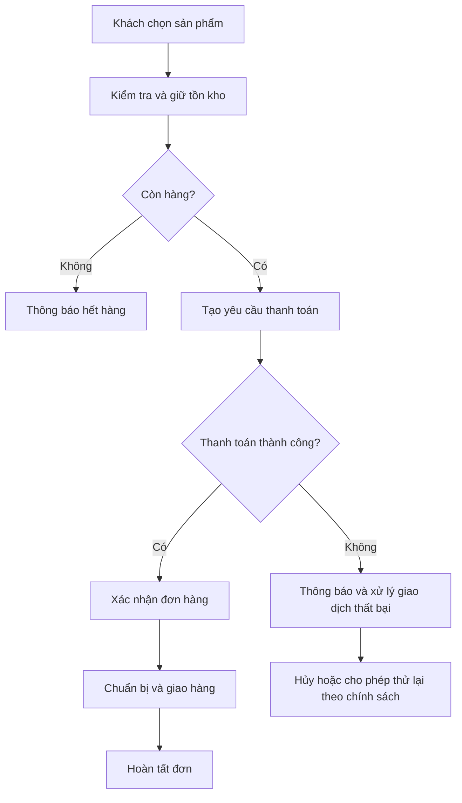

# Nhận diện miền nghiệp vụ và hậu quả khi sản phẩm hoạt động sai

Trong module `VALIDATION_TESTING_STRATEGY`, việc nhận diện miền nghiệp vụ là bước nền tảng để xây dựng chiến lược kiểm thử xác nhận (validation testing). Người kiểm thử cần hiểu sản phẩm đang giúp ai hoàn thành công việc gì, những quy tắc nào chi phối công việc đó và điều gì sẽ xảy ra nếu hệ thống đưa ra kết quả sai. Khi nắm được bối cảnh này, nhóm có thể chọn đúng luồng cần kiểm thử, xác định kết quả mong đợi có ý nghĩa với hoạt động kinh doanh và ưu tiên những rủi ro có hậu quả lớn.

## 1. Miền nghiệp vụ là gì và vì sao cần hiểu trước khi kiểm thử?

**Miền nghiệp vụ (business domain)** là phạm vi vấn đề và hoạt động mà sản phẩm hỗ trợ. Nó bao gồm mục tiêu của tổ chức và người dùng, các vai trò tham gia, quy trình công việc, khái niệm dữ liệu, quy tắc nghiệp vụ, giới hạn vận hành và các hệ thống bên ngoài có liên quan.

Ví dụ, với một sản phẩm bán hàng trực tuyến, miền nghiệp vụ không chỉ là trang danh sách sản phẩm hay chức năng thanh toán. Nó còn bao gồm cách cửa hàng quản lý tồn kho, cách khách đặt và hủy đơn, thời điểm ghi nhận doanh thu, cách xử lý thanh toán thất bại, quy trình giao hàng và chính sách hoàn tiền.

Một tính năng có thể chạy đúng về mặt kỹ thuật nhưng vẫn gây ra kết quả sai cho hoạt động thực tế. Chẳng hạn, API thanh toán trả về mã thành công nhưng đơn hàng không được tạo; khách đã bị trừ tiền mà cửa hàng không có đơn để giao. Kiểm tra riêng mã phản hồi của API sẽ không phát hiện đầy đủ vấn đề này. Cần kiểm tra cả kết quả xuyên suốt quy trình mà người dùng và doanh nghiệp mong đợi.

Trong kiểm thử, hiểu miền nghiệp vụ giúp trả lời bốn câu hỏi:

- **Ai** sử dụng hoặc chịu ảnh hưởng bởi sản phẩm?
- **Công việc nào** cần được hoàn thành và kết quả nào được xem là thành công?
- **Quy tắc và điều kiện nào** quyết định hệ thống phải xử lý ra sao?
- **Hậu quả nào** xuất hiện nếu một bước, dữ liệu hoặc quyết định của hệ thống sai?

Validation testing tập trung xác nhận sản phẩm đáp ứng nhu cầu sử dụng thực tế. Vì vậy, tiêu chí thành công cần gắn với kết quả nghiệp vụ, không chỉ với việc một màn hình hiển thị hay một hàm trả về giá trị như thiết kế.

## 2. Cách nhận diện miền nghiệp vụ

Không nên bắt đầu bằng cách liệt kê tất cả màn hình hoặc endpoint. Hãy bắt đầu từ mục tiêu và quy trình mà sản phẩm hỗ trợ, sau đó đi sâu vào các quy tắc và dữ liệu quyết định kết quả.

### 2.1. Xác định tác nhân và mục tiêu

Liệt kê những người, nhóm hoặc hệ thống tương tác với sản phẩm. Với mỗi tác nhân, ghi rõ mục tiêu, quyền hạn và kết quả họ cần nhận được.

| Tác nhân | Mục tiêu | Câu hỏi cần làm rõ |
|---|---|---|
| Khách hàng | Hoàn tất một giao dịch và nhận hàng/dịch vụ | Khách cần thấy thông tin gì trước khi xác nhận? Khi nào giao dịch được xem là hoàn tất? |
| Nhân viên vận hành | Xử lý đơn và giải quyết ngoại lệ | Nhân viên được phép sửa trạng thái nào? Cần bằng chứng gì để xử lý? |
| Bộ phận tài chính | Đối soát tiền thu, hoàn tiền và phí | Số tiền nào là nguồn dữ liệu chuẩn? Đối soát vào thời điểm nào? |
| Hệ thống thanh toán | Xác nhận hoặc từ chối giao dịch | Thông điệp lặp lại, đến trễ hoặc không rõ kết quả được xử lý thế nào? |

Một tác nhân có thể là người dùng cuối, nhân viên nội bộ, đối tác, dịch vụ bên thứ ba hoặc một hệ thống khác. Đừng bỏ qua tác nhân không trực tiếp dùng giao diện: họ vẫn có thể cung cấp dữ liệu hoặc chịu hậu quả từ quyết định của sản phẩm.

### 2.2. Mô tả luồng công việc từ đầu đến cuối

Chọn một quy trình có giá trị rõ ràng với người dùng và mô tả các bước từ khi bắt đầu đến khi đạt kết quả. Ghi lại cả nhánh ngoại lệ như từ chối, hết hạn, hủy, thử lại và xử lý thủ công.

Ví dụ, một luồng đặt hàng trực tuyến có thể được khái quát như sau:



Sơ đồ ban đầu không cần mô tả mọi chi tiết kỹ thuật. Mục tiêu là để nhóm thống nhất các bước nghiệp vụ, điểm ra quyết định, bên chịu trách nhiệm và kết quả cuối cùng. Sau đó, có thể bổ sung thời hạn xử lý, hệ thống tích hợp, điều kiện chuyển trạng thái và nhánh ngoại lệ.

Với mỗi bước, hãy hỏi:

- Dữ liệu đầu vào đến từ đâu và ai chịu trách nhiệm về độ chính xác?
- Điều kiện nào cho phép bước này bắt đầu hoặc hoàn tất?
- Hệ thống tạo ra thay đổi gì đối với dữ liệu hoặc trạng thái?
- Nếu bước thất bại, quy trình dừng lại, thử lại hay chuyển cho người xử lý?
- Người dùng và các hệ thống liên quan nhìn thấy kết quả nào?

### 2.3. Nhận diện khái niệm, dữ liệu và trạng thái

Ghi lại những đối tượng nghiệp vụ quan trọng và mối quan hệ giữa chúng. Trong ví dụ bán hàng, các đối tượng có thể gồm khách hàng, sản phẩm, tồn kho, đơn hàng, giao dịch thanh toán, vận đơn và yêu cầu hoàn tiền.

Với mỗi đối tượng, cần biết:

- **Định danh:** điều gì giúp phân biệt hai đối tượng?
- **Thuộc tính quan trọng:** dữ liệu nào ảnh hưởng đến quyết định nghiệp vụ?
- **Nguồn dữ liệu chuẩn:** hệ thống hoặc bộ phận nào có thẩm quyền xác nhận dữ liệu?
- **Vòng đời:** đối tượng được tạo, cập nhật, kết thúc hoặc lưu trữ như thế nào?
- **Quan hệ:** thay đổi ở đối tượng này ảnh hưởng đến đối tượng nào khác?

Trạng thái cần được hiểu theo quy tắc chuyển đổi, không chỉ theo danh sách giá trị. Ví dụ, một đơn hàng có thể đi qua các trạng thái nháp, chờ thanh toán, đã xác nhận, đang giao, hoàn tất hoặc đã hủy. Không phải mọi chuyển đổi đều hợp lệ: đơn đã giao không nên quay về trạng thái chờ thanh toán; đơn đã hủy không được tự động đưa vào giao hàng.

Các quy tắc chuyển trạng thái thường tạo ra điều kiện kiểm thử quan trọng:

| Đối tượng | Quy tắc cần xác định | Câu hỏi kiểm thử gợi ý |
|---|---|---|
| Đơn hàng | Chỉ xác nhận khi đáp ứng điều kiện thanh toán và tồn kho | Có thể xác nhận đơn khi một điều kiện chưa đạt không? |
| Tồn kho | Không bán vượt số lượng có thể phân bổ | Hai khách đặt sản phẩm cuối cùng gần như đồng thời thì kết quả ra sao? |
| Thanh toán | Một yêu cầu nghiệp vụ không được thu tiền hai lần | Gửi lại yêu cầu hoặc nhận thông báo lặp có tạo giao dịch trùng không? |
| Hoàn tiền | Tổng tiền hoàn không vượt số tiền đủ điều kiện hoàn | Nhiều yêu cầu hoàn đồng thời có vượt giới hạn không? |

### 2.4. Làm rõ quy tắc và bất biến nghiệp vụ

**Quy tắc nghiệp vụ** mô tả điều kiện hoặc cách xử lý mà tổ chức yêu cầu. **Bất biến nghiệp vụ (business invariant)** là điều kiện phải luôn đúng trong mọi trạng thái hợp lệ.

Ví dụ:

- Tổng số tiền thanh toán phải khớp với giá trị đơn sau khi áp dụng giảm giá, thuế và phí theo chính sách.
- Số lượng tồn kho khả dụng không được âm.
- Một đơn hàng chỉ được ghi nhận thu tiền thành công theo đúng số tiền được phép thu.
- Người dùng chỉ được xem hoặc thay đổi dữ liệu trong phạm vi quyền hạn.
- Một đơn đã hủy không được tiếp tục chuyển sang giao hàng nếu chưa có quy trình khôi phục hợp lệ.

Đừng tự suy diễn quy tắc từ tên trường hoặc hành vi hiện tại của phần mềm. Hãy xác nhận với chủ sở hữu nghiệp vụ, tài liệu chính sách, dữ liệu vận hành hoặc quy định liên quan. Nếu các nguồn mâu thuẫn, ghi rõ điểm chưa thống nhất và người có thẩm quyền quyết định.

### 2.5. Xác định ranh giới và phụ thuộc

Miền nghiệp vụ có thể trải qua nhiều ứng dụng và tổ chức. Hãy xác định hệ thống nào sở hữu dữ liệu, hệ thống nào gửi hoặc nhận sự kiện, ai chịu trách nhiệm khi tích hợp chậm hoặc không sẵn sàng.

Ví dụ, quy trình đặt hàng có thể phụ thuộc vào cổng thanh toán, dịch vụ quản lý kho, đối tác vận chuyển và hệ thống gửi thông báo. Cần làm rõ:

- Hệ thống nào là nguồn xác nhận cuối cùng cho từng kết quả?
- Phản hồi có thể đến trễ, lặp lại, sai thứ tự hoặc bị mất không?
- Khi không nhận được phản hồi, trạng thái nào được phép hiển thị?
- Có thể thử lại an toàn không? Làm sao tránh tạo giao dịch hoặc đơn trùng?
- Nếu một bước đã thành công nhưng bước kế tiếp thất bại, cách bù trừ hoặc phục hồi là gì?

Những câu hỏi này giúp kiểm thử các tình huống thực tế ở ranh giới tích hợp, nơi nhiều lỗi nghiệp vụ nghiêm trọng thường xuất hiện.

## 3. Xác định hậu quả khi sản phẩm hoạt động sai

Sau khi hiểu quy trình, hãy xác định điều gì có thể sai và ai sẽ chịu tác động. Một lỗi kỹ thuật có thể tạo ra nhiều hậu quả nghiệp vụ; ngược lại, cùng một lỗi hiển thị có thể có mức độ nghiêm trọng khác nhau tùy dữ liệu và thời điểm.

### 3.1. Phân biệt lỗi, biểu hiện và hậu quả

- **Lỗi hoặc cơ chế gây lỗi:** nguyên nhân trong phần mềm, dữ liệu, cấu hình hoặc tích hợp.
- **Biểu hiện:** điều người dùng hoặc hệ thống quan sát được.
- **Hậu quả nghiệp vụ:** tác động đến tiền, thời gian, quyết định, quyền lợi, nghĩa vụ hoặc hoạt động của tổ chức.

Ví dụ: một thông báo thanh toán bị xử lý lặp là cơ chế gây lỗi; khách hàng nhìn thấy hai giao dịch là biểu hiện; khách bị thu tiền hai lần, phát sinh khiếu nại và chi phí hoàn tiền là hậu quả. Phân biệt ba lớp này giúp nhóm viết kịch bản kiểm thử có mục đích và xác định đúng mức độ ưu tiên.

### 3.2. Các nhóm hậu quả thường gặp

| Nhóm hậu quả | Ví dụ | Điều cần xác nhận |
|---|---|---|
| Tài chính | Thu thiếu, thu trùng, tính sai giá hoặc hoàn tiền sai | Giá trị tối đa có thể bị ảnh hưởng; cách đối soát và khôi phục |
| Vận hành | Đơn bị kẹt, nhân viên phải nhập lại dữ liệu, quy trình bị gián đoạn | Khối lượng công việc tồn đọng; thời gian khôi phục |
| Khách hàng | Mất quyền lợi, nhận sai hàng, không thể hoàn tất giao dịch | Mức độ ảnh hưởng; khả năng tự phục vụ và giải quyết khiếu nại |
| Pháp lý và tuân thủ | Lưu trữ hoặc xử lý dữ liệu sai chính sách; không giữ được bằng chứng bắt buộc | Nghĩa vụ áp dụng; thời hạn; yêu cầu lưu vết |
| An toàn và sức khỏe | Hệ thống đưa ra quyết định sai trong quy trình có ảnh hưởng đến con người | Mức độ tổn hại; biện pháp ngăn chặn và cơ chế can thiệp |
| Bảo mật và quyền riêng tư | Người không có quyền truy cập dữ liệu hoặc thực hiện thao tác nhạy cảm | Phạm vi dữ liệu bị lộ; khả năng lạm dụng; nghĩa vụ thông báo |
| Uy tín và niềm tin | Người dùng mất tin tưởng sau các giao dịch sai lặp lại | Mức độ lan rộng; tác động đến việc tiếp tục sử dụng |
| Dữ liệu và quyết định | Báo cáo sai khiến quản lý phân bổ nguồn lực hoặc ra quyết định sai | Phạm vi dữ liệu sai; thời gian tồn tại; khả năng phát hiện |

Không phải sản phẩm nào cũng có mọi nhóm hậu quả. Chọn các nhóm thực sự liên quan đến miền nghiệp vụ và ghi rõ căn cứ.

### 3.3. Đánh giá mức độ ảnh hưởng

Để đánh giá rủi ro, cân nhắc ít nhất các khía cạnh sau:

1. **Mức độ tác động:** hậu quả có gây mất tiền, mất quyền lợi, gián đoạn lớn, vi phạm nghĩa vụ hoặc gây hại cho con người không?
2. **Phạm vi ảnh hưởng:** một người dùng, một giao dịch, một khách hàng tổ chức hay toàn bộ hoạt động?
3. **Khả năng xảy ra:** điều kiện kích hoạt có thường gặp không, có thể xảy ra đồng thời hoặc lặp lại không?
4. **Khả năng phát hiện:** lỗi có được phát hiện ngay hay âm thầm làm sai dữ liệu trong thời gian dài?
5. **Khả năng phục hồi:** có thể đảo ngược an toàn không, cần bao nhiêu thời gian và công sức để sửa?
6. **Tính phụ thuộc:** lỗi ở bước này có lan sang quy trình, báo cáo hoặc hệ thống khác không?

Có thể dùng thang điểm định tính thấp, trung bình, cao hoặc thang số để hỗ trợ thảo luận. Một cách sàng lọc đơn giản là điểm rủi ro = khả năng xảy ra × mức độ tác động. Điểm số chỉ hỗ trợ so sánh; không thay thế đánh giá chuyên môn. Một sự cố ít xảy ra nhưng có thể gây hậu quả nghiêm trọng vẫn cần được ưu tiên kiểm soát.

Khi ghi mức độ ảnh hưởng, hãy mô tả bằng tình huống cụ thể. “Ảnh hưởng cao” chưa đủ thông tin. “Có thể thu tiền hai lần cho cùng một đơn khi cổng thanh toán gửi lại thông báo sau thời gian chờ” giúp nhóm hiểu điều kiện, đối tượng và hậu quả cần ngăn chặn.

## 4. Chuyển hiểu biết nghiệp vụ thành mục tiêu và điều kiện kiểm thử

Một chiến lược kiểm thử có thể truy vết từ mục tiêu kinh doanh đến bằng chứng xác nhận. Chuỗi liên kết hữu ích là:

```
Mục tiêu nghiệp vụ
    -> Quy trình và quy tắc
        -> Rủi ro nếu quy tắc bị vi phạm
            -> Điều kiện/kịch bản kiểm thử
                -> Kết quả mong đợi và bằng chứng
```

Mỗi kịch bản nên chỉ ra điều kiện ban đầu, hành động, kết quả mong đợi và lý do nghiệp vụ khiến kết quả đó quan trọng. Kết quả mong đợi cần cụ thể, quan sát được và có thể đối chiếu với nguồn dữ liệu đáng tin cậy.

### 4.1. Ví dụ: xác nhận đơn hàng và thanh toán

Giả sử mục tiêu nghiệp vụ là khách hàng đặt được hàng còn tồn kho, chỉ bị thu đúng số tiền một lần và cửa hàng có thể giao đúng đơn đã xác nhận. Các quy tắc và rủi ro có thể được chuyển thành điều kiện kiểm thử như sau:

| Quy tắc / mục tiêu | Rủi ro khi sai | Điều kiện kiểm thử | Kết quả mong đợi |
|---|---|---|---|
| Không xác nhận đơn vượt tồn kho | Bán vượt số lượng có thể giao | Hai khách cùng đặt sản phẩm cuối cùng | Chỉ số lượng đơn hợp lệ được xác nhận; tồn kho không âm |
| Một đơn không bị thu tiền hai lần | Khách bị trừ tiền trùng | Gửi lại cùng yêu cầu thanh toán hoặc nhận cùng thông báo nhiều lần | Chỉ một lần thu tiền được ghi nhận cho giao dịch nghiệp vụ đó |
| Kết quả thanh toán phải được phản ánh nhất quán | Đã thu tiền nhưng đơn vẫn chờ hoặc bị mất | Cổng thanh toán báo thành công nhưng phản hồi về ứng dụng bị trễ | Hệ thống đối soát được trạng thái; không tạo đơn hoặc khoản thu trùng |
| Đơn hủy phải giải phóng nguồn lực theo chính sách | Tồn kho bị giữ mãi hoặc đơn đã hủy vẫn được giao | Hủy đơn khi đang giữ hàng hoặc sau khi thanh toán | Trạng thái đơn, tồn kho và hoàn tiền nhất quán với chính sách |
| Hoàn tiền không vượt giới hạn | Tổn thất tài chính hoặc sai lệch đối soát | Gửi hai yêu cầu hoàn tiền đồng thời cho cùng giao dịch | Tổng tiền hoàn không vượt số tiền đủ điều kiện |

Những kịch bản này cần được kiểm tra ở mức phù hợp: kiểm thử quy tắc ở cấp thành phần, kiểm thử tích hợp với dịch vụ liên quan và kiểm thử đầu cuối để xác nhận kết quả mà khách hàng hoặc nhân viên vận hành nhìn thấy. Với phụ thuộc bên ngoài, có thể dùng môi trường thử nghiệm hoặc mô phỏng phản hồi để kiểm tra các trường hợp lỗi, chậm, lặp và không rõ kết quả.

### 4.2. Bao phủ cả luồng bình thường và ngoại lệ

Với mỗi quy trình quan trọng, hãy xem xét:

- **Luồng thành công:** người dùng cung cấp dữ liệu hợp lệ và hoàn tất công việc.
- **Dữ liệu biên:** số lượng bằng không, giá trị tối đa, thời điểm sát hạn, nhiều yêu cầu đồng thời.
- **Dữ liệu không hợp lệ:** thiếu trường bắt buộc, sai định dạng, đối tượng không tồn tại hoặc không còn hiệu lực.
- **Quyền hạn:** vai trò được phép và không được phép thực hiện hành động.
- **Tính lặp và đồng thời:** nhấn nút nhiều lần, gửi lại yêu cầu, hai người cùng cập nhật một đối tượng.
- **Tích hợp không ổn định:** timeout, phản hồi chậm, thông báo trùng, sai thứ tự hoặc không thể xác định kết quả.
- **Phục hồi:** thử lại, hủy, hoàn tác, đối soát và xử lý thủ công.

Không cần tạo một kịch bản riêng cho mọi tổ hợp dữ liệu. Hãy chọn tổ hợp đại diện cho quy tắc, rủi ro và điều kiện vận hành quan trọng. Với lỗi có hậu quả lớn, cần có bằng chứng rằng hệ thống ngăn được lỗi hoặc phát hiện và phục hồi được trong giới hạn chấp nhận.

### 4.3. Xác định bằng chứng xác nhận

Một thông báo thành công trên giao diện chưa chắc chứng minh quy trình đã hoàn tất. Hãy xác định bằng chứng ở đúng nơi có thẩm quyền, ví dụ:

- Bản ghi đơn hàng và trạng thái chuyển đổi.
- Giao dịch hoặc xác nhận từ hệ thống thanh toán.
- Lịch sử thay đổi tồn kho.
- Bản ghi kiểm toán cho thao tác nhạy cảm.
- Báo cáo đối soát giữa các hệ thống.
- Thông báo hoặc tài liệu mà người dùng nhận được.

Bằng chứng cần đủ để đối chiếu các hệ thống liên quan và xác nhận không có tác dụng phụ sai. Khi dữ liệu được xử lý bất đồng bộ, cần xác định thời gian chờ hợp lý và trạng thái trung gian nào được chấp nhận.

## 5. Ưu tiên kiểm thử theo rủi ro nghiệp vụ

Nguồn lực kiểm thử luôn có giới hạn. Ưu tiên nên dựa trên hậu quả nếu sản phẩm sai, khả năng xảy ra và khả năng phát hiện hoặc phục hồi.

| Mức ưu tiên | Dấu hiệu thường gặp | Cách xử lý trong chiến lược |
|---|---|---|
| Rất cao | Có thể gây hại cho con người, vi phạm nghiêm trọng, mất tiền đáng kể, lộ dữ liệu nhạy cảm hoặc làm sai kết quả cốt lõi trên diện rộng | Xác nhận quy tắc với chủ sở hữu; thiết kế kiểm thử ngăn chặn và phục hồi; kiểm tra các nhánh lỗi và tích hợp trọng yếu |
| Cao | Làm gián đoạn quy trình chính, ảnh hưởng nhiều người dùng hoặc gây sai lệch khó phát hiện | Bao phủ luồng thành công, biên, đồng thời, tích hợp và đối soát |
| Trung bình | Ảnh hưởng giới hạn, có cách xử lý thủ công rõ ràng và ít tác động dây chuyền | Kiểm thử các tình huống đại diện, xác nhận thông báo và quy trình xử lý |
| Thấp | Ít ảnh hưởng đến mục tiêu nghiệp vụ, dễ phát hiện và phục hồi | Kiểm tra cơ bản hoặc đưa vào phạm vi phù hợp với nguồn lực |

Thứ tự này là hướng dẫn thảo luận, không phải phân loại cố định cho mọi sản phẩm. Một lỗi nhỏ về hiển thị có thể trở thành rủi ro cao nếu khiến người dùng xác nhận sai số tiền hoặc sai liều lượng. Ngược lại, một lỗi kỹ thuật phức tạp có thể có tác động nghiệp vụ thấp nếu được cô lập và phục hồi an toàn.

Khi lập kế hoạch, hãy bảo đảm:

- Mọi rủi ro rất cao đều có người chịu trách nhiệm xác nhận mức chấp nhận và phương án kiểm soát.
- Các quy tắc cốt lõi có ít nhất một kịch bản kiểm thử truy vết được.
- Các phụ thuộc bên ngoài quan trọng có trường hợp lỗi và phục hồi.
- Có cách quan sát hoặc đối soát để phát hiện lỗi âm thầm.
- Phạm vi chưa kiểm thử và rủi ro còn lại được ghi nhận rõ ràng.

## 6. Thu thập và xác nhận thông tin nghiệp vụ

Thông tin miền nghiệp vụ thường nằm rải rác trong nhiều nguồn. Kết hợp các cách sau để giảm nguy cơ hiểu sai:

| Nguồn | Thông tin có thể thu được | Cách sử dụng |
|---|---|---|
| Product Owner hoặc chuyên gia nghiệp vụ | Mục tiêu, quy tắc, tiêu chí chấp nhận và ưu tiên | Xác nhận điều gì tạo nên kết quả đúng |
| Người dùng và nhân viên vận hành | Cách công việc diễn ra, ngoại lệ và thao tác thủ công | So sánh quy trình thực tế với quy trình được mô tả |
| Hỗ trợ khách hàng | Khiếu nại, lỗi lặp lại, điểm gây nhầm lẫn | Tìm tình huống có tác động trực tiếp đến người dùng |
| Tài liệu chính sách và hợp đồng | Cam kết, giới hạn, thời hạn và nghĩa vụ | Xác định điều kiện bắt buộc phải tuân thủ |
| Dữ liệu và báo cáo vận hành | Tần suất, khối lượng, mẫu lỗi và sai lệch | Ước lượng phạm vi và khả năng xảy ra |
| Log, audit trail và hệ thống tích hợp | Trình tự sự kiện và bằng chứng xử lý | Kiểm tra khả năng truy vết và đối soát |

Khi phỏng vấn, nên hỏi bằng tình huống cụ thể thay vì chỉ hỏi “hệ thống cần làm gì?”. Ví dụ:

- Nếu khách đã trả tiền nhưng màn hình báo lỗi thì nhân viên cần xử lý thế nào?
- Trường hợp nào được phép hủy đơn sau khi xác nhận?
- Khi hai người cùng cập nhật dữ liệu, quyết định nào được xem là hợp lệ?
- Dữ liệu nào là nguồn chuẩn khi hai hệ thống hiển thị kết quả khác nhau?
- Có trường hợp nào cần can thiệp thủ công hoặc báo cáo cho bộ phận khác?

Ghi lại nguồn xác nhận, người quyết định, ngày cập nhật và giả định còn mở. Nếu chưa thể xác minh một quy tắc, đánh dấu đó là câu hỏi cần giải quyết; không biến giả định của người kiểm thử thành tiêu chí chấp nhận chính thức.

## 7. Mẫu ghi nhận bối cảnh và rủi ro

Có thể dùng mẫu ngắn sau khi khảo sát một quy trình. Mẫu này giúp kết nối hiểu biết nghiệp vụ với phạm vi kiểm thử:

| Trường | Nội dung cần ghi |
|---|---|
| Quy trình | Tên quy trình và mục tiêu cuối cùng |
| Tác nhân | Người dùng, vai trò nội bộ và hệ thống liên quan |
| Phạm vi | Điểm bắt đầu, điểm kết thúc và các hệ thống nằm ngoài ranh giới |
| Dữ liệu quan trọng | Đối tượng, thuộc tính, nguồn dữ liệu chuẩn và trạng thái |
| Quy tắc | Điều kiện bắt buộc, bất biến và quyền hạn |
| Ngoại lệ | Từ chối, timeout, thử lại, hủy và xử lý thủ công |
| Rủi ro | Tình huống sai, đối tượng chịu ảnh hưởng và hậu quả |
| Mức ưu tiên | Căn cứ về tác động, khả năng xảy ra, phát hiện và phục hồi |
| Kiểm thử | Điều kiện, hành động, kết quả mong đợi và mức kiểm thử |
| Bằng chứng | Nguồn dữ liệu hoặc dấu vết dùng để xác nhận |
| Xác nhận | Người có thẩm quyền, nguồn tham chiếu và câu hỏi còn mở |

Ví dụ rút gọn:

| Trường | Ví dụ: thanh toán đơn hàng |
|---|---|
| Quy trình | Khách thanh toán cho đơn hàng hợp lệ |
| Tác nhân | Khách hàng, dịch vụ đơn hàng, cổng thanh toán, bộ phận tài chính |
| Quy tắc | Một đơn chỉ được thu đúng số tiền và không tạo giao dịch trùng |
| Ngoại lệ | Timeout sau khi gửi yêu cầu; thông báo thanh toán đến lặp |
| Rủi ro | Khách bị trừ tiền nhưng đơn không được xác nhận hoặc bị thu hai lần |
| Kiểm thử | Gửi lại cùng yêu cầu; mô phỏng thông báo trùng; đối soát khi phản hồi đến trễ |
| Kết quả mong đợi | Một giao dịch hợp lệ; trạng thái đơn có thể đối soát; không phát sinh khoản thu trùng |
| Bằng chứng | Mã giao dịch, bản ghi đơn, lịch sử sự kiện và dữ liệu đối soát |

Mẫu này không thay thế tài liệu yêu cầu hoặc quyết định của chủ sở hữu nghiệp vụ. Nó là công cụ để phát hiện khoảng trống thông tin và giúp chiến lược kiểm thử có căn cứ.

## 8. Những sai lầm thường gặp

1. **Chỉ nhìn vào tính năng:** kiểm thử từng màn hình mà không xác nhận công việc từ đầu đến cuối. Kết quả là từng thành phần có thể đúng nhưng quy trình vẫn thất bại.
2. **Chỉ kiểm thử luồng thành công:** bỏ qua timeout, thông báo lặp, dữ liệu biên, đồng thời và phục hồi. Đây thường là nơi quy tắc nghiệp vụ bị vi phạm.
3. **Đồng nhất phản hồi kỹ thuật với thành công nghiệp vụ:** API trả về thành công không chứng minh tiền đã được đối soát, đơn đã được tạo hoặc hàng đã được giao.
4. **Không xác định nguồn dữ liệu chuẩn:** so sánh các màn hình với nhau nhưng không biết hệ thống nào có thẩm quyền quyết định.
5. **Đánh giá rủi ro chỉ theo tần suất:** bỏ qua tình huống hiếm nhưng có hậu quả nghiêm trọng hoặc khó phục hồi.
6. **Bỏ qua người dùng và quy trình thủ công:** không xem xét cách nhân viên xử lý ngoại lệ khiến sản phẩm khó vận hành khi sự cố xảy ra.
7. **Để giả định trở thành quy tắc:** tự chọn cách xử lý khi tài liệu mâu thuẫn mà không có xác nhận của người chịu trách nhiệm.
8. **Không xác định bằng chứng:** chỉ dựa vào thông báo giao diện nên bỏ sót dữ liệu sai hoặc tác dụng phụ ở hệ thống khác.

## 9. Checklist trước khi xây dựng chiến lược kiểm thử

- [ ] Đã xác định mục tiêu nghiệp vụ và các nhóm chịu ảnh hưởng.
- [ ] Đã mô tả luồng chính, nhánh ngoại lệ và điểm ra quyết định.
- [ ] Đã xác định đối tượng dữ liệu, trạng thái, nguồn dữ liệu chuẩn và quan hệ giữa các hệ thống.
- [ ] Đã ghi lại quy tắc nghiệp vụ, bất biến và quyền hạn cần bảo vệ.
- [ ] Đã làm rõ phụ thuộc bên ngoài, timeout, thông báo lặp và cơ chế phục hồi.
- [ ] Đã mô tả hậu quả cụ thể nếu từng quy tắc quan trọng bị vi phạm.
- [ ] Đã ưu tiên rủi ro theo tác động, khả năng xảy ra, phát hiện và phục hồi.
- [ ] Đã chuyển rủi ro quan trọng thành điều kiện kiểm thử có kết quả mong đợi đo được.
- [ ] Đã xác định bằng chứng và nguồn xác nhận cho từng kết quả quan trọng.
- [ ] Đã ghi nhận giả định, câu hỏi chưa giải quyết và người có thẩm quyền xác nhận.

Khi các mục trên đã được làm rõ ở mức phù hợp, nhóm có thể xây dựng chiến lược kiểm thử dựa trên rủi ro và giá trị nghiệp vụ. Mỗi kiểm thử khi đó đều có lý do rõ ràng: bảo vệ một mục tiêu, xác nhận một quy tắc hoặc phát hiện một hậu quả mà sản phẩm cần ngăn ngừa.
