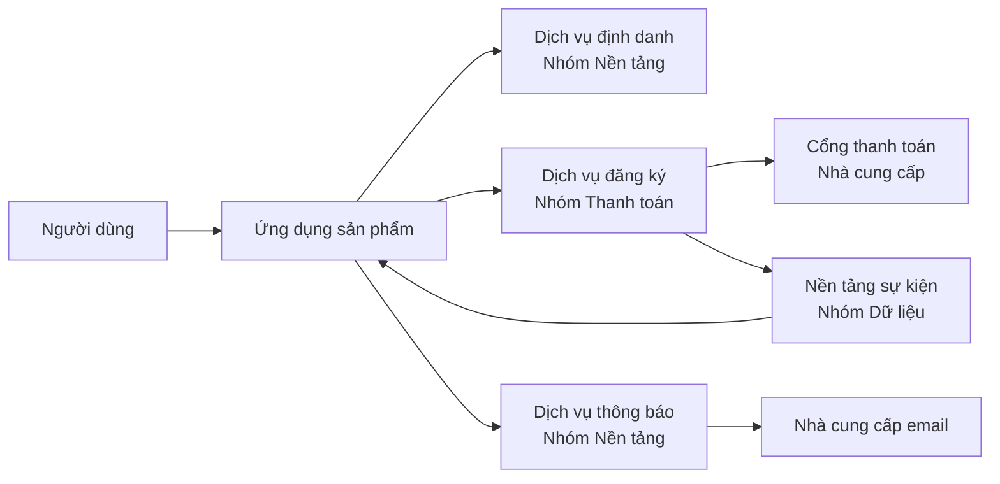

# Phân tích dịch vụ bên ngoài và thành phần do nhóm khác sở hữu

Một sản phẩm hiếm khi hoạt động độc lập. Một hành trình người dùng có thể đi qua nhiều dịch vụ của nhà cung cấp bên ngoài, API dùng chung, nền tảng nội bộ và thành phần do các nhóm khác phát triển, vận hành. Vì vậy, chiến lược kiểm thử xác thực cần hiểu rõ các phụ thuộc này: chúng làm gì, ai chịu trách nhiệm, dữ liệu nào đi qua, điều gì xảy ra khi chúng chậm hoặc lỗi và nhóm có thể thu thập bằng chứng ra sao.

Trong phạm vi **VALIDATION_TESTING_STRATEGY**, phân tích phụ thuộc giúp nhóm xác định ranh giới kiểm thử, rủi ro đầu cuối và những giả thuyết cần phối hợp với chủ sở hữu dịch vụ. Một tính năng có thể hoạt động tốt trong môi trường cô lập nhưng vẫn thất bại với người dùng khi nhà cung cấp từ chối yêu cầu, dịch vụ dùng chung thay đổi hợp đồng hoặc một nhóm khác triển khai phiên bản mới. Do đó, kết quả kiểm thử cần phản ánh cả hành vi của sản phẩm tại ranh giới tích hợp và cách sản phẩm ứng xử khi phụ thuộc không đáp ứng kỳ vọng.

## 1. Nhận diện các loại phụ thuộc

### Dịch vụ bên ngoài

Dịch vụ bên ngoài là dịch vụ do một tổ chức hoặc nhà cung cấp khác vận hành, được sản phẩm sử dụng qua API, webhook, SDK, giao thức hoặc quy trình trao đổi dữ liệu. Ví dụ:

- Cổng thanh toán và dịch vụ xử lý giao dịch.
- Nhà cung cấp định danh, đăng nhập một lần hoặc xác thực đa yếu tố.
- Dịch vụ gửi email, SMS, thông báo đẩy.
- Dịch vụ bản đồ, định vị, tìm kiếm hoặc phân tích dữ liệu.
- Nền tảng lưu trữ, xử lý tệp, chữ ký điện tử hoặc kiểm tra gian lận.

Nhóm phát triển sản phẩm thường không kiểm soát lịch phát hành, hạ tầng, mã nguồn hay quy trình vận hành của nhà cung cấp. Nhóm vẫn chịu trách nhiệm tích hợp đúng hợp đồng, bảo vệ dữ liệu, xử lý lỗi và thông báo trạng thái phù hợp cho người dùng.

### Thành phần nội bộ do nhóm khác sở hữu

Một thành phần nội bộ có thể nằm trong cùng tổ chức hoặc cùng hệ thống triển khai nhưng được một nhóm khác phát triển và vận hành. Ví dụ:

- Dịch vụ định danh và phân quyền do nhóm nền tảng sở hữu.
- Dịch vụ tính giá hoặc lập hóa đơn do nhóm tài chính sở hữu.
- Hệ thống tìm kiếm do nhóm dữ liệu hoặc trải nghiệm sở hữu.
- Nền tảng sự kiện, thông báo, lưu trữ hoặc cấu hình dùng chung.
- Thư viện hoặc SDK nội bộ có lịch phát hành và quy trình hỗ trợ riêng.

Khoảng cách tổ chức không nhất thiết giống khoảng cách kỹ thuật. Một dịch vụ nội bộ có thể có độ tin cậy và quy trình hỗ trợ rõ ràng hơn dịch vụ bên ngoài, nhưng thay đổi hợp đồng hoặc lịch triển khai vẫn có thể ảnh hưởng đến nhóm tích hợp. Cần đánh giá theo thực tế vận hành thay vì mặc định rằng thành phần nội bộ luôn an toàn.

### Phân biệt phụ thuộc trực tiếp và gián tiếp

Phụ thuộc trực tiếp là thành phần mà sản phẩm gọi hoặc sử dụng trực tiếp. Phụ thuộc gián tiếp nằm phía sau một thành phần khác. Chẳng hạn, ứng dụng gọi dịch vụ thanh toán nội bộ; dịch vụ thanh toán nội bộ lại gọi nhà cung cấp thanh toán và hệ thống chống gian lận.

Cả hai loại đều có thể ảnh hưởng đến kết quả cuối cùng. Nếu chỉ ghi nhận API mà ứng dụng gọi trực tiếp, nhóm có thể bỏ sót nơi phát sinh độ trễ, lỗi dữ liệu hoặc giới hạn dịch vụ. Khi phân tích một hành trình quan trọng, cần lần theo chuỗi phụ thuộc đủ sâu để xác định những thành phần có khả năng làm thay đổi kết quả người dùng.

## 2. Lập danh mục và xác định ranh giới sở hữu

### Tạo hồ sơ cho từng phụ thuộc

Một danh mục phụ thuộc nên đủ cụ thể để người thực hiện kiểm thử biết phải liên hệ ai, kiểm tra điều gì và dựa vào hợp đồng nào. Với mỗi dịch vụ hoặc thành phần, hãy ghi lại:

| Trường thông tin | Nội dung cần ghi |
|---|---|
| Tên và mục đích | Dịch vụ làm gì và hỗ trợ bước nào trong hành trình |
| Loại phụ thuộc | Nhà cung cấp bên ngoài, dịch vụ nội bộ, thư viện, nền tảng hoặc hệ thống dữ liệu |
| Chủ sở hữu | Nhóm chịu trách nhiệm kỹ thuật và đầu mối vận hành |
| Người tiêu thụ | Ứng dụng, dịch vụ hoặc nhóm đang sử dụng thành phần |
| Ranh giới giao tiếp | API, sự kiện, webhook, SDK, tệp hoặc quy trình thủ công |
| Dữ liệu trao đổi | Dữ liệu gửi đi, dữ liệu nhận về, phân loại nhạy cảm và thời gian lưu |
| Hợp đồng và phiên bản | Tài liệu API, schema, phiên bản đang dùng và chính sách tương thích |
| Môi trường kiểm thử | Sandbox, staging, simulator, endpoint kiểm thử hoặc điều kiện truy cập |
| Mức độ quan trọng | Hành trình bị ảnh hưởng và hậu quả nếu phụ thuộc không hoạt động |
| Giới hạn vận hành | Timeout, quota, rate limit, cửa sổ bảo trì và cam kết dịch vụ nếu có |
| Phương án khi lỗi | Retry, hàng đợi, fallback, thao tác bù hoặc xử lý thủ công |
| Theo dõi và hỗ trợ | Log, metric, trace, dashboard, kênh báo sự cố và lịch trực |

Không phải mọi trường đều có sẵn. Nếu thiếu thông tin về chủ sở hữu, giới hạn, môi trường hoặc phương án phục hồi, hãy ghi đó là khoảng trống cần làm rõ. Không tự giả định rằng nhà cung cấp có sandbox, SLA hoặc khả năng phát lại yêu cầu.

### Xác định trách nhiệm tại ranh giới

Mỗi phụ thuộc thường có ít nhất hai phía: bên cung cấp và bên tiêu thụ. Bên cung cấp chịu trách nhiệm về khả năng và hợp đồng mà họ công bố; bên tiêu thụ chịu trách nhiệm sử dụng hợp đồng đúng cách và xử lý kết quả. Trong thực tế, còn có thể có nhóm nền tảng, nhóm bảo mật, vận hành hoặc quản lý nhà cung cấp tham gia.

Có thể dùng bảng trách nhiệm đơn giản:

| Công việc | Nhóm tiêu thụ | Chủ sở hữu dịch vụ | Vận hành hoặc bảo mật |
|---|---|---|---|
| Định nghĩa nhu cầu tích hợp | Chịu trách nhiệm | Tham vấn | Tham vấn khi liên quan |
| Công bố và giải thích hợp đồng | Tham vấn | Chịu trách nhiệm | Có thể rà soát |
| Kiểm tra cách tiêu thụ API | Chịu trách nhiệm | Hỗ trợ làm rõ | — |
| Kiểm thử tương thích | Phối hợp | Phối hợp | Tham gia khi cần |
| Theo dõi lỗi trong sản phẩm | Chịu trách nhiệm phần tích hợp | Cung cấp tín hiệu dịch vụ | Phối hợp xử lý |
| Thay đổi phiên bản hoặc ngừng dịch vụ | Đánh giá tác động và cập nhật | Thông báo và quản lý thay đổi | Điều phối nếu có rủi ro vận hành |

Bảng này là điểm khởi đầu để thống nhất trách nhiệm; mỗi tổ chức có thể phân công khác nhau. Điều cần tránh là một lỗi nằm giữa hai nhóm nhưng không ai nhận trách nhiệm điều tra. Với mỗi phụ thuộc quan trọng, phải xác định người đầu mối, quy trình báo lỗi và cách phối hợp khi hợp đồng hoặc hành vi thay đổi.

### Vẽ sơ đồ phụ thuộc theo hành trình

Sơ đồ nên thể hiện cả hướng dữ liệu và ranh giới sở hữu. Ví dụ, hành trình tạo tài khoản và kích hoạt nhóm có thể đi qua các thành phần sau:

Sơ đồ này cần được xác minh với kiến trúc và chủ sở hữu thực tế. Hãy đánh dấu thành phần nằm trên đường đi bắt buộc, thành phần chạy bất đồng bộ và thành phần chỉ phục vụ phân tích. Một dịch vụ phân tích có thể không chặn giao dịch chính nhưng vẫn quan trọng với báo cáo hoặc kiểm soát kinh doanh.

## 3. Hiểu hợp đồng tích hợp và hành vi kỳ vọng

### Hợp đồng không chỉ là cấu trúc API

Hợp đồng tích hợp mô tả những điều hai phía thống nhất khi trao đổi. Ngoài endpoint, phương thức và kiểu dữ liệu, cần làm rõ:

- **Ngữ nghĩa dữ liệu:** trường có ý nghĩa gì, đơn vị đo, múi giờ, quy tắc làm tròn, giá trị mặc định và cách biểu diễn trạng thái.
- **Xác thực và phân quyền:** cách cấp, làm mới, thu hồi thông tin xác thực; phạm vi quyền và cách xử lý khi quyền không đủ.
- **Quy tắc lỗi:** mã lỗi, nội dung lỗi, điều kiện có thể thử lại và điều kiện cần người dùng can thiệp.
- **Thời gian phản hồi:** timeout ở từng phía, giới hạn thời gian xử lý và cách xử lý yêu cầu đến muộn.
- **Tính lặp an toàn:** yêu cầu gửi lại có tạo giao dịch hoặc bản ghi trùng hay không; khóa idempotency được dùng thế nào.
- **Thứ tự và tính nhất quán:** sự kiện có thể đến sai thứ tự không, dữ liệu cập nhật có xuất hiện ngay hay cần thời gian đồng bộ.
- **Giới hạn sử dụng:** rate limit, quota, kích thước payload, số kết nối và chính sách phân trang.
- **Phiên bản và tương thích:** cách thông báo thay đổi, thời gian hỗ trợ phiên bản cũ và quy tắc loại bỏ trường.
- **Webhook và sự kiện:** cơ chế xác minh chữ ký, retry, thời hạn gửi lại, xử lý trùng và xác nhận đã nhận.
- **Bảo mật và quyền riêng tư:** dữ liệu nào được truyền, mã hóa, che giấu trong log và lưu trong bao lâu.

Một hợp đồng chỉ mô tả phản hồi thành công sẽ không đủ cho chiến lược xác thực. Nhóm cần biết hành vi ở các trạng thái lỗi, trạng thái trung gian và trường hợp không chắc chắn.

### Phân biệt lỗi đồng bộ và bất đồng bộ

Với giao tiếp đồng bộ, ứng dụng chờ phản hồi trong cùng yêu cầu. Những vấn đề như timeout, phản hồi chậm và lỗi tức thời thường tác động trực tiếp đến trải nghiệm hiện tại.

Với giao tiếp bất đồng bộ, bên gửi có thể nhận xác nhận đã tiếp nhận trước khi công việc hoàn tất. Kết quả cuối cùng có thể đến qua webhook, sự kiện hoặc hàng đợi. Khi đó, nhóm cần xác thực toàn bộ vòng đời: gửi yêu cầu, nhận xác nhận, xử lý, phát kết quả, cập nhật trạng thái và thông báo cho người dùng.

Ví dụ, một yêu cầu thanh toán có thể được chấp nhận nhưng giao dịch chưa hoàn tất. Nếu giao diện hiển thị “thanh toán thành công” ngay khi nhận xác nhận tiếp nhận, sản phẩm có thể báo sai trạng thái. Cần phân biệt rõ các trạng thái như đang xử lý, thành công, thất bại, hết hạn và cần đối soát.

### Kiểm tra các quy tắc về retry và tính lặp an toàn

Retry giúp vượt qua lỗi tạm thời, nhưng gửi lại một yêu cầu không an toàn có thể tạo tác động lặp. Với thao tác tạo đơn hàng, thanh toán, gửi lời mời hoặc cấp quyền, cần biết yêu cầu có thể được gửi lại trong điều kiện nào và làm sao nhận ra yêu cầu đã xử lý.

Một thiết kế đáng tin cậy thường xác định:

- Lỗi nào được thử lại, lỗi nào phải dừng.
- Số lần thử và khoảng chờ giữa các lần thử.
- Có dùng exponential backoff và jitter để tránh nhiều hệ thống cùng gửi lại đồng thời hay không.
- Khóa idempotency được tạo, lưu và hết hạn như thế nào.
- Cách xử lý khi phía gọi timeout nhưng phía cung cấp đã hoàn tất tác vụ.
- Cách đối soát khi không xác định được kết quả cuối cùng.

Nhóm kiểm thử cần tạo tình huống phản hồi bị mất sau khi dịch vụ đã xử lý yêu cầu. Đây là cách phát hiện lỗi mà chỉ kiểm tra mã phản hồi thành công thường bỏ sót.

## 4. Đánh giá mức độ quan trọng và rủi ro của phụ thuộc

### Đánh giá tác động theo hành trình

Không phải phụ thuộc nào cũng có mức quan trọng như nhau. Hãy đánh giá một dịch vụ theo các câu hỏi:

1. Nếu dịch vụ ngừng hoạt động, người dùng có thể hoàn thành công việc chính không?
2. Phạm vi ảnh hưởng là một nhóm nhỏ, một khách hàng, một khu vực hay toàn bộ người dùng?
3. Lỗi có gây mất dữ liệu, giao dịch sai, lộ thông tin hoặc vi phạm nghĩa vụ không?
4. Có thể trì hoãn công việc, lưu tạm, chuyển sang quy trình khác hoặc phục hồi sau đó không?
5. Bao lâu thì ảnh hưởng trở nên nghiêm trọng?
6. Nhóm có quan sát được trạng thái và phát hiện lỗi trước khi người dùng báo không?

Có thể phân loại theo mức độ:

| Mức | Đặc điểm | Ví dụ về cách xử lý trong chiến lược |
|---|---|---|
| Tới hạn | Hỏng sẽ chặn hành trình cốt lõi hoặc gây hậu quả nghiêm trọng | Kiểm thử hợp đồng, lỗi, bảo mật, tải và phục hồi; có tiêu chí phát hành rõ |
| Cao | Hỏng làm suy giảm đáng kể trải nghiệm hoặc hoạt động kinh doanh | Kiểm thử tích hợp và các tình huống suy giảm; xác minh cảnh báo và phương án thay thế |
| Trung bình | Hỏng ảnh hưởng một phần chức năng, có thể trì hoãn hoặc xử lý lại | Kiểm thử retry, hàng đợi, trạng thái chờ và đồng bộ lại |
| Thấp | Hỏng ít ảnh hưởng đến hành trình chính và có thể bỏ qua tạm thời | Kiểm tra cơ chế cô lập lỗi và xác minh không làm hỏng chức năng chính |

Tên mức chỉ giúp thống nhất thảo luận. Nhóm cần ghi rõ căn cứ xếp loại và hậu quả thực tế, không chỉ ghi một nhãn.

### Xem xét xác suất và khả năng phát hiện

Ngoài tác động, hãy xem xét khả năng xảy ra lỗi và khả năng phát hiện trước khi người dùng chịu ảnh hưởng. Một dịch vụ có thể ít khi ngừng hoàn toàn nhưng thường xuyên phản hồi chậm, giới hạn quota hoặc thay đổi dữ liệu. Một lỗi dễ phát hiện qua cảnh báo có thể ít nguy hiểm hơn lỗi âm thầm ghi sai trạng thái.

Các yếu tố nên cân nhắc gồm:

- Lịch sử sự cố và xu hướng chất lượng dịch vụ.
- Tần suất phát hành và mức độ thay đổi hợp đồng.
- Mức độ phức tạp của tích hợp và số lượng phụ thuộc bắc cầu.
- Khả năng quan sát, cảnh báo và truy vết giao dịch.
- Mức độ trưởng thành của môi trường sandbox hoặc staging.
- Thời gian phản hồi của chủ sở hữu và khả năng hỗ trợ ngoài giờ.
- Khả năng phục hồi, đối soát và khôi phục dữ liệu.

Nếu dùng thang điểm rủi ro, hãy định nghĩa thang đo và ngưỡng trước khi chấm. Điểm số hỗ trợ sắp xếp ưu tiên, không thay thế phân tích hậu quả. Các rủi ro bảo mật, quyền riêng tư, tài chính hoặc tuân thủ cần được đánh giá theo yêu cầu chuyên môn tương ứng.

### Ưu tiên theo đường đi quan trọng

Một phụ thuộc cần được ưu tiên khi nó nằm trên đường đi bắt buộc của hành trình có giá trị cao, có hậu quả lỗi lớn hoặc khó thay thế. Phụ thuộc gián tiếp cũng có thể trở thành điểm nghẽn. Ví dụ, hệ thống gửi email có thể không chặn việc tạo tài khoản, nhưng nếu email chứa liên kết xác minh thì người dùng vẫn không thể hoàn thành kích hoạt.

Hãy nối danh mục phụ thuộc với bản đồ hành trình để biết:

- Bước nào gọi dịch vụ nào.
- Thành phần nào là bắt buộc và thành phần nào có thể chạy nền.
- Một lỗi ảnh hưởng đến người dùng nào và trong khoảng thời gian nào.
- Có phương án dự phòng hoặc quy trình bù hay không.
- Bằng chứng kiểm thử nào đang thiếu và ai cần cung cấp.

## 5. Thiết kế kiểm thử tại ranh giới phụ thuộc

Chiến lược tốt kết hợp nhiều cấp kiểm thử. Mỗi cấp trả lời một câu hỏi khác nhau và có giới hạn riêng.

### Kiểm thử đơn vị với mock hoặc stub

Mock và stub giúp kiểm tra logic của thành phần tiêu thụ mà không cần gọi dịch vụ thật. Chúng hữu ích để kiểm tra cách ứng dụng xử lý phản hồi thành công, lỗi, timeout, dữ liệu không hợp lệ và trạng thái hiếm gặp.

Tuy nhiên, mock chỉ phản ánh hành vi mà nhóm đã lập trình vào nó. Nếu mock không cập nhật theo hợp đồng thật, kiểm thử có thể tiếp tục thành công trong khi tích hợp đã hỏng. Vì vậy:

- Dùng mock cho logic nội bộ và các nhánh lỗi khó tái tạo.
- Lấy dữ liệu mẫu từ hợp đồng hoặc phản hồi đã được xác minh.
- Không xem kiểm thử mock là bằng chứng duy nhất về tương thích.
- Rà soát mock khi hợp đồng, schema hoặc phiên bản dịch vụ thay đổi.

### Kiểm thử hợp đồng giữa bên tiêu thụ và bên cung cấp

Kiểm thử hợp đồng xác nhận hai phía hiểu cùng một giao diện và ngữ nghĩa. Ở phía tiêu thụ, kiểm thử có thể ghi lại các tương tác mà ứng dụng kỳ vọng. Ở phía cung cấp, kiểm thử xác minh dịch vụ đáp ứng những kỳ vọng đó.

Các điểm cần kiểm tra gồm tên và kiểu trường, trường bắt buộc, giá trị enum, định dạng ngày giờ, mã lỗi, xác thực, quy tắc phân trang và tương thích ngược. Với sự kiện hoặc webhook, cần kiểm tra schema, chữ ký, phiên bản và xử lý sự kiện lặp.

Kiểm thử hợp đồng đặc biệt hữu ích khi nhiều nhóm phát hành độc lập. Nó giúp phát hiện thay đổi phá vỡ tương thích trước khi thay đổi đến môi trường tích hợp hoặc người dùng. Dù vậy, kiểm thử hợp đồng không chứng minh toàn bộ hành trình hoạt động, vì nó thường không bao phủ cấu hình thực tế, hạ tầng, độ trễ hoặc hành vi của nhà cung cấp đang chạy.

### Kiểm thử tích hợp với môi trường đại diện

Kiểm thử tích hợp xác minh các thành phần giao tiếp với nhau trong cấu hình gần thực tế. Khi có sandbox hoặc staging, hãy kiểm tra xác thực, cấu hình endpoint, chứng thư, webhook, mạng, quyền truy cập và luồng dữ liệu.

Môi trường đại diện cần được mô tả rõ: phiên bản dịch vụ, dữ liệu mẫu, giới hạn quota, cấu hình và khác biệt so với production. Nếu môi trường kiểm thử không có đầy đủ tính năng hoặc có hành vi khác môi trường thật, hãy ghi rõ phần nào chưa được xác minh.

Không nên gọi mọi lần kiểm thử qua sandbox là kiểm thử đầu cuối đầy đủ. Sandbox có thể mô phỏng kết quả thành công nhưng không mô phỏng chính xác tải, sự cố vùng, quy trình đối soát hoặc giới hạn tài khoản thật.

### Kiểm thử đầu cuối và thử nghiệm thực tế

Kiểm thử đầu cuối xác nhận người dùng có thể hoàn thành hành trình qua các ranh giới cần thiết. Chọn một số kịch bản đại diện có giá trị cao, ví dụ đăng ký, xác minh danh tính, thanh toán và nhận xác nhận. Kiểm tra cả trạng thái cuối cùng trong giao diện lẫn trạng thái được lưu ở các hệ thống liên quan.

Khi dùng dịch vụ bên ngoài, cần giới hạn tần suất và dữ liệu thử nghiệm theo quy định của nhà cung cấp. Không tạo giao dịch thật, gửi tin nhắn thật hoặc gây ảnh hưởng đến khách hàng nếu chưa có môi trường và quy trình được cho phép.

### Kiểm thử khả năng chịu lỗi và phục hồi

Không chỉ kiểm tra dịch vụ có hoạt động; hãy kiểm tra sản phẩm phản ứng thế nào khi dịch vụ không hoạt động như kỳ vọng. Các kỹ thuật có thể gồm mô phỏng timeout, ngắt kết nối, trả lỗi có chọn lọc, tăng độ trễ, gửi phản hồi sai định dạng hoặc phát sự kiện trùng. Việc tiêm lỗi vào môi trường dùng chung hoặc production cần quy trình kiểm soát và phạm vi được phê duyệt.

Các câu hỏi quan trọng:

- Ứng dụng có giới hạn thời gian chờ để tránh giữ tài nguyên vô hạn không?
- Retry có bị giới hạn và có tránh tạo tác động trùng không?
- Circuit breaker hoặc cơ chế cô lập có ngăn lỗi lan rộng không?
- Yêu cầu có được lưu vào hàng đợi khi dịch vụ tạm ngừng không?
- Người dùng nhìn thấy trạng thái trung thực và biết bước tiếp theo không?
- Hệ thống có thể đồng bộ lại sau khi dịch vụ phục hồi không?
- Có thể đối soát những giao dịch không xác định kết quả không?
- Nhóm có cảnh báo khi hàng đợi tăng, sự kiện bị kẹt hoặc tỷ lệ lỗi vượt ngưỡng không?

### Kiểm thử hiệu năng và giới hạn sử dụng

Phụ thuộc có thể đáp ứng tốt ở tải thấp nhưng suy giảm khi số yêu cầu tăng. Hãy xác minh giới hạn kết nối, rate limit, quota, kích thước dữ liệu, độ trễ p95 hoặc p99 nếu có yêu cầu đo lường, và cách ứng dụng điều tiết lưu lượng.

Không tạo tải vượt giới hạn của nhà cung cấp hoặc dịch vụ dùng chung khi chưa có thỏa thuận. Có thể dùng môi trường mô phỏng để kiểm tra logic điều tiết và một bài kiểm thử tải có kiểm soát để xác nhận cấu hình với chủ sở hữu dịch vụ.

### Kiểm thử bảo mật và quyền riêng tư

Tại ranh giới tích hợp, cần kiểm tra quyền truy cập tối thiểu, xác thực, quản lý bí mật, xác minh webhook, mã hóa khi truyền, kiểm soát dữ liệu trả về và việc che giấu thông tin nhạy cảm trong log. Cũng cần xác minh dữ liệu được gửi cho nhà cung cấp có đúng mục đích và phạm vi đã thống nhất hay không.

Các trường hợp thường cần kiểm tra gồm token hết hạn hoặc bị thu hồi, quyền không đủ, chữ ký webhook không hợp lệ, replay request, truy cập chéo tenant, dữ liệu cá nhân xuất hiện trong log và cấu hình bí mật bị thiếu. Phạm vi và tiêu chí phải phù hợp với chính sách bảo mật, quyền riêng tư và nghĩa vụ áp dụng cho sản phẩm.

## 6. Quản lý môi trường và dữ liệu kiểm thử

### Chọn đúng loại môi trường

Mỗi loại môi trường cung cấp mức bằng chứng khác nhau:

| Môi trường hoặc cách mô phỏng | Phù hợp để kiểm tra | Giới hạn cần ghi nhận |
|---|---|---|
| Mock hoặc stub | Logic tiêu thụ, nhánh lỗi và tình huống hiếm | Không chứng minh dịch vụ thật tương thích |
| Contract test | Schema, giao thức và kỳ vọng giữa hai phía | Không chứng minh hạ tầng hoặc toàn bộ hành trình |
| Sandbox của nhà cung cấp | Tích hợp, xác thực và luồng nghiệp vụ đại diện | Có thể khác production về dữ liệu, quota và độ tin cậy |
| Staging tích hợp | Cấu hình gần thực tế và hành trình nhiều dịch vụ | Có thể thiếu tải, dữ liệu hoặc cấu hình production |
| Production có kiểm soát | Quan sát hành vi thực tế và xác minh vận hành | Chỉ dùng cơ chế an toàn, phạm vi và dữ liệu được cho phép |

Nếu không có sandbox, nhóm có thể dùng contract test, simulator hoặc stub có kiểm soát để kiểm tra phần mình sở hữu. Cần ghi rõ những hành vi của nhà cung cấp chưa được kiểm chứng và thống nhất cách xác minh trước khi phát hành.

### Quản lý dữ liệu thử nghiệm

Dữ liệu cần đại diện cho các trường hợp hợp lệ, không hợp lệ, biên và trạng thái chuyển tiếp. Với dữ liệu cá nhân, tài chính hoặc dữ liệu khách hàng, ưu tiên dữ liệu tổng hợp hoặc đã được khử định danh theo quy trình được phê duyệt.

Cần quản lý vòng đời dữ liệu thử nghiệm: ai tạo, ai được truy cập, dữ liệu được lưu ở đâu, khi nào hết hạn và cách xóa. Không đưa thông tin xác thực, khóa bí mật hoặc dữ liệu khách hàng thật vào mã nguồn, log, ảnh chụp hay tài liệu kiểm thử.

Với dịch vụ có trạng thái, ví dụ giao dịch thanh toán hoặc lời mời, hãy xác định cách tạo trạng thái ban đầu, cách dọn dẹp và cách khôi phục khi kịch bản dừng giữa chừng. Dữ liệu dùng chung không được để lại trạng thái khiến lần kiểm thử sau cho kết quả sai.

### Kiểm soát sai khác giữa môi trường

Sai khác cấu hình là nguyên nhân phổ biến khiến kiểm thử staging thành công nhưng production thất bại. Hãy đối chiếu các yếu tố như endpoint, phiên bản API, quyền, chứng thư, secret, webhook URL, quota, timeout, retry và feature flag.

Nên lưu dấu phiên bản hợp đồng và cấu hình có liên quan cùng kết quả kiểm thử. Khi nhà cung cấp hoặc nhóm sở hữu dịch vụ thay đổi phiên bản, nhóm tiêu thụ cần biết thay đổi nào có thể ảnh hưởng đến hành trình và cần chạy lại loại kiểm thử nào.

## 7. Xử lý trạng thái lỗi và duy trì trải nghiệm người dùng

### Thiết kế hành vi khi phụ thuộc suy giảm

Sản phẩm cần có hành vi rõ ràng cho từng loại lỗi. Không phải lỗi nào cũng nên thử lại hoặc hiển thị cùng một thông báo.

| Tình huống | Hành vi cần cân nhắc | Bằng chứng cần xác thực |
|---|---|---|
| Dịch vụ tạm thời không khả dụng | Thử lại có giới hạn, lưu yêu cầu hoặc cho phép thử lại sau | Không mất dữ liệu; người dùng biết trạng thái |
| Phản hồi chậm hoặc timeout | Dừng chờ đúng hạn và kiểm tra kết quả trước khi gửi lại thao tác nhạy cảm | Không tạo giao dịch trùng; trạng thái không mơ hồ |
| Bị giới hạn tần suất | Điều tiết yêu cầu và tôn trọng thời gian chờ do dịch vụ cung cấp | Không tạo vòng retry liên tục |
| Token hoặc quyền hết hạn | Làm mới thông tin xác thực hoặc yêu cầu người dùng đăng nhập lại | Không lộ dữ liệu; luồng khôi phục dễ hiểu |
| Dữ liệu không hợp lệ | Từ chối hoặc đưa vào luồng xử lý lỗi có thể điều tra | Lỗi được ghi nhận; dữ liệu sai không lan truyền |
| Sự kiện đến trùng hoặc sai thứ tự | Xử lý idempotent, kiểm tra phiên bản hoặc trạng thái | Không cập nhật lùi hoặc xử lý hai lần |
| Dịch vụ bất đồng bộ bị chậm | Hiển thị trạng thái đang xử lý và cập nhật khi có kết quả | Trạng thái nhất quán; có cảnh báo khi quá hạn |

Thông báo cho người dùng nên nói rõ điều gì đã xảy ra, tác động đến công việc và bước tiếp theo. Tránh hiển thị mã lỗi kỹ thuật hoặc tuyên bố một giao dịch thành công khi hệ thống mới chỉ tiếp nhận yêu cầu.

### Xác thực cơ chế dự phòng và thao tác bù

Fallback là cách duy trì một phần giá trị khi phụ thuộc chính không sẵn sàng, ví dụ cho phép lưu bản nháp khi dịch vụ đồng bộ tạm ngừng. Không phải chức năng nào cũng có thể có fallback; với giao dịch tài chính hoặc kiểm tra quyền, dùng dữ liệu cũ có thể nguy hiểm hơn việc tạm dừng.

Saga hoặc quy trình bù có thể cần thiết khi một hành trình gồm nhiều thao tác ở các hệ thống khác nhau và không thể hoàn tác bằng một giao dịch nguyên tử. Ví dụ, nếu tạo đăng ký thành công nhưng bước thanh toán thất bại, hệ thống cần xác định giữ đăng ký ở trạng thái chờ, hủy đăng ký hay cho phép thanh toán lại. Quy tắc này phải được thống nhất với chủ sở hữu nghiệp vụ và dịch vụ liên quan.

Kiểm thử phục hồi nên bao gồm cả trường hợp lỗi xảy ra giữa chừng, hệ thống khởi động lại, thông điệp được gửi lại và kết quả cuối cùng đến muộn. Mục tiêu là bảo đảm trạng thái cuối nhất quán và có thể giải thích.

## 8. Ví dụ: xác thực hành trình đăng ký và thanh toán

Giả sử một sản phẩm SaaS cho phép người dùng tạo tài khoản, chọn gói dịch vụ và thanh toán để kích hoạt thuê bao. Hành trình sử dụng dịch vụ định danh nội bộ, dịch vụ đăng ký do một nhóm khác sở hữu và cổng thanh toán bên ngoài.

| Bước | Thành phần liên quan | Rủi ro cần xem xét | Kiểm thử hoặc bằng chứng |
|---|---|---|---|
| Tạo tài khoản | Dịch vụ định danh nội bộ | Token không hợp lệ, quyền sai, tài khoản trùng | Contract test, kiểm thử quyền và luồng đăng nhập |
| Chọn gói | Dịch vụ cấu hình giá | Giá hoặc phiên bản gói không nhất quán | Kiểm tra schema, tiền tệ, thời hạn và phiên bản |
| Tạo yêu cầu thanh toán | Dịch vụ đăng ký và cổng thanh toán | Timeout, gửi trùng, giới hạn tần suất | Kiểm thử idempotency, retry và lỗi mạng |
| Nhận kết quả | Webhook từ nhà cung cấp | Chữ ký sai, sự kiện trùng hoặc đến muộn | Xác minh chữ ký, xử lý sự kiện lặp và sai thứ tự |
| Kích hoạt thuê bao | Dịch vụ đăng ký nội bộ | Giao dịch thành công nhưng thuê bao chưa cập nhật | Kiểm thử tích hợp, đồng bộ lại và đối soát |
| Thông báo cho người dùng | Dịch vụ thông báo và nhà cung cấp email | Email không gửi được hoặc gửi sai trạng thái | Kiểm thử hàng đợi, retry và nội dung thông báo |

Một bộ tình huống đại diện có thể gồm:

1. Thanh toán thành công và webhook đến đúng hạn.
2. Nhà cung cấp đã xử lý giao dịch nhưng phản hồi đồng bộ bị timeout.
3. Webhook được gửi lại nhiều lần.
4. Webhook đến trước khi ứng dụng nhận được phản hồi tạo giao dịch.
5. Chữ ký webhook không hợp lệ.
6. Thanh toán bị từ chối hoặc yêu cầu xác thực bổ sung.
7. Dịch vụ đăng ký nội bộ tạm ngừng sau khi thanh toán thành công.
8. Email xác nhận không gửi được nhưng thuê bao đã được kích hoạt.
9. Token hết hạn trong khi người dùng đang thực hiện hành trình.

Kết quả cần đối chiếu giữa giao diện, trạng thái thuê bao, trạng thái giao dịch và sự kiện đã ghi nhận. Ví dụ, nếu giao dịch thành công nhưng cập nhật thuê bao bị gián đoạn, sản phẩm cần có quy trình đồng bộ lại hoặc đối soát. Việc chỉ kiểm tra màn hình thanh toán báo thành công sẽ không phát hiện được trạng thái lệch giữa các hệ thống.

## 9. Phối hợp thay đổi với chủ sở hữu dịch vụ

### Thiết lập quy trình thông báo thay đổi

Hợp đồng và hành vi của phụ thuộc có thể thay đổi theo thời gian. Nhóm cần biết cách nhận thông báo về phiên bản mới, trường bị loại bỏ, thay đổi xác thực, cửa sổ bảo trì và giới hạn sử dụng.

Với thành phần nội bộ, nên thống nhất:

- Nơi công bố tài liệu và lịch phát hành.
- Cách thông báo thay đổi phá vỡ tương thích.
- Khoảng thời gian hỗ trợ phiên bản cũ.
- Bộ kiểm thử hợp đồng dùng chung và người chịu trách nhiệm duy trì.
- Quy trình báo lỗi, phân loại mức độ và phối hợp khắc phục.

Với nhà cung cấp bên ngoài, cần theo dõi thông báo phiên bản, trạng thái dịch vụ, chính sách ngừng hỗ trợ và thay đổi điều khoản kỹ thuật. Đầu mối quản lý nhà cung cấp có thể cần tham gia khi thay đổi ảnh hưởng đến cam kết hoặc chi phí.

### Phản ứng khi có thay đổi

Khi một phụ thuộc phát hành phiên bản mới, nhóm tiêu thụ nên đánh giá tác động trước khi nâng cấp. Xác định API, schema, quyền, dữ liệu, luồng lỗi và hành trình nào bị ảnh hưởng. Sau đó chọn kiểm thử tương ứng: contract test cho thay đổi giao diện, integration test cho cấu hình và trao đổi dữ liệu, end-to-end test cho hành trình quan trọng, kiểm thử hiệu năng hoặc bảo mật khi thay đổi có liên quan.

Không nên chỉ dựa vào ghi chú phát hành. Những thay đổi nhỏ về kiểu dữ liệu, giá trị mặc định, thứ tự sự kiện hoặc cách xử lý timeout có thể tạo tác động lớn ở phía tiêu thụ. Cần có bằng chứng từ kiểm thử hoặc xác nhận có thể truy vết.

## 10. Quan sát và chẩn đoán trong vận hành

Kiểm thử trước phát hành chỉ là một phần của bằng chứng. Sau khi triển khai, nhóm cần biết phụ thuộc có tiếp tục đáp ứng kỳ vọng hay không.

Các tín hiệu nên cân nhắc:

- Tỷ lệ yêu cầu thành công và thất bại theo dịch vụ, phiên bản và loại thao tác.
- Độ trễ theo phân vị, đặc biệt ở các luồng quan trọng.
- Số lần retry, timeout, circuit breaker mở và yêu cầu bị giới hạn.
- Độ dài hàng đợi, tuổi của thông điệp cũ nhất và số thông điệp vào vùng lỗi.
- Tỷ lệ webhook hợp lệ, trùng, đến muộn hoặc không xử lý được.
- Chênh lệch giữa trạng thái giao dịch ở hệ thống tiêu thụ và hệ thống cung cấp.
- Số lần người dùng cần thử lại hoặc liên hệ hỗ trợ do phụ thuộc.

Dùng correlation ID hoặc trace ID để nối các yêu cầu qua nhiều dịch vụ, đồng thời tránh ghi thông tin xác thực hoặc dữ liệu nhạy cảm. Cảnh báo nên gắn với tác động đến hành trình và ngưỡng hành động rõ ràng; quá nhiều cảnh báo không có ngữ cảnh sẽ khiến sự cố quan trọng bị bỏ qua.

Sau một sự cố, hãy xem lại giả thuyết và kịch bản kiểm thử: lỗi có nằm trong danh mục phụ thuộc chưa, môi trường có mô phỏng được không, tín hiệu nào đã thiếu và hành vi phục hồi có đúng không. Bài học từ vận hành cần quay lại chiến lược xác thực để giảm khả năng lặp lại.

## 11. Những sai lầm thường gặp

- **Chỉ lập danh sách API trực tiếp:** phụ thuộc bắc cầu và dịch vụ chạy nền có thể vẫn làm hành trình thất bại.
- **Cho rằng thành phần nội bộ không có rủi ro:** nhóm khác có lịch phát hành, ưu tiên và quy trình vận hành riêng.
- **Chỉ kiểm thử đường đi thành công:** timeout, phản hồi trễ, sự kiện trùng và lỗi xác thực thường gây lỗi thực tế.
- **Tin tuyệt đối vào mock:** mock có thể lệch hợp đồng thật nếu không được duy trì.
- **Coi sandbox giống production:** dữ liệu, quota, độ trễ và cơ chế vận hành có thể khác.
- **Retry mọi lỗi:** thao tác không idempotent có thể tạo giao dịch hoặc dữ liệu trùng.
- **Không xác định chủ sở hữu:** lỗi tích hợp bị chuyển qua lại giữa các nhóm và kéo dài thời gian xử lý.
- **Bỏ qua dữ liệu và quyền riêng tư:** dữ liệu kiểm thử hoặc log có thể làm lộ thông tin nhạy cảm.
- **Không kiểm tra trạng thái cuối:** phản hồi API thành công chưa chứng minh toàn bộ hành trình đã hoàn tất.
- **Không cập nhật kiểm thử khi hợp đồng đổi:** bộ kiểm thử cũ có thể tiếp tục xanh dù không còn đại diện cho tích hợp hiện tại.

## 12. Đầu ra cần có trước khi chốt chiến lược kiểm thử

Bản phân tích phụ thuộc đủ dùng nên tạo ra các đầu ra sau:

1. **Danh mục phụ thuộc:** tên, mục đích, loại, chủ sở hữu, người tiêu thụ và mức độ quan trọng.
2. **Sơ đồ phụ thuộc theo hành trình:** luồng gọi, luồng sự kiện, ranh giới sở hữu và các thành phần bắt buộc.
3. **Hồ sơ hợp đồng:** API hoặc schema, phiên bản, quy tắc lỗi, timeout, retry, idempotency, giới hạn và bảo mật.
4. **Đánh giá rủi ro:** tác động đến người dùng và kinh doanh, khả năng xảy ra, khả năng phát hiện và phương án phục hồi.
5. **Ma trận kiểm thử:** cấp kiểm thử, tình huống, môi trường, dữ liệu, người chịu trách nhiệm và bằng chứng mong đợi.
6. **Khoảng trống và thỏa thuận:** thông tin còn thiếu, đầu mối cần phối hợp, quyền truy cập và lịch xác minh.
7. **Kế hoạch quan sát:** metric, log, trace, cảnh báo, đối soát và cách xử lý sự cố.

Trước khi đưa một phụ thuộc quan trọng vào phạm vi phát hành, hãy tự rà soát:

- Đã xác định chủ sở hữu và đầu mối hỗ trợ chưa?
- Hợp đồng và phiên bản đang dùng có rõ ràng không?
- Đã hiểu dữ liệu trao đổi và yêu cầu bảo mật chưa?
- Đã xác định lỗi, timeout, retry, giới hạn và trạng thái bất đồng bộ chưa?
- Có kiểm thử hợp đồng hoặc bằng chứng tương thích phù hợp không?
- Môi trường kiểm thử có đại diện đủ cho hành vi cần xác thực không?
- Đã kiểm tra đường đi lỗi, phục hồi và trạng thái cuối chưa?
- Có cách theo dõi phụ thuộc sau phát hành và truy vết sự cố không?

Khi các đầu ra này được xác định, nhóm có thể đưa phụ thuộc vào kế hoạch kiểm thử theo mức rủi ro và hành trình bị ảnh hưởng. Phân tích cần được cập nhật khi chủ sở hữu, hợp đồng, phiên bản, dữ liệu, nhà cung cấp hoặc cách sản phẩm sử dụng dịch vụ thay đổi. Nhờ đó, chiến lược xác thực phản ánh được hệ thống thực tế mà người dùng đang trải nghiệm và trách nhiệm phối hợp giữa các nhóm.

