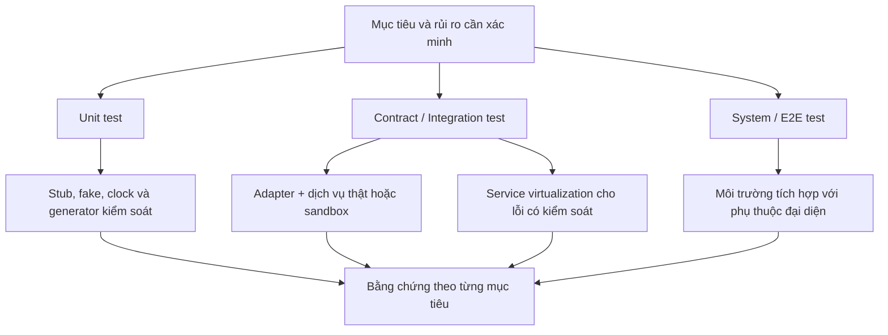

# Lựa chọn dịch vụ thật, sandbox hoặc mô phỏng theo mục tiêu

**Chương:** Môi trường kiểm thử  
**Phạm vi module:** `VALIDATION_TESTING_STRATEGY`

Một hệ thống phần mềm thường phụ thuộc vào nhiều dịch vụ: cơ sở dữ liệu, cổng thanh toán, dịch vụ định danh, email, vận chuyển, định tuyến, kho tệp hoặc API của đối tác. Khi kiểm thử, nhóm phải quyết định nên kết nối đến implementation thật trong môi trường kiểm thử, sử dụng sandbox do nhà cung cấp cung cấp hay thay thế phụ thuộc bằng mô phỏng.

Không có một lựa chọn phù hợp cho mọi bài kiểm thử. Dịch vụ thật cung cấp bằng chứng gần với cách các thành phần thực sự phối hợp nhưng có thể chậm, khó cô lập và tạo tác dụng phụ. Sandbox cho phép kiểm tra giao thức với nhà cung cấp trong môi trường dành cho thử nghiệm, nhưng hành vi và dữ liệu có thể khác sản xuất. Mô phỏng giúp kiểm soát chính xác phản hồi và lỗi, song chỉ chứng minh hành vi đã được mô hình hóa.

Quyết định cần bắt đầu từ mục tiêu kiểm thử: nhóm muốn xác minh logic nghiệp vụ, hợp đồng giao tiếp, khả năng tích hợp, hành vi khi lỗi hay toàn bộ hành trình? Từ mục tiêu đó, nhóm chọn mức độ thực của từng phụ thuộc, xác định bằng chứng cần thu thập và ghi rõ giới hạn còn lại.

Sau bài học, người học có thể:

- Phân biệt dịch vụ thật trong môi trường kiểm thử, sandbox và mô phỏng.
- Chọn loại phụ thuộc phù hợp với câu hỏi và rủi ro cần xác minh.
- Đánh giá mức độ trung thực của môi trường theo giao thức, dữ liệu, trạng thái và hành vi.
- Kết hợp dịch vụ thật, sandbox và mô phỏng trong cùng một chiến lược kiểm thử.
- Thiết kế dữ liệu, danh tính, cấu hình và cleanup an toàn.
- Kiểm tra hợp đồng, lỗi, timeout, giới hạn tốc độ và tác dụng phụ.
- Ghi rõ phạm vi bằng chứng, giới hạn và rủi ro còn lại trong báo cáo.

## 1. Ba cách kết nối phụ thuộc

### 1.1. Dịch vụ thật trong môi trường kiểm thử

Trong bài học này, **dịch vụ thật** là implementation thực tế của thành phần mà nhóm muốn kiểm tra, được triển khai hoặc cung cấp trong môi trường kiểm thử có kiểm soát. Ví dụ: ứng dụng kết nối đến instance PostgreSQL dành cho test, gọi dịch vụ định danh nội bộ đã triển khai ở môi trường staging hoặc gửi thông điệp đến message broker thật của môi trường tích hợp.

Dịch vụ thật có thể cung cấp bằng chứng về:

- Giao tiếp thực giữa các thành phần và cấu hình đang dùng.
- Cách xử lý dữ liệu, transaction, serialization và trạng thái.
- Hành vi của hạ tầng như khóa, hàng đợi, cache hoặc cơ chế xác thực.
- Tích hợp giữa phiên bản dịch vụ đang triển khai.
- Các vấn đề chỉ xuất hiện khi nhiều thành phần hoạt động cùng nhau.

Dịch vụ thật không đồng nghĩa với việc dùng dữ liệu hoặc endpoint sản xuất. Thông thường, nhóm nên dùng implementation thật trong môi trường riêng, có dữ liệu thử nghiệm và quyền hạn giới hạn. Kết nối trực tiếp môi trường sản xuất chỉ phù hợp với các hoạt động được phê duyệt và có kiểm soát riêng; một bài test thông thường không nên tạo giao dịch, gửi thông báo hoặc thay đổi dữ liệu thật ngoài ý muốn.

### 1.2. Sandbox

Sandbox là môi trường thử nghiệm do nhà cung cấp hoặc đơn vị vận hành dịch vụ cung cấp. Nó thường mô phỏng một phần hoạt động của dịch vụ thật thông qua endpoint, tài khoản, dữ liệu và quy tắc riêng cho thử nghiệm.

Ví dụ:

- Cổng thanh toán cung cấp tài khoản và thẻ thử nghiệm để tạo giao dịch giả lập.
- Nhà cung cấp định danh cung cấp tenant thử nghiệm để kiểm tra đăng nhập và callback.
- Dịch vụ vận chuyển cung cấp mã vận đơn thử nghiệm và trạng thái giao hàng giả lập.
- API đối tác cung cấp endpoint thử nghiệm với dữ liệu mẫu và giới hạn gọi riêng.

Sandbox có lợi thế là kiểm tra được giao thức và cách tích hợp với nhà cung cấp mà không tạo tác động trực tiếp lên dữ liệu hoặc giao dịch sản xuất. Tuy nhiên, sandbox có thể không có đầy đủ tính năng, tải, dữ liệu, cơ chế chống gian lận, giới hạn tốc độ hoặc cấu hình giống production. Vì vậy, kết quả sandbox không tự động chứng minh mọi hành vi sản xuất.

### 1.3. Mô phỏng (simulation)

Mô phỏng thay thế một phần hoặc toàn bộ hành vi của phụ thuộc bằng thành phần do nhóm kiểm soát. Các dạng phổ biến:

- **Stub:** trả về dữ liệu hoặc lỗi đã định trước.
- **Fake:** implementation đơn giản có hành vi hoạt động, chẳng hạn repository trong bộ nhớ hoặc server giả lập giao thức.
- **Mock:** ghi nhận và xác minh tương tác được kỳ vọng.
- **Service virtualization:** mô phỏng một dịch vụ hoặc API ở mức giao thức, có thể cấu hình nhiều phản hồi, độ trễ và lỗi.
- **Simulator:** mô hình hóa một hệ thống hoặc thiết bị phức tạp để kiểm tra hành vi trong các kịch bản xác định.

Mô phỏng hữu ích khi cần điều khiển chính xác đầu vào, tái tạo lỗi hiếm, chạy nhanh hoặc tránh phụ thuộc vào mạng và trạng thái nhà cung cấp. Giới hạn chính là mô phỏng chỉ phản ánh những gì được xây dựng. Nếu mô hình sai hoặc quá đơn giản, test có thể đạt trong khi tích hợp thật vẫn lỗi.

### 1.4. So sánh nhanh

| Tiêu chí | Dịch vụ thật trong môi trường test | Sandbox | Mô phỏng |
|---|---|---|---|
| Mục tiêu phù hợp | Xác minh tích hợp và hành vi thực của thành phần | Xác minh giao tiếp với nhà cung cấp trong môi trường thử nghiệm | Xác minh logic và tình huống cần kiểm soát |
| Mức kiểm soát dữ liệu | Phụ thuộc quyền quản trị môi trường | Theo khả năng nhà cung cấp | Cao, nếu nhóm kiểm soát mô hình |
| Khả năng tái lập | Trung bình đến cao nếu môi trường ổn định | Thay đổi theo sandbox và nhà cung cấp | Thường cao |
| Tính trung thực | Cao với implementation được triển khai | Gần hợp đồng thử nghiệm; có thể khác production | Giới hạn theo phạm vi mô hình |
| Tốc độ | Phụ thuộc hạ tầng và số thành phần | Phụ thuộc dịch vụ nhà cung cấp | Thường nhanh |
| Chi phí và giới hạn | Tài nguyên, vận hành và dữ liệu | Quota, tài khoản, giới hạn sandbox | Chi phí xây dựng và bảo trì mô hình |
| Lỗi hiếm hoặc cực đoan | Khó tạo nếu phụ thuộc môi trường | Có thể không hỗ trợ | Dễ tạo nếu mô hình cho phép |

Ba lựa chọn không loại trừ nhau. Một bộ kiểm thử có thể dùng mô phỏng cho unit test, dịch vụ thật cho integration test nội bộ và sandbox cho contract/integration test với nhà cung cấp.

## 2. Bắt đầu từ mục tiêu kiểm thử

Trước khi chọn loại dịch vụ, hãy viết câu hỏi mà test cần trả lời. Cùng một phụ thuộc có thể cần nhiều cách kiểm tra tùy mục tiêu.

Ví dụ với cổng thanh toán:

- Logic đơn hàng có xử lý đúng khi thanh toán được duyệt hoặc từ chối không? Dùng stub trong unit test.
- Adapter có tạo request đúng, xác thực đúng và phân tích response đúng không? Dùng contract test và sandbox.
- Cấu hình ứng dụng, mạng, secret và dịch vụ thanh toán có kết nối được trong môi trường tích hợp không? Dùng sandbox hoặc dịch vụ thật phù hợp.
- Luồng mua hàng có cập nhật đơn hàng, giao dịch và thông báo đúng không? Dùng một hành trình E2E đại diện với các thành phần đã chọn.
- Hệ thống xử lý thế nào khi nhà cung cấp timeout sau khi đã nhận giao dịch? Dùng mô phỏng có kiểm soát để tạo tình huống khó tái hiện, sau đó kiểm tra các cơ chế đối soát và idempotency ở ranh giới phù hợp.

### 2.1. Các câu hỏi cần xác định

1. **Hành vi nào cần chứng minh?** Quy tắc nghiệp vụ, cấu trúc request, transaction, tích hợp, khả năng phục hồi hay hành trình người dùng?
2. **Phụ thuộc nào tạo ra hành vi?** Một thư viện, một dịch vụ nội bộ, nhà cung cấp bên ngoài hay nhiều hệ thống phối hợp?
3. **Đặc tính nào quan trọng?** Giao thức, dữ liệu, độ trễ, trạng thái, bảo mật, tải, tính đồng thời hoặc tác dụng phụ?
4. **Có thể kiểm soát điều kiện không?** Nhóm có thể tạo dữ liệu, ép lỗi, đặt thời gian hoặc giới hạn tốc độ không?
5. **Mức độ thực cần thiết là bao nhiêu?** Test có cần implementation thật hay chỉ cần hợp đồng được xác minh?
6. **Hậu quả nếu test bỏ sót là gì?** Lỗi có ảnh hưởng tiền, dữ liệu, quyền truy cập, nghĩa vụ hoặc hoạt động chính không?
7. **Bằng chứng nào đủ để kết luận?** Log, trace, trạng thái đọc lại, payload, sự kiện hay kết quả người dùng nhìn thấy?

### 2.2. Chọn theo câu hỏi, không theo sự tiện lợi của công cụ

Một sandbox dễ dùng không có nghĩa mọi test đều phải gọi sandbox. Một mock nhanh không có nghĩa nó đủ để xác minh tích hợp. Hãy chọn mức độ thực dựa trên thuộc tính cần kiểm tra và ghi rõ điều test không chứng minh.

## 3. Đánh giá mức độ trung thực của môi trường

Không nên chỉ hỏi “dịch vụ này là thật hay giả?”. Mức độ trung thực có nhiều chiều và có thể khác nhau giữa các môi trường.

### 3.1. Trung thực về giao thức và hợp đồng

Kiểm tra xem endpoint, method, header, schema, kiểu dữ liệu, mã phản hồi và quy tắc lỗi có tương thích với dịch vụ mà ứng dụng sẽ sử dụng hay không.

Sandbox thường được thiết kế để tương thích với một phần hợp đồng của nhà cung cấp. Mô phỏng tự xây dựng cần được đối chiếu với tài liệu hoặc contract test. Dịch vụ thật trong môi trường test có thể dùng cùng implementation nhưng vẫn có cấu hình endpoint, chứng thư hoặc gateway khác production.

### 3.2. Trung thực về dữ liệu và trạng thái

Một dịch vụ có thể trả response đúng định dạng nhưng không mô phỏng được vòng đời dữ liệu thực. Ví dụ, sandbox thanh toán có thể trả “approved” nhưng không mô phỏng đầy đủ đối soát, hoàn tiền, tranh chấp hoặc trạng thái đến muộn.

Hãy xem xét:

- Dữ liệu có đủ các trạng thái và quan hệ cần kiểm tra không?
- Có thể tạo, đọc, cập nhật và xóa dữ liệu theo vòng đời thực không?
- Dữ liệu có được lưu giữa các lần gọi hay chỉ là response cố định?
- Có hỗ trợ callback, sự kiện lặp và sự kiện sai thứ tự không?
- Cơ chế reset hoặc dọn dẹp có làm thay đổi trạng thái dùng chung không?

### 3.3. Trung thực về lỗi và độ trễ

Một số lỗi khó tạo trong dịch vụ thật: timeout đúng thời điểm, mất kết nối sau khi server commit, phản hồi không hợp lệ, quota bị vượt hoặc dịch vụ trả kết quả không xác định. Mô phỏng có thể tạo chính xác các tình huống đó.

Tuy nhiên, mô phỏng độ trễ không chứng minh được hệ thống thật có cùng phân bố độ trễ. Dùng mô phỏng để xác minh cách ứng dụng phản ứng; dùng đo lường trên môi trường thật hoặc sandbox phù hợp để hiểu hiệu năng và độ trễ thực tế.

### 3.4. Trung thực về bảo mật và danh tính

Sandbox có thể dùng chứng thư, tài khoản, quyền và cơ chế xác thực riêng. Một mock có thể trả về “đã xác thực” mà không kiểm tra chữ ký, token hoặc cấu hình TLS.

Nếu mục tiêu là xác minh xác thực, phân quyền, chữ ký, mã hóa hoặc quản lý khóa, cần kiểm tra ranh giới thực bằng implementation và cấu hình đủ tương đồng. Mô phỏng chỉ phù hợp cho các nhánh logic cần kiểm soát; không thay thế bằng chứng về cơ chế bảo mật thực tế.

### 3.5. Trung thực về tải và hành vi vận hành

Sandbox thường có giới hạn tài nguyên và quota khác production. Mô phỏng không phản ánh đầy đủ tranh chấp CPU, bộ nhớ, mạng hoặc giới hạn của nhà cung cấp. Kiểm thử tải, năng lực và khả năng phục hồi cần môi trường có đặc tính gần với mục tiêu đánh giá, được thiết kế riêng để tránh gây ảnh hưởng ngoài ý muốn.

### 3.6. Ma trận đánh giá fidelity

| Chiều cần xác minh | Câu hỏi | Bằng chứng có thể cần |
|---|---|---|
| Giao thức | Request/response có đúng hợp đồng? | Contract test, payload đã làm sạch, schema validation |
| Dữ liệu | Trạng thái và quan hệ có giống luồng thực? | Đọc lại dữ liệu, đối soát và kiểm tra vòng đời |
| Lỗi | Timeout, retry, lỗi xác thực có được mô phỏng đúng? | Kịch bản lỗi, log và trạng thái cuối |
| Bảo mật | Token, chữ ký và quyền có được kiểm tra thật? | Integration test với cấu hình và danh tính phù hợp |
| Hiệu năng | Độ trễ và thông lượng có đại diện? | Đo trên môi trường có năng lực tương đồng |
| Vận hành | Giám sát, quota, reset và cleanup có hoạt động? | Nhật ký vận hành, cảnh báo và kết quả dọn dẹp |

## 4. Khi nào nên dùng dịch vụ thật?

Dịch vụ thật trong môi trường kiểm thử phù hợp khi mục tiêu cần xác minh hành vi của implementation đang triển khai hoặc đặc tính hạ tầng không thể được chứng minh bằng mô phỏng.

### 4.1. Xác minh tích hợp nội bộ

Ví dụ:

- Ứng dụng với cơ sở dữ liệu thật để kiểm tra SQL, migration, ràng buộc và transaction.
- Dịch vụ đơn hàng với message broker thật để kiểm tra publish, consume và acknowledgement.
- API với dịch vụ định danh nội bộ để kiểm tra token, role và cấu hình xác thực.
- Ứng dụng với object storage để kiểm tra upload, download, quyền và metadata.

Đây là những hành vi mà fake hoặc mock thường không đủ để chứng minh.

### 4.2. Kiểm tra đặc tính phụ thuộc implementation

Chọn dịch vụ thật khi thuộc tính cần kiểm tra gắn với cách implementation hoạt động: khóa dữ liệu, transaction isolation, retry broker, serialization, cache invalidation hoặc cấu hình bảo mật.

### 4.3. Xác minh triển khai và cấu hình môi trường

Một integration test với dịch vụ thật có thể phát hiện sai endpoint, secret thiếu, chứng thư hết hạn, cấu hình mạng hoặc quyền dịch vụ. Các lỗi này thường không xuất hiện khi unit test dùng stub.

### 4.4. Điều kiện cần có

Trước khi dùng dịch vụ thật, hãy xác minh:

- Môi trường riêng và được quản lý.
- Dữ liệu thử nghiệm có thể tạo và dọn dẹp.
- Quyền truy cập tối thiểu và danh tính tách biệt.
- Có giới hạn tài nguyên và cơ chế ngăn tác dụng phụ không mong muốn.
- Có log, trace và khả năng truy vấn trạng thái.
- Phiên bản và cấu hình của dịch vụ được ghi nhận.
- Có cách xử lý khi dịch vụ không sẵn sàng.

### 4.5. Giới hạn

Dịch vụ thật có thể chậm hoặc khó kiểm soát. Việc khởi tạo dữ liệu, chờ tác vụ nền và dọn dẹp có thể làm test tốn thời gian. Một số lỗi hiếm hoặc tình huống phá hoại khó tạo an toàn. Hãy dùng dịch vụ thật cho các test cần bằng chứng thực, không nhất thiết cho mọi biến thể dữ liệu.

## 5. Khi nào nên dùng sandbox?

Sandbox phù hợp khi cần xác minh tích hợp với nhà cung cấp nhưng không thể hoặc không nên gọi môi trường sản xuất.

### 5.1. Xác minh luồng giao tiếp với đối tác

Sandbox có thể xác minh:

- Endpoint và giao thức được cấu hình đúng.
- Thông tin xác thực thử nghiệm hoạt động.
- Request được nhà cung cấp chấp nhận theo hợp đồng.
- Response được ánh xạ đúng sang mô hình nội bộ.
- Callback hoặc webhook có thể được tiếp nhận.
- Một số trạng thái thành công, từ chối và lỗi được mô phỏng theo quy ước nhà cung cấp.

### 5.2. Kiểm tra vòng đời nghiệp vụ ở mức hỗ trợ

Nếu sandbox hỗ trợ tạo giao dịch, truy vấn, hủy hoặc hoàn tiền thử nghiệm, nhóm có thể xác minh chuỗi tương tác giữa ứng dụng và nhà cung cấp. Cần đọc rõ các giới hạn: có trạng thái nào không được hỗ trợ, dữ liệu có bị reset, callback có tự động gửi hay phải kích hoạt thủ công?

### 5.3. Không giả định sandbox giống production

Khác biệt thường gặp:

- Phiên bản API hoặc tính năng được triển khai khác nhau.
- Dữ liệu mẫu và trạng thái nghiệp vụ bị giới hạn.
- Cơ chế xác thực hoặc chứng thư khác.
- Không có hệ thống chống gian lận, đối soát hoặc giới hạn tải đầy đủ.
- Độ trễ và tính sẵn sàng không đại diện cho production.
- Webhook hoặc tác vụ nền chỉ được mô phỏng một phần.

Nhóm nên duy trì contract test và một số kiểm tra định kỳ với sandbox để phát hiện thay đổi, đồng thời xác định những đặc tính phải được kiểm tra ở môi trường khác.

### 5.4. Quản lý tài khoản và quota

Sandbox thường có giới hạn số request, số tài khoản, số giao dịch hoặc tốc độ. Hãy:

- Dùng tài khoản thử nghiệm riêng theo nhóm hoặc môi trường.
- Không chia sẻ credential trong mã nguồn hay log.
- Theo dõi quota và giới hạn tốc độ.
- Dùng dữ liệu có định danh để tránh xung đột.
- Có cơ chế cleanup hoặc quy trình reset.
- Phân biệt lỗi quota với lỗi sản phẩm.

### 5.5. Khi sandbox không đủ

Nếu sandbox không hỗ trợ một lỗi hiếm, có thể dùng mô phỏng để kiểm tra phản ứng của ứng dụng. Nếu cần xác minh hợp đồng hoặc trạng thái thực, phải có test khác trên sandbox hoặc dịch vụ thật. Không dùng kết quả mô phỏng để tuyên bố đã kiểm tra tính tương thích với nhà cung cấp.

## 6. Khi nào nên dùng mô phỏng?

Mô phỏng phù hợp khi cần điều khiển đầu vào và phản hồi, tái lập lỗi hoặc cô lập logic khỏi những phụ thuộc không thuộc mục tiêu của test.

### 6.1. Unit test cho quy tắc nghiệp vụ

Stub hoặc fake giúp kiểm tra nhiều nhánh nhanh chóng:

- Dịch vụ trả thành công, từ chối hoặc lỗi.
- Không có dữ liệu, dữ liệu thiếu hoặc dữ liệu không hợp lệ.
- Độ trễ hoặc timeout được mô phỏng.
- Giá trị thời gian hoặc ngẫu nhiên được cố định.
- Một phụ thuộc phát sinh exception.

Mục tiêu là xác minh logic phản ứng đúng với các kết quả có thể xảy ra theo hợp đồng.

### 6.2. Tái tạo lỗi hiếm và tình huống cực đoan

Ví dụ:

- Dịch vụ đã xử lý yêu cầu nhưng phản hồi bị mất.
- Callback đến lặp hoặc sai thứ tự.
- Hàng đợi giao thông điệp chậm hoặc tạm ngừng.
- Dịch vụ trả dữ liệu thiếu trường bắt buộc.
- Đồng hồ vượt qua ranh giới ngày hoặc thời hạn.
- Một hệ thống phụ thuộc trả về lỗi xác thực hoặc giới hạn tốc độ.

Những tình huống này có thể khó tái tạo bằng dịch vụ thật. Mô phỏng giúp kiểm tra cơ chế retry, timeout, idempotency, rollback và phục hồi.

### 6.3. Kiểm thử logic khi không cần kiểm tra giao thức

Nếu mục tiêu là xác minh rằng đơn hàng không được xác nhận khi thanh toán bị từ chối, một stub `PaymentGateway` là đủ cho unit test. Test không cần gửi HTTP đến nhà cung cấp vì giao thức không phải câu hỏi đang được kiểm tra.

### 6.4. Kiểm soát chi phí và độ ổn định

Mô phỏng giúp tránh phí gọi API, giới hạn quota, dữ liệu dùng chung và biến động mạng. Nó đặc biệt hữu ích cho test chạy thường xuyên trong CI. Tuy nhiên, cần duy trì test hợp đồng và tích hợp để mô hình không trôi xa so với implementation thật.

### 6.5. Giới hạn của mô phỏng

- Mô phỏng có thể thiếu trường hợp hoặc mô hình sai hành vi.
- Mock có thể khớp với giả định của consumer nhưng không khớp provider.
- Fake trong bộ nhớ không chứng minh transaction hoặc concurrency của cơ sở dữ liệu thật.
- Server mô phỏng không chứng minh chứng thư, TLS, DNS hoặc mạng thật.
- Response cố định không phản ánh độ trễ, quota và tải thực tế.

Vì vậy, mỗi mô phỏng cần có hợp đồng rõ và phạm vi sử dụng được ghi nhận.

## 7. Kết hợp ba lựa chọn theo tầng kiểm thử

Một chiến lược cân bằng thường dùng mô phỏng ở tầng thấp, dịch vụ thật hoặc sandbox ở ranh giới tích hợp, và một số hành trình hệ thống đại diện.

### 7.1. Unit test

Dùng stub/fake cho dịch vụ ngoài, đồng hồ cố định và nguồn ngẫu nhiên có thể điều khiển. Kiểm tra logic nhanh, nhiều nhánh và dữ liệu biên.

### 7.2. Contract test

Kiểm tra consumer và provider thống nhất về schema, request, response, lỗi và phiên bản. Có thể dùng contract fixture, provider verification hoặc cơ chế do công cụ quản lý.

### 7.3. Integration test

Kết nối adapter với dịch vụ thật trong môi trường test hoặc sandbox để xác minh cấu hình, giao thức, dữ liệu và hành vi phụ thuộc. Dùng mô phỏng giao thức khi cần ép lỗi hoặc tạo điều kiện khó tái lập.

### 7.4. System và E2E test

Dùng các thành phần thật hoặc sandbox đại diện cho các hành trình quan trọng. Mô phỏng một số phụ thuộc không cần thiết cho mục tiêu hoặc không thể sử dụng ổn định, nhưng phải ghi rõ ranh giới.

### 7.5. Kiểm thử phi chức năng

Hiệu năng, tải, độ bền và phục hồi cần môi trường có đặc tính phù hợp. Sandbox có quota nhỏ hoặc mock phản hồi tức thời không phải bằng chứng đủ cho năng lực của dịch vụ thật. Cần chọn môi trường, tải và dữ liệu theo câu hỏi đo lường.

## 8. Ma trận lựa chọn theo mục tiêu

Bảng sau là hướng dẫn bắt đầu. Quyết định cuối cùng cần xét hợp đồng, rủi ro và khả năng của môi trường cụ thể.

| Mục tiêu kiểm thử | Lựa chọn thường phù hợp | Lý do và lưu ý |
|---|---|---|
| Kiểm tra nhánh nghiệp vụ khi dịch vụ trả nhiều kết quả | Mô phỏng | Điều khiển chính xác phản hồi và chạy nhanh |
| Kiểm tra phép tính dựa trên thời gian | Đồng hồ cố định/mô phỏng | Không phụ thuộc ngày và giờ thực |
| Kiểm tra logic retry khi timeout | Mô phỏng lỗi | Tái tạo được thời điểm timeout và phản hồi không xác định |
| Kiểm tra request/response theo API đối tác | Contract test và sandbox | Xác minh hợp đồng với nhà cung cấp |
| Kiểm tra cấu hình kết nối và xác thực đối tác | Sandbox | Dùng endpoint và credential thử nghiệm |
| Kiểm tra SQL, transaction và ràng buộc | Dịch vụ cơ sở dữ liệu thật trong môi trường test | Cần implementation có hành vi thực |
| Kiểm tra message broker và acknowledgement | Broker thật trong môi trường tích hợp | Cần xác minh giao nhận và trạng thái thực |
| Kiểm tra callback lặp hoặc sai thứ tự | Mô phỏng + integration test | Mô phỏng tạo sự kiện có kiểm soát; tích hợp xác minh xử lý thật |
| Kiểm tra hành trình thanh toán đại diện | Sandbox và dịch vụ nội bộ thật | Xác minh phối hợp mà không tạo giao dịch thật |
| Đo hiệu năng dịch vụ ngoài | Môi trường được phê duyệt có tính đại diện | Mock hoặc sandbox giới hạn không đại diện cho tải sản xuất |
| Kiểm tra lỗi mất vùng hoặc phục hồi | Môi trường diễn tập riêng | Cần kiểm tra phụ thuộc và quy trình phục hồi thực tế |

## 9. Ví dụ tổng hợp: tích hợp cổng thanh toán

Giả sử một ứng dụng thương mại điện tử cần tạo giao dịch, nhận callback và cập nhật trạng thái đơn hàng.

### 9.1. Phân rã câu hỏi kiểm thử

| Câu hỏi | Mức kiểm tra phù hợp |
|---|---|
| Khi thanh toán được duyệt, logic đơn hàng có xác nhận đúng không? | Unit test với stub |
| Khi thanh toán bị từ chối, đơn hàng có giữ trạng thái phù hợp không? | Unit test với stub |
| Request có đúng số tiền, đơn vị tiền tệ và mã idempotency không? | Contract test |
| Credential và endpoint thử nghiệm có hoạt động không? | Integration test với sandbox |
| Callback hợp lệ có được xác minh và ánh xạ đúng không? | Sandbox/contract test và integration test |
| Callback trùng đến đồng thời có tạo giao dịch trùng không? | Mô phỏng tình huống đồng thời kết hợp cơ sở dữ liệu thật trong môi trường test |
| Người mua có hoàn tất hành trình thanh toán không? | E2E đại diện với sandbox |

### 9.2. Thiết kế các nhóm test

**Nhóm A — Unit test với mô phỏng:**

- Gateway trả approved.
- Gateway trả declined.
- Gateway ném timeout.
- Gateway trả response không hợp lệ.
- Callback trùng hoặc trạng thái không hợp lệ được chuyển vào logic xử lý.

Nhóm này kiểm tra cách ứng dụng phản ứng với các kết quả đã biết. Nó không chứng minh request HTTP hoặc chữ ký callback đúng.

**Nhóm B — Contract và sandbox:**

- Gửi request với trường bắt buộc và kiểu dữ liệu đúng.
- Xác minh mã phản hồi và cấu trúc response.
- Kiểm tra chữ ký hoặc cơ chế xác thực theo hướng dẫn nhà cung cấp.
- Nhận callback thử nghiệm và xác minh payload.
- Kiểm tra giới hạn và các trạng thái sandbox hỗ trợ.

Nhóm này cung cấp bằng chứng về tích hợp với nhà cung cấp trong phạm vi sandbox.

**Nhóm C — Integration với thành phần nội bộ thật:**

- Ghi giao dịch và đơn hàng trong transaction phù hợp.
- Xử lý callback lặp với unique constraint hoặc cơ chế idempotency.
- Xác minh cập nhật trạng thái và outbox/event.
- Xác minh rollback hoặc trạng thái phục hồi khi lỗi giữa chừng.

Nhóm này kiểm tra các thuộc tính phụ thuộc vào cơ sở dữ liệu và thành phần thật.

**Nhóm D — E2E đại diện:**

- Khách hàng tạo đơn hàng.
- Ứng dụng gửi yêu cầu đến sandbox.
- Sandbox trả kết quả thành công.
- Ứng dụng nhận callback hoặc truy vấn trạng thái.
- Đơn hàng hiển thị trạng thái phù hợp và có liên kết giao dịch.

Nhóm này xác minh hành trình xuyên suốt. Không cần chạy mọi trường hợp timeout hoặc payload sai ở E2E nếu các trường hợp đó đã được kiểm tra chi tiết ở tầng khác.

### 9.3. Bằng chứng và giới hạn

Báo cáo cần ghi rõ sandbox nào được dùng, phiên bản API, thời điểm chạy, tài khoản thử nghiệm, các trạng thái được hỗ trợ và những nhánh đã mô phỏng. Ví dụ, nếu sandbox không hỗ trợ callback đến sai thứ tự, nhóm có thể mô phỏng callback đó để kiểm tra logic và dùng integration test để xác minh trạng thái dữ liệu nội bộ. Không nên tuyên bố sandbox đã xác minh nhánh mà nó không hỗ trợ.

## 10. Quản lý dữ liệu và trạng thái giữa các lần chạy

Dịch vụ thật và sandbox thường lưu trạng thái qua nhiều request. Nếu test dùng chung tài khoản hoặc dữ liệu, các lần chạy có thể ảnh hưởng lẫn nhau.

### 10.1. Tạo dữ liệu có định danh

Mỗi lần chạy nên có mã tương quan hoặc tiền tố riêng cho đơn hàng, giao dịch, người dùng và tài nguyên. Dữ liệu phải đủ để truy vết nhưng không chứa thông tin nhạy cảm không cần thiết.

### 10.2. Chuẩn bị và dọn dẹp

Xác định cách tạo dữ liệu trước test và cách dọn dẹp sau test. Nếu sandbox không hỗ trợ xóa, cần dùng dữ liệu có vòng đời hoặc quy trình reset. Tránh để test sau phụ thuộc trạng thái test trước.

### 10.3. Xử lý callback và tác vụ bất đồng bộ

Nếu sandbox gửi webhook bất đồng bộ, test cần chờ điều kiện hoàn tất có thời hạn và xác minh mã tương quan. Không dùng một khoảng sleep cố định nếu có thể chờ trạng thái hoặc sự kiện quan sát được.

### 10.4. Tránh tác dụng phụ trùng lặp

Retry một test có thể tạo giao dịch, đơn hàng hoặc thông báo trùng. Trước khi chạy lại, xác minh trạng thái lần đầu và dùng idempotency key hoặc dữ liệu riêng. Với thao tác không thể lặp an toàn, không retry mù quáng.

## 11. An toàn, quyền truy cập và giới hạn sử dụng

Kết nối dịch vụ thật hoặc sandbox vẫn cần kiểm soát an toàn. Môi trường thử nghiệm không có nghĩa là không có rủi ro.

### 11.1. Tách biệt môi trường và danh tính

- Dùng endpoint và credential riêng cho test.
- Cấp quyền tối thiểu đủ cho kịch bản.
- Không dùng tài khoản cá nhân hoặc tài khoản production trong fixture.
- Xác minh cấu hình trước khi chạy thao tác có tác dụng phụ.
- Dùng allowlist hoặc kiểm tra endpoint để ngăn gọi nhầm production.

### 11.2. Bảo vệ dữ liệu

Không đưa dữ liệu cá nhân, thông tin thẻ, token hoặc bí mật vào mã nguồn, log hay báo cáo. Dùng dữ liệu tổng hợp hoặc đã được xử lý theo chính sách. Khi lưu request/response để chẩn đoán, loại bỏ trường nhạy cảm và giới hạn quyền truy cập artifact.

### 11.3. Tuân thủ quota và giới hạn tốc độ

Sandbox có thể giới hạn số request, số giao dịch hoặc tốc độ. Cần theo dõi quota, dùng backoff khi phù hợp và tránh chạy song song vượt giới hạn. Nếu quota bị vượt, phân loại đây là vấn đề môi trường/nhà cung cấp thay vì tự động kết luận lỗi nghiệp vụ.

### 11.4. Kiểm soát tác dụng phụ

Ngay cả sandbox cũng có thể gửi email thử nghiệm, tạo webhook, phát thông điệp hoặc tiêu thụ hạn mức. Hãy xác định tác dụng phụ và cách ngăn chúng lan ra người dùng thật. Với dịch vụ thật nội bộ, dùng namespace, tenant hoặc database riêng khi có thể.

### 11.5. Quản lý chi phí

Theo dõi chi phí gọi API, tài nguyên cloud, thời gian runner và phí sandbox nếu có. Không chạy kiểm thử tải lên sandbox của nhà cung cấp nếu điều khoản hoặc giới hạn không cho phép. Kiểm thử tải cần được phối hợp và thực hiện trên môi trường được phê duyệt.

## 12. Phân loại lỗi theo nguồn phụ thuộc

Khi test thất bại, cần xác định lỗi đến từ ứng dụng, adapter, dịch vụ thật, sandbox, mô phỏng hay môi trường chạy.

### 12.1. Thu thập thông tin cần thiết

- Mã lần chạy, phiên bản ứng dụng và mã test.
- Loại phụ thuộc đang dùng: real, sandbox hay simulated.
- Endpoint đã làm sạch, phiên bản API và cấu hình không nhạy cảm.
- Request/response đã loại bỏ bí mật.
- Mã tương quan, trace và timestamp.
- Trạng thái dữ liệu trước và sau thao tác.
- Thông tin quota, timeout, độ trễ và trạng thái dịch vụ.
- Phiên bản mô hình mô phỏng hoặc fixture được sử dụng.

### 12.2. Phân biệt các nhóm lỗi

| Nhóm lỗi | Ví dụ | Hướng điều tra |
|---|---|---|
| Logic ứng dụng | Ánh xạ sai trạng thái callback | Kiểm tra quy tắc, unit test và dữ liệu đầu vào |
| Adapter | Tạo sai header hoặc parse sai response | Kiểm tra request/response và contract test |
| Dịch vụ thật nội bộ | Transaction hoặc cấu hình broker sai | Kiểm tra log dịch vụ, dữ liệu và hạ tầng |
| Sandbox/nhà cung cấp | Quota, sandbox gián đoạn hoặc thay đổi dữ liệu mẫu | Kiểm tra trạng thái và tài liệu nhà cung cấp |
| Mô phỏng | Stub hoặc fake không khớp hợp đồng | Đối chiếu mô hình với contract và implementation |
| Môi trường test | DNS, credential, runner hoặc mạng lỗi | Kiểm tra cấu hình và khả năng kết nối |

Không nên tự động retry mọi lỗi. Nếu lỗi sản phẩm có thể tái hiện, cần giữ kết quả thất bại. Nếu dịch vụ thử nghiệm không sẵn sàng, có thể đánh dấu blocked hoặc infrastructure failure theo quy trình. Nếu mô phỏng sai, sửa mô hình và đánh giá lại các kết quả đã dựa trên nó.

## 13. Quản lý thay đổi của sandbox và mô phỏng

Sandbox, hợp đồng và mô hình mô phỏng có thể thay đổi theo thời gian. Nếu không quản lý phiên bản, test có thể thất bại hoặc đạt vì môi trường đã thay đổi mà nhóm không nhận biết.

### 13.1. Theo dõi phiên bản và cấu hình

Ghi phiên bản API, ngày cập nhật tài liệu, cấu hình endpoint, phiên bản image hoặc fixture mô phỏng. Khi nhà cung cấp thay đổi sandbox, chạy contract test và đánh giá tác động đến bộ test.

### 13.2. Đồng bộ mô phỏng với hợp đồng

Mô hình cần được xem xét khi:

- Schema request/response thay đổi.
- Có mã lỗi hoặc trạng thái mới.
- Trường bắt buộc hoặc quy tắc xác thực thay đổi.
- Hành vi retry, timeout hoặc callback thay đổi.
- Nhà cung cấp cập nhật phiên bản API.

Nên có test xác minh mô hình phản ánh hợp đồng được phê duyệt. Không để mock trở thành nguồn sự thật duy nhất về hành vi của provider.

### 13.3. Quản lý dữ liệu mô phỏng

Fixture cần có tên, mục đích và trạng thái rõ. Ví dụ: `payment-approved`, `payment-declined`, `payment-timeout-after-accept`. Tránh fixture mơ hồ hoặc thay đổi ngầm. Khi một lỗi lịch sử được mô phỏng, giữ lại trường hợp hồi quy có liên kết đến nguyên nhân.

### 13.4. Kiểm tra định kỳ với hệ thống thật

Ngay cả khi phần lớn test dùng mô phỏng, vẫn cần một tập kiểm tra hợp đồng hoặc tích hợp định kỳ với sandbox/dịch vụ thật để phát hiện drift. Tần suất phụ thuộc mức độ thay đổi và hậu quả của sai lệch.

## 14. Quy trình quyết định và triển khai

Nhóm có thể dùng quy trình sau cho mỗi phụ thuộc quan trọng:

1. **Mô tả mục tiêu:** viết câu hỏi kiểm thử và kết quả cần chứng minh.
2. **Phân tích rủi ro:** xác định hậu quả nếu bỏ sót, dữ liệu và tác dụng phụ liên quan.
3. **Liệt kê đặc tính cần thực:** giao thức, trạng thái, bảo mật, hiệu năng, đồng thời hoặc vận hành.
4. **Đánh giá lựa chọn:** dịch vụ thật, sandbox và mô phỏng có hỗ trợ đặc tính nào?
5. **Chọn mức cho từng tầng:** không nhất thiết một phụ thuộc dùng cùng một lựa chọn trong mọi test.
6. **Thiết kế dữ liệu và quyền:** chuẩn bị tài khoản, credential, namespace, quota và cleanup.
7. **Viết test và oracle:** xác định kết quả quan sát được, bằng chứng và điều kiện thất bại.
8. **Xác minh hợp đồng:** đối chiếu sandbox/mô phỏng với tài liệu và provider khi cần.
9. **Chạy thử và phân loại lỗi:** bảo đảm có thể phân biệt lỗi sản phẩm, phụ thuộc và môi trường.
10. **Ghi giới hạn:** nêu rõ thành phần thật, sandbox, mô phỏng và rủi ro chưa được kiểm tra.
11. **Rà soát định kỳ:** cập nhật khi hợp đồng, nhà cung cấp, dữ liệu hoặc kiến trúc thay đổi.

### 14.1. Mẫu quyết định cho một phụ thuộc

| Trường | Nội dung cần ghi |
|---|---|
| Tên phụ thuộc | Dịch vụ hoặc thành phần cần kiểm tra |
| Mục tiêu | Hành vi hoặc thuộc tính cần chứng minh |
| Tầng kiểm thử | Unit, contract, integration, system hoặc E2E |
| Lựa chọn | Real, sandbox hoặc simulated |
| Lý do | Vì sao lựa chọn này đủ bằng chứng và phù hợp chi phí |
| Dữ liệu/quyền | Nguồn dữ liệu, tài khoản, quyền và quota |
| Bằng chứng | Log, trace, payload, trạng thái hoặc kết quả nghiệp vụ |
| Giới hạn | Những hành vi chưa được kiểm tra |
| Chủ sở hữu | Nhóm hoặc người duy trì cấu hình và mô hình |
| Điều kiện rà soát | Thay đổi API, nhà cung cấp, kiến trúc hoặc mức rủi ro |

## 15. Những sai lầm thường gặp

### 15.1. Dùng dịch vụ thật cho mọi test

Điều này có thể làm test chậm, tốn tài nguyên, phụ thuộc mạng và khó tạo lỗi hiếm. Hãy dùng dịch vụ thật ở nơi cần bằng chứng tích hợp; kiểm tra logic chi tiết bằng mô phỏng khi phù hợp.

### 15.2. Dùng mock cho mọi ranh giới

Test có thể đạt dù request sai, chứng thư lỗi hoặc provider thay đổi hợp đồng. Cần contract test và integration test với sandbox hoặc dịch vụ thật cho ranh giới quan trọng.

### 15.3. Coi sandbox tương đương production

Sandbox có thể thiếu tính năng, dữ liệu, quota hoặc cơ chế bảo mật. Báo cáo cần nêu rõ giới hạn và không suy rộng kết quả ngoài phạm vi.

### 15.4. Mô phỏng quá đơn giản

Một stub chỉ trả `success` không phản ánh trạng thái, lỗi, callback, retry hoặc tác dụng phụ. Mô hình cần đủ cho mục tiêu và được đối chiếu với hợp đồng.

### 15.5. Không quản lý dữ liệu và trạng thái

Tài khoản hoặc dữ liệu dùng chung có thể làm test ảnh hưởng lẫn nhau. Tạo dữ liệu riêng, định danh theo lần chạy và cleanup có kiểm soát.

### 15.6. Retry mà không kiểm tra tác dụng phụ

Chạy lại có thể tạo giao dịch, gửi email hoặc phát thông điệp trùng. Xác minh idempotency và trạng thái trước khi thử lại.

### 15.7. Không ghi rõ phạm vi đã kiểm tra

Nếu báo cáo chỉ ghi “tích hợp thanh toán đạt”, người đọc không biết test dùng sandbox hay mock, trạng thái nào được hỗ trợ và nhánh nào chưa kiểm tra. Ghi rõ loại phụ thuộc, phiên bản và giới hạn.

### 15.8. Không cập nhật mô phỏng khi hợp đồng thay đổi

Mock cũ có thể khiến test đạt trong khi provider không còn chấp nhận request. Liên kết mô phỏng với contract test và rà soát khi có thay đổi.

## 16. Danh sách rà soát khi lựa chọn dịch vụ

Trước khi quyết định dùng dịch vụ thật, sandbox hay mô phỏng, hãy kiểm tra:

- [ ] Mục tiêu kiểm thử và hành vi cần chứng minh được mô tả rõ.
- [ ] Phụ thuộc và ranh giới hệ thống được xác định.
- [ ] Các đặc tính cần thực được liệt kê: giao thức, dữ liệu, lỗi, bảo mật, tải hoặc vận hành.
- [ ] Lựa chọn real/sandbox/simulated phù hợp với câu hỏi và rủi ro.
- [ ] Mức độ trung thực và giới hạn của môi trường được hiểu rõ.
- [ ] Dữ liệu, tài khoản, credential và quota được quản lý.
- [ ] Có cơ chế ngăn gọi nhầm production hoặc tạo tác dụng phụ thật.
- [ ] Test có thể tái lập và dọn dẹp trạng thái.
- [ ] Contract/integration test bảo vệ ranh giới quan trọng.
- [ ] Mô phỏng có hợp đồng và được cập nhật khi provider thay đổi.
- [ ] Lỗi sản phẩm được phân biệt với lỗi sandbox, mô phỏng và môi trường.
- [ ] Kết quả có bằng chứng và giới hạn được ghi rõ.
- [ ] Có chủ sở hữu và chu kỳ rà soát cho từng phụ thuộc quan trọng.

## 17. Kết luận

Lựa chọn dịch vụ thật, sandbox hay mô phỏng phải dựa trên mục tiêu kiểm thử và rủi ro cần xác minh. Dịch vụ thật trong môi trường kiểm thử cung cấp bằng chứng về implementation, cấu hình và hành vi tích hợp; sandbox giúp kiểm tra giao tiếp với nhà cung cấp trong phạm vi thử nghiệm; mô phỏng cho phép điều khiển logic, dữ liệu và tình huống lỗi để test nhanh và tái lập.

Không lựa chọn nào tự bao phủ mọi khía cạnh. Một chiến lược hiệu quả kết hợp mô phỏng ở nơi cần kiểm soát, sandbox ở ranh giới đối tác và dịch vụ thật ở nơi cần xác minh implementation hoặc hạ tầng. Nhóm phải quản lý dữ liệu, quyền, quota và tác dụng phụ; duy trì contract test; đồng thời báo cáo chính xác phần đã kiểm tra và giới hạn còn lại. Nhờ đó, kết quả kiểm thử vừa có thể lặp lại vừa phản ánh đúng mức độ tin cậy mà môi trường thực sự cung cấp.
