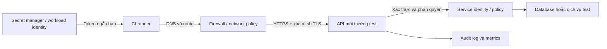

# Quản lý mạng, chứng chỉ, bí mật và quyền truy cập

Môi trường kiểm thử cần kết nối được với đúng dịch vụ, xác minh đúng danh tính của các hệ thống giao tiếp và bảo vệ thông tin xác thực được sử dụng trong quá trình chạy. Một ca kiểm thử có thể thất bại dù logic sản phẩm đúng nếu DNS phân giải sai, firewall chặn cổng, chứng chỉ TLS hết hạn hoặc tài khoản kiểm thử thiếu quyền. Ngược lại, một môi trường được cấu hình quá rộng có thể vô tình kết nối đến hệ thống sản xuất, làm lộ bí mật hoặc cho phép tài khoản kiểm thử thực hiện thao tác vượt quá phạm vi cần thiết.

Trong chiến lược kiểm thử xác thực (validation testing strategy), **mạng**, **chứng chỉ**, **bí mật** và **quyền truy cập** là các phần của điều kiện kiểm thử. Chúng ảnh hưởng đến khả năng tái tạo, tính an toàn, độ tin cậy và giá trị của bằng chứng. Nhóm cần thiết kế chúng như một hệ thống thống nhất: mạng xác định đường giao tiếp; chứng chỉ xác minh đầu cuối; bí mật cung cấp thông tin xác thực; quyền truy cập giới hạn hành động của từng danh tính.

Mục tiêu là tạo môi trường đủ giống bối cảnh sử dụng cần xác minh, có ranh giới rõ, có thể thiết lập và kiểm tra lặp lại, đồng thời giảm nguy cơ truy cập nhầm hoặc tiết lộ dữ liệu. Không nên giải quyết lỗi kết nối bằng cách tắt xác minh TLS, mở mọi cổng hoặc cấp quyền quản trị rộng. Cần xác định nguyên nhân và điều chỉnh đúng thành phần.

## 1. Xác định ranh giới và mục tiêu của môi trường

Trước khi cấu hình mạng hoặc cấp thông tin xác thực, hãy xác định môi trường cần kiểm tra và các hệ thống mà nó được phép giao tiếp. Một hệ thống thường có nhiều môi trường như phát triển, kiểm thử tích hợp, staging và sản xuất. Mỗi môi trường cần danh tính, dữ liệu, endpoint và quyền riêng biệt.

Các nguyên tắc nền tảng:

- **Tách biệt môi trường:** Môi trường kiểm thử không nên dùng chung credential, database hoặc quyền quản trị của sản xuất.
- **Giới hạn đường kết nối:** Chỉ cho phép luồng mạng cần thiết giữa các thành phần và dịch vụ phụ thuộc.
- **Nhận diện đúng đầu cuối:** Client phải xác minh máy chủ; với kết nối hai chiều, máy chủ cũng cần xác minh client.
- **Cấp quyền tối thiểu:** Mỗi người dùng, service account và pipeline chỉ có quyền cần thiết cho nhiệm vụ.
- **Quản lý vòng đời:** Chứng chỉ, token, mật khẩu và quyền phải có chủ sở hữu, thời hạn và quy trình thu hồi.
- **Có thể truy vết:** Thay đổi cấu hình, lần truy cập và lỗi xác thực cần được ghi nhận mà không làm lộ bí mật.
- **Có thể tái tạo:** Cấu hình mạng và quyền nên được quản lý có phiên bản, kiểm tra và triển khai nhất quán.

Hãy lập sơ đồ luồng giao tiếp trước khi cấu hình. Ví dụ, ứng dụng kiểm thử có thể gọi API đơn hàng, API đơn hàng truy cập database và gửi message đến broker; worker xử lý message gọi dịch vụ email giả lập. Mỗi mũi tên cần có nguồn, đích, giao thức, cổng, phương thức xác thực và mục đích rõ ràng.

## 2. Quản lý mạng cho môi trường kiểm thử

### 2.1. Lập danh mục luồng mạng

Mạng kiểm thử cần cho phép những giao tiếp phục vụ mục tiêu kiểm tra và chặn những đường không cần thiết. Danh mục luồng nên ghi:

| Trường | Nội dung cần xác định |
|---|---|
| Nguồn | Ứng dụng, runner CI, máy kiểm thử hoặc subnet khởi tạo kết nối |
| Đích | Dịch vụ, hostname, subnet hoặc endpoint cụ thể |
| Giao thức và cổng | HTTPS/TCP, DNS, message broker hoặc giao thức chuyên biệt |
| Hướng kết nối | Ingress, egress hoặc giao tiếp nội bộ giữa các dịch vụ |
| Mục đích | API, truy vấn dữ liệu, tải artifact, gửi message hoặc giám sát |
| Xác thực | TLS, mTLS, token, workload identity hoặc cơ chế khác |
| Môi trường | Dev, test, staging hoặc dịch vụ sandbox |
| Chủ sở hữu | Nhóm chịu trách nhiệm phê duyệt và duy trì luồng |

Ví dụ, runner kiểm thử có thể chỉ cần truy cập HTTPS đến API staging, DNS nội bộ và kho artifact. Nó không cần quyền truy cập trực tiếp đến mạng sản xuất hoặc cổng quản trị của database. Nếu kiểm thử cần kết nối database, nên dùng một đường mạng riêng với tài khoản có quyền phù hợp, thay vì mở database cho toàn bộ mạng runner.

### 2.2. Ingress, egress và phân đoạn mạng

- **Ingress** là lưu lượng đi vào một vùng hoặc dịch vụ. Chỉ mở endpoint và cổng cần nhận request.
- **Egress** là lưu lượng đi ra ngoài vùng hoặc dịch vụ. Giới hạn đích mà ứng dụng và runner được phép gọi.
- **Phân đoạn mạng (network segmentation)** chia môi trường thành các vùng có chính sách giao tiếp riêng, giảm khả năng một thành phần bị xâm nhập có thể truy cập mọi hệ thống.

Chính sách firewall hoặc network policy nên theo nguyên tắc mặc định từ chối, sau đó cho phép các luồng được xác định rõ. Tránh quy tắc rộng như cho phép mọi địa chỉ và mọi cổng nếu không có lý do được phê duyệt. Với dịch vụ cloud, có thể dùng security group, subnet, network ACL, private endpoint hoặc policy của nền tảng container để giới hạn giao tiếp.

Môi trường kiểm thử có thể cần truy cập Internet để tải dependency hoặc gọi sandbox của nhà cung cấp. Hãy giới hạn đích theo hostname hoặc nhóm dịch vụ cần thiết, dùng proxy có kiểm soát nếu phù hợp và ghi rõ dependency bên ngoài. Không dùng cùng một quy tắc egress rộng cho mọi runner chỉ vì một nhóm kiểm thử cần một endpoint đặc biệt.

### 2.3. DNS và service discovery

DNS hoặc service discovery xác định địa chỉ mà một hostname trỏ đến. Cấu hình sai có thể khiến kiểm thử gọi nhầm dịch vụ, đặc biệt khi tên miền staging và production gần giống nhau.

Nên:

- Dùng hostname riêng, dễ nhận diện cho từng môi trường.
- Kiểm tra DNS từ đúng nơi chạy kiểm thử, không chỉ từ máy của lập trình viên.
- Ghi nhận resolver, search domain và TTL khi chúng ảnh hưởng đến việc tái hiện.
- Tránh dùng file hosts hoặc địa chỉ IP cố định không được quản lý như một giải pháp lâu dài.
- Xác minh endpoint đích trước khi chạy kiểm thử có tác dụng phụ.
- Dùng service discovery hoặc DNS nội bộ theo cấu hình được quản lý và có thể kiểm tra.

Nếu một ca kiểm thử tạo đơn hàng hoặc giao dịch, cần xác nhận hostname thực tế trỏ đến môi trường thử nghiệm. Tên biến cấu hình như `API_BASE_URL` không đủ để chứng minh endpoint đúng; báo cáo nên ghi hostname và định danh môi trường, không ghi token hoặc query chứa dữ liệu nhạy cảm.

### 2.4. Proxy, VPN và kết nối riêng

Runner CI hoặc máy kiểm thử có thể phải đi qua proxy, VPN, private link hoặc gateway để truy cập dịch vụ nội bộ. Những thành phần này có thể ảnh hưởng đến DNS, TLS, timeout và đường định tuyến.

Khi cấu hình, hãy xác định:

- Proxy nào được sử dụng cho HTTP/HTTPS và cách xử lý `NO_PROXY` hoặc danh sách bypass.
- DNS được phân giải trước hay qua proxy.
- VPN có cấp route đến đúng subnet và có giới hạn truy cập không.
- Gateway có chấm dứt TLS, kiểm tra lưu lượng hoặc thay chứng chỉ không.
- Timeout, giới hạn kết nối và kích thước request có khác môi trường sử dụng không.
- Log mạng có thể truy vết request bằng mã tương quan mà không ghi nội dung bí mật không.

Một lỗi chỉ xuất hiện khi đi qua proxy có thể đến từ chứng chỉ CA của proxy, header bị thay đổi, timeout hoặc giới hạn payload. Hãy so sánh đường đi của request và cấu hình thực tế thay vì bỏ qua proxy hoặc tắt bảo vệ TLS để làm ca đạt.

### 2.5. Mô phỏng sự cố mạng có kiểm soát

Kiểm thử xác thực có thể cần xác minh timeout, mất kết nối, độ trễ, giới hạn băng thông hoặc lỗi DNS. Nên dùng công cụ hoặc môi trường mô phỏng được giới hạn phạm vi, áp dụng cho namespace hoặc tiến trình kiểm thử cụ thể.

Ví dụ các tình huống:

- Dịch vụ phụ thuộc phản hồi chậm hơn timeout đã cấu hình.
- Kết nối bị ngắt sau khi server nhận request nhưng trước khi client nhận response.
- DNS tạm thời không phân giải được hostname phụ thuộc.
- Broker từ chối kết nối hoặc đóng kết nối giữa lúc gửi message.
- Băng thông thấp làm lộ lỗi tải tệp hoặc đồng bộ.

Ghi lại mức độ trễ, tỷ lệ mất gói, thời gian áp dụng và cách khôi phục môi trường. Không áp dụng quy tắc gây lỗi mạng trên subnet dùng chung hoặc môi trường sản xuất. Sau thử nghiệm, xác nhận cấu hình mạng đã được khôi phục.

## 3. Chứng chỉ và xác minh danh tính kết nối

### 3.1. Vai trò của TLS và chứng chỉ

TLS bảo vệ dữ liệu khi truyền và giúp client xác minh danh tính máy chủ thông qua chứng chỉ số. Chứng chỉ máy chủ thường chứa tên miền hợp lệ trong Subject Alternative Name (SAN), thời hạn hiệu lực và thông tin chuỗi chứng thực. Client kiểm tra chuỗi chứng chỉ đến một CA (Certificate Authority) được tin cậy, tên máy chủ và thời gian hiệu lực.

Với HTTPS, việc kết nối thành công ở tầng TCP không chứng minh TLS hợp lệ. Một request có thể đến được server nhưng bị từ chối vì chứng chỉ hết hạn, hostname không khớp, CA không được tin cậy hoặc chuỗi chứng chỉ thiếu intermediate certificate.

Các môi trường kiểm thử nên sử dụng chứng chỉ phù hợp với hostname và CA được quản lý. Nếu dùng CA nội bộ hoặc CA thử nghiệm, chỉ cài trust anchor cần thiết vào trust store của môi trường kiểm thử. Không đưa CA thử nghiệm vào trust store rộng của máy người dùng hoặc runner dùng chung nếu không cần.

### 3.2. Kiểm tra các thuộc tính chứng chỉ

Khi kiểm tra chứng chỉ, cần xác minh:

- **Hostname/SAN:** Tên miền mà client gọi phải khớp một SAN hợp lệ.
- **Thời hạn:** `notBefore` và `notAfter` phải phù hợp với thời gian hệ thống.
- **Chuỗi chứng thực:** Certificate chain phải đầy đủ và dẫn đến CA được tin cậy.
- **Key usage và extended key usage:** Chứng chỉ phải được cấp cho mục đích phù hợp, ví dụ server authentication hoặc client authentication.
- **Thuật toán và độ dài khóa:** Phù hợp chính sách bảo mật của tổ chức và nền tảng.
- **Trạng thái thu hồi:** Tuân thủ cơ chế kiểm tra revocation áp dụng, nếu có.
- **Private key:** Được bảo vệ và chỉ cấp cho thành phần cần sử dụng.

Đồng hồ hệ thống sai có thể làm chứng chỉ trông như chưa có hiệu lực hoặc đã hết hạn. Vì vậy, môi trường cần đồng bộ thời gian bằng nguồn tin cậy và ghi nhận timezone khi điều tra lỗi.

### 3.3. Chứng chỉ máy chủ và mutual TLS

Trong TLS thông thường, client xác minh chứng chỉ server. Với **mutual TLS (mTLS)**, server cũng yêu cầu client trình chứng chỉ để xác minh danh tính phía gọi. mTLS thường được dùng giữa các dịch vụ nội bộ hoặc trong môi trường có yêu cầu xác thực máy với máy.

Khi kiểm thử mTLS, cần chuẩn bị:

1. Chứng chỉ server với SAN đúng hostname.
2. CA hoặc trust bundle mà client dùng để xác minh server.
3. Chứng chỉ client và private key do CA được server tin cậy cấp.
4. Cấu hình server xác minh đúng CA và mục đích chứng chỉ client.
5. Quy tắc ánh xạ danh tính chứng chỉ sang quyền hoặc service identity.
6. Kịch bản chứng chỉ hợp lệ, sai CA, hết hạn, thiếu chứng chỉ và bị thu hồi nếu phạm vi yêu cầu.

Không nên dùng một cặp chứng chỉ và private key cho tất cả môi trường hoặc mọi service. Mỗi danh tính máy cần credential riêng để có thể giới hạn quyền và thu hồi mà không ảnh hưởng thành phần khác.

### 3.4. Trust store và CA nội bộ

Trust store là tập CA mà một runtime hoặc ứng dụng chấp nhận để xác minh chuỗi chứng chỉ. Các runtime, container và trình duyệt có thể dùng trust store khác nhau. Vì vậy, việc chứng chỉ hoạt động trên máy lập trình viên không bảo đảm runner CI hoặc container cũng tin cậy.

Khi cài CA nội bộ:

- Xác minh fingerprint và nguồn phân phối CA qua kênh đáng tin cậy.
- Chỉ thêm CA cần thiết vào trust store của đúng môi trường.
- Quản lý CA bundle theo phiên bản và có quy trình cập nhật.
- Tránh tin cậy một CA gốc không cần thiết chỉ để xử lý một lỗi chứng chỉ.
- Kiểm tra ứng dụng thực sự dùng trust store nào; một số thư viện có cấu hình riêng.

Không tắt xác minh hostname hoặc cấu hình `trust all certificates` để làm kiểm thử vượt qua. Cách đó loại bỏ chính thuộc tính bảo mật mà kiểm thử cần xác nhận và có thể che giấu cấu hình sai.

### 3.5. Vòng đời và luân chuyển chứng chỉ

Chứng chỉ cần được theo dõi từ lúc tạo, cấp phát, cài đặt, gia hạn, thay thế đến thu hồi. Nên có cảnh báo trước ngày hết hạn và kiểm tra tự động trên endpoint quan trọng.

Khi luân chuyển chứng chỉ:

1. Cấp chứng chỉ mới và xác minh chain, SAN, key usage cùng thời hạn.
2. Cài trust hoặc cấu hình cần thiết trước thời điểm chuyển đổi.
3. Triển khai chứng chỉ mới theo cách có thể kiểm tra và rollback.
4. Xác nhận kết nối từ các client và runner liên quan.
5. Thu hồi hoặc loại bỏ chứng chỉ cũ khi không còn cần và sau khi xác minh không có consumer phụ thuộc.

Nếu kiểm thử chứng chỉ hết hạn hoặc bị thu hồi, nên dùng chứng chỉ thử nghiệm riêng và môi trường cô lập. Không làm hết hạn hoặc thu hồi chứng chỉ đang được dùng chung để tạo tình huống kiểm thử.

## 4. Quản lý bí mật và thông tin xác thực

### 4.1. Bí mật là gì?

Bí mật (secret) là thông tin có thể cấp quyền hoặc cho phép truy cập tài nguyên. Ví dụ:

- Mật khẩu người dùng hoặc service account.
- API key, access token và refresh token.
- Private key, client certificate key và signing key.
- Chuỗi kết nối database có chứa thông tin xác thực.
- Credential của cloud, registry, package repository hoặc dịch vụ sandbox.
- Khóa mã hóa, webhook secret và thông tin ký request.

Không phải mọi cấu hình đều là bí mật. Hostname, cổng hoặc tên feature flag thường không cần bảo mật như token, nhưng vẫn có thể nhạy cảm tùy kiến trúc. Hãy phân loại dữ liệu và áp dụng kiểm soát phù hợp.

### 4.2. Lưu trữ bí mật tập trung

Ưu tiên secret manager hoặc vault được tổ chức phê duyệt để lưu, cấp phát, kiểm soát và luân chuyển bí mật. CI/CD nên lấy secret trong thời gian cần thiết thông qua danh tính workload hoặc cơ chế cấp quyền có giới hạn.

Không lưu bí mật trong:

- Mã nguồn, repository hoặc file cấu hình được commit.
- Test fixture, snapshot, golden master hoặc dữ liệu seed.
- Log, ảnh chụp màn hình, báo cáo kiểm thử hoặc artifact pipeline.
- Ticket, chat, tài liệu chia sẻ hoặc command line history.
- Tên biến, URL hoặc thông báo lỗi được hiển thị công khai.

File `.env` có thể hữu ích cho phát triển cục bộ nếu được loại khỏi version control, giới hạn quyền truy cập và không được chia sẻ. Nó không thay thế secret manager cho môi trường dùng chung hoặc pipeline. Nếu bí mật đã bị commit, xóa dòng trong commit mới không làm bí mật cũ mất hiệu lực; cần thu hồi hoặc luân chuyển bí mật và xử lý lịch sử theo quy trình tổ chức.

### 4.3. Cấp phát theo môi trường và nhiệm vụ

Không dùng chung một API key hoặc mật khẩu giữa dev, test, staging và production. Bí mật của từng môi trường cần độc lập để giới hạn tác động khi bị lộ hoặc cần thu hồi.

Một pipeline có thể cần các bí mật khác nhau ở từng job. Ví dụ, job chạy unit test không cần credential truy cập sandbox thanh toán; job integration test chỉ nhận token sandbox trong thời gian thực hiện; job triển khai staging có quyền ghi vào môi trường staging nhưng không có quyền production.

Nên ưu tiên:

- Credential ngắn hạn thay cho mật khẩu hoặc token sống lâu.
- Workload identity hoặc OIDC federation nếu nền tảng hỗ trợ.
- Secret theo từng service, tenant hoặc pipeline thay vì một secret dùng chung.
- Quyền đọc secret chỉ trong job cần dùng.
- Thu hồi tự động hoặc hết hạn sau lần chạy nếu có thể.
- Danh tính riêng cho người và cho dịch vụ; không dùng tài khoản cá nhân làm service identity.

### 4.4. Truyền bí mật vào tiến trình kiểm thử

Bí mật có thể được cung cấp qua secret manager, biến môi trường, file mount có quyền hạn chế hoặc cơ chế credential của nền tảng. Cần chọn cách tránh để bí mật xuất hiện trong log, command line, crash dump hoặc artifact.

Ví dụ cấu hình minh họa, trong đó giá trị được cấp bởi secret manager của CI:

```yaml
jobs:
  integration-test:
    environment: test
    steps:
      - name: Run integration tests
        env:
          PAYMENT_API_TOKEN: ${{ secrets.TEST_PAYMENT_API_TOKEN }}
        run: ./run-integration-tests
```

Đây là ví dụ khái niệm; cú pháp và cơ chế bảo vệ phụ thuộc nền tảng CI. Cần giới hạn job nào có thể truy cập secret, tránh chạy mã không tin cậy với credential có quyền và bảo đảm log không in toàn bộ environment.

### 4.5. Che giấu và xử lý bí mật trong log

Không ghi token, mật khẩu, private key hoặc chuỗi kết nối đầy đủ vào log. Cơ chế masking của CI hữu ích nhưng không phải bảo đảm tuyệt đối: secret có thể bị mã hóa, cắt chuỗi, nối vào URL hoặc ghi ra từ một công cụ không hỗ trợ masking.

Khi cần truy vết, dùng định danh không nhạy cảm như secret version ID, key alias, client ID không có quyền hoặc correlation ID. Nếu cần hiển thị một phần giá trị để phân biệt, chỉ làm theo chính sách được phê duyệt và bảo đảm phần hiển thị không đủ để khôi phục secret.

### 4.6. Luân chuyển và thu hồi bí mật

Mọi secret cần có chủ sở hữu, phạm vi, thời hạn hoặc chính sách luân chuyển. Khi token bị lộ, người sở hữu rời nhóm hoặc môi trường không còn dùng credential, cần thu hồi theo quy trình.

Một quy trình luân chuyển an toàn gồm:

1. Tạo credential mới với quyền tối thiểu cần thiết.
2. Cập nhật secret manager và xác minh ứng dụng nhận giá trị mới.
3. Kiểm tra kết nối và hành vi trong môi trường thử nghiệm.
4. Thu hồi credential cũ sau khi xác nhận không còn consumer phụ thuộc.
5. Kiểm tra log truy cập và cảnh báo để phát hiện sử dụng credential cũ.

Không nên chia sẻ bí mật qua nội dung báo cáo hoặc yêu cầu người khác dán token vào chat để chẩn đoán. Dùng kênh quản lý bí mật và cơ chế cấp quyền được tổ chức phê duyệt.

## 5. Quản lý danh tính và quyền truy cập

### 5.1. Phân biệt xác thực và phân quyền

- **Xác thực (authentication)** xác minh danh tính của người hoặc service đang kết nối.
- **Phân quyền (authorization)** quyết định danh tính đó được phép thực hiện hành động nào trên tài nguyên nào.

Một request có token hợp lệ vẫn có thể không được phép đọc một đơn hàng cụ thể. Ngược lại, một tài khoản có role phù hợp nhưng dùng token hết hạn vẫn không thể xác thực. Kiểm thử cần xác minh cả hai khía cạnh.

### 5.2. Least privilege và RBAC/ABAC

Nguyên tắc quyền tối thiểu (least privilege) yêu cầu mỗi danh tính chỉ có quyền cần thiết cho nhiệm vụ. Có thể dùng:

- **RBAC (Role-Based Access Control):** Cấp quyền theo vai trò như viewer, tester, operator hoặc administrator.
- **ABAC (Attribute-Based Access Control):** Quyết định dựa trên thuộc tính như tenant, chủ sở hữu tài nguyên, môi trường, thời điểm hoặc mức phân loại dữ liệu.
- **Scope-based access:** Token chỉ được cấp các scope cụ thể như đọc đơn hàng hoặc tạo giao dịch sandbox.

Không cấp quyền admin cho tài khoản kiểm thử chỉ để tránh lỗi `403`. Nếu ca cần xác nhận thao tác quản trị, hãy dùng danh tính riêng có quyền giới hạn đúng hành động đó. Các thao tác thông thường nên được kiểm tra với vai trò người dùng thực tế.

### 5.3. Danh tính người dùng kiểm thử

Một bộ kiểm thử có thể cần nhiều tài khoản đại diện cho các vai trò khác nhau. Tài khoản nên được tạo cho mục đích kiểm thử, có tên hoặc metadata dễ nhận biết và không đại diện cho người dùng thật.

Ví dụ:

| Danh tính thử | Quyền dự kiến | Mục đích kiểm thử |
|---|---|---|
| `test-viewer` | Chỉ đọc dữ liệu trong tenant thử nghiệm | Xác minh xem dữ liệu được phép |
| `test-editor` | Đọc và sửa tài nguyên được phân công | Kiểm tra cập nhật hợp lệ |
| `test-operator` | Thực hiện thao tác vận hành được giới hạn | Kiểm tra luồng xử lý nghiệp vụ đặc biệt |
| `test-no-access` | Không có quyền với tài nguyên mục tiêu | Xác minh từ chối truy cập |
| `test-admin` | Quyền quản trị tối thiểu trong môi trường test | Kiểm tra chức năng quản trị được phê duyệt |

Không dùng cùng một tài khoản cho mọi ca nếu trạng thái, quyền hoặc session có thể thay đổi. Mỗi ca hoặc worker nên có danh tính riêng khi cần chạy song song. Tài khoản cần được vô hiệu hóa hoặc reset theo vòng đời của môi trường.

### 5.4. Danh tính dịch vụ và workload

Các dịch vụ giao tiếp với nhau nên dùng service identity riêng. Có thể xác thực bằng mTLS, workload identity, token ngắn hạn hoặc cơ chế được nền tảng hỗ trợ.

Không nên dùng credential của lập trình viên hoặc tài khoản người dùng để chạy dịch vụ tự động. Service identity cần:

- Có chủ sở hữu và mục đích rõ.
- Chỉ truy cập đúng API, queue, database hoặc namespace cần thiết.
- Không có quyền tương tác với production nếu chỉ phục vụ test.
- Có cơ chế cấp, gia hạn và thu hồi tự động hoặc có kiểm soát.
- Có log theo danh tính dịch vụ để truy vết hành động.

### 5.5. Quyền truy cập con người và phê duyệt

Người phát triển, QA, vận hành và quản trị viên có nhu cầu khác nhau. Có thể dùng nhóm hoặc role riêng để cấp quyền đọc log, chạy test, thay đổi cấu hình hoặc quản lý secret. Các thao tác nhạy cảm như cấp quyền quản trị, xem secret hoặc thay đổi firewall cần được giới hạn theo chính sách và ghi nhận.

MFA nên được áp dụng cho truy cập tương tác của con người theo chính sách tổ chức. Không nhúng MFA bypass hoặc tài khoản dùng chung vào script kiểm thử. Với automation, sử dụng danh tính workload phù hợp thay vì lưu mật khẩu người dùng.

## 6. Quản lý quyền cho CI/CD và runner kiểm thử

Runner CI là một phần của môi trường kiểm thử và có thể nắm giữ quyền truy cập vào mã nguồn, artifact, secret và dịch vụ. Nếu runner dùng chung nhiều dự án hoặc xử lý pull request từ nguồn không tin cậy, rủi ro rò rỉ credential tăng lên.

Các biện pháp cần xem xét:

- Tách runner hoặc job theo mức độ tin cậy và môi trường.
- Không cấp secret nhạy cảm cho job chạy mã từ fork hoặc nguồn chưa được tin cậy.
- Chỉ cho phép workflow đã được review truy cập credential triển khai hoặc sandbox có tác dụng phụ.
- Dùng token có thời hạn và scope giới hạn.
- Giới hạn quyền ghi repository, registry, artifact và môi trường triển khai.
- Làm sạch workspace, cache và file tạm sau job nếu có thể chứa dữ liệu nhạy cảm.
- Tránh chạy job có quyền cao trên runner dùng chung với job không tin cậy.
- Ghi nhận danh tính runner, job, commit và môi trường trong audit log.

Một job unit test thường chỉ cần đọc source và tải dependency. Nó không cần secret thanh toán, quyền ghi cloud hoặc quyền truy cập database production. Chia nhỏ quyền theo job giúp giới hạn tác động nếu mã kiểm thử hoặc dependency bị khai thác.

## 7. Kết hợp mạng, chứng chỉ, bí mật và quyền truy cập

Bốn thành phần này liên kết chặt chẽ. Một kết nối chỉ hoạt động khi đường mạng được phép, endpoint được định tuyến đúng, chứng chỉ được tin cậy, thông tin xác thực hợp lệ và danh tính có quyền thực hiện hành động.

Ví dụ, runner gọi API staging:

1. DNS phân giải `api.test.example.internal` đến địa chỉ staging.
2. Firewall cho phép runner kết nối TCP đến cổng HTTPS của API.
3. Client xác minh chứng chỉ server theo hostname và CA được tin cậy.
4. Runner lấy token ngắn hạn từ secret manager hoặc workload identity.
5. API xác thực token và ánh xạ danh tính đến role/scope phù hợp.
6. API chỉ cho phép thao tác trên dữ liệu của tenant kiểm thử.
7. Audit log ghi danh tính, hành động và correlation ID, không ghi token.

Sơ đồ luồng:



Khi kiểm thử thất bại, hãy xác định lớp bị lỗi:

- Không phân giải được hostname: kiểm tra DNS và search domain.
- Timeout hoặc connection refused: kiểm tra route, firewall, listener, proxy và cổng.
- Lỗi chứng chỉ: kiểm tra SAN, chain, trust store, thời hạn và đồng hồ.
- `401 Unauthorized`: kiểm tra token, issuer, audience, thời hạn và cơ chế xác thực.
- `403 Forbidden`: kiểm tra role, scope, tenant, ownership và policy.
- Kết nối được nhưng thao tác sai dữ liệu: kiểm tra endpoint, danh tính, môi trường và dữ liệu ban đầu.

Không nên xử lý tất cả lỗi bằng cách cấp thêm quyền hoặc tắt xác minh. Một `403` có thể là kết quả đúng của kiểm thử phân quyền; một chứng chỉ không hợp lệ có thể là lỗi sản phẩm hoặc cấu hình cần phát hiện.

## 8. Chuẩn hóa cấu hình để kiểm thử có thể tái tạo

Mạng, trust store, chứng chỉ và quyền thường được cấu hình qua nhiều công cụ. Nếu thay đổi thủ công mà không ghi nhận, hai runner có thể tạo kết quả khác nhau.

Nên quản lý cấu hình dưới dạng mã khi nền tảng hỗ trợ:

- Firewall rules, network policies, security groups và DNS records.
- Cấu hình proxy, endpoint và route.
- Danh sách CA được tin cậy và cấu hình TLS.
- Role, policy, service account và scope.
- Tham chiếu secret, quyền truy cập secret và chính sách luân chuyển.
- Cấu hình môi trường, feature flag và endpoint sandbox.

Không lưu giá trị secret thực trong repository cấu hình. Lưu tham chiếu đến secret manager hoặc định danh secret version; giá trị chỉ được cấp khi job hoặc workload cần dùng.

Mỗi lần chạy quan trọng nên ghi lại phiên bản cấu hình hoặc commit hạ tầng, phiên bản chứng chỉ/CA bundle, danh tính workload và môi trường. Có thể ghi fingerprint chứng chỉ công khai hoặc secret version ID để truy vết, nhưng không ghi private key, token hoặc giá trị bí mật.

## 9. Kiểm thử các tình huống mạng và bảo mật

Ma trận kiểm thử cần bao phủ cả luồng hợp lệ lẫn tình huống từ chối hoặc lỗi. Một số ví dụ:

| Chủ đề | Kịch bản hợp lệ | Kịch bản lỗi hoặc biên |
|---|---|---|
| DNS | Hostname test phân giải đến endpoint đúng | Hostname không tồn tại, resolver lỗi hoặc trỏ nhầm môi trường |
| Firewall | Luồng được phê duyệt kết nối thành công | Cổng không được phép bị chặn; nguồn ngoài phạm vi bị từ chối |
| Proxy | Request đi qua proxy theo cấu hình | Proxy không sẵn sàng, timeout hoặc CA proxy không được tin cậy |
| TLS server | Chứng chỉ đúng hostname và chain hợp lệ | Sai SAN, hết hạn, chưa có hiệu lực hoặc chain không tin cậy |
| mTLS | Client có chứng chỉ hợp lệ được chấp nhận | Thiếu chứng chỉ, sai CA hoặc chứng chỉ hết hạn bị từ chối |
| Secret | Token hợp lệ và còn hạn được sử dụng | Token hết hạn, bị thu hồi hoặc sai audience bị từ chối |
| Phân quyền | Vai trò đúng thực hiện được hành động được phép | Vai trò thiếu quyền hoặc truy cập tài nguyên tenant khác bị từ chối |
| CI runner | Job chỉ nhận secret cần thiết | Job không tin cậy không thể đọc secret hoặc triển khai |
| Audit | Hành động nhạy cảm được ghi nhận | Log không chứa token, mật khẩu hoặc private key |

Khi kiểm tra từ chối truy cập, cần xác nhận không có tác dụng phụ. Ví dụ, API trả `403` nhưng vẫn tạo bản ghi hoặc phát message là lỗi nghiêm trọng. Chỉ kiểm tra mã phản hồi là chưa đủ; cần kiểm tra trạng thái dữ liệu và các hệ thống liên quan.

## 10. Chẩn đoán sự cố mà không làm lộ bí mật

Chẩn đoán cần đủ thông tin để phân biệt lỗi cấu hình, lỗi mạng, lỗi chứng chỉ, lỗi xác thực và lỗi phân quyền. Có thể ghi:

- Thời điểm và ID lần chạy.
- Tên môi trường và hostname đích.
- DNS resolver hoặc địa chỉ đích ở mức phù hợp với chính sách.
- Giao thức, cổng, timeout và trạng thái kết nối.
- Mã lỗi TLS hoặc mã phản hồi HTTP.
- Subject/SAN, issuer, serial hoặc fingerprint chứng chỉ công khai khi cần.
- Secret version ID hoặc credential alias, không phải giá trị secret.
- Danh tính workload, role/scope và correlation ID.
- Phiên bản cấu hình, build và runner.

Không ghi:

- Authorization header, bearer token, cookie hoặc session ID đầy đủ.
- Mật khẩu, API key, private key hoặc chuỗi kết nối có credential.
- Nội dung request/response chứa dữ liệu cá nhân không cần thiết.
- Toàn bộ environment variables hoặc file cấu hình bí mật.

Nếu cần chia sẻ bằng chứng, hãy che dữ liệu nhạy cảm trước khi đưa vào ticket hoặc báo cáo. Kiểm tra cả log của ứng dụng, reverse proxy, runner và secret manager vì bí mật có thể bị ghi ở bất kỳ lớp nào.

## 11. Quản lý thay đổi và rà soát định kỳ

Mạng, chứng chỉ, secret và quyền đều có vòng đời. Chúng cần được xem xét khi thay đổi ứng dụng, hạ tầng, nhà cung cấp hoặc nhóm người dùng.

Các sự kiện cần kích hoạt rà soát:

- Thêm dịch vụ hoặc endpoint mới.
- Chuyển môi trường, subnet, proxy, VPN hoặc DNS.
- Thay CA, gia hạn chứng chỉ hoặc thay đổi chính sách TLS.
- Secret bị lộ, sắp hết hạn hoặc không còn được sử dụng.
- Thay đổi role, scope, tenant hoặc service identity.
- Thay đổi runner, pipeline, repository trust hoặc nguồn pull request.
- Phát hiện truy cập ngoài dự kiến hoặc lỗi phân quyền.
- Thay đổi yêu cầu tuân thủ hoặc chính sách dữ liệu.

Một quy trình thay đổi nên gồm đề xuất, đánh giá tác động, review, triển khai ở môi trường phù hợp, kiểm thử xác nhận, giám sát và cập nhật tài liệu. Các quyền tạm thời cần có ngày hết hạn và người chịu trách nhiệm thu hồi.

Rà soát định kỳ nên tìm:

- Firewall rule hoặc route không còn được sử dụng.
- Chứng chỉ sắp hết hạn hoặc CA không còn cần thiết.
- Secret quá hạn luân chuyển, không rõ chủ sở hữu hoặc không có lần sử dụng hợp lệ.
- Tài khoản thử nghiệm có quyền vượt nhu cầu.
- Service account không còn được workload sử dụng.
- Runner hoặc pipeline có quyền truy cập rộng hơn nhiệm vụ.
- Log hoặc artifact chứa dữ liệu nhạy cảm.

## 12. Ví dụ xuyên suốt: kiểm thử tích hợp thanh toán trong môi trường test

Giả sử một ứng dụng đặt hàng cần gọi API sandbox của nhà cung cấp thanh toán. Nhóm muốn xác minh thanh toán thành công, thất bại, timeout và gửi lại request không tạo giao dịch trùng.

**Mạng:** Runner chỉ được phép gọi hostname sandbox qua HTTPS và truy cập các dịch vụ test nội bộ cần thiết. DNS phải phân giải đúng endpoint sandbox. Không có route đến API production hoặc database production.

**Chứng chỉ:** Client xác minh chứng chỉ server sandbox theo hostname và CA được tin cậy. Nếu nhà cung cấp yêu cầu mTLS, runner dùng client certificate riêng cho môi trường test. Chứng chỉ và trust bundle có thời hạn, chủ sở hữu và cảnh báo gia hạn.

**Bí mật:** Token sandbox được lưu trong secret manager và cấp cho job integration test trong thời gian chạy. Unit test không nhận token. Token không được in ra log hoặc lưu vào artifact. Khi credential cần thay đổi, nhóm luân chuyển và kiểm tra token mới trước khi thu hồi token cũ.

**Quyền:** Service identity của ứng dụng chỉ có scope cần thiết để tạo và truy vấn giao dịch sandbox. Tài khoản kiểm thử không có quyền quản trị nhà cung cấp hoặc truy cập dữ liệu của tenant khác. Kịch bản negative test xác nhận token thiếu scope bị từ chối và không tạo giao dịch.

**Bằng chứng:** Mỗi lần chạy có `testRunId`, mã đơn hàng và correlation ID riêng. Báo cáo ghi hostname sandbox, build, secret version ID, fingerprint chứng chỉ công khai và kết quả kết nối; không ghi token hoặc private key.

**Dọn dẹp:** Giao dịch thử được hủy hoặc đánh dấu theo cơ chế sandbox của nhà cung cấp nếu cần. Dữ liệu đơn hàng và message thuộc `testRunId` được xóa khỏi namespace kiểm thử. Nếu thao tác bù trừ thất bại, tài nguyên được ghi nhận để xử lý, không coi cleanup đã hoàn tất.

Với cách tổ chức này, một lỗi có thể được khoanh vùng rõ hơn. DNS sai là lỗi định tuyến; chứng chỉ không hợp lệ là lỗi TLS; token hết hạn là lỗi xác thực; scope thiếu là lỗi phân quyền; giao dịch trùng dù request được gửi lại là vấn đề nghiệp vụ hoặc idempotency cần kiểm tra ở cấp ứng dụng.

## 13. Những sai lầm thường gặp

- **Mở mạng quá rộng để test chạy được:** Tăng bề mặt truy cập và có thể tạo đường đến môi trường không mong muốn.
- **Dùng chung endpoint hoặc credential giữa test và production:** Tăng nguy cơ thao tác nhầm và khó thu hồi độc lập.
- **Tắt xác minh TLS:** Che giấu lỗi hostname, CA hoặc chứng chỉ và làm mất bằng chứng về bảo mật kết nối.
- **Cài CA thử nghiệm ở phạm vi quá rộng:** Mở rộng vùng tin cậy ngoài nhu cầu của môi trường test.
- **Dùng một chứng chỉ client cho mọi service:** Khi lộ hoặc cần thu hồi, nhiều thành phần bị ảnh hưởng.
- **Commit secret vào repository:** Xóa secret khỏi file không làm credential đã lộ mất hiệu lực; cần thu hồi và luân chuyển.
- **In toàn bộ biến môi trường để debug:** Có thể làm lộ token, mật khẩu và private key trong log.
- **Cấp quyền admin cho tài khoản kiểm thử:** Làm kiểm thử không phản ánh quyền thực tế và có thể che lỗi phân quyền.
- **Dùng tài khoản cá nhân cho automation:** Khó quản lý vòng đời, quyền và trách nhiệm.
- **Cấp secret cho job không tin cậy:** Mã từ nguồn chưa được review có thể đọc hoặc gửi secret ra ngoài.
- **Không kiểm tra tác dụng phụ khi bị từ chối:** Request có thể trả lỗi nhưng vẫn thay đổi dữ liệu.
- **Không thu hồi quyền tạm thời:** Quyền tồn tại lâu hơn mục đích ban đầu và làm tăng rủi ro.
- **Ghi bằng chứng có chứa bí mật:** Báo cáo, ảnh chụp hoặc artifact có thể trở thành nguồn rò rỉ thứ cấp.

## 14. Checklist quản lý mạng, chứng chỉ, bí mật và quyền truy cập

Trước khi sử dụng môi trường cho kiểm thử tích hợp hoặc xác thực, nhóm có thể dùng checklist sau:

- [ ] Môi trường test được tách biệt với production về endpoint, dữ liệu, credential và quyền.
- [ ] Sơ đồ luồng mạng có nguồn, đích, giao thức, cổng, mục đích và chủ sở hữu.
- [ ] Ingress/egress và firewall chỉ cho phép các luồng cần thiết.
- [ ] DNS, proxy, VPN và route được xác minh từ đúng runner hoặc môi trường chạy test.
- [ ] Endpoint đích được xác nhận là test/sandbox trước khi chạy thao tác có tác dụng phụ.
- [ ] TLS được bật và xác minh hostname, chain, thời hạn và mục đích chứng chỉ.
- [ ] Trust store chỉ chứa CA cần thiết; không tắt kiểm tra chứng chỉ để vượt lỗi.
- [ ] mTLS được kiểm tra nếu giao thức yêu cầu xác minh client.
- [ ] Chứng chỉ có chủ sở hữu, thời hạn, cảnh báo và quy trình luân chuyển/thu hồi.
- [ ] Secret được lưu trong hệ thống quản lý bí mật được phê duyệt, không nằm trong mã nguồn hoặc artifact.
- [ ] Credential tách biệt theo môi trường, service và job; ưu tiên token ngắn hạn.
- [ ] Log và báo cáo không chứa token, mật khẩu, private key hoặc dữ liệu nhạy cảm không cần thiết.
- [ ] Người dùng và service account có quyền tối thiểu theo vai trò, scope và tenant.
- [ ] Kịch bản xác thực và phân quyền hợp lệ/không hợp lệ đều được kiểm tra.
- [ ] Runner CI và pipeline chỉ nhận quyền, secret và network access cần thiết.
- [ ] Thay đổi cấu hình có review, phiên bản và audit trail.
- [ ] Quyền tạm thời, secret và chứng chỉ không còn dùng được thu hồi đúng hạn.
- [ ] Có cách chẩn đoán lỗi DNS, kết nối, TLS, authentication và authorization riêng biệt.

Quản lý mạng, chứng chỉ, bí mật và quyền truy cập đúng cách giúp môi trường kiểm thử vừa kết nối được với các phụ thuộc cần thiết vừa duy trì ranh giới an toàn. Khi mỗi luồng mạng, danh tính, chứng chỉ và secret có mục đích cùng vòng đời rõ ràng, nhóm có thể tái tạo điều kiện kiểm thử, phát hiện lỗi cấu hình và bảo vệ bằng chứng mà không làm lộ thông tin nhạy cảm.
