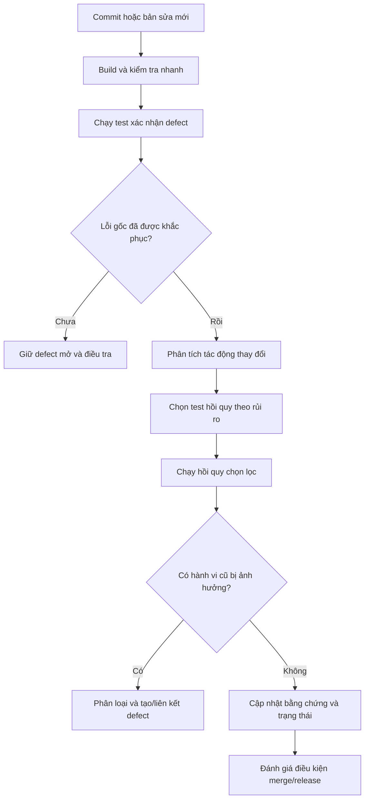

# Phân biệt kiểm thử xác nhận bản sửa với kiểm thử hồi quy

Khi một lỗi được báo cáo và lập trình viên sửa mã, nhóm cần trả lời hai câu hỏi khác nhau. Thứ nhất, lỗi cụ thể đã được khắc phục chưa? Thứ hai, thay đổi dùng để sửa lỗi có làm hỏng chức năng đang hoạt động hay không? Hai câu hỏi này tương ứng với **kiểm thử xác nhận bản sửa** (confirmation testing, thường được gọi là retesting) và **kiểm thử hồi quy** (regression testing).

Kiểm thử xác nhận bản sửa tập trung tái hiện lỗi đã biết trong điều kiện phù hợp để xác minh hành vi sai không còn xuất hiện và kết quả mong đợi đã được khôi phục. Kiểm thử hồi quy tập trung tìm tác động không mong muốn của thay đổi lên những hành vi, thành phần hoặc luồng liên quan vốn đã hoạt động trước đó. Hai hoạt động thường được thực hiện cùng nhau sau một lần sửa lỗi, nhưng chúng có mục tiêu, phạm vi và bằng chứng khác nhau.

## 1. Kiểm thử xác nhận bản sửa là gì?

Kiểm thử xác nhận bản sửa kiểm tra trực tiếp vấn đề đã được ghi nhận. Người kiểm thử dùng bước tái hiện, dữ liệu, điều kiện và kết quả mong đợi của báo cáo lỗi để xác minh bản build có chứa bản sửa.

Mục tiêu chính:

- Xác nhận lỗi ban đầu có thể tái hiện trên phiên bản bị lỗi hoặc có bằng chứng đáng tin cậy về hành vi trước khi sửa.
- Chạy lại trường hợp đã thất bại với phiên bản chứa bản sửa.
- Xác minh kết quả thực tế hiện khớp với kết quả mong đợi.
- Kiểm tra các điều kiện liên quan trực tiếp đến nguyên nhân lỗi, chẳng hạn giá trị biên, trạng thái hoặc vai trò gây kích hoạt.
- Ghi lại phiên bản, môi trường, dữ liệu và bằng chứng để có thể truy nguyên quyết định.

Kiểm thử xác nhận thường có phạm vi hẹp và tập trung. Nếu lỗi là “người dùng có vai trò Viewer vẫn có thể xóa đơn hàng”, kiểm thử xác nhận cần chạy lại yêu cầu xóa với vai trò Viewer và xác minh thao tác bị từ chối, dữ liệu không bị thay đổi. Chỉ kiểm tra một trang khác vẫn tải được không chứng minh lỗi phân quyền đã được sửa.

### Điều kiện để xác nhận có ý nghĩa

Trường hợp xác nhận cần giữ được điều kiện kích hoạt lỗi. Nếu báo cáo ban đầu xảy ra khi một mã giảm giá hết hạn theo múi giờ của cửa hàng, chạy lại với mã còn hiệu lực hoặc múi giờ khác có thể không kiểm tra đúng lỗi.

Trước khi chạy, cần hiểu:

- Phiên bản nào từng có lỗi và phiên bản nào chứa bản sửa.
- Các bước tối thiểu để tái hiện.
- Dữ liệu, trạng thái ban đầu, vai trò và cấu hình cần thiết.
- Kết quả thực tế trước khi sửa và kết quả mong đợi.
- Điều kiện đặc biệt như thời gian, tải, đồng thời hoặc thứ tự sự kiện.
- Phạm vi thay đổi kỹ thuật có liên quan đến lỗi.

Nếu lỗi không còn tái hiện trên phiên bản cũ do môi trường hoặc dữ liệu đã thay đổi, cần ghi rõ giới hạn. Không nên kết luận bản sửa thành công chỉ vì không tái hiện được lỗi trong một điều kiện khác.

## 2. Kiểm thử hồi quy là gì?

Kiểm thử hồi quy đánh giá xem thay đổi mới có gây tác động bất lợi lên chức năng đã hoạt động trước đó hay không. Thay đổi có thể là bản sửa lỗi, tính năng mới, tái cấu trúc, nâng cấp thư viện, thay cấu hình, migration dữ liệu hoặc thay đổi hạ tầng.

Kiểm thử hồi quy tìm các vấn đề như:

- Chức năng cũ không còn hoạt động.
- Một luồng liên quan trả về kết quả khác trước.
- Hợp đồng API hoặc schema thông điệp bị thay đổi ngoài dự kiến.
- Dữ liệu bị sai, mất, trùng hoặc cập nhật không nhất quán.
- Quyền truy cập, trạng thái hoặc quy tắc nghiệp vụ bị ảnh hưởng.
- Tích hợp với thành phần khác bị hỏng.
- Hiệu năng, độ tin cậy hoặc khả năng tương thích suy giảm.

Phạm vi hồi quy thường rộng hơn trường hợp xác nhận bản sửa. Nó được chọn dựa trên tác động có thể có của thay đổi và mức rủi ro của các chức năng liên quan. Không nhất thiết phải chạy lại mọi kiểm thử trong mọi lần sửa; cần chọn tập kiểm thử đủ mạnh để cung cấp bằng chứng phù hợp với rủi ro.

Ví dụ, khi sửa cách tính ngày hết hạn của mã giảm giá, kiểm thử hồi quy có thể bao gồm áp dụng mã còn hiệu lực, mã hết hạn, mã chưa đến ngày hiệu lực, kết hợp nhiều ưu đãi, tính tổng đơn hàng, thanh toán và báo cáo doanh thu. Mục đích là phát hiện bản sửa ngày giờ có làm sai những hành vi khác của quy trình đặt hàng hay không.

## 3. So sánh trực tiếp hai loại kiểm thử

| Tiêu chí | Xác nhận bản sửa (retesting) | Kiểm thử hồi quy |
| --- | --- | --- |
| Câu hỏi chính | Lỗi cụ thể đã được khắc phục chưa? | Thay đổi có làm hỏng hành vi đang hoạt động không? |
| Điểm xuất phát | Báo cáo lỗi, bước tái hiện và kết quả mong đợi | Phạm vi thay đổi, quan hệ phụ thuộc và rủi ro |
| Phạm vi | Tập trung vào lỗi và điều kiện kích hoạt | Bao phủ chức năng bị ảnh hưởng và các luồng liên quan |
| Dữ liệu | Ưu tiên dữ liệu tái hiện lỗi ban đầu và biến thể sát nguyên nhân | Dữ liệu đại diện cho hành vi cũ, nhánh liên quan và điều kiện biên |
| Thời điểm | Sau khi có bản sửa có thể kiểm thử | Sau thay đổi; có thể chạy trước, trong và sau khi tích hợp tùy pipeline |
| Kết quả cần chứng minh | Hành vi lỗi không còn xuất hiện; yêu cầu cụ thể được đáp ứng | Hành vi đã có tiếp tục đúng trong phạm vi được kiểm tra |
| Phạm vi thất bại | Lỗi gốc vẫn còn hoặc chưa có bằng chứng đủ | Có lỗi mới hoặc hành vi cũ bị ảnh hưởng |

Ví dụ ngắn:

- Xác nhận bản sửa: gửi yêu cầu xóa đơn bằng tài khoản Viewer và xác minh nhận phản hồi từ chối, đơn vẫn tồn tại.
- Hồi quy: xác minh Admin vẫn xóa được đơn theo quy trình; Viewer vẫn đọc được đơn; Editor vẫn cập nhật trường được phép; các API và báo cáo liên quan vẫn hoạt động.

Không thể dùng kết quả của một loại thay thế hoàn toàn cho loại kia. Một trường hợp xác nhận đạt chỉ chứng minh lỗi cụ thể đã được kiểm tra; nó không chứng minh thay đổi không làm hỏng chức năng khác. Một bộ hồi quy đạt cũng không chứng minh lỗi ban đầu đã được tái hiện đúng và xác nhận được khắc phục, trừ khi bộ đó có chứa trường hợp xác nhận phù hợp.

## 4. Phân biệt với kiểm thử lại sau khi chạy thất bại

Trong thực tế, từ “retest” đôi khi được dùng để chỉ việc chạy lại một bài kiểm thử sau khi bất kỳ failure nào được xử lý. Để tránh nhầm lẫn, nhóm nên dùng tên và trạng thái rõ ràng:

- **Xác nhận bản sửa:** chạy lại trường hợp của defect đã được sửa.
- **Chạy lại kiểm thử (rerun):** thực thi lại một test vì cần xác định failure có lặp lại hay do môi trường, tính không ổn định hoặc dữ liệu.
- **Kiểm thử hồi quy:** kiểm tra các hành vi hiện có có bị ảnh hưởng bởi thay đổi không.

Chạy lại một test không tự động là xác nhận bản sửa. Nếu test thất bại do runner mất kết nối rồi đạt ở lần chạy sau, nhóm cần phân loại failure thay vì đóng defect. Tương tự, chạy lại toàn bộ suite không có nghĩa là nhóm đã thực hiện phân tích hồi quy có chủ đích.

## 5. Quy trình sau khi nhận bản sửa lỗi

Một quy trình có thể lặp lại giúp nhóm tránh bỏ sót bước xác nhận hoặc hồi quy.

1. **Đọc và làm rõ defect:** xác nhận điều kiện, kết quả thực tế, kết quả mong đợi, mức độ ảnh hưởng và bước tái hiện.
2. **Kiểm tra bản sửa:** xác định commit/build chứa thay đổi, thành phần được sửa và ghi chú của lập trình viên.
3. **Chuẩn bị môi trường và dữ liệu:** khôi phục trạng thái ban đầu, đúng vai trò, cấu hình và phụ thuộc.
4. **Chạy xác nhận bản sửa:** thực hiện bước tái hiện gốc và các biến thể trực tiếp liên quan đến nguyên nhân.
5. **Đánh giá tác động:** xem file, module, API, schema, cấu hình, dữ liệu và thành phần phụ thuộc bị thay đổi.
6. **Chọn kiểm thử hồi quy:** ưu tiên các hành vi cùng thành phần, luồng nghiệp vụ liên quan và rủi ro có thể bị ảnh hưởng.
7. **Chạy kiểm thử hồi quy:** thực hiện theo tầng phù hợp, ghi nhận kết quả và phân loại failure.
8. **Xác minh lại lỗi phát sinh:** nếu có lỗi mới, tạo hoặc liên kết defect, xác định phạm vi và kiểm tra xem có liên quan đến bản sửa không.
9. **Cập nhật trạng thái:** ghi rõ xác nhận bản sửa và hồi quy đạt, không đạt hoặc chưa đủ bằng chứng.
10. **Quyết định tích hợp/phát hành:** dựa trên tiêu chí chất lượng, mức rủi ro và bằng chứng còn thiếu.

Quy trình có thể thay đổi theo mức độ nghiêm trọng và tốc độ phát hành. Với lỗi khẩn cấp, nhóm có thể chạy một tập kiểm thử rủi ro cao trước, sau đó mở rộng kiểm tra theo kế hoạch được phê duyệt. Cần ghi rõ phần nào đã chạy và phần nào còn chờ.

## 6. Phân tích tác động để chọn phạm vi hồi quy

Không nên chọn kiểm thử hồi quy chỉ dựa trên tên file vừa sửa. Một thay đổi nhỏ ở thư viện dùng chung hoặc quy tắc miền có thể ảnh hưởng tới nhiều luồng. Ngược lại, một thay đổi lớn trong thành phần cô lập có thể có phạm vi ảnh hưởng hẹp hơn dự kiến.

### Những nguồn thông tin để phân tích

- **Mã nguồn và phụ thuộc:** lớp, hàm, module, thư viện và thành phần gọi tới phần đã sửa.
- **Yêu cầu và quy tắc nghiệp vụ:** các hành vi dùng chung quy tắc hoặc dữ liệu liên quan.
- **API và hợp đồng:** endpoint, schema, event, message và consumer/provider liên quan.
- **Dữ liệu và lưu trữ:** bảng, truy vấn, migration, transaction, cache và chỉ mục.
- **Cấu hình và hạ tầng:** feature flag, quyền, biến môi trường, runtime, broker và dịch vụ ngoài.
- **Lịch sử lỗi:** lỗi tương tự, lỗi hồi quy từng xảy ra và thành phần có độ bất ổn cao.
- **Mức độ sử dụng và tác động:** số người dùng, giao dịch, dữ liệu hoặc hoạt động phụ thuộc.

### Phạm vi gần và phạm vi xa

**Hồi quy gần (nearby regression)** kiểm tra các hành vi ngay trong thành phần hoặc vùng mã vừa thay đổi. **Hồi quy xa (wider/system regression)** kiểm tra luồng xuyên qua các thành phần khác có thể bị ảnh hưởng gián tiếp.

Ví dụ, thay đổi quy tắc tính phí có thể cần:

- Kiểm thử đơn vị cho công thức, làm tròn và giá trị biên.
- Kiểm thử tích hợp cho cách lưu số tiền, thuế và mã giảm giá.
- Kiểm thử API cho phản hồi tổng tiền và chi tiết phí.
- Kiểm thử E2E cho luồng giỏ hàng, thanh toán và hóa đơn.

Phạm vi cần chọn theo rủi ro và mối liên hệ thực tế. Không phải mọi thay đổi đều cần chạy toàn bộ tầng.

## 7. Chọn kiểm thử hồi quy theo rủi ro

Khi bộ kiểm thử lớn, nhóm cần xếp thứ tự chạy và chọn tập phù hợp với thời gian.

Các yếu tố ưu tiên:

1. Mức độ nghiêm trọng nếu hành vi bị hỏng.
2. Khả năng thành phần thay đổi ảnh hưởng tới hành vi đó.
3. Tần suất sử dụng và số người dùng bị ảnh hưởng.
4. Lịch sử lỗi và độ ổn định của khu vực.
5. Mức độ khó phát hiện hoặc khôi phục sau khi phát hành.
6. Chi phí và thời gian chạy kiểm thử.

Có thể chia tập hồi quy:

| Tập kiểm thử | Nội dung | Thời điểm phù hợp |
| --- | --- | --- |
| Smoke/sanity | Kiểm tra nhanh các chức năng thiết yếu và khả năng khởi động | Sau build hoặc triển khai thử |
| Hồi quy chọn lọc | Các test liên quan trực tiếp đến thay đổi và phụ thuộc gần | Mỗi pull request hoặc sau bản sửa |
| Hồi quy mở rộng | Các luồng liên quan, tích hợp và rủi ro mức cao | Trước merge quan trọng, release candidate hoặc theo lịch CI |
| Hồi quy đầy đủ | Bộ kiểm thử đã chọn cho toàn sản phẩm hoặc phạm vi phát hành | Trước phát hành lớn, theo đêm hoặc khi thay đổi rộng |

Tên gọi và nội dung từng tập có thể khác nhau giữa tổ chức. Điều quan trọng là tiêu chí chọn, chủ sở hữu và thời điểm chạy phải rõ.

Không nên chỉ chọn test vì chúng chạy nhanh. Một bài kiểm thử chậm nhưng bảo vệ giao dịch quan trọng có thể cần được ưu tiên trong cổng phát hành. Có thể phân tầng pipeline để cung cấp phản hồi sớm rồi tiếp tục chạy các tập sâu hơn.

## 8. Ví dụ chi tiết: sửa lỗi mã giảm giá hết hạn

Giả sử người dùng có thể áp dụng mã giảm giá đã hết hạn khi cửa hàng hoạt động ở múi giờ khác với máy chủ. Báo cáo lỗi có thông tin:

- Mã `SAVE10` hết hạn lúc 00:00 ngày 01/06 theo múi giờ cửa hàng.
- Người dùng gửi đơn lúc 00:15 ngày 01/06 theo giờ cửa hàng.
- API vẫn áp dụng giảm giá và trả về tổng tiền đã trừ ưu đãi.
- Kết quả mong đợi: mã hết hạn phải bị từ chối và tổng tiền không được giảm.

### Kiểm thử xác nhận bản sửa

Chạy lại điều kiện tái hiện gốc trên build chứa bản sửa:

1. Tạo mã giảm giá với thời điểm hết hạn đã biết và múi giờ cửa hàng xác định.
2. Đặt đồng hồ hoặc dữ liệu thời gian theo điều kiện tái hiện.
3. Gửi yêu cầu áp dụng mã sau thời điểm hết hạn.
4. Xác minh API từ chối mã với mã lỗi nghiệp vụ phù hợp.
5. Xác minh tổng tiền không bị giảm và không tạo bản ghi sử dụng mã.

Thêm các biến thể trực tiếp quanh nguyên nhân:

- Gửi đúng tại thời điểm hết hạn theo quy tắc bao gồm/không bao gồm đã thống nhất.
- Gửi ngay trước thời điểm hết hạn.
- Gửi sau thời điểm hết hạn ở múi giờ cửa hàng khác với UTC.
- Gửi mã chưa đến thời điểm bắt đầu hiệu lực.

Đây là xác nhận bản sửa vì mỗi trường hợp nhắm trực tiếp vào quy tắc hiệu lực của mã và lỗi thời gian đã báo.

### Kiểm thử hồi quy

Tiếp theo, chọn các hành vi cũ có thể bị ảnh hưởng bởi thay đổi ngày giờ:

| Khu vực | Kiểm thử hồi quy cần có | Lý do |
| --- | --- | --- |
| Mã còn hiệu lực | Mã hợp lệ vẫn được áp dụng và tính giảm đúng | Tránh từ chối nhầm mã hợp lệ |
| Điều kiện tối thiểu | Đơn đạt giá trị tối thiểu được giảm; đơn dưới ngưỡng bị từ chối | Xác minh quy tắc kết hợp |
| Giới hạn sử dụng | Mã dùng một lần hoặc hết lượt không được áp dụng thêm | Bảo vệ trạng thái và số lần sử dụng |
| Kết hợp ưu đãi | Các quy tắc cộng dồn hoặc loại trừ vẫn đúng | Thay đổi có thể ảnh hưởng thứ tự tính giá |
| Thanh toán | Số tiền gửi tới cổng thanh toán khớp tổng sau ưu đãi | Bảo vệ giao dịch |
| Hóa đơn và báo cáo | Số tiền giảm, thuế và tổng tiền được ghi đúng | Bảo vệ dữ liệu downstream |
| Đa múi giờ | Người dùng ở múi giờ khác vẫn thấy thời hạn nhất quán | Phát hiện tác động ngoài phạm vi ban đầu |

Trường hợp xác nhận trả lời “mã hết hạn đã bị từ chối đúng chưa?”. Bộ hồi quy trả lời “các quy tắc mã giảm giá và luồng tính tiền đang hoạt động có còn đúng không?”.

## 9. Ví dụ về phân quyền: xác nhận lỗi và hồi quy vai trò

Giả sử một lỗi cho phép vai trò Viewer gọi API xóa đơn hàng.

**Xác nhận bản sửa:**

- Dùng tài khoản Viewer đã đăng nhập.
- Gửi yêu cầu xóa đơn tới endpoint bị ảnh hưởng.
- Xác minh phản hồi từ chối theo hợp đồng API.
- Xác minh đơn vẫn tồn tại và không có sự kiện xóa được phát.

**Hồi quy:**

- Admin vẫn xóa được đơn theo quy trình được phép.
- Viewer vẫn đọc được các trường được phép.
- Editor vẫn cập nhật những trường thuộc quyền của mình.
- Người dùng không thể truy cập đơn thuộc tenant khác.
- API khác có cùng middleware phân quyền vẫn hoạt động.
- Log audit ghi đúng người dùng và hành động.

Ví dụ này cho thấy bản sửa phân quyền có thể ảnh hưởng đến các vai trò khác hoặc các endpoint dùng chung cơ chế kiểm tra quyền.

## 10. Thiết kế và duy trì bộ kiểm thử hồi quy

Bộ kiểm thử hồi quy cần được quản lý như một tài sản sản phẩm. Mỗi test nên có mục đích, điều kiện và liên kết rõ để nhóm biết khi nào cần chạy và vì sao.

### Thông tin nên lưu cho mỗi test

- Mã test và mô tả hành vi.
- Yêu cầu, rủi ro hoặc defect mà test bảo vệ.
- Thành phần, API, dữ liệu và vai trò liên quan.
- Tầng kiểm thử và môi trường cần thiết.
- Điều kiện đầu vào, trạng thái ban đầu và kết quả mong đợi.
- Mức ưu tiên, thời gian chạy và độ ổn định.
- Chủ sở hữu và thời điểm xem xét gần nhất.

### Tránh test trùng lặp hoặc không còn giá trị

Nhiều test giống nhau có thể làm suite chậm mà không tăng đáng kể bằng chứng. Hãy xem xét:

- Có nhiều test chỉ kiểm tra cùng một quy tắc với dữ liệu tương tự không?
- Một test cấp cao đã bao phủ hành vi mà test thấp hơn kiểm tra chưa?
- Có test nào gắn với yêu cầu đã bị loại bỏ hoặc thay đổi không?
- Test có assertion đủ mạnh để phát hiện hành vi sai không?
- Có thể chuyển kiểm tra lặp lại sang tầng nhanh và ổn định hơn không?

Không nên xóa test chỉ vì nó ít khi thất bại. Một test bảo vệ rủi ro nghiêm trọng có thể hiếm khi phát hiện lỗi nhưng vẫn có giá trị. Việc loại bỏ cần dựa trên phân tích phạm vi, bằng chứng thay thế và quyết định có thể truy nguyên.

### Quản lý test không ổn định

Test flaky có thể làm kết quả hồi quy mất độ tin cậy. Khi phát hiện:

1. Giữ lại kết quả thất bại ban đầu.
2. Thu thập log, trace, dữ liệu và điều kiện môi trường.
3. Phân biệt lỗi sản phẩm thoáng qua với lỗi của test hoặc hạ tầng.
4. Sửa nguyên nhân như chờ cố định, dữ liệu dùng chung, phụ thuộc thứ tự hoặc đồng thời.
5. Nếu phải quarantine tạm thời, ghi chủ sở hữu, lý do, hạn xử lý và biện pháp kiểm tra thay thế cho rủi ro quan trọng.

Không nên tự động bỏ qua một test thất bại sau khi chạy lại thành công. Cần có phân loại và lịch sử để người ra quyết định hiểu tín hiệu ban đầu.

## 11. Tự động hóa xác nhận bản sửa và hồi quy

Hai loại kiểm thử đều có thể tự động hóa, nhưng cần gắn với mục đích riêng.

### Tự động hóa xác nhận bản sửa

Khi defect được sửa, có thể chuyển bước tái hiện thành test tự động để ngăn lỗi quay lại. Test cần:

- Tái tạo điều kiện đã gây lỗi.
- Kiểm tra kết quả mong đợi ở ranh giới phù hợp.
- Không phụ thuộc dữ liệu production hoặc dịch vụ bên ngoài ngoài phạm vi.
- Có tên và liên kết tới defect để truy nguyên.
- Chạy trong pipeline thích hợp sau thay đổi liên quan.

Ví dụ, một test tự động kiểm tra mã hết hạn theo múi giờ cửa hàng có thể được thêm vào unit hoặc integration suite tùy nơi quy tắc được thực thi. Khi test được giữ lại lâu dài để phát hiện tái diễn, nó trở thành một phần của bộ hồi quy.

### Tự động hóa hồi quy

Pipeline có thể tổ chức các bước:



Việc tách bước trong pipeline giúp báo cáo cho biết lỗi gốc chưa được sửa hay một hành vi khác bị ảnh hưởng. Nếu chỉ hiển thị “regression suite failed”, người đọc khó biết cần xử lý phần nào.

### Chọn tầng phù hợp

- Unit test thường phù hợp với quy tắc tính toán, xử lý giá trị biên và trạng thái cục bộ.
- Integration test phù hợp với database, API, broker, transaction và hợp đồng.
- System/E2E phù hợp với một số hành trình nghiệp vụ quan trọng xuyên qua nhiều thành phần.
- Kiểm thử thủ công có mục tiêu vẫn cần thiết khi hành vi khó mô phỏng, phụ thuộc trải nghiệm người dùng hoặc có nhiều yếu tố khám phá.

Không phải tất cả xác nhận bản sửa đều cần E2E. Hãy kiểm tra ở tầng thấp nhất có thể chứng minh lỗi đã được sửa, sau đó bổ sung tầng cao hơn khi rủi ro nằm ở tương tác giữa các thành phần.

## 12. Xử lý kết quả không đạt hoặc chưa đủ bằng chứng

Khi xác nhận bản sửa thất bại, có thể lỗi vẫn tồn tại, bước tái hiện không còn đúng, bản build chưa chứa thay đổi hoặc môi trường không đáp ứng điều kiện. Cần kiểm tra trước khi kết luận:

- Đúng build/commit đã được triển khai chưa?
- Dữ liệu và trạng thái ban đầu có đúng không?
- Vai trò, quyền, múi giờ và cấu hình có khớp báo cáo không?
- Bản sửa có được bật qua feature flag hoặc cấu hình cần thiết không?
- Có phụ thuộc ngoài hoặc lỗi môi trường làm sai kết quả không?

Nếu xác nhận đạt nhưng hồi quy thất bại, bản sửa có thể đã xử lý lỗi gốc nhưng tạo tác động phụ. Cần mở hoặc liên kết defect mới, xác định phạm vi và đánh giá khả năng rollback.

Trạng thái báo cáo nên phân biệt:

| Trạng thái | Ý nghĩa |
| --- | --- |
| Pass | Điều kiện kiểm thử được đáp ứng với bằng chứng hợp lệ |
| Fail | Kết quả thực tế không đáp ứng tiêu chí |
| Blocked | Không thể chạy do thiếu môi trường, dữ liệu, quyền hoặc phụ thuộc |
| Not run | Chưa thực hiện |
| Inconclusive | Đã chạy nhưng bằng chứng không đủ để kết luận |
| Flaky / Unstable | Kết quả không ổn định và đang được điều tra |

Không nên đổi Blocked hoặc Inconclusive thành Pass. Thiếu bằng chứng cần được nêu rõ trong quyết định phát hành.

## 13. Báo cáo bằng chứng và truy nguyên

Một báo cáo sau sửa lỗi nên giúp người khác hiểu cả kết quả xác nhận lẫn kết quả hồi quy. Tối thiểu cần ghi:

1. Mã defect và mô tả lỗi ban đầu.
2. Build/commit chứa bản sửa.
3. Môi trường, cấu hình, dữ liệu và vai trò.
4. Trường hợp xác nhận đã chạy và kết quả.
5. Phạm vi hồi quy, lý do chọn và kết quả.
6. Failure mới, trạng thái chưa chạy hoặc phần bị chặn.
7. Log, ảnh, trace, dữ liệu hoặc liên kết artifact cần thiết.
8. Kết luận, rủi ro còn lại và người chịu trách nhiệm tiếp theo.

Mẫu báo cáo:

```text
DEFECT: BUG-4821
SUMMARY: Expired coupon accepted in store timezone
FIX BUILD: checkout-4.8.2+build.193
ENVIRONMENT: QA / store timezone Asia/Ho_Chi_Minh
FIX CONFIRMATION:
  - Original reproduction: PASS
  - Expired boundary case: PASS
  - Valid-before-expiry case: PASS
REGRESSION SCOPE:
  - Coupon eligibility: PASS
  - Minimum order value: PASS
  - Payment amount mapping: PASS
  - Invoice total: PASS
NOT RUN:
  - Full cross-browser E2E: scheduled in release candidate
BLOCKERS: None for selected scope
EVIDENCE: test run 193, report link, sanitized request IDs
CONCLUSION: Fix confirmed; selected regression passed
```

Mẫu chỉ minh họa cách trình bày. Các trạng thái phải phản ánh kết quả thực tế; không ghi PASS cho test chưa chạy hoặc chỉ chạy trong điều kiện khác.

## 14. Tiêu chí hoàn tất trước khi đóng defect

Trước khi chuyển defect sang trạng thái đã xác minh hoặc đóng, cần xem xét:

- Trường hợp tái hiện gốc đã chạy trên đúng build chứa bản sửa.
- Kết quả mong đợi được kiểm tra trực tiếp, bao gồm trạng thái hoặc dữ liệu liên quan.
- Các biến thể gần nguyên nhân đã được kiểm tra khi phù hợp.
- Failure trong quá trình xác nhận đã được phân loại và giải thích.
- Phạm vi hồi quy theo rủi ro đã được chạy hoặc có kế hoạch và phê duyệt rõ.
- Các lỗi hồi quy mới đã được tạo hoặc liên kết.
- Bằng chứng có thể truy nguyên tới build, môi trường và dữ liệu.
- Rủi ro hoặc phạm vi chưa kiểm tra được ghi nhận cho người ra quyết định.

Việc đóng defect và việc chấp nhận phát hành có thể là hai quyết định khác nhau. Một lỗi có thể được xác nhận đã sửa nhưng phát hành vẫn bị chặn bởi một lỗi hồi quy mới. Ngược lại, tổ chức có thể có quy trình chấp nhận rủi ro cho một phạm vi giới hạn, nhưng quyết định đó phải được ghi nhận đúng thẩm quyền.

## 15. Những sai lầm thường gặp

- **Chỉ chạy lại test gốc:** xác nhận bản sửa đạt nhưng bỏ qua tác động lên chức năng liên quan.
- **Chỉ chạy suite hồi quy:** suite đạt nhưng không chứa điều kiện tái hiện lỗi ban đầu.
- **Nhầm rerun với retesting:** test đạt sau lần chạy lại nhưng chưa xác định nguyên nhân failure ban đầu.
- **Chọn hồi quy theo cảm tính:** bỏ sót phụ thuộc gián tiếp hoặc rủi ro cao.
- **Chạy mọi test mà không phân tầng:** pipeline chậm và phản hồi quan trọng đến muộn.
- **Dùng dữ liệu khác điều kiện lỗi:** không tái hiện đúng vấn đề nhưng vẫn kết luận bản sửa đạt.
- **Không kiểm tra trạng thái dữ liệu:** API trả lỗi đúng nhưng dữ liệu đã bị thay đổi trước đó.
- **Bỏ qua test bị quarantine:** tạo khoảng trống bằng chứng không được theo dõi.
- **Không lưu build và môi trường:** kết quả không thể tái hiện hoặc đối chiếu.
- **Đóng defect khi chỉ có xác nhận miệng:** không có bằng chứng hoặc kết quả chạy cụ thể.

## 16. Checklist thực hiện sau bản sửa

**Xác nhận bản sửa**

- [ ] Đã hiểu bước tái hiện, kết quả thực tế và kết quả mong đợi của defect.
- [ ] Đúng build chứa bản sửa đã được triển khai vào môi trường kiểm thử.
- [ ] Dữ liệu, vai trò, cấu hình và trạng thái ban đầu phù hợp.
- [ ] Đã chạy lại trường hợp tái hiện gốc.
- [ ] Đã kiểm tra giá trị biên hoặc biến thể trực tiếp liên quan đến nguyên nhân.
- [ ] Đã xác minh cả phản hồi và tác động lên trạng thái/dữ liệu khi cần.

**Kiểm thử hồi quy**

- [ ] Đã phân tích thành phần, phụ thuộc, API, dữ liệu và cấu hình bị ảnh hưởng.
- [ ] Đã chọn test theo mức độ rủi ro và phạm vi thay đổi.
- [ ] Các hành vi cũ quan trọng và luồng liên quan đã được kiểm tra.
- [ ] Các tầng kiểm thử được chọn phù hợp với ranh giới lỗi.
- [ ] Failure mới, test không ổn định và phần chưa chạy được phân loại rõ.

**Báo cáo và quyết định**

- [ ] Kết quả xác nhận và hồi quy được báo cáo riêng.
- [ ] Build, môi trường, dữ liệu và bằng chứng có thể truy nguyên.
- [ ] Defect mới được tạo hoặc liên kết khi có tác động phụ.
- [ ] Khoảng trống và rủi ro còn lại được ghi rõ.
- [ ] Người có trách nhiệm có đủ bằng chứng để quyết định đóng defect, merge hoặc phát hành.

## 17. Những điểm cần ghi nhớ

- Kiểm thử xác nhận bản sửa trả lời lỗi cụ thể đã được khắc phục chưa.
- Kiểm thử hồi quy trả lời thay đổi có làm hỏng hành vi đã hoạt động không.
- Xác nhận bản sửa tập trung vào bước tái hiện, điều kiện và kết quả mong đợi của defect.
- Hồi quy được chọn theo tác động thay đổi, phụ thuộc và rủi ro; không nhất thiết chạy mọi test trong mọi lần sửa.
- Chạy lại (rerun) để điều tra failure không đồng nghĩa với xác nhận bản sửa.
- Một bản sửa có thể vượt qua xác nhận nhưng vẫn gây lỗi hồi quy; cần báo cáo hai kết quả riêng.
- Tự động hóa test xác nhận giúp đưa lỗi đã sửa vào bộ hồi quy để ngăn tái diễn.
- Kết luận cần gắn với build, môi trường, dữ liệu, phạm vi và bằng chứng cụ thể.

## Câu hỏi tự kiểm tra

1. Kiểm thử xác nhận bản sửa và kiểm thử hồi quy trả lời hai câu hỏi khác nhau nào?
2. Vì sao chạy lại đúng một test đã thất bại không đủ để kết luận thay đổi an toàn?
3. Khi xác nhận một lỗi phân quyền, ngoài phản hồi API cần kiểm tra trạng thái dữ liệu hoặc tác động nào?
4. Hãy phân tích tác động của thay đổi quy tắc tính phí và chọn các tầng kiểm thử hồi quy phù hợp.
5. Phân biệt xác nhận bản sửa, chạy lại test (rerun) và kiểm thử hồi quy bằng một ví dụ.
6. Nếu test xác nhận bản sửa đạt nhưng một test hồi quy thất bại, nhóm cần điều tra và báo cáo như thế nào?
7. Vì sao cần lưu build, môi trường, dữ liệu và kết quả riêng cho hai hoạt động?
8. Hãy lập kế hoạch xác nhận bản sửa và hồi quy cho một lỗi bạn từng gặp, nêu rõ phạm vi và tiêu chí hoàn tất.
