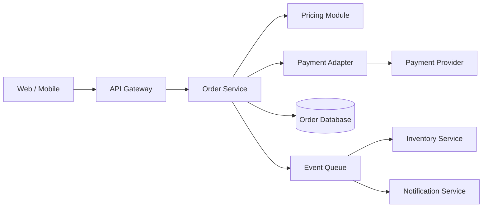

# Phân tích ảnh hưởng từ thay đổi mã, cấu hình, dữ liệu và thành phần phụ thuộc

## Mục tiêu học tập

Sau bài học này, người học có thể:

- Giải thích vì sao phân tích ảnh hưởng là bước quan trọng để lựa chọn kiểm thử hồi quy sau mỗi thay đổi.
- Xác định phạm vi thay đổi trực tiếp và các thành phần, hành vi, dữ liệu hoặc hệ thống có thể bị ảnh hưởng gián tiếp.
- Phân tích ảnh hưởng của thay đổi mã nguồn, cấu hình, schema/dữ liệu, API và thành phần phụ thuộc.
- Sử dụng sơ đồ phụ thuộc, truy vết yêu cầu, lịch sử lỗi, luồng dữ liệu và dấu vết thực thi để xây dựng giả thuyết ảnh hưởng.
- Đánh giá rủi ro theo khả năng xảy ra, mức độ tác động, độ lan truyền và khả năng phát hiện.
- Chọn tập kiểm thử hồi quy theo phạm vi ảnh hưởng và mức rủi ro thay vì chỉ chạy các test gần với file vừa sửa.
- Ghi nhận giả định, khoảng trống, quyết định kiểm thử và bằng chứng còn thiếu.
- Cập nhật phân tích khi thay đổi hoặc kết quả kiểm thử cho thấy phạm vi ảnh hưởng khác dự kiến.

## 1. Vì sao cần phân tích ảnh hưởng trước khi kiểm thử hồi quy?

Trong phạm vi **VALIDATION_TESTING_STRATEGY**, kiểm thử hồi quy xác minh rằng thay đổi mới không làm hỏng hành vi đã hoạt động đúng hoặc tạo ra lỗi ở các phần liên quan. Tuy nhiên, một thay đổi thường không chỉ tác động đến dòng mã được chỉnh sửa. Nó có thể ảnh hưởng đến thành phần gọi nó, dữ liệu được đọc hoặc ghi, cấu hình runtime, hợp đồng API, quy trình bất đồng bộ và dịch vụ phụ thuộc.

Ví dụ, thay đổi cách tính phí vận chuyển có thể chỉ sửa một hàm trong Order service, nhưng tác động có thể lan sang tổng tiền đơn hàng, thanh toán, hóa đơn, hoàn tiền, báo cáo doanh thu và thông điệp gửi đến hệ thống kho. Nếu chỉ chạy test của hàm vừa sửa, nhóm có thể bỏ sót lỗi do các thành phần khác sử dụng kết quả theo giả định cũ.

Phân tích ảnh hưởng (impact analysis) là quá trình xác định những phần có thể bị tác động bởi một thay đổi, đánh giá mức độ và đường lan truyền của tác động, rồi dùng kết quả đó để lựa chọn bằng chứng kiểm thử phù hợp. Phân tích không cần dự đoán chắc chắn mọi lỗi; nó cần tạo ra giả thuyết có căn cứ, chỉ ra vùng cần kiểm tra và làm rõ phần chưa biết.

Phân tích ảnh hưởng giúp:

- Chọn đúng test cần chạy và tránh bỏ sót hành vi có liên quan.
- Ưu tiên kiểm thử ở các ranh giới và luồng có rủi ro cao.
- Phát hiện phụ thuộc ngầm giữa mã, cấu hình, dữ liệu và dịch vụ.
- Giải thích vì sao một thay đổi nhỏ có thể cần phạm vi hồi quy rộng.
- Giảm thời gian chạy toàn bộ suite khi có thể chứng minh một tập con đủ phù hợp.
- Ghi nhận lý do cho quyết định bỏ qua hoặc trì hoãn một nhóm test.
- Hỗ trợ review, kế hoạch phát hành và đánh giá rủi ro còn lại.

Không nên xem số file thay đổi là đại diện cho phạm vi ảnh hưởng. Một dòng sửa trong thư viện xác thực có thể ảnh hưởng đến nhiều ứng dụng; một thay đổi lớn trong tài liệu hoặc mã không được sử dụng có thể có ảnh hưởng runtime rất thấp.

## 2. Phân biệt phạm vi thay đổi và phạm vi ảnh hưởng

Hai phạm vi này liên quan nhưng không giống nhau.

- **Phạm vi thay đổi (change scope)** là những phần được chỉnh sửa trực tiếp: file mã, cấu hình, schema, migration, dependency manifest, pipeline hoặc tài nguyên triển khai.
- **Phạm vi ảnh hưởng (impact scope)** là những phần có thể thay đổi hành vi hoặc kết quả do thay đổi trực tiếp hay gián tiếp, kể cả phần không bị sửa.

Ví dụ, một thay đổi trong thư viện định dạng ngày có thể ảnh hưởng đến API nhận ngày, bộ lọc báo cáo, tác vụ lập lịch và thông báo. Các thành phần đó nằm trong phạm vi ảnh hưởng dù không có file nào của chúng thay đổi.

### 2.1. Các lớp ảnh hưởng

| Lớp | Nội dung | Ví dụ |
|---|---|---|
| Trực tiếp | Mã hoặc cấu hình được sửa | Hàm tính giá, biến môi trường, schema cột. |
| Người gọi / người tiêu thụ | Thành phần sử dụng giao diện đã thay đổi | Service gọi hàm, API client đọc response, consumer nhận event. |
| Dữ liệu | Bản ghi, cấu trúc, trạng thái và quy tắc lưu trữ | Migration, index, kiểu dữ liệu, dữ liệu mặc định. |
| Tích hợp | Hệ thống giao tiếp qua API, queue, file hoặc giao thức | Payment provider, warehouse service, identity provider. |
| Vận hành | Triển khai, khởi động, giám sát, phục hồi và mở rộng | Health check, autoscaling, secret, timeout. |
| Nghiệp vụ | Hành trình, quy tắc và quyết định người dùng nhìn thấy | Đặt hàng, hoàn tiền, phân quyền, báo cáo. |
| Tuân thủ và bảo mật | Kiểm soát quyền, dữ liệu nhạy cảm và audit | Quyền truy cập, lưu trữ, mã hóa, audit trail. |

### 2.2. Phân biệt thay đổi có chủ đích và tác động ngoài ý muốn

Thay đổi có thể làm thay đổi hành vi theo yêu cầu, chẳng hạn thêm một trạng thái đơn hàng mới. Phân tích ảnh hưởng cần xác định cả hành vi dự kiến lẫn những hành vi phải giữ nguyên.

Hãy ghi rõ:

- Hành vi nào được phép thay đổi?
- Hành vi nào phải tiếp tục hoạt động như trước?
- Hợp đồng hoặc dữ liệu nào phải tương thích ngược?
- Những thành phần nào cần được cập nhật đồng bộ?
- Có thay đổi nào chỉ áp dụng cho một tenant, vùng, phiên bản hoặc feature flag không?

Điều này giúp phân biệt lỗi hồi quy với khác biệt được chấp nhận theo yêu cầu mới.

## 3. Bắt đầu từ mô tả thay đổi và mục đích

Phân tích ảnh hưởng tốt bắt đầu bằng việc hiểu thay đổi đang giải quyết vấn đề gì. Chỉ đọc diff có thể không đủ nếu không biết mục đích, yêu cầu và hành vi kỳ vọng.

### 3.1. Thu thập thông tin thay đổi

Với mỗi thay đổi, hãy xác định:

- Mục đích nghiệp vụ hoặc kỹ thuật.
- Yêu cầu, defect hoặc sự cố liên quan.
- Hành vi trước và sau thay đổi.
- Các thành phần và giao diện được sửa.
- Dữ liệu hoặc cấu hình cần cập nhật.
- Dependency được thêm, nâng cấp, thay thế hoặc gỡ bỏ.
- Kế hoạch rollout, migration và rollback.
- Giới hạn đã biết và giả định của người thực hiện.

Nguồn thông tin có thể gồm pull request, commit diff, ticket, thiết kế, API specification, migration script, cấu hình triển khai và trao đổi với người sở hữu thành phần. Nếu mô tả thay đổi mâu thuẫn với mã hoặc thiết kế, cần làm rõ trước khi chốt phạm vi kiểm thử.

### 3.2. Tạo bản tóm tắt thay đổi

Một bản tóm tắt ngắn có thể theo mẫu:

> Thay đổi **[thành phần]** để **[mục đích]**. Hành vi trực tiếp thay đổi là **[trước/sau]**. Các giao diện, dữ liệu và cấu hình liên quan gồm **[danh sách]**. Hành vi phải giữ nguyên gồm **[danh sách]**. Rủi ro chính là **[rủi ro]**.

Ví dụ:

> Thay đổi Payment adapter để hỗ trợ phiên bản API mới của nhà cung cấp. Request thêm trường `captureMode`, response có thể trả trạng thái `PENDING`. Cần giữ tương thích với các giao dịch cũ và bảo đảm Order service không đánh dấu đơn đã thanh toán trước khi nhận trạng thái hoàn tất.

### 3.3. Phân loại loại thay đổi

Một thay đổi có thể thuộc nhiều loại:

- Thay đổi logic hoặc thuật toán.
- Thay đổi cấu trúc, module hoặc ranh giới service.
- Thay đổi API, event, schema hoặc hợp đồng dữ liệu.
- Thay đổi cấu hình, feature flag hoặc secret.
- Thay đổi database, migration hoặc dữ liệu seed.
- Thay đổi thư viện, runtime, image hoặc dịch vụ bên ngoài.
- Thay đổi pipeline, script build, test hoặc triển khai.
- Thay đổi bảo mật, quyền, mã hóa hoặc xử lý dữ liệu.

Phân loại giúp xác định phương pháp phân tích phù hợp. Ví dụ, thay đổi dependency cần xem release notes và tương thích phiên bản; thay đổi migration cần xem dữ liệu hiện có, rollback và khả năng chạy trên nhiều phiên bản ứng dụng.

## 4. Dùng đồ thị phụ thuộc để lần theo ảnh hưởng

Đồ thị phụ thuộc mô tả thành phần nào sử dụng hoặc phụ thuộc vào thành phần nào. Nó có thể được xây dựng từ kiến trúc, import/call graph, service map, API contract, schema, event flow hoặc cấu hình triển khai.

### 4.1. Các loại quan hệ phụ thuộc

- **Gọi hàm hoặc module**: một hàm, class hoặc package sử dụng thành phần khác.
- **API**: consumer gửi request hoặc đọc response từ provider.
- **Dữ liệu**: thành phần đọc/ghi cùng bảng, view, cache hoặc object store.
- **Sự kiện**: producer phát event và consumer xử lý event.
- **Cấu hình**: nhiều thành phần dùng chung key, secret, feature flag hoặc biến môi trường.
- **Runtime**: thành phần phụ thuộc phiên bản runtime, image, driver hoặc thư viện.
- **Vận hành**: service phụ thuộc network, DNS, identity, queue, storage hoặc hạ tầng.

Một dependency graph cần phân biệt quan hệ đồng bộ và bất đồng bộ. Khi service A gọi trực tiếp service B, lỗi có thể truyền qua call chain. Khi A phát event cho queue và B xử lý sau, tác động có thể xuất hiện trễ và khó quan sát hơn.

### 4.2. Lần theo chiều đi và chiều về

Khi một thành phần thay đổi, cần xem:

- **Chiều đi (outgoing dependencies)**: thành phần đó gọi hoặc sử dụng những gì; thay đổi có làm thay đổi cách nó tương tác với dependency không?
- **Chiều về (incoming dependents)**: thành phần nào gọi hoặc tiêu thụ nó; các consumer có còn tương thích không?

Ví dụ, khi thay đổi response của Customer API, cần kiểm tra cả Customer service với database và mọi consumer đọc response. Chỉ kiểm tra API provider có thể bỏ sót client đang giả định trường cũ luôn tồn tại.

### 4.3. Xác định blast radius

Blast radius là phạm vi thành phần, người dùng, dữ liệu hoặc hoạt động có thể bị ảnh hưởng nếu thay đổi gây lỗi. Có thể đánh giá theo:

- Số lượng consumer và service liên quan.
- Mức độ dùng chung của thành phần.
- Số tenant, vùng hoặc phiên bản bị tác động.
- Mức độ quan trọng của luồng nghiệp vụ.
- Khả năng lỗi lan truyền hoặc làm gián đoạn hệ thống khác.
- Khả năng cô lập hoặc rollback thay đổi.

Một thư viện dùng chung cho nhiều service thường có blast radius lớn hơn một module chỉ được sử dụng trong một tính năng. Tuy nhiên, mức độ quan trọng của hành vi cũng cần được xét: một hàm trong module nhỏ có thể điều khiển quyền truy cập hoặc ghi nhận tiền.

### 4.4. Sơ đồ luồng phụ thuộc minh họa

Nếu thay đổi `Pricing Module`, vùng cần phân tích có thể gồm Order service, API trả tổng tiền, Payment adapter nhận số tiền, dữ liệu đơn hàng và event gửi sang Inventory/Notification nếu payload chứa giá trị bị thay đổi. Không phải mọi thành phần đều cần cùng một mức test; cần xác định đường ảnh hưởng thực tế và mức rủi ro.

## 5. Phân tích ảnh hưởng từ thay đổi mã nguồn

Thay đổi mã có thể tác động trực tiếp đến logic, luồng điều khiển, trạng thái, hiệu năng hoặc hợp đồng nội bộ.

### 5.1. Thay đổi logic và điều kiện

Khi sửa điều kiện, phép tính hoặc thứ tự xử lý, hãy xác định:

- Đầu vào nào làm kết quả thay đổi?
- Các nhánh true/false và điều kiện kết hợp nào bị tác động?
- Giá trị biên và dữ liệu bất thường nào liên quan?
- Hành vi lỗi, exception và fallback có thay đổi không?
- Có quy tắc nào đang dựa vào thứ tự thực thi không?
- Kết quả được dùng bởi thành phần nào?

Một thay đổi `>` thành `>=` có vẻ nhỏ nhưng thay đổi hành vi đúng tại biên. Cần test giá trị ngay dưới, bằng và ngay trên ngưỡng, rồi xác minh các consumer sử dụng kết quả theo cùng quy tắc.

### 5.2. Thay đổi chữ ký hàm hoặc giao diện module

Khi thêm, xóa hoặc đổi kiểu tham số, kiểu trả về, exception hoặc visibility, cần kiểm tra:

- Tất cả caller và implementation.
- Mock, fake, test fixture và adapter.
- Serialization hoặc mapping ở ranh giới.
- API public và các module khác dùng chung.
- Khả năng tương thích nhị phân hoặc source nếu là thư viện.

Việc build thành công không bảo đảm consumer bên ngoài vẫn hoạt động nếu hợp đồng runtime hoặc ngữ nghĩa đã thay đổi.

### 5.3. Refactor và thay đổi cấu trúc

Refactor được kỳ vọng giữ nguyên hành vi, nhưng có thể thay đổi thứ tự gọi, transaction boundary, lazy loading, xử lý exception, concurrency hoặc vòng đời object. Cần xác định các bất biến phải giữ và chạy test bảo vệ hành vi trước/sau.

Không nên coi refactor là rủi ro bằng không chỉ vì không có yêu cầu nghiệp vụ mới. Nếu thay đổi ranh giới module hoặc cách quản lý trạng thái, có thể cần integration test và kiểm tra hiệu năng.

### 5.4. Thay đổi xử lý bất đồng bộ và đồng thời

Khi thay đổi thread, executor, queue consumer, retry hoặc lock, cần xem:

- Thứ tự sự kiện và tính idempotent.
- Race condition và lost update.
- Timeout, retry, backoff và duplicate delivery.
- Deadlock, starvation và giới hạn thread/connection.
- Tính nhất quán giữa database và message broker.
- Trạng thái khi tiến trình dừng giữa chừng.

Test tuần tự đơn giản có thể không phát hiện lỗi đồng thời. Cần chọn kiểm thử cạnh tranh có điểm đồng bộ và quan sát trạng thái cuối.

### 5.5. Thay đổi bảo mật

Thay đổi xác thực, phân quyền, mã hóa, xử lý token hoặc audit cần đánh giá cả đường truy cập được phép và bị từ chối. Kiểm tra vai trò, tenant, scope, thời hạn, thu hồi quyền, dữ liệu cũ và client tương thích.

Không chỉ kiểm tra người dùng hợp lệ truy cập được; cần xác minh người dùng không có quyền không thể đọc hoặc thay đổi tài nguyên. Nếu chính sách thay đổi, xác định rõ hành vi mới được chấp nhận và hành vi cũ cần bị loại bỏ.

## 6. Phân tích ảnh hưởng từ thay đổi cấu hình

Cấu hình có thể làm thay đổi hành vi mà không cần sửa mã. Một key đổi giá trị có thể thay đổi timeout, endpoint, giới hạn, quyền, thuật toán hoặc bật/tắt chức năng.

### 6.1. Phân loại cấu hình

- Biến môi trường và tham số runtime.
- Feature flag và cấu hình rollout.
- Timeout, retry, pool size và giới hạn tài nguyên.
- Endpoint, DNS, TLS và chứng thư.
- Cấu hình database, cache và message broker.
- Cấu hình xác thực, phân quyền và secret.
- Cấu hình logging, metrics, tracing và alert.
- Cấu hình build, deploy, autoscaling và health check.

### 6.2. Tác động của thay đổi giá trị

Với mỗi key thay đổi, hãy xác định:

- Thành phần nào đọc key đó?
- Giá trị mặc định và giá trị khi thiếu là gì?
- Đơn vị đo và cách parse có rõ không?
- Giá trị hợp lệ, biên và không hợp lệ là gì?
- Cấu hình có được reload động hay chỉ đọc lúc khởi động?
- Môi trường nào, tenant nào hoặc phiên bản nào nhận thay đổi?
- Có ảnh hưởng đến tương thích với cấu hình cũ không?

Ví dụ, giảm HTTP timeout từ 30 giây xuống 5 giây có thể làm tăng số request thất bại khi provider phản hồi chậm. Tăng retry có thể làm tải lên dependency và tạo giao dịch trùng nếu thao tác không idempotent. Vì vậy, cần kiểm tra cả kết quả trực tiếp lẫn hiệu ứng dây chuyền.

### 6.3. Feature flag và rollout

Feature flag tạo ra nhiều cấu hình hành vi cùng tồn tại. Phạm vi test cần xét:

- Flag bật và tắt.
- Flag theo tenant, nhóm người dùng hoặc vùng.
- Giá trị mặc định khi flag không có hoặc không đọc được.
- Thay đổi flag trong lúc hệ thống đang chạy.
- Rollout từng phần và rollback.
- Tương tác giữa flag mới và flag cũ.

Không cần kiểm tra mọi tổ hợp flag nếu số lượng quá lớn. Hãy chọn tổ hợp có khả năng tương tác hoặc tác động cao, đồng thời kiểm tra cấu hình mặc định và đường rollback.

### 6.4. Secret và chứng thư

Thay secret, key mã hóa hoặc chứng thư có thể ảnh hưởng đến xác thực, kết nối và khả năng giải mã dữ liệu cũ. Cần kiểm tra quy trình rotation, thời gian chồng lấp key, client cũ, kết nối mới và phục hồi nếu cập nhật thất bại.

Không đưa giá trị secret vào test report. Chỉ ghi nhận phiên bản hoặc định danh không nhạy cảm cần thiết để truy nguyên.

## 7. Phân tích ảnh hưởng từ thay đổi dữ liệu và schema

Thay đổi dữ liệu thường có rủi ro cao vì tác động có thể kéo dài sau khi mã được rollback. Migration có thể thay đổi cấu trúc, kiểu dữ liệu, index, constraint, quan hệ hoặc cách diễn giải bản ghi hiện có.

### 7.1. Thay đổi schema

Với thêm, xóa hoặc đổi cột, bảng, index, constraint hoặc kiểu dữ liệu, hãy xem:

- Ứng dụng phiên bản cũ có còn đọc/ghi được không?
- Ứng dụng phiên bản mới có xử lý dữ liệu cũ không?
- Consumer, báo cáo, ETL và job nền có dùng schema đó không?
- Dữ liệu null, default và giá trị hiện hữu được xử lý ra sao?
- Truy vấn, index và transaction có thay đổi hiệu năng không?
- Migration có khóa bảng hoặc gây gián đoạn không?
- Rollback có thể khôi phục cấu trúc và dữ liệu không?

### 7.2. Chiến lược expand-and-contract

Với thay đổi schema có yêu cầu tương thích nhiều phiên bản, có thể chia thành các bước:

1. **Expand**: thêm cấu trúc mới theo cách tương thích, chẳng hạn thêm cột nullable hoặc bảng mới.
2. **Migrate**: chuyển đổi hoặc backfill dữ liệu theo lô và có thể tiếp tục phục vụ ứng dụng cũ.
3. **Switch**: triển khai ứng dụng đọc/ghi cấu trúc mới, có kiểm tra dữ liệu và theo dõi.
4. **Contract**: chỉ xóa cấu trúc cũ sau khi không còn consumer sử dụng và đã có xác nhận.

Đây là một mẫu triển khai phổ biến, không phải cách duy nhất. Với từng bước, cần kiểm tra tương thích giữa phiên bản ứng dụng, schema và dữ liệu. Không xóa cột cũ ngay khi phiên bản mới vừa được triển khai nếu còn instance hoặc job cũ đang sử dụng.

### 7.3. Backfill và chuyển đổi dữ liệu

Backfill cần được kiểm tra về:

- Tính đầy đủ: mọi bản ghi thuộc phạm vi đã được xử lý.
- Tính chính xác: giá trị mới được tính đúng theo quy tắc.
- Idempotency: chạy lại không làm hỏng hoặc nhân đôi dữ liệu.
- Khả năng tiếp tục: có thể tiếp tục sau khi job bị gián đoạn.
- Hiệu năng: không gây khóa hoặc tải quá mức.
- Đối soát: số lượng và tổng hợp trước/sau có thể so sánh.
- Dữ liệu lỗi: bản ghi không hợp lệ được phát hiện và xử lý rõ.

### 7.4. Thay đổi dữ liệu seed hoặc fixture

Thay đổi dữ liệu chuẩn có thể ảnh hưởng nhiều test cùng lúc. Cần xác định test nào dựa vào ID, số lượng, thứ tự hoặc trạng thái cố định. Fixture nên được version hóa và test cần tự chuẩn bị dữ liệu khi có thể, tránh phụ thuộc vào một seed dùng chung bị thay đổi ngoài ý muốn.

### 7.5. Dữ liệu và quyền riêng tư

Thay đổi cách thu thập, ẩn danh, lưu trữ hoặc xóa dữ liệu có thể ảnh hưởng đến test và nghĩa vụ xử lý dữ liệu. Cần xác định trường nào được lưu, thời hạn lưu, quyền truy cập, cơ chế xóa và các bản sao ở cache, log, backup hoặc hệ thống phân tích.

## 8. Phân tích ảnh hưởng từ thành phần phụ thuộc

Dependency có thể là thư viện, runtime, dịch vụ nội bộ, API đối tác, database driver, container image, plugin hoặc nền tảng cloud. Nâng cấp dependency có thể thay đổi hành vi mặc định, giao thức, hiệu năng, bảo mật và khả năng tương thích.

### 8.1. Xác định thay đổi dependency

Ghi nhận:

- Dependency được thêm, nâng cấp, thay thế hoặc gỡ bỏ.
- Phiên bản cũ và mới, phạm vi phiên bản được hỗ trợ.
- Breaking changes, deprecation và thay đổi mặc định.
- Thay đổi API, schema, giao thức hoặc định dạng dữ liệu.
- Thay đổi transitive dependency.
- Thay đổi license, lỗ hổng bảo mật hoặc yêu cầu runtime.
- Ảnh hưởng đến build, package, container và môi trường triển khai.

### 8.2. Kiểm tra tương thích

Không chỉ kiểm tra ứng dụng build được. Cần xem:

- Source và binary compatibility.
- Protocol/API compatibility giữa provider và consumer.
- Tương thích schema và dữ liệu cũ.
- Tương thích runtime, hệ điều hành, driver và container.
- Hành vi mặc định, timeout, retry và xử lý exception.
- Tương thích khi triển khai rolling hoặc chạy nhiều phiên bản đồng thời.

### 8.3. Dịch vụ bên ngoài

Với API đối tác hoặc SaaS, thay đổi có thể đến từ phía nhà cung cấp mà không có commit trong repository. Cần theo dõi phiên bản API, sandbox, giới hạn rate, schema, thông báo deprecation và thay đổi SLA. Test contract và integration có thể giúp phát hiện sai lệch, nhưng cần phân biệt lỗi sản phẩm với sự cố nhà cung cấp.

### 8.4. Dependency dùng chung

Một thư viện xác thực, serialization hoặc logging được nhiều service sử dụng có thể có blast radius rộng. Khi nâng cấp, lập danh sách consumer và kiểm tra các hành vi quan trọng ở từng loại consumer. Không nhất thiết chạy tất cả test của mọi repository nếu có thể phân nhóm theo cách sử dụng, nhưng cần có bằng chứng rằng các kiểu tích hợp quan trọng đã được kiểm tra.

## 9. Phân tích ảnh hưởng xuyên ranh giới dữ liệu và sự kiện

Nhiều lỗi hồi quy xảy ra khi một thành phần thay đổi cách tạo hoặc diễn giải dữ liệu nhưng consumer khác vẫn dùng giả định cũ.

### 9.1. API contract

Khi thay đổi request hoặc response, hãy xem:

- Thêm trường bắt buộc có làm client cũ gửi thiếu dữ liệu không?
- Xóa hoặc đổi tên trường có phá consumer không?
- Kiểu dữ liệu, đơn vị, nullability hoặc enum có đổi không?
- Mã lỗi và ngữ nghĩa response có thay đổi không?
- Consumer có bỏ qua trường mới hoặc xử lý giá trị không biết không?
- Có cần hỗ trợ song song hai phiên bản API không?

### 9.2. Event và message schema

Với event-driven system, kiểm tra:

- Producer có phát đúng schema và version không?
- Consumer cũ có đọc được event mới không?
- Consumer mới có xử lý event cũ còn nằm trong queue không?
- Thứ tự, duplicate, retry và dead-letter có thay đổi không?
- Event có chứa trường nhạy cảm hoặc dữ liệu không còn được phép chia sẻ không?
- Idempotency key và correlation ID có được giữ đúng không?

### 9.3. File, batch và trao đổi dữ liệu

Thay đổi delimiter, encoding, header, thứ tự cột, tên file, compression hoặc lịch gửi có thể ảnh hưởng đến hệ thống nhận. Cần test file rỗng, file lớn, dòng lỗi, ký tự đặc biệt, dữ liệu thiếu và xử lý gửi lại. Xác minh cả số lượng bản ghi và kết quả đối soát.

## 10. Kết hợp nhiều nguồn để tìm vùng ảnh hưởng

Không có một công cụ hoặc tài liệu nào luôn cho biết toàn bộ phạm vi. Nên kết hợp nhiều nguồn bằng chứng.

### 10.1. Diff và phân tích mã

Diff cho biết dòng và file thay đổi. Có thể dùng tìm kiếm tham chiếu, call graph, type analysis hoặc static analysis để xác định caller, implementation và dữ liệu liên quan. Tuy nhiên, phân tích tĩnh có thể bỏ sót dependency được tạo động, reflection, cấu hình hoặc tương tác runtime.

### 10.2. Truy vết yêu cầu và test

Liên kết thay đổi với requirement, acceptance criteria, defect và test case. Từ yêu cầu bị tác động, tìm các test xác minh nó và các yêu cầu liên quan. Truy vết hai chiều giúp phát hiện cả test bị ảnh hưởng lẫn yêu cầu chưa có bằng chứng.

### 10.3. Lịch sử lỗi và thay đổi

Lịch sử defect, incident, hotfix và rollback cho biết vùng nào dễ phát sinh lỗi. Nếu một module từng gây lỗi khi thay đổi schema hoặc timezone, các thay đổi mới trong vùng đó nên được đánh giá cẩn thận hơn.

### 10.4. Code ownership và chuyên gia thành phần

Người sở hữu module thường biết phụ thuộc ngầm, dữ liệu đặc biệt và giới hạn vận hành. Hãy tham khảo owner khi thay đổi chạm vào API, schema, security boundary hoặc thành phần dùng chung. Review của chuyên gia bổ sung thông tin mà đồ thị phụ thuộc tự động có thể không thể hiện.

### 10.5. Coverage và dấu vết thực thi

Coverage, test execution trace hoặc telemetry có thể cho biết test nào đã đi qua vùng mã liên quan. Tuy nhiên, việc một test từng thực thi một file không chứng minh test đó xác minh đúng hành vi bị thay đổi. Dùng dữ liệu này để thu hẹp ứng viên, sau đó xem assertion và mục tiêu của test.

### 10.6. Cấu hình triển khai và sơ đồ vận hành

Manifest, deployment chart, pipeline, service map và cấu hình runtime giúp xác định thành phần cùng môi trường chịu ảnh hưởng. Một thay đổi config có thể không xuất hiện trong call graph nhưng vẫn thay đổi endpoint, quota hoặc quyền của service.

## 11. Đánh giá rủi ro của vùng ảnh hưởng

Sau khi lập danh sách thành phần có thể bị tác động, cần ưu tiên theo rủi ro. Không phải mọi dependency đều có xác suất và hậu quả như nhau.

### 11.1. Các yếu tố rủi ro

- **Khả năng xảy ra**: độ phức tạp thay đổi, mức mới, số tương tác và lịch sử lỗi.
- **Mức độ tác động**: hậu quả đối với người dùng, tiền, dữ liệu, bảo mật, an toàn hoặc hoạt động.
- **Độ lan truyền**: số consumer, tenant, service và quy trình có thể bị ảnh hưởng.
- **Khả năng phát hiện**: lỗi có dễ nhận biết qua monitoring hoặc test không?
- **Khả năng khôi phục**: rollback, feature flag hoặc phục hồi dữ liệu có dễ thực hiện không?
- **Tính khó đảo ngược**: migration, xóa dữ liệu hoặc thao tác bên ngoài có thể không hoàn tác được.
- **Độ không chắc chắn**: thiếu tài liệu, dependency động hoặc thay đổi chưa được hiểu rõ.

### 11.2. Ma trận ưu tiên tham khảo

| Mức | Đặc điểm | Hướng kiểm thử |
|---|---|---|
| Thấp | Phạm vi cô lập, ít consumer, hậu quả nhỏ và dễ khôi phục | Test trực tiếp và một số kiểm tra liên quan. |
| Trung bình | Có dependency nội bộ hoặc ảnh hưởng một hành trình quan trọng nhưng phạm vi kiểm soát được | Unit/component cộng integration hoặc contract test phù hợp. |
| Cao | Ảnh hưởng nhiều consumer, dữ liệu quan trọng, giao dịch, quyền hoặc thành phần dùng chung | Mở rộng test ở ranh giới, hồi quy hành trình và kiểm tra vận hành. |
| Rất cao | Có thể gây mất dữ liệu, lỗi bảo mật, gián đoạn diện rộng hoặc thay đổi khó đảo ngược | Review chuyên gia, kiểm thử sâu, rollout có kiểm soát, kế hoạch rollback và bằng chứng phát hành. |

Ma trận chỉ là khung hỗ trợ. Quy định của tổ chức hoặc tiêu chuẩn chuyên ngành có thể yêu cầu kiểm tra bắt buộc. Không nên hạ mức rủi ro chỉ vì test tốn thời gian.

### 11.3. Phân biệt rủi ro thay đổi và rủi ro còn lại

Rủi ro thay đổi là nguy cơ do bản sửa gây ra. Rủi ro còn lại là nguy cơ vẫn tồn tại sau khi đã thực hiện review, test và biện pháp kiểm soát. Báo cáo cần ghi rõ phần nào đã có bằng chứng, phần nào chưa thể kiểm tra và ai chịu trách nhiệm chấp nhận rủi ro còn lại.

## 12. Chuyển phân tích ảnh hưởng thành lựa chọn kiểm thử hồi quy

Kết quả phân tích cần dẫn đến một kế hoạch kiểm thử cụ thể. Mỗi vùng ảnh hưởng nên gắn với hành vi, rủi ro, loại test và lý do lựa chọn.

### 12.1. Chọn test theo lớp

- **Unit**: logic, điều kiện, giá trị biên và thuật toán bị sửa.
- **Component**: tương tác giữa các lớp nội bộ hoặc module trong cùng thành phần.
- **Contract**: request/response, event schema và tương thích consumer/provider.
- **Integration**: database, queue, cache, API và transaction thật.
- **System/E2E**: hành trình nghiệp vụ xuyên nhiều thành phần bị ảnh hưởng.
- **Non-functional**: hiệu năng, bảo mật, độ tin cậy hoặc khả năng phục hồi khi thay đổi tác động đến thuộc tính đó.
- **Migration/data validation**: cấu trúc, dữ liệu hiện có, backfill và đối soát.

Chọn cấp thấp nhất có thể chứng minh hành vi một cách đáng tin cậy, sau đó bổ sung test ở ranh giới nơi tương tác thực sự tạo ra rủi ro. Không chuyển mọi ảnh hưởng thành E2E vì chi phí và độ khó chẩn đoán có thể tăng không cần thiết.

### 12.2. Tập kiểm thử hồi quy theo mức

Có thể tổ chức:

1. **Smoke/regression nhanh**: xác minh build, khởi động, health check và hành vi cốt lõi.
2. **Tập test liên quan trực tiếp**: kiểm tra mã, config, schema hoặc dependency vừa thay đổi.
3. **Tập test theo đường ảnh hưởng**: kiểm tra caller, consumer, luồng dữ liệu và tích hợp liên quan.
4. **Tập test rủi ro cao**: bảo mật, dữ liệu, giao dịch, migration hoặc hiệu năng khi cần.
5. **Regression rộng**: chạy toàn bộ hoặc tập lớn hơn trước phát hành, theo lịch hoặc khi blast radius không thể giới hạn đáng tin cậy.

### 12.3. Khi nào cần chạy toàn bộ suite?

Cân nhắc chạy suite rộng khi:

- Thay đổi ảnh hưởng thư viện hoặc thành phần dùng chung nhiều nơi.
- Không có dependency map đáng tin cậy.
- Thay đổi cấu hình toàn cục hoặc runtime.
- Migration hoặc thay đổi dữ liệu có phạm vi rộng.
- Có thay đổi ranh giới kiến trúc hoặc giao thức.
- Test chọn lọc không thể xác định đủ consumer.
- Mức rủi ro cao hoặc yêu cầu phát hành bắt buộc.

Nếu chọn chỉ chạy một tập con, cần ghi lý do và giả định. Không nên dùng việc test chọn lọc Pass làm bằng chứng cho phần chưa chạy.

## 13. Ma trận truy vết thay đổi – ảnh hưởng – kiểm thử

Ma trận giúp biến suy luận thành kế hoạch có thể review.

| Thay đổi | Vùng ảnh hưởng dự kiến | Rủi ro | Bằng chứng kiểm thử phù hợp |
|---|---|---|---|
| Sửa điều kiện tính phí | Pricing, tổng đơn, payment amount, hóa đơn | Tính sai tiền ở biên | Unit boundary, component, E2E đặt hàng đại diện. |
| Đổi response API | Provider, consumer, SDK và client cũ | Consumer lỗi hoặc diễn giải sai | Contract compatibility, integration với phiên bản consumer. |
| Thêm cột bắt buộc | Schema, ứng dụng cũ/mới, ETL và báo cáo | Migration lỗi hoặc ghi thiếu dữ liệu | Migration test, backward compatibility, data reconciliation. |
| Giảm timeout | HTTP client, retry, queue và trải nghiệm người dùng | Timeout tăng, retry gây tải hoặc duplicate | Integration fault test, timeout/retry test, observability. |
| Nâng cấp thư viện xác thực | Nhiều service dùng chung | Đăng nhập hoặc phân quyền sai | Unit, contract, integration, security regression theo consumer. |
| Đổi feature flag mặc định | Nhóm người dùng, tenant và rollout | Hành vi mới bật ngoài dự kiến | Test bật/tắt, mặc định, rollout và rollback. |
| Thay event schema | Producer, consumer, queue backlog và replay | Consumer cũ không đọc được event | Schema/contract test, consumer integration, replay dữ liệu cũ. |

Mỗi dòng có thể được mở rộng với mã test, người sở hữu, môi trường, trạng thái và liên kết bằng chứng. Nếu chưa biết consumer hoặc rủi ro, ghi “chưa xác định” để điều tra, không tự xem như không có ảnh hưởng.

## 14. Ví dụ xuyên suốt: thay đổi Payment adapter

Giả sử nhóm nâng cấp Payment adapter để dùng API mới của nhà cung cấp. API mới yêu cầu trường `captureMode`, trả thêm trạng thái `PENDING` và thay đổi quy tắc retry khi timeout.

### 14.1. Phạm vi thay đổi trực tiếp

- Mapping request từ Order service sang Payment provider.
- Parsing response và enum trạng thái.
- Cấu hình timeout và retry.
- Test fixture, mock và sandbox scenario.
- Có thể có migration nếu cần lưu thêm trạng thái hoặc mã tham chiếu.

### 14.2. Vùng ảnh hưởng

- Order service sử dụng kết quả thanh toán để cập nhật trạng thái đơn.
- Web/mobile hiển thị trạng thái cho người mua.
- Webhook handler nhận callback hoàn tất hoặc từ chối.
- Reconciliation job đối soát giao dịch `PENDING`.
- Notification service gửi thông báo theo trạng thái.
- Báo cáo doanh thu và dashboard vận hành tổng hợp giao dịch.
- Hỗ trợ khách hàng tra cứu mã tham chiếu.

### 14.3. Rủi ro chính

- Đơn hàng bị đánh dấu đã thanh toán khi provider mới chỉ trả `PENDING`.
- Retry sau timeout tạo giao dịch thanh toán trùng.
- Callback đến trước hoặc sau response làm trạng thái bị ghi đè sai.
- Consumer cũ không hiểu trạng thái mới.
- Báo cáo doanh thu tính giao dịch chờ như giao dịch hoàn tất.
- Cấu hình timeout mới làm tăng lỗi hoặc backlog.

### 14.4. Lựa chọn kiểm thử

| Mục tiêu | Kiểm thử |
|---|---|
| Mapping request/response đúng | Unit test cho mapper và parser với response cũ/mới. |
| Hợp đồng provider tương thích | Contract test hoặc sandbox verification với API version mới. |
| `PENDING` không bị coi là `PAID` | Component/integration test cho chuyển trạng thái và dữ liệu đơn hàng. |
| Retry không tạo giao dịch trùng | Integration test với timeout giả lập và idempotency key. |
| Callback đến sai thứ tự vẫn nhất quán | Test sự kiện trễ/lặp, xác minh trạng thái cuối và audit. |
| Consumer hiển thị đúng trạng thái | API/UI regression cho hành trình thanh toán đang chờ. |
| Đối soát xử lý giao dịch chờ | Test job với dữ liệu cũ, mới, thành công và thất bại. |
| Cấu hình timeout phù hợp | Test timeout/fault và theo dõi metric khi tải đại diện. |

### 14.5. Tiêu chí kết luận

Nhóm chỉ kết luận thay đổi an toàn trong phạm vi đã kiểm tra khi request đúng hợp đồng, trạng thái `PENDING` không bị nhầm với hoàn tất, retry không tạo giao dịch trùng, callback không làm sai trạng thái cuối và các consumer quan trọng vẫn hoạt động. Nếu chưa kiểm tra được hành vi của nhà cung cấp production, báo cáo cần nêu rõ sandbox hoặc fake đã được sử dụng và phần rủi ro còn lại.

## 15. Phân tích ảnh hưởng trong CI/CD và quy trình review

Phân tích ảnh hưởng nên diễn ra sớm và được cập nhật khi diff thay đổi.

### 15.1. Trước khi merge

- Người thực hiện mô tả mục đích và phạm vi thay đổi.
- Xác định API, schema, config và dependency bị tác động.
- Liên kết test hiện có và đề xuất test mới.
- Chạy tập test nhanh và các test theo vùng ảnh hưởng.
- Review dependency, migration và rủi ro rollback.

### 15.2. Trong CI

Pipeline có thể sử dụng metadata thay đổi, dependency graph hoặc tag test để chọn tập liên quan. Tuy nhiên, việc chọn test tự động cần được kiểm tra độ chính xác. Nếu mapping giữa file và test không đáng tin, pipeline có thể bỏ sót test quan trọng.

Nên ghi lại:

- Commit và diff đã phân tích.
- Quy tắc chọn test hoặc dependency map version.
- Danh sách test được chạy và test bị bỏ qua.
- Lý do chọn hoặc loại trừ.
- Kết quả và artifact của từng test.
- Các vùng ảnh hưởng chưa có test tương ứng.

### 15.3. Trước phát hành

Với thay đổi rủi ro cao, cần xác minh:

- Kết quả hồi quy trên môi trường đại diện.
- Tương thích phiên bản và rollout nhiều giai đoạn.
- Migration, backfill và đối soát dữ liệu.
- Monitoring, alert và khả năng phát hiện lỗi sau triển khai.
- Feature flag, rollback và quy trình phục hồi.
- Rủi ro còn lại được ghi nhận và có người chịu trách nhiệm.

### 15.4. Sau triển khai

Monitoring production có thể cung cấp tín hiệu về tác động mà môi trường test không tái hiện được. Theo dõi error rate, latency, trạng thái nghiệp vụ, queue, dữ liệu đối soát và phản hồi người dùng. Nếu xuất hiện khác biệt ngoài dự kiến, cập nhật phân tích ảnh hưởng và bổ sung regression test để ngăn tái diễn.

## 16. Giới hạn và sai lầm thường gặp

- **Chỉ nhìn file thay đổi**: bỏ sót consumer và dữ liệu liên quan. Hãy lần theo dependency theo cả hai chiều.
- **Chỉ chạy test gần mã vừa sửa**: bỏ sót ảnh hưởng xuyên service. Hãy liên kết thay đổi với hành trình và ranh giới tích hợp.
- **Giả định dependency graph đầy đủ**: reflection, cấu hình động hoặc event có thể không hiện trong sơ đồ. Hãy kết hợp tài liệu, runtime trace và owner review.
- **Bỏ qua thay đổi cấu hình**: hành vi runtime thay đổi dù mã không đổi. Hãy kiểm tra giá trị, default, môi trường và rollout.
- **Chỉ kiểm tra migration trên database rỗng**: bỏ sót dữ liệu cũ, khóa bảng và tương thích nhiều phiên bản. Hãy dùng dữ liệu đại diện và kiểm tra nâng cấp thực tế.
- **Chỉ kiểm tra consumer mới**: consumer cũ vẫn có thể chạy trong rollout. Hãy kiểm tra tương thích phiên bản và event backlog.
- **Coi build Pass là đủ**: lỗi runtime, dữ liệu và hành vi nghiệp vụ vẫn có thể tồn tại. Hãy chọn test theo vùng ảnh hưởng.
- **Chạy toàn bộ suite nhưng không xem assertion**: test đã chạy chưa chắc xác minh rủi ro. Hãy xem mục tiêu và kết quả mong đợi.
- **Bỏ qua phần chưa chạy**: kết luận quá rộng từ bằng chứng chọn lọc. Hãy nêu rõ phạm vi và giới hạn.
- **Không cập nhật khi diff thay đổi**: phân tích ban đầu trở nên lỗi thời. Hãy tính lại vùng ảnh hưởng khi có commit mới.
- **Không giữ lại lỗi đã phát hiện**: lỗi hồi quy có thể tái xuất hiện. Hãy bổ sung test ở cấp phù hợp và liên kết với defect.

## 17. Hồ sơ phân tích ảnh hưởng

Một hồ sơ có thể dùng để review và truy nguyên quyết định kiểm thử:

| Trường | Nội dung cần ghi |
|---|---|
| Change ID | Commit, pull request, ticket hoặc release. |
| Mục đích | Vấn đề và hành vi dự kiến thay đổi. |
| Thành phần trực tiếp | File, module, config, schema hoặc dependency được sửa. |
| Vùng ảnh hưởng | Caller, consumer, dữ liệu, service, hành trình và môi trường liên quan. |
| Đường phụ thuộc | Call/API/event/data/config/runtime relationship. |
| Hành vi phải giữ | Tương thích và bất biến không được phá vỡ. |
| Rủi ro | Khả năng, tác động, blast radius, khả năng phát hiện và rollback. |
| Test được chọn | Test ID, cấp test, môi trường và lý do lựa chọn. |
| Test chưa chạy | Phạm vi, lý do, giới hạn và người chấp nhận rủi ro. |
| Bằng chứng | Kết quả, log, trace, report, migration reconciliation. |
| Kế hoạch rollout | Feature flag, canary, monitoring và rollback. |
| Người sở hữu | Người phân tích, reviewer và owner thành phần. |

Hồ sơ không cần dài nếu thay đổi nhỏ và cô lập. Với thay đổi rủi ro cao, migration hoặc dependency dùng chung, cần đủ chi tiết để người review hiểu phạm vi và lý do kiểm thử.

## 18. Quy trình phân tích ảnh hưởng và lập kế hoạch hồi quy

Nhóm có thể áp dụng trình tự sau:

1. **Hiểu mục đích thay đổi**: đọc yêu cầu, defect, thiết kế và mô tả trước/sau.
2. **Lập danh sách thay đổi trực tiếp**: mã, cấu hình, schema, dữ liệu, dependency và pipeline.
3. **Lần theo dependency**: tìm caller, consumer, service, bảng, event và môi trường liên quan theo cả hai chiều.
4. **Xác định hành vi và bất biến**: nêu điều được phép thay đổi và điều phải giữ nguyên.
5. **Đánh giá blast radius và rủi ro**: xem tác động, khả năng, độ lan truyền, rollback và độ không chắc chắn.
6. **Chọn bằng chứng kiểm thử**: map từng rủi ro sang unit, component, contract, integration, system, non-functional hoặc migration test.
7. **Quyết định phạm vi chạy**: chọn tập nhanh, tập liên quan, tập rủi ro cao hoặc regression rộng; ghi rõ lý do.
8. **Thực thi và quan sát**: lưu test result, log, trace, dữ liệu đối soát và phiên bản môi trường.
9. **Cập nhật phân tích**: điều chỉnh khi diff, dependency hoặc kết quả test thay đổi giả thuyết.
10. **Báo cáo rủi ro còn lại**: nêu phần chưa kiểm tra, giới hạn và người chịu trách nhiệm chấp nhận.

## 19. Tự kiểm tra

Trước khi chốt kế hoạch hồi quy cho một thay đổi, hãy tự hỏi:

- Mục đích và hành vi trước/sau đã rõ chưa?
- Phạm vi thay đổi trực tiếp và phạm vi ảnh hưởng đã được phân biệt chưa?
- Đã lần theo caller, consumer, dữ liệu, event, config và runtime dependency chưa?
- Có hành vi hoặc bất biến nào phải giữ nguyên dù không nằm trong diff không?
- Thay đổi có ảnh hưởng đến phiên bản cũ, rollout, migration hoặc rollback không?
- Blast radius và hậu quả khi lỗi xảy ra đã được đánh giá chưa?
- Mỗi rủi ro quan trọng có test hoặc bằng chứng phù hợp không?
- Tập test chọn lọc có bỏ sót vùng phụ thuộc chưa được lập bản đồ không?
- Những test chưa chạy và giả định chưa xác minh có được ghi rõ không?
- Kết quả có gắn với commit, cấu hình, dữ liệu và môi trường đã kiểm tra không?
- Có kế hoạch quan sát sau triển khai và bổ sung regression test nếu phát hiện lỗi không?

## Kết luận

Phân tích ảnh hưởng giúp chuyển một diff thành phạm vi kiểm thử hồi quy có căn cứ. Nhóm cần hiểu mục đích thay đổi, phân biệt phần sửa trực tiếp với các caller, consumer, dữ liệu, cấu hình và dependency có thể bị tác động. Đồ thị phụ thuộc, truy vết yêu cầu, lịch sử lỗi, cấu hình triển khai và dấu vết thực thi cung cấp những góc nhìn bổ sung để xác định blast radius và rủi ro. Khi mỗi rủi ro được gắn với test phù hợp, quyết định chạy hoặc bỏ qua được ghi rõ và phần chưa được chứng minh được công khai, kiểm thử hồi quy có thể tập trung vào những nơi thay đổi dễ gây lỗi nhất mà vẫn giữ được giới hạn kết luận chính xác.
