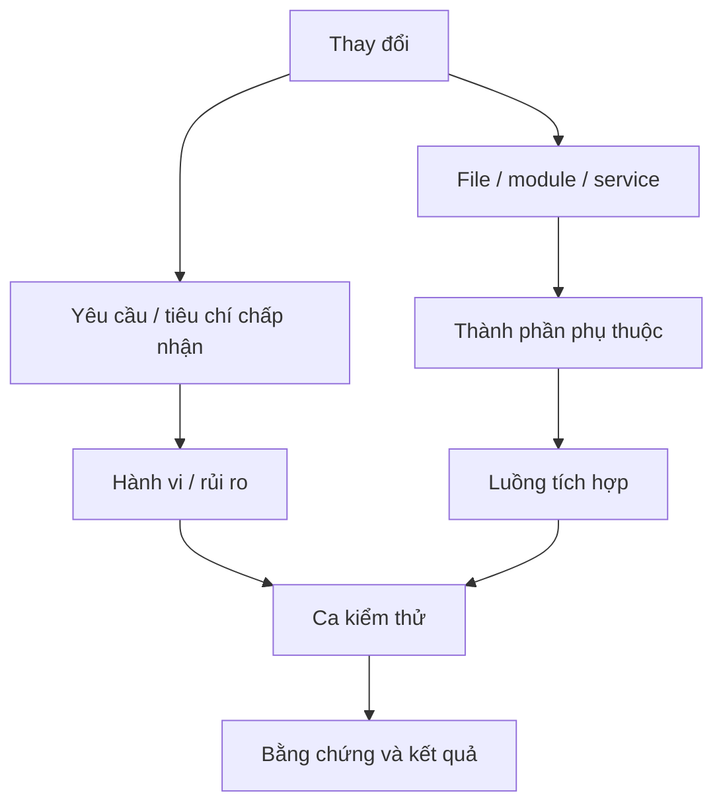

# Lựa chọn bộ kiểm thử theo tác động và kiểm tra giới hạn của lựa chọn

Sau mỗi thay đổi phần mềm, nhóm thường cần chạy lại một phần kiểm thử hồi quy để xác nhận hành vi cũ vẫn đúng. Khi hệ thống lớn, chạy toàn bộ bộ kiểm thử cho mọi commit hoặc pull request có thể tốn nhiều thời gian, tài nguyên và làm chậm phản hồi. Vì vậy, nhóm có thể lựa chọn một tập kiểm thử dựa trên tác động của thay đổi: xác định thành phần, hành vi, dữ liệu và rủi ro có khả năng bị ảnh hưởng, sau đó chọn các ca kiểm thử phù hợp để xác minh.

**Lựa chọn kiểm thử hồi quy (regression test selection)** là quá trình chọn một tập con của bộ kiểm thử hiện có cho một thay đổi cụ thể. Việc lựa chọn cần dựa trên bằng chứng về quan hệ giữa thay đổi và kiểm thử, mức độ quan trọng của hành vi, phạm vi phụ thuộc và giới hạn của phân tích tác động. Một tập được chọn nhỏ hơn có thể giúp phản hồi nhanh, nhưng nếu bỏ sót quan hệ phụ thuộc hoặc tác động gián tiếp, lỗi hồi quy có thể lọt qua.

Mục tiêu không phải luôn chọn ít ca nhất. Mục tiêu là chọn tập kiểm thử có giá trị đủ cao cho quyết định cần đưa ra, trong giới hạn thời gian và tài nguyên đã thống nhất. Khi độ tin cậy của phân tích tác động thấp, thay đổi rộng hoặc rủi ro cao, nhóm cần mở rộng phạm vi hoặc chạy toàn bộ bộ kiểm thử liên quan.

## 1. Vì sao cần lựa chọn bộ kiểm thử theo tác động?

Một bộ hồi quy có thể chứa hàng nghìn ca kiểm thử ở nhiều cấp độ: đơn vị, API, tích hợp, hệ thống, giao diện và phi chức năng. Mỗi ca có thời gian chạy, dữ liệu, môi trường và chi phí bảo trì khác nhau. Chạy tất cả ở mọi thời điểm có thể tạo ra thời gian chờ dài, tăng tải CI và làm chậm vòng phản hồi cho lập trình viên.

Lựa chọn theo tác động giúp:

- Chạy sớm các ca liên quan đến phần mã, yêu cầu hoặc luồng nghiệp vụ vừa thay đổi.
- Giảm thời gian phản hồi ở pull request và nhánh phát triển.
- Tập trung tài nguyên vào các rủi ro có khả năng bị ảnh hưởng.
- Tránh chạy lặp lại các ca không liên quan khi bằng chứng về phạm vi thay đổi đủ tốt.
- Tạo liên kết có thể truy vết giữa thay đổi, thành phần, rủi ro và kiểm thử.
- Phân biệt những ca có thể chạy nhanh với những ca cần môi trường hoặc dữ liệu chuyên biệt.

Tuy nhiên, lựa chọn có thể tạo ra khoảng trống nếu dữ liệu phụ thuộc không đầy đủ, quan hệ giữa mã và kiểm thử đã lỗi thời hoặc thay đổi ảnh hưởng đến hành vi dùng chung mà phân tích không nhận diện được. Do đó, lựa chọn theo tác động cần được quản lý như một quyết định dựa trên rủi ro, có giới hạn và cơ chế kiểm tra lại.

## 2. Phân biệt lựa chọn, ưu tiên và giảm bộ kiểm thử

Ba hoạt động thường được kết hợp nhưng có mục đích khác nhau:

| Hoạt động | Câu hỏi chính | Kết quả |
|---|---|---|
| Lựa chọn kiểm thử (test selection) | Ca nào cần chạy cho thay đổi này? | Tập kiểm thử được chọn |
| Ưu tiên kiểm thử (test prioritization) | Trong các ca cần chạy, ca nào nên chạy trước? | Thứ tự chạy |
| Giảm bộ kiểm thử (test suite minimization) | Có thể loại bỏ ca trùng lặp lâu dài mà vẫn giữ mục tiêu bao phủ đã định không? | Bộ kiểm thử nhỏ hơn được duy trì |

Ví dụ, một thay đổi ở module thanh toán có thể khiến nhóm chọn các ca kiểm tra tính tiền, giao dịch và trạng thái đơn hàng. Trong tập được chọn, nhóm ưu tiên ca kiểm tra lỗi tính tiền và giao dịch trùng chạy trước vì hậu quả cao và thời gian ngắn. Việc loại bỏ một ca chỉ vì nó trùng một phần với ca khác là quyết định giảm bộ kiểm thử và cần đánh giá riêng, không nên thực hiện chỉ để làm một lần chạy nhanh hơn.

Lựa chọn xác định phạm vi; ưu tiên xác định thứ tự. Một ca có thể không được chọn trong một lần chạy nhanh nhưng vẫn nằm trong bộ hồi quy đầy đủ. Không nên nhầm việc bỏ qua tạm thời với việc xóa ca khỏi bộ kiểm thử chính thức.

## 3. Xác định phạm vi thay đổi trước khi chọn ca

Chất lượng lựa chọn phụ thuộc vào việc hiểu đúng thay đổi. Trước khi chọn kiểm thử, nhóm cần xác định thay đổi gồm những gì và có thể ảnh hưởng đến phần nào.

Thông tin cần xem xét:

- File, module, package, service, API hoặc schema được sửa.
- Yêu cầu, tiêu chí chấp nhận và quy tắc nghiệp vụ thay đổi.
- Cấu hình, feature flag, biến môi trường và quyền truy cập thay đổi.
- Thư viện, framework, runtime hoặc dịch vụ phụ thuộc được nâng cấp.
- Dữ liệu, migration, truy vấn, event schema hoặc hợp đồng API bị tác động.
- Luồng người dùng và hệ thống tích hợp có liên quan.
- Các lỗi trước đây trong khu vực thay đổi hoặc các khu vực có quan hệ phụ thuộc.

Không nên chỉ nhìn danh sách file đã sửa. Một thay đổi cấu hình có thể ảnh hưởng nhiều module mà không sửa mã nguồn của chúng. Một thay đổi trong thư viện dùng chung có thể tác động đến hàng loạt dịch vụ. Một thay đổi ở quy tắc nghiệp vụ có thể ảnh hưởng nhiều màn hình và báo cáo dù chỉ sửa một hàm.

### 3.1. Phân tích diff và lịch sử thay đổi

Diff cho biết dòng mã, cấu trúc hoặc tệp nào thay đổi. Có thể kết hợp lịch sử commit, pull request, thông tin ticket và review để hiểu ý định. Cần lưu ý:

- Đổi tên hoặc di chuyển file có thể làm phân tích diff đánh giá sai phạm vi.
- Refactor có thể thay đổi nhiều dòng nhưng không đổi hành vi; vẫn có rủi ro do vô tình làm thay đổi logic.
- Thay đổi nhỏ trong hàm dùng chung có thể có phạm vi tác động lớn.
- Thay đổi được tạo tự động như generated code hoặc lockfile có thể cần phân tích theo nguồn gốc thay vì số dòng diff.
- Một commit có thể chứa nhiều mục tiêu; nên tách thay đổi độc lập nếu có thể để lựa chọn chính xác hơn.

Diff là đầu vào quan trọng nhưng không phải bằng chứng đầy đủ về tác động. Nhóm cần kết hợp kiến thức kiến trúc, quan hệ phụ thuộc và yêu cầu nghiệp vụ.

### 3.2. Phân tích thay đổi ngoài mã nguồn

Một số thay đổi không xuất hiện như sửa logic thông thường:

- Thay đổi biến môi trường hoặc feature flag.
- Cập nhật quyền IAM, role, scope hoặc chính sách mạng.
- Thay đổi migration database, index, constraint hoặc collation.
- Thay đổi schema message, topic, queue hoặc event routing.
- Nâng cấp chứng chỉ, CA bundle hoặc cấu hình TLS.
- Thay đổi cấu hình timeout, retry, cache hoặc connection pool.
- Thay đổi dữ liệu tham chiếu, bảng giá hoặc quy tắc theo khu vực.

Những thay đổi này có thể ảnh hưởng trực tiếp đến hành vi chạy. Quy trình lựa chọn cần nhận diện chúng từ artifact, hạ tầng dưới dạng mã, cấu hình triển khai và yêu cầu thay đổi, không chỉ từ diff mã nguồn.

## 4. Xây dựng bản đồ quan hệ giữa thay đổi và kiểm thử

Để lựa chọn có cơ sở, nhóm cần biết một ca kiểm thử xác nhận thành phần hoặc hành vi nào. Có thể xây dựng bản đồ liên kết nhiều chiều:



Quan hệ có thể được lưu bằng metadata trong test case, annotation, tag, manifest, báo cáo coverage, trace từ runtime hoặc hệ thống quản lý yêu cầu. Ví dụ, một ca có thể gắn với `REQ-PAY-014`, service `payment`, API `POST /payments` và rủi ro `duplicate-charge`.

### 4.1. Liên kết kiểm thử với mã nguồn

Ở cấp đơn vị, có thể xác định test nào gọi trực tiếp lớp, hàm hoặc module được sửa. Coverage report cho biết những dòng hoặc nhánh nào được thực thi trong các lần chạy trước. Thông tin này giúp thu hẹp tập ca có khả năng liên quan.

Nhưng coverage lịch sử có giới hạn:

- Nó cho biết ca đã thực thi mã nào trong một lần chạy cụ thể, không chứng minh mọi tác động đều được bao phủ.
- Đường đi có thể thay đổi theo dữ liệu, cấu hình, quyền hoặc feature flag.
- Coverage cũ có thể không còn đúng sau refactor hoặc thay đổi kiến trúc.
- Một test có thể gọi module gián tiếp qua service hoặc event mà trace không nhận diện được.
- Mã được thực thi không đồng nghĩa hành vi được kiểm tra bằng assertion có ý nghĩa.

Coverage nên là một tín hiệu trong phân tích tác động, không phải bằng chứng duy nhất để loại ca.

### 4.2. Liên kết kiểm thử với yêu cầu và rủi ro

Với thay đổi nghiệp vụ, liên kết với yêu cầu thường quan trọng hơn liên kết file. Ví dụ, thay đổi chính sách hoàn tiền có thể ảnh hưởng đến giao diện khách hàng, API quản trị, báo cáo kế toán và tác vụ nền. Nếu chỉ chọn test nằm cạnh file vừa sửa, nhóm có thể bỏ qua các luồng nghiệp vụ phụ thuộc.

Mỗi yêu cầu hoặc rủi ro quan trọng nên có một hoặc nhiều ca xác nhận. Khi yêu cầu thay đổi, nhóm có thể tìm các ca liên quan và kiểm tra xem có cần bổ sung hoặc điều chỉnh hay không.

### 4.3. Liên kết theo phụ thuộc và luồng dữ liệu

Đồ thị phụ thuộc có thể mô tả service gọi service khác, module sử dụng thư viện chung, producer phát event cho consumer, hoặc ứng dụng đọc dữ liệu do một tác vụ tạo ra. Khi một nút thay đổi, các nút phụ thuộc trực tiếp và gián tiếp có thể bị ảnh hưởng.

Phạm vi lan truyền cần được xác định theo hướng phụ thuộc và hành vi. Ví dụ, thay đổi thư viện serialization có thể ảnh hưởng mọi producer và consumer dùng thư viện đó. Thay đổi một endpoint provider có thể ảnh hưởng tất cả consumer đang gọi endpoint, kể cả consumer nằm ở repository khác.

Không phải mọi phụ thuộc đều có cùng mức ảnh hưởng. Một module chỉ dùng kiểu dữ liệu chung có thể không chịu tác động của thay đổi thuật toán nội bộ; một consumer đọc trực tiếp trường đã đổi ngữ nghĩa có thể chịu tác động lớn. Cần kết hợp cấu trúc phụ thuộc với cách sử dụng thực tế.

## 5. Các chiến lược lựa chọn kiểm thử

### 5.1. Lựa chọn dựa trên coverage

Nhóm chọn các ca đã thực thi phần mã thay đổi trong những lần chạy trước. Đây là cách tiếp cận hữu ích khi có coverage dữ liệu theo test và build được quản lý tốt.

Ưu điểm:

- Có quan hệ thực nghiệm giữa ca và phần mã được thực thi.
- Có thể tự động hóa và tích hợp vào CI.
- Giúp giảm tập ca khi thay đổi nằm trong một vùng mã nhỏ.

Giới hạn:

- Coverage không chứng minh assertion kiểm tra đúng hành vi.
- Các đường đi phụ thuộc dữ liệu hoặc cấu hình có thể chưa xuất hiện trong lần đo.
- Thay đổi có tác động gián tiếp đến module không được chạy trong trace lịch sử.
- Dữ liệu coverage cũ hoặc không đúng build có thể dẫn đến lựa chọn sai.

Nên bổ sung test liên quan đến yêu cầu, phụ thuộc, rủi ro và các ca smoke quan trọng.

### 5.2. Lựa chọn dựa trên phụ thuộc

Nhóm bắt đầu từ thành phần thay đổi, sau đó chọn các ca kiểm thử của thành phần và các consumer hoặc luồng phụ thuộc. Cách này phù hợp với hệ thống có kiến trúc module hoặc service được mô tả rõ.

Ưu điểm là có thể bao phủ tác động gián tiếp và ranh giới tích hợp. Giới hạn là đồ thị phụ thuộc có thể không đầy đủ, quá rộng hoặc không phản ánh điều kiện thực thi. Một phụ thuộc chỉ được khai báo ở cấu hình runtime có thể không xuất hiện trong đồ thị mã nguồn.

### 5.3. Lựa chọn dựa trên yêu cầu và rủi ro

Khi thay đổi được gắn với yêu cầu, tiêu chí chấp nhận hoặc rủi ro, nhóm chọn các ca xác nhận những mục đó. Cách này đặc biệt hữu ích với thay đổi nghiệp vụ, bảo mật, dữ liệu và phi chức năng.

Ưu điểm là gắn với tác động người dùng và mục tiêu chất lượng. Giới hạn là liên kết có thể thiếu hoặc lỗi thời; yêu cầu chung có thể không phản ánh đầy đủ đường đi kỹ thuật.

### 5.4. Lựa chọn dựa trên lịch sử lỗi

Các ca từng phát hiện lỗi ở khu vực tương tự hoặc ca thường thất bại sau loại thay đổi tương tự có thể được ưu tiên. Lịch sử giúp nhận diện khu vực dễ phát sinh lỗi và bổ sung bằng chứng thực nghiệm.

Tuy nhiên, lịch sử không dự đoán được mọi lỗi mới. Một khu vực chưa từng có lỗi không có nghĩa rủi ro thấp. Dữ liệu lỗi còn phụ thuộc cách nhóm ghi nhận, mức độ kiểm thử và các lỗi đã lọt qua.

### 5.5. Lựa chọn kết hợp

Trong thực tế, nên kết hợp nhiều nguồn:

- Diff và thông tin thay đổi.
- Coverage theo test.
- Đồ thị module/service và phụ thuộc.
- Liên kết yêu cầu, rủi ro và ca kiểm thử.
- Lịch sử lỗi và độ ổn định của ca.
- Bộ smoke test và kiểm tra bắt buộc.

Kết hợp giúp giảm nguy cơ phụ thuộc vào một tín hiệu không hoàn hảo. Nếu một nguồn chỉ ra phạm vi nhỏ nhưng nguồn khác chỉ ra rủi ro rộng, cần điều tra chênh lệch trước khi thu hẹp bộ kiểm thử.

## 6. Phân loại tác động và xác định phạm vi kiểm thử

Sau khi thu thập thông tin, nhóm có thể phân loại thay đổi theo phạm vi:

| Phạm vi thay đổi | Ví dụ | Nhóm kiểm thử cần xem xét |
|---|---|---|
| Cục bộ trong một hàm hoặc module | Sửa quy tắc làm tròn | Unit test liên quan, test biên và ca sử dụng module |
| Ảnh hưởng hợp đồng | Đổi schema API hoặc event | Contract test provider/consumer, integration test và consumer quan trọng |
| Ảnh hưởng dữ liệu | Thay migration, query hoặc constraint | Test migration, repository, dữ liệu biên, rollback/restore và luồng nghiệp vụ |
| Ảnh hưởng cấu hình | Thay timeout, feature flag hoặc quyền | Test cấu hình hợp lệ/không hợp lệ, luồng phụ thuộc và môi trường liên quan |
| Ảnh hưởng xuyên service | Thay logic phát event hoặc xử lý thanh toán | Test producer/consumer, integration, end-to-end trọng yếu |
| Thay đổi nền tảng hoặc thư viện dùng chung | Nâng JDK, framework hoặc thư viện mã hóa | Test tương thích, bảo mật, hiệu năng và các service sử dụng phụ thuộc |
| Thay đổi rộng hoặc khó phân tích | Refactor kiến trúc, thay nền tảng dữ liệu | Bộ hồi quy mở rộng hoặc toàn bộ suite liên quan |

Phạm vi nên được chọn theo hậu quả nếu bỏ sót, độ tin cậy của bản đồ tác động và khả năng kiểm thử. Không nên gắn một loại thay đổi với một tập test cố định mà không xét kiến trúc và rủi ro cụ thể.

## 7. Chọn tập kiểm thử theo mức rủi ro

Một cách thực hành là đánh giá từng vùng bị ảnh hưởng theo xác suất xảy ra lỗi và hậu quả nếu lỗi xuất hiện. Có thể xem xét:

- Mức độ quan trọng của chức năng đối với người dùng hoặc nghiệp vụ.
- Mức độ nhạy cảm của dữ liệu và quyền truy cập.
- Mức độ phức tạp của thay đổi và số lượng thành phần liên quan.
- Mức độ phụ thuộc vào hệ thống bên ngoài.
- Lịch sử lỗi và tần suất thay đổi.
- Khả năng phát hiện lỗi ở giai đoạn sau.
- Mức độ tin cậy của liên kết giữa thay đổi và test.

Ví dụ, thay đổi nhãn trên một màn hình ít quan trọng có thể chỉ cần test giao diện liên quan và smoke test. Thay đổi thuật toán tính tiền cần test đơn vị ở các giá trị biên, test API, test tích hợp với đơn hàng và một số luồng đầu cuối. Thay đổi phân quyền cần kiểm tra cả quyền được phép lẫn quyền bị từ chối ở nhiều ranh giới.

Không nên chỉ dựa vào điểm rủi ro tổng hợp. Một rủi ro nghiêm trọng như truy cập trái phép hoặc giao dịch trùng có thể cần test bắt buộc dù xác suất ước lượng thấp.

### 7.1. Phân biệt rủi ro của thay đổi và rủi ro của việc lựa chọn

Có hai câu hỏi riêng:

1. Thay đổi có thể gây ra lỗi nghiêm trọng đến đâu?
2. Phương pháp lựa chọn có thể bỏ sót ca liên quan đến thay đổi đến mức nào?

Một thay đổi nhỏ có thể có rủi ro nghiệp vụ thấp nhưng phương pháp phân tích tác động cũng rất đáng tin. Ngược lại, một thay đổi nhỏ trong cấu hình xác thực có thể có rủi ro cao và quan hệ phụ thuộc khó thấy. Khi rủi ro lựa chọn cao, cần tăng phạm vi test dù diff nhỏ.

## 8. Tạo các tầng kiểm thử hồi quy

Một bộ hồi quy có thể được tổ chức thành các tầng để đáp ứng thời gian phản hồi khác nhau:

| Tầng | Nội dung | Thời điểm thường dùng |
|---|---|---|
| Smoke/critical path | Các luồng cốt lõi, kiểm tra khởi động và khả năng sử dụng cơ bản | Mỗi pull request, sau deploy hoặc trước khi chạy suite rộng |
| Impact-selected | Các ca được chọn từ thay đổi, phụ thuộc, yêu cầu và rủi ro | Pull request hoặc sau khi tích hợp |
| Targeted integration | Các ranh giới API, database, message và dịch vụ liên quan | Sau build hoặc theo nhóm thay đổi |
| Full regression | Bộ hồi quy rộng của sản phẩm hoặc vùng chức năng | Theo lịch, trước phát hành hoặc khi rủi ro yêu cầu |
| Specialized | Hiệu năng, bảo mật sâu, tương thích nền tảng và kiểm thử dài hạn | Theo lịch hoặc mốc kiểm soát riêng |

Các tầng có thể chạy song song hoặc theo thứ tự. Tập smoke thường được duy trì nhỏ, ổn định và có giá trị cao. Tập impact-selected thay đổi theo diff. Full regression vẫn cần được chạy định kỳ để kiểm tra những vùng không được chọn trong từng lần commit.

Không nên xem smoke test là thay thế cho hồi quy đầy đủ. Smoke chỉ xác nhận một số hành vi cốt lõi và có thể bỏ sót lỗi ở nhánh hiếm, dữ liệu biên hoặc tích hợp ít sử dụng.

## 9. Quy trình lựa chọn kiểm thử cho một thay đổi

Một quy trình thực tế có thể gồm:

1. **Nhận diện thay đổi:** Thu thập diff, ticket, cấu hình, migration, dependency và mục tiêu thay đổi.
2. **Xác định phạm vi trực tiếp:** Liệt kê file, module, service, API, schema hoặc quy tắc bị tác động.
3. **Mở rộng theo phụ thuộc:** Tìm consumer, module gọi, dữ liệu chia sẻ và luồng tích hợp liên quan.
4. **Liên kết với yêu cầu/rủi ro:** Xác định hành vi người dùng, tiêu chí chấp nhận và rủi ro có thể bị ảnh hưởng.
5. **Thu thập bằng chứng kiểm thử:** Dùng coverage, metadata test, lịch sử lỗi, trace và quan hệ yêu cầu-test.
6. **Chọn các ca cần chạy:** Bao gồm test trực tiếp, test phụ thuộc, ca rủi ro cao và smoke bắt buộc.
7. **Đánh giá độ tin cậy của lựa chọn:** Kiểm tra dữ liệu có đầy đủ, mới và phù hợp với build không.
8. **Ưu tiên thực thi:** Đưa ca ngắn, quan trọng và có khả năng phát hiện lỗi cao lên trước.
9. **Chạy và phân tích:** Ghi kết quả, test bị bỏ qua, test bị chặn và lỗi môi trường.
10. **Quyết định mở rộng:** Nếu có tín hiệu bất thường hoặc phạm vi không chắc chắn, chạy thêm test tích hợp hoặc full regression.
11. **Lưu dấu vết:** Ghi lý do chọn/bỏ, phiên bản dữ liệu tác động và kết quả để cải thiện lần sau.

Quy trình có thể tự động hóa một phần, nhưng những thay đổi có rủi ro cao hoặc tác động khó xác định cần review của người hiểu kiến trúc và nghiệp vụ.

## 10. Ví dụ: chọn hồi quy cho thay đổi luồng thanh toán

Giả sử một pull request thay đổi cách dịch vụ thanh toán xử lý timeout và gửi lại request. Diff trực tiếp nằm trong module `payment-client`, nhưng hành vi liên quan đến đơn hàng, giao dịch, message và thông báo.

Phân tích tác động:

- Module trực tiếp: client gọi nhà cung cấp thanh toán.
- Phụ thuộc: API tạo thanh toán, database giao dịch, service đơn hàng và message broker.
- Hành vi nghiệp vụ: thanh toán thành công, thất bại, timeout, retry và idempotency.
- Rủi ro: giao dịch bị ghi nhận hai lần, đơn hàng ở trạng thái sai hoặc thông báo không nhất quán.
- Test liên quan: unit test retry policy, contract test API provider, integration test với sandbox/fake, test trạng thái đơn và end-to-end checkout.

Một tập kiểm thử có thể gồm:

| Ca | Lý do chọn | Mức kiểm thử |
|---|---|---|
| Retry dừng sau số lần tối đa | Xác nhận giới hạn retry mới | Unit |
| Timeout sau khi provider đã nhận request | Xác nhận không tạo tác dụng phụ trùng | Integration |
| Gửi lại cùng idempotency key | Xác nhận một giao dịch logic | API/contract và integration |
| Provider trả lỗi tạm thời | Xác nhận retry theo chính sách | Integration |
| Đơn hàng cập nhật sau thanh toán thành công | Xác nhận phối hợp payment và order | Integration/end-to-end |
| Thanh toán thất bại không tạo đơn đã thanh toán | Xác nhận trạng thái và dữ liệu | API/integration |
| Luồng checkout quan trọng | Xác nhận hành trình người dùng | End-to-end smoke |

Nếu phân tích chỉ chọn unit test của `payment-client`, nhóm có thể bỏ qua lỗi phối hợp giữa provider và database. Nếu chỉ chạy end-to-end checkout, nhóm có thể phát hiện lỗi nhưng khó chẩn đoán trường hợp timeout sau khi provider đã xử lý. Tập nhiều cấp độ tạo bằng chứng bổ sung cho nhau.

## 11. Kiểm tra giới hạn của lựa chọn

Lựa chọn theo tác động luôn dựa trên mô hình và dữ liệu không hoàn hảo. Nhóm cần chủ động kiểm tra các giới hạn để tránh tin tưởng quá mức vào một tập test nhỏ.

### 11.1. Phụ thuộc không được ghi nhận

Đồ thị module hoặc service có thể thiếu các quan hệ được tạo qua cấu hình, reflection, plugin, dependency injection, event bus, truy vấn động hoặc API bên ngoài. Khi đó, phân tích tĩnh có thể không nhận ra tác động.

Cách giảm rủi ro:

- Duy trì danh mục service, API, event và dependency.
- Kết hợp phân tích mã với cấu hình triển khai và quan sát runtime.
- Chọn test hợp đồng và smoke cho các ranh giới quan trọng.
- Chạy full regression theo lịch và sau thay đổi kiến trúc rộng.
- Review thủ công khi thay đổi liên quan đến cơ chế động hoặc tích hợp ngoài.

### 11.2. Coverage lịch sử không đại diện cho đường chạy hiện tại

Coverage được thu thập từ một build, dữ liệu và cấu hình cụ thể. Nếu code, feature flag, test data hoặc môi trường đã thay đổi, quan hệ test-code có thể lỗi thời.

Cần gắn coverage với commit/build, môi trường, phiên bản test và điều kiện chạy. Nếu không thể xác định nguồn gốc, không dùng dữ liệu đó làm căn cứ mạnh để loại test.

### 11.3. Thay đổi hành vi gián tiếp

Một thay đổi ở thư viện chung hoặc cấu trúc dữ liệu có thể ảnh hưởng đến nơi không nằm trong diff. Ví dụ, thay đổi thứ tự trường JSON có thể ảnh hưởng consumer dùng parser không tuân thủ hợp đồng; thay đổi timezone mặc định có thể ảnh hưởng báo cáo và tác vụ nền.

Với thay đổi nền tảng, dữ liệu hoặc cấu hình dùng chung, cần mở rộng phạm vi sang consumer và luồng nghiệp vụ liên quan. Nếu không thể lập bản đồ tác động đầy đủ, chọn bộ kiểm thử rộng hơn.

### 11.4. Ca kiểm thử được chọn nhưng assertion yếu

Một ca có thể thực thi code bị ảnh hưởng nhưng chỉ kiểm tra trạng thái HTTP hoặc việc chương trình không ném exception. Điều đó không chứng minh hành vi nghiệp vụ đúng.

Khi xem xét một ca được chọn, hãy kiểm tra assertion, oracle, dữ liệu và điều kiện. Test được chọn vì có chạy qua module không đồng nghĩa test đó xác nhận rủi ro cần quan tâm.

### 11.5. Thay đổi ở test hoặc hạ tầng kiểm thử

Khi sửa chính bộ kiểm thử, fixture, mock, runner, pipeline hoặc công cụ lựa chọn, cần kiểm tra rằng cơ chế lựa chọn vẫn đúng. Nếu thay đổi làm test không được phát hiện hoặc metadata bị mất, bộ test có thể bị chọn thiếu.

Những thay đổi đối với bộ máy lựa chọn, coverage collector, test discovery hoặc mapping metadata nên kích hoạt kiểm tra rộng hơn và review riêng.

### 11.6. Lỗi có thể xuất hiện ở vùng không được chọn

Một thay đổi có thể gây ra lỗi bất ngờ ngoài phạm vi dự đoán. Đây là giới hạn căn bản của mọi phương pháp lựa chọn. Cần giữ các cơ chế kiểm tra bổ sung như full regression định kỳ, kiểm thử tích hợp theo lịch, giám sát sau triển khai và phân tích lỗi lọt để cải thiện mô hình.

## 12. Khi nào phải mở rộng hoặc chạy toàn bộ bộ kiểm thử?

Không nên cố giữ tập lựa chọn nhỏ khi bằng chứng về tác động không đủ tin cậy. Các tình huống nên mở rộng phạm vi gồm:

- Thay đổi kiến trúc, thư viện nền tảng hoặc thành phần dùng chung.
- Thay đổi schema, migration, dữ liệu hoặc quy tắc nghiệp vụ có nhiều consumer.
- Thay đổi xác thực, phân quyền, mã hóa hoặc ranh giới bảo mật.
- Thay đổi concurrency, retry, transaction hoặc xử lý sự kiện phân tán.
- Đồ thị phụ thuộc hoặc coverage không đầy đủ, cũ hoặc mâu thuẫn.
- Thay đổi được thực hiện trong nhiều module hoặc khó tách mục tiêu.
- Có lỗi hồi quy nghiêm trọng gần đây ở vùng liên quan.
- Ca được chọn không đủ bao phủ các rủi ro trọng yếu.
- Công cụ lựa chọn hoặc dữ liệu metadata vừa được thay đổi.
- Quy trình phát hành hoặc yêu cầu tuân thủ bắt buộc chạy bộ kiểm thử rộng.

Có thể áp dụng mức mở rộng theo từng bước: thêm test của consumer, chạy integration suite, chạy regression của service liên quan, rồi full suite nếu vẫn còn bất định. Với thay đổi có hậu quả nghiêm trọng hoặc không thể đánh giá an toàn, nên chạy toàn bộ bộ kiểm thử bắt buộc trước quyết định phát hành.

## 13. Giới hạn theo thời gian và tài nguyên

Lựa chọn test thường diễn ra trong một ngân sách thời gian. Nhóm cần xác định thời gian tối đa cho pull request, thời gian có thể dành cho nightly run và mức độ bao phủ bắt buộc trước phát hành.

Khi ngân sách giới hạn:

- Chọn ca kiểm tra rủi ro cao và hành vi cốt lõi trước.
- Ưu tiên ca nhanh, ổn định và có khả năng phát hiện lỗi cao.
- Chạy song song nếu dữ liệu và môi trường được cô lập.
- Đưa test chậm hoặc cần tài nguyên chuyên biệt vào giai đoạn phù hợp.
- Báo rõ ca nào chưa chạy, bị chặn hoặc được hoãn.
- Không diễn giải “đã chạy hết tập được chọn” thành “đã kiểm tra toàn bộ rủi ro”.

Nếu không đủ thời gian để chạy các ca quan trọng, đó là rủi ro phát hành cần được ghi nhận và quyết định bởi người có thẩm quyền. Không nên âm thầm giảm tập kiểm thử để đạt thời gian pipeline mục tiêu.

## 14. Đánh giá chất lượng của phương pháp lựa chọn

Muốn biết lựa chọn có hiệu quả hay không, nhóm cần theo dõi cả tốc độ lẫn lỗi bị bỏ sót. Một phương pháp chọn ít test nhưng thường xuyên để lọt lỗi không phải là phương pháp tốt.

Các chỉ số có thể theo dõi:

- **Thời gian phản hồi:** Thời gian từ khi thay đổi được gửi đến khi có kết quả của tập được chọn.
- **Tỷ lệ test được chọn:** Số ca được chạy so với tổng số ca phù hợp trong bộ hồi quy.
- **Tỷ lệ phát hiện lỗi:** Số lỗi được các ca lựa chọn phát hiện theo loại thay đổi.
- **Lỗi lọt qua:** Lỗi được phát hiện sau đó ở ca không được chọn, môi trường sau hoặc sản xuất.
- **Độ chính xác lựa chọn:** Tỷ lệ ca được chọn thực sự liên quan đến thay đổi, nếu có thể xác định từ phân tích sau.
- **Tỷ lệ bỏ sót:** Ca liên quan nhưng không được chọn, xác định qua review hoặc lỗi lọt.
- **Chi phí chạy:** Thời gian, CPU, môi trường, dữ liệu và chi phí dịch vụ.
- **Độ ổn định của metadata:** Tỷ lệ mapping test-code/test-requirement còn hợp lệ và cập nhật.
- **Tỷ lệ mở rộng:** Số lần tập chọn phải mở rộng hoặc chuyển sang full suite do tín hiệu không chắc chắn.

Không có một chỉ số đơn lẻ phản ánh toàn bộ chất lượng. Tỷ lệ test được chọn thấp có thể là dấu hiệu tốt về hiệu quả, hoặc dấu hiệu lựa chọn quá hẹp. Tỷ lệ lỗi lọt cần được phân tích theo mức nghiêm trọng, nguyên nhân và khả năng dự đoán.

### 14.1. Học từ lỗi lọt

Khi lỗi được phát hiện ở một ca không được chọn, hãy xem lại:

1. Thay đổi nào đã gây lỗi?
2. Ca nào đã phát hiện lỗi và vì sao ca đó không được chọn?
3. Quan hệ phụ thuộc hoặc metadata nào bị thiếu?
4. Coverage có cũ, không đầy đủ hoặc gắn sai build không?
5. Assertion của ca có đủ mạnh không?
6. Có cần thêm mapping, test mới hoặc quy tắc mở rộng cho loại thay đổi tương tự không?
7. Có nên chạy một test bổ sung mặc định cho các thay đổi cùng vùng rủi ro không?

Mục tiêu là cải thiện mô hình lựa chọn và bộ kiểm thử. Không nên chỉ thêm một ngoại lệ riêng cho lỗi vừa xảy ra mà không xem xét các trường hợp tương tự.

## 15. Quản trị lý do chọn và bỏ qua kiểm thử

Một báo cáo lựa chọn hữu ích cần giải thích không chỉ ca nào được chạy mà còn vì sao một số ca không được chọn. Điều này giúp reviewer đánh giá độ tin cậy và người ra quyết định hiểu giới hạn.

Thông tin nên lưu:

- Commit/build và danh sách thay đổi đầu vào.
- Phiên bản công cụ hoặc quy tắc lựa chọn.
- Nguồn metadata: coverage, dependency graph, requirement mapping, lịch sử lỗi.
- Ca được chọn và lý do chọn.
- Ca bị loại hoặc không xác định được quan hệ, cùng lý do.
- Ca bắt buộc luôn chạy bất kể phân tích tác động.
- Các giả định và giới hạn của phân tích.
- Quyết định mở rộng hoặc chấp nhận rủi ro, người phê duyệt và thời điểm.

Không cần tạo báo cáo dài cho mọi pull request. Có thể lưu metadata máy đọc được và hiển thị phần tóm tắt cho người review. Nhưng với thay đổi rủi ro cao hoặc quyết định bỏ qua test quan trọng, lý do cần được ghi rõ.

## 16. Ví dụ về quy tắc lựa chọn tự động

Một pipeline có thể dùng quy tắc minh họa sau:

```text
changed = collect_changed_files_and_config()
direct_components = map_changes_to_components(changed)
affected_components = expand_dependency_graph(direct_components)
affected_requirements = map_components_to_requirements(affected_components)

selected = tests_linked_to(
    components = affected_components,
    requirements = affected_requirements
)

selected += tests_covering_changed_code(changed)
selected += tests_for_high_risk_dependencies(affected_components)
selected += mandatory_smoke_tests

if impact_metadata_is_stale_or_incomplete():
    selected = expand_to_related_service_regression()

if change_is_wide_or_high_risk() or selection_confidence_is_low():
    selected = full_regression_suite()

ordered = prioritize(selected, by = [risk, detection_value, duration])
run(ordered)
```

Đây là quy trình khái niệm, không phải mã triển khai sẵn. Các hàm thu thập thay đổi, mở rộng phụ thuộc và đánh giá độ tin cậy cần được xây dựng theo kiến trúc và công cụ thực tế. Quy tắc phải được review và kiểm tra bằng các thay đổi lịch sử đã biết để xem có bỏ sót test quan trọng không.

## 17. Những sai lầm thường gặp

- **Chỉ chọn test theo file diff:** Bỏ qua cấu hình, yêu cầu, dữ liệu, consumer và phụ thuộc gián tiếp.
- **Dựa hoàn toàn vào coverage:** Nhầm việc thực thi mã với việc xác nhận hành vi.
- **Tin đồ thị phụ thuộc là đầy đủ:** Bỏ sót liên kết động, event, plugin hoặc dịch vụ bên ngoài.
- **Bỏ qua test không được chọn mà không lưu lý do:** Không thể đánh giá rủi ro và cải thiện thuật toán.
- **Nhầm lựa chọn với ưu tiên:** Sắp xếp test không làm cho các test bị bỏ qua trở nên đã được xác minh.
- **Loại bỏ test lâu dài để tối ưu một lần chạy:** Làm mất phạm vi hồi quy có giá trị.
- **Chỉ chạy test nhanh:** Có thể bỏ sót rủi ro tích hợp hoặc hành vi xuyên hệ thống.
- **Không có full regression định kỳ:** Những vùng ít thay đổi hoặc không được mapping có thể không bao giờ được kiểm tra.
- **Không kiểm tra metadata:** Mapping lỗi thời dẫn đến lựa chọn thiếu.
- **Không mở rộng khi độ tin cậy thấp:** Cố giữ tập test nhỏ dù thay đổi rộng hoặc rủi ro cao.
- **Báo cáo “đã đạt” khi còn test chưa chạy:** Che giấu khoảng trống bằng chứng.
- **Không học từ lỗi lọt:** Cùng một loại thiếu sót tiếp tục lặp lại ở các lần phát hành sau.

## 18. Checklist lựa chọn và kiểm tra giới hạn

Trước khi chấp nhận một tập hồi quy được chọn theo tác động, nhóm có thể dùng checklist sau:

- [ ] Thay đổi mã, cấu hình, dữ liệu, dependency và yêu cầu đã được nhận diện.
- [ ] Phạm vi trực tiếp và phụ thuộc gián tiếp đã được xem xét.
- [ ] Test được liên kết với module, yêu cầu, rủi ro hoặc hành vi liên quan.
- [ ] Coverage và metadata được gắn đúng build, còn mới và có nguồn gốc.
- [ ] Ca được chọn có assertion và oracle đủ mạnh cho rủi ro cần xác nhận.
- [ ] Smoke test và các kiểm tra bắt buộc luôn chạy đã được thêm.
- [ ] Rủi ro thay đổi và rủi ro bỏ sót do lựa chọn được đánh giá riêng.
- [ ] Các giới hạn như phụ thuộc động, hệ thống ngoài và cấu hình runtime đã được xem xét.
- [ ] Có quy tắc mở rộng hoặc chạy full regression khi dữ liệu không đầy đủ hay rủi ro cao.
- [ ] Test chưa chạy, bị chặn và bị loại được báo cáo rõ.
- [ ] Có lịch chạy full regression hoặc bộ kiểm thử mở rộng để phát hiện khoảng trống.
- [ ] Lý do chọn/bỏ và phiên bản công cụ được lưu để truy vết.
- [ ] Lỗi lọt qua được phân tích để cải thiện mapping, quy tắc và bộ kiểm thử.

Lựa chọn bộ kiểm thử theo tác động giúp rút ngắn phản hồi khi thay đổi có phạm vi rõ và dữ liệu liên kết đáng tin cậy. Nhưng một tập test nhỏ chỉ có giá trị khi nhóm hiểu nó đang xác nhận điều gì, dựa trên bằng chứng nào và còn bỏ ngỏ những rủi ro nào. Kết hợp phân tích thay đổi, phụ thuộc, yêu cầu, coverage và lịch sử lỗi; duy trì smoke test cùng full regression định kỳ; và mở rộng phạm vi khi độ tin cậy thấp sẽ giúp cân bằng tốc độ với độ tin cậy của quyết định chất lượng.
