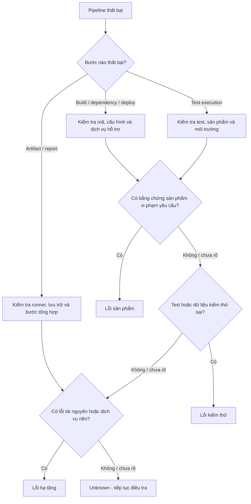

# Tách lỗi sản phẩm, lỗi kiểm thử và lỗi hạ tầng trong kết quả pipeline

Khi pipeline CI/CD thất bại, trạng thái màu đỏ chỉ cho biết một bước không hoàn tất theo điều kiện đã đặt. Nó chưa cho biết nguyên nhân nằm ở sản phẩm, mã kiểm thử hay hạ tầng chạy kiểm thử. Nếu nhóm kết luận quá sớm, lỗi sản phẩm có thể bị gắn nhãn “CI chập chờn”, lỗi kiểm thử có thể làm chặn phát hành không cần thiết, còn sự cố hạ tầng có thể bị sửa bằng cách thay đổi mã ứng dụng.

Phân loại đúng cần dựa trên bằng chứng và khả năng tái hiện trong điều kiện được kiểm soát. Mục tiêu là xác định điều gì đã thất bại, phạm vi bị ảnh hưởng, ai cần hành động và liệu pipeline có đủ bằng chứng để tiếp tục hay không. Một kết quả chưa rõ nguyên nhân phải được giữ ở trạng thái chưa xác định hoặc cần điều tra; không nên tự động coi đó là lỗi sản phẩm, lỗi kiểm thử hay lỗi hạ tầng.

## 1. Ba nhóm nguyên nhân chính

### Lỗi sản phẩm (product defect)

Lỗi sản phẩm xảy ra khi phần mềm hoặc cấu hình thuộc phạm vi sản phẩm không đáp ứng yêu cầu, hợp đồng, quy tắc nghiệp vụ hoặc thuộc tính chất lượng đã xác định. Lỗi có thể nằm trong mã ứng dụng, cấu hình sản phẩm, migration, schema, thuật toán, quyền truy cập hoặc cách xử lý lỗi.

Ví dụ:

- API trả về `200 OK` nhưng số tiền được tính sai.
- Người dùng không có quyền vẫn xóa được tài nguyên.
- Consumer xử lý cùng một thông điệp hai lần và tạo hai giao dịch.
- Ứng dụng không phục hồi sau khi phụ thuộc bị timeout.
- Một thay đổi làm hỏng tương thích với consumer đang được hỗ trợ.

Lỗi sản phẩm có thể chỉ xuất hiện ở một điều kiện hiếm, tải cao hoặc thứ tự sự kiện cụ thể. Việc không tái hiện được ngay không đủ để kết luận đó không phải lỗi sản phẩm.

### Lỗi kiểm thử (test defect)

Lỗi kiểm thử xảy ra khi mã, dữ liệu, cấu hình hoặc giả định của chính hoạt động kiểm thử không đúng. Test có thể kiểm tra sai yêu cầu, tạo dữ liệu không hợp lệ, sử dụng assertion sai, phụ thuộc thứ tự chạy hoặc thao tác với giao diện theo cách không còn phù hợp.

Ví dụ:

- Assertion mong đợi trạng thái `PENDING` trong khi tiêu chí hiện hành yêu cầu `PROCESSING`.
- Test dùng dữ liệu hết hạn nhưng lại kỳ vọng giao dịch được chấp nhận.
- Mock trả về phản hồi không thể xuất hiện theo hợp đồng thật.
- Test UI tìm phần tử theo selector đã đổi dù hành vi người dùng vẫn đúng.
- Test không dọn dữ liệu nên lần chạy sau thất bại do bản ghi trùng.

Lỗi kiểm thử không có nghĩa sản phẩm chắc chắn đúng. Khi phát hiện test sai, nhóm vẫn cần xác định liệu có một lỗi sản phẩm độc lập đang bị che khuất hay không.

### Lỗi hạ tầng (infrastructure failure)

Lỗi hạ tầng xảy ra khi môi trường hoặc dịch vụ hỗ trợ pipeline không cung cấp điều kiện cần thiết để build, triển khai hoặc thực thi kiểm thử. Phạm vi có thể gồm runner, mạng, registry, kho artifact, database thử nghiệm, broker, container runtime, secret manager, DNS hoặc dịch vụ phụ thuộc của môi trường.

Ví dụ:

- Runner hết dung lượng đĩa hoặc bị dừng giữa chừng.
- Không tải được dependency do registry tạm thời không sẵn sàng.
- Database test không thể kết nối vì DNS hoặc chứng thư hết hạn.
- Container không khởi động vì node thiếu tài nguyên.
- Secret của môi trường kiểm thử hết hạn hoặc bị thu hồi ngoài dự kiến.

Lỗi hạ tầng có thể làm test thất bại trước khi mã sản phẩm được thực thi. Tuy nhiên, cấu hình hạ tầng nằm trong phạm vi sản phẩm hoặc cấu hình triển khai do ứng dụng sở hữu có thể được xem là lỗi sản phẩm. Cần xác định ranh giới trách nhiệm trước khi phân loại.

## 2. Phân biệt nguyên nhân với triệu chứng

Thông báo lỗi là triệu chứng quan sát được, không nhất thiết là nguyên nhân gốc.

| Triệu chứng | Những khả năng cần điều tra |
| --- | --- |
| HTTP 500 | Lỗi logic sản phẩm, dữ liệu không hợp lệ, dependency lỗi, cấu hình sai hoặc test tạo trạng thái không đúng |
| Timeout | Hiệu năng sản phẩm, deadlock, runner quá tải, mạng chập chờn hoặc timeout test đặt quá ngắn |
| Không tìm thấy phần tử UI | Giao diện thay đổi ngoài dự kiến, selector lỗi thời, render chậm hoặc môi trường dùng sai build |
| Build không tải được thư viện | Registry/ mạng lỗi, thông tin xác thực, phiên bản dependency không tồn tại hoặc cấu hình build sai |
| Test thất bại chỉ khi chạy song song | Race condition sản phẩm, dữ liệu test dùng chung, tài nguyên hạ tầng dùng chung hoặc test phụ thuộc thứ tự |
| Test chạy lại thì đạt | Lỗi thoáng qua trong sản phẩm, test không ổn định, dữ liệu biến động hoặc sự cố hạ tầng tạm thời |

Không nên phân loại chỉ dựa vào tên exception hoặc một dòng log cuối cùng. Ví dụ `Connection refused` có thể do dịch vụ sản phẩm không khởi động, test trỏ sai cổng, container bị dừng hoặc mạng nội bộ bị chặn. Cần kiểm tra chuỗi sự kiện trước khi kết luận.

## 3. Bằng chứng cần thu thập trước khi phân loại

Mỗi lần pipeline thất bại nên giữ đủ thông tin để tái dựng điều kiện chạy. Các bằng chứng quan trọng gồm:

- **Định danh lần chạy:** pipeline ID, job ID, attempt, commit, branch, pull request và thời điểm.
- **Phiên bản:** build ứng dụng, image/container, dependency, test package và cấu hình.
- **Môi trường:** runner, hệ điều hành, tài nguyên, network, endpoint, database, broker và vùng triển khai.
- **Dữ liệu:** fixture, seed, namespace, trạng thái ban đầu và mã bản ghi liên quan.
- **Kết quả test:** tên test, bước thất bại, assertion, expected/actual, stack trace và thời gian.
- **Log và trace:** log có cấu trúc, correlation ID, trace ID, span, request ID và thông tin phụ thuộc.
- **Lịch sử:** lần chạy trước đó, thay đổi gần nhất, kết quả trên build tương tự và trạng thái các dịch vụ.
- **Tác động:** test nào bị ảnh hưởng, tầng kiểm thử nào bị chặn và quyết định phát hành nào đang chờ.

Log và artifact cần được làm sạch thông tin xác thực và dữ liệu nhạy cảm. Chỉ giữ thông tin cần thiết để điều tra; không đưa token, mật khẩu hoặc dữ liệu cá nhân vào ticket hay log chỉ để thuận tiện.

## 4. Quy trình phân loại có hệ thống

Một quy trình nhất quán giúp nhóm không vội vàng đổ lỗi cho sản phẩm, test hoặc hạ tầng.

1. **Xác định bước thất bại:** build, cài dependency, khởi tạo môi trường, deploy, setup dữ liệu, thực thi test hay thu thập kết quả?
2. **Xác định phạm vi ảnh hưởng:** một test, một job, một runner, một dịch vụ hay nhiều pipeline cùng lúc?
3. **Kiểm tra điều kiện chạy:** commit, build, cấu hình, dữ liệu, quyền, phiên bản và tài nguyên có đúng không?
4. **Đọc bằng chứng gần thời điểm lỗi:** xem log trước lỗi, stack trace, trace và trạng thái phụ thuộc, không chỉ dòng cuối.
5. **So sánh với lần chạy thành công:** điều gì thay đổi ở mã, dữ liệu, môi trường, runner hoặc dịch vụ?
6. **Tái hiện có kiểm soát:** chạy lại đúng commit và điều kiện; nếu cần, cô lập test hoặc phụ thuộc để phân biệt nguyên nhân.
7. **Phân loại tạm thời:** product, test, infrastructure hoặc unknown, kèm bằng chứng và mức tin cậy.
8. **Chỉ định người điều tra:** có chủ sở hữu, thời hạn và bước tiếp theo cụ thể.
9. **Xác minh sau khắc phục:** chạy lại bước liên quan và kiểm tra xem lỗi đã được giải quyết mà không che giấu lỗi khác.
10. **Cập nhật hồ sơ:** lưu nguyên nhân, hành động, kết quả và bài học để giảm tái diễn.

Phân loại ban đầu có thể thay đổi khi có thêm bằng chứng. Hãy ghi “nghi ngờ lỗi hạ tầng” hoặc “chưa xác định” nếu chưa đủ căn cứ, thay vì biến phỏng đoán thành kết luận.

## 5. Cây quyết định chẩn đoán ban đầu



Sơ đồ chỉ là hướng dẫn phân loại ban đầu. Trong thực tế, một lần pipeline có thể chứa nhiều nguyên nhân cùng lúc, ví dụ runner quá tải làm test timeout, đồng thời test cũng có lỗi chờ cố định. Khi đó, cần ghi nhiều phát hiện riêng và phân biệt nguyên nhân trực tiếp với yếu tố góp phần.

## 6. Dấu hiệu thường gặp của lỗi sản phẩm

Những dấu hiệu sau làm tăng khả năng nguyên nhân thuộc sản phẩm:

- Test có dữ liệu, trạng thái và môi trường hợp lệ nhưng kết quả thực tế vi phạm yêu cầu.
- Cùng lỗi xuất hiện ổn định trên nhiều runner hoặc môi trường tương đương.
- Log cho thấy ứng dụng xử lý sai dữ liệu, trạng thái, quyền hoặc hợp đồng.
- Lỗi bắt đầu sau một thay đổi sản phẩm có liên quan.
- Một test độc lập hoặc kiểm tra thủ công có thể xác minh cùng hành vi sai.
- Có tác động thực tế như ghi dữ liệu sai, phát sự kiện sai, trả kết quả sai hoặc vi phạm tiêu chí chất lượng.

Ví dụ: integration test gửi cùng một khóa idempotency hai lần. Dữ liệu đầu vào hợp lệ, database và broker hoạt động bình thường, nhưng hệ thống tạo hai khoản thu. Nếu kết quả tái hiện được và vi phạm yêu cầu chỉ ghi nhận một giao dịch, đây là bằng chứng mạnh về lỗi sản phẩm.

### Cần xem xét cả lỗi cấu hình thuộc sản phẩm

Không phải lỗi sản phẩm nào cũng nằm trong mã nguồn. Các ví dụ:

- Giá trị mặc định của timeout ứng dụng không phù hợp với hợp đồng.
- Cấu hình phân quyền của endpoint bị thiếu trong manifest do sản phẩm quản lý.
- Migration phát hành làm thay đổi dữ liệu ngoài dự kiến.
- Feature flag được bật sai trong cấu hình phát hành thuộc quyền sở hữu của nhóm sản phẩm.

Ranh giới cần dựa trên trách nhiệm và hợp đồng. Cấu hình runner hoặc node CI thường thuộc hạ tầng; cấu hình ứng dụng được đóng gói và phát hành cùng sản phẩm thường thuộc sản phẩm.

## 7. Dấu hiệu thường gặp của lỗi kiểm thử

Những dấu hiệu sau gợi ý cần kiểm tra chính test hoặc dữ liệu test:

- Expected value không khớp yêu cầu hoặc tài liệu hiện hành.
- Test dựa vào thứ tự, thời gian hoặc trạng thái không được bảo đảm.
- Selector, locator hoặc API test helper đã lỗi thời.
- Fixture thiếu trường bắt buộc, dùng dữ liệu trùng hoặc sai múi giờ.
- Mock/stub không còn phản ánh hợp đồng thật.
- Assertion kiểm tra chi tiết triển khai thay vì hành vi được cam kết.
- Test thất bại trước khi gọi tới thành phần sản phẩm cần kiểm tra.
- Test chạy riêng đạt nhưng thất bại khi song song do chia sẻ tài khoản, file hoặc bản ghi.

Ví dụ: một test kiểm tra danh sách đơn hàng kỳ vọng phần tử đầu tiên là `ORD-100`, nhưng API không cam kết thứ tự nếu không có tham số sort. Nếu sản phẩm trả về đúng tập đơn hàng nhưng thứ tự khác, lỗi nằm ở giả định của test. Nếu yêu cầu thực sự quy định thứ tự theo thời gian và API trả sai, đó có thể là lỗi sản phẩm.

### Kiểm tra assertion và test oracle

Test oracle là cơ sở để xác định kết quả đúng. Khi test thất bại, cần xác minh:

- Kết quả mong đợi được lấy từ yêu cầu, hợp đồng hoặc quy tắc nào?
- Assertion có kiểm tra đúng trường và đúng đơn vị không?
- Có nhầm giữa null, rỗng, thiếu trường hoặc giá trị mặc định không?
- Test có giả định thời gian, thứ tự, độ chính xác hoặc trạng thái không được bảo đảm không?
- Dữ liệu tạo ra có thực sự đại diện cho trường hợp đang kiểm tra không?

Không sửa expected value chỉ để làm test đạt. Nếu yêu cầu hoặc hợp đồng thay đổi, cần cập nhật tiêu chí có phê duyệt và lưu liên kết thay đổi.

## 8. Dấu hiệu thường gặp của lỗi hạ tầng

Những dấu hiệu sau gợi ý vấn đề ở môi trường hoặc dịch vụ nền:

- Nhiều job không liên quan cùng thất bại trên một runner hoặc một vùng.
- Runner mất kết nối, hết CPU/bộ nhớ/đĩa hoặc bị hệ thống quản lý dừng.
- Registry, package repository, artifact store hoặc secret manager không sẵn sàng.
- Container, database, broker hoặc dịch vụ thử nghiệm không khởi động được.
- Chứng thư, DNS, firewall hoặc route mạng thay đổi ngoài dự kiến.
- Lỗi biến mất khi chuyển sang runner khỏe mạnh mà không đổi commit hay test.
- Log hạ tầng cho thấy sự cố ở thời điểm trùng với pipeline failure.

Ví dụ: các test tích hợp thất bại với `Connection refused`, đồng thời log cho thấy database container bị OOM-kill trước khi test bắt đầu. Đây là bằng chứng cho lỗi môi trường kiểm thử. Tuy nhiên, nếu ứng dụng sử dụng bộ nhớ vượt giới hạn do một thay đổi sản phẩm, cần điều tra liệu nguyên nhân gốc là hành vi sản phẩm hay cấu hình tài nguyên của runner.

### Hạ tầng và cấu hình môi trường

Cần phân biệt:

- **Hạ tầng CI:** runner, agent, container runtime, network, cache, registry và artifact storage.
- **Môi trường kiểm thử:** database, broker, dịch vụ mock, sandbox, dữ liệu dùng chung và endpoint.
- **Cấu hình sản phẩm:** biến môi trường, feature flag, timeout, quyền và cấu hình được triển khai cùng ứng dụng.

Những lớp này có thể tương tác. Ghi rõ lớp nào thuộc đội nào và thay đổi nào đã xảy ra giúp phân công xử lý đúng.

## 9. Điều tra timeout và lỗi không ổn định

Timeout là một trong những triệu chứng dễ bị phân loại sai nhất. Cần xác định timeout xảy ra ở đâu:

- Test runner chờ quá thời hạn?
- Client HTTP dừng chờ trước khi server hoàn tất?
- Ứng dụng chờ database hoặc dịch vụ bên ngoài?
- Broker consumer không xử lý kịp?
- Runner bị thiếu tài nguyên và làm chậm toàn bộ tiến trình?
- Timeout có phải tiêu chí sản phẩm đã cam kết hay chỉ là giá trị test đặt ra?

Để điều tra, ghi lại thời điểm bắt đầu/kết thúc, thời gian từng bước, trạng thái dịch vụ, tài nguyên runner, request ID và trace. Nếu ứng dụng xử lý lâu hơn SLO trong môi trường đại diện, đó có thể là lỗi hiệu năng sản phẩm. Nếu runner bị treo hoặc thiếu tài nguyên ngoài dự kiến, đó có thể là lỗi hạ tầng. Nếu test đặt timeout thấp hơn yêu cầu hoặc dùng sleep không phù hợp, đó có thể là lỗi kiểm thử.

### Flaky test và rerun

Test flaky cho kết quả khác nhau trong những lần chạy được cho là tương đương mà không có thay đổi giải thích được. Rerun có thể giúp thu thập thêm bằng chứng, nhưng không nên biến một lần thất bại thành PASS mà xóa lịch sử.

Quy tắc thực hành:

1. Giữ kết quả lần chạy đầu.
2. Ghi rõ lý do rerun và điều kiện có thay đổi hay không.
3. So sánh log, trace, dữ liệu, runner và thời điểm giữa các lần.
4. Xác định rerun thành công có do môi trường phục hồi, test không ổn định hay lỗi sản phẩm chỉ xuất hiện gián đoạn.
5. Phân loại nguyên nhân với mức tin cậy và tạo hành động khắc phục.

Nếu một lỗi sản phẩm chỉ xảy ra 1 trong 20 lần do race condition, rerun 19 lần đạt không chứng minh test sai. Ngược lại, nếu test thất bại do selector không đồng bộ với giao diện nhưng ứng dụng vẫn đúng, đó có thể là lỗi test. Cần phân tích cơ chế, không dựa vào đa số lần chạy.

## 10. Điều tra failure theo từng giai đoạn pipeline

Vị trí thất bại cung cấp manh mối đầu tiên:

| Giai đoạn | Kiểm tra trước tiên | Khả năng nguyên nhân |
| --- | --- | --- |
| Checkout source | Repository, quyền, branch, commit, mạng | Credential, quyền, network hoặc cấu hình pipeline |
| Cài dependency | Lockfile, phiên bản, registry, cache, chứng thư | Dependency không tồn tại, registry lỗi, cấu hình build sai |
| Compile/build | Compiler, source, generated code, plugin | Lỗi mã, tương thích toolchain hoặc cấu hình build |
| Unit test | Test case, assertion, fixture, mã vừa đổi | Lỗi sản phẩm cục bộ hoặc lỗi test |
| Start service | Container, port, config, secret, health check | Lỗi sản phẩm khởi động hoặc môi trường |
| Integration test | Database, broker, API, dữ liệu và contract | Lỗi sản phẩm ở ranh giới, test setup hoặc hạ tầng |
| Deploy/staging | Manifest, image, quota, policy, migration | Cấu hình sản phẩm, lỗi triển khai hoặc hạ tầng |
| E2E | Hành trình, trạng thái bất đồng bộ, browser, dependency | Lỗi sản phẩm xuyên dịch vụ, test timing hoặc môi trường |
| Publish artifact/report | Quyền ghi, dung lượng, đường dẫn và dịch vụ lưu trữ | Hạ tầng CI hoặc cấu hình pipeline |

Đây là thứ tự điều tra, không phải quy tắc phân loại tự động. Một lỗi compile có thể do mã sản phẩm hoặc toolchain; một lỗi deploy có thể do manifest sản phẩm sai hoặc cluster không sẵn sàng.

## 11. Cô lập nguyên nhân bằng các phép thử có kiểm soát

Khi chưa rõ nguyên nhân, thay đổi một yếu tố mỗi lần giúp phân biệt các giả thuyết.

### So sánh trên runner khác

Chạy cùng commit, image và dữ liệu trên một runner khác có cấu hình tương đương. Nếu chỉ một runner thất bại, điều tra tài nguyên, cache, trạng thái tiến trình và cấu hình riêng của runner đó. Nếu nhiều runner thất bại theo cùng cách, xem xét sản phẩm, test hoặc phụ thuộc chung.

### Chạy test riêng và chạy song song

Chạy test riêng giúp kiểm tra phụ thuộc thứ tự hoặc dữ liệu dùng chung. Sau đó chạy song song với cùng điều kiện để tìm race condition. Nếu test chỉ thất bại khi song song, nguyên nhân có thể ở test fixture, tài nguyên dùng chung hoặc logic đồng thời của sản phẩm.

Không nên chỉ chạy riêng rồi kết luận đã khắc phục nếu pipeline thực tế chạy song song. Điều kiện tái hiện phải phản ánh cách hệ thống được sử dụng.

### So sánh commit trước và sau

Chạy cùng bộ kiểm thử trên commit gần nhất đã đạt và commit hiện tại trong môi trường tương đương. Nếu failure chỉ xuất hiện sau thay đổi, xem xét vùng mã, dependency, cấu hình và migration liên quan. Nếu cả hai commit đều thất bại, kiểm tra thay đổi hạ tầng hoặc phụ thuộc chung.

Việc so sánh cần tránh thay đổi đồng thời nhiều yếu tố. Nếu runner, image và database đều khác, không thể biết yếu tố nào gây ra khác biệt.

### Thay test double bằng phụ thuộc thật hoặc ngược lại

Khi nghi ngờ hợp đồng mock sai, chạy kiểm thử hợp đồng hoặc tích hợp với phụ thuộc thật trong môi trường kiểm soát. Nếu test double trả kết quả khác provider thật, cần sửa test double hoặc hợp đồng. Nếu cả hai cho cùng hành vi sai so với yêu cầu, có thể là lỗi sản phẩm.

Không nên kết nối production hoặc tạo tác động thật chỉ để chẩn đoán. Dùng sandbox, container hoặc môi trường được phê duyệt.

## 12. Phân loại khi có nhiều nguyên nhân cùng lúc

Một pipeline có thể thất bại vì nhiều nguyên nhân liên quan:

- Runner thiếu bộ nhớ khiến dịch vụ test khởi động chậm.
- Test đặt timeout quá thấp và không chờ theo điều kiện.
- Ứng dụng có memory leak khiến dịch vụ bị OOM khi chạy đủ lâu.

Trong trường hợp này, không nên ép toàn bộ sự kiện vào một nhãn. Có thể ghi:

- Nguyên nhân trực tiếp của lần chạy: runner bị OOM.
- Yếu tố góp phần: cấu hình bộ nhớ runner thấp hơn mức cần thiết.
- Nghi ngờ sản phẩm: mức sử dụng bộ nhớ tăng theo thời gian, cần xác minh bằng bài soak test.
- Lỗi kiểm thử: timeout không phản ánh mục tiêu đo và cần được điều chỉnh sau khi thống nhất tiêu chí.

Phân biệt nguyên nhân trực tiếp, yếu tố góp phần và rủi ro chưa xác minh giúp tránh kết luận một chiều. Nếu có lỗi sản phẩm độc lập, vẫn cần tạo defect riêng ngay cả khi sự cố hạ tầng cũng tồn tại.

## 13. Quyền sở hữu và trách nhiệm xử lý

Phân loại chỉ có ích khi dẫn đến hành động và người chịu trách nhiệm.

| Nhóm | Trách nhiệm thường gặp | Ví dụ hành động |
| --- | --- | --- |
| Product/development | Điều tra và sửa hành vi sản phẩm, cấu hình ứng dụng, migration hoặc contract | Sửa logic, bổ sung kiểm thử, phát hành build mới |
| Test/QA | Sửa test oracle, fixture, selector, test helper và chiến lược chờ | Cập nhật assertion, cô lập dữ liệu, bổ sung bằng chứng |
| Platform/CI/Infrastructure | Duy trì runner, mạng, registry, secret, artifact store và môi trường dùng chung | Khôi phục dịch vụ, tăng dung lượng, sửa agent hoặc cấu hình nền |
| Service owner | Điều tra dịch vụ phụ thuộc hoặc sandbox thuộc quyền sở hữu | Khôi phục endpoint, cập nhật hợp đồng hoặc dữ liệu thử |
| Incident/release owner | Điều phối khi ảnh hưởng tới cổng phát hành hoặc nhiều nhóm | Đánh giá rủi ro, quyết định dừng/tiếp tục theo thẩm quyền |

Một người điều phối nên được chỉ định cho failure chưa rõ nguyên nhân. Trách nhiệm điều phối không đồng nghĩa người đó phải tự sửa mọi thành phần; họ bảo đảm điều tra có tiến triển và các nhóm liên quan phối hợp.

Không nên chuyển ticket sang nhóm khác chỉ dựa trên phỏng đoán. Hãy kèm log, thời điểm, bước tái hiện, phạm vi ảnh hưởng và lý do nghi ngờ.

## 14. Thiết kế pipeline để hỗ trợ chẩn đoán

Pipeline có thể được thiết kế để phân loại dễ hơn ngay từ đầu:

- Tách job build, unit, integration, E2E, deploy và publish artifact để biết bước nào thất bại.
- Ghi commit, image digest, dependency lock, phiên bản test và cấu hình vào kết quả.
- Thu thập log, report, trace và trạng thái dịch vụ ngay cả khi job thất bại.
- Kiểm tra health/readiness của phụ thuộc trước khi bắt đầu test.
- Dùng dữ liệu và namespace riêng cho từng job hoặc lần chạy.
- Ghi rõ timeout, retry và số lần attempt.
- Phân biệt failure do assertion với failure do setup/teardown.
- Cung cấp mã lỗi hoặc nhãn phân loại có quy tắc, nhưng vẫn cho phép trạng thái unknown.
- Giữ artifact đủ lâu để điều tra theo chính sách và loại bỏ bí mật.

### Không tự động retry mọi failure

Retry tự động có thể hữu ích với lỗi tạm thời đã được hiểu rõ, nhưng có thể che giấu lỗi sản phẩm hoặc làm tăng tải.

Chỉ retry khi:

- Có loại lỗi được xác định là tạm thời và có cơ chế giới hạn.
- Thao tác an toàn khi chạy lại hoặc có idempotency.
- Kết quả lần chạy đầu vẫn được giữ.
- Số lần retry, thời gian chờ và điều kiện dừng rõ ràng.
- Failure sau retry vẫn được phân loại và báo cáo đúng.

Không nên retry tự động assertion sai, lỗi dữ liệu, vi phạm hợp đồng hoặc lỗi bảo mật. Các lỗi đó cần hành động điều tra.

### Giữ kết quả và artifact của lần chạy đầu

Với mọi retry, pipeline nên giữ:

- Attempt đầu và trạng thái ban đầu.
- Lý do retry và chính sách được áp dụng.
- Kết quả của từng attempt.
- Runner và môi trường từng attempt.
- Kết luận phân loại cuối cùng cùng bằng chứng.

Như vậy, dashboard có thể thể hiện test đạt sau retry nhưng vẫn cảnh báo rằng lần đầu thất bại và nguyên nhân chưa được giải quyết.

## 15. Trạng thái kết quả và ngôn ngữ báo cáo

Không nên chỉ dùng PASS/FAIL cho mọi tình huống. Một bộ trạng thái rõ giúp tránh hiểu nhầm:

| Trạng thái | Ý nghĩa | Cách xử lý |
| --- | --- | --- |
| PASS | Test chạy trong điều kiện hợp lệ và đáp ứng tiêu chí | Lưu bằng chứng và tiếp tục pipeline theo chính sách |
| PRODUCT_FAIL | Bằng chứng cho thấy sản phẩm vi phạm yêu cầu | Tạo/liên kết defect và đánh giá cổng phát hành |
| TEST_FAIL | Test, oracle, fixture hoặc test setup có lỗi | Sửa test, xác minh lại kỳ vọng và chạy lại |
| INFRA_FAIL | Hạ tầng hoặc dịch vụ môi trường không đáp ứng điều kiện | Khôi phục môi trường và chạy lại có kiểm soát |
| BLOCKED | Không thể bắt đầu hoặc hoàn tất do thiếu điều kiện | Ghi blocker, chủ sở hữu và tác động |
| UNKNOWN | Chưa đủ bằng chứng để phân loại | Điều tra tiếp, không tự động coi là pass |
| SKIPPED | Test không được thực hiện theo quy tắc hoặc quyết định rõ | Ghi lý do và khoảng trống bằng chứng |

Các nhãn này là mô hình tham khảo; công cụ CI có thể chỉ hỗ trợ success, failure, cancelled hoặc skipped. Nhóm có thể lưu phân loại chi tiết trong report, annotation hoặc hệ thống quản lý lỗi.

Ngôn ngữ báo cáo cần mô tả điều đã biết:

- Tốt: “Integration test `PaymentRetryTest` thất bại ở attempt 1 do database container bị OOM-kill trước khi test gửi yêu cầu; chưa có bằng chứng về lỗi sản phẩm. Hạ tầng đang được điều tra.”
- Chưa đủ: “CI lỗi, chạy lại sau.”
- Tốt: “Test xác minh quyền Viewer gọi API xóa đơn nhận `200` và dữ liệu bị xóa; tái hiện trên hai runner cùng build. Đã phân loại là lỗi sản phẩm, mức độ cao.”
- Chưa đủ: “Test đỏ nên backend sai.”

## 16. Ví dụ tổng hợp: pipeline của dịch vụ thanh toán

Giả sử pipeline có các job: compile, unit tests, database integration, API contract tests, E2E và publish artifact.

### Tình huống A: assertion về số tiền thất bại

Test gửi đơn có hai sản phẩm và mã giảm giá. Expected total là 180.000 VND nhưng API trả 175.000 VND. Dữ liệu hợp lệ, build đúng và database hoạt động.

Điều tra:

1. Kiểm tra quy tắc giá và tiêu chí mong đợi.
2. Xác minh test oracle và phép tính độc lập.
3. Tái hiện trên commit trước và sau thay đổi.
4. Kiểm tra log tính phí và các thành phần áp dụng ưu đãi.

Nếu yêu cầu và phép tính xác nhận tổng đúng là 180.000 VND, còn ứng dụng trả 175.000 VND trên các lần chạy ổn định, đây là lỗi sản phẩm. Nếu expected value của test tính sai do áp dụng nhầm thứ tự ưu đãi, đó là lỗi kiểm thử.

### Tình huống B: API contract test thất bại vì mock

Consumer test kỳ vọng trường `paymentStatus`, nhưng hợp đồng mới quy định `status`. Provider verification và API contract hiện hành đều xác nhận `status` là trường đúng.

Điều tra:

1. Xác định phiên bản hợp đồng đang được pipeline sử dụng.
2. Kiểm tra mock server và fixture có được cập nhật không.
3. Xem consumer có còn dùng trường cũ hay không.
4. Phân biệt thay đổi hợp đồng được phê duyệt với thay đổi ngoài dự kiến.

Nếu consumer test đang dùng fixture cũ trong khi consumer đã cập nhật, lỗi nằm ở test. Nếu provider tự ý thay đổi trường mà không có kế hoạch tương thích và consumer đang hỗ trợ vẫn phụ thuộc trường cũ, có thể là lỗi sản phẩm hoặc thay đổi contract không tương thích.

### Tình huống C: integration job không kết nối được database

Log cho thấy database container chưa sẵn sàng, health check thất bại và runner hết bộ nhớ.

Điều tra:

1. Kiểm tra tài nguyên runner và log container.
2. Xác minh database image và health check có đúng không.
3. So sánh với job khác trên runner khỏe mạnh.
4. Kiểm tra test có bắt đầu trước khi database readiness đạt không.

Nếu database không khởi động do runner thiếu bộ nhớ ngoài dự kiến, phân loại hạ tầng. Nếu test setup không chờ readiness theo hợp đồng của môi trường, có thể có lỗi kiểm thử. Nếu ứng dụng yêu cầu cấu hình database không hợp lệ trong manifest do sản phẩm sở hữu, cần xem là lỗi cấu hình sản phẩm.

### Tình huống D: E2E thất bại một lần nhưng đạt khi chạy lại

Attempt đầu chờ đơn chuyển sang `PAID` trong 5 giây rồi timeout. Attempt sau đạt sau 2 giây.

Điều tra:

1. Giữ trace và trạng thái của attempt đầu.
2. Xem thời gian xử lý từng dịch vụ, broker lag và số lần retry.
3. Xác minh 5 giây có phù hợp với tiêu chí và môi trường không.
4. Kiểm tra trạng thái cuối, sự kiện trùng và giao dịch đối soát.

Nếu hệ thống có SLO hoàn tất trong 3 giây và attempt đầu mất 8 giây do consumer xử lý chậm, đây có thể là lỗi hiệu năng hoặc độ tin cậy sản phẩm. Nếu test dùng sleep/timeout không phù hợp với điều kiện đã thống nhất, đó có thể là lỗi test. Nếu broker của môi trường test bị gián đoạn, đó có thể là hạ tầng. Rerun đạt không đủ để tự chọn một trong các kết luận này.

## 17. Đo lường chất lượng phân loại

Nhóm có thể theo dõi quy trình phân loại để cải thiện khả năng chẩn đoán:

- Thời gian từ failure đến khi được phân loại.
- Tỷ lệ failure còn ở trạng thái unknown sau một khoảng thời gian.
- Tỷ lệ phân loại bị thay đổi sau khi có thêm bằng chứng.
- Số lần retry trước khi xác định nguyên nhân.
- Tỷ lệ failure được liên kết với defect, test issue hoặc incident hạ tầng.
- Thời gian xử lý theo từng nhóm nguyên nhân.
- Tỷ lệ lỗi tương tự tái diễn sau khi đã có hành động khắc phục.

Cần đọc các chỉ số cùng bối cảnh. Tỷ lệ unknown tăng có thể phản ánh dữ liệu log tốt hơn và nhóm phát hiện những tình huống phức tạp; thời gian phân loại giảm có thể do quy trình tốt hơn hoặc do nhóm gắn nhãn quá sớm. Không nên đặt mục tiêu buộc mọi failure phải được phân loại trong vài phút nếu bằng chứng chưa đủ.

## 18. Mẫu báo cáo phân loại pipeline failure

```text
PIPELINE: checkout-ci / run 58214 / attempt 1
COMMIT: 9f3a2c1
JOB: payment-integration-tests
TEST: PaymentRetryTest.shouldNotChargeTwice
STATUS: UNKNOWN -> INVESTIGATING
SYMPTOM: Assertion observed two charge records after retry
EXPECTED: One logical charge for the same idempotency key
ACTUAL: Two charge records in test database
ENVIRONMENT: runner-17 / test-db-42 / broker-test-3
EVIDENCE:
  - test report and stack trace
  - request IDs and event IDs
  - database state before/after
  - broker delivery attempts
HYPOTHESES:
  - Product: idempotency not enforced across retry
  - Test: fixture reuses or mutates key unexpectedly
  - Infrastructure: duplicate delivery configuration differs
CLASSIFICATION: Pending evidence
OWNER: Payments test triage
NEXT ACTION:
  - Re-run with isolated data and inspect persisted idempotency key
RELEASE IMPACT: Payment integration gate remains unresolved
```

Mẫu này thể hiện rằng nhóm có thể ghi nhiều giả thuyết nhưng chưa kết luận khi chưa có bằng chứng. Khi xác định nguyên nhân, cập nhật trường classification, lý do, người xử lý và kết quả xác minh.

## 19. Tiêu chí đóng điều tra

Một pipeline failure chỉ nên được đóng khi:

- Nguyên nhân hoặc giới hạn chưa thể xác định đã được ghi rõ.
- Có bằng chứng hỗ trợ phân loại, không chỉ dựa vào suy đoán.
- Hành động khắc phục có chủ sở hữu và đã được xác minh.
- Kết quả lần chạy ban đầu và các lần retry được giữ lại.
- Các lỗi sản phẩm độc lập không bị bỏ qua vì có lỗi hạ tầng hoặc test.
- Test được sửa vẫn kiểm tra đúng yêu cầu và không làm yếu assertion không có căn cứ.
- Môi trường được khôi phục và có thể chạy lại trong điều kiện cần thiết.
- Tác động tới merge, release hoặc triển khai được đánh giá theo chính sách.
- Bài học hoặc biện pháp phòng ngừa tái diễn được ghi nhận khi phù hợp.

Nếu nguyên nhân vẫn unknown nhưng cần tiếp tục phát hành, đó là quyết định quản lý rủi ro riêng. Người có thẩm quyền phải biết khoảng trống bằng chứng và phê duyệt theo quy trình; pipeline không nên tự chuyển unknown thành pass.

## 20. Những sai lầm thường gặp

- **Gắn mọi failure vào sản phẩm:** làm tăng thời gian điều tra và tạo ticket không có căn cứ.
- **Gắn mọi timeout vào hạ tầng:** bỏ sót vấn đề hiệu năng, deadlock hoặc xử lý chậm của ứng dụng.
- **Gắn mọi rerun-to-pass vào flaky test:** có thể che giấu lỗi sản phẩm thoáng qua.
- **Sửa assertion để pipeline xanh:** làm mất khả năng phát hiện lỗi nếu không xác minh lại oracle.
- **Bỏ kết quả attempt đầu:** mất bằng chứng quan trọng về sự cố không ổn định.
- **Retry mọi lỗi:** che lỗi xác định và có thể lặp tác động không an toàn.
- **Không ghi phiên bản và môi trường:** không thể tái hiện hoặc so sánh.
- **Không có trạng thái unknown:** buộc nhóm chọn một nguyên nhân khi chưa đủ bằng chứng.
- **Chuyển ticket không có dữ liệu:** nhóm nhận không thể bắt đầu điều tra.
- **Đóng sự cố khi chỉ khôi phục tạm thời:** nguyên nhân gốc vẫn tồn tại và có thể tái diễn.

## 21. Checklist phân loại pipeline failure

- [ ] Xác định chính xác job, bước, test và attempt thất bại.
- [ ] Ghi commit, build, dependency, cấu hình và môi trường.
- [ ] Thu thập log, report, stack trace, trace ID và trạng thái phụ thuộc.
- [ ] Kiểm tra dữ liệu, fixture, quyền và trạng thái ban đầu.
- [ ] Phân biệt triệu chứng với nguyên nhân gốc.
- [ ] Kiểm tra test oracle, assertion, selector, mock và điều kiện chờ.
- [ ] Kiểm tra runner, tài nguyên, mạng, registry, database, broker và secret.
- [ ] So sánh với lần chạy thành công và commit trước đó trong điều kiện tương đương.
- [ ] Tái hiện có kiểm soát và chỉ thay đổi một yếu tố mỗi lần.
- [ ] Ghi phân loại product/test/infrastructure/unknown cùng bằng chứng và độ tin cậy.
- [ ] Giữ kết quả lần chạy đầu và lịch sử retry.
- [ ] Chỉ định người sở hữu, hành động tiếp theo và thời hạn.
- [ ] Xác minh sau khắc phục và đánh giá ảnh hưởng tới merge/release.

## 22. Những điểm cần ghi nhớ

- Pipeline failure là triệu chứng; cần điều tra trước khi kết luận nguyên nhân.
- Lỗi sản phẩm là hành vi hoặc cấu hình thuộc sản phẩm vi phạm yêu cầu hay hợp đồng.
- Lỗi kiểm thử nằm ở test, oracle, fixture, dữ liệu hoặc giả định kiểm thử không đúng.
- Lỗi hạ tầng nằm ở runner, mạng, dịch vụ nền hoặc môi trường hỗ trợ không đáp ứng điều kiện.
- Timeout, HTTP 500, selector không tìm thấy và rerun-to-pass đều có thể có nhiều nguyên nhân.
- Thu thập bằng chứng về commit, build, môi trường, dữ liệu, log, trace và lịch sử trước khi phân loại.
- Tái hiện có kiểm soát, thay đổi một yếu tố mỗi lần và giữ nguyên kết quả attempt đầu.
- Có thể có nhiều nguyên nhân cùng lúc; phân biệt nguyên nhân trực tiếp, yếu tố góp phần và rủi ro chưa xác minh.
- Gán chủ sở hữu và hành động cụ thể; không chuyển ticket chỉ dựa trên suy đoán.
- Trạng thái unknown hoặc blocked phải được giữ rõ ràng khi chưa đủ bằng chứng; không tự động coi là pass.

## Câu hỏi tự kiểm tra

1. Vì sao trạng thái pipeline đỏ chưa đủ để kết luận sản phẩm có lỗi?
2. Hãy nêu ví dụ một lỗi có cùng triệu chứng timeout nhưng có thể thuộc sản phẩm, kiểm thử hoặc hạ tầng.
3. Khi một test thất bại ở attempt đầu nhưng đạt sau rerun, cần giữ và so sánh những bằng chứng nào?
4. Một assertion mong đợi thứ tự phần tử mà API không cam kết. Đây là lỗi gì và cần xác minh điều gì trước khi sửa test?
5. Làm thế nào phân biệt runner hết tài nguyên với ứng dụng có memory leak?
6. Một pipeline có cả lỗi test setup và lỗi sản phẩm. Nhóm nên ghi nhận và phân công như thế nào?
7. Vì sao không nên tự động retry assertion failure hoặc lỗi hợp đồng?
8. Hãy viết một báo cáo phân loại pipeline failure với triệu chứng, bằng chứng, giả thuyết, trạng thái, chủ sở hữu và hành động tiếp theo.
