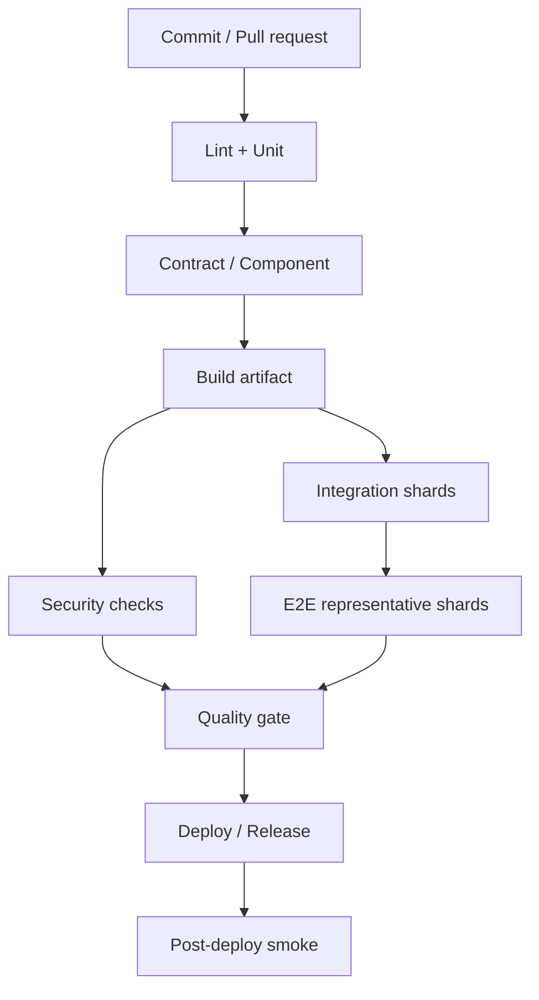

# Chạy song song hoặc chia bộ kiểm thử theo ngân sách tài nguyên

## Mục tiêu học tập

Sau bài học này, người học có thể:

- Giải thích sự khác nhau giữa chạy song song, chia shard và chạy nhiều worker trên CI/CD.
- Xác định ngân sách CPU, bộ nhớ, I/O, mạng, database, runner và giới hạn dịch vụ phụ thuộc cho một pipeline.
- Ước lượng mức đồng thời phù hợp dựa trên tài nguyên khả dụng và mức tiêu thụ của từng nhóm test.
- Chọn chiến lược chia bộ kiểm thử theo thời gian chạy, loại test, rủi ro, dependency và chi phí setup.
- Thiết kế test có thể chạy độc lập, cô lập dữ liệu và tránh tranh chấp tài nguyên khi chạy đồng thời.
- Quản lý giới hạn toàn cục, quota, rate limit và dịch vụ dùng chung giữa nhiều job.
- Theo dõi thời gian hoàn thành, throughput, mức sử dụng tài nguyên, hàng đợi và flaky rate để điều chỉnh lịch chạy.
- Xử lý timeout, worker mất kết nối, shard không cân bằng và kết quả không đầy đủ.
- Xây dựng chính sách chạy nhanh, chạy đầy đủ và phân bổ tài nguyên phù hợp với từng giai đoạn CI/CD.

## 1. Vì sao cần chạy song song hoặc chia bộ kiểm thử?

Trong phạm vi **VALIDATION_TESTING_STRATEGY**, CI/CD cần cung cấp phản hồi đủ nhanh để nhóm phát hiện lỗi và quyết định có thể hợp nhất hoặc phát hành thay đổi hay không. Khi bộ kiểm thử phát triển, thời gian chạy tuần tự có thể tăng đến mức làm chậm pull request, kéo dài thời gian phát hành và khiến nhóm có xu hướng bỏ qua một số kiểm tra.

Chạy song song hoặc chia bộ kiểm thử thành nhiều phần giúp sử dụng nhiều tài nguyên cùng lúc để rút ngắn thời gian hoàn thành. Tuy nhiên, tăng số worker không tự động làm pipeline nhanh hơn. Nếu nhiều worker cùng tranh CPU, bộ nhớ, ổ đĩa, database hoặc một dịch vụ có quota thấp, tổng thời gian có thể tăng, test trở nên flaky và kết quả không còn đáng tin cậy.

Mục tiêu là tối ưu thời gian phản hồi trong ngân sách tài nguyên xác định, đồng thời bảo đảm mỗi test có điều kiện thực thi hợp lệ và kết quả có thể truy nguyên. Nhóm cần cân bằng:

- **Thời gian phản hồi**: thời gian từ lúc pipeline bắt đầu đến khi có kết quả cần thiết.
- **Throughput**: số test hoặc nhóm test hoàn thành trong một đơn vị thời gian.
- **Tài nguyên**: CPU, memory, I/O, network, runner, database và dịch vụ phụ thuộc.
- **Độ tin cậy**: tỷ lệ kết quả đúng, tính ổn định và khả năng tái lập.
- **Chi phí**: thời gian máy, runner, dịch vụ cloud, license và công vận hành.
- **Mức độ ưu tiên**: test nào cần chạy sớm để phản hồi về rủi ro quan trọng.

Một pipeline tốt không nhất thiết chạy mọi test đồng thời. Nó phân bổ mức đồng thời theo đặc điểm tải, giới hạn tài nguyên và giá trị của từng nhóm test.

## 2. Phân biệt song song hóa, chia shard và phân tán

Ba khái niệm thường được dùng cùng nhau nhưng có ý nghĩa khác nhau.

- **Chạy song song (parallel execution)**: nhiều test hoặc nhóm test được thực thi đồng thời trong cùng một khoảng thời gian, có thể trên một máy hoặc nhiều máy.
- **Chia shard (test sharding)**: chia một bộ test thành các phần tương đối độc lập để các worker xử lý riêng. Mỗi shard chịu trách nhiệm cho một tập test được xác định.
- **Chạy phân tán (distributed execution)**: điều phối công việc qua nhiều runner hoặc node, thường cần cơ chế phân phối, đồng bộ kết quả và quản lý tài nguyên chung.

Ví dụ, một bộ có 600 test có thể được chia thành 6 shard, mỗi shard khoảng 100 test. Sáu worker có thể chạy đồng thời trên sáu runner. Trong mỗi worker, framework cũng có thể chạy nhiều test song song. Khi đó có hai tầng đồng thời: giữa shard và bên trong shard.

### 2.1. Song song ở cấp nào?

| Cấp | Đơn vị được chạy đồng thời | Ví dụ | Rủi ro cần chú ý |
|---|---|---|---|
| Test case | Nhiều test trong cùng process hoặc JVM | Framework chạy nhiều method đồng thời | Dữ liệu, trạng thái tĩnh và fixture dùng chung. |
| Class/suite | Nhiều class hoặc nhóm test | Mỗi class chạy trên worker riêng | Setup/teardown, port và tài nguyên dùng chung. |
| Shard | Một phần bộ test trên mỗi worker | Shard 1 đến shard 8 | Phân bố thời gian không đều và test bị thiếu/trùng. |
| Job | Nhiều job CI trong cùng pipeline | Unit, contract và integration chạy đồng thời | Cạnh tranh runner, database và dịch vụ phụ thuộc. |
| Pipeline | Nhiều pipeline của nhiều nhánh hoặc pull request | Nhiều build chạy cùng lúc | Quota toàn cục và tài nguyên dùng chung bị quá tải. |

Việc bật song song ở nhiều cấp có thể nhân mức đồng thời. Nếu có 8 shard và mỗi shard chạy 4 test cùng lúc, có thể có đến 32 test đang hoạt động, chưa kể các job khác. Cần tính tổng mức đồng thời thực tế thay vì chỉ xem một tham số worker riêng lẻ.

## 3. Xác định ngân sách tài nguyên

Ngân sách tài nguyên (resource budget) là giới hạn có thể sử dụng cho một pipeline, một job hoặc một nhóm test trong khoảng thời gian xác định. Ngân sách phải xét cả tài nguyên của runner và giới hạn của các hệ thống mà test gọi đến.

### 3.1. CPU

CPU thường là tài nguyên dễ nhận thấy khi chạy nhiều test song song. Test compile, chạy thuật toán, serialize dữ liệu, browser automation và xử lý ảnh có thể tiêu thụ CPU cao.

Hãy xác định:

- Số core hoặc vCPU thực sự được cấp cho runner.
- CPU quota và throttling của container.
- Mức CPU trung bình và đỉnh của từng nhóm test.
- CPU dành cho hệ điều hành, agent CI, log và các tiến trình phụ.
- Mức tải nền do job khác hoặc pipeline khác tạo ra.

Không nên đặt số worker bằng đúng số core rồi giả định mọi test đều chạy hiệu quả. Một số test chờ I/O có thể chạy đồng thời nhiều hơn số core; test CPU-bound thường không có lợi khi mức đồng thời vượt xa số core khả dụng.

### 3.2. Bộ nhớ

Mỗi worker có thể tạo process, JVM, browser, container hoặc dữ liệu riêng. Bộ nhớ tổng có thể tăng nhanh khi nhân số worker.

Ngân sách memory cần tính:

- Bộ nhớ nền của runner và agent CI.
- Heap hoặc memory limit của mỗi process.
- Browser, driver, container và service phụ trợ.
- Dữ liệu fixture, cache và artifact trong lúc chạy.
- Bộ nhớ đỉnh khi nhiều test khởi tạo cùng lúc.
- Khoảng dự phòng để tránh swap, OOM hoặc container bị kill.

Nếu một worker dùng trung bình 1,2 GB và đỉnh 1,8 GB, 6 worker có thể cần hơn 10 GB chỉ cho các worker, chưa kể hệ điều hành và dịch vụ phụ trợ. Hãy dùng mức đỉnh quan sát được và khoảng dự phòng, không chỉ lấy trung bình.

### 3.3. I/O và lưu trữ

Test có thể cùng lúc đọc/ghi fixture, tạo database, lưu screenshot, tải artifact hoặc ghi log lớn. I/O bị bão hòa khiến các worker chờ nhau và làm tăng thời gian thực thi.

Kiểm tra:

- IOPS và throughput của ổ đĩa.
- Độ trễ đọc/ghi và giới hạn volume.
- Dung lượng tạm thời và tốc độ tăng log/artifact.
- Tranh chấp file, thư mục hoặc socket dùng chung.
- Tác động của việc tạo nhiều container hoặc database instance.

### 3.4. Network và dịch vụ phụ thuộc

Một runner có thể còn CPU nhưng hệ thống vẫn quá tải vì network, API hoặc dịch vụ ngoài. Ví dụ, nhiều test cùng gọi sandbox thanh toán có thể chạm rate limit; nhiều worker cùng tải image hoặc package có thể gây nghẽn network.

Hãy xác định:

- Băng thông và giới hạn kết nối của runner.
- Rate limit theo IP, token, tài khoản, tenant hoặc endpoint.
- Số kết nối đồng thời được database, cache và broker cho phép.
- Quota của dịch vụ cloud và sandbox.
- Thời gian phản hồi và mức độ ổn định của dependency.
- Chính sách retry và backoff khi bị giới hạn.

### 3.5. Tài nguyên nghiệp vụ dùng chung

Ngoài hạ tầng, test có thể tranh chấp tài nguyên logic:

- Một tài khoản hoặc tenant dùng chung.
- Một số điện thoại, email hoặc mã định danh duy nhất.
- Một bản ghi được nhiều test cập nhật.
- Một queue hoặc topic nhận sự kiện từ nhiều test.
- Một port cố định hoặc thư mục tạm chung.
- Một feature flag hoặc cấu hình toàn cục.
- Một sandbox có số lượng giao dịch hoặc tài khoản giới hạn.

Những tài nguyên này cần được phân vùng, cấp phát độc quyền hoặc điều phối bằng lock phù hợp. Nếu không, test có thể thất bại ngẫu nhiên dù từng test chạy riêng đều Pass.

## 4. Ước lượng mức đồng thời phù hợp

Không có một con số worker đúng cho mọi suite. Cần ước lượng từ giới hạn tài nguyên và đo thực tế.

### 4.1. Ước lượng theo CPU

Với nhóm test chủ yếu CPU-bound, có thể bắt đầu bằng số worker không vượt quá số core khả dụng, sau đó đo mức sử dụng và thời gian hoàn thành. Nếu test chủ yếu chờ I/O, mức đồng thời có thể cao hơn, nhưng phải kiểm tra giới hạn network, database và dịch vụ phụ thuộc.

### 4.2. Ước lượng theo memory

Nếu:

- (M_{total}) là memory khả dụng cho job,
- (M_{base}) là memory nền cần giữ lại,
- (M_{worker,p95}) là mức memory p95 của một worker,

thì một giới hạn khởi đầu có thể được ước lượng:

\[
N_{memory} = \left\lfloor \frac{M_{total} - M_{base}}{M_{worker,p95}} \right\rfloor
\]

Đây là ước lượng lập kế hoạch, không phải bảo đảm an toàn. Nếu memory đỉnh cao hơn nhiều so với p95 hoặc nhiều worker có đỉnh trùng thời điểm, cần dùng mức dự phòng lớn hơn và theo dõi OOM.

### 4.3. Ước lượng theo dependency

Giả sử database chỉ cho phép 40 kết nối dành cho pipeline, mỗi worker giữ tối đa 5 kết nối, mức worker theo database không nên vượt quá khoảng 8 nếu không có pooling hoặc giới hạn khác. Thực tế cần trừ kết nối nền, migration, monitoring và job khác. Một API có rate limit 100 request/giây cũng có thể giới hạn số worker dù runner còn nhiều CPU.

### 4.4. Chọn giới hạn nhỏ nhất trong các ràng buộc

Có thể xem mức đồng thời ban đầu là giới hạn nhỏ nhất trong các giới hạn theo CPU, memory, I/O, network và dependency:

\[
N_{safe} \leq \min(N_{CPU}, N_{memory}, N_{IO}, N_{network}, N_{dependency})
\]

Mô hình này đơn giản hóa thực tế vì các test có mức tiêu thụ khác nhau và tài nguyên có thể dùng chung. Nó hữu ích để đặt giới hạn ban đầu; sau đó cần đo, điều chỉnh và xác minh ở tải thực.

### 4.5. Đo thay vì đoán

Thử nghiệm với các mức đồng thời tăng dần, chẳng hạn 1, 2, 4 và 6 worker. Với mỗi mức, ghi lại:

- Thời gian hoàn thành toàn suite.
- Throughput test hoàn thành.
- CPU, memory, I/O và network.
- Độ trễ và lỗi của database hoặc API phụ thuộc.
- Tỷ lệ test flaky, timeout và retry.
- Chi phí runner hoặc thời gian máy.

Nếu tăng từ 4 lên 6 worker chỉ giảm ít thời gian nhưng làm tăng đáng kể flaky rate và chi phí, mức 4 có thể là lựa chọn tốt hơn. Mục tiêu là thời gian hoàn thành ổn định trong ngân sách, không phải đạt số worker lớn nhất.

## 5. Chọn chiến lược chia bộ kiểm thử

Chia suite cần cân bằng tải giữa các worker, giảm thời gian chờ và giữ được tính đúng đắn. Một cách chia đơn giản theo số lượng test có thể tạo shard không cân bằng nếu thời gian mỗi test khác nhau.

### 5.1. Chia theo số lượng test

Chia tổng số test thành các nhóm có số lượng gần bằng nhau.

Ưu điểm:

- Dễ hiểu và dễ triển khai.
- Phù hợp khi test có thời gian tương đối đồng đều.
- Dễ dự đoán số test mỗi worker phải xử lý.

Hạn chế:

- Một vài test rất chậm có thể khiến một shard kéo dài hơn các shard khác.
- Test có setup lớn hoặc phụ thuộc khác nhau có thể làm tải không cân bằng.

### 5.2. Chia theo thời gian chạy lịch sử

Ghi thời gian từng test hoặc nhóm test từ các lần chạy trước, sau đó phân phối sao cho tổng thời gian dự kiến của các shard gần nhau.

Một chiến lược phổ biến là sắp xếp test theo thời gian giảm dần rồi lần lượt gán test tiếp theo vào shard đang có tổng thời gian thấp nhất (greedy longest-processing-time first). Cách này thường cân bằng tốt hơn chia theo số lượng khi có dữ liệu thời gian đáng tin.

Ví dụ:

| Test | Thời gian lịch sử |
|---|---:|
| E2E-01 | 180 giây |
| E2E-02 | 150 giây |
| E2E-03 | 90 giây |
| E2E-04 | 80 giây |
| E2E-05 | 60 giây |
| E2E-06 | 40 giây |

Với 3 shard, có thể phân phối E2E-01/E2E-06, E2E-02/E2E-05 và E2E-03/E2E-04. Tổng thời gian dự kiến lần lượt là 220, 210 và 170 giây. Nếu chia tuần tự theo danh sách, chênh lệch có thể lớn hơn.

Thời gian lịch sử cần được cập nhật định kỳ. Test mới có thể dùng ước lượng ban đầu theo nhóm hoặc chạy trong một shard thăm dò rồi điều chỉnh.

### 5.3. Chia theo loại test hoặc đặc điểm tài nguyên

Có thể tách suite thành nhóm:

- Unit test CPU-bound.
- Integration test tiêu thụ database.
- UI/E2E test cần browser và memory lớn.
- Test hiệu năng cần generator và môi trường riêng.
- Test phụ thuộc sandbox hoặc rate limit bên ngoài.
- Test migration hoặc test cần tài nguyên độc quyền.

Mỗi nhóm có thể dùng pool runner và mức đồng thời khác nhau. Cách này hữu ích khi test có profile tài nguyên khác biệt rõ, nhưng cần tránh tạo quá nhiều nhóm nhỏ khiến việc điều phối phức tạp.

### 5.4. Chia theo module hoặc ranh giới nghiệp vụ

Chia theo service, package, domain hoặc hành trình giúp nhóm hiểu ownership và xử lý lỗi. Tuy nhiên, kích thước module có thể không tương ứng với thời gian chạy. Cần kết hợp thời gian lịch sử để cân bằng các shard.

### 5.5. Chia động (dynamic sharding)

Trong chia động, worker lấy test tiếp theo từ hàng đợi chung khi hoàn tất công việc trước. Cách này giảm thời gian nhàn rỗi khi thời gian test biến động lớn.

Ưu điểm:

- Tự cân bằng khi test có thời gian khác nhau.
- Worker nhanh có thể nhận thêm việc.
- Không cần dự đoán chính xác tổng thời gian của từng shard cố định.

Hạn chế:

- Cần bộ điều phối và cơ chế khóa/lease đáng tin cậy.
- Phải bảo đảm mỗi test chỉ được giao theo chính sách mong muốn.
- Khó quản lý test có dependency hoặc cần chạy theo thứ tự.
- Cần lưu trạng thái hoàn thành để xử lý worker bị mất.

### 5.6. Chia theo mức ưu tiên

Đưa test quan trọng vào nhóm chạy sớm để cung cấp tín hiệu nhanh. Ví dụ, smoke test, test bảo mật quan trọng hoặc test bảo vệ hành trình doanh thu có thể chạy trước các test dài và ít rủi ro hơn.

Không nên chỉ ưu tiên test nhanh. Một test rủi ro cao nhưng mất nhiều thời gian vẫn có thể cần chạy sớm nếu kết quả của nó quyết định việc tiếp tục pipeline. Có thể chia thành các lớp ưu tiên: bắt buộc trước merge, bắt buộc trước phát hành và chạy định kỳ.

## 6. Thiết kế test an toàn khi chạy song song

Chạy song song chỉ đáng tin khi test độc lập hoặc chia sẻ tài nguyên theo một giao thức được kiểm soát.

### 6.1. Cô lập dữ liệu

Mỗi test hoặc worker nên có namespace, tenant, schema, database hoặc định danh dữ liệu riêng khi phù hợp. Tránh nhiều test cập nhật cùng một bản ghi hoặc dùng chung tài khoản có trạng thái thay đổi.

Các cách thường dùng:

- Tạo ID duy nhất theo run ID, shard ID và test ID.
- Tạo database/schema riêng cho worker hoặc nhóm test.
- Dùng transaction rollback cho test phù hợp, lưu ý transaction không cô lập được mọi side effect ngoài database.
- Dùng fixture immutable hoặc snapshot khi chỉ đọc.
- Cleanup chỉ dữ liệu thuộc run hiện tại.

### 6.2. Cô lập tài nguyên hệ điều hành

Test có thể tranh chấp port, file, thư mục tạm, process hoặc container. Hãy cấp phát port động, thư mục riêng và tên tài nguyên có namespace. Không giả định một port cố định luôn trống khi nhiều worker chạy trên cùng runner.

### 6.3. Kiểm soát trạng thái toàn cục

Các biến static, singleton, cache dùng chung, feature flag toàn cục và cấu hình process có thể khiến test ảnh hưởng lẫn nhau. Cần reset trạng thái, tạo process riêng hoặc tuần tự hóa nhóm test nếu không thể cô lập.

### 6.4. Kiểm soát thứ tự và phụ thuộc

Test không nên dựa vào việc một test khác đã tạo dữ liệu hoặc thay đổi trạng thái. Nếu một workflow cần thứ tự, hãy mô hình hóa thành một scenario rõ ràng hoặc nhóm test có điều phối riêng. Không chia các bước phụ thuộc của cùng một hành trình sang worker khác mà không có cơ chế truyền trạng thái được kiểm soát.

### 6.5. Side effect bên ngoài

Email, SMS, thanh toán, webhook và thao tác với hệ thống đối tác có thể không thể rollback. Dùng sandbox, sink hoặc fake có kiểm soát; tạo định danh riêng cho từng test; tránh gửi thông báo hoặc giao dịch thật ngoài phạm vi được cho phép.

### 6.6. Không dùng retry để che tranh chấp

Nếu test chỉ thất bại khi chạy song song, cần điều tra race condition, dữ liệu dùng chung, giới hạn tài nguyên hoặc thứ tự. Retry có thể giúp thu thêm bằng chứng, nhưng không được biến một lỗi không ổn định thành kết quả Pass mà không lưu lần thất bại đầu và nguyên nhân.

## 7. Quản lý tài nguyên dùng chung và quota

Một số tài nguyên được chia sẻ giữa nhiều job hoặc pipeline. Giới hạn phải được quản lý ở đúng phạm vi.

### 7.1. Giới hạn theo runner và pool

Runner pool có thể giới hạn số job đồng thời dựa trên CPU, memory hoặc loại máy. Job browser có thể cần runner memory lớn; job unit có thể chạy trên runner nhỏ hơn. Phân loại pool giúp tránh để test nặng chiếm hết tài nguyên của nhóm test nhẹ.

### 7.2. Giới hạn toàn cục cho dependency

Nếu sandbox chỉ cho phép 20 request đồng thời, không thể để mỗi pipeline tự cho phép 20 request mà không có bộ điều phối toàn cục. Cần quota chung, semaphore phân tán hoặc pool giới hạn để tổng lưu lượng từ mọi worker không vượt ngưỡng.

### 7.3. Rate limit và backoff

Khi nhận phản hồi rate limit, test cần xử lý theo hợp đồng của dịch vụ. Backoff có thể giảm áp lực, nhưng thời gian chờ cần được đo và báo cáo. Nếu mọi worker retry đồng thời theo cùng nhịp, có thể tạo thundering herd. Jitter giúp phân tán thời điểm retry trong những hệ thống phù hợp.

### 7.4. Tài khoản và tài nguyên độc quyền

Nếu một test cần tài khoản có trạng thái độc quyền, dùng pool tài khoản với cơ chế cấp phát/thu hồi. Lease cần có thời hạn để giải phóng tài nguyên khi worker bị mất. Tránh khóa vĩnh viễn khi job bị hủy.

### 7.5. Database và connection pool

Tổng kết nối từ tất cả worker, job và service phụ trợ phải nằm trong giới hạn database. Có thể giới hạn số worker integration, dùng connection pool, tách database theo shard hoặc chạy migration tuần tự. Cần tránh tạo quá nhiều database instance nếu storage hoặc startup time trở thành điểm nghẽn.

## 8. Tổ chức pipeline theo ngân sách và thời điểm phản hồi

Một pipeline có thể chia các nhóm test theo thời gian cần phản hồi và mức tài nguyên.

### 8.1. Tập nhanh trên mỗi thay đổi

Thường gồm:

- Lint, static checks và unit test.
- Test component hoặc contract có thời gian ngắn.
- Smoke test cho hành vi cốt lõi.
- Test bảo vệ rủi ro cao cần phản hồi trước merge.

Tập này cần thời gian dự đoán được và tài nguyên vừa phải để không làm chậm vòng lặp phát triển.

### 8.2. Tập tích hợp rộng

Chạy sau build tích hợp hoặc theo điều kiện phù hợp:

- Integration test với database, queue và dịch vụ nội bộ.
- E2E đại diện.
- Test tương thích nhiều phiên bản.
- Test migration và dữ liệu.

Có thể chạy song song theo shard, nhưng cần giới hạn số worker theo tài nguyên database, browser và dependency.

### 8.3. Tập chuyên sâu hoặc chạy theo lịch

Performance, soak, stress, resilience và security suite có thể tiêu thụ tài nguyên lớn hoặc tạo side effect. Chúng thường cần pool riêng, môi trường cô lập và lịch chạy có kiểm soát. Không nên chạy nhiều bài stress đồng thời trên cùng một môi trường nếu kết quả cần phản ánh năng lực của từng thành phần.

### 8.4. Sơ đồ pipeline minh họa

Các nhánh có thể chạy song song khi không phụ thuộc kết quả của nhau. Quality gate cần chờ đầy đủ các job bắt buộc và phân biệt trạng thái thất bại với trạng thái chưa hoàn thành hoặc không có dữ liệu.

## 9. Điều phối worker và xử lý lỗi

Khi test được phân phối qua nhiều worker, cần quản lý vòng đời công việc và kết quả.

### 9.1. Giao việc và nhận kết quả

Mỗi test hoặc shard nên có định danh ổn định. Bộ điều phối cần ghi nhận:

- Worker được giao việc.
- Thời điểm bắt đầu và heartbeat nếu có.
- Trạng thái chạy, hoàn tất, thất bại hoặc bị hủy.
- Kết quả, log và artifact.
- Phiên bản code, cấu hình và dữ liệu.

Nếu worker mất kết nối, bộ điều phối cần phân biệt job thực sự đã dừng với job chỉ mất heartbeat. Không giao lại ngay một test có side effect nếu chưa biết lần chạy trước đã thực hiện đến đâu.

### 9.2. Timeout và hủy

Timeout cần được đặt theo cấp:

- Timeout cho từng test.
- Timeout cho shard hoặc worker.
- Timeout tổng job và pipeline.
- Timeout cho thao tác cleanup hoặc thu thập artifact.

Khi hủy, cần dừng tiến trình con, giải phóng lease, đóng browser/container và thu thập bằng chứng có thể lấy được. Timeout quá ngắn gây false failure; quá dài làm pipeline bị treo. Dựa trên thời gian lịch sử và mức độ biến động để đặt giới hạn.

### 9.3. Shard thất bại và chạy lại

Nếu một shard thất bại, chỉ chạy lại shard đó khi điều kiện an toàn và dữ liệu cho phép. Với test không idempotent hoặc có side effect, cần cleanup hoặc xác minh trạng thái trước khi chạy lại. Báo cáo phải giữ kết quả lần đầu và lý do retry.

### 9.4. Bảo đảm không bỏ sót test

Khi chia suite, cần xác minh:

- Mọi test trong phạm vi được gán đúng một lần theo chính sách.
- Không có test bị bỏ vì bộ lọc, tag hoặc metadata sai.
- Test mới được đưa vào phân phối mặc định.
- Test bị disable có lý do và thời hạn xem xét.
- Kết quả tổng hợp chờ mọi shard bắt buộc hoàn tất.

Nếu shard không gửi kết quả, pipeline không được xem toàn suite là Pass chỉ vì các shard khác đã Pass.

## 10. Cân bằng shard và giảm thời gian chờ

Thời gian pipeline thường bị quyết định bởi shard hoàn thành cuối cùng (straggler). Cân bằng tải giúp giảm khoảng chờ này.

### 10.1. Dùng thời gian lịch sử

Lưu thời gian chạy theo test, class hoặc nhóm. Dùng dữ liệu đủ gần với phiên bản hiện tại; thay đổi môi trường hoặc dữ liệu có thể làm thời gian cũ không còn phù hợp.

### 10.2. Phân phối test dài trước

Một thuật toán greedy đơn giản:

1. Sắp xếp test theo thời gian giảm dần.
2. Khởi tạo các shard với tổng thời gian bằng 0.
3. Gán test tiếp theo vào shard có tổng thời gian nhỏ nhất.
4. Cập nhật tổng thời gian dự kiến và tiếp tục.

Đây là heuristic, không bảo đảm nghiệm tối ưu tuyệt đối. Nó thường giảm chênh lệch so với chia tuần tự và đủ hữu ích cho nhiều suite.

### 10.3. Xử lý test mới và test có thời gian biến động

Test mới có thể được ước lượng theo loại hoặc module. Test có thời gian biến động lớn nên được theo dõi bằng phân vị, không chỉ trung bình. Nếu một test phụ thuộc môi trường hoặc dữ liệu lớn, hãy tách nó thành nhóm riêng hoặc dùng giới hạn đồng thời thấp hơn.

### 10.4. Tính đến chi phí setup

Chia quá nhiều shard có thể làm tăng chi phí khởi động process, tải fixture, tạo database, tải browser và thu thập artifact. Nếu mỗi shard cần setup 90 giây, tăng từ 4 lên 16 shard có thể làm tổng chi phí setup tăng đáng kể dù thời gian test thuần không đổi.

Hãy cân nhắc tổng thời gian:

\[
T_{pipeline} \approx T_{queue} + T_{setup} + T_{execution} + T_{teardown} + T_{aggregation}
\]

Trong pipeline song song, các thành phần có thể chồng lấp; biểu thức này là cách phân loại chi phí chứ không phải phép cộng chính xác trong mọi trường hợp. Thời gian hoàn thành thường bị chi phối bởi nhánh hoặc shard chậm nhất cộng với bước đồng bộ cuối.

## 11. Đo lường hiệu quả của song song hóa

Không nên chỉ so sánh thời gian trước và sau khi tăng worker. Cần xem liệu thời gian giảm có đi kèm chi phí hoặc rủi ro tăng hay không.

### 11.1. Các chỉ số thời gian

- Tổng thời gian pipeline (wall-clock duration).
- Thời gian queue trước khi runner nhận job.
- Thời gian setup, execution, teardown và aggregation.
- Thời gian của shard chậm nhất.
- Chênh lệch giữa shard nhanh nhất và chậm nhất.
- Thời gian p50/p90/p95 của job qua nhiều lần chạy.

### 11.2. Các chỉ số tài nguyên

- CPU trung bình, p95 và đỉnh.
- Memory trung bình, p95, đỉnh và OOM.
- Disk I/O, network và số kết nối.
- Mức sử dụng runner và thời gian nhàn rỗi.
- Số lần throttling, rate limit và dependency timeout.
- Chi phí runner theo pipeline hoặc theo build.

### 11.3. Các chỉ số chất lượng

- Flaky rate khi chạy tuần tự và song song.
- Tỷ lệ test timeout hoặc retry.
- Số lỗi do tranh chấp dữ liệu hoặc tài nguyên.
- Số test bị bỏ, trùng hoặc không có kết quả.
- Tỷ lệ lỗi sản phẩm được phát hiện và thời điểm phát hiện.
- Tỷ lệ kết quả không xác định do môi trường.

### 11.4. So sánh speedup và hiệu quả tài nguyên

Speedup có thể được tính:

\[
S(N) = \frac{T(1)}{T(N)}
\]

Trong đó (T(1)) là thời gian chạy với một worker và (T(N)) là thời gian với (N) worker. Hiệu quả song song (parallel efficiency) có thể xem là:

\[
E(N) = \frac{S(N)}{N}
\]

Ví dụ, nếu suite chạy tuần tự mất 40 phút và chạy với 4 worker mất 13 phút, speedup xấp xỉ 3,08 và efficiency khoảng 77%. Đây chỉ là phép đo thời gian; cần xem thêm độ ổn định, chi phí và tài nguyên để quyết định mức đồng thời.

### 11.5. Đánh giá qua nhiều lần chạy

Một lần chạy nhanh có thể là do cache nóng hoặc tải nền thấp. Hãy so sánh nhiều lần chạy trong điều kiện tương đương, xem phân vị và độ biến động. Khi thay đổi runner, dependency hoặc dữ liệu, tạo đường cơ sở mới hoặc ghi rõ điều kiện khác biệt.

## 12. Cách xử lý khi chạy song song làm kết quả xấu đi

Nếu thời gian không giảm hoặc flaky tăng, cần xác định nút thắt thay vì tăng thêm worker.

| Dấu hiệu | Nguyên nhân có thể | Hướng điều tra |
|---|---|---|
| CPU luôn cao, thời gian không giảm | CPU contention hoặc throttling | Giảm worker, dùng runner nhiều core hơn hoặc tách nhóm CPU-bound. |
| OOM hoặc process bị kill | Tổng memory vượt ngân sách | Giảm đồng thời, giới hạn heap hoặc phân bổ runner memory lớn hơn. |
| Database timeout | Quá nhiều kết nối hoặc transaction cạnh tranh | Giới hạn worker DB, tách schema/database hoặc tối ưu fixture. |
| Rate limit tăng | Nhiều worker gọi dependency chung | Áp dụng quota toàn cục, pool giới hạn và backoff. |
| Test chỉ fail khi chạy song song | Dữ liệu, trạng thái hoặc tài nguyên dùng chung | Tìm shared state, ID trùng, port và thứ tự test. |
| Một shard luôn chậm | Phân phối không cân bằng hoặc có test dài | Dùng thời gian lịch sử, chia lại hoặc tách test nặng. |
| Runner nhàn rỗi nhưng pipeline chậm | Queue, dependency hoặc bước tuần tự là điểm nghẽn | Đo thời gian chờ, setup và critical path. |
| Kết quả thiếu shard | Worker mất hoặc tổng hợp không đầy đủ | Kiểm tra trạng thái điều phối và quality gate. |

### 12.1. Phân biệt lỗi do tranh chấp và lỗi sản phẩm

Chạy lại test riêng lẻ có thể giúp thu thập thông tin, nhưng không đủ để kết luận lỗi chỉ do môi trường. Hãy thử:

- Chạy cùng test đồng thời với chính nó.
- Chạy test cùng nhóm nhưng với dữ liệu riêng.
- Đảo thứ tự hoặc chạy lặp nhiều lần.
- Quan sát ID, port, file, queue và tài nguyên được chia sẻ.
- So sánh trạng thái dữ liệu trước và sau test.
- Kiểm tra log, trace và timestamp để xác định tương tác.

Nếu test thất bại khi tranh chấp một tài nguyên mà production cũng có thể tranh chấp, đó có thể là lỗi sản phẩm cần kiểm tra concurrency, không chỉ là vấn đề test.

## 13. Ví dụ xuyên suốt: phân bổ suite CI cho một dịch vụ thương mại điện tử

Giả sử pipeline có 900 test:

- 600 unit test, mỗi test rất nhanh và chủ yếu CPU-bound.
- 180 component/contract test, dùng database hoặc fake server.
- 90 integration test, kết nối database và queue.
- 30 E2E test, mỗi test dùng browser và nhiều service.

Runner có 8 vCPU và 16 GB RAM. Một số E2E worker cần gần 2 GB RAM khi browser hoạt động. Database test có giới hạn connection và sandbox thanh toán có rate limit.

### 13.1. Chia nhóm theo đặc điểm

| Nhóm | Chiến lược | Giới hạn đồng thời ban đầu |
|---|---|---:|
| Unit | Chia theo thời gian lịch sử và chạy song song trên runner CPU | 6 worker |
| Component/Contract | Shard theo thời gian và giới hạn dependency | 4 worker |
| Integration | Shard theo service/schema, giới hạn connection | 2 worker |
| E2E | Chia theo thời gian lịch sử, browser worker riêng | 3 worker |

Các giới hạn là ví dụ khởi đầu. Nếu tất cả nhóm cùng chạy trên một runner 8 vCPU/16 GB, không thể cộng các con số trên rồi giả định tài nguyên đủ. Cần xác định job chạy đồng thời hay theo giai đoạn, và dùng pool hoặc semaphore chung nếu chia sẻ runner/database.

### 13.2. Tổ chức pipeline

1. Lint và unit test bắt đầu ngay sau commit.
2. Contract/component test chạy khi unit test hoặc build prerequisite hoàn tất.
3. Integration test chạy trên pool có giới hạn database và queue.
4. E2E smoke chạy sau khi môi trường tích hợp sẵn sàng.
5. Security hoặc performance suite chuyên sâu chạy theo lịch hoặc theo thay đổi rủi ro cao.
6. Quality gate tổng hợp trạng thái của tất cả job bắt buộc.

Một số nhóm có thể chạy đồng thời nếu độc lập. Các nhóm cần migration hoặc triển khai môi trường có thể phải chạy tuần tự để tránh tranh chấp.

### 13.3. Cân bằng shard

Nhóm lưu thời gian lịch sử cho từng test. Các test E2E dài được phân phối trước để tránh một shard chứa toàn bộ hành trình thanh toán chậm. Test mới được gán theo ước lượng của nhóm và cập nhật sau các lần chạy đầu.

### 13.4. Điều chỉnh từ số liệu

Sau một tuần, nhóm nhận thấy unit test chạy nhanh hơn khi tăng worker từ 4 lên 6, nhưng integration test có nhiều timeout ở mức 4 worker do database connection. Nhóm giữ unit ở 6, giảm integration xuống 2 và tách migration test chạy riêng. E2E có memory đỉnh cao nên chuyển sang runner có memory lớn hơn và giới hạn 3 browser worker.

Quyết định này dựa trên từng loại tải và điểm nghẽn, không áp một mức đồng thời chung cho toàn bộ pipeline.

## 14. Những sai lầm thường gặp

- **Tăng worker tối đa**: CPU, memory hoặc dependency bị bão hòa. Hãy đo và đặt ngân sách theo từng nhóm.
- **Chỉ chia theo số lượng test**: shard có thời gian chênh lệch lớn. Hãy dùng thời gian lịch sử và cân bằng test dài trước.
- **Bật song song ở nhiều tầng mà không tính tổng**: số process thực tế vượt dự kiến. Hãy tính đồng thời giữa pipeline, job, shard và test.
- **Dùng chung dữ liệu hoặc tài khoản**: test ghi đè trạng thái của nhau. Hãy cô lập dữ liệu hoặc cấp phát độc quyền.
- **Giả định database và API vô hạn**: connection và rate limit bị vượt. Hãy quản lý quota toàn cục.
- **Chỉ xem CPU**: memory, I/O, network hoặc dependency có thể là điểm nghẽn. Hãy theo dõi toàn bộ tài nguyên liên quan.
- **Chạy test phụ thuộc thứ tự trên worker khác nhau**: kết quả không xác định. Hãy tách scenario hoặc quản lý dependency rõ ràng.
- **Retry để che lỗi flaky**: mất dấu lần thất bại đầu. Hãy lưu kết quả và tìm nguyên nhân.
- **Không xử lý worker mất**: pipeline có thể thiếu test nhưng vẫn tổng hợp Pass. Hãy yêu cầu trạng thái hoàn tất của mọi shard bắt buộc.
- **Tạo quá nhiều shard nhỏ**: setup, teardown và aggregation làm tăng thời gian. Hãy tính chi phí cố định của mỗi shard.
- **Không cập nhật thời gian lịch sử**: phân phối dần mất cân bằng khi test thay đổi. Hãy cập nhật số liệu thường xuyên.
- **Chạy stress test cùng môi trường với test khác**: tải chồng lấn làm sai kết quả. Hãy dùng môi trường và lịch riêng.

## 15. Quy trình lập ngân sách và tối ưu chạy song song

Nhóm có thể áp dụng trình tự sau:

1. **Phân loại test**: nhóm theo CPU, memory, I/O, network, dependency, thời gian và mức rủi ro.
2. **Đo đường cơ sở**: chạy tuần tự hoặc ở mức đồng thời hiện tại để lấy thời gian và tài nguyên.
3. **Xác định giới hạn**: tính runner, quota, database connection, rate limit và tài nguyên dùng chung.
4. **Đặt mức đồng thời ban đầu**: chọn mức an toàn theo ràng buộc chặt nhất và có khoảng dự phòng.
5. **Chọn chiến lược chia**: theo thời gian lịch sử, loại test, module, ưu tiên hoặc dynamic queue.
6. **Kiểm tra tính độc lập**: cô lập dữ liệu, port, file, trạng thái, tài khoản và side effect.
7. **Tích hợp điều phối**: giao việc, timeout, heartbeat, retry có kiểm soát và tổng hợp kết quả.
8. **Chạy thử tăng dần**: so sánh nhiều mức worker trong điều kiện tương đương.
9. **Đánh giá đa chiều**: thời gian, throughput, tài nguyên, flaky rate, chi phí và độ đầy đủ kết quả.
10. **Điều chỉnh và theo dõi**: cập nhật shard, quota và mức đồng thời khi suite hoặc hạ tầng thay đổi.

## 16. Tự kiểm tra

Trước khi bật hoặc tăng mức chạy song song, hãy tự hỏi:

- Đã xác định tài nguyên khả dụng thực tế của runner và container chưa?
- Đã tính CPU, memory, I/O, network và quota dependency chưa?
- Có tính tổng mức đồng thời giữa pipeline, job, shard và test case không?
- Chiến lược chia có cân bằng theo thời gian chạy thực tế không?
- Test có độc lập về dữ liệu, trạng thái, port, file và tài khoản không?
- Các dependency dùng chung có giới hạn toàn cục hoặc cơ chế cấp phát không?
- Test có thể chạy lại an toàn sau timeout hoặc worker mất không?
- Pipeline có phát hiện shard thiếu, trùng hoặc chưa hoàn tất không?
- Có đo speedup, resource efficiency, flaky rate và chi phí qua nhiều lần chạy không?
- Test nặng hoặc stress có được cách ly khỏi workload gây nhiễu không?
- Mức đồng thời hiện tại có khoảng dự phòng và được rà soát định kỳ không?

## Kết luận

Chạy song song và chia bộ kiểm thử giúp giảm thời gian phản hồi CI/CD khi được thiết kế theo ngân sách tài nguyên và đặc điểm của từng nhóm test. Nhóm cần tính tổng mức đồng thời, đo CPU, memory, I/O, network và giới hạn dependency; chọn chiến lược shard cân bằng theo thời gian hoặc loại tải; đồng thời cô lập dữ liệu và tài nguyên dùng chung để giữ kết quả ổn định. Việc điều phối worker, xử lý shard thiếu, theo dõi flaky rate và so sánh speedup với chi phí giúp xác định mức song song phù hợp. Khi điều chỉnh dựa trên số liệu và rủi ro, pipeline có thể hoàn thành nhanh hơn mà vẫn cung cấp kết quả đầy đủ, đáng tin cậy.
