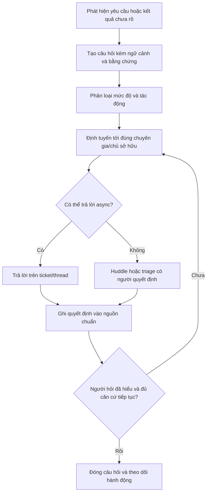

# Thiết kế kênh phản hồi nhanh khi yêu cầu hoặc kết quả chưa rõ

Trong hoạt động kiểm thử, nhiều quyết định bị chậm không phải vì thiếu người làm mà vì một câu hỏi quan trọng chưa được giải đáp. Yêu cầu có thể dùng từ mơ hồ như “nhanh”, “an toàn” hoặc “đúng định dạng”; tiêu chí chấp nhận có thể mâu thuẫn; kết quả kiểm thử có thể thất bại nhưng chưa rõ do sản phẩm, test hay môi trường. Nếu câu hỏi nằm trong email dài, chat rời rạc hoặc cuộc họp không có người quyết định, nhóm dễ tiếp tục dựa trên giả định và phát hiện sai lệch muộn.

Thiết kế kênh phản hồi nhanh là thiết lập cách để câu hỏi được gửi đến đúng người, kèm đủ ngữ cảnh và bằng chứng, được phản hồi trong thời gian phù hợp và để lại quyết định có thể truy nguyên. Mục tiêu không phải tạo thêm nhiều cuộc họp hoặc nhóm chat. Mục tiêu là giảm thời gian từ lúc nhận ra sự chưa rõ đến lúc có câu trả lời đủ tin cậy để tiếp tục công việc.

## 1. Nhận diện khi nào cần phản hồi

Không phải mọi câu hỏi đều cần escalation. Tuy nhiên, nhóm cần có tín hiệu rõ để nhận biết khi một điểm chưa rõ có thể làm thay đổi thiết kế, kết quả kiểm thử, mức rủi ro hoặc quyết định phát hành.

Các tình huống thường cần phản hồi:

- **Yêu cầu mơ hồ:** chưa rõ thuật ngữ, phạm vi, điều kiện đầu vào, hành vi ngoại lệ hoặc mức chất lượng cần đạt.
- **Tiêu chí chấp nhận thiếu hoặc mâu thuẫn:** tài liệu nói một điều, API hoặc người đại diện nghiệp vụ lại diễn giải khác.
- **Kết quả kiểm thử không rõ:** test thất bại nhưng chưa xác định expected result, trạng thái dữ liệu hoặc nguyên nhân.
- **Bằng chứng chưa đủ:** test bị chặn, môi trường không đại diện, thiếu dữ liệu hoặc chưa kiểm tra một nhánh quan trọng.
- **Rủi ro chưa có chủ sở hữu:** nhóm biết có thể xảy ra tác động nhưng chưa rõ ai đánh giá hoặc chấp nhận.
- **Phụ thuộc bị chặn:** cần quyết định từ nhóm khác, nhà cung cấp, vận hành hoặc người phê duyệt.
- **Thay đổi khẩn cấp:** yêu cầu hoặc cấu hình thay đổi sát thời điểm kiểm thử/phát hành, làm mất hiệu lực giả định trước đó.

Đặt câu hỏi sớm khi một giả định có thể ảnh hưởng đến kết quả. Ví dụ, nếu không rõ “đơn hàng được xem là hoàn tất” là khi API trả `202 Accepted`, khi thanh toán thành công hay khi kho đã giữ hàng, nhóm không nên tự chọn một mốc rồi viết test. Cần làm rõ chủ sở hữu nghiệp vụ và trạng thái nào là bằng chứng hoàn tất.

## 2. Nguyên tắc thiết kế kênh phản hồi

Một kênh phản hồi hữu ích cần đáp ứng các nguyên tắc:

1. **Đúng người:** câu hỏi đến người có kiến thức hoặc thẩm quyền trả lời, không chỉ người dễ liên hệ nhất.
2. **Đúng ngữ cảnh:** người nhận hiểu sản phẩm, phiên bản, yêu cầu, môi trường và tác động liên quan.
3. **Đúng mức khẩn cấp:** vấn đề chặn release cần được xử lý nhanh hơn câu hỏi cải thiện tài liệu không ảnh hưởng tiến độ.
4. **Có bằng chứng:** câu hỏi đi kèm ví dụ, log, kết quả thực tế, tiêu chí hoặc liên kết nguồn.
5. **Có chủ sở hữu:** luôn biết ai đang theo dõi câu hỏi đến khi được giải quyết.
6. **Có thời hạn phản hồi:** người hỏi biết khi nào cần câu trả lời hoặc khi nào phải chuyển cấp.
7. **Có quyết định được lưu:** câu trả lời ảnh hưởng đến yêu cầu, test hoặc phát hành phải được ghi ở nơi nhóm có thể tra cứu.
8. **Ít ma sát:** kênh dễ sử dụng, không yêu cầu người hỏi lặp lại thông tin đã có và không tạo thêm thủ tục không cần thiết.

Phản hồi nhanh không có nghĩa là trả lời vội khi chưa đủ dữ liệu. Nếu chưa thể kết luận, người nhận nên nói rõ điều đã biết, điều chưa biết, ai cần tham gia và thời điểm cập nhật tiếp theo.

## 3. Phân loại câu hỏi trước khi chọn kênh

Câu hỏi khác nhau cần người nhận và hình thức trao đổi khác nhau. Có thể phân thành các nhóm:

| Loại câu hỏi | Ví dụ | Người thường cần tham gia | Kết quả cần có |
| --- | --- | --- | --- |
| Làm rõ nghiệp vụ | “Hủy đơn” có hoàn tiền tự động không? | Product owner, business analyst, chuyên gia nghiệp vụ | Quy tắc được xác nhận và ví dụ cụ thể |
| Làm rõ yêu cầu kỹ thuật | API có bảo đảm thứ tự sự kiện không? | Tech lead, kiến trúc sư, service owner | Hợp đồng hoặc quyết định kỹ thuật |
| Làm rõ kết quả kiểm thử | Trạng thái thực tế khác expected; expected lấy từ đâu? | QA/test lead, product owner, developer | Oracle đúng và kết luận pass/fail/unknown |
| Điều tra lỗi | Failure có tái hiện trên build trước không? | Developer, QA, platform/CI | Phân loại nguyên nhân và hành động |
| Đánh giá rủi ro | Có thể phát hành giới hạn khi thiếu một bằng chứng không? | Risk owner, security, vận hành, release authority | Quyết định trong đúng thẩm quyền |
| Phụ thuộc hoặc blocker | Sandbox nhà cung cấp không hoạt động | Service owner, vendor contact, platform | Người xử lý, ETA và phương án thay thế |

Tránh gửi mọi câu hỏi vào một kênh chung rồi mong người phù hợp tự tìm thấy. Kênh chung có thể dùng để tiếp nhận và điều phối, nhưng cần định tuyến rõ tới người chịu trách nhiệm.

## 4. Chọn kênh theo mức khẩn cấp và độ phức tạp

Các kênh có thể gồm ticket, công cụ quản lý yêu cầu, chat, cuộc họp ngắn, phiên triage, dashboard, tài liệu quyết định và giờ tư vấn cố định. Mỗi kênh có ưu điểm riêng.

| Kênh | Phù hợp khi | Điểm cần lưu ý |
| --- | --- | --- |
| Ticket hoặc issue có cấu trúc | Câu hỏi cần theo dõi, có chủ sở hữu, thời hạn hoặc liên quan defect/release | Ghi đầy đủ bối cảnh, trạng thái và liên kết; tránh tạo ticket trùng |
| Chat nhóm hoặc thread | Cần xác nhận nhanh, câu hỏi ngắn, cần điều phối người tham gia | Đưa kết luận quan trọng về ticket hoặc decision log; chat dễ bị trôi |
| Trao đổi trực tiếp/huddle ngắn | Có nhiều cách hiểu, cần tương tác để làm rõ hoặc điều tra chung | Chuẩn bị câu hỏi và kết thúc bằng quyết định, người phụ trách, hạn |
| Phiên triage định kỳ | Có nhiều failure hoặc câu hỏi cần ưu tiên chung | Không chờ phiên định kỳ nếu vấn đề đang chặn công việc khẩn cấp |
| Dashboard/test report | Cần xem trạng thái, xu hướng, bằng chứng và khoảng trống | Chỉ hữu ích khi dữ liệu cập nhật, định nghĩa chỉ số rõ và có chủ sở hữu |
| Tài liệu yêu cầu/decision log | Cần một nguồn chuẩn để nhóm tham chiếu lâu dài | Ghi phiên bản, người quyết định và ngày hiệu lực |
| Office hours hoặc kênh tư vấn | Câu hỏi lặp lại, cần tiếp cận chuyên gia theo lịch | Nêu rõ phạm vi, thời gian và cách gửi câu hỏi trước |

### Ma trận chọn kênh

```text
Mức khẩn cấp thấp + câu hỏi đơn giản
    -> Ticket hoặc tài liệu, phản hồi theo thời hạn thông thường

Mức khẩn cấp cao + câu hỏi đơn giản
    -> Chat/alert tới đúng người, sau đó ghi nhận kết quả vào ticket

Mức khẩn cấp thấp + câu hỏi phức tạp
    -> Tài liệu có ngữ cảnh và phiên trao đổi được lên lịch

Mức khẩn cấp cao + câu hỏi phức tạp
    -> Huddle/triage ngay với người có thẩm quyền,
       ghi quyết định và hành động ngay sau phiên
```

Không nên dùng chat như nơi lưu duy nhất của một quyết định quan trọng. Ngược lại, không nên bắt người hỏi tạo một tài liệu dài cho một câu hỏi nhỏ có thể trả lời ngay. Chọn kênh theo khả năng giải quyết và nhu cầu truy nguyên.

## 5. Thiết lập đầu mối và quyền sở hữu câu hỏi

Một câu hỏi thường cần nhiều người đóng góp, nhưng phải có một người chịu trách nhiệm điều phối đến khi có kết quả.

Các trách nhiệm nên được xác định:

- **Người nêu câu hỏi:** mô tả điểm chưa rõ, cung cấp bối cảnh và bằng chứng, phản hồi khi cần bổ sung.
- **Người tiếp nhận/triage:** xác định loại câu hỏi, mức khẩn cấp, người trả lời và kênh phù hợp.
- **Người trả lời chuyên môn:** làm rõ nội dung trong phạm vi hiểu biết và nêu giả định hoặc giới hạn.
- **Người quyết định:** đưa ra quyết định khi có nhiều phương án hoặc cần chấp nhận trade-off.
- **Người điều phối:** theo dõi câu hỏi, nhắc thời hạn, ghi nhận kết quả và đóng vòng phản hồi.

Trong nhóm nhỏ, một người có thể giữ nhiều vai trò. Tuy nhiên, người trả lời chuyên môn không phải lúc nào cũng có quyền quyết định nghiệp vụ hoặc chấp nhận rủi ro. Cần chuyển tới đúng người nếu câu hỏi vượt phạm vi.

### Xác định người trả lời theo chủ đề

| Chủ đề | Đầu mối chính thường gặp | Người cần tham vấn khi phù hợp |
| --- | --- | --- |
| Mục tiêu và quy tắc nghiệp vụ | Product owner/business analyst | Người dùng đại diện, vận hành, pháp chế |
| Hợp đồng API/sự kiện | Service owner/tech lead | Consumer/provider, kiến trúc sư |
| Kết quả test và test oracle | QA/test lead | Product owner, developer |
| Build, runner, môi trường CI | Platform/CI owner | QA, developer, service owner |
| Dữ liệu và quyền truy cập | Data owner/steward | Security, privacy, custodian |
| Rủi ro bảo mật | Security owner | Product, engineering, privacy |
| Khả năng vận hành | Service owner/SRE/operations | QA, support, release manager |
| Quyết định phát hành | Release authority | Các chủ sở hữu rủi ro và nhóm kiểm soát bắt buộc |

Không định tuyến câu hỏi chỉ theo chức danh. Hãy dùng ma trận trách nhiệm của dự án để xác định người có thẩm quyền thực tế và người thay thế khi họ vắng mặt.

## 6. Chuẩn hóa nội dung yêu cầu phản hồi

Người nhận có thể phản hồi nhanh hơn nếu câu hỏi được trình bày rõ. Một yêu cầu làm rõ nên có:

1. **Tiêu đề nêu điểm cần quyết định:** ví dụ “Xác nhận trạng thái hoàn tất của đơn hàng bất đồng bộ”.
2. **Bối cảnh:** tính năng, yêu cầu, phiên bản, môi trường và luồng nghiệp vụ.
3. **Điểm chưa rõ:** trích dẫn chính xác câu chữ hoặc mô tả hai cách hiểu đang tồn tại.
4. **Bằng chứng:** test result, log, API response, screenshot đã làm sạch dữ liệu hoặc liên kết tài liệu.
5. **Tác động nếu chậm:** test nào bị chặn, release nào bị ảnh hưởng, rủi ro nào có thể tăng.
6. **Câu hỏi cụ thể:** điều gì cần người nhận xác nhận hoặc quyết định?
7. **Phương án nếu có:** lựa chọn A/B cùng hệ quả và khuyến nghị của người hỏi.
8. **Thời điểm cần phản hồi:** thời hạn và lý do của thời hạn.
9. **Người theo dõi:** ai chịu trách nhiệm cập nhật trạng thái và đóng câu hỏi?

### Ví dụ yêu cầu chưa rõ và yêu cầu tốt

**Chưa đủ thông tin:**

> API thanh toán không rõ, nhờ xem giúp sớm.

**Có thể xử lý:**

> **Câu hỏi:** Xác nhận thời điểm đơn hàng được xem là `PAID` trong luồng thanh toán bất đồng bộ.  
> **Bối cảnh:** Sau khi nhận `PaymentSucceeded`, Order Service cập nhật trạng thái và phát `OrderConfirmed`.  
> **Điểm chưa rõ:** Tài liệu nghiệp vụ nói “thanh toán thành công”, nhưng API hiện trả `202 Accepted` trước khi consumer cập nhật đơn.  
> **Tác động:** Test E2E chưa xác định được điểm kết thúc; hai kịch bản hồi quy đang bị chặn.  
> **Cần xác nhận:** Assertion nên kiểm tra trạng thái `PAID` trong Order Service hay chỉ kiểm tra việc yêu cầu thanh toán được chấp nhận?  
> **Đề xuất:** Dùng trạng thái `PAID` làm kết quả nghiệp vụ; `202` chỉ xác nhận yêu cầu đã được tiếp nhận.  
> **Cần phản hồi trước:** 15:00 ngày làm việc hôm nay để hoàn tất test plan.  
> **Người theo dõi:** QA lead.

Ví dụ cho thấy câu hỏi có thể được trả lời trực tiếp mà không cần người nhận tự tìm lại bối cảnh.

## 7. Thiết lập mức độ ưu tiên và thời gian phản hồi

Không phải mọi câu hỏi đều cần phản hồi tức thì. Nhóm nên thống nhất mức ưu tiên và thời gian phản hồi mục tiêu dựa trên tác động, mức khẩn cấp và công việc đang bị chặn.

Ví dụ một quy ước nội bộ:

| Mức | Tình huống | Phản hồi ban đầu mục tiêu | Cách xử lý |
| --- | --- | --- | --- |
| P0 – Khẩn cấp | Sự cố đang ảnh hưởng production, nguy cơ mất dữ liệu hoặc vi phạm nghiêm trọng | Ngay theo quy trình incident/on-call | Kích hoạt incident response và thông báo vai trò có thẩm quyền |
| P1 – Chặn release | Cổng bắt buộc thất bại, rủi ro cao chưa được quyết định, blocker ảnh hưởng release gần | Trong vòng 1 giờ làm việc hoặc theo lịch trực đã thống nhất | Triage trực tiếp, chỉ định người quyết định và cập nhật thường xuyên |
| P2 – Chặn công việc | Một nhóm không thể hoàn tất test/design nhưng chưa ảnh hưởng ngay tới release | Trong cùng ngày làm việc | Ticket có owner và thời hạn giải quyết |
| P3 – Làm rõ thông thường | Câu hỏi tài liệu, cải thiện hoặc trường hợp chưa chặn công việc | Trong 2 ngày làm việc | Trả lời async, cập nhật tài liệu khi cần |

Các thời gian trên chỉ là ví dụ để thiết kế quy ước; nhóm phải thống nhất theo múi giờ, lịch làm việc, độ phủ on-call và mức rủi ro. Không được trình bày chúng như SLA phổ quát.

### Phân biệt phản hồi ban đầu và giải quyết cuối cùng

Thời gian phản hồi ban đầu là lúc người nhận xác nhận đã tiếp nhận, chỉ định người xử lý và nêu bước tiếp theo. Thời gian giải quyết là lúc câu hỏi có câu trả lời hoặc quyết định được ghi nhận. Hai mốc này khác nhau.

Nếu chưa thể giải quyết trong thời hạn, phản hồi ban đầu vẫn nên nêu:

- Ai đang điều tra hoặc cần tham gia?
- Còn thiếu bằng chứng nào?
- Khi nào sẽ có cập nhật tiếp theo?
- Có phương án tạm thời nào được phép dùng không?
- Có cần chặn test, merge hoặc release trong lúc chờ không?

Không nên trả lời “đang xem” nhiều lần mà không có mốc cập nhật hoặc hành động cụ thể.

## 8. Thiết kế luồng tiếp nhận, triage và đóng câu hỏi

Một luồng phản hồi rõ ràng có thể gồm các bước:

1. **Tiếp nhận:** câu hỏi được gửi qua kênh đã công bố và có mã hoặc nơi theo dõi.
2. **Kiểm tra thông tin:** xác nhận câu hỏi có bối cảnh, bằng chứng, tác động và thời hạn.
3. **Phân loại:** nghiệp vụ, kỹ thuật, test result, môi trường, rủi ro hoặc release.
4. **Định tuyến:** gán người trả lời và người có quyền quyết định nếu cần.
5. **Chọn hình thức:** trả lời async, trao đổi ngắn, triage hoặc escalation.
6. **Phản hồi:** cung cấp câu trả lời, yêu cầu bổ sung hoặc cập nhật thời điểm giải quyết.
7. **Ghi quyết định:** cập nhật ticket, acceptance criteria, test plan, defect hoặc decision log.
8. **Xác nhận hiểu đúng:** người hỏi phản hồi rằng câu trả lời giải quyết điểm chưa rõ; nếu còn mâu thuẫn, tiếp tục làm rõ.
9. **Đóng:** ghi kết quả, người quyết định, ngày hiệu lực và liên kết liên quan.

Luồng có thể được mô tả:



### Không để câu hỏi biến mất

Ticket cần có trạng thái rõ như New, Triaged, Waiting for information, In progress, Decision needed, Answered, Verified và Closed. Trạng thái cụ thể tùy công cụ, nhưng phải cho biết câu hỏi đang chờ ai và bước tiếp theo là gì.

Với câu hỏi đang chờ bên ngoài hoặc nhà cung cấp, ghi người theo dõi nội bộ và thời điểm nhắc lại. Không để trách nhiệm biến mất chỉ vì đang chờ phản hồi từ bên khác.

## 9. Phản hồi nhanh khi yêu cầu chưa rõ

Khi yêu cầu mơ hồ, người phản hồi cần giúp biến mong muốn thành hành vi có thể kiểm tra. Không chỉ hỏi “ý bạn là gì?”; nên đưa ra cách hiểu và ví dụ cụ thể để người có thẩm quyền xác nhận.

Các câu hỏi hữu ích:

- Ai là người dùng hoặc hệ thống thực hiện hành động?
- Điều kiện đầu vào và trạng thái ban đầu là gì?
- Hành vi nào phải xảy ra khi thành công?
- Điều gì phải xảy ra khi dữ liệu thiếu, sai, trùng hoặc đến muộn?
- Quy tắc nào áp dụng khi hai hành động xảy ra đồng thời?
- Hệ thống cần phản hồi ngay hay có thể hoàn tất bất đồng bộ?
- Trường hợp nào nằm ngoài phạm vi hoặc cần xử lý riêng?
- Có tiêu chí định lượng nào cho hiệu năng, độ tin cậy hoặc bảo mật không?

### Dùng ví dụ và phản ví dụ

Ví dụ cụ thể giúp phát hiện cách hiểu khác nhau nhanh hơn câu mô tả trừu tượng.

Ví dụ:

- Yêu cầu: “Người dùng có thể hủy đơn trước khi giao hàng.”
- Cần làm rõ: đơn đã thanh toán nhưng chưa giao có được hủy không? Đơn đã bàn giao cho vận chuyển thì sao? Hủy có hoàn tiền tự động hay tạo yêu cầu hoàn tiền? Nếu yêu cầu hủy đến đồng thời với sự kiện giao hàng thì trạng thái cuối nào hợp lệ?

Nhóm có thể ghi bảng ví dụ/ phản ví dụ để product owner xác nhận. Khi đã thống nhất, chuyển kết quả vào acceptance criteria hoặc đặc tả nguồn; không để câu trả lời chỉ tồn tại trong cuộc trò chuyện.

### Khi có nhiều cách hiểu hợp lý

Liệt kê các cách hiểu và hệ quả:

| Cách hiểu | Hệ quả kiểm thử | Cần ai quyết định? |
| --- | --- | --- |
| Hủy trước khi tạo vận đơn | Có thể giải phóng tồn kho và bắt đầu hoàn tiền | Product owner và chủ sở hữu nghiệp vụ |
| Hủy sau khi tạo vận đơn | Có thể cần quy trình thu hồi hoặc chặn giao hàng | Product owner, Shipping owner, Operations |
| Hủy sau khi giao thành công | Có thể là trả hàng thay vì hủy | Product owner, Finance/Support |

Tester có thể khuyến nghị dựa trên rủi ro và tính nhất quán, nhưng không nên tự quyết định quy tắc nghiệp vụ nếu không được ủy quyền.

## 10. Phản hồi nhanh khi kết quả kiểm thử chưa rõ

Khi test thất bại, cần phân biệt điều đã quan sát với kết luận về nguyên nhân. Kênh phản hồi nên giúp người nhận tái dựng sự kiện.

Một báo cáo failure tốt gồm:

- Tên test, job, build, commit và môi trường.
- Dữ liệu, vai trò và trạng thái ban đầu.
- Bước thực hiện và thời điểm.
- Expected result và nguồn xác định expected.
- Actual result, log, trace, request ID hoặc screenshot đã làm sạch.
- Tần suất tái hiện và kết quả chạy lại.
- Phạm vi bị ảnh hưởng và mức độ chặn công việc.
- Giả thuyết nguyên nhân, được gắn nhãn là giả thuyết.
- Câu hỏi cụ thể cần người khác trả lời.

Ví dụ:

> **Quan sát:** `PaymentRetryTest` tạo hai bản ghi charge sau khi cùng một yêu cầu được gửi lại.  
> **Kỳ vọng:** cùng khóa idempotency chỉ tạo một giao dịch logic.  
> **Môi trường:** build `checkout-5.2.1`, integration test, broker test v3.  
> **Bằng chứng:** hai charge ID, cùng idempotency key, trace ID và trạng thái database sau lần chạy.  
> **Chưa rõ:** consumer xử lý trùng hay fixture tạo hai khóa khác nhau?  
> **Cần hỗ trợ:** Payments owner kiểm tra logic idempotency; QA xác minh dữ liệu fixture.  
> **Tác động:** cổng thanh toán integration đang bị chặn.

Thông tin này giúp developer và QA điều tra song song. Khi có kết luận, cập nhật loại lỗi, nguyên nhân và hành động vào defect hoặc test issue.

### Trạng thái chưa đủ bằng chứng

Không nên ép mọi kết quả vào Pass hoặc Fail. Có thể dùng:

- **Pass:** điều kiện hợp lệ và kết quả đáp ứng tiêu chí.
- **Fail:** có bằng chứng kết quả vi phạm tiêu chí.
- **Blocked:** không thể chạy do thiếu quyền, môi trường, dữ liệu hoặc phụ thuộc.
- **Inconclusive/Unknown:** đã có quan sát nhưng chưa đủ bằng chứng để kết luận.
- **Flaky/Unstable:** kết quả thay đổi giữa các lần chạy tương đương và cần điều tra.

Khi chưa rõ, phản hồi cần nêu phần nào đã xác minh, phần nào chưa, ai đang điều tra và khi nào cập nhật. Không biến Blocked hoặc Unknown thành Pass để giữ pipeline xanh.

## 11. Kênh phản hồi trong các giai đoạn phát triển và kiểm thử

Kênh nên được bố trí xuyên suốt vòng đời, không chỉ xuất hiện khi gần release.

| Giai đoạn | Câu hỏi thường gặp | Kênh phản hồi phù hợp |
| --- | --- | --- |
| Phân tích yêu cầu | Thuật ngữ, ngoại lệ, tiêu chí chưa rõ | Review requirement, ticket clarification, workshop ngắn |
| Thiết kế | Hợp đồng API, trạng thái, ranh giới dịch vụ | Design review, architecture decision record, trao đổi service owner |
| Phát triển | Hành vi khác acceptance criteria, mock/fixture chưa thống nhất | Pull request thread, chat chuyên môn, pairing |
| CI và kiểm thử tích hợp | Failure, runner, dữ liệu, dependency | Pipeline annotation, ticket triage, kênh CI/platform |
| Kiểm thử hệ thống/E2E | Trạng thái bất đồng bộ, kết quả khác giữa dịch vụ | Triage có QA, developer, service owner và nghiệp vụ |
| UAT/chấp nhận | Người dùng chưa hiểu kết quả hoặc chưa đồng ý tiêu chí | Phiên phản hồi người dùng, issue theo kịch bản, decision log |
| Release | Rủi ro còn lại, blocker, quyền phê duyệt | Release readiness review và escalation theo thẩm quyền |
| Sau phát hành | Sự cố, phản hồi người dùng, chỉ số vượt ngưỡng | Incident channel, support ticket, dashboard và post-incident review |

Đặt kênh tại nơi công việc diễn ra giúp giảm thời gian chuyển ngữ cảnh. Ví dụ, câu hỏi về expected result nên gắn với test hoặc requirement liên quan; failure pipeline nên có liên kết trực tiếp tới job và artifact.

## 12. Tổ chức triage ngắn và hiệu quả

Phiên triage có ích khi nhiều câu hỏi liên quan cần ưu tiên hoặc có nhiều bên phải cùng giải quyết. Một phiên ngắn nên có cấu trúc:

**Trước phiên:**

- Gửi danh sách câu hỏi và bằng chứng trước.
- Chỉ mời người cần cung cấp thông tin hoặc có quyền quyết định.
- Đánh dấu vấn đề chặn release, rủi ro cao và câu hỏi có thể xử lý async.
- Xác định người điều phối và người ghi quyết định.

**Trong phiên:**

1. Nêu câu hỏi và tác động trong một phút.
2. Xác nhận dữ kiện và điểm chưa biết.
3. So sánh các phương án và hệ quả.
4. Xác định người có thẩm quyền quyết định.
5. Chốt quyết định hoặc hành động điều tra tiếp.
6. Ghi owner, deadline và thời điểm cập nhật.

**Sau phiên:**

- Đăng quyết định vào nguồn chuẩn.
- Gán các hành động và cập nhật trạng thái.
- Thông báo cho người bị ảnh hưởng.
- Kiểm tra câu hỏi có thực sự được giải quyết hay chỉ được chuyển sang cuộc họp khác.

Không nên biến triage thành buổi đọc từng ticket. Những câu hỏi đã có đủ thông tin và người trả lời có thể xử lý async. Phiên trực tiếp nên dành cho vấn đề cần thảo luận hoặc quyết định chung.

## 13. Thiết kế cơ chế escalation

Escalation là chuyển vấn đề tới cấp hoặc vai trò có khả năng giải quyết khi kênh thông thường không đủ. Cần có tiêu chí rõ:

- Câu hỏi vượt quá thời gian phản hồi mục tiêu.
- Công việc quan trọng hoặc cổng release bị chặn.
- Rủi ro vượt giới hạn ủy quyền của người đang xử lý.
- Có bất đồng giữa các nhóm về yêu cầu hoặc bằng chứng.
- Vấn đề có thể ảnh hưởng production, dữ liệu, bảo mật hoặc nghĩa vụ bắt buộc.
- Phụ thuộc bên ngoài không phản hồi và đã ảnh hưởng mốc quan trọng.

Quy trình escalation nên nêu:

1. Ai có quyền kích hoạt và qua kênh nào?
2. Người hoặc vai trò tiếp nhận ở cấp tiếp theo?
3. Bằng chứng tối thiểu phải đính kèm?
4. Thời gian phản hồi và nhịp cập nhật?
5. Quyết định tạm thời nào được phép trong khi chờ?
6. Điều kiện nào buộc dừng kiểm thử, merge hoặc release?

Escalation không phải là phàn nàn hoặc gửi thông điệp cho nhiều quản lý cùng lúc. Mục tiêu là đưa quyết định tới đúng cấp, với thông tin đủ để hành động.

### Ví dụ escalation

Giả sử kiểm thử phát hiện người dùng thuộc tenant A có thể truy cập đơn của tenant B. Đây là vấn đề phân quyền và cô lập dữ liệu có tác động cao.

- QA lưu request/response đã làm sạch, tài khoản thử, tenant ID giả lập và bước tái hiện.
- Security owner và service owner được thông báo qua kênh incident/security đã quy định.
- Release owner được thông báo rằng cổng bảo mật đang bị chặn.
- Nhóm không tự chấp nhận rủi ro hoặc mở rộng phát hành trong khi chưa có quyết định của thẩm quyền phù hợp.
- Sau khi sửa, QA xác nhận bản sửa và chạy hồi quy phân quyền; Security đánh giá bằng chứng theo quy trình.

## 14. Ghi nhận quyết định và duy trì một nguồn thông tin chuẩn

Khi một câu hỏi được giải đáp, kết quả cần được lưu ở nơi người khác có thể tìm thấy. Tùy loại câu hỏi, nguồn chuẩn có thể là:

- Requirement hoặc acceptance criteria cho quy tắc nghiệp vụ.
- API schema, contract hoặc tài liệu thiết kế cho giao diện kỹ thuật.
- Defect hoặc test issue cho kết quả lỗi và hành động sửa.
- Test plan hoặc test case cho điều kiện kiểm thử đã thống nhất.
- Architecture Decision Record cho lựa chọn kiến trúc.
- Risk register hoặc release decision record cho chấp nhận rủi ro và phát hành.

Một quyết định nên ghi:

- Câu hỏi ban đầu và các cách hiểu đã xem xét.
- Quyết định cuối cùng và lý do.
- Người quyết định, người tham vấn và ngày hiệu lực.
- Phạm vi áp dụng, giả định và trường hợp chưa được bao phủ.
- Tác động đến requirement, test, dữ liệu, cấu hình hoặc release.
- Hành động tiếp theo, chủ sở hữu và hạn nếu còn việc.

Chat hoặc email có thể là nơi trao đổi, nhưng không nên là nguồn chuẩn duy nhất cho quyết định ảnh hưởng lâu dài. Khi cập nhật tài liệu nguồn, thêm liên kết tới thread hoặc ticket để giữ ngữ cảnh.

## 15. Bảo đảm phản hồi an toàn và tôn trọng dữ liệu

Kênh nhanh không được làm giảm bảo vệ thông tin. Khi chia sẻ bằng chứng:

- Che token, cookie, mật khẩu, khóa API và thông tin xác thực.
- Dùng mã định danh giả hoặc dữ liệu tổng hợp thay cho thông tin cá nhân khi có thể.
- Không đưa dump database hoặc log chứa dữ liệu nhạy cảm vào chat/ticket không được phép.
- Chỉ mời người cần thiết vào thread hoặc cuộc họp.
- Dùng kho artifact và quyền truy cập theo chính sách.
- Ghi liên kết tới nguồn được kiểm soát thay vì sao chép dữ liệu sang nhiều nơi.

Nếu phát hiện đã chia sẻ nhầm, báo theo quy trình sự cố, thu hồi quyền/liên kết khi được phép và giữ bằng chứng phục vụ điều tra. Không tự xóa log cần thiết hoặc gửi thêm dữ liệu nhạy cảm để giải thích.

## 16. Đo hiệu quả của kênh phản hồi

Kênh phản hồi cần được xem xét định kỳ để biết nó có giảm thời gian chờ và cải thiện chất lượng quyết định không.

Các chỉ số tham khảo:

- **Thời gian phản hồi đầu tiên:** từ lúc gửi câu hỏi đến khi có người tiếp nhận và nêu bước tiếp theo.
- **Thời gian giải quyết:** từ lúc mở câu hỏi đến khi quyết định hoặc câu trả lời được xác nhận.
- **Tỷ lệ câu hỏi quá hạn:** số câu hỏi vượt thời gian mục tiêu trên tổng số câu hỏi thuộc phạm vi.
- **Tỷ lệ mở lại:** câu hỏi đã đóng nhưng phải mở lại vì trả lời thiếu hoặc hiểu sai.
- **Thời gian blocker tồn tại:** thời gian một vấn đề chặn test, merge hoặc release.
- **Tỷ lệ quyết định có nguồn chuẩn:** phần quyết định quan trọng được ghi vào requirement, decision log hoặc ticket.
- **Tỷ lệ định tuyến đúng:** số câu hỏi được chuyển tới đúng người ngay lần đầu.

Không nên tối ưu thời gian phản hồi bằng cách trả lời nhanh nhưng thiếu căn cứ. Kết hợp tốc độ với tỷ lệ mở lại, chất lượng bằng chứng và mức độ hài lòng của người sử dụng kênh. Một câu hỏi được đóng nhanh nhưng phải mở lại nhiều lần cho thấy quy trình chưa hiệu quả.

### Đánh giá định tính

Trong review định kỳ, hỏi:

- Người hỏi có biết gửi câu hỏi ở đâu không?
- Có dễ xác định người trả lời và người quyết định không?
- Các câu hỏi quan trọng có được phản hồi trước khi trở thành blocker không?
- Quyết định có thể tìm lại sau vài tuần hoặc khi thành viên thay đổi không?
- Kênh có quá nhiều thông báo hoặc cuộc họp không cần thiết không?
- Có nhóm nào thường xuyên bị bỏ sót hoặc không có đầu mối không?

Điều chỉnh kênh dựa trên dữ liệu và phản hồi thực tế. Nếu chat tạo quá nhiều nhiễu, dùng thread và quy tắc định tuyến; nếu ticket bị tồn đọng, bổ sung triage owner hoặc giờ tư vấn; nếu quyết định bị thất lạc, cải thiện nguồn chuẩn và liên kết.

## 17. Ví dụ tổng hợp: làm rõ tiêu chí và kết quả kiểm thử trước release

Giả sử nhóm phát triển một tính năng hoàn tiền. Requirement ghi “hoàn tiền ngay sau khi hủy”, nhưng API trả `202 Accepted` và việc hoàn tiền thực tế được xử lý bất đồng bộ. Test E2E đang thất bại vì kiểm tra số dư ngay sau phản hồi.

### Điểm chưa rõ

- “Ngay” nghĩa là trong cùng request hay trong một khoảng thời gian mục tiêu?
- Hủy đơn có luôn đồng nghĩa với hoàn tiền hay còn điều kiện?
- Trạng thái nào được xem là hoàn tất: `REFUND_REQUESTED`, `REFUND_PROCESSING` hay `REFUNDED`?
- Nếu nhà cung cấp timeout nhưng đã nhận yêu cầu, hệ thống xử lý retry và đối soát ra sao?

### Thiết kế kênh phản hồi

1. QA tạo ticket làm rõ, liên kết requirement, test report và trace đã loại bỏ dữ liệu nhạy cảm.
2. Ticket được phân loại là câu hỏi nghiệp vụ kết hợp hợp đồng API, mức P1 vì đang chặn release.
3. Product owner xác nhận quy tắc nghiệp vụ; Payments service owner xác nhận trạng thái kỹ thuật; vận hành góp ý về thời gian xử lý và giám sát.
4. Vì các cách hiểu ảnh hưởng đến tiêu chí phát hành, nhóm tổ chức huddle ngắn với đúng người quyết định.
5. Nhóm thống nhất: `202` chỉ xác nhận yêu cầu được tiếp nhận; trạng thái `REFUNDED` là kết quả nghiệp vụ cuối; thời gian hoàn tất mục tiêu và điều kiện lỗi được ghi trong tiêu chí.
6. QA cập nhật test oracle và test plan; product owner cập nhật requirement; service owner cập nhật hợp đồng nếu cần.
7. Nhóm chạy lại test xác nhận, kiểm thử tích hợp timeout/retry và E2E chờ theo điều kiện có thời hạn.
8. Release owner nhận trạng thái mới cùng các bằng chứng và khoảng trống còn lại.

### Kết quả cần lưu

- Quyết định về ý nghĩa của “hoàn tiền ngay”.
- Trạng thái API và trạng thái nghiệp vụ cuối.
- Thời hạn mục tiêu và nguồn đo.
- Cách xử lý timeout, retry và giao dịch chưa rõ trạng thái.
- Người quyết định, người thực hiện và ngày hiệu lực.
- Liên kết tới test đã cập nhật và kết quả xác minh.

Ví dụ này cho thấy kênh phản hồi nhanh có thể ngăn nhóm viết test dựa trên giả định sai, đồng thời giữ quyết định nghiệp vụ, kỹ thuật và phát hành nhất quán.

## 18. Những sai lầm thường gặp

- **Chỉ có một kênh chung cho mọi câu hỏi:** thông tin quan trọng bị trôi và không có người chịu trách nhiệm.
- **Gửi câu hỏi không có bối cảnh:** người nhận phải tự tìm build, yêu cầu và bằng chứng.
- **Không phân biệt người trả lời với người quyết định:** câu trả lời chuyên môn bị hiểu nhầm thành phê duyệt.
- **Chỉ trao đổi bằng chat:** quyết định biến mất khi thread bị trôi hoặc thành viên rời nhóm.
- **Tổ chức họp cho mọi vấn đề:** tăng thời gian chờ và làm gián đoạn công việc.
- **Không đặt thời gian phản hồi:** người hỏi không biết khi nào cần nhắc hoặc chuyển cấp.
- **Đóng câu hỏi khi mới có phản hồi đầu tiên:** chưa xác nhận người hỏi hiểu đúng hoặc tài liệu nguồn được cập nhật.
- **Không cho phép trạng thái unknown:** nhóm bị ép chọn pass/fail dù thiếu bằng chứng.
- **Escalation quá muộn:** blocker chỉ được chuyển cấp khi release đã sát giờ.
- **Gửi dữ liệu nhạy cảm qua kênh nhanh:** tốc độ trao đổi làm tăng nguy cơ lộ thông tin.
- **Đo tốc độ mà bỏ chất lượng:** phản hồi nhanh nhưng bị mở lại nhiều lần hoặc tạo quyết định mâu thuẫn.

## 19. Checklist thiết kế kênh phản hồi

- [ ] Các loại câu hỏi thường gặp và tín hiệu cần phản hồi được xác định.
- [ ] Có kênh phù hợp cho câu hỏi đơn giản, phức tạp, khẩn cấp và cần truy nguyên.
- [ ] Mỗi loại câu hỏi có đầu mối chuyên môn và người quyết định rõ.
- [ ] Có người điều phối theo dõi câu hỏi đến khi đóng.
- [ ] Mẫu yêu cầu phản hồi có bối cảnh, bằng chứng, tác động, câu hỏi và thời hạn.
- [ ] Mức ưu tiên và thời gian phản hồi ban đầu/giải quyết được thống nhất.
- [ ] Có trạng thái để biết câu hỏi đang chờ ai và bước tiếp theo.
- [ ] Có cơ chế triage và escalation khi blocker hoặc rủi ro vượt thẩm quyền.
- [ ] Quyết định được cập nhật vào nguồn chuẩn và liên kết với trao đổi ban đầu.
- [ ] Kết quả chưa đủ bằng chứng được giữ ở trạng thái Blocked/Unknown/Inconclusive.
- [ ] Kênh và artifact tuân thủ quy tắc bảo vệ dữ liệu.
- [ ] Có chỉ số và review định kỳ về tốc độ, chất lượng và khả năng truy nguyên.

## 20. Những điểm cần ghi nhớ

- Kênh phản hồi nhanh giúp giảm thời gian từ khi phát hiện điểm chưa rõ đến khi có câu trả lời hoặc quyết định đáng tin cậy.
- Câu hỏi phải đến đúng người, có đủ ngữ cảnh, bằng chứng, mức khẩn cấp và thời hạn.
- Chọn ticket, chat, huddle, triage, dashboard hoặc decision log theo độ phức tạp và nhu cầu truy nguyên.
- Phân biệt người tiếp nhận, người trả lời chuyên môn, người quyết định và người điều phối.
- Đặt thời gian phản hồi ban đầu và thời gian giải quyết riêng; nếu chưa có câu trả lời cuối, phải nêu bước tiếp theo và mốc cập nhật.
- Yêu cầu mơ hồ cần được làm rõ bằng ví dụ, phản ví dụ và tiêu chí có thể kiểm tra.
- Kết quả test chưa rõ cần có expected/actual, build, môi trường, dữ liệu và bằng chứng; không ép Unknown thành Pass.
- Escalation phải có tiêu chí, đầu mối và quyền quyết định; không phải gửi thông điệp hàng loạt.
- Quyết định quan trọng cần được ghi vào nguồn chuẩn, không chỉ lưu trong chat hoặc cuộc họp.
- Đo cả tốc độ, chất lượng phản hồi, tỷ lệ mở lại, blocker và khả năng truy nguyên.

## Câu hỏi tự kiểm tra

1. Những tín hiệu nào cho thấy một yêu cầu hoặc kết quả kiểm thử cần được làm rõ trước khi tiếp tục?
2. Vì sao không nên gửi mọi câu hỏi vào một kênh chat chung?
3. Hãy phân biệt người tiếp nhận, người trả lời chuyên môn, người quyết định và người điều phối.
4. Một câu hỏi làm rõ tốt cần những thông tin nào để người nhận có thể phản hồi nhanh?
5. Khi nào nên dùng ticket, chat, huddle hoặc triage? Hãy nêu một ví dụ cho mỗi kênh.
6. Phân biệt thời gian phản hồi ban đầu với thời gian giải quyết cuối cùng. Nếu chưa thể kết luận, người nhận cần cung cấp gì?
7. Khi một test thất bại nhưng chưa rõ expected result, nhóm cần thu thập bằng chứng và định tuyến câu hỏi như thế nào?
8. Khi nào cần escalation và thông tin nào phải đi kèm?
9. Vì sao quyết định quan trọng cần được ghi vào nguồn chuẩn sau khi trao đổi qua chat hoặc cuộc họp?
10. Hãy thiết kế luồng phản hồi nhanh cho một blocker đang ảnh hưởng release, nêu kênh, người nhận, thời hạn, quyết định và cách truy nguyên.
