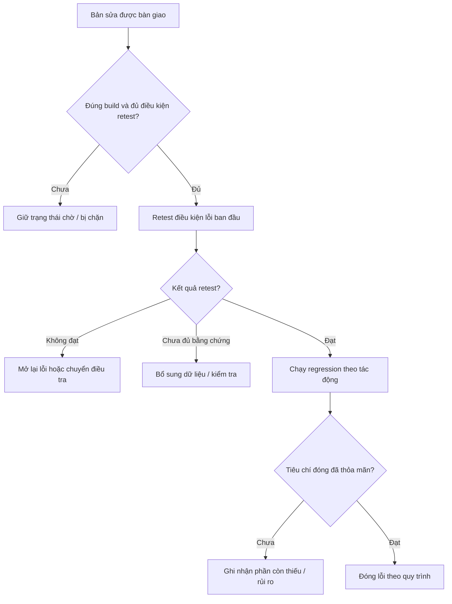
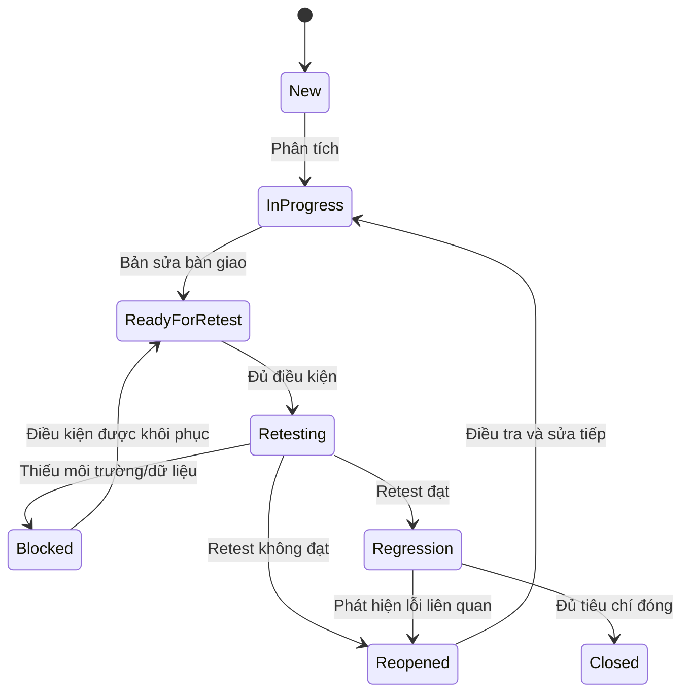

# Đặt tiêu chí kiểm tra lại và đóng lỗi

**Chương:** Lỗi và sự cố  
**Phạm vi module:** `VALIDATION_TESTING_STRATEGY`

Một lỗi được chuyển sang trạng thái đã sửa không có nghĩa là vấn đề đã được giải quyết. Nhóm kiểm thử cần xác minh bản sửa trên đúng phiên bản, điều kiện và dữ liệu; kiểm tra các hành vi liên quan có bị ảnh hưởng hay không; đồng thời thu thập bằng chứng đủ để quyết định trạng thái cuối cùng của lỗi. Nếu tiêu chí kiểm tra lại không rõ, lỗi có thể bị đóng quá sớm, mở lại nhiều lần hoặc được đánh dấu hoàn tất dù chỉ mới kiểm tra một phần.

Đặt tiêu chí kiểm tra lại và đóng lỗi là việc xác định trước điều kiện để bắt đầu retest, phạm vi cần xác minh, kết quả được coi là đạt, bằng chứng phải lưu và quy tắc chuyển trạng thái. Tiêu chí cần phù hợp với nguyên nhân lỗi, mức độ nghiêm trọng, rủi ro còn lại và quy trình phát hành của tổ chức.

Bài học này trình bày cách xác định điều kiện đầu vào cho retest, thiết kế tiêu chí pass/fail/blocked, mở rộng kiểm tra hồi quy, xử lý lỗi không tái hiện hoặc chỉ được sửa một phần, và quyết định khi nào có thể đóng lỗi. Nội dung cũng làm rõ sự khác nhau giữa trạng thái kỹ thuật của lỗi và quyết định chấp nhận rủi ro.

Sau bài học, người học có thể:

- Phân biệt trạng thái sửa lỗi với kết quả kiểm tra lại và quyết định đóng lỗi.
- Xác định điều kiện đầu vào cần có trước khi bắt đầu retest.
- Chuyển nguyên nhân và điều kiện tái hiện thành tiêu chí kiểm tra có thể xác minh.
- Xác định phạm vi retest và regression theo tác động của bản sửa.
- Phân loại kết quả đạt, không đạt, bị chặn và chưa đủ bằng chứng.
- Đặt tiêu chí đóng lỗi dựa trên bằng chứng, rủi ro và quy trình phê duyệt.
- Xử lý lỗi tái diễn, lỗi không tái hiện, lỗi trùng và rủi ro được chấp nhận.
- Ghi nhận lịch sử, truy vết và chỉ số để cải thiện quy trình xử lý lỗi.

## 1. Phân biệt sửa lỗi, kiểm tra lại và đóng lỗi

Một vòng đời lỗi thường có nhiều bước và nhiều vai trò. Nếu các bước này bị gộp thành một trạng thái chung như “Done”, nhóm sẽ khó biết lỗi đã được sửa, đã được kiểm tra hay đã được chấp nhận đóng.

### 1.1. Sửa lỗi (fix)

Sửa lỗi là thay đổi mã nguồn, cấu hình, dữ liệu, tài liệu hoặc quy trình nhằm loại bỏ nguyên nhân hoặc giảm tác động của lỗi. Người phát triển có thể đánh dấu bản sửa đã sẵn sàng, nhưng đó mới là tuyên bố kỹ thuật cần được xác minh.

Thông tin bàn giao bản sửa nên gồm:

- Build, commit hoặc phiên bản chứa thay đổi.
- Mô tả nguyên nhân gốc hoặc nguyên nhân đã xác minh.
- Mô tả cách sửa và các thành phần bị tác động.
- Điều kiện tái hiện ban đầu và dữ liệu cần thiết.
- Hành vi mong đợi sau sửa.
- Các rủi ro phụ, migration hoặc cấu hình cần áp dụng.
- Những kiểm tra đã được người sửa thực hiện.

Nếu bản sửa chưa có trong môi trường kiểm thử hoặc thiếu thông tin để xác định đúng phiên bản, retest chưa nên bắt đầu.

### 1.2. Kiểm tra lại (retesting)

Retesting xác minh lỗi cụ thể đã được xử lý. Người kiểm thử chạy lại điều kiện từng làm lỗi xuất hiện và kiểm tra kết quả mong đợi. Nếu lỗi ban đầu không thể tái hiện, cần dùng bằng chứng khác phù hợp, nhưng phải ghi rõ giới hạn.

Retest trả lời câu hỏi: “Lỗi đã được sửa trong điều kiện đã xác định chưa?”. Nó không tự trả lời liệu bản sửa có làm hỏng chức năng khác hay không.

### 1.3. Kiểm thử hồi quy (regression testing)

Regression kiểm tra những hành vi khác có thể bị ảnh hưởng bởi thay đổi. Phạm vi được chọn theo vùng tác động, phụ thuộc, dữ liệu dùng chung, mức rủi ro và lịch sử lỗi.

Ví dụ, lỗi tính tổng tiền được sửa bằng cách thay đổi hàm làm tròn. Retest cần xác minh đơn hàng từng gây lỗi đã cho tổng tiền đúng. Regression có thể cần kiểm tra thêm nhiều dòng hàng, thuế, chiết khấu, hoàn tiền và payload gửi sang cổng thanh toán.

### 1.4. Đóng lỗi (closure)

Đóng lỗi là quyết định cập nhật hồ sơ sang trạng thái kết thúc theo quy trình quản lý lỗi. Quyết định này dựa trên kết quả retest, phạm vi regression cần thiết, bằng chứng và các điều kiện quản trị như phê duyệt hoặc chấp nhận rủi ro.

Đóng lỗi không nhất thiết có nghĩa hệ thống không còn bất kỳ rủi ro nào. Ví dụ, lỗi có thể được đóng vì đã sửa và xác minh; được đóng vì là bản ghi trùng; hoặc được đóng theo quyết định chấp nhận rủi ro. Các lý do này cần được phân biệt rõ.

### 1.5. Chuỗi quyết định

Sơ đồ mô tả luồng tổng quát. Công cụ quản lý lỗi có thể dùng tên trạng thái khác nhau, nhưng cần bảo đảm các quyết định và bằng chứng tương ứng được ghi nhận.

## 2. Đặt tiêu chí trước khi kiểm tra lại

Tiêu chí nên được xác định trước khi chạy test để tránh điều chỉnh kỳ vọng sau khi đã thấy kết quả. Một tiêu chí tốt mô tả điều kiện, hành động, kết quả mong đợi và bằng chứng cần có.

### 2.1. Bắt đầu từ mô tả lỗi gốc

Đọc hồ sơ lỗi và xác định:

- Triệu chứng quan sát được.
- Hành vi mong đợi theo yêu cầu hoặc quy tắc nghiệp vụ.
- Điều kiện tiền đề, dữ liệu và trạng thái.
- Các bước hoặc sự kiện kích hoạt lỗi.
- Phiên bản và môi trường khi lỗi xuất hiện.
- Tác động và phạm vi ảnh hưởng.
- Nguyên nhân đã xác minh hoặc giả thuyết còn mở.

Không chỉ dựa vào tiêu đề lỗi. Tiêu đề thường tóm tắt triệu chứng, trong khi điều kiện tái hiện và nguyên nhân có thể nằm trong phần mô tả, log hoặc trao đổi điều tra.

### 2.2. Chuyển lỗi thành tiêu chí có thể kiểm chứng

Có thể dùng mẫu:

> Với **[tiền điều kiện và dữ liệu]**, khi **[hành động hoặc sự kiện]**, hệ thống phải **[kết quả mong đợi]**; xác minh bằng **[trạng thái, dữ liệu hoặc bằng chứng]**.

Ví dụ:

> Với một đơn hàng gồm nhiều dòng có chiết khấu phần trăm, khi tính tổng tiền và lưu đơn hàng, tổng tiền lưu trữ phải bằng kết quả theo quy tắc làm tròn đã phê duyệt; xác minh bằng dữ liệu đọc lại và số tiền gửi sang cổng thanh toán.

Tiêu chí không nên chỉ nói “không còn lỗi” hoặc “chức năng hoạt động”. Các câu này không chỉ rõ dữ liệu, trạng thái và bằng chứng nào chứng minh đạt.

### 2.3. Xác định oracle và nguồn sự thật

Oracle là cơ sở để xác định kết quả thực tế có đúng hay không. Tùy lỗi, nguồn sự thật có thể là:

- Quy tắc nghiệp vụ hoặc tiêu chí chấp nhận đã được phê duyệt.
- Giá trị tính toán độc lập đã được xác minh.
- Trạng thái dữ liệu đọc lại từ cơ sở dữ liệu.
- Hợp đồng API hoặc schema sự kiện.
- Quyết định phân quyền và chính sách bảo mật.
- Bằng chứng từ hệ thống tích hợp hoặc nhà cung cấp.
- Hành vi người dùng nhìn thấy trong luồng hoàn chỉnh.

Không nên dùng chính kết quả của implementation đang bị nghi ngờ làm oracle duy nhất. Ví dụ, nếu lỗi nằm ở hàm tính tổng tiền, không nên lấy kết quả của cùng hàm đó để tạo expected value.

### 2.4. Định nghĩa tiêu chí pass/fail riêng biệt

Tiêu chí nên chỉ ra:

- Điều kiện nào phải đạt để xác nhận lỗi đã được sửa.
- Sai lệch nào khiến retest không đạt.
- Điều kiện nào khiến test không thể kết luận.
- Bằng chứng nào bắt buộc phải lưu.
- Có cần kiểm tra thêm cấu hình, vai trò hoặc nền tảng nào không.

Ví dụ, “đơn hàng được xác nhận” chưa đủ nếu lỗi ban đầu là giao dịch bị ghi hai lần. Tiêu chí cần kiểm tra số giao dịch có hiệu lực, trạng thái cuối và tác dụng phụ liên quan.

## 3. Điều kiện đầu vào trước khi retest

Không nên chuyển một lỗi sang kiểm tra lại chỉ vì người sửa đã nhấn nút “Resolved”. Cần xác nhận các điều kiện tối thiểu để kết quả retest có ý nghĩa.

### 3.1. Bản sửa đã được triển khai đúng

Xác minh:

- Build hoặc commit chứa bản sửa.
- Phiên bản đang chạy trên môi trường kiểm thử.
- Thành phần liên quan đã được triển khai đầy đủ.
- Migration hoặc thay đổi cấu hình đã áp dụng nếu cần.
- Không có bản dựng cũ hoặc cache làm sai lệch kết quả.

Nếu bản sửa chưa có trong môi trường, trạng thái phù hợp là chờ build/triển khai hoặc bị chặn, không phải retest thất bại.

### 3.2. Điều kiện tái hiện và dữ liệu đã sẵn sàng

Chuẩn bị dữ liệu đủ để tái tạo lỗi, gồm:

- Tài khoản, vai trò và quyền cần thiết.
- Bản ghi, trạng thái hoặc quan hệ dữ liệu.
- Tham số, file hoặc request đầu vào.
- Thời điểm, múi giờ hoặc seed nếu có liên quan.
- Trạng thái dịch vụ phụ thuộc và cấu hình môi trường.

Dữ liệu cần được xử lý theo chính sách bảo vệ thông tin. Dùng dữ liệu tổng hợp hoặc đã ẩn danh khi phù hợp; không đưa secret hoặc dữ liệu cá nhân không cần thiết vào hồ sơ lỗi.

### 3.3. Môi trường đáp ứng điều kiện

Kiểm tra health, quyền truy cập, phiên bản dịch vụ phụ thuộc và khả năng quan sát. Nếu môi trường không ổn định hoặc một dịch vụ cần thiết không sẵn sàng, kết quả có thể là `BLOCKED` hoặc `INCONCLUSIVE` tùy tình huống.

### 3.4. Có thông tin bàn giao đủ

Người kiểm thử cần hiểu bản sửa giải quyết nguyên nhân nào, thay đổi vùng nào và có những giới hạn gì. Nếu thiếu thông tin quan trọng, yêu cầu bổ sung trước khi mở rộng kiểm tra. Điều này giảm việc thử ngẫu nhiên và giúp tập trung vào rủi ro thực.

### 3.5. Xác định phạm vi retest và regression

Trước khi chạy, ghi rõ:

- Ca tái hiện lỗi ban đầu.
- Các biến thể dữ liệu hoặc trạng thái cần kiểm tra.
- Thành phần và luồng bị ảnh hưởng bởi bản sửa.
- Các test hồi quy bắt buộc.
- Cấu hình hoặc nền tảng cần kiểm tra.
- Điều kiện dừng hoặc mở rộng phạm vi khi phát hiện lỗi mới.

## 4. Xây dựng phạm vi retest

Retest nên kiểm tra đúng điều kiện đã gây lỗi và những biến thể cần thiết để xác minh cơ chế sửa.

### 4.1. Tái hiện điều kiện ban đầu

Nếu có thể, dùng cùng dữ liệu, trạng thái, thao tác và cấu hình đã tạo ra lỗi. Điều này giúp xác minh trực tiếp vấn đề đã được khắc phục.

Nếu điều kiện cũ không còn tồn tại do dữ liệu hoặc kiến trúc thay đổi, cần mô tả điều kiện thay thế và giải thích vì sao nó vẫn kiểm tra cùng quy tắc.

### 4.2. Kiểm tra giá trị biên và biến thể gần

Không phải mọi lỗi đều cần kiểm tra nhiều biến thể, nhưng cần xem xét khi nguyên nhân liên quan đến ranh giới hoặc tổ hợp dữ liệu:

- Ngay dưới, đúng tại và ngay trên ngưỡng.
- Giá trị rỗng, thiếu, null hoặc mặc định.
- Số lượng tối thiểu và tối đa.
- Vai trò hoặc trạng thái liên quan.
- Thứ tự sự kiện hoặc thao tác lặp.
- Thời điểm hết hạn hoặc thời gian sát ranh giới.
- Cấu hình, locale hoặc nền tảng có liên quan.

Chọn biến thể theo nguyên nhân và rủi ro. Không mở rộng vô hạn thành một bộ test mới không liên quan.

### 4.3. Kiểm tra hành vi lỗi và nhánh thay thế

Nếu bản sửa thay đổi xử lý exception, timeout, retry hoặc fallback, cần xác minh cả nhánh thành công và nhánh lỗi có liên quan. Một bản sửa có thể làm luồng thành công đạt nhưng khiến hệ thống xử lý sai khi phụ thuộc ngoài từ chối hoặc phản hồi chậm.

### 4.4. Kiểm tra tác dụng phụ và tính toàn vẹn

Với lỗi dữ liệu hoặc giao dịch, không chỉ kiểm tra thông báo hiển thị. Cần xác minh:

- Bản ghi được tạo hoặc cập nhật đúng số lượng.
- Không có dữ liệu trùng hoặc trạng thái mồ côi.
- Transaction và rollback phù hợp.
- Sự kiện, email hoặc thông báo không bị phát lặp.
- Dữ liệu đọc lại nhất quán với kết quả người dùng nhìn thấy.

### 4.5. Chọn tầng kiểm thử phù hợp

| Loại nguyên nhân | Kiểm tra retest phù hợp | Bằng chứng |
|---|---|---|
| Sai điều kiện hoặc công thức | Unit test và ca biên | Giá trị đầu ra, nhánh và expected value độc lập |
| Sai ánh xạ API | API/contract test | Request, response, schema và mã lỗi |
| Sai transaction hoặc dữ liệu | Integration test | Dữ liệu commit, rollback và trạng thái đọc lại |
| Sai quyền truy cập | API/system test theo vai trò | Hành động được phép/từ chối và không rò rỉ dữ liệu |
| Lỗi sự kiện bất đồng bộ | Integration/system test | Thứ tự sự kiện, trạng thái cuối và tác dụng phụ |
| Lỗi hành trình nhiều thành phần | E2E đại diện | Kết quả xuyên suốt và trạng thái các thành phần |

Không cần đẩy mọi retest lên E2E. Chọn tầng có thể xác minh nguyên nhân một cách đáng tin cậy; bổ sung kiểm tra xuyên suốt khi bản sửa có tác động đến luồng tích hợp.

## 5. Xây dựng tiêu chí regression sau bản sửa

Một bản sửa có thể ảnh hưởng đến các thành phần khác ngoài nơi phát hiện lỗi. Phạm vi regression nên dựa trên tác động thực tế của thay đổi.

### 5.1. Phân tích vùng thay đổi

Xác định:

- File, module, service hoặc cấu hình đã thay đổi.
- API, event, schema hoặc dữ liệu bị ảnh hưởng.
- Thành phần gọi hoặc được gọi bởi phần sửa.
- Luồng nghiệp vụ dùng chung logic hoặc dữ liệu.
- Các lỗi lịch sử có nguyên nhân tương tự.

### 5.2. Chọn ca theo rủi ro

Ưu tiên:

- Hành vi có hậu quả nghiêm trọng nếu sai.
- Thành phần dùng chung hoặc có nhiều consumer.
- Ca đã từng phát hiện lỗi tương tự.
- Ca kiểm tra tương thích hoặc migration.
- Ca bắt buộc theo chính sách phát hành.

### 5.3. Xác định điều kiện dừng

Nếu regression phát hiện lỗi nghiêm trọng mới, nhóm cần dừng hoặc mở rộng điều tra theo chính sách. Không nên tiếp tục đánh dấu lỗi ban đầu đã đóng trong khi một lỗi liên quan làm thay đổi quyết định phát hành.

Lỗi mới có thể được ghi thành hồ sơ riêng và liên kết với lỗi ban đầu. Cách này giúp giữ lịch sử nguyên nhân, phạm vi và trách nhiệm rõ ràng.

### 5.4. Ghi rõ phần chưa chạy

Nếu không đủ thời gian hoặc môi trường để chạy toàn bộ regression, báo cáo cần nêu:

- Những ca đã chạy và kết quả.
- Những ca chưa chạy hoặc bị chặn.
- Lý do thu hẹp phạm vi.
- Rủi ro còn lại.
- Người có thẩm quyền quyết định chấp nhận rủi ro.

Không được suy diễn rằng regression hoàn tất chỉ vì retest của lỗi ban đầu đạt.

## 6. Phân loại kết quả kiểm tra lại

Kết quả cần phản ánh đúng bằng chứng. Không nên ép mọi lần chạy vào hai trạng thái “pass” hoặc “fail” nếu test không thể thực hiện hoặc chưa đủ cơ sở kết luận.

### 6.1. PASS — Đạt

Có thể đánh dấu retest đạt khi:

- Bản sửa đúng phiên bản đã được kiểm tra.
- Điều kiện gây lỗi được tái tạo hoặc thay thế có giải thích.
- Hành vi mong đợi được quan sát.
- Các assertion và dữ liệu hậu điều kiện đều đạt.
- Không xuất hiện sai lệch liên quan trong phạm vi retest.
- Bằng chứng đủ để người khác kiểm tra lại kết luận.

PASS chỉ áp dụng cho phạm vi đã thực thi. Nó không tự động chứng minh mọi cấu hình hoặc toàn bộ regression đều đạt.

### 6.2. FAIL — Không đạt

Retest không đạt khi lỗi ban đầu vẫn tái hiện, kết quả vẫn sai hoặc bản sửa tạo ra sai lệch liên quan. Cần lưu:

- Bước và dữ liệu gây lỗi.
- Kết quả thực tế và mong đợi.
- Build, môi trường và thời điểm.
- Log, trace, ảnh hoặc dữ liệu hậu điều kiện.
- Mức độ tái hiện và phạm vi ảnh hưởng.

Nếu cùng lỗi vẫn tồn tại, thường mở lại hồ sơ ban đầu để giữ lịch sử. Nếu phát hiện vấn đề khác, tạo lỗi mới và liên kết khi có quan hệ.

### 6.3. BLOCKED — Bị chặn

Dùng khi không thể thực hiện kiểm tra do điều kiện bên ngoài chưa sẵn sàng, ví dụ:

- Bản sửa chưa được triển khai.
- Môi trường hoặc dịch vụ phụ thuộc không hoạt động.
- Thiếu tài khoản, quyền hoặc dữ liệu.
- Build không thể cài đặt hoặc khởi động.
- Có sự cố hạ tầng khiến test không thể chạy.

BLOCKED không phải PASS và cũng không tự động là lỗi sản phẩm. Cần ghi nguyên nhân, người hoặc nhóm chịu trách nhiệm gỡ chặn và thời điểm dự kiến kiểm tra lại.

### 6.4. INCONCLUSIVE — Chưa đủ cơ sở kết luận

Dùng khi test đã chạy nhưng bằng chứng không đủ để xác định đạt hay không đạt. Ví dụ, lỗi không tái hiện sau nhiều lần thử nhưng không có dữ liệu gốc; log bị thiếu; trạng thái phụ thuộc không rõ; hoặc oracle chưa được thống nhất.

INCONCLUSIVE cần có hành động tiếp theo: bổ sung log, tái tạo dữ liệu, làm rõ expected result hoặc thiết kế kiểm tra khác. Không chuyển sang PASS chỉ để đóng hồ sơ.

### 6.5. Kết quả lần chạy lại không nhất quán

Nếu lần đầu fail nhưng lần sau pass, không nên tự động kết luận bản sửa đạt. Cần xác định:

- Điều kiện giữa các lần chạy có tương đương không?
- Có flaky test, race condition hoặc phụ thuộc dữ liệu không?
- Lỗi sản phẩm có tính thời điểm không?
- Retry có tạo tác dụng phụ hoặc thay đổi trạng thái không?
- Có đủ bằng chứng để xác định nguyên nhân không?

Giữ toàn bộ lịch sử attempt. Nếu chưa xác định được, phân loại là nghi ngờ thiếu ổn định hoặc INCONCLUSIVE theo quy trình.

## 7. Tiêu chí đóng lỗi

Đóng lỗi khi hồ sơ có đủ bằng chứng và các điều kiện theo quy trình đã được thỏa mãn. Tiêu chí cần được điều chỉnh theo mức rủi ro, nhưng nên có một bộ điều kiện cơ sở thống nhất.

### 7.1. Điều kiện đóng sau khi sửa và xác minh

Thông thường cần:

1. Bản sửa đã được xác định bằng build/commit/phiên bản.
2. Retest điều kiện lỗi ban đầu đạt hoặc có cách xác minh thay thế được phê duyệt.
3. Regression theo phạm vi tác động đã hoàn tất hoặc có quyết định rõ về phần chưa chạy.
4. Không còn lỗi nghiêm trọng liên quan chưa được xử lý.
5. Kết quả mong đợi, dữ liệu và bằng chứng đã được ghi nhận.
6. Trạng thái và liên kết đến test, build, yêu cầu hoặc lỗi liên quan được cập nhật.
7. Người có thẩm quyền theo quy trình đã xác nhận đóng nếu cần.

### 7.2. Tiêu chí theo mức độ rủi ro

| Mức rủi ro | Bằng chứng thường cần | Điều kiện đóng gợi ý |
|---|---|---|
| Thấp | Retest cơ bản, ảnh/log hoặc kết quả test | Đạt điều kiện lỗi ban đầu và không có sai lệch liên quan rõ ràng |
| Trung bình | Retest và regression gần, dữ liệu hậu điều kiện | Đạt các ca đã xác định; ghi rõ phần phạm vi chưa chạy nếu có |
| Cao | Retest có thể tái lập, regression theo tác động, bằng chứng tích hợp | Các kiểm tra quan trọng đạt; reviewer/chủ sở hữu xác nhận khi quy trình yêu cầu |
| Rất cao | Bằng chứng kỹ thuật đầy đủ, kiểm tra độc lập hoặc chuyên môn, phê duyệt phù hợp | Chỉ đóng khi yêu cầu kiểm soát bắt buộc hoàn tất hoặc rủi ro được chấp nhận chính thức |

Đây là khung tham khảo. Tổ chức cần quy định rõ vai trò phê duyệt và các yêu cầu bắt buộc cho bảo mật, dữ liệu, tài chính, an toàn và tuân thủ.

### 7.3. Không dùng “đã sửa” làm tiêu chí đóng duy nhất

Trạng thái do người phát triển cập nhật là tín hiệu để bắt đầu retest, không thay thế kết quả xác minh. Nếu công cụ có trạng thái `Resolved`, `Ready for QA` hoặc tương tự, cần hiểu nó là bàn giao bản sửa theo quy trình.

### 7.4. Đóng theo lý do khác

Không phải mọi hồ sơ kết thúc đều là lỗi đã được sửa. Một số lý do khác:

- **Duplicate:** trùng với lỗi khác; giữ liên kết đến hồ sơ chính.
- **Not a defect/As designed:** hành vi phù hợp với yêu cầu hoặc thiết kế đã được xác nhận.
- **Won't fix/Deferred:** quyết định không sửa hoặc hoãn sửa; cần lý do và người chấp nhận rủi ro.
- **Cannot reproduce:** chưa thể tái hiện; cần bằng chứng điều tra và quyết định theo chính sách.
- **Obsolete:** tính năng hoặc phiên bản liên quan không còn được hỗ trợ.

Các lý do này không nên được ghi chung thành “Fixed”. Hãy dùng resolution hoặc trạng thái phù hợp để người đọc hiểu bản chất quyết định.

## 8. Xử lý các tình huống đặc biệt

### 8.1. Lỗi vẫn tái hiện sau bản sửa

Nếu điều kiện ban đầu vẫn tạo ra lỗi:

- Giữ bằng chứng và xác nhận đúng build.
- Kiểm tra bản sửa có được triển khai và cấu hình có hiệu lực không.
- Mở lại lỗi hoặc chuyển lại cho người sở hữu theo workflow.
- Mô tả sai lệch còn tồn tại và các điều kiện mới quan sát được.
- Không đóng lỗi chỉ vì một nhánh khác đã đạt.

Nếu bản sửa giải quyết triệu chứng nhưng nguyên nhân gốc còn tồn tại, cần đánh giá xem có đủ cơ sở đóng hay không. Không nên coi biện pháp giảm nhẹ là sửa triệt để nếu rủi ro tái diễn vẫn không được chấp nhận.

### 8.2. Lỗi không thể tái hiện

Không tái hiện được không đồng nghĩa lỗi đã biến mất. Có thể do dữ liệu, môi trường, phiên bản hoặc điều kiện thời điểm không còn giống ban đầu.

Hướng xử lý:

1. Xác nhận build, môi trường và dữ liệu gần với điều kiện gốc.
2. Kiểm tra log, trace, telemetry hoặc bằng chứng sự cố.
3. Thử các điều kiện kích hoạt đã biết và biến thể hợp lý.
4. Hỏi rõ thay đổi đã thực hiện và giả thuyết nguyên nhân.
5. Ghi số lần thử, điều kiện và giới hạn tái hiện.
6. Chuyển INCONCLUSIVE hoặc trạng thái theo dõi nếu chưa đủ bằng chứng.
7. Chỉ đóng theo resolution `Cannot reproduce` khi quy trình và người có thẩm quyền cho phép.

Với lỗi nghiêm trọng, cần thận trọng hơn và có thể yêu cầu giám sát bổ sung hoặc kiểm tra trong môi trường có khả năng tái hiện cao hơn.

### 8.3. Bản sửa chỉ giải quyết một phần

Nếu lỗi ban đầu có nhiều điều kiện và bản sửa chỉ xử lý một phần, không nên đóng toàn bộ hồ sơ nếu phần còn lại vẫn thuộc cùng lỗi và cùng phạm vi cam kết. Có thể:

- Giữ lỗi mở và ghi rõ phần đã khắc phục.
- Tạo lỗi theo dõi riêng nếu phần còn lại có nguyên nhân hoặc phạm vi độc lập.
- Liên kết các hồ sơ để giữ truy vết.
- Đặt mức ưu tiên và thời hạn cho phần còn lại.

### 8.4. Lỗi trùng (duplicate)

Khi xác định hai hồ sơ mô tả cùng một vấn đề:

- Chọn hồ sơ chính có thông tin và lịch sử đầy đủ hơn.
- Liên kết hồ sơ trùng với hồ sơ chính.
- Giữ lại bằng chứng hoặc điều kiện tái hiện bổ sung từ hồ sơ trùng.
- Đóng hồ sơ trùng với resolution rõ ràng.

Không xóa lịch sử hoặc đóng mà không liên kết, vì có thể mất thông tin về tần suất và phạm vi ảnh hưởng.

### 8.5. Không phải lỗi (not a defect)

Chỉ dùng khi hành vi thực tế phù hợp với yêu cầu, thiết kế hoặc quyết định nghiệp vụ đã được xác nhận. Cần ghi nguồn xác nhận, phiên bản yêu cầu và lý do. Nếu yêu cầu mơ hồ hoặc các bên chưa thống nhất, nên làm rõ trước khi đóng.

### 8.6. Không sửa hoặc hoãn sửa

Quyết định `Won't fix` hoặc `Deferred` là quyết định quản lý rủi ro. Hồ sơ cần ghi:

- Lý do không sửa hoặc hoãn.
- Tác động nếu lỗi tiếp tục tồn tại.
- Phạm vi người dùng hoặc dữ liệu có thể bị ảnh hưởng.
- Biện pháp giảm thiểu hoặc hướng dẫn vận hành.
- Người có thẩm quyền chấp nhận rủi ro.
- Điều kiện hoặc thời điểm xem xét lại.

Không nên dùng trạng thái này để che một lỗi chưa được điều tra hoặc để đạt chỉ tiêu đóng lỗi.

### 8.7. Lỗi chỉ xuất hiện ở một môi trường hoặc cấu hình

Nếu lỗi chỉ xảy ra trên một browser, OS, tenant hoặc cấu hình, retest phải xác minh đúng môi trường đó và đánh giá phạm vi hỗ trợ. Không được kết luận lỗi đã sửa chỉ vì test đạt trên môi trường khác.

### 8.8. Lỗi tái xuất hiện sau khi đóng

Nếu lỗi tương tự xuất hiện sau khi đóng:

- So sánh nguyên nhân và điều kiện với hồ sơ cũ.
- Nếu cùng lỗi và cùng nguyên nhân, mở lại hoặc liên kết theo quy trình.
- Nếu khác nguyên nhân, tạo lỗi mới và liên kết để theo dõi xu hướng.
- Kiểm tra vì sao test hồi quy không phát hiện.
- Cập nhật điều kiện kiểm thử hoặc phạm vi regression.

## 9. Quy trình retest và đóng lỗi

Một quy trình có thể triển khai theo các bước sau:

1. **Nhận bàn giao:** tiếp nhận lỗi ở trạng thái sẵn sàng retest cùng build, mô tả bản sửa và nguyên nhân.
2. **Kiểm tra đầu vào:** xác nhận đúng phiên bản, môi trường, dữ liệu và quyền.
3. **Rà soát tiêu chí:** xác định điều kiện tái hiện, expected result, oracle và bằng chứng.
4. **Thực hiện retest:** chạy ca gốc và các biến thể đã xác định.
5. **Phân loại kết quả:** PASS, FAIL, BLOCKED hoặc INCONCLUSIVE.
6. **Mở rộng regression:** chạy các ca theo vùng tác động, rủi ro và lịch sử lỗi.
7. **Xem xét rủi ro còn lại:** xác định ca chưa chạy, lỗi liên quan và ngoại lệ.
8. **Hoàn thiện hồ sơ:** đính kèm log, ảnh, trace, test run, build và kết quả.
9. **Quyết định trạng thái:** đóng, mở lại, giữ chờ, chuyển theo dõi hoặc đóng theo resolution khác.
10. **Cập nhật truy vết:** liên kết lỗi với test, yêu cầu, thay đổi và lỗi liên quan.

### 9.1. Ví dụ luồng trạng thái

Đây là ví dụ vòng đời. Công cụ có thể không có trạng thái `Retesting` riêng; nhóm vẫn cần ghi nhận hoạt động và kết quả tương ứng.

## 10. Vai trò và quyền quyết định

Quy trình cần xác định ai cung cấp bản sửa, ai xác minh, ai quyết định đóng và ai chấp nhận rủi ro.

| Vai trò | Trách nhiệm |
|---|---|
| Developer/fix owner | Bàn giao build, nguyên nhân, thay đổi và thông tin retest |
| Tester/QA | Xác minh điều kiện lỗi, chạy retest/regression, lưu bằng chứng và đề xuất trạng thái |
| QA lead/test lead | Xem xét phạm vi, mức độ đầy đủ của bằng chứng và ngoại lệ kiểm thử |
| Product owner/BA | Xác nhận quy tắc nghiệp vụ và expected result khi cần |
| Security/data specialist | Xem xét lỗi chuyên môn có rủi ro cao |
| Incident/release manager | Điều phối xử lý sự cố và quyết định phát hành theo thẩm quyền |
| Defect owner | Bảo đảm hồ sơ có thông tin, liên kết và trạng thái đúng |

Một số tổ chức cho phép tester đóng lỗi sau khi retest đạt; tổ chức khác yêu cầu người sở hữu hoặc QA lead xác nhận. Điều quan trọng là quyền quyết định được quy định trước và không để người không có thẩm quyền tự chấp nhận rủi ro nghiêm trọng.

### 10.1. Tách xác minh kỹ thuật và chấp nhận rủi ro

Tester có thể kết luận rằng retest đạt trong phạm vi đã chạy. Người có thẩm quyền nghiệp vụ hoặc phát hành có thể phải quyết định có chấp nhận phần rủi ro chưa được kiểm tra hay không. Hai kết luận này cần được ghi riêng.

### 10.2. Tránh xung đột trách nhiệm

Người sửa lỗi không nên tự thay thế bằng chứng kiểm thử độc lập khi quy trình yêu cầu QA xác minh. Với lỗi rủi ro cao, có thể cần reviewer hoặc người kiểm tra độc lập để tăng tính khách quan.

## 11. Bằng chứng cần lưu trước khi đóng

Bằng chứng giúp người khác hiểu chính xác điều gì đã được kiểm tra và tại sao lỗi được đóng.

Thông tin nên có:

- Mã lỗi và liên kết đến yêu cầu hoặc incident.
- Build/commit/phiên bản chứa bản sửa.
- Môi trường, cấu hình và dữ liệu đã dùng.
- Ca retest và regression đã thực thi.
- Kết quả từng ca và thời điểm chạy.
- Expected result và actual result.
- Log, trace, ảnh chụp, video hoặc dữ liệu hậu điều kiện phù hợp.
- Người thực hiện và người xác nhận nếu cần.
- Ca chưa chạy, giới hạn và rủi ro còn lại.
- Resolution và lý do đóng.

Không lưu secret, token, mật khẩu hoặc dữ liệu cá nhân không cần thiết. Nếu cần bằng chứng có dữ liệu nhạy cảm, phải áp dụng chính sách ẩn danh, phân quyền và thời hạn lưu trữ.

### 11.1. Bằng chứng cho kiểm tra tự động

Với test tự động, lưu test run ID, commit, pipeline/job, báo cáo assertion, log và artifact có liên quan. Nếu có retry, giữ cả lần chạy đầu và các lần sau. Một kết quả cuối cùng màu xanh không đủ nếu lần đầu thất bại mà nguyên nhân chưa rõ.

### 11.2. Bằng chứng cho kiểm tra thủ công

Với test thủ công, ghi bước thực hiện, dữ liệu, kết quả mong đợi, kết quả quan sát và ảnh hoặc video khi hữu ích. Tránh chỉ ghi “đã kiểm tra OK” mà không mô tả phạm vi.

### 11.3. Bằng chứng cho lỗi không tái hiện

Ghi số lần thử, môi trường, phiên bản, dữ liệu, log đã xem và lý do kết luận chưa thể tái hiện. Nếu quyết định đóng theo `Cannot reproduce`, ghi rõ người phê duyệt và giới hạn còn lại.

## 12. Ví dụ: đóng lỗi tính sai tổng tiền

Giả sử lỗi `BUG-ORD-241` mô tả rằng đơn hàng nhiều dòng có chiết khấu phần trăm hiển thị tổng tiền khác với số tiền gửi sang cổng thanh toán.

### 12.1. Tiêu chí retest

- Build chứa bản sửa đã triển khai trên môi trường QA.
- Dữ liệu có ít nhất ba dòng hàng và giá trị chiết khấu tạo phần thập phân.
- Quy tắc làm tròn và thứ tự áp dụng thuế/chiết khấu đã được xác nhận.
- Khi tạo đơn, tổng tiền hiển thị và tổng tiền lưu phải bằng expected value độc lập.
- Payload gửi sang cổng thanh toán phải có cùng số tiền và đơn vị tiền tệ.
- Không tạo bản ghi giao dịch hoặc dòng hàng trùng.

### 12.2. Regression theo tác động

- Một dòng hàng với giá trị nguyên.
- Nhiều dòng hàng ở ranh giới làm tròn.
- Đơn có phí vận chuyển và thuế.
- Hủy đơn và hoàn tiền theo tổng tiền đã lưu.
- API xem trước đơn hàng và API tạo đơn.

### 12.3. Kết quả

Retest đạt khi đơn hàng tái hiện điều kiện ban đầu cho tổng tiền đúng, dữ liệu đọc lại và payload nhất quán, đồng thời không có tác dụng phụ trùng. Regression cần đạt theo phạm vi đã xác định hoặc có quyết định rõ cho phần chưa chạy.

### 12.4. Quyết định đóng

Nếu mọi tiêu chí bắt buộc đạt, bằng chứng được lưu và không còn lỗi nghiêm trọng liên quan, người có thẩm quyền có thể đóng lỗi với resolution `Fixed`. Nếu payload đúng nhưng dữ liệu hoàn tiền vẫn sai, không nên đóng lỗi nếu hành vi đó thuộc phạm vi ảnh hưởng của bản sửa; cần mở rộng điều tra hoặc tạo lỗi liên quan có liên kết.

## 13. Ví dụ: đóng lỗi phân quyền

Giả sử lỗi `BUG-AUTH-078` cho phép người dùng A xem hồ sơ thuộc người dùng B bằng cách thay ID trong URL.

### 13.1. Tiêu chí retest

- Người dùng A đọc hồ sơ của chính mình và được phép.
- Người dùng A đọc hồ sơ của B phải bị từ chối theo chính sách.
- Người dùng A không thể sửa, xóa hoặc xuất dữ liệu của B.
- Phản hồi không tiết lộ thông tin nhạy cảm.
- Quyền của vai trò hỗ trợ hoặc quản trị được kiểm tra theo ma trận quyền đã phê duyệt.
- Kiểm tra ở API hoặc điểm thực thi phía máy chủ, không chỉ ẩn nút trên giao diện.

### 13.2. Tiêu chí regression và đóng

Chạy các ca liên quan tenant, chủ sở hữu, vai trò và endpoint dùng chung. Với lỗi bảo mật, cần lưu request/response đã làm sạch, tài khoản vai trò thử nghiệm, phiên bản và kết quả kiểm tra. Đóng chỉ khi các kiểm tra bắt buộc đạt và người có thẩm quyền xác nhận theo chính sách bảo mật của tổ chức.

## 14. Chỉ số theo dõi chất lượng đóng lỗi

Các chỉ số giúp đánh giá quy trình, nhưng cần được đọc cùng bối cảnh và không dùng để tạo áp lực đóng lỗi sớm.

- **Tỷ lệ retest đạt lần đầu:** phản ánh mức độ sẵn sàng của bản sửa và chất lượng bàn giao, nhưng không phải chỉ tiêu cá nhân độc lập.
- **Tỷ lệ mở lại:** số lỗi được mở lại trên tổng số lỗi đã đóng trong kỳ.
- **Tỷ lệ tái diễn:** số lỗi có cùng hoặc tương tự nguyên nhân xuất hiện lại sau khi đóng.
- **Thời gian từ bàn giao đến retest:** phản ánh hàng đợi và năng lực kiểm thử.
- **Thời gian từ phát hiện đến đóng:** cần phân tích theo mức nghiêm trọng và thời gian chờ.
- **Tỷ lệ lỗi đóng thiếu bằng chứng:** số hồ sơ không có đủ build, test run hoặc kết quả cần thiết.
- **Tỷ lệ blocked/inconclusive:** giúp phát hiện vấn đề môi trường, dữ liệu hoặc chất lượng điều tra.
- **Tỷ lệ regression hoàn tất theo phạm vi:** phản ánh mức thực thi các kiểm tra đã cam kết.

### 14.1. Diễn giải đúng chỉ số

Tỷ lệ retest đạt lần đầu cao có thể cho thấy bản sửa tốt, nhưng cũng có thể do tiêu chí retest quá hẹp. Tỷ lệ mở lại cao có thể phản ánh bản sửa chưa đầy đủ hoặc điều kiện bàn giao chưa tốt. Thời gian đóng ngắn không có giá trị nếu hồ sơ thiếu bằng chứng hoặc rủi ro chưa được xem xét.

Nên phân tích xu hướng theo loại lỗi, mức nghiêm trọng, nhóm thành phần và môi trường. Mục tiêu là cải thiện chất lượng bản sửa và quy trình xác minh, không tối ưu một con số riêng lẻ.

## 15. Những sai lầm thường gặp

### 15.1. Đóng lỗi ngay khi developer đánh dấu đã sửa

Đó là thời điểm bàn giao để retest, không phải bằng chứng lỗi đã được khắc phục. Cần xác minh trên đúng build và điều kiện.

### 15.2. Chỉ chạy lại đúng một bước ban đầu

Điều kiện tái hiện cần được kiểm tra, nhưng bản sửa có thể ảnh hưởng các nhánh lân cận. Hãy chọn thêm biến thể và regression theo nguyên nhân và rủi ro.

### 15.3. Dùng expected result không có nguồn tin cậy

Nếu expected value được tạo từ cùng logic lỗi, test có thể đạt sai. Dùng yêu cầu, quy tắc nghiệp vụ hoặc phép tính độc lập đã xác minh.

### 15.4. Coi không tái hiện được là đã sửa

Không tái hiện có thể do thiếu dữ liệu hoặc môi trường khác. Cần lưu bằng chứng, thử điều kiện phù hợp và dùng resolution riêng theo quy trình.

### 15.5. Bỏ qua regression sau retest đạt

Retest chỉ xác minh lỗi gốc. Nếu bản sửa chạm logic dùng chung, cần kiểm tra các hành vi liên quan trước khi đóng theo tiêu chí đã đặt.

### 15.6. Đóng lỗi dù còn test bị chặn mà không ghi nhận

BLOCKED không phải PASS. Nếu phải đóng theo quyết định chấp nhận rủi ro, ghi rõ phần chưa kiểm tra, biện pháp giảm thiểu và người phê duyệt.

### 15.7. Dùng một trạng thái đóng cho mọi lý do

Fixed, Duplicate, Not a defect, Deferred và Cannot reproduce có ý nghĩa khác nhau. Dùng resolution phù hợp để bảo toàn lịch sử.

### 15.8. Không lưu bằng chứng hoặc liên kết

Một ghi chú “đã test” không đủ để kiểm tra lại quyết định sau này. Lưu test run, build, dữ liệu, kết quả và liên kết đến yêu cầu/lỗi liên quan.

### 15.9. Đóng lỗi để đạt KPI

Chỉ số số lượng lỗi đóng có thể tạo động lực đóng sớm. Đánh giá cần xét chất lượng bằng chứng, tỷ lệ mở lại, lỗi tái diễn và rủi ro sau phát hành.

## 16. Mẫu tiêu chí và hồ sơ đóng lỗi

### 16.1. Mẫu tiêu chí retest

| Trường | Nội dung cần điền |
|---|---|
| Mã lỗi | Định danh duy nhất |
| Build/commit | Phiên bản chứa bản sửa |
| Nguyên nhân | Nguyên nhân đã xác minh hoặc giả thuyết cần kiểm tra |
| Điều kiện đầu vào | Môi trường, dữ liệu, trạng thái và quyền |
| Ca tái hiện | Test hoặc bước tái hiện lỗi ban đầu |
| Kết quả mong đợi | Hành vi và dữ liệu cần đạt |
| Biến thể | Giá trị biên, vai trò, cấu hình hoặc thứ tự sự kiện liên quan |
| Regression | Các ca liên quan cần chạy |
| Bằng chứng | Log, trace, ảnh, payload hoặc dữ liệu đọc lại |
| Tiêu chí pass/fail | Điều kiện kết luận rõ ràng |

### 16.2. Mẫu quyết định đóng

| Trường | Nội dung cần ghi |
|---|---|
| Kết quả retest | PASS/FAIL/BLOCKED/INCONCLUSIVE |
| Regression | Tập đã chạy và kết quả |
| Build/môi trường | Phiên bản và cấu hình đã xác minh |
| Bằng chứng | Liên kết test run và artifact |
| Phạm vi chưa kiểm tra | Ca bị hoãn, lý do và giới hạn |
| Rủi ro còn lại | Tác động nếu phần chưa kiểm tra thất bại |
| Resolution | Fixed/Duplicate/Not a defect/Deferred/Cannot reproduce hoặc giá trị theo workflow |
| Người xác nhận | Người thực hiện và người phê duyệt nếu cần |
| Ngày đóng | Thời điểm quyết định |

## 17. Danh sách rà soát trước khi đóng lỗi

Trước khi chuyển lỗi sang trạng thái đóng, hãy kiểm tra:

- [ ] Bản sửa đã có trong đúng build và môi trường.
- [ ] Nguyên nhân và phạm vi thay đổi đã được hiểu.
- [ ] Điều kiện tái hiện hoặc phương án xác minh thay thế được mô tả.
- [ ] Expected result có nguồn tin cậy và oracle độc lập khi cần.
- [ ] Dữ liệu, quyền, cấu hình và phụ thuộc đã sẵn sàng.
- [ ] Retest đã xác minh hành vi gây lỗi ban đầu.
- [ ] Các biến thể cần thiết theo nguyên nhân đã được kiểm tra.
- [ ] Regression theo vùng tác động và rủi ro đã hoàn tất hoặc có quyết định ngoại lệ.
- [ ] Không còn lỗi nghiêm trọng liên quan chưa được xử lý.
- [ ] Kết quả PASS/FAIL/BLOCKED/INCONCLUSIVE được phân loại đúng.
- [ ] Bằng chứng, build, test run và liên kết đã được lưu.
- [ ] Phạm vi chưa kiểm tra và rủi ro còn lại được ghi rõ.
- [ ] Resolution phản ánh đúng lý do kết thúc.
- [ ] Người có thẩm quyền đã xác nhận nếu quy trình yêu cầu.

## 18. Kết luận

Đặt tiêu chí retest và đóng lỗi rõ ràng giúp bảo đảm trạng thái lỗi phản ánh bằng chứng thực tế. Bản sửa được bàn giao chỉ là điểm bắt đầu; người kiểm thử cần xác minh đúng build, tái tạo điều kiện gây lỗi, kiểm tra kết quả theo oracle tin cậy và mở rộng regression theo tác động của thay đổi.

Lỗi chỉ nên được đóng theo resolution phù hợp khi các điều kiện bắt buộc đã đạt, bằng chứng được lưu và rủi ro còn lại được xử lý hoặc chấp nhận bởi đúng thẩm quyền. PASS, FAIL, BLOCKED và INCONCLUSIVE cần được phân biệt; lỗi không tái hiện, lỗi trùng, lỗi không sửa và lỗi tái diễn cần có cách xử lý riêng. Một quy trình đóng lỗi tốt không chạy theo số lượng hồ sơ đã đóng mà bảo đảm mỗi quyết định có thể truy vết, giải thích và xem xét lại khi cần.
