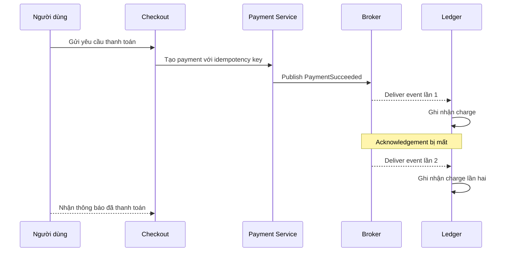

# Chuyển sự cố production thành thông tin điều chỉnh chiến lược

Một sự cố production cho thấy sản phẩm đã thất bại trong điều kiện sử dụng thực tế. Giá trị của việc điều tra không dừng ở khôi phục dịch vụ hoặc sửa lỗi cụ thể. Sự cố còn cung cấp bằng chứng về những giả định sai, rủi ro chưa được nhận diện, giới hạn của môi trường kiểm thử và khoảng trống trong cách nhóm thiết kế, thực hiện hoặc đánh giá kiểm thử.

Nếu chỉ sửa lỗi và đóng ticket, cùng một cơ chế thất bại có thể xuất hiện ở tính năng khác, dịch vụ khác hoặc lần phát hành sau. Chuyển sự cố production thành thông tin điều chỉnh chiến lược nghĩa là biến bằng chứng từ vận hành thành thay đổi có chủ đích trong mô hình rủi ro, danh mục kiểm thử, dữ liệu, môi trường, tiêu chí phát hành, khả năng quan sát và trách nhiệm của các nhóm.

Quá trình này cần giữ được mối liên hệ từ sự kiện thực tế đến quyết định cải tiến: điều gì đã xảy ra, vì sao các lớp bảo vệ không ngăn hoặc phát hiện sớm, kiểm thử nào cần thay đổi, ai chịu trách nhiệm và làm thế nào biết thay đổi đó có hiệu quả.

## 1. Phân biệt sự cố, lỗi và tín hiệu học hỏi

**Sự cố production (production incident)** là sự kiện làm suy giảm hoặc đe dọa tính đúng đắn, tính sẵn sàng, hiệu năng, bảo mật hoặc khả năng sử dụng của dịch vụ trong môi trường thực. Sự cố có thể do một lỗi phần mềm, cấu hình, dữ liệu, hạ tầng, phụ thuộc bên ngoài, quy trình vận hành hoặc sự kết hợp của nhiều yếu tố.

**Defect** là một sai lệch trong sản phẩm hoặc thành phần liên quan so với yêu cầu, hợp đồng hay hành vi được kỳ vọng. Một defect có thể chưa gây sự cố production; ngược lại, một sự cố có thể xuất phát từ nhiều defect và điều kiện vận hành kết hợp.

**Near miss** là tình huống suýt gây sự cố hoặc đã được kiểm soát trước khi tác động lan tới người dùng. Near miss cũng là nguồn bằng chứng quan trọng. Ví dụ, cảnh báo phát hiện một giao dịch bị xử lý hai lần nhưng cơ chế đối soát đã ngăn ghi nhận trùng; đây là tín hiệu cho thấy rủi ro vẫn tồn tại dù chưa có thiệt hại.

**Tín hiệu học hỏi** là thông tin từ sự cố, near miss, phản hồi người dùng, log, trace, dữ liệu vận hành hoặc điều tra kỹ thuật có thể làm thay đổi cách nhóm đánh giá và kiểm soát rủi ro.

| Khái niệm | Trọng tâm | Câu hỏi |
| --- | --- | --- |
| Sự cố | Tác động thực tế và khôi phục dịch vụ | Điều gì đang ảnh hưởng người dùng và cần ổn định ra sao? |
| Defect | Sai lệch cần sửa | Hành vi hoặc thành phần nào không đáp ứng yêu cầu? |
| Near miss | Tín hiệu trước khi có tác động lớn | Lớp kiểm soát nào đã ngăn hậu quả và còn yếu ở đâu? |
| Học hỏi sau sự cố | Thay đổi hệ thống và cách làm | Cần điều chỉnh chiến lược nào để giảm khả năng tái diễn hoặc giảm tác động? |

Không phải mọi sự cố đều dẫn đến một bài kiểm thử mới. Có thể cần thay đổi thiết kế, cảnh báo, runbook, cấu hình, phân quyền hoặc quy trình phê duyệt. Ngược lại, không phải mọi bài học đều được giải quyết bằng một bản sửa mã.

## 2. Vì sao phải đưa sự cố vào chiến lược kiểm thử?

Kiểm thử được thiết kế dựa trên hiểu biết về rủi ro. Khi sự cố production xảy ra, hiểu biết đó có thể đã thiếu hoặc sai. Nếu nhóm không cập nhật, chiến lược kiểm thử tiếp tục bảo vệ sản phẩm theo những giả định đã bị thực tế bác bỏ.

Sự cố có thể chỉ ra:

- Một hành trình quan trọng chưa có kiểm thử hoặc được kiểm tra ở tầng không phù hợp.
- Một test có tồn tại nhưng assertion không kiểm tra đúng kết quả nghiệp vụ.
- Dữ liệu kiểm thử không đại diện cho quy mô, phân bố, trạng thái hoặc dữ liệu bất thường trong production.
- Môi trường kiểm thử không mô phỏng được tải, độ trễ, thứ tự sự kiện hoặc phụ thuộc thật.
- Kiểm thử hợp đồng bỏ sót khác biệt giữa provider và consumer.
- Một lỗi chỉ xuất hiện sau thời gian dài, khi có tải đồng thời hoặc khi một phụ thuộc gặp lỗi.
- Pipeline có kiểm thử nhưng phản hồi quá chậm hoặc failure bị phân loại sai.
- Thiếu log, trace, metric hoặc cảnh báo khiến nhóm phát hiện muộn và khó xác định nguyên nhân.
- Cổng phát hành không yêu cầu bằng chứng cho một rủi ro quan trọng.

Chiến lược cần thay đổi ở đúng điểm kiểm soát. Ví dụ, nếu sự cố do consumer xử lý sự kiện trùng, thêm một E2E kiểm tra đường đi thành công có thể chưa đủ. Nhóm có thể cần kiểm thử idempotency ở tầng tích hợp, mô phỏng giao nhận trùng, kiểm tra trạng thái dữ liệu và theo dõi metric số lần áp dụng nghiệp vụ.

## 3. Thu thập dữ liệu sự cố trước khi rút ra bài học

Không nên điều chỉnh chiến lược chỉ dựa trên một dòng thông báo hoặc trí nhớ của người tham gia. Trước tiên cần dựng lại sự kiện từ bằng chứng có thể xác minh.

### Thông tin tối thiểu

- **Mốc thời gian:** thời điểm bắt đầu, phát hiện, cảnh báo, giảm thiểu, khôi phục và xác nhận ổn định.
- **Phạm vi ảnh hưởng:** người dùng, tenant, khu vực, API, giao dịch, dữ liệu hoặc dịch vụ bị tác động.
- **Triệu chứng:** điều người dùng và hệ thống quan sát được, gồm lỗi, độ trễ, dữ liệu sai hoặc gián đoạn.
- **Điều kiện kích hoạt:** thay đổi gần nhất, loại dữ liệu, tải, thứ tự sự kiện, cấu hình hoặc trạng thái phụ thuộc.
- **Phiên bản:** build, commit, image, cấu hình và dependency liên quan.
- **Bằng chứng kỹ thuật:** log, trace, metric, request ID, event ID, trạng thái database, queue và kết quả kiểm tra.
- **Biện pháp ứng phó:** rollback, tắt feature flag, giới hạn lưu lượng, chạy đối soát, khôi phục dữ liệu hoặc thay đổi cấu hình.
- **Kết quả:** thời gian gián đoạn, số lượng bản ghi/giao dịch bị ảnh hưởng, phần dữ liệu cần sửa và trạng thái cuối.
- **Bất định:** điều gì chưa thể xác minh, dữ liệu nào không còn hoặc giả định nào vẫn cần kiểm tra.

### Phân biệt dữ kiện và giả thuyết

Hồ sơ nên tách:

- **Dữ kiện đã xác minh:** ví dụ, 126 yêu cầu thanh toán có cùng khóa idempotency tạo ra 2 charge record trong khoảng 4 phút.
- **Giả thuyết:** ví dụ, consumer xử lý lại sự kiện sau khi acknowledgement bị mất.
- **Điều chưa biết:** ví dụ, chưa xác định được liệu mọi giao dịch trùng đều đến từ cùng một đường retry.
- **Kết luận tạm thời:** giả thuyết hiện phù hợp nhất với bằng chứng nhưng cần thêm xác minh.

Không nên viết giả thuyết thành nguyên nhân đã được chứng minh. Nếu log hoặc dữ liệu bị thiếu, hãy ghi giới hạn đó; đừng lấp khoảng trống bằng suy đoán.

### Bảo vệ thông tin trong hồ sơ

Log, trace và bản ghi sự cố có thể chứa dữ liệu cá nhân, token hoặc thông tin kinh doanh. Khi tạo báo cáo học hỏi, chỉ giữ dữ liệu cần thiết, che bí mật, dùng mã định danh thay thế và giới hạn quyền truy cập theo chính sách. Không đưa dump production nguyên vẹn vào tài liệu kiểm thử hoặc kho chia sẻ rộng.

## 4. Dựng dòng thời gian và hiểu cách sự cố lan truyền

Dòng thời gian giúp xác định thứ tự sự kiện, khoảng trễ và thời điểm các lớp kiểm soát hoạt động. Với hệ thống phân tán, cần liên kết sự kiện bằng trace ID, correlation ID, request ID hoặc business ID phù hợp.

Ví dụ một luồng thanh toán:



Trong ví dụ, sự cố không chỉ nằm ở thông điệp được giao hai lần. Cần xem consumer có bảo đảm idempotency không, trạng thái xử lý được lưu ở đâu, việc ghi ledger có nguyên tử không, và acknowledgement được gửi vào thời điểm nào.

Dòng thời gian nên ghi rõ mốc mà nhóm biết sự cố đã xảy ra so với mốc sự cố thực sự bắt đầu. Nếu cảnh báo đến muộn 20 phút, đó là một khoảng trống phát hiện cần được phân tích riêng với nguyên nhân gây lỗi.

## 5. Phân tích nguyên nhân và các yếu tố góp phần

Mục tiêu của phân tích sau sự cố là hiểu cơ chế và điều kiện khiến hệ thống thất bại, không tìm một cá nhân để quy trách nhiệm. Cách tiếp cận không đổ lỗi giúp nhóm xem xét cả thiết kế, công cụ, thông tin, quy trình và giới hạn tổ chức.

### Phân tích nhiều lớp

Có thể xem xét các lớp:

1. **Kích hoạt:** sự kiện hoặc thay đổi nào bắt đầu chuỗi vấn đề?
2. **Điều kiện tiềm ẩn:** thiết kế, dữ liệu, cấu hình hoặc phụ thuộc nào khiến hệ thống dễ bị ảnh hưởng?
3. **Lớp phòng ngừa:** vì sao lỗi không bị ngăn từ đầu?
4. **Lớp phát hiện:** vì sao cảnh báo hoặc kiểm thử không phát hiện sớm?
5. **Lớp giới hạn tác động:** vì sao sự cố lan rộng hoặc kéo dài?
6. **Lớp phục hồi:** điều gì làm quá trình khôi phục nhanh hoặc chậm?

### Kỹ thuật hỗ trợ

- **5 Whys:** hỏi “vì sao?” nhiều lần để đi từ triệu chứng đến điều kiện hệ thống sâu hơn. Không ép mọi sự cố vào đúng năm câu hỏi.
- **Fishbone/Ishikawa:** nhóm yếu tố theo con người, quy trình, công nghệ, dữ liệu, môi trường và phụ thuộc.
- **Causal graph:** biểu diễn quan hệ giữa điều kiện, sự kiện và hậu quả; giúp nhận ra nhiều đường dẫn cùng góp phần.
- **Fault tree:** bắt đầu từ hậu quả không mong muốn rồi phân tích các tổ hợp điều kiện có thể dẫn tới hậu quả đó.

Ví dụ 5 Whys rút gọn:

1. Vì sao khách hàng bị ghi nhận hai lần thanh toán? Vì ledger tạo hai charge record.
2. Vì sao ledger xử lý hai lần? Vì cùng sự kiện được giao lại và consumer không nhận diện lần xử lý trước.
3. Vì sao consumer không nhận diện? Vì khóa idempotency chỉ được kiểm tra ở một tiến trình, không được lưu bền vững cùng giao dịch.
4. Vì sao kiểm thử không phát hiện? Vì test chỉ kiểm tra một lần giao sự kiện và không mô phỏng acknowledgement bị mất.
5. Vì sao kịch bản đó chưa có? Vì chiến lược kiểm thử chưa xem giao nhận lặp là rủi ro trọng yếu của luồng ledger.

Kết luận không nên dừng ở “thiếu một test”. Có thể còn cần thay đổi cơ chế lưu khóa idempotency, transaction, metric và quy tắc release.

### Tránh kết luận đơn nguyên nhân

Trong hệ thống phức tạp, sự cố thường cần nhiều điều kiện cùng xảy ra. Một timeout có thể kết hợp với retry không an toàn, dữ liệu dùng chung và cảnh báo chậm. Sửa một yếu tố có thể giảm rủi ro nhưng không loại bỏ mọi đường dẫn gây hậu quả.

Phân tích nên nêu:

- Nguyên nhân trực tiếp đã được xác minh.
- Các yếu tố góp phần.
- Những lớp bảo vệ đã hoạt động.
- Những lớp bảo vệ không hoạt động hoặc không tồn tại.
- Các giả thuyết còn mở và cách xác minh.

## 6. Xác định khoảng trống trong chiến lược kiểm thử

Không phải cứ không có test là có khoảng trống; có thể rủi ro đã được kiểm soát bằng cơ chế khác. Ngược lại, có test nhưng không có assertion đủ mạnh cũng là khoảng trống.

Các câu hỏi đánh giá:

- Rủi ro này đã được nhận diện trước sự cố chưa?
- Có kiểm thử nào được liên kết với rủi ro không?
- Test có chạy trong pipeline hoặc trước release không?
- Test có tái tạo đúng điều kiện kích hoạt không?
- Test oracle có kiểm tra hậu quả nghiệp vụ hay chỉ kiểm tra phản hồi bề mặt?
- Dữ liệu, tải, thời gian và môi trường có đại diện không?
- Test có chạy đủ thường xuyên để phát hiện lỗi trước khi triển khai không?
- Failure có được phân loại và điều tra hay bị retry/skip?
- Có metric hoặc cảnh báo production để phát hiện sớm nếu lỗi vẫn lọt không?
- Có phương án giới hạn tác động và phục hồi được diễn tập không?

Có thể phân loại khoảng trống:

| Loại khoảng trống | Biểu hiện | Ví dụ điều chỉnh |
| --- | --- | --- |
| Nhận diện rủi ro | Rủi ro chưa có trong risk register | Bổ sung rủi ro và chủ sở hữu |
| Thiết kế kiểm thử | Có rủi ro nhưng chưa có test phù hợp | Thiết kế tình huống và oracle mới |
| Tầng kiểm thử | Chỉ có E2E chậm hoặc test đơn vị quá cô lập | Bổ sung integration/contract/system test tại ranh giới phù hợp |
| Dữ liệu | Thiếu dữ liệu biên, dữ liệu lớn hoặc trạng thái bất thường | Tạo fixture và dữ liệu tổng hợp đại diện |
| Môi trường | Không mô phỏng được tải hoặc lỗi phụ thuộc | Bổ sung môi trường thử, fault injection hoặc sandbox |
| Tần suất | Test có nhưng chỉ chạy thủ công trước release | Đưa kiểm tra phù hợp vào CI hoặc lịch định kỳ |
| Assertion/oracle | Test chạy nhưng không kiểm tra hậu quả thực | Kiểm tra trạng thái, tính toàn vẹn và tác động downstream |
| Phát hiện | Sự cố kéo dài trước khi cảnh báo | Bổ sung SLI, alert, trace và runbook |
| Phục hồi | Không có kiểm tra rollback/restore | Diễn tập phục hồi và xác minh dữ liệu |

## 7. Chuyển sự cố thành thay đổi trong danh mục kiểm thử

Chiến lược kiểm thử nên được cập nhật theo rủi ro và tầng phù hợp, không chỉ thêm một test có tên giống sự cố.

### Unit/component tests

Phù hợp để kiểm tra quy tắc cục bộ, giá trị biên, chuyển trạng thái và tính toán. Ví dụ: cùng idempotency key phải trả về cùng kết quả logic; mã giảm giá hết hạn không được áp dụng; trạng thái đã hủy không thể quay về đang xử lý.

### Integration tests

Phù hợp với transaction, database, broker, cache, API và các phụ thuộc ở ranh giới. Ví dụ: consumer nhận cùng event hai lần nhưng chỉ ghi một giao dịch; lỗi ghi database không làm acknowledgement bị gửi sớm.

### Contract tests

Phù hợp khi sự cố liên quan schema, trường dữ liệu, mã lỗi, thứ tự hoặc cách diễn giải hợp đồng giữa provider và consumer. Cần cập nhật hợp đồng và xác minh cả hai phía nếu thay đổi hành vi được thống nhất.

### System/E2E tests

Chọn một số hành trình đại diện để xác minh kết quả nghiệp vụ xuyên nhiều thành phần. Ví dụ: khách hàng thanh toán một lần, đơn đạt trạng thái đã thanh toán và ledger chỉ có một giao dịch logic.

### Non-functional tests

Nếu sự cố liên quan tải, độ trễ, độ tin cậy, bảo mật hoặc phục hồi, cần bổ sung bài đo tương ứng. Một test chức năng thành công không chứng minh hệ thống chịu được tải hoặc phục hồi đúng sau lỗi.

### Exploratory/manual tests

Dùng để khám phá hành vi mới, tương tác người dùng, tổ hợp điều kiện khó mô hình hóa và các giả thuyết chưa đủ ổn định để tự động hóa. Kết quả khám phá nên tạo ra bằng chứng và giả thuyết có thể chuyển thành kiểm thử lặp lại khi phù hợp.

### Chọn tầng theo câu hỏi

| Câu hỏi từ sự cố | Tầng phù hợp thường gặp |
| --- | --- |
| Quy tắc nghiệp vụ có xử lý đúng giá trị biên? | Unit/component |
| Ghi dữ liệu và phát sự kiện có nhất quán? | Integration |
| Provider và consumer có hiểu cùng schema/trạng thái? | Contract |
| Toàn bộ hành trình có tạo kết quả đúng? | System/E2E |
| Hệ thống chịu được tải hoặc phụ thuộc chậm? | Performance/resilience |
| Người dùng có hiểu trạng thái khi xử lý chậm? | Exploratory/usability |

Không nên giải quyết mọi sự cố bằng một E2E mới. Hãy đặt kiểm tra ở tầng thấp nhất có thể phát hiện cơ chế lỗi một cách ổn định, rồi bổ sung tầng cao hơn nếu cần bằng chứng về tương tác hoặc kết quả nghiệp vụ.

## 8. Thiết kế kiểm thử hồi quy từ sự cố mà không overfit

Một lỗi production thường có một bộ điều kiện cụ thể. Nếu chỉ sao chép đúng dữ liệu và bước tái hiện đó, test có thể phát hiện cùng lỗi trong tương lai nhưng bỏ lỡ biến thể cùng cơ chế.

Để mở rộng hợp lý:

1. Xác định bất biến nghiệp vụ bị vi phạm, ví dụ “một giao dịch logic chỉ được ghi nhận một lần”.
2. Xác định cơ chế gây lỗi, ví dụ giao nhận ít nhất một lần và acknowledgement bị mất.
3. Tạo biến thể quanh cơ chế: gửi trùng, retry sau timeout, consumer restart, sự kiện đến muộn và xử lý song song.
4. Xác định dữ liệu, trạng thái và điều kiện biên cần có.
5. Chọn test ở tầng phù hợp và kiểm tra cả kết quả lẫn tác dụng phụ.
6. Giữ test tái hiện chính xác sự cố làm test hồi quy nếu nó có giá trị ổn định.
7. Rà soát xem test mới có trùng lặp hoặc phụ thuộc chi tiết triển khai không.

Ví dụ, thay vì chỉ kiểm tra event ID cụ thể trong sự cố, hãy kiểm tra bất biến: nhiều lần giao cùng một event không tạo nhiều tác động nghiệp vụ. Có thể bổ sung trường hợp hai event ID khác nhau nhưng cùng business key nếu nghiệp vụ yêu cầu chống trùng theo khóa giao dịch.

## 9. Cập nhật mô hình rủi ro và ưu tiên

Sự cố production là bằng chứng mới để đánh giá lại khả năng xảy ra, tác động, mức phơi lộ và khả năng phát hiện. Một rủi ro từng được xếp thấp có thể cần nâng ưu tiên nếu thực tế cho thấy hậu quả lớn hơn dự kiến.

Khi cập nhật risk register, ghi:

- Mô tả rủi ro theo sự kiện và hậu quả.
- Nguyên nhân và điều kiện kích hoạt đã biết.
- Phạm vi người dùng, dữ liệu và dịch vụ bị ảnh hưởng.
- Khả năng xảy ra trước và sau khi có thêm bằng chứng.
- Tác động và mức độ nghiêm trọng.
- Các kiểm soát đã có và hiệu quả quan sát được.
- Rủi ro còn lại, chủ sở hữu và hành động tiếp theo.
- Liên kết tới incident, defect, test và quyết định phát hành.

Không nên tự động nâng mọi rủi ro của một thành phần lên mức cao chỉ vì có một sự cố. Hãy xem xét tần suất, điều kiện, phạm vi và các biện pháp đã chứng minh hiệu quả. Ngược lại, sự cố hiếm nhưng có hậu quả nghiêm trọng có thể vẫn cần ưu tiên cao.

### Điều chỉnh chiến lược theo mức rủi ro

| Kết quả đánh giá | Điều chỉnh có thể cần |
| --- | --- |
| Rủi ro được nhận diện nhưng kiểm thử yếu | Bổ sung test và assertion ở tầng phù hợp |
| Rủi ro chưa từng được nhận diện | Cập nhật risk register, owner và tiêu chí chất lượng |
| Test có nhưng chạy quá muộn | Đưa kiểm tra nhanh hơn vào pull request/CI hoặc tăng tần suất chạy |
| Test chỉ chạy trong môi trường không đại diện | Cải thiện dữ liệu, cấu hình, tải hoặc sandbox |
| Lỗi khó phát hiện trong production | Bổ sung telemetry, alert và runbook |
| Tác động lan rộng quá nhanh | Thêm giới hạn rollout, circuit breaker, feature flag hoặc kiểm soát cô lập |
| Khôi phục chậm | Diễn tập rollback, restore, replay hoặc reconciliation |

## 10. Điều chỉnh môi trường và dữ liệu kiểm thử

Điều kiện production có thể khác xa môi trường test. Sự cố có thể bộc lộ khác biệt về số lượng bản ghi, phân bố dữ liệu, quyền, thời gian, vùng triển khai, network, cấu hình hoặc hành vi nhà cung cấp.

### Dữ liệu

Xem xét bổ sung:

- Dữ liệu có kích thước và phân bố gần production.
- Bản ghi trùng, thiếu trường, null, dữ liệu cũ và dữ liệu biên.
- Trạng thái chuyển tiếp hoặc dữ liệu không nhất quán.
- Tổ hợp giao dịch đồng thời và thứ tự cập nhật.
- Dữ liệu lớn để kiểm tra truy vấn, index và thời gian xử lý.

Ưu tiên dữ liệu tổng hợp hoặc dữ liệu đã xử lý phù hợp. Không sao chép dữ liệu cá nhân production vào môi trường kiểm thử chỉ để tái hiện thuận tiện. Nếu cần dữ liệu nhạy cảm, phải có căn cứ, phê duyệt và biện pháp bảo vệ riêng.

### Môi trường

Đối chiếu production và test về:

- Phiên bản runtime, thư viện, container image và cấu hình.
- Số instance, autoscaling, giới hạn CPU/bộ nhớ và network.
- Database engine, index, replication, transaction isolation.
- Broker, partition, retention, consumer group và retry policy.
- Cache, TTL, clock, timezone và đồng bộ thời gian.
- Endpoint, chứng thư, rate limit và độ trễ của phụ thuộc.

Không nhất thiết tái tạo production hoàn toàn. Cần xác định khác biệt nào có thể ảnh hưởng đến rủi ro và bổ sung kiểm thử hoặc môi trường mô phỏng để kiểm tra các khác biệt quan trọng.

### Fault injection và chaos testing

Khi sự cố liên quan đến lỗi phụ thuộc, có thể chủ động mô phỏng timeout, mất kết nối, độ trễ, restart, giới hạn tài nguyên hoặc giao nhận lặp. Bài thử phải có phạm vi an toàn, điều kiện dừng và khả năng khôi phục.

Không chạy fault injection trên production tùy tiện. Thử nghiệm production chỉ được thực hiện theo quy trình được phê duyệt, với phạm vi giới hạn, giám sát và phương án dừng.

## 11. Cải thiện khả năng quan sát và phát hiện

Một sự cố có thể không tránh được hoàn toàn. Chiến lược cần giảm thời gian phát hiện và giúp xác định nguyên nhân trước khi tác động lan rộng.

Các nguồn quan sát:

- **Metrics:** tỷ lệ lỗi, latency theo phân vị, thông lượng, queue lag, retry count, số giao dịch trùng hoặc backlog.
- **Logs:** sự kiện có cấu trúc, mã lỗi, business ID, event ID và trạng thái xử lý.
- **Traces:** liên kết thao tác xuyên dịch vụ bằng trace ID và span.
- **Audit trail:** ai thực hiện hành động nhạy cảm, với tài nguyên nào và khi nào.
- **User signals:** phản hồi hỗ trợ, khiếu nại, tỷ lệ bỏ dở và hành vi bất thường.

### Từ sự cố tới chỉ số và cảnh báo

Mỗi bài học nên xem xét:

1. Có chỉ số nào có thể báo hiệu điều kiện gây sự cố trước khi hậu quả xảy ra không?
2. Chỉ số có đo kết quả nghiệp vụ hay chỉ đo sức khỏe hạ tầng?
3. Ngưỡng cảnh báo có đủ sớm nhưng không gây quá nhiều cảnh báo giả không?
4. Ai nhận cảnh báo và cần hành động gì?
5. Có runbook giải thích cách xác minh, giảm thiểu và khôi phục không?

Ví dụ, queue depth tăng có thể là tín hiệu nhưng chưa chắc cho biết người dùng bị ảnh hưởng. Kết hợp queue lag, tuổi thông điệp lâu nhất, tỷ lệ xử lý thành công và số đơn đang ở trạng thái chờ sẽ giúp hiểu tác động nghiệp vụ tốt hơn.

### Kiểm thử cảnh báo

Cảnh báo cũng cần được kiểm thử. Có thể mô phỏng điều kiện vượt ngưỡng trong môi trường an toàn, xác minh thông báo đến đúng người, nội dung có ngữ cảnh và runbook hoạt động. Một cảnh báo chưa được diễn tập có thể không hữu ích khi sự cố thật xảy ra.

## 12. Điều chỉnh cổng phát hành và quy trình triển khai

Nếu sự cố lọt qua release gate, cần hỏi cổng đó thiếu tiêu chí hay tiêu chí đã có nhưng không được thực thi.

Các điều chỉnh có thể gồm:

- Thêm test hoặc bằng chứng bắt buộc cho rủi ro đã được xác nhận.
- Yêu cầu kiểm tra hợp đồng provider/consumer trước khi nâng phiên bản.
- Thêm bài kiểm thử tải, soak, phục hồi hoặc bảo mật theo mức rủi ro.
- Không cho phép bỏ qua test quan trọng nếu chưa có phê duyệt ngoại lệ.
- Yêu cầu trạng thái môi trường và dữ liệu kiểm thử hợp lệ trước khi chạy.
- Áp dụng canary hoặc rollout theo đợt để giới hạn phạm vi.
- Bổ sung điều kiện rollback hoặc tắt feature flag khi chỉ số vượt ngưỡng.
- Kiểm tra runbook, backup, restore và người trực trước release.

Không nên thêm cổng mới chỉ để phản ứng với một sự cố nếu không có cơ chế đo và người chịu trách nhiệm. Một gate không có dữ liệu tin cậy hoặc không ai xử lý khi thất bại chỉ tạo thêm thủ tục.

### Phân biệt cổng chặn và cảnh báo

- **Blocking gate:** điều kiện bắt buộc; không đạt thì pipeline hoặc release không được tiếp tục theo quy trình.
- **Warning/advisory:** tín hiệu cần xem xét nhưng không tự động chặn; phải có người đánh giá nếu liên quan rủi ro đáng kể.
- **Conditional approval:** ngoại lệ có phạm vi, người phê duyệt, thời hạn, kiểm soát và điều kiện dừng.

Không chuyển một lỗi nghiêm trọng thành cảnh báo chỉ để tránh chặn release. Nếu có ngoại lệ được phép, phải theo đúng thẩm quyền và ghi lại quyết định.

## 13. Biến bài học thành hành động có chủ sở hữu

Postmortem chỉ tạo giá trị khi hành động được thực hiện và xác minh. Mỗi hành động cần mô tả kết quả mong muốn, không chỉ là công việc chung chung.

Một action item nên có:

- Mã và liên kết tới sự cố.
- Mô tả vấn đề hoặc khoảng trống cần xử lý.
- Loại hành động: sản phẩm, kiểm thử, dữ liệu, môi trường, quan sát, quy trình hoặc đào tạo.
- Chủ sở hữu chịu trách nhiệm cuối cùng.
- Người thực hiện và nhóm phụ thuộc.
- Hạn hoàn thành và mức ưu tiên.
- Bằng chứng đóng và người xác minh.
- Chỉ số hoặc cách đánh giá hiệu quả sau khi hoàn tất.

Ví dụ hành động chưa đủ: “Thêm test cho thanh toán.”

Ví dụ hành động có thể xác minh: “Bổ sung integration test mô phỏng cùng `PaymentSucceeded` được giao hai lần sau khi consumer restart; xác minh chỉ có một ledger entry và metric duplicate-event được cập nhật; Payments team sở hữu, QA xác minh trên build phát hành.”

### Phân loại hành động

| Loại | Ví dụ | Bằng chứng hoàn tất |
| --- | --- | --- |
| Sửa sản phẩm | Lưu idempotency key bền vững cùng transaction | Code review, migration và test tích hợp đạt |
| Bổ sung kiểm thử | Test duplicate delivery và consumer restart | Test chạy trong CI, liên kết với risk/incident |
| Cải thiện dữ liệu/môi trường | Tạo fixture có sự kiện trùng và trạng thái retry | Bộ dữ liệu được version hóa và tái sử dụng an toàn |
| Quan sát | Metric duplicate charge và alert theo ngưỡng | Dashboard, alert test và runbook đã xác minh |
| Release/process | Thêm gate cho kiểm thử retry và rollout giới hạn | Pipeline/release checklist cập nhật và được diễn tập |
| Tổ chức/đào tạo | Làm rõ on-call và quyền quyết định trong incident | RACI, lịch trực và diễn tập được xác nhận |

Không nên đóng action item chỉ vì code đã merge hoặc tài liệu đã cập nhật. Cần kiểm tra bằng chứng và xác nhận khoảng trống mà hành động nhắm tới đã được giảm.

## 14. Ưu tiên hành động theo rủi ro và khả năng giảm thiểu

Không phải mọi hành động đều có thể hoàn thành ngay. Hãy ưu tiên theo:

- Mức độ nghiêm trọng của hậu quả nếu sự cố tái diễn.
- Khả năng và mức độ phơi lộ của điều kiện gây sự cố.
- Số lượng người dùng, giao dịch hoặc dữ liệu có thể bị ảnh hưởng.
- Khả năng phát hiện và khôi phục hiện tại.
- Hiệu quả dự kiến của hành động.
- Thời gian, độ phức tạp và phụ thuộc cần thiết.

Có thể ưu tiên trước các biện pháp giảm thiểu tác động nhanh, như tắt feature flag hoặc thêm cảnh báo, đồng thời triển khai giải pháp gốc. Tuy nhiên, biện pháp tạm thời phải có thời hạn và không được làm mất dấu hành động dài hạn.

Ví dụ, sau sự cố giao dịch trùng:

1. Ngay lập tức chạy đối soát và giới hạn retry không an toàn.
2. Thêm cảnh báo khi một business key có nhiều ledger entry.
3. Sửa cơ chế idempotency và transaction.
4. Bổ sung kiểm thử integration cho duplicate delivery và restart.
5. Chạy kiểm thử tải/đồng thời và xác minh khả năng phục hồi.
6. Rà soát các dịch vụ khác dùng chung thư viện hoặc mẫu xử lý.

## 15. Đo xem chiến lược đã cải thiện chưa

Không nên đánh giá hiệu quả chỉ bằng số lượng action item đã đóng hoặc số test mới được thêm. Cần đo xem rủi ro có giảm, phát hiện có nhanh hơn và khả năng phục hồi có tốt hơn không.

Các chỉ số có thể theo dõi:

- **Tỷ lệ sự cố tái diễn:** số sự cố cùng cơ chế hoặc cùng nguyên nhân trong cửa sổ theo dõi.
- **Escaped defects theo nhóm rủi ro:** lỗi production liên quan tới các hành vi đã được xác định trọng yếu.
- **Thời gian phát hiện (MTTD):** thời gian từ lúc sự cố bắt đầu đến lúc được phát hiện.
- **Thời gian khôi phục (MTTR):** cần định nghĩa rõ mốc bắt đầu/kết thúc và loại sự cố được tính.
- **Tỷ lệ hành động đúng hạn:** hành động sau sự cố được hoàn tất và xác minh trong hạn.
- **Tỷ lệ rủi ro cao có bằng chứng hiện hành:** phần rủi ro ưu tiên cao có kiểm thử hoặc kiểm soát được xác minh.
- **Độ tin cậy cảnh báo:** tỷ lệ cảnh báo có thể hành động và thời gian phản hồi.
- **Thời gian phát hiện trong pipeline:** khoảng thời gian từ thay đổi đến khi kiểm thử phát hiện vấn đề.

Cần định nghĩa mẫu số, cửa sổ thời gian, cách nhóm sự cố tương tự và nguồn dữ liệu. Một sự cố lớn có thể được ghi thành nhiều ticket; nếu đếm ticket thay vì incident, xu hướng sẽ sai.

### Đọc chỉ số cùng bối cảnh

Số sự cố giảm có thể do sản phẩm tốt hơn, nhưng cũng có thể do lượng sử dụng giảm hoặc phát hiện kém. Số lỗi được phát hiện trong CI tăng có thể cho thấy kiểm thử tốt hơn hoặc chất lượng thay đổi suy giảm. MTTD giảm nhưng số cảnh báo giả tăng có thể khiến đội vận hành quá tải.

Vì vậy, nên kết hợp chỉ số kết quả với chỉ số bảo vệ và bằng chứng định tính từ người dùng, postmortem và diễn tập.

## 16. Ví dụ tổng hợp: sự cố backlog thông điệp

Giả sử một dịch vụ thông báo xử lý chậm sau một đợt phát hành. Queue backlog tăng trong giờ cao điểm; một số khách hàng nhận thông báo xác nhận muộn 25 phút. Không có dữ liệu giao dịch bị mất, nhưng người dùng gửi yêu cầu nhiều lần vì tưởng thao tác chưa thành công.

### Bằng chứng và phân tích

- Thay đổi gần nhất tăng số event được phát cho mỗi đơn hàng.
- Consumer xử lý tuần tự và không mở rộng theo độ sâu queue.
- Test tích hợp chỉ gửi vài thông điệp, không kiểm tra tải hoặc tốc độ tiêu thụ.
- Dashboard có queue depth nhưng không có tuổi thông điệp lâu nhất hoặc tỷ lệ hoàn tất nghiệp vụ.
- Không có hướng dẫn cho support giải thích trạng thái đang chờ.

Nguyên nhân không chỉ là “consumer chậm”. Sự cố cho thấy thiếu kiểm tra năng lực xử lý ở tải đại diện, thiếu chỉ số phản ánh độ trễ người dùng, và thiếu hướng dẫn vận hành.

### Điều chỉnh chiến lược

1. Bổ sung load test với tốc độ phát event tương ứng giờ cao điểm và burst.
2. Bổ sung soak test để phát hiện backlog tăng dần hoặc rò rỉ tài nguyên.
3. Kiểm thử retry, consumer restart và thông điệp trùng để bảo đảm xử lý an toàn khi mở rộng.
4. Đặt SLI cho tuổi thông điệp và thời gian từ hành động người dùng đến trạng thái cuối.
5. Tạo alert khi backlog hoặc message age vượt ngưỡng có ý nghĩa nghiệp vụ.
6. Cập nhật runbook và nội dung trạng thái trên giao diện để người dùng hiểu yêu cầu đang được xử lý.
7. Bổ sung rollout theo đợt và điều kiện dừng nếu độ trễ tăng nhanh.
8. Gán owner, hạn và bằng chứng cho từng hành động; xem lại sau các đợt phát hành tiếp theo.

### Cách xác minh cải tiến

Nhóm không chỉ kiểm tra load test mới đạt. Cần xác minh backlog không tăng không kiểm soát, message age nằm trong mục tiêu, thông báo không bị gửi trùng, cảnh báo kích hoạt đúng và đội vận hành có thể thực hiện runbook. Sau release, theo dõi xu hướng thực tế để xem giả định tải và ngưỡng có phù hợp.

## 17. Tích hợp bài học vào các tài liệu và quy trình

Để bài học không bị thất lạc, cập nhật các nguồn phù hợp:

- **Risk register:** bổ sung hoặc điều chỉnh rủi ro, tác động, chủ sở hữu và kiểm soát.
- **Test strategy:** thay đổi ưu tiên, tầng kiểm thử, tần suất và điều kiện chạy.
- **Test cases/suites:** thêm, sửa hoặc loại bỏ test có căn cứ; liên kết với incident và defect.
- **Test data specification:** cập nhật dữ liệu biên, dữ liệu bất thường và cách tạo dữ liệu an toàn.
- **Environment specification:** ghi cấu hình, phụ thuộc và khác biệt production/test quan trọng.
- **Quality criteria/release gates:** bổ sung tiêu chí, ngưỡng hoặc điều kiện chặn khi cần.
- **Observability/runbook:** cập nhật metric, log, trace, cảnh báo và quy trình ứng phó.
- **Ownership/RACI:** làm rõ người theo dõi, người quyết định và cơ chế escalation.
- **Training/knowledge base:** chia sẻ mẫu lỗi và cách nhận biết để giảm phụ thuộc vào trí nhớ cá nhân.

Không cần cập nhật mọi tài liệu cho mọi sự cố. Chỉ sửa nguồn có liên quan, nhưng phải bảo đảm thông tin được đồng bộ và có phiên bản.

## 18. Tổ chức postmortem không đổ lỗi

Postmortem là buổi hoặc tài liệu phân tích sau sự cố nhằm hiểu điều gì đã xảy ra và cải thiện hệ thống. Một postmortem hữu ích:

- Tập trung vào điều kiện, quyết định, công cụ và cơ chế hệ thống.
- Dựa trên dòng thời gian và bằng chứng.
- Ghi nhận cả những điều đã hoạt động tốt, như cảnh báo, rollback hoặc phối hợp.
- Phân biệt dữ kiện, giả thuyết và câu hỏi chưa giải quyết.
- Tạo hành động cụ thể có chủ sở hữu và hạn.
- Chia sẻ bài học tới nhóm có rủi ro hoặc thành phần tương tự.

Tránh các kết luận như “kỹ sư quên kiểm tra” nếu chưa xem xét vì sao quy trình, công cụ hoặc cổng kiểm soát cho phép thiếu sót đó đi qua. Trách nhiệm cá nhân vẫn có thể cần làm rõ trong những trường hợp phù hợp, nhưng mục tiêu của postmortem kỹ thuật là ngăn hệ thống lặp lại điều kiện thất bại.

### Cấu trúc postmortem tham khảo

```text
INCIDENT ID:
SUMMARY:
SEVERITY / IMPACT:
START / DETECTED / MITIGATED / RESOLVED:
AFFECTED USERS / SERVICES / DATA:
CUSTOMER SYMPTOMS:
TIMELINE:
TRIGGERING CHANGE OR CONDITION:
CONFIRMED CAUSES:
CONTRIBUTING FACTORS:
CONTROLS THAT WORKED:
CONTROLS THAT FAILED OR WERE MISSING:
TEST STRATEGY GAPS:
OBSERVABILITY / RESPONSE GAPS:
RECOVERY AND DATA REPAIR:
OPEN QUESTIONS:
ACTIONS (OWNER / DUE / CLOSURE EVIDENCE):
RISK REGISTER UPDATES:
FOLLOW-UP REVIEW DATE:
```

Mẫu này giúp kết nối điều tra với thay đổi chiến lược. Không nên dùng nó như biểu mẫu hành chính chỉ để hoàn tất thủ tục; nội dung phải phản ánh bằng chứng và câu hỏi thực sự của sự cố.

## 19. Tránh các anti-pattern khi chuyển bài học

- **Chỉ thêm test tái hiện chính xác sự cố:** bỏ lỡ cơ chế chung và các biến thể có thể gây hậu quả tương tự.
- **Đổ lỗi cho người thao tác:** bỏ qua thiết kế, thông tin, quy trình và lớp bảo vệ.
- **Sửa triệu chứng nhưng không kiểm tra nguyên nhân:** sự cố có thể tái diễn qua đường dẫn khác.
- **Tăng số test mà không xem assertion:** suite lớn hơn nhưng không tăng khả năng phát hiện.
- **Tạo gate sau mọi sự cố:** pipeline chậm và nhiều cảnh báo nhưng không giảm rủi ro thực.
- **Chỉ đóng action item theo trạng thái ticket:** không xác minh bằng chứng hoặc hiệu quả.
- **Không chia sẻ bài học với nhóm có thành phần tương tự:** cùng một lỗi xuất hiện ở nơi khác.
- **Dùng dữ liệu production không kiểm soát để tái hiện:** tạo thêm rủi ro quyền riêng tư và bảo mật.
- **Đồng nhất sự cố không tái diễn với chiến lược đã tốt:** có thể do ít tải, ít người dùng hoặc thiếu phát hiện.
- **Không ghi bất định:** giả thuyết chưa xác minh bị biến thành sự thật và dẫn đến thay đổi sai.

## 20. Checklist chuyển sự cố production thành điều chỉnh chiến lược

- [ ] Dòng thời gian, phạm vi ảnh hưởng và bằng chứng sự cố được tổng hợp.
- [ ] Dữ kiện, giả thuyết và điều chưa biết được phân biệt.
- [ ] Nguyên nhân trực tiếp và yếu tố góp phần được phân tích.
- [ ] Các lớp phòng ngừa, phát hiện, giới hạn tác động và phục hồi được xem xét.
- [ ] Rủi ro và giả định trong chiến lược hiện tại được đánh giá lại.
- [ ] Khoảng trống về tầng kiểm thử, dữ liệu, môi trường, assertion và tần suất được xác định.
- [ ] Kiểm thử mới hoặc thay đổi kiểm thử được đặt ở tầng phù hợp với cơ chế lỗi.
- [ ] Dữ liệu và môi trường được cập nhật an toàn, có tính đại diện.
- [ ] Metric, alert, trace, runbook và điều kiện dừng được xem xét.
- [ ] Release gate và rollout được điều chỉnh nếu có căn cứ.
- [ ] Mỗi hành động có owner, hạn và bằng chứng đóng.
- [ ] Bài học được đưa vào risk register, test strategy và nguồn tài liệu phù hợp.
- [ ] Hiệu quả được đo lại sau thay đổi và sau các lần phát hành tiếp theo.

## 21. Những điểm cần ghi nhớ

- Sự cố production là bằng chứng về cách hệ thống hoạt động trong thực tế và có thể làm thay đổi hiểu biết về rủi ro.
- Phân biệt sự cố, defect, near miss và tín hiệu học hỏi; không phải mọi bài học đều cần thêm test.
- Thu thập dòng thời gian, phạm vi, phiên bản, dữ liệu, log, trace, metric và giới hạn trước khi kết luận.
- Phân tích nguyên nhân theo nhiều lớp, bao gồm phòng ngừa, phát hiện, giới hạn tác động và phục hồi.
- Xác định khoảng trống thực sự: rủi ro, tầng kiểm thử, dữ liệu, môi trường, assertion, tần suất hoặc khả năng quan sát.
- Chuyển cơ chế thất bại thành kiểm thử hồi quy có tính khái quát, tránh chỉ overfit vào dữ liệu của một sự cố.
- Điều chỉnh risk register, test portfolio, release gate, observability và runbook khi có căn cứ.
- Mọi hành động cần chủ sở hữu, hạn và bằng chứng đóng; trạng thái ticket không tự chứng minh hiệu quả.
- Đo sự cố tái diễn, lỗi lọt, thời gian phát hiện/khôi phục, mức bao phủ rủi ro và chất lượng cảnh báo trong bối cảnh.
- Duy trì postmortem không đổ lỗi và chia sẻ bài học cho các nhóm có rủi ro tương tự.

## Câu hỏi tự kiểm tra

1. Phân biệt sự cố production, defect, near miss và tín hiệu học hỏi.
2. Vì sao chỉ sửa defect và đóng ticket chưa đủ để ngăn sự cố cùng cơ chế tái diễn?
3. Khi dựng dòng thời gian sự cố phân tán, những định danh và bằng chứng nào giúp liên kết các bước?
4. Phân biệt nguyên nhân trực tiếp, yếu tố góp phần và giả thuyết chưa được xác minh.
5. Một sự cố do thông điệp được giao hai lần nên dẫn tới những thay đổi nào ở sản phẩm, kiểm thử, quan sát và release?
6. Làm thế nào chuyển một tình huống production cụ thể thành kiểm thử hồi quy có thể phát hiện các biến thể cùng cơ chế?
7. Khi nào nên bổ sung unit, integration, contract, E2E, non-functional hoặc exploratory test?
8. Vì sao dữ liệu production không nên được sao chép nguyên vẹn vào môi trường kiểm thử chỉ để tái hiện lỗi?
9. Hãy chọn một sự cố đã biết và lập action plan có owner, hạn, bằng chứng đóng và chỉ số đánh giá hiệu quả.
10. Sau khi các action item được đóng, cần theo dõi những tín hiệu nào để xác minh chiến lược thực sự được cải thiện?
