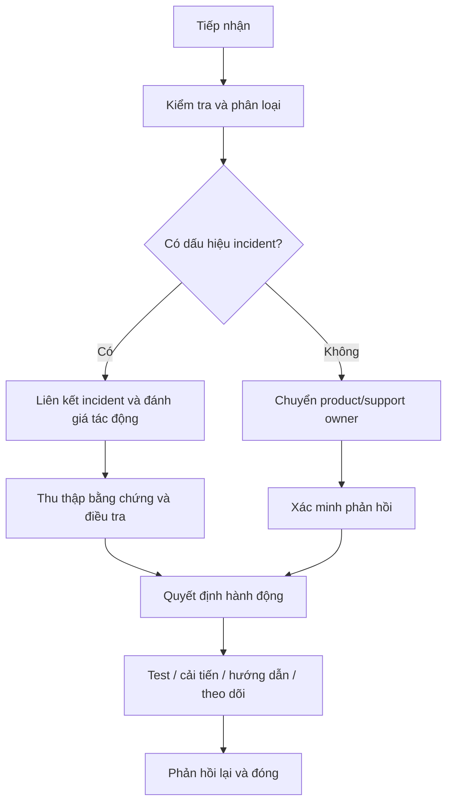

# Thu nhận phản hồi người dùng và dữ liệu sự cố để bổ sung bằng chứng

## Mục tiêu học tập

Sau bài học này, người học có thể:

- Giải thích vai trò của phản hồi người dùng và dữ liệu sự cố trong việc xác minh chất lượng sau phát hành.
- Phân biệt ý kiến, quan sát, tín hiệu vận hành, triệu chứng, bằng chứng và kết luận.
- Xác định các kênh thu nhận phản hồi phù hợp với hành trình và nhóm người dùng.
- Thu thập log, metric, trace, ticket hỗ trợ, báo cáo lỗi và dữ liệu nghiệp vụ theo cách có thể truy nguyên.
- Liên kết phản hồi với phiên bản, môi trường, thời điểm, hành trình và điều kiện xảy ra.
- Phân loại, làm sạch, khử trùng lặp và ưu tiên thông tin mà không làm mất ngữ cảnh quan trọng.
- Đánh giá tính đại diện, độ tin cậy, sai lệch và giới hạn của nguồn dữ liệu.
- Bảo vệ dữ liệu cá nhân, thông tin nhạy cảm và bằng chứng điều tra theo chính sách.
- Chuyển phản hồi và dữ liệu sự cố thành giả thuyết, test case, tiêu chí chất lượng hoặc cải tiến vận hành có thể xác minh.
- Theo dõi kết quả sau khi áp dụng cải tiến và đóng vòng phản hồi với người dùng, đội sản phẩm và đội kỹ thuật.

## 1. Vì sao cần thu nhận phản hồi và dữ liệu sự cố sau phát hành?

Trong phạm vi **VALIDATION_TESTING_STRATEGY**, kiểm thử trước phát hành cung cấp bằng chứng về hành vi trong những điều kiện đã được thiết kế và mô phỏng. Khi sản phẩm được sử dụng thực tế, người dùng, dữ liệu, thiết bị, mạng, cấu hình, tích hợp và mức tải có thể khác với giả định trong môi trường kiểm thử. Một số vấn đề chỉ xuất hiện khi nhiều điều kiện kết hợp hoặc khi người dùng thực hiện hành trình theo cách nhóm chưa dự đoán.

Phản hồi người dùng cho biết sản phẩm đang đáp ứng nhu cầu và kỳ vọng như thế nào. Dữ liệu sự cố cho biết hệ thống đã hoạt động ra sao khi có lỗi, suy giảm hoặc điều kiện bất thường. Kết hợp hai nguồn giúp nhóm hiểu cả tác động nhìn thấy từ phía người dùng lẫn cơ chế kỹ thuật phía sau.

Ví dụ, bộ phận hỗ trợ nhận được phản ánh rằng khách hàng đã thanh toán nhưng màn hình vẫn hiển thị “đang xử lý”. Metric backend cho thấy tỷ lệ request thành công bình thường. Trace sau đó cho thấy callback từ nhà cung cấp đến trễ, trong khi giao diện không tự làm mới trạng thái. Phản hồi người dùng xác định vấn đề và mức ảnh hưởng; dữ liệu sự cố giúp tìm nguyên nhân; cả hai cùng bổ sung bằng chứng để cập nhật test, giao diện và monitoring.

Thu nhận có hệ thống giúp:

- Phát hiện lỗi và khoảng trống chất lượng không xuất hiện trong môi trường test.
- Hiểu tác động thực tế thay vì chỉ nhìn trạng thái kỹ thuật.
- Xác minh hoặc bác bỏ giả định về hành vi người dùng và workload.
- Phân biệt lỗi sản phẩm với vấn đề môi trường, tích hợp hoặc hướng dẫn sử dụng.
- Xây dựng test hồi quy từ tình huống thực tế và rủi ro đã được xác nhận.
- Cập nhật tiêu chí chất lượng, SLI/SLO, alert và runbook.
- Ưu tiên cải tiến theo mức ảnh hưởng và tần suất thực tế.
- Cho người dùng biết phản hồi của họ được tiếp nhận và xử lý như thế nào.

Phản hồi và telemetry không tự động trở thành bằng chứng kết luận. Chúng cần được xác minh, đặt trong ngữ cảnh và đối chiếu với các nguồn khác trước khi thay đổi sản phẩm hoặc tiêu chí chất lượng.

## 2. Phân biệt phản hồi, tín hiệu, bằng chứng và kết luận

Các loại thông tin sau có liên quan nhưng không đồng nghĩa:

| Khái niệm | Ý nghĩa | Ví dụ |
|---|---|---|
| Phản hồi người dùng | Nhận xét, câu hỏi, khiếu nại hoặc đề xuất từ người sử dụng | “Tôi không biết đơn hàng đã được thanh toán chưa.” |
| Tín hiệu vận hành | Dữ liệu cho thấy trạng thái hoặc xu hướng của hệ thống | Tỷ lệ callback timeout tăng trong 15 phút. |
| Triệu chứng | Hành vi sai hoặc suy giảm có thể quan sát | Màn hình giữ trạng thái pending dù giao dịch đã hoàn tất. |
| Bằng chứng | Thông tin có nguồn, thời điểm và ngữ cảnh đủ để hỗ trợ hoặc bác bỏ một nhận định | Trace liên kết với payment reference cho thấy callback đến sau response ban đầu. |
| Giả thuyết | Lời giải thích cần được kiểm tra | Giao diện không truy vấn lại trạng thái sau callback trễ. |
| Kết luận | Nhận định đã được xác minh ở mức phù hợp với dữ liệu | Trạng thái phía client không được làm mới sau khi tác vụ bất đồng bộ hoàn tất. |

Một phản ánh đơn lẻ có thể là tín hiệu quan trọng, nhưng chưa đủ để kết luận mọi người dùng đều gặp vấn đề. Ngược lại, không có ticket hỗ trợ không chứng minh sản phẩm không có lỗi; người dùng có thể bỏ cuộc, không biết kênh báo cáo hoặc không nhận ra hành vi sai.

### 2.1. Bằng chứng cần trả lời câu hỏi nào?

Trước khi thu thập dữ liệu, hãy xác định câu hỏi cần trả lời:

- Điều gì đã xảy ra và người dùng nhìn thấy gì?
- Ai hoặc nhóm nào bị ảnh hưởng, trong phạm vi nào?
- Hành vi bắt đầu và kết thúc khi nào?
- Phiên bản, cấu hình và môi trường nào liên quan?
- Có thể tái hiện sự kiện không?
- Hệ thống có ghi nhận trạng thái cuối đúng không?
- Đây là trường hợp đơn lẻ, một nhóm có đặc điểm chung hay xu hướng rộng?
- Có thay đổi nào gần thời điểm vấn đề bắt đầu?
- Cần bổ sung kiểm soát hoặc test nào để phát hiện sớm hơn?

### 2.2. Tránh nhầm tương quan với nguyên nhân

Hai sự kiện xảy ra cùng thời điểm chưa chứng minh sự kiện này gây ra sự kiện kia. Ví dụ, lỗi tăng sau khi triển khai phiên bản mới có thể liên quan đến thay đổi đó, nhưng cũng có thể do tải tăng, dependency gặp sự cố hoặc cấu hình bên ngoài thay đổi. Cần dùng timeline, trace, so sánh nhóm chịu ảnh hưởng và thử nghiệm có kiểm soát để đánh giá quan hệ nhân quả.

## 3. Các kênh thu nhận phản hồi người dùng

Không có một kênh duy nhất phù hợp với mọi loại sản phẩm. Nên kết hợp kênh chủ động và thụ động, đồng thời bảo đảm người dùng có cách báo cáo vấn đề trong bối cảnh họ gặp phải.

### 3.1. Kênh hỗ trợ và chăm sóc khách hàng

Ticket hỗ trợ, chat, email, tổng đài và yêu cầu qua cổng khách hàng thường cung cấp mô tả cụ thể về vấn đề. Nhân viên hỗ trợ có thể hỏi thêm điều kiện xảy ra, mức ảnh hưởng và hành động người dùng đã thực hiện.

Thông tin cần ghi nhận khi phù hợp:

- Mô tả theo lời người dùng, giữ nguyên ý nghĩa và không diễn giải quá sớm.
- Hành trình hoặc tính năng liên quan.
- Thời điểm và múi giờ.
- Thiết bị, trình duyệt, ứng dụng hoặc phiên bản nếu có.
- Mức độ ảnh hưởng đến công việc hoặc giao dịch.
- Các bước đã thử và kết quả.
- Mã ticket, mã giao dịch hoặc correlation ID an toàn nếu người dùng có thể cung cấp.
- Sự đồng ý và giới hạn sử dụng thông tin theo chính sách.

Không yêu cầu người dùng gửi mật khẩu, token, dữ liệu thẻ hoặc thông tin nhạy cảm để điều tra. Hướng dẫn họ cung cấp mã tham chiếu không nhạy cảm hoặc dùng kênh bảo mật đã được tổ chức phê duyệt.

### 3.2. Phản hồi trong sản phẩm

Form feedback, nút báo lỗi, đánh giá sau tác vụ hoặc khảo sát trong ứng dụng có thể thu nhận phản hồi ngay tại thời điểm người dùng trải nghiệm.

Thiết kế nên:

- Hỏi ngắn và tập trung vào hành vi hoặc vấn đề cụ thể.
- Cho phép mô tả tự do khi cần.
- Gắn phản hồi với màn hình hoặc hành trình hiện tại nếu được phép.
- Cung cấp lựa chọn không gửi thông tin bổ sung.
- Nêu rõ mục đích thu thập và cách sử dụng dữ liệu.
- Tránh làm gián đoạn tác vụ quan trọng hoặc lặp lại khảo sát quá mức.

### 3.3. Khảo sát và phỏng vấn

Khảo sát giúp tìm xu hướng ở một nhóm người dùng; phỏng vấn giúp hiểu lý do và ngữ cảnh sâu hơn. Có thể dùng câu hỏi về mức độ hoàn thành, điểm gây khó khăn, mức tin cậy và hành vi thay thế.

Tránh câu hỏi dẫn dắt như “Bạn có thấy tính năng mới nhanh hơn không?” nếu mục tiêu là đo trải nghiệm trung lập. Có thể hỏi “Bạn mất bao lâu để hoàn thành tác vụ?” hoặc “Bước nào khiến bạn phải thử lại?”. Kết quả tự báo cáo cần được đối chiếu với dữ liệu sử dụng khi phù hợp.

### 3.4. Đánh giá ứng dụng và cộng đồng

Đánh giá trên cửa hàng ứng dụng, diễn đàn, cộng đồng, mạng xã hội hoặc kênh đối tác có thể phát hiện vấn đề mà kênh hỗ trợ chính thức chưa ghi nhận. Nguồn này có thể chứa thông tin thiếu ngữ cảnh, trùng lặp hoặc không xác thực, nên cần xác minh trước khi kết luận.

### 3.5. Phản hồi từ đội nội bộ và đối tác

Nhân viên vận hành, bán hàng, triển khai, kiểm thử chấp nhận người dùng (UAT), đối tác tích hợp và nhà cung cấp có thể nhìn thấy vấn đề ở các ranh giới khác nhau. Hãy cung cấp kênh ghi nhận thống nhất và cách liên kết thông tin với phiên bản hoặc giao dịch.

### 3.6. Phản hồi thụ động từ hành vi sử dụng

Các sự kiện analytics có thể cho biết người dùng bỏ dở ở bước nào, thao tác nào thường được lặp lại hoặc hành trình nào có tỷ lệ hoàn thành thấp. Đây là tín hiệu về hành vi, không phải lời giải thích trực tiếp. Không nên suy diễn cảm xúc hoặc nguyên nhân từ một sự kiện click đơn lẻ.

## 4. Dữ liệu sự cố và tín hiệu vận hành cần thu thập

Phản hồi người dùng thường cho biết vấn đề từ góc nhìn trải nghiệm; dữ liệu vận hành giúp xác định điều gì xảy ra bên trong hệ thống.

### 4.1. Log

Log ghi lại sự kiện, lỗi và thông tin xử lý tại một thời điểm. Log hữu ích khi có timestamp, severity, service, phiên bản, correlation ID và ngữ cảnh cần thiết.

Log nên:

- Có cấu trúc để lọc và tổng hợp.
- Dùng timestamp nhất quán và có timezone.
- Gắn request ID, trace ID hoặc business reference an toàn.
- Ghi trạng thái và loại lỗi rõ ràng.
- Tránh ghi secret, token, mật khẩu và payload nhạy cảm.
- Có chính sách lưu trữ, truy cập và xóa phù hợp.

Log quá nhiều nhưng thiếu ngữ cảnh có thể làm tăng chi phí mà không giúp điều tra. Log quá ít có thể khiến nhóm không xác định được bước gây lỗi. Cần chọn trường theo câu hỏi vận hành và rủi ro dữ liệu.

### 4.2. Metric

Metric thể hiện số liệu tổng hợp theo thời gian hoặc nhóm. Các nhóm thường dùng:

- Tỷ lệ request thành công, lỗi và timeout.
- Latency p50, p90, p95 và p99.
- Throughput, concurrency và số request đang xử lý.
- Queue depth, tuổi message và dead-letter count.
- Tỷ lệ giao dịch hoàn tất, từ chối, pending hoặc hoàn tiền.
- Tỷ lệ người dùng hoàn thành hành trình hoặc bỏ dở.
- Tài nguyên CPU, memory, disk, network và connection pool.

Metric cần có định nghĩa rõ, đơn vị, nhãn và phạm vi đo. Tránh tạo nhãn có cardinality rất cao như user ID hoặc request ID trong metric; các định danh chi tiết thường phù hợp hơn với log hoặc trace.

### 4.3. Distributed trace

Trace liên kết các bước xử lý của một request hoặc giao dịch qua nhiều thành phần. Nó giúp xác định latency, lỗi và điểm dừng trong luồng phân tán.

Để trace có ích:

- Truyền trace context qua HTTP, queue và tác vụ nền khi có thể.
- Dùng span name và thuộc tính có ý nghĩa.
- Ghi trạng thái lỗi và thời gian từng bước.
- Liên kết với mã nghiệp vụ không nhạy cảm khi phù hợp.
- Xem xét sampling để cân bằng chi phí và khả năng điều tra.
- Không đưa payload hoặc dữ liệu cá nhân không cần thiết vào span.

Trace có thể không tồn tại cho mọi request nếu sampling được bật. Khi điều tra sự cố hiếm, cần kết hợp log, metric và dữ liệu nghiệp vụ.

### 4.4. Event, audit và message history

Event history cho biết sự kiện nào được phát, nhận, retry hoặc xử lý. Audit log hỗ trợ truy nguyên thao tác nhạy cảm hoặc thay đổi trạng thái. Với hệ thống bất đồng bộ, cần lưu thông tin đủ để xác định event ID, producer, consumer, thời điểm, số lần thử và kết quả cuối.

### 4.5. Báo cáo lỗi từ client

Crash report, exception report và client telemetry có thể cho biết lỗi chỉ xuất hiện trên một loại thiết bị, phiên bản hệ điều hành hoặc trạng thái ứng dụng. Cần thu thập phiên bản app, loại thiết bị và stack trace đã được xử lý dữ liệu phù hợp. Không thu thập toàn bộ bộ nhớ hoặc nội dung màn hình nếu không có mục đích và cơ chế bảo vệ rõ ràng.

### 4.6. Dữ liệu nghiệp vụ và đối soát

Một số vấn đề không thể xác định từ metric kỹ thuật. Ví dụ, HTTP request thành công nhưng đơn hàng không được tạo; thanh toán được xác nhận nhưng trạng thái đơn không đổi; hoặc một giao dịch xuất hiện hai lần.

Có thể cần kiểm tra:

- Trạng thái đơn hàng, thanh toán, hoàn tiền hoặc giao hàng.
- Số lượng bản ghi và quan hệ giữa các thực thể.
- Tổng tiền, số dư, số lượng và bất biến nghiệp vụ.
- Sự kiện phát ra so với trạng thái đã lưu.
- Kết quả đối soát giữa hệ thống nội bộ và đối tác.

Chỉ truy vấn dữ liệu theo quyền được cấp và quy trình được phê duyệt. Dùng mã định danh hoặc bản trích xuất đã xử lý khi không cần dữ liệu định danh trực tiếp.

## 5. Gắn phản hồi với ngữ cảnh kỹ thuật và nghiệp vụ

Một phản ánh như “ứng dụng bị chậm” rất khó điều tra nếu không biết tác vụ, thời điểm, phiên bản và điều kiện mạng. Thu nhận tốt cần liên kết nguồn phản hồi với ngữ cảnh vừa đủ.

### 5.1. Ngữ cảnh tối thiểu

Tùy tình huống và chính sách, có thể ghi:

- Mã phản hồi hoặc ticket.
- Thời điểm xảy ra và timezone.
- Hành trình, màn hình, API hoặc thao tác liên quan.
- Phiên bản ứng dụng, build hoặc release.
- Môi trường, vùng triển khai và tenant theo định danh phù hợp.
- Loại thiết bị, hệ điều hành, trình duyệt hoặc phiên bản client.
- Mã request, trace hoặc giao dịch không nhạy cảm.
- Mức độ ảnh hưởng và trạng thái hiện tại.

Không phải mọi trường đều cần thu thập cho mọi phản hồi. Chỉ lấy thông tin cần thiết để xác minh câu hỏi đã nêu.

### 5.2. Correlation ID và định danh nghiệp vụ

Correlation ID giúp liên kết log và trace của cùng một luồng. Business ID như order reference hoặc payment reference giúp đối chiếu trạng thái nghiệp vụ. Hai loại ID có mục đích khác nhau; cần tránh dùng mã có thể trực tiếp tiết lộ danh tính người dùng trong kênh log hoặc báo cáo rộng.

### 5.3. Đồng bộ thời gian

Khi nối dữ liệu từ nhiều nguồn, timezone và clock skew có thể làm sai thứ tự sự kiện. Nên lưu timestamp theo chuẩn thống nhất, thường là UTC, đồng thời giữ thông tin múi giờ nguồn nếu cần hiển thị cho người dùng. Ghi nhận độ lệch đồng hồ của hệ thống khi điều tra chuỗi sự kiện có độ chính xác cao.

### 5.4. Liên kết phản hồi và sự cố

Một ticket có thể liên quan đến incident đã có; một incident có thể tạo ra nhiều ticket. Hãy dùng quan hệ nhiều-nhiều khi phù hợp thay vì tạo bản sao riêng không thể đối chiếu. Khi ticket được gắn với incident, vẫn giữ mô tả gốc của người dùng để không làm mất ngữ cảnh trải nghiệm.

## 6. Phân loại và ưu tiên phản hồi

Nếu mọi phản hồi đều được xử lý theo thứ tự đến, vấn đề nghiêm trọng có thể bị chậm. Cần có taxonomy và cơ chế triage rõ.

### 6.1. Phân loại theo loại vấn đề

Có thể dùng các nhóm:

- Lỗi chức năng hoặc kết quả nghiệp vụ sai.
- Hiệu năng, độ trễ hoặc timeout.
- Tính sẵn sàng và gián đoạn dịch vụ.
- Bảo mật, quyền truy cập và quyền riêng tư.
- Dữ liệu sai, mất, trùng hoặc không nhất quán.
- Tương thích thiết bị, trình duyệt hoặc phiên bản.
- Khả năng sử dụng và khả năng truy cập.
- Tích hợp, API và dịch vụ bên ngoài.
- Câu hỏi hướng dẫn hoặc thiếu thông tin sản phẩm.
- Đề xuất cải tiến hoặc nhu cầu mới.

### 6.2. Phân loại theo mức độ nghiêm trọng

| Mức | Mô tả tham khảo | Ví dụ |
|---|---|---|
| Critical | Ảnh hưởng rộng hoặc gây nguy cơ nghiêm trọng đến tiền, dữ liệu, bảo mật hay hoạt động cốt lõi | Giao dịch bị ghi trùng diện rộng, rò rỉ dữ liệu giữa tenant. |
| High | Hành trình quan trọng bị chặn hoặc nhiều người dùng bị ảnh hưởng | Không thể đăng nhập hoặc hoàn tất thanh toán ở một vùng. |
| Medium | Một phần chức năng suy giảm, có cách thay thế hoặc phạm vi hạn chế | Báo cáo không tải được với bộ lọc đặc biệt. |
| Low | Bất tiện nhỏ hoặc vấn đề trình bày không chặn công việc | Nhãn giao diện sai nhưng hành động vẫn hoàn tất. |

Mức độ cần dựa trên tác động, không chỉ số lượng ticket. Một lỗi bảo mật được báo bởi một người vẫn có thể là Critical. Ngược lại, nhiều đề xuất giao diện không nhất thiết là incident nghiêm trọng.

### 6.3. Phân loại theo mức ưu tiên xử lý

Severity mô tả mức nghiêm trọng của vấn đề; priority mô tả thứ tự và thời điểm cần xử lý dựa trên tác động, khẩn cấp, nghĩa vụ và nguồn lực. Một lỗi mức Medium có thể được ưu tiên cao nếu ảnh hưởng sự kiện sắp diễn ra; một lỗi Low có thể được lên kế hoạch sau.

### 6.4. Triage ban đầu

Quy trình triage có thể gồm:

1. Kiểm tra thông tin tối thiểu và kênh tiếp nhận.
2. Tìm ticket hoặc incident trùng.
3. Xác định hành trình, phiên bản và phạm vi.
4. Đánh giá severity, priority và nguy cơ đang tiếp diễn.
5. Chuyển đúng owner hoặc incident commander.
6. Yêu cầu bổ sung thông tin an toàn nếu cần.
7. Ghi trạng thái, thời điểm phản hồi và bước tiếp theo.

Nếu có dấu hiệu bảo mật, dữ liệu cá nhân hoặc gian lận, chuyển theo quy trình chuyên biệt thay vì chia sẻ rộng trong kênh hỗ trợ thông thường.

## 7. Kiểm tra chất lượng và độ tin cậy của dữ liệu thu nhận

Dữ liệu thực tế có thể thiếu, trùng, sai thời điểm hoặc bị thiên lệch. Trước khi dùng để thay đổi test hoặc tiêu chí, cần kiểm tra chất lượng nguồn.

### 7.1. Tính đầy đủ

- Có thời điểm và nguồn ghi nhận không?
- Có phiên bản hoặc môi trường liên quan không?
- Có mô tả hành vi mong đợi và thực tế không?
- Có mã tham chiếu để tìm thêm bằng chứng không?
- Các trường quan trọng có bị thiếu theo một nhóm cụ thể không?

Thiếu dữ liệu không có nghĩa sự kiện không xảy ra. Hãy ghi rõ trường nào không có và mức độ ảnh hưởng đến kết luận.

### 7.2. Tính chính xác và nhất quán

Kiểm tra định dạng, đơn vị, timezone, trạng thái, mã lỗi và cách định nghĩa metric. Ví dụ, một dashboard đếm số request retry như request mới có thể làm tỷ lệ lỗi hoặc throughput bị diễn giải sai.

### 7.3. Khử trùng lặp nhưng giữ số lần xảy ra

Nhiều người dùng có thể báo cùng một lỗi; một người cũng có thể gửi nhiều ticket cho cùng sự kiện. Có thể gộp các báo cáo vào một incident để điều tra, nhưng cần giữ số lượng báo cáo, nguồn và thời điểm để đánh giá phạm vi. Không xóa bản ghi gốc chỉ vì đã liên kết với ticket khác.

### 7.4. Tính kịp thời

Dữ liệu đến trễ có thể làm sai thời điểm phát hiện hoặc phạm vi ảnh hưởng. Ghi riêng thời điểm sự kiện, thời điểm hệ thống ghi nhận và thời điểm nhóm tiếp nhận khi chúng khác nhau.

### 7.5. Tính nhất quán giữa các nguồn

Đối chiếu phản hồi với log, trace, metric, dữ liệu nghiệp vụ và trạng thái đối tác. Nếu các nguồn mâu thuẫn, tìm hiểu cách đo và phạm vi của từng nguồn trước khi chọn một nguồn làm chuẩn.

### 7.6. Nguồn gốc và khả năng truy nguyên

Ghi nhận hệ thống tạo dữ liệu, truy vấn hoặc bộ lọc, thời gian trích xuất, phiên bản schema và người thực hiện. Khi dữ liệu được biến đổi hoặc tổng hợp, lưu cách biến đổi để người khác có thể tái tạo kết quả.

## 8. Tránh sai lệch khi diễn giải phản hồi

Phản hồi người dùng và telemetry không phải lúc nào cũng đại diện cho toàn bộ người dùng hoặc mọi tình huống.

### 8.1. Sai lệch tự chọn (self-selection bias)

Người chủ động gửi phản hồi có thể là người gặp vấn đề nghiêm trọng hoặc người có động lực đặc biệt. Người dùng im lặng có thể đã bỏ cuộc hoặc không biết cách báo lỗi. Không dùng số ticket đơn thuần để ước lượng tỷ lệ toàn bộ người dùng bị ảnh hưởng.

### 8.2. Sai lệch kênh

Một nhóm người dùng có thể dễ tiếp cận chat hoặc khảo sát hơn nhóm khác. Nếu chỉ dùng một kênh, phản hồi có thể thiếu nhóm thiết bị, vùng hoặc mức độ kỹ năng nhất định.

### 8.3. Survivorship và bỏ dở

Analytics có thể chỉ ghi nhận người hoàn thành hành trình. Người bỏ dở trước khi sự kiện được gửi có thể biến mất khỏi dữ liệu. Cần xem cả bước bắt đầu, bước lỗi, bước thoát và khả năng telemetry bị mất.

### 8.4. Sai lệch đo lường

Metric có thể bị thay đổi bởi instrumentation, sampling, bộ lọc hoặc định nghĩa event. Nếu tên event vẫn giữ nguyên nhưng ý nghĩa thay đổi sau release, so sánh trước/sau có thể sai.

### 8.5. Quy mô mẫu và ngữ cảnh

Một sự cố hiếm nhưng nghiêm trọng vẫn cần điều tra; không cần chờ đủ mẫu lớn. Tuy nhiên, khi đánh giá xu hướng hoặc tỷ lệ, cần nêu kích thước mẫu, khoảng thời gian, nhóm người dùng và độ bất định.

### 8.6. Phân biệt trải nghiệm với nguyên nhân kỹ thuật

Người dùng có thể mô tả “mất dữ liệu” khi thực tế dữ liệu chưa được làm mới hoặc bị ẩn do bộ lọc. Không phủ nhận trải nghiệm của họ; hãy giữ mô tả gốc và xác minh cơ chế bằng dữ liệu kỹ thuật.

## 9. Bảo vệ quyền riêng tư và dữ liệu nhạy cảm

Thu nhận phản hồi và telemetry cần tuân thủ nguyên tắc tối thiểu hóa dữ liệu, giới hạn mục đích và kiểm soát truy cập. Nhiều thông tin có vẻ kỹ thuật vẫn có thể nhận diện một cá nhân hoặc tiết lộ hoạt động nhạy cảm.

### 9.1. Thu thập tối thiểu cần thiết

- Chỉ thu trường cần cho mục đích điều tra hoặc cải thiện đã xác định.
- Ưu tiên mã tham chiếu kỹ thuật thay cho thông tin định danh trực tiếp.
- Không thu toàn bộ payload nếu chỉ cần một số thuộc tính.
- Không bật ghi nội dung nhạy cảm chỉ để thuận tiện debug.
- Xác định thời hạn lưu và quy trình xóa.

### 9.2. Ẩn danh và giả danh

Ẩn danh nhằm giảm khả năng liên kết dữ liệu với cá nhân bằng các phương tiện hợp lý trong bối cảnh sử dụng. Giả danh thay định danh trực tiếp bằng mã khác nhưng vẫn có thể liên kết lại nếu tồn tại thông tin bổ trợ. Dữ liệu giả danh vẫn cần được bảo vệ.

Không nên cho rằng xóa tên hoặc email là đủ. Tổ hợp timestamp chính xác, vị trí, loại thiết bị và lịch sử giao dịch có thể giúp nhận diện lại người dùng.

### 9.3. Redaction và che dữ liệu

Trước khi đưa log hoặc trace vào ticket chia sẻ rộng, loại bỏ hoặc che:

- Password, token, API key, session cookie và secret.
- Dữ liệu thẻ, tài khoản ngân hàng hoặc thông tin thanh toán nhạy cảm.
- Thông tin cá nhân không cần thiết.
- Nội dung người dùng gửi riêng tư hoặc dữ liệu thuộc tenant khác.
- Header hoặc payload có thể chứa credential.

Redaction nên được áp dụng ở nguồn khi có thể. Nếu chỉ che trong giao diện báo cáo nhưng dữ liệu gốc vẫn có quyền truy cập rộng, rủi ro vẫn còn.

### 9.4. Kiểm soát truy cập và chia sẻ

- Phân quyền theo vai trò và nhu cầu công việc.
- Tách dữ liệu incident nhạy cảm khỏi kênh thảo luận chung.
- Ghi nhận truy cập hoặc xuất dữ liệu theo chính sách.
- Dùng kênh bảo mật để trao đổi bằng chứng cần thiết.
- Không gửi dữ liệu production vào công cụ cá nhân hoặc dịch vụ ngoài phạm vi được phép.
- Chỉ chia sẻ bản tóm tắt đã xử lý khi không cần dữ liệu gốc.

### 9.5. Bảo toàn bằng chứng

Với sự cố cần điều tra chính thức, bảo toàn nguồn gốc, timestamp, checksum hoặc audit theo quy trình. Không chỉnh sửa bản gốc; tạo bản sao đã xử lý cho phân tích hoặc chia sẻ. Tuân thủ yêu cầu pháp lý, hợp đồng và chính sách lưu trữ của tổ chức.

## 10. Từ phản hồi đến giả thuyết và bằng chứng kiểm thử

Phản hồi cần được chuyển thành câu hỏi có thể kiểm tra, không chỉ ghi lại thành một yêu cầu chung.

### 10.1. Chuyển lời phản ánh thành mô tả có cấu trúc

Một mô tả tốt nêu:

- Vai trò hoặc nhóm người dùng bị ảnh hưởng.
- Mục tiêu người dùng đang cố hoàn thành.
- Điều kiện trước khi xảy ra vấn đề.
- Các bước hoặc hành động đã thực hiện.
- Kết quả mong đợi.
- Kết quả thực tế.
- Tần suất và mức độ ảnh hưởng.
- Bằng chứng và thông tin chưa biết.

Ví dụ, thay vì ghi “thanh toán bị lỗi”, có thể ghi: “Người mua trên ứng dụng Android phiên bản X hoàn tất xác thực thanh toán; provider trả trạng thái pending, sau khoảng 20 giây giao dịch được xác nhận nhưng màn hình vẫn giữ pending cho đến khi người dùng mở lại trang đơn hàng.”

### 10.2. Xây dựng giả thuyết

Giả thuyết cần có cơ chế có thể kiểm tra. Ví dụ:

> Khi callback hoàn tất đến sau response pending, client không truy vấn lại trạng thái và không nhận được push event, vì vậy trạng thái hiển thị không được cập nhật trong phiên hiện tại.

Giả thuyết có thể được kiểm tra bằng trace, event history, client log và test với callback trễ.

### 10.3. Tạo test case từ tình huống thực

Một test case nên mô tả:

- Điều kiện ban đầu và dữ liệu.
- Phiên bản hoặc cấu hình liên quan.
- Trình tự hành động hoặc sự kiện.
- Kết quả mong đợi tại API, UI và trạng thái dữ liệu.
- Timeout hoặc cửa sổ chờ nếu có.
- Bằng chứng cần lưu.
- Cleanup và điều kiện chạy lại an toàn.

### 10.4. Chọn cấp kiểm thử

- Unit/component khi cơ chế nằm trong logic xử lý trạng thái hoặc điều kiện.
- Contract khi khác biệt nằm ở schema, response hoặc event.
- Integration khi cần xác minh callback, queue, database và transaction.
- E2E khi vấn đề phụ thuộc phối hợp giữa client, API và dịch vụ.
- Non-functional khi phản hồi cho thấy latency, capacity, availability hoặc security.

Chọn cấp thấp nhất có thể tái hiện cơ chế một cách đáng tin cậy, rồi bổ sung kiểm tra hành trình nếu người dùng thực sự bị ảnh hưởng xuyên nhiều thành phần.

### 10.5. Kiểm tra test có thực sự bảo vệ lỗi

Nếu có thể tái tạo defect trong môi trường an toàn, chạy test trước khi sửa để xác nhận nó thất bại, sau đó chạy lại sau khi sửa để xác nhận Pass. Có thể dùng mutation hoặc fault injection có kiểm soát để kiểm tra assertion có phát hiện biến thể lỗi liên quan không.

## 11. Kết hợp dữ liệu định tính và định lượng

Hai loại dữ liệu bổ sung cho nhau:

- **Định tính** giúp hiểu ngữ cảnh, kỳ vọng, khó khăn và tác động mà metric không thể giải thích.
- **Định lượng** giúp đo tần suất, phạm vi, xu hướng, độ trễ và mức độ thay đổi theo thời gian.

Ví dụ, ticket hỗ trợ cho biết người dùng không hiểu trạng thái “đang đối soát”. Analytics cho thấy nhiều người mở lại trang đơn hàng; usability interview cho thấy họ không biết cần chờ hay thực hiện lại thanh toán. Metric giao dịch xác nhận thanh toán chỉ được capture một lần. Kết hợp các nguồn cho thấy vấn đề chính có thể là phản hồi trạng thái và hướng dẫn, không phải xử lý giao dịch.

### 11.1. Tam giác hóa bằng chứng (triangulation)

Khi có thể, xác minh một nhận định bằng nhiều nguồn độc lập:

1. Phản hồi người dùng mô tả triệu chứng.
2. Analytics hoặc metric cho biết xu hướng và phạm vi.
3. Log/trace cho thấy đường xử lý kỹ thuật.
4. Dữ liệu nghiệp vụ xác nhận trạng thái cuối.
5. Test tái hiện kiểm tra cơ chế trong môi trường kiểm soát.

Không phải mọi vấn đề đều có đủ năm nguồn. Hãy ghi nguồn đã dùng và giới hạn còn lại.

### 11.2. Khi nguồn dữ liệu mâu thuẫn

Ví dụ, người dùng báo không thể hoàn tất đơn, metric API cho thấy success rate cao, còn database có đơn ở trạng thái pending. Có thể metric chỉ đo request được tiếp nhận, không đo hành trình hoàn tất. Cần kiểm tra định nghĩa SLI và xác định điểm đo phù hợp với kết quả người dùng cần.

### 11.3. Không để metric tổng che khuất nhóm nhỏ

Phân đoạn theo phiên bản, vùng, thiết bị, tenant hoặc hành trình khi có cơ sở và quyền phù hợp. Tỷ lệ lỗi tổng thấp có thể che một nhóm nhỏ bị ảnh hưởng nghiêm trọng. Tuy nhiên, tránh phân đoạn quá chi tiết làm lộ danh tính hoặc tạo kết luận từ mẫu rất nhỏ.

## 12. Quản lý vòng đời phản hồi và incident

Một quy trình rõ giúp thông tin không bị thất lạc và người gửi biết tình trạng xử lý.

### 12.1. Trạng thái xử lý tham khảo

### 12.2. Các trạng thái có thể dùng

- New: mới tiếp nhận.
- Triaged: đã phân loại và xác định owner.
- Investigating: đang xác minh.
- Confirmed: vấn đề đã được xác nhận.
- Planned: đã có hành động hoặc kế hoạch.
- In progress: đang thực hiện.
- Monitoring: đã triển khai và đang theo dõi hiệu quả.
- Resolved: đã xử lý theo tiêu chí.
- Closed: đã thông báo, lưu bằng chứng và hoàn tất quy trình.
- Rejected/Not reproducible: chưa xác nhận hoặc không tái hiện được, kèm lý do và bằng chứng.

Tên trạng thái tùy công cụ; điều quan trọng là phân biệt “đã nhận”, “đang điều tra”, “đã sửa” và “đã xác minh hiệu quả”.

### 12.3. Liên kết ticket, incident, defect và change

Một phản hồi có thể liên kết với incident, defect, change request, test case và release. Dùng ID liên kết thay vì sao chép nội dung sang nhiều hệ thống. Cần giữ lịch sử trạng thái và nguồn gốc để biết phản hồi nào dẫn đến thay đổi nào.

### 12.4. Phản hồi lại người dùng

Khi phù hợp, thông báo:

- Đã tiếp nhận phản hồi.
- Đang điều tra hoặc đã xác nhận vấn đề.
- Có giải pháp tạm thời hoặc hướng dẫn an toàn nào.
- Bản sửa đã được triển khai hay chưa.
- Có cần người dùng thực hiện bước xác minh nào không.

Không hứa thời gian hoặc kết quả chưa được xác nhận. Không tiết lộ chi tiết kỹ thuật, dữ liệu người dùng khác hoặc thông tin incident nhạy cảm.

## 13. Từ dữ liệu sau phát hành đến cập nhật chiến lược kiểm thử

Phản hồi và incident cần được tổng hợp để cải thiện các lớp kiểm soát trước phát hành.

### 13.1. Cập nhật risk register

Nếu dữ liệu cho thấy một rủi ro mới hoặc tần suất/hậu quả cao hơn dự kiến, cập nhật:

- Mô tả rủi ro và điều kiện kích hoạt.
- Nhóm người dùng, hành trình và thành phần bị ảnh hưởng.
- Khả năng và mức tác động.
- Kiểm soát hiện tại và khoảng trống.
- Hành động bổ sung và owner.
- Tín hiệu theo dõi sau cải tiến.

### 13.2. Cập nhật test suite

- Bổ sung test tái hiện defect.
- Mở rộng dữ liệu và trạng thái biên.
- Thêm test contract hoặc integration khi lỗi nằm ở ranh giới.
- Thêm test bảo mật hoặc quyền truy cập nếu liên quan.
- Đưa test vào pipeline ở thời điểm đủ sớm.
- Xác minh test có assertion hữu ích và không flaky.

### 13.3. Cập nhật tiêu chí chất lượng

Phản hồi có thể cho thấy chỉ số kỹ thuật không phản ánh kết quả người dùng. Ví dụ, request success rate cao nhưng tỷ lệ hoàn tất hành trình thấp. Khi đó cần bổ sung business SLI, định nghĩa lại mẫu số hoặc thêm chỉ số theo hành trình.

Không nên thay đổi SLO chỉ để làm số liệu đạt mục tiêu. Cần xác định mục tiêu người dùng, điều kiện đo, đường cơ sở và thẩm quyền phê duyệt.

### 13.4. Cập nhật monitoring và alert

- Thêm metric nghiệp vụ và phân đoạn phù hợp.
- Bổ sung correlation ID hoặc trace cho luồng thiếu quan sát.
- Điều chỉnh alert theo tín hiệu đã xác minh.
- Giảm cảnh báo giả và xác định owner.
- Thêm synthetic check cho hành trình quan trọng.
- Bổ sung runbook và escalation.

### 13.5. Cập nhật tài liệu và đào tạo

Nếu người dùng hoặc nhân viên hiểu sai hành vi, có thể cần cải thiện nội dung, hướng dẫn, thông báo hoặc tài liệu vận hành. Không phải mọi phản hồi đều là bug; một số phản ánh cho thấy sản phẩm hoặc hướng dẫn chưa đủ rõ.

## 14. Ví dụ xuyên suốt: người dùng báo trạng thái đơn hàng không cập nhật

Giả sử nhiều khách hàng phản ánh rằng sau khi thanh toán, trang đơn hàng vẫn hiển thị “đang xử lý”. Bộ phận hỗ trợ nhận được 18 ticket trong hai giờ sau một đợt phát hành.

### 14.1. Thu nhận phản hồi

Nhóm hỗ trợ ghi nhận:

- Mô tả gốc của người dùng.
- Thời điểm theo timezone.
- Phiên bản ứng dụng và loại thiết bị.
- Mã đơn hàng tham chiếu đã được xử lý an toàn.
- Các bước người dùng đã thực hiện.
- Người dùng có phải tải lại trang hoặc mở lại ứng dụng không.

Các ticket được liên kết với một incident để điều tra, nhưng nội dung và nguồn từng ticket vẫn được giữ.

### 14.2. Thu thập dữ liệu kỹ thuật

Nhóm kiểm tra:

- Metric API cho trạng thái thanh toán.
- Trace từ request tạo payment đến provider callback.
- Event history và queue lag.
- Log client về thao tác refresh hoặc nhận push event.
- Payment record và order state.
- Phiên bản backend, mobile app và feature flag.

### 14.3. Phát hiện và giả thuyết

Dữ liệu cho thấy provider trả response pending nhanh, callback hoàn tất đến sau. Backend cập nhật database đúng nhưng client không nhận được thông báo và chỉ truy vấn lại khi người dùng mở lại màn hình. Điều này giải thích vì sao backend metric vẫn tốt trong khi trải nghiệm bị chậm cập nhật.

### 14.4. Xác minh

Nhóm tái hiện với callback trễ trên staging, kiểm tra trạng thái backend và giao diện. Thử trên các phiên bản client khác nhau để xác định phạm vi. Sau đó xác minh liệu event push có bị mất hoặc client có bỏ qua event do lifecycle của ứng dụng không.

### 14.5. Hành động và bằng chứng mới

- Bổ sung cơ chế refresh/poll có giới hạn hoặc cập nhật realtime theo thiết kế.
- Thêm integration test callback hoàn tất sau response pending.
- Thêm UI test xác minh trạng thái được cập nhật trong phiên hiện tại.
- Bổ sung business metric về thời gian từ payment completion đến order status visible.
- Cập nhật runbook để phân biệt backend pending với client stale state.
- Theo dõi tỷ lệ ticket và thời gian cập nhật sau release.

### 14.6. Đóng vòng phản hồi

Sau khi triển khai, nhóm xác minh bằng test, telemetry và phản hồi từ một nhóm người dùng đại diện. Ticket được cập nhật với kết quả và hướng dẫn phù hợp. Chỉ đóng incident khi phạm vi ảnh hưởng được xử lý, bằng chứng đã lưu và hành động theo dõi có owner.

## 15. Chỉ số đánh giá hiệu quả thu nhận và sử dụng phản hồi

Không nên chỉ đo số ticket hoặc số log. Cần đánh giá cả tốc độ tiếp nhận, chất lượng bằng chứng và mức cải thiện sau hành động.

### 15.1. Chỉ số tiếp nhận và xử lý

- Thời gian từ khi người dùng gửi đến khi nhóm tiếp nhận.
- Thời gian triage và xác định owner.
- Thời gian từ khi phát hiện đến khi xác nhận phạm vi.
- Tỷ lệ phản hồi có đủ thông tin để điều tra.
- Tỷ lệ ticket được liên kết với incident/defect/change phù hợp.
- Tỷ lệ phản hồi được cập nhật trạng thái và thông báo lại.

### 15.2. Chỉ số phát hiện và tác động

- MTTD (Mean Time to Detect) hoặc thời gian phát hiện theo định nghĩa của tổ chức.
- MTTR (Mean Time to Restore/Recover) theo cách định nghĩa nhất quán.
- Số người dùng, giao dịch hoặc tenant bị ảnh hưởng.
- Thời gian người dùng chịu tác động.
- Tỷ lệ incident được phát hiện bởi monitoring so với người dùng.
- Tỷ lệ lỗi tái diễn theo cơ chế hoặc nhóm nguyên nhân.

### 15.3. Chỉ số chất lượng bằng chứng

- Tỷ lệ incident có timeline và nguồn dữ liệu truy nguyên.
- Tỷ lệ giả thuyết được xác minh bằng nhiều nguồn.
- Tỷ lệ log/trace có correlation context cần thiết.
- Tỷ lệ metric có định nghĩa và owner rõ.
- Số vấn đề không thể kết luận do thiếu dữ liệu hoặc sai lệch nguồn.

### 15.4. Chỉ số cải tiến

- Tỷ lệ incident có hành động phòng ngừa được xác minh.
- Tỷ lệ lỗi lọt được chuyển thành regression test phù hợp.
- Tỷ lệ test mới chạy trong pipeline cần thiết.
- Tỷ lệ SLI/alert/runbook được cập nhật theo bài học.
- Tỷ lệ hành động hoàn thành đúng hạn và có bằng chứng hiệu quả.

### 15.5. Diễn giải chỉ số cẩn trọng

Số ticket tăng có thể phản ánh sản phẩm xấu đi, nhưng cũng có thể do kênh phản hồi dễ tiếp cận hơn. Số incident giảm có thể là cải thiện thật hoặc do telemetry bị mất. MTTD thấp hơn có thể do alert nhạy hơn nhưng tạo nhiều false positive. Luôn đọc số liệu cùng thay đổi về lượng người dùng, release, kênh tiếp nhận và cách đo.

## 16. Hồ sơ bằng chứng sau phát hành

Với một vấn đề quan trọng, nên tạo hồ sơ tập hợp thông tin đủ để người khác tiếp tục điều tra và đánh giá.

| Trường | Nội dung cần ghi |
|---|---|
| Feedback/Incident ID | Mã phản hồi, ticket hoặc incident. |
| Nguồn | Người dùng, support, partner, monitoring hoặc audit. |
| Mô tả gốc | Triệu chứng theo ngữ cảnh, không kết luận trước. |
| Thời gian | Event time, received time, timezone và khoảng ảnh hưởng. |
| Phạm vi | Người dùng, tenant, vùng, giao dịch hoặc hành trình. |
| Phiên bản | Release, build, client, config và feature flag. |
| Bằng chứng kỹ thuật | Log, metric, trace, event, report và query reference. |
| Bằng chứng nghiệp vụ | Trạng thái, đối soát và bất biến liên quan. |
| Giả thuyết/kết luận | Điều đã xác minh, chưa biết và mức độ tin cậy. |
| Tác động | Severity, phạm vi và thời gian người dùng bị ảnh hưởng. |
| Hành động | Containment, fix, test, monitoring và owner. |
| Quyền riêng tư | Trường đã loại bỏ/che, nơi lưu và quyền truy cập. |
| Trạng thái | New, investigating, confirmed, resolved, verified hoặc closed. |

Không cần sao chép mọi log vào hồ sơ. Có thể lưu liên kết đến hệ thống nguồn với quyền truy cập phù hợp, kèm mã tham chiếu và truy vấn có thể tái tạo.

## 17. Những sai lầm thường gặp

- **Chỉ thu ticket hỗ trợ**: bỏ sót người dùng im lặng hoặc rời hành trình. Hãy kết hợp phản hồi chủ động và telemetry phù hợp.
- **Coi một phản ánh là kết luận**: suy rộng quá mức từ một trường hợp. Hãy xác minh phạm vi và nguồn khác.
- **Chỉ nhìn metric tổng**: nhóm nhỏ hoặc hành trình cụ thể bị che khuất. Hãy phân đoạn có kiểm soát.
- **Thu thập quá nhiều dữ liệu**: tăng rủi ro riêng tư mà không tăng giá trị điều tra. Hãy tối thiểu hóa theo câu hỏi.
- **Không gắn phiên bản và thời điểm**: khó liên kết với release hoặc thay đổi. Hãy lưu ngữ cảnh tối thiểu.
- **Gộp ticket rồi xóa bản gốc**: mất tần suất, nguồn và trải nghiệm riêng. Hãy liên kết nhưng giữ lịch sử.
- **Log chứa secret hoặc dữ liệu cá nhân**: tạo thêm rủi ro. Hãy redaction và giới hạn truy cập.
- **Nhầm request success với hành trình thành công**: chỉ số kỹ thuật không phản ánh kết quả nghiệp vụ. Hãy bổ sung business SLI.
- **Coi tương quan là nguyên nhân**: dẫn đến sửa sai thành phần. Hãy kiểm tra timeline và giả thuyết.
- **Không phản hồi người dùng**: mất niềm tin và thông tin bổ sung. Hãy cập nhật trạng thái phù hợp.
- **Đóng incident khi service đã hoạt động**: bỏ sót đối soát dữ liệu và hành động phòng ngừa. Hãy tách phục hồi khỏi xác minh hiệu quả.
- **Thêm test nhưng không xác minh khả năng phát hiện**: test có thể không bắt được lỗi. Hãy tái hiện defect hoặc kiểm tra assertion.
- **Không theo dõi sai lệch nguồn**: số liệu thay đổi do instrumentation hoặc kênh thu thập. Hãy version hóa định nghĩa và kiểm tra chất lượng dữ liệu.
- **Chia sẻ bằng chứng không đúng quyền**: làm lộ thông tin. Hãy dùng kênh và bản dữ liệu đã xử lý phù hợp.

## 18. Quy trình thu nhận phản hồi và bổ sung bằng chứng

Nhóm có thể áp dụng trình tự sau:

1. **Xác định mục tiêu thu nhận**: nêu câu hỏi chất lượng, hành trình hoặc rủi ro cần hiểu.
2. **Chọn kênh và nguồn**: kết hợp phản hồi người dùng, support, analytics, log, metric, trace và dữ liệu nghiệp vụ phù hợp.
3. **Thu thập ngữ cảnh tối thiểu**: thời gian, phiên bản, môi trường, hành trình và mã tham chiếu an toàn.
4. **Phân loại và triage**: xác định loại vấn đề, severity, priority, owner và nguy cơ đang tiếp diễn.
5. **Kiểm tra chất lượng dữ liệu**: đầy đủ, chính xác, kịp thời, trùng lặp, nguồn gốc và sai lệch.
6. **Bảo vệ dữ liệu**: redaction, phân quyền, thời hạn lưu và bảo toàn bằng chứng theo chính sách.
7. **Đối chiếu nhiều nguồn**: liên kết phản hồi với telemetry, trạng thái nghiệp vụ và lịch sử thay đổi.
8. **Xây dựng và kiểm tra giả thuyết**: tái hiện hoặc thực hiện phân tích có kiểm soát; phân biệt dữ kiện và điều chưa biết.
9. **Chuyển thành hành động**: cập nhật test, tiêu chí, monitoring, runbook, tài liệu hoặc sản phẩm.
10. **Xác minh và đóng vòng**: theo dõi hiệu quả, phản hồi người dùng và lưu hồ sơ có thể truy nguyên.

## 19. Tự kiểm tra

Trước khi dùng phản hồi hoặc dữ liệu sự cố làm căn cứ thay đổi chiến lược kiểm thử, hãy tự hỏi:

- Câu hỏi cần trả lời và mục tiêu thu nhận đã rõ chưa?
- Nguồn phản hồi có được ghi nhận và giữ nguyên ngữ cảnh không?
- Đã liên kết được thời gian, phiên bản, môi trường và hành trình liên quan chưa?
- Đã phân biệt triệu chứng, tín hiệu, giả thuyết và kết luận chưa?
- Có đối chiếu phản hồi với log, metric, trace hoặc dữ liệu nghiệp vụ khi cần không?
- Có đánh giá sai lệch kênh, mẫu, telemetry và định nghĩa metric không?
- Ticket trùng đã được liên kết nhưng vẫn giữ lịch sử và tần suất chưa?
- Dữ liệu nhạy cảm đã được tối thiểu hóa, redaction và giới hạn truy cập chưa?
- Giả thuyết đã được xác minh bằng tái hiện hoặc bằng chứng độc lập chưa?
- Hành động có tạo ra test, tiêu chí hoặc tín hiệu phát hiện cụ thể không?
- Test mới có thể phát hiện lỗi khi cơ chế cũ quay lại không?
- Owner, thời hạn và tiêu chí xác minh hiệu quả đã rõ chưa?
- Người dùng và các nhóm liên quan đã được cập nhật trạng thái phù hợp chưa?
- Bằng chứng có thể truy nguyên và tái sử dụng mà vẫn tuân thủ chính sách không?

## Kết luận

Phản hồi người dùng và dữ liệu sự cố bổ sung góc nhìn thực tế cho bằng chứng kiểm thử trước phát hành. Muốn sử dụng chúng đáng tin cậy, nhóm cần thu nhận từ nhiều kênh, gắn với thời gian, phiên bản, hành trình và trạng thái nghiệp vụ, rồi kiểm tra chất lượng, sai lệch và quyền sử dụng. Việc đối chiếu phản hồi với log, metric, trace và dữ liệu nghiệp vụ giúp chuyển triệu chứng thành giả thuyết có thể xác minh. Bài học cần được chuyển thành test hồi quy, tiêu chí chất lượng, monitoring hoặc cải tiến vận hành có owner và bằng chứng hiệu quả. Khi đóng vòng bằng việc theo dõi sau triển khai và phản hồi lại người dùng, tổ chức biến sự kiện thực tế thành tri thức có thể tái sử dụng để cải thiện liên tục chiến lược kiểm thử.
