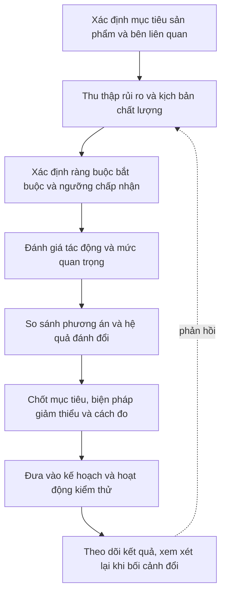

# Ưu tiên các thuộc tính chất lượng khi có đánh đổi

**Chương:** Mục tiêu chất lượng  
**Phạm vi module:** `VALIDATION_TESTING_STRATEGY`

Một sản phẩm phần mềm hiếm khi có thể tối đa hóa mọi thuộc tính chất lượng cùng lúc. Tăng mức bảo vệ có thể làm quy trình đăng nhập phức tạp hơn; bổ sung dự phòng có thể làm tăng chi phí; tối ưu hiệu năng có thể khiến mã khó bảo trì hơn. Vì vậy, xác định mục tiêu chất lượng không chỉ là liệt kê những điều mong muốn. Nhóm cần hiểu thuộc tính nào quan trọng nhất trong bối cảnh cụ thể, mức chất lượng nào là bắt buộc, những đánh đổi nào có thể chấp nhận và cách kiểm chứng quyết định đó.

Bài học này trình bày cách ưu tiên các thuộc tính chất lượng khi nguồn lực, thời gian hoặc yêu cầu có xung đột. Trọng tâm là đưa ra quyết định có căn cứ và chuyển quyết định thành tiêu chí có thể kiểm thử.

Sau bài học, người học có thể:

- Nhận diện các thuộc tính chất lượng liên quan đến mục tiêu và rủi ro của sản phẩm.
- Phân biệt yêu cầu bắt buộc, mục tiêu mong muốn và giới hạn chấp nhận được.
- So sánh mức độ quan trọng của các thuộc tính bằng kịch bản và tiêu chí có thể đo lường.
- Phân tích hệ quả của một lựa chọn và ghi nhận lý do đánh đổi.
- Chuyển ưu tiên chất lượng thành hoạt động kiểm thử và bằng chứng phù hợp.

## 1. Vì sao phải ưu tiên thuộc tính chất lượng?

Thuộc tính chất lượng mô tả những đặc điểm quyết định phần mềm hoạt động tốt đến mức nào trong một bối cảnh sử dụng. Chúng thường bao gồm:

- **Tính phù hợp chức năng:** chức năng có đáp ứng đúng nhu cầu và quy tắc nghiệp vụ không.
- **Hiệu năng và hiệu quả:** thời gian phản hồi, thông lượng, khả năng mở rộng và mức sử dụng tài nguyên.
- **Độ tin cậy:** khả năng hoạt động ổn định, chịu lỗi, phục hồi và duy trì dịch vụ.
- **Bảo mật:** khả năng bảo vệ dữ liệu, danh tính, tài nguyên và hoạt động khỏi truy cập hoặc sử dụng trái phép.
- **Khả năng sử dụng và khả năng tiếp cận:** mức dễ học, dễ thao tác, dễ hiểu và phù hợp với nhiều nhóm người dùng.
- **Khả năng tương thích:** khả năng phối hợp với hệ thống khác và hoạt động trên các môi trường được hỗ trợ.
- **Khả năng bảo trì:** mức dễ hiểu, sửa đổi, kiểm thử, mở rộng và vận hành phần mềm.
- **Tính di động:** mức dễ triển khai hoặc chuyển phần mềm giữa các môi trường và nền tảng.

Danh sách và cách phân nhóm có thể khác nhau tùy mô hình chất lượng mà tổ chức sử dụng. Không phải sản phẩm nào cũng cần ưu tiên mọi thuộc tính ở mức cao nhất. Ví dụ, một hệ thống xử lý giao dịch tài chính có thể đặt độ tin cậy, bảo mật và tính đúng đắn lên hàng đầu; một ứng dụng trình diễn tương tác có thể chú trọng độ trễ, khả năng sử dụng và tương thích thiết bị.

Các thuộc tính thường ảnh hưởng lẫn nhau. Một thay đổi có thể cải thiện một thuộc tính, làm suy giảm thuộc tính khác hoặc cải thiện đồng thời nhiều thuộc tính. Tác động còn phụ thuộc kiến trúc, công nghệ, quy mô tải, người dùng và môi trường triển khai. Vì vậy, không nên mặc định rằng hai thuộc tính luôn xung đột hoặc có thể quy đổi trực tiếp thành một điểm số chung.

## 2. Phân biệt yêu cầu bắt buộc, mục tiêu và giới hạn

Trước khi xếp hạng, hãy xác định mỗi phát biểu chất lượng thuộc loại nào. Ba loại sau có vai trò khác nhau:

| Loại | Ý nghĩa | Ví dụ |
|---|---|---|
| Ràng buộc bắt buộc | Điều kiện phải đáp ứng do luật, hợp đồng, chính sách, an toàn hoặc kiến trúc đã cam kết | Chỉ người có quyền mới được xem thông tin thanh toán; dữ liệu nhạy cảm phải được bảo vệ theo chính sách |
| Mục tiêu chất lượng | Mức mong muốn để tạo trải nghiệm hoặc năng lực cạnh tranh tốt | 95% yêu cầu xem giỏ hàng phản hồi trong tối đa 300 ms ở tải mục tiêu |
| Giới hạn chấp nhận | Ngưỡng thấp nhất hoặc mức rủi ro tối đa mà bên liên quan đồng ý | Trong một sự cố đơn lẻ, dịch vụ có thể gián đoạn tối đa 5 phút trước khi phải kích hoạt phương án phục hồi |

Ràng buộc bắt buộc thường là điều kiện đạt/không đạt. Không nên để một điểm số tổng hợp cao bù trừ cho việc vi phạm quy định hoặc yêu cầu an toàn. Mục tiêu chất lượng giúp so sánh các phương án và đánh giá kết quả. Giới hạn chấp nhận xác định điểm mà tại đó rủi ro hoặc suy giảm chất lượng không còn được chấp nhận.

Một phát biểu như “hệ thống phải nhanh, an toàn và dễ dùng” chưa đủ để làm căn cứ thiết kế hoặc kiểm thử. Hãy diễn đạt thành tình huống cụ thể, xác định điều kiện xảy ra và kết quả có thể quan sát.

## 3. Dùng kịch bản chất lượng để làm rõ ưu tiên

Kịch bản chất lượng mô tả cách hệ thống cần phản ứng trước một tình huống có ý nghĩa đối với bên liên quan. Một kịch bản hữu ích thường xác định sáu thành phần:

1. **Nguồn kích thích:** ai hoặc thành phần nào tạo ra sự kiện.
2. **Kích thích:** sự kiện hoặc yêu cầu xảy ra là gì.
3. **Bối cảnh:** điều kiện vận hành khi sự kiện xảy ra, chẳng hạn tải bình thường, tải cao hoặc khi một dịch vụ phụ thuộc gặp lỗi.
4. **Đối tượng chịu tác động:** hệ thống, thành phần hoặc dữ liệu nào cần phản ứng.
5. **Phản hồi mong đợi:** hệ thống cần làm gì.
6. **Thước đo phản hồi:** ngưỡng định lượng hoặc tiêu chí quan sát để xác định đáp ứng.

Ví dụ, “trang thanh toán phải nhanh” chưa cho biết nhanh là bao nhiêu, trong điều kiện nào và đo ở đâu. Một kịch bản rõ hơn là:

> Khi có 1.000 phiên mua hàng đồng thời trong giờ cao điểm, 95% yêu cầu xác nhận giỏ hàng phải hoàn tất trong 500 ms, tính từ lúc máy chủ nhận yêu cầu đến khi gửi phản hồi; tỷ lệ lỗi do quá tải không vượt quá ngưỡng đã thống nhất.

Kịch bản này làm rõ tải, hành vi cần đo và điều kiện đánh giá. Ngưỡng 1.000 phiên và 500 ms chỉ là ví dụ; dự án cần xác định con số từ dữ liệu sử dụng, mục tiêu kinh doanh và năng lực hạ tầng thực tế.

### 3.1. Viết kịch bản cho nhiều thuộc tính

Với cùng một chức năng thanh toán, có thể xây dựng các kịch bản khác nhau:

| Thuộc tính | Tình huống | Phản hồi và thước đo minh họa |
|---|---|---|
| Hiệu năng | Tải tăng mạnh trong đợt khuyến mãi | 95% yêu cầu tạo đơn hoàn tất trong 800 ms ở mức tải đã xác định |
| Độ tin cậy | Dịch vụ thanh toán bên ngoài mất kết nối tạm thời | Đơn hàng không chuyển sang trạng thái đã thanh toán khi chưa có xác nhận hợp lệ; yêu cầu được xử lý lại an toàn |
| Bảo mật | Người dùng thử truy cập giao dịch của tài khoản khác | Yêu cầu bị từ chối; không tiết lộ dữ liệu giao dịch; sự kiện được ghi nhận theo chính sách |
| Khả năng sử dụng | Người mua lần đầu thanh toán trên điện thoại | Người dùng hoàn thành luồng chính mà không cần trợ giúp; tỷ lệ hoàn thành đạt mục tiêu thử nghiệm |
| Khả năng bảo trì | Nhóm cần thay đổi quy tắc tính phí | Thay đổi có thể được triển khai và kiểm thử trong thời gian mục tiêu, không làm hỏng các quy tắc hiện có |

Các ngưỡng phải được thống nhất trước khi kiểm thử. Nếu không có ngưỡng, nhóm có thể đo và quan sát nhưng khó kết luận kết quả có đạt mục tiêu hay không.

### 3.2. Ưu tiên theo bối cảnh sử dụng

Một thuộc tính không nhất thiết có cùng mức ưu tiên ở mọi nơi. Chẳng hạn:

- Với thao tác xem nội dung công khai, một khoảng trễ ngắn có thể chấp nhận được; với xác nhận giao dịch, độ trễ và tính nhất quán có thể ảnh hưởng trực tiếp đến quyết định của người dùng.
- Với dữ liệu công khai, yêu cầu bảo mật vẫn tồn tại nhưng mức độ kiểm soát có thể khác dữ liệu cá nhân hoặc thông tin thanh toán.
- Với ứng dụng chỉ chạy trên một nền tảng đã xác định, khả năng di động có thể ít quan trọng hơn khả năng tiếp cận và ổn định trên nền tảng đó.
- Với hệ thống được duy trì nhiều năm, khả năng bảo trì và khả năng thay đổi có thể có tác động lớn hơn một tối ưu hiệu năng nhỏ trong ngắn hạn.

Do đó, hãy ưu tiên theo kịch bản, người dùng, rủi ro và vòng đời của hệ thống thay vì gán một thứ hạng cố định cho từng thuộc tính.

## 4. Quy trình ưu tiên các thuộc tính chất lượng

Có thể dùng quy trình sau trong buổi làm rõ yêu cầu, lập chiến lược kiểm thử hoặc đánh giá một thay đổi kiến trúc.

### Bước 1: Xác định mục tiêu sản phẩm và bên liên quan

Làm rõ sản phẩm phục vụ ai, hỗ trợ hoạt động nào và điều gì tạo ra giá trị. Thu thập quan điểm từ người dùng, chủ sản phẩm, vận hành, phát triển, bảo mật, hỗ trợ khách hàng và các bên có trách nhiệm tuân thủ.

Các bên liên quan có thể đánh giá chất lượng khác nhau. Người dùng quan tâm thao tác nhanh và dễ hiểu; vận hành quan tâm khả năng quan sát và phục hồi; bộ phận bảo mật quan tâm kiểm soát truy cập; chủ sản phẩm quan tâm chi phí và thời điểm phát hành. Cần ghi nhận khác biệt và xác định người có quyền quyết định khi lợi ích xung đột.

### Bước 2: Thu thập rủi ro và kịch bản chất lượng

Xác định những sự cố hoặc điều kiện có thể làm giảm chất lượng: tải đột biến, mất kết nối, dữ liệu không hợp lệ, hành vi lạm dụng, thiết bị cũ, thay đổi yêu cầu hoặc thiếu nguồn lực vận hành. Với mỗi rủi ro, mô tả tác động đến người dùng, dữ liệu, doanh thu, vận hành và uy tín.

Đừng chỉ ghi tên thuộc tính. “Độ tin cậy” là một nhãn rộng; “đơn hàng không bị ghi nhận đã thanh toán khi cổng thanh toán chưa xác nhận” là rủi ro có thể phân tích và kiểm chứng.

### Bước 3: Xác định ràng buộc và ngưỡng chấp nhận

Đánh dấu yêu cầu bắt buộc từ luật, hợp đồng, chính sách bảo mật, an toàn và cam kết dịch vụ. Sau đó xác định các ngưỡng chất lượng mà sản phẩm cần đạt hoặc mức suy giảm tối đa có thể chấp nhận.

Nếu chưa thể thống nhất ngưỡng, ghi rõ người chịu trách nhiệm và thời điểm cần quyết định. Không tự biến một con số giả định thành cam kết kỹ thuật.

### Bước 4: Đánh giá tác động và mức quan trọng

Với mỗi kịch bản, đánh giá ít nhất các khía cạnh:

- **Mức độ ảnh hưởng:** hậu quả nếu kịch bản xảy ra hoặc mục tiêu không đạt.
- **Khả năng xảy ra hoặc mức phơi nhiễm:** tần suất dự kiến, số người dùng hoặc thành phần có thể bị ảnh hưởng.
- **Khả năng phát hiện và phục hồi:** nhóm có nhận ra sự cố kịp thời và khôi phục được không.
- **Mức cấp thiết:** thời điểm cần đạt chất lượng, chẳng hạn trước khi mở rộng người dùng hoặc trước một đợt phát hành.
- **Chi phí và độ khó:** nguồn lực, thời gian và độ phức tạp cần thiết để đạt mục tiêu.

Không phải mọi yếu tố đều cần chuyển thành điểm số. Một cuộc thảo luận có cấu trúc, có bằng chứng và người chịu trách nhiệm đôi khi hữu ích hơn một phép tính phức tạp.

### Bước 5: So sánh phương án và hệ quả đánh đổi

Liệt kê các phương án khả thi. Với mỗi phương án, nêu thuộc tính được cải thiện, thuộc tính có thể suy giảm, chi phí phát sinh và rủi ro còn lại. Tìm phương án đáp ứng các ràng buộc bắt buộc trước, sau đó so sánh các phương án theo mục tiêu quan trọng nhất.

### Bước 6: Chốt mục tiêu, biện pháp giảm thiểu và cách đo

Ghi lại quyết định, ngưỡng cần đạt, phần đánh đổi được chấp nhận, biện pháp giảm thiểu và người phê duyệt. Xác định cách thu thập số liệu hoặc bằng chứng để kiểm chứng sau khi triển khai.

### Bước 7: Đưa ưu tiên vào kiểm thử và xem xét lại

Điều chỉnh chiến lược, cách tiếp cận và kế hoạch kiểm thử để tập trung vào các kịch bản có ưu tiên cao. Theo dõi kết quả thực tế và xem xét lại khi có thay đổi đáng kể về tải, người dùng, dữ liệu, kiến trúc, quy định hoặc mục tiêu kinh doanh.

## 5. Kỹ thuật hỗ trợ xếp hạng

Không có một công thức duy nhất phù hợp với mọi dự án. Có thể kết hợp đánh giá định tính với phương pháp chấm điểm để giúp cuộc thảo luận minh bạch hơn.

### 5.1. Ma trận tác động và khả năng xảy ra

Ma trận rủi ro giúp nhận diện kịch bản cần chú ý trước. Một cách đơn giản là đánh giá khả năng xảy ra và mức tác động theo thang 1–5.

| Điểm | Khả năng xảy ra | Mức tác động |
|---|---|---|
| 1 | Hiếm | Không đáng kể, dễ khắc phục |
| 2 | Ít gặp | Ảnh hưởng nhỏ đến một nhóm nhỏ |
| 3 | Có thể xảy ra | Làm gián đoạn một luồng hoặc cần xử lý đáng kể |
| 4 | Dễ xảy ra | Ảnh hưởng lớn đến nhiều người dùng hoặc hoạt động chính |
| 5 | Rất thường xuyên hoặc gần như chắc chắn | Gây tổn thất nghiêm trọng, mất dữ liệu hoặc vi phạm nghĩa vụ |

Có thể dùng tích của hai điểm để sắp xếp sơ bộ. Ví dụ, khả năng 4 và tác động 5 cho điểm rủi ro 20. Điểm này là tín hiệu để thảo luận, không phải xác suất thống kê hay bằng chứng rằng rủi ro có thể so sánh chính xác với rủi ro khác. Cần xem xét riêng các nghĩa vụ bắt buộc, rủi ro hiếm nhưng có hậu quả thảm khốc và khả năng phát hiện.

### 5.2. Ma trận trọng số

Khi có nhiều kịch bản cần so sánh, nhóm có thể dùng bảng trọng số. Mỗi tiêu chí được gán trọng số theo tầm quan trọng, mỗi phương án hoặc kịch bản được chấm theo cùng một thang điểm. Tổng điểm có thể giúp nhìn ra xu hướng, nhưng phải ghi rõ giả định và không để điểm tổng che khuất ràng buộc bắt buộc.

Ví dụ minh họa cho một dịch vụ thanh toán:

| Tiêu chí | Trọng số | Phương án A: tăng dự phòng | Phương án B: tối ưu chi phí |
|---|---:|---:|---:|
| Độ tin cậy và phục hồi | 5 | 5 | 2 |
| Bảo mật và kiểm soát | 5 | 4 | 4 |
| Hiệu năng ở tải cao | 3 | 4 | 3 |
| Chi phí vận hành | 2 | 2 | 5 |
| **Tổng điểm có trọng số** |  | **61** | **49** |

Điểm tổng được tính bằng tổng của `trọng số × điểm phương án` cho từng tiêu chí. Điểm cao hơn của phương án A trong ví dụ chỉ phản ánh trọng số giả định của nhóm. Nếu phương án B vi phạm một yêu cầu bảo mật bắt buộc thì phương án B phải bị loại, bất kể tổng điểm. Trước khi sử dụng bảng, các bên cần thống nhất ý nghĩa thang điểm, trọng số và dữ liệu dùng để chấm.

### 5.3. So sánh theo cặp

Khi khó xếp hạng nhiều thuộc tính cùng lúc, hãy so sánh từng cặp trong cùng một bối cảnh:

- Nếu chỉ có thể cải thiện một thuộc tính trước đợt phát hành này, thuộc tính nào giảm rủi ro lớn hơn?
- Nếu hai thuộc tính xung đột, hậu quả của việc không đạt từng thuộc tính là gì?
- Có phương án kiến trúc hoặc biện pháp vận hành nào giảm mức xung đột không?
- Quyết định nào có thể trì hoãn, và quyết định nào sẽ tốn kém nếu sửa muộn?

So sánh theo cặp giúp làm rõ lý do và phát hiện bất đồng. Nếu kết quả thay đổi theo người tham gia, hãy tìm hiểu giả định hoặc mục tiêu khác nhau thay vì chỉ lấy đa số.

## 6. Các đánh đổi thường gặp

Đánh đổi cần được đánh giá theo hệ thống cụ thể. Những ví dụ dưới đây cho thấy các câu hỏi nên đặt ra, không phải quy tắc rằng hai thuộc tính luôn đối nghịch.

### 6.1. Bảo mật và khả năng sử dụng

Xác thực nhiều bước, thời gian phiên ngắn hoặc quy trình xác nhận bổ sung có thể giảm nguy cơ chiếm đoạt tài khoản nhưng cũng làm tăng số thao tác. Nếu giảm kiểm soát để thao tác thuận tiện hơn, rủi ro truy cập trái phép có thể tăng.

Có thể giảm xung đột bằng cách áp dụng xác thực tăng cường theo mức rủi ro, hỗ trợ phương thức xác thực dễ tiếp cận, giữ phiên hợp lý trên thiết bị đáng tin cậy và giải thích rõ lý do cần xác minh bổ sung. Các yêu cầu pháp lý và chính sách bảo vệ dữ liệu vẫn là ràng buộc bắt buộc.

### 6.2. Hiệu năng và độ tin cậy

Cache, xử lý bất đồng bộ hoặc giảm số lần gọi dịch vụ có thể cải thiện tốc độ. Tuy nhiên, dữ liệu cache cũ, hàng đợi bị đầy hoặc xử lý không đúng thứ tự có thể làm kết quả sai lệch.

Nhóm cần xác định dữ liệu nào được phép cũ trong bao lâu, thao tác nào cần nhất quán ngay lập tức, cách xử lý khi hàng đợi hoặc cache gặp lỗi và cách đối soát sau phục hồi. Với thanh toán, không được đánh đổi tính đúng đắn giao dịch chỉ để giảm thời gian phản hồi.

### 6.3. Độ tin cậy và chi phí

Máy chủ dự phòng, nhiều vùng triển khai, sao lưu thường xuyên và giám sát chuyên sâu có thể tăng khả năng phục hồi nhưng làm tăng chi phí hạ tầng và vận hành. Cần so sánh chi phí với tổn thất dự kiến khi ngừng dịch vụ, thời gian phục hồi mục tiêu và lượng dữ liệu có thể chấp nhận mất.

Một dịch vụ nội bộ ít quan trọng có thể chấp nhận thời gian phục hồi dài hơn dịch vụ xử lý đơn hàng. Mức dự phòng nên tương xứng với tác động kinh doanh và cam kết dịch vụ.

### 6.4. Khả năng bảo trì và tốc độ phát hành

Một giải pháp viết nhanh có thể đáp ứng thời hạn trước mắt nhưng làm tăng độ phức tạp, lặp mã hoặc phụ thuộc khó thay đổi. Đầu tư vào cấu trúc, kiểm thử tự động và tài liệu có thể làm tăng thời gian ban đầu nhưng giảm chi phí thay đổi về sau.

Nhóm cần cân nhắc vòng đời dự kiến, tần suất thay đổi, mức độ quan trọng của thành phần và chi phí sửa lỗi. Nếu phải chọn giải pháp tạm thời, hãy ghi rõ giới hạn, người sở hữu và thời điểm xem xét loại bỏ.

### 6.5. Khả năng di động và tối ưu theo nền tảng

Dùng tính năng riêng của một nền tảng có thể tạo hiệu năng hoặc trải nghiệm tốt hơn, nhưng làm tăng công sức hỗ trợ các môi trường khác. Nếu người dùng tập trung trên một nền tảng, tối ưu riêng có thể hợp lý; nếu sản phẩm cần triển khai rộng, tính di động và chi phí duy trì nhiều biến thể trở nên quan trọng.

Nhóm nên xác định danh sách môi trường được hỗ trợ, mức tương đương cần đạt và phần khác biệt nào được chấp nhận.

## 7. Ví dụ thực hành: ưu tiên chất lượng cho thanh toán trực tuyến

Giả sử một cửa hàng trực tuyến chuẩn bị mở rộng số lượng người dùng. Nhóm có nguồn lực giới hạn và phải quyết định việc nào cần đầu tư trước.

### 7.1. Bối cảnh và rủi ro

- Thanh toán là luồng tạo doanh thu cốt lõi.
- Giao dịch trùng lặp có thể khiến khách hàng bị thu tiền nhiều lần.
- Tải tăng vào các đợt khuyến mãi.
- Dịch vụ thanh toán bên ngoài có thể phản hồi chậm hoặc tạm thời không truy cập được.
- Người dùng cần hoàn tất giao dịch trên điện thoại và máy tính.

### 7.2. Thứ tự ưu tiên ban đầu

| Mức ưu tiên | Thuộc tính và lý do | Mục tiêu hoặc ràng buộc minh họa |
|---|---|---|
| Ràng buộc | Bảo mật và quyền riêng tư: dữ liệu giao dịch và tài khoản cần được bảo vệ | Không cho phép truy cập trái quyền; tuân thủ chính sách và nghĩa vụ áp dụng |
| Rất cao | Tính đúng đắn và độ tin cậy: tránh ghi nhận sai hoặc trùng giao dịch | Mỗi yêu cầu thanh toán chỉ tạo tối đa một giao dịch có hiệu lực; trạng thái đơn hàng phải dựa trên xác nhận hợp lệ |
| Cao | Hiệu năng: luồng thanh toán phải phản hồi trong thời gian chấp nhận được | Đặt mục tiêu độ trễ theo phân vị ở tải cao điểm đã đo |
| Cao | Khả năng phục hồi: xử lý lỗi từ dịch vụ bên ngoài | Có thể tiếp tục hoặc đối soát an toàn sau sự cố; có mục tiêu thời gian phục hồi |
| Trung bình đến cao | Khả năng sử dụng và tiếp cận: giảm bỏ dở trong luồng mua hàng | Người dùng hoàn thành luồng chính trên các thiết bị được hỗ trợ |
| Theo vòng đời | Khả năng bảo trì: quy tắc phí và phương thức thanh toán có thể thay đổi | Có kiểm thử hồi quy và cấu trúc đủ rõ để thay đổi an toàn |

Đây là thứ tự ban đầu dựa trên bối cảnh giả định. Sau khi có dữ liệu sử dụng, phân tích rủi ro, nghĩa vụ cụ thể và chi phí, nhóm cần điều chỉnh thứ tự và xác định ngưỡng đo lường.

### 7.3. Chọn phương án và kiểm chứng

Nhóm quyết định giữ xác thực và kiểm soát truy cập theo chính sách, sử dụng khóa định danh yêu cầu để chống tạo giao dịch trùng, ghi nhận trạng thái giao dịch rõ ràng và bổ sung cơ chế thử lại có giới hạn. Để cải thiện hiệu năng, nhóm tối ưu các truy vấn đọc và tách một số tác vụ không cần phản hồi tức thời khỏi luồng chính. Các thao tác ảnh hưởng đến kết quả thanh toán vẫn cần xác nhận có thẩm quyền trước khi cập nhật trạng thái đơn hàng.

Các kiểm thử ưu tiên có thể gồm:

- Kiểm thử bảo mật cho xác thực, phân quyền, truy cập dữ liệu giao dịch và quản lý phiên.
- Kiểm thử tích hợp cho phản hồi thành công, thất bại, hết thời gian chờ và phản hồi đến muộn từ cổng thanh toán.
- Kiểm thử lặp yêu cầu với cùng khóa để xác minh không tạo giao dịch trùng.
- Kiểm thử lỗi và phục hồi khi dịch vụ thanh toán hoặc hàng đợi bị gián đoạn.
- Kiểm thử tải để đo độ trễ theo phân vị, thông lượng và tỷ lệ lỗi ở các mức tải đã thống nhất.
- Kiểm thử khả năng sử dụng trên các thiết bị và trình duyệt nằm trong phạm vi hỗ trợ.
- Kiểm thử hồi quy cho quy tắc tính tiền, phí, trạng thái đơn hàng và các phương thức thanh toán.

Như vậy, ưu tiên chất lượng dẫn đến lựa chọn kỹ thuật, tiêu chí chấp nhận và thứ tự kiểm thử cụ thể. Kết quả kiểm thử sẽ cung cấp bằng chứng để nhóm quyết định có cần thay đổi phương án hay không.

## 8. Chuyển ưu tiên thành chiến lược và kế hoạch kiểm thử

Một ưu tiên chỉ có giá trị vận hành khi nhóm biết sẽ kiểm tra nó như thế nào. Với mỗi kịch bản quan trọng, hãy xác định:

| Thành phần | Câu hỏi cần trả lời |
|---|---|
| Mục tiêu | Thuộc tính hoặc rủi ro nào cần kiểm chứng? |
| Điều kiện | Hệ thống, tải, dữ liệu và môi trường ở trạng thái nào? |
| Phương pháp | Cần kiểm thử chức năng, hiệu năng, bảo mật, phục hồi, khả năng sử dụng hay kết hợp? |
| Thước đo | Đo thời gian, tỷ lệ lỗi, mức mất dữ liệu, tỷ lệ hoàn thành hay kết quả kiểm tra nào? |
| Ngưỡng | Điều kiện đạt và không đạt là gì? |
| Bằng chứng | Log, báo cáo tải, bản ghi giao dịch, ảnh chụp, kết quả phân tích hoặc báo cáo lỗi nào được lưu? |
| Trách nhiệm | Ai theo dõi kết quả, xử lý sai lệch và chấp nhận rủi ro còn lại? |

Không cần chạy mọi loại kiểm thử với cùng độ sâu. Kịch bản có tác động lớn hoặc nghĩa vụ bắt buộc cần được kiểm chứng kỹ hơn. Các thuộc tính ít quan trọng hơn vẫn cần mức kiểm tra phù hợp với phạm vi và rủi ro.

Ví dụ, nếu độ tin cậy là ưu tiên cao, chiến lược kiểm thử có thể yêu cầu kiểm tra lỗi phụ thuộc và khả năng phục hồi. Cách tiếp cận xác định dùng kiểm thử tích hợp, kiểm thử chịu lỗi và kiểm thử khôi phục. Kế hoạch xác định môi trường, dữ liệu, lịch, người phụ trách và điều kiện kết thúc. Ca kiểm thử mô tả một tình huống cụ thể như cổng thanh toán phản hồi sau thời hạn chờ.

## 9. Ghi nhận quyết định đánh đổi

Những quyết định ảnh hưởng đáng kể đến kiến trúc, rủi ro hoặc cam kết chất lượng nên được ghi lại để người khác hiểu và đánh giá về sau. Có thể dùng một bản ghi quyết định ngắn với các mục:

1. **Bối cảnh:** mục tiêu, người dùng, rủi ro và giới hạn nguồn lực.
2. **Vấn đề cần quyết định:** những thuộc tính chất lượng đang cạnh tranh.
3. **Ràng buộc:** điều kiện bắt buộc không được vi phạm.
4. **Các phương án:** lựa chọn đã cân nhắc cùng ưu và nhược điểm.
5. **Quyết định:** phương án được chọn và lý do.
6. **Đánh đổi được chấp nhận:** thuộc tính nào có thể suy giảm, suy giảm đến mức nào và trong điều kiện nào.
7. **Biện pháp giảm thiểu:** kiểm soát, giám sát, dự phòng hoặc kế hoạch khôi phục.
8. **Cách kiểm chứng:** chỉ số, kiểm thử và bằng chứng cần thu thập.
9. **Người chịu trách nhiệm và thời điểm xem xét lại:** ai chấp nhận rủi ro và sự kiện nào sẽ kích hoạt việc đánh giá lại.

Ví dụ, nhóm có thể chấp nhận độ trễ cao hơn một chút trong luồng xác minh thanh toán để thực hiện kiểm tra chống gian lận bổ sung. Bản ghi cần nêu rõ mức tăng độ trễ cho phép, cách đo, nhóm người dùng bị ảnh hưởng, cơ chế theo dõi và điều kiện xem xét lại nếu tỷ lệ bỏ dở tăng.

Việc ghi lại quyết định giúp tránh tình trạng một đánh đổi tạm thời trở thành mặc định lâu dài mà không ai nhớ lý do. Nó cũng giúp nhóm mới hiểu bối cảnh khi thay đổi kiến trúc hoặc yêu cầu.

## 10. Những sai lầm thường gặp

### 10.1. Đặt mọi thuộc tính ở mức ưu tiên cao nhất

Nếu mọi thứ đều quan trọng như nhau, nhóm không có cơ sở phân bổ nguồn lực. Hãy xác định ràng buộc, xếp hạng theo rủi ro và nói rõ thuộc tính nào cần đạt trước.

### 10.2. Dùng từ định tính mà không có thước đo

“Nhanh”, “ổn định”, “an toàn” và “dễ dùng” có thể được hiểu khác nhau. Hãy bổ sung bối cảnh, đối tượng, điều kiện và ngưỡng đánh giá.

### 10.3. Chỉ nhìn vào điểm tổng

Điểm số có thể giúp so sánh nhưng không thể thay thế phán đoán. Một vi phạm bảo mật bắt buộc hoặc một rủi ro an toàn nghiêm trọng không thể được bù bằng điểm cao ở hiệu năng hay chi phí.

### 10.4. Chỉ đánh giá chi phí ban đầu

Một giải pháp rẻ lúc triển khai có thể tạo chi phí vận hành, khắc phục sự cố và thay đổi cao hơn về sau. Hãy xét toàn bộ vòng đời và hậu quả khi chất lượng không đạt.

### 10.5. Không xem xét các thuộc tính tương tác

Tối ưu riêng từng thành phần có thể làm chất lượng tổng thể xấu đi. Ví dụ, cache có thể cải thiện hiệu năng nhưng làm dữ liệu hiển thị cũ; cần đánh giá đồng thời tính nhất quán và độ tin cậy.

### 10.6. Không cập nhật ưu tiên khi bối cảnh thay đổi

Khi lượng người dùng, loại dữ liệu, quy định, kiến trúc hoặc mô hình kinh doanh thay đổi, thứ tự ưu tiên cũ có thể không còn phù hợp. Hãy xác định sự kiện kích hoạt việc xem xét lại.

## 11. Danh sách rà soát trước khi chốt ưu tiên

Trước khi phê duyệt mục tiêu chất lượng hoặc đưa chúng vào chiến lược kiểm thử, hãy kiểm tra:

- [ ] Mục tiêu sản phẩm và nhóm người dùng chính đã rõ.
- [ ] Các bên liên quan và người có quyền chấp nhận rủi ro đã được xác định.
- [ ] Rủi ro chất lượng được mô tả bằng tình huống cụ thể.
- [ ] Ràng buộc bắt buộc được tách khỏi mục tiêu mong muốn.
- [ ] Các mục tiêu có bối cảnh, thước đo và ngưỡng đánh giá.
- [ ] Các phương án và hệ quả đánh đổi đã được xem xét.
- [ ] Điểm số hoặc trọng số (nếu dùng) có giả định rõ ràng và không che khuất ràng buộc.
- [ ] Biện pháp giảm thiểu và rủi ro còn lại được ghi nhận.
- [ ] Mỗi ưu tiên quan trọng được liên kết với phương pháp kiểm thử và bằng chứng.
- [ ] Có người chịu trách nhiệm và thời điểm xem xét lại quyết định.

## 12. Kết luận

Ưu tiên thuộc tính chất lượng là quyết định dựa trên bối cảnh, mục tiêu và rủi ro. Nhóm cần xác định điều kiện bắt buộc trước, mô tả các kịch bản quan trọng bằng thước đo cụ thể, so sánh phương án và ghi lại hệ quả của lựa chọn. Các kỹ thuật chấm điểm có thể hỗ trợ thảo luận nhưng không thay thế việc đánh giá nghĩa vụ, tác động và rủi ro nghiêm trọng.

Khi ưu tiên được chuyển thành mục tiêu đo lường, tiêu chí chấp nhận và hoạt động kiểm thử, nhóm có thể kiểm chứng quyết định bằng bằng chứng thực tế. Khi bối cảnh thay đổi, các ưu tiên và đánh đổi cũng cần được xem xét lại.
