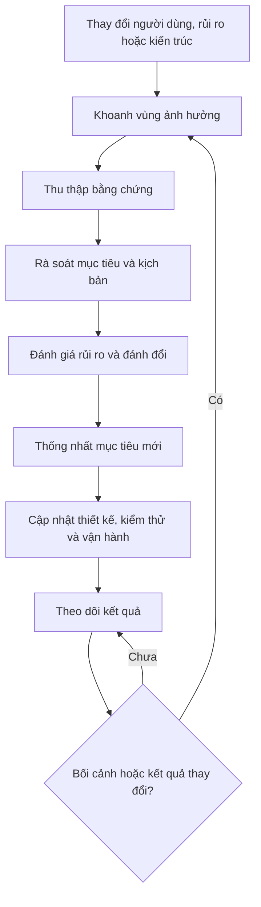

# Rà soát lại mục tiêu khi người dùng, rủi ro hoặc kiến trúc thay đổi

Mục tiêu chất lượng định hướng cách một hệ thống cần hoạt động trong điều kiện thực tế. Chúng giúp nhóm quyết định nên ưu tiên điều gì khi thiết kế, triển khai, kiểm thử và vận hành sản phẩm. Tuy nhiên, mục tiêu được đặt ra ở đầu dự án không phải lúc nào cũng còn phù hợp sau nhiều tháng hoặc nhiều năm. Người dùng có thể thay đổi, quy mô sử dụng tăng lên, rủi ro mới xuất hiện hoặc kiến trúc được thay thế. Khi bối cảnh thay đổi, nhóm cần rà soát lại mục tiêu chất lượng để bảo đảm các quyết định kỹ thuật vẫn phục vụ đúng nhu cầu và mức rủi ro hiện tại.

Trong phạm vi chiến lược kiểm thử, việc rà soát này còn giúp xác định hệ thống cần được kiểm chứng điều gì, bằng phương pháp nào, ở tầng nào và vào thời điểm nào. Một mục tiêu chất lượng đã lỗi thời có thể khiến nhóm đầu tư kiểm thử vào vấn đề ít quan trọng, bỏ sót rủi ro mới hoặc dùng tiêu chí nghiệm thu không còn phản ánh kỳ vọng của người dùng.

## 1. Mục tiêu chất lượng cần gắn với bối cảnh

Mục tiêu chất lượng mô tả những đặc tính mà hệ thống cần đạt, chẳng hạn tính sẵn sàng, hiệu năng, khả năng mở rộng, bảo mật, khả năng sử dụng, khả năng truy cập, khả năng phục hồi, khả năng tương thích và khả năng bảo trì. Các mục tiêu này thường cạnh tranh với nhau. Tăng mức mã hóa hoặc kiểm tra bảo mật có thể làm tăng độ trễ; nhân bản dữ liệu để tăng khả năng sẵn sàng có thể làm phức tạp việc bảo đảm tính nhất quán; thêm nhiều lớp trừu tượng có thể hỗ trợ thay đổi nhưng cũng làm hệ thống khó hiểu hơn.

Vì thế, một danh sách chung như “hệ thống phải nhanh, an toàn và dễ mở rộng” chưa đủ để hướng dẫn quyết định. Nhóm cần làm rõ:

- Ai cần đặc tính đó và trong tình huống nào?
- Hành vi hoặc sự kiện nào có thể gây ra vấn đề?
- Hệ thống cần phản hồi ra sao?
- Có thể đo hoặc kiểm chứng kết quả bằng tiêu chí nào?
- Mức độ ưu tiên và hậu quả nếu không đạt mục tiêu là gì?

Một mục tiêu hữu ích cần đủ cụ thể để có thể đưa ra quyết định và kiểm chứng. Ví dụ, “trang danh sách đơn hàng phải nhanh” có thể được diễn đạt rõ hơn: “Trong giờ cao điểm, với tải dự kiến của nhóm người dùng thông thường, 95% yêu cầu xem danh sách đơn hàng được phản hồi trong tối đa hai giây.” Con số trong ví dụ chỉ minh họa cách viết tiêu chí; ngưỡng thực tế phải được thống nhất dựa trên nhu cầu, dữ liệu sử dụng và chi phí chấp nhận được.

### Phân biệt mục tiêu, chỉ số và ngưỡng

Ba khái niệm thường bị dùng lẫn nhau:

| Khái niệm | Ý nghĩa | Ví dụ |
|---|---|---|
| Mục tiêu chất lượng | Kết quả hoặc đặc tính hệ thống cần đạt | Người dùng có thể tra cứu đơn hàng ổn định trong giờ cao điểm |
| Chỉ số | Đại lượng dùng để quan sát kết quả | Phân vị 95 của thời gian phản hồi, tỷ lệ yêu cầu thành công |
| Ngưỡng chấp nhận | Giá trị hoặc điều kiện dùng để đánh giá | P95 không vượt quá hai giây trong tải đã thống nhất |

Một chỉ số có thể giúp theo dõi nhiều mục tiêu, và một mục tiêu có thể cần nhiều chỉ số. Chẳng hạn, tính sẵn sàng không chỉ được phản ánh qua tỷ lệ thời gian dịch vụ trả lời; nhóm còn cần xem xét khả năng hoàn thành nghiệp vụ, thời gian khôi phục và mức độ mất dữ liệu có thể chấp nhận.

## 2. Nhận diện những thay đổi cần kích hoạt rà soát

Không cần đợi đến khi có sự cố lớn mới xem lại mục tiêu. Nhóm nên coi các thay đổi có ảnh hưởng đến kỳ vọng, mức phơi nhiễm hoặc cách hệ thống vận hành là tín hiệu để đánh giá lại.

### Người dùng và nhu cầu thay đổi

Nhóm người dùng mới có thể sử dụng sản phẩm theo cách khác với nhóm ban đầu. Một ứng dụng nội bộ được mở cho khách hàng bên ngoài sẽ đối mặt với nhiều loại thiết bị, mạng, mức độ hiểu biết và kỳ vọng hỗ trợ khác nhau. Một sản phẩm bắt đầu phục vụ người dùng ở nhiều quốc gia có thể cần thêm ngôn ngữ, múi giờ, quy định về dữ liệu và khả năng truy cập.

Các tín hiệu cần chú ý gồm:

- Phản hồi, khiếu nại, yêu cầu hỗ trợ hoặc khảo sát cho thấy trải nghiệm hiện tại không đáp ứng nhu cầu.
- Nhóm người dùng, vai trò, quy trình nghiệp vụ hoặc kênh truy cập mới được bổ sung.
- Mức độ sử dụng thay đổi đáng kể, chẳng hạn số lượng người dùng đồng thời, tần suất giao dịch hoặc khối lượng dữ liệu.
- Người dùng cần hoàn thành nghiệp vụ trong điều kiện mới như mạng yếu, thiết bị cũ hoặc yêu cầu hỗ trợ công nghệ trợ giúp.
- Cam kết dịch vụ hoặc kỳ vọng của khách hàng thay đổi.

Những tín hiệu này có thể làm thay đổi thứ tự ưu tiên. Ví dụ, khi một hệ thống chuyển từ công cụ nội bộ sang dịch vụ khách hàng, khả năng truy cập, bảo vệ dữ liệu cá nhân, tính sẵn sàng và hỗ trợ nhiều thiết bị có thể trở nên quan trọng hơn.

### Rủi ro và mối đe dọa thay đổi

Rủi ro phụ thuộc vào tài sản cần bảo vệ, mối đe dọa, điểm yếu, xác suất xảy ra và hậu quả. Khi dữ liệu mới được lưu trữ, tích hợp thanh toán, mở API cho đối tác hoặc thay đổi quy định, mức rủi ro có thể tăng ngay cả khi chức năng chính không đổi.

Nhóm nên rà soát khi:

- Có sự cố, lỗi nghiêm trọng, lỗ hổng bảo mật hoặc tình huống suýt gây thiệt hại.
- Dữ liệu nhạy cảm hơn được thu thập, xử lý, chia sẻ hoặc lưu trữ lâu hơn.
- Xuất hiện kiểu tấn công, gian lận hoặc lạm dụng mới.
- Hệ thống phụ thuộc vào nhà cung cấp, dịch vụ hoặc thư viện có rủi ro mới.
- Thay đổi pháp lý, hợp đồng hoặc chính sách làm thay đổi nghĩa vụ của tổ chức.
- Mức độ tác động của lỗi tăng lên do hệ thống trở thành một phần quan trọng hơn trong hoạt động kinh doanh.

Ví dụ, một chức năng trước đây chỉ hiển thị dữ liệu có thể trở thành chức năng cho phép sửa và xuất dữ liệu. Mục tiêu về bảo mật, phân quyền, kiểm toán và khả năng phục hồi cần được xem xét lại vì hậu quả của thao tác sai đã thay đổi.

### Kiến trúc và môi trường kỹ thuật thay đổi

Kiến trúc quyết định cách hệ thống đáp ứng mục tiêu chất lượng và nơi rủi ro có thể xuất hiện. Việc chuyển từ một ứng dụng đơn khối sang nhiều dịch vụ, thay cơ sở dữ liệu, chuyển lên đám mây, triển khai đa vùng hoặc bổ sung bộ nhớ đệm đều có thể làm thay đổi đặc tính vận hành.

Các thay đổi thường cần rà soát gồm:

- Tách hoặc hợp nhất dịch vụ, thay đổi ranh giới mô-đun và giao thức giao tiếp.
- Thay đổi cơ sở dữ liệu, mô hình lưu trữ, cơ chế sao lưu hoặc đồng bộ dữ liệu.
- Chuyển nền tảng triển khai, hạ tầng mạng, nhà cung cấp hoặc vùng địa lý.
- Bổ sung hàng đợi, xử lý bất đồng bộ, cache, tìm kiếm hoặc hệ thống phân tích dữ liệu.
- Thay đổi cơ chế xác thực, phân quyền, mã hóa, quản lý bí mật hoặc ghi log.
- Tăng mức độ tự động hóa, thay đổi quy trình phát hành hoặc cách mở rộng tài nguyên.

Một kiến trúc mới có thể cải thiện một mục tiêu nhưng làm tăng rủi ro ở mục tiêu khác. Chẳng hạn, tách dịch vụ giúp mở rộng từng thành phần độc lập nhưng tạo thêm điểm lỗi ở mạng, giao tiếp, định tuyến và xử lý giao dịch phân tán. Nhóm cần đánh giá lại mục tiêu và kiểm thử tương ứng thay vì mặc định rằng kiến trúc mới tự động tốt hơn.

## 3. Mô tả mục tiêu bằng kịch bản chất lượng

Kịch bản chất lượng (quality attribute scenario) giúp chuyển một mong muốn chung thành tình huống có thể phân tích và kiểm chứng. Một kịch bản thường có sáu phần:

1. **Nguồn kích thích:** ai hoặc thành phần nào tạo ra sự kiện?
2. **Kích thích:** sự kiện hoặc điều kiện xảy ra là gì?
3. **Môi trường:** hệ thống đang ở trạng thái hoặc mức tải nào?
4. **Thành phần chịu tác động:** phần nào của hệ thống phải xử lý?
5. **Phản hồi mong đợi:** hệ thống cần làm gì?
6. **Thước đo phản hồi:** điều kiện nào chứng minh phản hồi đạt yêu cầu?

Ví dụ về tính sẵn sàng: “Khi một nút xử lý đơn hàng gặp sự cố trong giờ cao điểm, bộ điều phối chuyển yêu cầu sang nút còn hoạt động và người dùng vẫn có thể gửi đơn; tỷ lệ yêu cầu gửi đơn thành công duy trì trên ngưỡng đã thống nhất và thời gian gián đoạn không vượt quá giới hạn phục hồi.” Kịch bản này giúp nhóm xác định cần kiểm thử chuyển đổi dự phòng, xử lý yêu cầu lặp, tính nhất quán dữ liệu và khả năng quan sát vận hành.

Ví dụ về bảo mật: “Khi người dùng không có quyền truy cập thử đọc thông tin đơn hàng của người khác thông qua API, hệ thống từ chối yêu cầu, không tiết lộ dữ liệu và ghi nhận sự kiện theo chính sách kiểm toán.” Từ kịch bản này, nhóm có thể thiết kế kiểm thử phân quyền ở cấp API, kiểm thử âm tính và kiểm tra log.

Một mục tiêu có thể có nhiều kịch bản vì các nguồn kích thích và môi trường khác nhau tạo ra rủi ro khác nhau. Ngược lại, một kịch bản có thể tác động đến nhiều mục tiêu. Ví dụ, sự cố mạng giữa hai dịch vụ có thể ảnh hưởng đồng thời đến tính sẵn sàng, tính nhất quán và thời gian phản hồi.

## 4. Quy trình rà soát mục tiêu chất lượng

Rà soát nên là một hoạt động có cấu trúc, có sự tham gia của những người hiểu nhu cầu nghiệp vụ, vận hành, bảo mật, kiến trúc và kiểm thử. Một quy trình thực tế có thể gồm các bước sau:

### Bước 1: Ghi nhận thay đổi và phạm vi ảnh hưởng

Mô tả điều gì đã thay đổi, thời điểm thay đổi và lý do. Xác định người dùng, quy trình, dữ liệu, thành phần, tích hợp và môi trường bị ảnh hưởng. Tránh bắt đầu bằng việc chọn một chỉ số quen thuộc rồi cố gắng tìm lý do để giữ nó.

### Bước 2: Thu thập bằng chứng

Sử dụng dữ liệu phù hợp với loại thay đổi: phản hồi người dùng, phân tích hành vi, lưu lượng, sự cố, kết quả kiểm thử, cảnh báo vận hành, đánh giá bảo mật, yêu cầu hợp đồng và quyết định kiến trúc. Phân biệt dữ liệu quan sát được với giả định. Nếu dữ liệu còn thiếu, ghi rõ điều cần đo hoặc xác minh trước khi chốt ngưỡng.

### Bước 3: Xem lại các mục tiêu hiện có

Với từng mục tiêu, xác định mục tiêu đó còn phù hợp, cần điều chỉnh, cần bổ sung hay có thể loại bỏ. Kiểm tra xem phạm vi, người dùng, môi trường, chỉ số và ngưỡng có còn phản ánh tình huống hiện tại không. Một mục tiêu cũ có thể vẫn đúng nhưng cần thêm kịch bản cho một môi trường mới.

### Bước 4: Đánh giá rủi ro và ưu tiên

Đánh giá khả năng xảy ra, mức độ tác động, phạm vi ảnh hưởng và khả năng phát hiện trước khi hậu quả xảy ra. Có thể dùng ma trận xác suất và tác động để hỗ trợ thảo luận, nhưng không nên coi điểm số là kết luận khách quan tuyệt đối. Rủi ro liên quan đến an toàn, quyền riêng tư, tài chính hoặc nghĩa vụ pháp lý có thể cần ưu tiên cao ngay cả khi xác suất ước tính thấp.

### Bước 5: Thống nhất mục tiêu và đánh đổi

Viết lại mục tiêu dưới dạng kịch bản có tiêu chí đo được. Ghi nhận ai chấp nhận mức rủi ro còn lại, chi phí cần thiết và những mục tiêu khác có thể bị ảnh hưởng. Nếu chưa thể đạt ngưỡng mong muốn ngay, xác định biện pháp tạm thời, thời hạn và điều kiện xem xét lại.

### Bước 6: Cập nhật kiến trúc, kiểm thử và vận hành

Chuyển mục tiêu mới thành yêu cầu thiết kế, quyết định kiến trúc, trường hợp kiểm thử, tiêu chí phát hành, cảnh báo và quy trình vận hành. Mỗi mục tiêu quan trọng cần có cách kiểm chứng trước phát hành hoặc theo dõi sau phát hành, tùy vào bản chất của nó.

### Bước 7: Ghi nhận quyết định và theo dõi

Lưu phiên bản mục tiêu, lý do thay đổi, bằng chứng, người tham gia, người chịu trách nhiệm và ngày hoặc sự kiện cần rà soát tiếp theo. Theo dõi kết quả thực tế để biết mục tiêu mới có đạt được và có tạo ra tác động mong muốn hay không.

## 5. Chuyển mục tiêu đã rà soát thành chiến lược kiểm thử

Mục tiêu chất lượng chỉ tạo ra giá trị khi được chuyển thành hoạt động kiểm chứng phù hợp. Sau khi thống nhất mục tiêu, nhóm cần xem xét kiểm thử ở các cấp độ khác nhau và cả hoạt động vận hành.

| Mục tiêu hoặc rủi ro | Cách kiểm chứng có thể áp dụng | Bằng chứng cần thu thập |
|---|---|---|
| Hiệu năng khi số người dùng tăng | Kiểm thử tải, kiểm thử sức chịu đựng, kiểm thử hiệu năng API | Thời gian phản hồi theo phân vị, thông lượng, mức sử dụng tài nguyên và tỷ lệ lỗi |
| Khả năng phục hồi khi dịch vụ phụ thuộc gặp sự cố | Kiểm thử lỗi có kiểm soát, kiểm thử tích hợp, diễn tập khôi phục | Thời gian phát hiện, thời gian khôi phục, dữ liệu mất hoặc xử lý lặp |
| Bảo mật khi mở API cho đối tác | Kiểm thử xác thực, phân quyền, kiểm thử âm tính và đánh giá bảo mật | Các yêu cầu bị từ chối đúng cách, dữ liệu không bị lộ và dấu vết kiểm toán |
| Khả năng sử dụng với nhóm người dùng mới | Kiểm thử khả năng truy cập, kiểm thử khả dụng với người dùng đại diện | Tỷ lệ hoàn thành tác vụ, lỗi thao tác và phản hồi của người tham gia |
| Tính tương thích sau khi thay nền tảng | Kiểm thử hồi quy, kiểm thử tương thích và kiểm thử trên môi trường đích | Kết quả theo trình duyệt, thiết bị, hệ điều hành hoặc cấu hình được hỗ trợ |
| Khả năng bảo trì sau khi tách dịch vụ | Kiểm thử hợp đồng, tích hợp và kiểm tra quy trình triển khai | Tính tương thích API, khả năng triển khai độc lập và thời gian điều tra lỗi |

Không phải mọi mục tiêu đều có thể được xác minh đầy đủ bằng kiểm thử tự động. Khả năng sử dụng cần quan sát người dùng thực hiện tác vụ; bảo mật có thể cần đánh giá chuyên môn; khả năng phục hồi cần diễn tập trong điều kiện gần với vận hành. Kiểm thử tự động, kiểm thử thủ công, đánh giá chuyên môn và giám sát sau phát hành bổ sung cho nhau.

### Xác định thời điểm kiểm chứng

Đưa kiểm tra về giai đoạn sớm khi có thể tạo ra tín hiệu đáng tin cậy với chi phí thấp. Ví dụ, quy tắc phân quyền có thể được kiểm thử ở cấp đơn vị hoặc API trong mỗi pull request. Các thuộc tính phụ thuộc môi trường thật như chuyển vùng, phục hồi dữ liệu hoặc khả năng chịu tải lớn có thể cần kiểm thử ở môi trường tích hợp hoặc trước phát hành. Sau phát hành, giám sát và diễn tập tiếp tục xác nhận mục tiêu trong điều kiện thực tế.

Nếu mục tiêu thay đổi nhưng bộ kiểm thử, tiêu chí phát hành và cảnh báo vận hành không được cập nhật, tổ chức có thể tuyên bố một chất lượng mà thực tế không kiểm chứng. Vì vậy, mỗi thay đổi mục tiêu cần có liên kết rõ đến những kiểm tra và bằng chứng liên quan.

## 6. Ví dụ: từ ứng dụng nội bộ đến dịch vụ cho nhiều khách hàng

Giả sử ban đầu một hệ thống quản lý đơn hàng chỉ phục vụ một nhóm nhân viên trong cùng tổ chức. Hệ thống có lượng truy cập vừa phải, mạng nội bộ ổn định và người dùng đã được cấp tài khoản. Sau đó, doanh nghiệp quyết định mở hệ thống thành dịch vụ cho nhiều khách hàng và đối tác ở nhiều khu vực.

Thay đổi này tác động đến cả ba nhóm yếu tố:

- **Người dùng:** số lượng và vai trò đa dạng hơn; người dùng truy cập từ thiết bị và mạng khác nhau; cần trải nghiệm rõ ràng và hỗ trợ tốt hơn.
- **Rủi ro:** dữ liệu giữa các khách hàng phải được cách ly; API công khai có thể bị lạm dụng; gián đoạn dịch vụ ảnh hưởng trực tiếp đến hoạt động của khách hàng.
- **Kiến trúc:** cần mở rộng theo tải, triển khai nhiều vùng, quản lý định danh và phân quyền theo tổ chức; tích hợp với hệ thống của đối tác.

Nhóm rà soát lại các mục tiêu ban đầu và nhận thấy cần bổ sung hoặc điều chỉnh như sau:

| Chủ đề | Mục tiêu trước thay đổi | Mục tiêu sau khi rà soát | Hệ quả đối với kiểm thử |
|---|---|---|---|
| Hiệu năng | Đáp ứng tốt cho tải nội bộ | Duy trì thời gian phản hồi theo phân vị dưới tải cao đã dự báo | Bổ sung kiểm thử tải, kiểm thử tăng tải và theo dõi hiệu năng theo vùng |
| Bảo mật và riêng tư | Người dùng nội bộ chỉ xem dữ liệu được cấp quyền | Mọi yêu cầu phải cách ly dữ liệu giữa các khách hàng và kiểm soát quyền theo tổ chức | Thêm kiểm thử phân quyền chéo khách hàng, kiểm thử API âm tính và kiểm tra log |
| Tính sẵn sàng | Có thể bảo trì trong khung giờ nội bộ | Dịch vụ cần đáp ứng cam kết sẵn sàng với khách hàng và có quy trình thông báo sự cố | Kiểm thử chuyển đổi dự phòng, khôi phục và xác minh các chỉ số vận hành |
| Khả năng sử dụng | Nhân viên được hướng dẫn sử dụng | Người dùng mới có thể tự hoàn thành các tác vụ chính | Kiểm thử khả dụng, khả năng truy cập và hướng dẫn lỗi |
| Tương thích | Một số cấu hình trình duyệt nội bộ | Hỗ trợ các trình duyệt và thiết bị đã cam kết | Mở rộng ma trận kiểm thử tương thích |

Nhóm cũng cần xác định ngưỡng cụ thể từ dữ liệu tải dự kiến, cam kết với khách hàng và khả năng đầu tư. Không nên tự chọn một con số chỉ vì nó phổ biến ở dự án khác. Các mục tiêu mới sau đó được đưa vào thiết kế phân vùng dữ liệu, cơ chế định danh, kiến trúc triển khai, bộ kiểm thử và dashboard vận hành.

Ví dụ này cho thấy một thay đổi về nhóm người dùng có thể làm thay đổi yêu cầu bảo mật và sẵn sàng; một thay đổi kiến trúc lại tạo ra các kịch bản kiểm thử mới. Rà soát chất lượng cần xem xét mối liên hệ đó thay vì xử lý từng thuộc tính một cách tách rời.

## 7. Quản lý đánh đổi và tránh những sai lầm thường gặp

Rà soát mục tiêu không có nghĩa là nâng mọi ngưỡng lên mức cao nhất. Mỗi cải thiện có chi phí về thời gian, hạ tầng, độ phức tạp và vận hành. Nhóm cần hiểu rõ đánh đổi và thống nhất mức chấp nhận được với các bên liên quan.

Một số sai lầm thường gặp:

- **Giữ nguyên mục tiêu vì đã được phê duyệt:** quyết định cũ có thể dựa trên giả định không còn đúng. Hãy kiểm tra lại bằng chứng và bối cảnh hiện tại.
- **Chỉ rà soát sau sự cố:** sự cố là tín hiệu quan trọng, nhưng thay đổi người dùng, quy mô hoặc kiến trúc cũng cần được đánh giá trước khi triển khai rộng.
- **Đặt mục tiêu mơ hồ:** các từ như “nhanh”, “an toàn” hoặc “ổn định” không đủ để xác định điều kiện nghiệm thu. Hãy mô tả kịch bản và thước đo.
- **Chọn chỉ số dễ đo thay cho kết quả cần đạt:** số lượng kiểm thử hoặc độ phủ mã nguồn không tự chứng minh hệ thống đáp ứng nhu cầu chất lượng.
- **Tối ưu một thuộc tính riêng lẻ:** tăng tính sẵn sàng bằng sao chép dữ liệu có thể ảnh hưởng đến tính nhất quán và chi phí; cần đánh giá toàn bộ kịch bản.
- **Không cập nhật kiểm thử và vận hành:** mục tiêu mới sẽ không có tác dụng nếu tiêu chí phát hành, kiểm thử và cảnh báo vẫn dựa trên mục tiêu cũ.
- **Rà soát quá hình thức:** cuộc họp không có bằng chứng, quyết định, người phụ trách hoặc hành động tiếp theo khó tạo ra thay đổi thực tế.
- **Đặt ngưỡng không có căn cứ:** ngưỡng phải dựa trên kỳ vọng người dùng, dữ liệu nền, mức rủi ro và khả năng kỹ thuật; ghi rõ giả định nếu cần xác minh thêm.

Để tránh những vấn đề này, mỗi quyết định nên ghi rõ điều gì thay đổi, bằng chứng nào hỗ trợ, mục tiêu nào bị ảnh hưởng, rủi ro còn lại là gì và ai chịu trách nhiệm thực hiện. Khi chưa đủ dữ liệu, có thể đặt một giai đoạn đo lường hoặc thử nghiệm có giới hạn trước khi chốt mục tiêu dài hạn.

## 8. Thiết lập nhịp rà soát và duy trì tính truy vết

Rà soát theo sự kiện phù hợp khi có thay đổi lớn: ra mắt nhóm người dùng mới, tích hợp đối tác, di chuyển hạ tầng, thay đổi mô hình dữ liệu, phát hiện lỗ hổng hoặc xảy ra sự cố nghiêm trọng. Ngoài ra, nhóm có thể rà soát định kỳ để phát hiện những giả định đã âm thầm thay đổi. Tần suất nên phù hợp với tốc độ thay đổi và mức độ rủi ro; hệ thống quan trọng hoặc biến động nhanh cần được xem xét thường xuyên hơn.

Một bản ghi rà soát nên có tối thiểu:

- Ngày rà soát, phạm vi hệ thống và người tham gia.
- Thay đổi hoặc tín hiệu kích hoạt việc rà soát.
- Bằng chứng, giả định và những điểm chưa chắc chắn.
- Mục tiêu cũ được giữ, sửa, bổ sung hoặc loại bỏ.
- Kịch bản chất lượng, chỉ số và ngưỡng đã thống nhất.
- Đánh đổi, rủi ro còn lại và người có thẩm quyền chấp nhận.
- Kiểm thử, quyết định kiến trúc, tiêu chí phát hành hoặc cảnh báo cần cập nhật.
- Người chịu trách nhiệm, thời hạn và điều kiện rà soát tiếp theo.

Nên duy trì liên kết giữa mục tiêu chất lượng, yêu cầu, kịch bản kiểm thử, quyết định kiến trúc và bằng chứng vận hành. Khi một mục tiêu đổi, nhóm có thể truy ra những phần cần xem lại. Khi một kiểm thử thất bại hoặc một chỉ số vận hành xấu đi, nhóm cũng có thể xác định mục tiêu và rủi ro nào đang bị ảnh hưởng.

## Kết luận

Mục tiêu chất lượng phản ánh bối cảnh sử dụng và rủi ro của hệ thống tại một thời điểm. Khi người dùng, rủi ro hoặc kiến trúc thay đổi, nhóm cần thu thập bằng chứng, đánh giá lại các kịch bản chất lượng, thống nhất mức ưu tiên và chuyển kết quả thành thiết kế, kiểm thử cùng hoạt động vận hành. Việc rà soát có cấu trúc và được duy trì bằng tính truy vết giúp chiến lược kiểm thử tiếp tục kiểm chứng đúng những điều quan trọng đối với sản phẩm.
