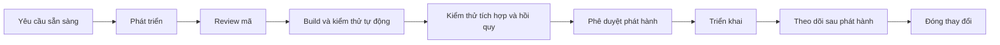

# Sử dụng hồi cứu để phát hiện điểm nghẽn và vùng lọt lỗi

Hồi cứu sau thay đổi hoặc sau phát hành giúp nhóm nhìn lại cách một thay đổi đi từ yêu cầu tới sản xuất, từ đó nhận diện nơi công việc bị chờ đợi, phải làm lại hoặc không được kiểm tra đủ sâu. Khi phân tích cả luồng công việc lẫn lỗi lọt tới môi trường sau kiểm thử, nhóm có thể chọn cải tiến cụ thể cho quy trình validation và testing thay vì chỉ nhắc lại những sự cố đã xảy ra.

Một buổi hồi cứu có ích phải dựa trên dữ liệu có thể kiểm chứng, đặt câu hỏi về hệ thống và điều kiện làm việc, rồi chuyển phát hiện thành hành động có người chịu trách nhiệm. Mục tiêu là cải thiện khả năng phát hiện rủi ro và tốc độ đưa thay đổi an toàn tới người dùng, không phải tìm cá nhân để quy lỗi.

## 1. Hồi cứu trong quản lý thay đổi là gì?

Hồi cứu (retrospective) là hoạt động xem xét một khoảng công việc đã hoàn thành hoặc một sự kiện đã xảy ra để hiểu điều gì diễn ra, vì sao kết quả khác kỳ vọng và cần thay đổi điều gì trong cách làm. Trong quản lý thay đổi, đối tượng hồi cứu có thể là một release, một đợt triển khai, một nhóm thay đổi có liên quan, một sự cố production hoặc một giai đoạn phát triển.

Hồi cứu thường trả lời bốn câu hỏi:

1. Điều gì đã xảy ra? Dòng thời gian, phạm vi thay đổi, kết quả kiểm thử và sự cố thực tế là gì?
2. Điều gì đã giúp công việc diễn ra tốt? Kiểm soát, công cụ hoặc phối hợp nào nên được duy trì?
3. Điểm nghẽn và vùng lọt lỗi nằm ở đâu? Công việc phải chờ ở bước nào, và lỗi đã vượt qua những lớp kiểm soát nào?
4. Cần thử thay đổi nào tiếp theo? Ai sở hữu hành động, khi nào thực hiện và đo hiệu quả bằng cách nào?

Hồi cứu không thay thế điều tra nguyên nhân gốc của một sự cố nghiêm trọng. Điều tra sự cố có thể cần phân tích kỹ thuật, bảo toàn log, dựng lại điều kiện và xác định phạm vi ảnh hưởng. Hồi cứu dùng kết quả điều tra cùng dữ liệu quy trình để tìm cơ hội cải thiện rộng hơn. Hai hoạt động bổ trợ cho nhau nhưng có mục tiêu và độ sâu khác nhau.

## 2. Xác định mục tiêu và phạm vi trước khi xem dữ liệu

Phạm vi quá rộng khiến cuộc hồi cứu dễ biến thành cuộc thảo luận chung chung; phạm vi quá hẹp có thể bỏ qua nguyên nhân nằm ở bước trước hoặc sau. Hãy xác định một câu hỏi điều tra cụ thể, chẳng hạn:

- Vì sao thời gian từ lúc yêu cầu được chấp nhận đến khi phát hành tăng trong ba release gần đây?
- Vì sao một số lỗi tích hợp chỉ được phát hiện sau khi triển khai?
- Vì sao kiểm thử hồi quy thường bắt đầu muộn và phải chạy lại?
- Vì sao các thay đổi liên quan đến migration có tỷ lệ rollback cao hơn?

Chọn đơn vị phân tích phù hợp với câu hỏi. Có thể là một release cụ thể, các thay đổi thuộc cùng một loại rủi ro, các lỗi được phát hiện sau phát hành trong một khoảng thời gian, hoặc một mẫu công việc đủ lớn trong vài chu kỳ. Ghi rõ thời gian bắt đầu và kết thúc, sản phẩm hoặc thành phần, môi trường và tiêu chí đưa bản ghi vào mẫu.

Trước khi phân tích, thống nhất định nghĩa. Ví dụ, “bắt đầu kiểm thử” là lúc pipeline khởi chạy hay lúc người kiểm thử bắt đầu thực thi? “Lỗi lọt” là lỗi được phát hiện sau khi release đã mở cho người dùng hay gồm cả lỗi phát hiện ở staging sau khi một vòng kiểm thử trước đã kết thúc? Các nhóm có thể chọn định nghĩa khác nhau, nhưng phải dùng nhất quán và công bố trong báo cáo.

## 3. Thu thập dữ liệu từ toàn bộ luồng thay đổi

Để tìm điểm nghẽn, cần ghép các mốc thời gian và sự kiện từ yêu cầu, quản lý mã nguồn, CI/CD, hệ thống kiểm thử, quản lý lỗi, triển khai và hỗ trợ vận hành. Một nguồn đơn lẻ thường chỉ cho thấy một phần quy trình.

| Nguồn | Dữ liệu hữu ích | Câu hỏi có thể trả lời |
|---|---|---|
| Công cụ quản lý công việc | Thời điểm tạo, sẵn sàng, bắt đầu, chờ duyệt và hoàn tất | Công việc chờ ở đâu? |
| Pull request và code review | Thời gian mở, thời gian chờ review, số vòng phản hồi, kích thước thay đổi | Review có trở thành hàng đợi không? |
| CI và build | Thời gian queue, thời gian chạy, tỷ lệ pipeline lỗi, số lần rerun | Pipeline chậm hay thiếu ổn định? |
| Test management | Test case, phạm vi, kết quả, thời điểm chạy, trạng thái bị chặn | Lớp kiểm thử nào có khoảng trống? |
| Defect tracker | Thời điểm tạo, mức độ, thành phần, nguyên nhân, giai đoạn phát hiện và trạng thái | Lỗi tập trung ở đâu và được phát hiện muộn khi nào? |
| Release và deployment | Thời điểm phê duyệt, triển khai, rollback, thay đổi cấu hình | Quyết định hoặc triển khai tạo ra thời gian chờ nào? |
| Incident và support | Thời điểm phát hiện, ảnh hưởng, thời gian khôi phục và tín hiệu cảnh báo | Vấn đề nào đã lọt tới người dùng? |

Mỗi bản ghi nên có khóa liên kết ổn định, ví dụ change ID, pull request ID, build ID, test run ID, release ID và defect ID. Nếu hệ thống không có khóa chung, cần quy tắc ghép dữ liệu minh bạch và đánh dấu những liên kết chỉ là suy luận.

Thu thập dữ liệu ở mức đủ để trả lời câu hỏi. Không đưa token, mật khẩu, dữ liệu cá nhân hoặc payload khách hàng vào tài liệu hồi cứu. Khi cần minh họa lỗi, dùng dữ liệu đã ẩn danh hoặc dữ liệu thử nghiệm. Ghi nhận múi giờ, nguồn và thời điểm trích xuất để tránh so sánh nhầm các mốc thời gian.

## 4. Dựng lại dòng thời gian và luồng giá trị

Vẽ các bước từ lúc thay đổi được yêu cầu tới khi phát hành và theo dõi sau triển khai. Với từng bước, ghi thời điểm bắt đầu, kết thúc, trạng thái, người hoặc nhóm chịu trách nhiệm, điều kiện đầu vào và đầu ra. Một sơ đồ đơn giản có thể bắt đầu như sau:



Sơ đồ phải phản ánh quy trình thực tế. Nếu có bước lặp, nhánh phê duyệt, kiểm thử song song hoặc quay lại sửa lỗi, hãy thể hiện chúng. Một thay đổi có thể quay từ kiểm thử về phát triển nhiều lần; nếu chỉ ghi lần hoàn tất cuối cùng, nhóm sẽ đánh mất dữ liệu về rework.

Phân biệt thời gian xử lý với thời gian chờ. Thời gian xử lý là lúc có người hoặc hệ thống thực sự làm việc trên hạng mục; thời gian chờ là khoảng hạng mục nằm trong hàng đợi, chờ đầu vào, chờ môi trường, chờ review hoặc chờ quyết định. Tổng thời gian từ đầu đến cuối có thể dài dù thời gian thao tác trực tiếp ngắn.

Các chỉ số cơ bản:

| Chỉ số | Cách hiểu | Lưu ý |
|---|---|---|
| Lead time | Thời gian từ khi yêu cầu được chấp nhận hoặc bắt đầu theo định nghĩa tới khi hoàn tất | Phải công bố mốc bắt đầu và kết thúc |
| Cycle time | Thời gian từ lúc công việc thực sự bắt đầu tới khi hoàn tất | Không đồng nhất giữa các nhóm nếu định nghĩa khác nhau |
| Queue time | Tổng thời gian chờ trong một hoặc nhiều hàng đợi | Tách theo loại hàng đợi để tìm nơi có thể cải thiện |
| Active time | Thời gian xử lý thực tế | Khó đo chính xác nếu hệ thống không ghi nhận trạng thái làm việc |
| Rework time | Thời gian dành cho sửa và thực hiện lại do phản hồi hoặc lỗi | Cần phân loại lý do, tránh tính mọi thay đổi nhỏ là rework |
| Handoff count | Số lần chuyển trách nhiệm hoặc chuyển trạng thái giữa nhóm | Nhiều lần chuyển có thể tạo chờ đợi và mất ngữ cảnh |

Ví dụ, một thay đổi mất 8 ngày từ lúc sẵn sàng tới khi phát hành. Trong đó, phát triển mất 2 ngày, review chờ và xử lý mất 2 ngày, chờ môi trường kiểm thử mất 1,5 ngày, kiểm thử và sửa lỗi mất 2 ngày, phê duyệt và triển khai mất 0,5 ngày. Nếu chỉ tối ưu thời gian chạy test, nhóm có thể bỏ qua phần chờ môi trường đang chiếm gần một phần năm tổng thời gian.

## 5. Nhận diện điểm nghẽn trong quy trình

Điểm nghẽn là bước hoặc nguồn lực giới hạn tốc độ hoàn thành của toàn luồng. Một bước có thời gian xử lý dài chưa chắc là điểm nghẽn nếu nó không tạo hàng đợi; ngược lại, một bước thao tác nhanh vẫn có thể gây chậm lớn nếu mọi công việc phải chờ một người phê duyệt hoặc một môi trường dùng chung.

Các dấu hiệu thường gặp:

- Hàng đợi tăng liên tục trước một bước, trong khi bước sau thường nhàn rỗi.
- Thời gian chờ chiếm tỷ lệ lớn so với thời gian xử lý.
- Nhiều thay đổi cùng tranh một môi trường, thiết bị hoặc chuyên gia.
- Công việc bị trả lại nhiều lần vì thiếu tiêu chí, dữ liệu hoặc điều kiện đầu vào.
- Pipeline thường xuyên phải rerun do lỗi hạ tầng hoặc test không ổn định.
- Phê duyệt tập trung vào một người hoặc một khung thời gian cố định.
- Các thay đổi lớn được đưa vào kiểm thử cùng lúc, tạo đợt dồn việc cuối chu kỳ.

Để xác định điểm nghẽn, xem phân bố chứ không chỉ xem trung bình. Trung vị và các phân vị cao như P85 hoặc P95 cho thấy trải nghiệm của những thay đổi chậm. So sánh theo loại thay đổi, độ lớn, thành phần, môi trường và mức rủi ro. Một trung bình tốt có thể che giấu một nhóm nhỏ thay đổi bị mắc kẹt nhiều ngày.

Hãy kiểm tra cả thông lượng và lượng công việc đang chờ. Nếu số thay đổi đi vào một bước lớn hơn số thay đổi hoàn tất, hàng đợi sẽ tăng. Tăng thêm công việc đang làm dở có thể làm mọi người bận hơn nhưng không nhất thiết tăng số thay đổi hoàn tất. Khi điểm nghẽn nằm ở năng lực review hoặc môi trường, giới hạn công việc đang thực hiện và giải quyết hàng đợi thường hiệu quả hơn việc bắt đầu thêm việc mới.

Không mặc định rằng cá nhân hoặc nhóm có nhiều ticket đang chờ là nguyên nhân. Hàng đợi có thể phản ánh phân bổ năng lực, ưu tiên thay đổi, thiếu quyền truy cập, phụ thuộc bên ngoài hoặc chính sách phê duyệt.

## 6. Phát hiện vùng lọt lỗi qua dữ liệu defect

Vùng lọt lỗi là khoảng trống trong chuỗi phòng ngừa và phát hiện khiến lỗi không được nhận ra ở giai đoạn mà nhóm kỳ vọng, mà chỉ xuất hiện ở giai đoạn sau hoặc sau khi phát hành. Để tìm vùng này, phải phân biệt hai khái niệm:

- **Giai đoạn phát sinh:** nơi thay đổi hoặc điều kiện gây ra lỗi được đưa vào, chẳng hạn thiết kế, code, cấu hình, migration hoặc tích hợp.
- **Giai đoạn phát hiện:** nơi lỗi được nhận ra, chẳng hạn unit test, integration test, staging, production hoặc phản ánh từ khách hàng.

Lỗi phát sinh trong code nhưng được phát hiện ngay ở unit test là ví dụ của kiểm soát sớm hoạt động hiệu quả. Lỗi phát sinh từ giả định contract không được thống nhất và chỉ xuất hiện khi hai dịch vụ chạy cùng nhau có thể chỉ ra khoảng trống ở integration hoặc contract testing. Giai đoạn phát hiện muộn không tự động chứng minh nhóm kiểm thử đã sai; có thể thiếu khả năng tái hiện, dữ liệu hoặc môi trường tương đương production.

Với mỗi defect, ghi ít nhất:

| Trường | Nội dung |
|---|---|
| Defect ID | Mã duy nhất và liên kết tới change/release liên quan |
| Severity và impact | Mức độ nghiêm trọng, người dùng hoặc dữ liệu bị ảnh hưởng |
| Component và change type | Thành phần và loại thay đổi liên quan |
| Origin phase | Giai đoạn lỗi được đưa vào, nếu xác định được |
| Detection phase | Giai đoạn lỗi được phát hiện |
| Detection mechanism | Test tự động, review, monitoring, support hoặc cách khác |
| Escape path | Các lớp kiểm soát đã đi qua hoặc không bao phủ |
| Root/contributing factors | Nguyên nhân chính và các yếu tố góp phần, kèm mức độ chắc chắn |
| Corrective action | Hành động sửa sản phẩm và cải thiện kiểm soát |

Ma trận phát sinh và phát hiện giúp nhìn thấy khoảng trống:

| Giai đoạn phát sinh ↓ / phát hiện → | Unit | Integration | Staging | Production |
|---|---:|---:|---:|---:|
| Yêu cầu hoặc thiết kế | 2 | 3 | 1 | 2 |
| Code | 12 | 5 | 2 | 1 |
| Contract hoặc tích hợp | 1 | 4 | 3 | 4 |
| Cấu hình hoặc triển khai | 0 | 1 | 2 | 5 |

Các con số trên chỉ là ví dụ minh họa. Trong dữ liệu thật, cần định nghĩa cách đếm: một defect có thể liên quan nhiều giai đoạn, nhưng phải tránh đếm trùng khi tổng hợp. Nếu chưa xác định được giai đoạn phát sinh, ghi “chưa rõ” thay vì ép phân loại.

Những mẫu hình đáng điều tra gồm: lỗi thiết kế thường chỉ xuất hiện ở production; lỗi contract tập trung ở staging hoặc sau tích hợp; lỗi cấu hình chỉ xuất hiện khi triển khai; hoặc lỗi regression lặp lại sau các thay đổi ở cùng thành phần. Mẫu hình là tín hiệu để đặt giả thuyết, không phải kết luận nguyên nhân.

## 7. Chọn chỉ số để đo điểm nghẽn và lỗi lọt

Chỉ số nên hỗ trợ câu hỏi cụ thể và có định nghĩa, mẫu số, phạm vi, chu kỳ đo rõ ràng. Không nên tạo một điểm số tổng hợp duy nhất để đại diện cho chất lượng kiểm thử.

| Chỉ số | Cách tính gợi ý | Cách sử dụng |
|---|---|---|
| Escape defect rate | Số defect đủ điều kiện được phát hiện sau mốc kiểm soát đã chọn / tổng defect đủ điều kiện trong cùng cohort | Theo dõi tỷ lệ lỗi vượt qua một ranh giới kiểm soát |
| Production defect density | Số defect production trong cohort / đơn vị quy mô đã chọn, nếu có mẫu số đáng tin cậy | So sánh xu hướng trong cùng loại sản phẩm hoặc thay đổi |
| Detection phase distribution | Số defect theo giai đoạn phát hiện | Tìm giai đoạn đang phát hiện nhiều lỗi |
| Reopen rate | Số defect bị mở lại / số defect đã đóng trong cohort | Tìm vấn đề ở chất lượng sửa hoặc xác nhận |
| Test flakiness rate | Số lần chạy test không ổn định theo định nghĩa / tổng lần chạy phù hợp | Đánh giá độ tin cậy của tín hiệu CI |
| Queue time by stage | Tổng hoặc phân vị thời gian chờ theo bước | Xác định hàng đợi gây chậm |
| Rework rate | Số thay đổi hoặc giờ công phải làm lại theo định nghĩa / tổng thay đổi hoặc giờ công tương ứng | Đánh giá chi phí do phản hồi muộn và lỗi |
| Change failure rate | Tỷ lệ triển khai gây ra sự cố hoặc cần khắc phục khẩn cấp theo định nghĩa đã chọn | Theo dõi kết quả thay đổi trong vận hành |

Với escape defect rate, phải nêu rõ mốc kiểm soát. Ví dụ, nếu mốc là hoàn tất kiểm thử staging, mẫu số có thể là toàn bộ defect liên quan tới cohort release đã biết tại thời điểm đánh giá; tử số là các defect trong cohort chỉ được phát hiện sau mốc đó. Nếu chỉ đếm defect production đã biết, tỷ lệ có thể thay đổi khi nhóm phát hiện thêm lỗi hoặc khi thời gian quan sát dài hơn.

Không so sánh tỷ lệ giữa hai nhóm nếu cách phân loại, mức độ ghi nhận, phạm vi hệ thống hoặc thời gian quan sát khác nhau. Đếm lỗi tuyệt đối cũng cần ngữ cảnh: một sản phẩm có nhiều người dùng và nhiều thay đổi có thể ghi nhận nhiều lỗi hơn dù tỷ lệ rủi ro thấp hơn.

Các chỉ số DORA như lead time for changes, deployment frequency, change failure rate và time to restore service có thể cung cấp góc nhìn về hiệu quả phân phối và vận hành. Chúng không thay thế phân tích defect theo giai đoạn phát sinh/phát hiện hoặc phân tích hàng đợi nội bộ. Hãy dùng chúng như tín hiệu bổ trợ và giữ nguyên định nghĩa nguồn khi báo cáo.

## 8. Phân tích nguyên nhân và yếu tố góp phần

Khi thấy một điểm nghẽn hoặc nhóm lỗi lặp lại, bắt đầu bằng dữ kiện cụ thể rồi xây dựng giả thuyết. Các kỹ thuật có thể kết hợp:

**5 Whys:** hỏi “vì sao” nhiều lần để đi từ biểu hiện tới điều kiện hệ thống. Không cần ép đủ năm lần; dừng khi có nguyên nhân có thể kiểm chứng và có hành động phù hợp. Tránh câu trả lời kết thúc ở “do bất cẩn” nếu chưa giải thích điều kiện khiến sai sót đó dễ xảy ra.

**Fishbone (xương cá):** nhóm yếu tố theo con người và kỹ năng, quy trình, công cụ, môi trường, dữ liệu, yêu cầu và đo lường. Đây là cách mở rộng phạm vi giả thuyết, không phải bằng chứng rằng mọi nhánh đều góp phần.

**Pareto:** phân loại thời gian chờ hoặc defect theo nhóm để tìm phần đóng góp lớn. Pareto giúp ưu tiên điều tra; nhóm nhỏ có số lượng ít vẫn có thể có mức độ nghiêm trọng cao và cần xử lý riêng.

**Phân tích cohort:** so sánh các thay đổi cùng loại hoặc các release trong điều kiện gần tương đương. Ví dụ, tách thay đổi schema, thay đổi API, thay đổi UI và thay đổi cấu hình để tránh một nhóm lớn che khuất rủi ro đặc thù.

**Kiểm tra mẫu và tái hiện:** mở một số bản ghi đại diện, đối chiếu log và timeline, tái hiện kịch bản nếu có thể. Xác minh dữ liệu thô trước khi kết luận từ biểu đồ tổng hợp.

Một nguyên nhân chỉ nên được coi là đã xác nhận khi có bằng chứng hỗ trợ. Nếu mới có tương quan, ghi rõ đó là giả thuyết và đề xuất cách kiểm chứng. Có thể có nhiều yếu tố góp phần: tiêu chí chấp nhận mơ hồ, test thiếu dữ liệu biên, môi trường không giống production và cảnh báo không được theo dõi. Tránh tìm một nguyên nhân đơn nhất khi sự cố thực tế là kết quả của nhiều điều kiện cùng xuất hiện.

## 9. Ví dụ: tìm nguyên nhân lỗi tích hợp bị lọt

Giả sử trong bốn release liên tiếp, nhóm ghi nhận 18 defect liên quan tới tương tác giữa hai dịch vụ. Có 11 lỗi được phát hiện trong integration test, 4 lỗi ở staging và 3 lỗi sau khi triển khai. Dữ liệu cho thấy một số thay đổi API được kiểm thử riêng lẻ nhưng chưa chạy contract test giữa phiên bản dịch vụ mới và phiên bản phụ thuộc đang triển khai.

Hồi cứu timeline của ba lỗi production cho thấy:

1. Pull request được review và unit test đạt.
2. Pipeline chạy integration test với mock service.
3. Staging dùng phiên bản dependency khác production.
4. Sau triển khai, một trường response không còn tương thích với consumer cũ.
5. Monitoring chỉ cảnh báo tỷ lệ lỗi tổng thể sau khi một số request thất bại.

Nhóm không nên kết luận đơn giản rằng “thiếu test”. Cần kiểm chứng các giả thuyết cụ thể: contract giữa producer và consumer có được quản lý không; môi trường staging khác production ở phiên bản nào; mock có bỏ qua trường hợp tương thích ngược không; và cảnh báo có đủ nhạy để phát hiện sớm không.

Các hành động có thể chọn sau khi xác nhận gồm:

| Phát hiện | Hành động cải tiến | Bằng chứng hiệu quả |
|---|---|---|
| Thiếu kiểm tra tương thích producer/consumer | Thêm contract test cho các phiên bản được hỗ trợ | Contract test chạy trên pipeline và bắt được thay đổi không tương thích trong thử nghiệm |
| Môi trường staging lệch production | Đồng bộ phiên bản dependency hoặc ghi nhận sai khác có kiểm soát | Báo cáo cấu hình hai môi trường và kiểm tra drift |
| Mock không mô phỏng trường hợp lỗi | Bổ sung test với contract thực hoặc test component phù hợp | Kịch bản tái hiện lỗi trước đây đạt độ bao phủ mong muốn |
| Cảnh báo phát hiện muộn | Thêm chỉ báo theo endpoint hoặc loại lỗi | Thời gian từ lỗi tới cảnh báo giảm trong diễn tập hoặc sự kiện thực tế |

Sau một vài release, kiểm tra xem lỗi cùng loại có giảm và các hành động có được sử dụng thường xuyên không. Nếu tỷ lệ lỗi giảm nhưng thời gian phát hành tăng mạnh, cần xem tác động tổng thể và điều chỉnh thiết kế kiểm soát.

## 10. Tổ chức buổi hồi cứu hiệu quả

Một buổi hồi cứu thường có người điều phối, người ghi nhận và đại diện các vai trò liên quan như phát triển, kiểm thử, vận hành, sản phẩm hoặc bảo mật tùy phạm vi. Người điều phối cần tạo điều kiện để các bên nêu dữ kiện và bất đồng một cách an toàn.

Agenda tham khảo cho buổi 60–90 phút:

| Thời lượng | Hoạt động | Kết quả mong đợi |
|---|---|---|
| 5–10 phút | Nhắc mục tiêu, phạm vi và quy tắc trao đổi | Cùng hiểu câu hỏi cần trả lời |
| 10–15 phút | Xem timeline và dữ liệu đã chuẩn bị | Thống nhất điều gì thực sự xảy ra |
| 15–20 phút | Xác định điểm nghẽn và vùng lọt lỗi | Danh sách tín hiệu và giả thuyết |
| 15–20 phút | Kiểm chứng nguyên nhân và yếu tố góp phần | Một số phát hiện có bằng chứng |
| 10–15 phút | Chọn hành động cải tiến | Hành động ưu tiên, chủ sở hữu, thời hạn |
| 5 phút | Đọc lại quyết định và cách theo dõi | Cam kết và mốc kiểm tra tiếp theo |

Người tham gia nên chuẩn bị dữ liệu trước cuộc họp. Dành phần lớn thời gian để hiểu hệ thống và kiểm chứng giả thuyết, không dùng buổi họp để đọc từng ticket. Nếu dữ liệu còn thiếu, ghi rõ khoảng trống, người có thể bổ sung và thời điểm xem xét lại.

## 11. Chuyển phát hiện thành hành động cải tiến

Một phát hiện chỉ tạo giá trị khi dẫn tới thay đổi có thể thực hiện và đánh giá. Hành động nên mô tả điều kiện cần thay đổi, phạm vi, người chịu trách nhiệm, thời hạn và cách xác minh.

Một bản ghi hành động nên có:

- **Vấn đề:** tín hiệu và bằng chứng đã quan sát.
- **Nguyên nhân hoặc giả thuyết:** điều gì tạo ra vấn đề và mức độ chắc chắn.
- **Thay đổi đề xuất:** quy trình, test, công cụ, dữ liệu, môi trường hoặc cơ chế phối hợp cần điều chỉnh.
- **Owner:** một cá nhân hoặc vai trò chịu trách nhiệm đưa hành động tới hoàn tất.
- **Due date:** thời điểm cần hoàn thành hoặc xem xét lại.
- **Measure:** chỉ số hoặc bằng chứng xác nhận thay đổi có hiệu quả.
- **Review point:** release hoặc chu kỳ sẽ dùng để đánh giá kết quả.

Ưu tiên hành động theo mức giảm rủi ro, độ khẩn cấp, phạm vi ảnh hưởng, công sức và khả năng kiểm chứng. Một hành động nhỏ như tự động kiểm tra schema trong pipeline có thể giảm nhiều lần chờ review thủ công. Một hành động lớn như thay toàn bộ nền tảng kiểm thử cần được chia thành thử nghiệm có phạm vi và tiêu chí thành công rõ ràng.

Giới hạn số hành động đang mở. Nếu danh sách quá dài, nhóm sẽ khó hoàn tất và không biết thay đổi nào thực sự tạo hiệu quả. Có thể chọn một đến ba hành động có tác động lớn cho chu kỳ tiếp theo, ghi các ý tưởng còn lại vào backlog cải tiến và đánh giá lại theo dữ liệu.

## 12. Theo dõi hiệu quả sau hồi cứu

Không đánh giá một hành động chỉ bằng việc ticket đã đóng. Cần xem kiểm soát mới có được sử dụng, có phát hiện đúng loại lỗi và có cải thiện dòng công việc hay không.

Ví dụ:

| Hành động | Chỉ báo dẫn dắt | Kết quả cần theo dõi |
|---|---|---|
| Thêm contract test | Tỷ lệ thay đổi API có contract test chạy trước merge | Số lỗi tương thích bị phát hiện trước staging/production |
| Tạo môi trường kiểm thử dùng chung có quản lý hàng đợi | Thời gian chờ cấp môi trường | Phân vị queue time và số lần bị chặn do môi trường |
| Chia nhỏ pull request | Kích thước thay đổi và thời gian review | Lead time review, số vòng sửa và lỗi lọt liên quan |
| Ổn định test flaky | Tỷ lệ rerun và tỷ lệ test không ổn định | Thời gian pipeline và độ tin cậy của kết quả |
| Bổ sung cảnh báo theo luồng nghiệp vụ | Độ bao phủ tín hiệu và thời gian xác nhận cảnh báo | Thời gian phát hiện và thời gian khôi phục |

So sánh trước và sau trên các cohort tương đương, có đủ thời gian quan sát. Ghi nhận thay đổi đồng thời như tăng tải, đổi kiến trúc, thay đổi thành viên hoặc thay đổi chính sách release. Nếu có thể, thử nghiệm cải tiến trên phạm vi nhỏ trước khi áp dụng rộng để phân biệt tác động của cải tiến với các yếu tố khác.

Nếu chỉ số không cải thiện, kiểm tra ba khả năng: hành động chưa được triển khai đúng, giả thuyết nguyên nhân chưa chính xác, hoặc chỉ số không đo đúng kết quả mong muốn. Có thể cần sửa hành động hoặc thay chỉ số, nhưng phải ghi lại lý do để tránh thay đổi thước đo chỉ nhằm tạo kết quả đẹp.

## 13. Những sai lầm cần tránh

**Đổ lỗi cho cá nhân.** Việc tập trung vào ai mắc lỗi làm giảm khả năng chia sẻ thông tin. Hãy tìm điều kiện và cơ chế khiến lỗi có thể đi qua hệ thống.

**Chỉ xem trung bình.** Trung bình có thể che khuất hàng đợi kéo dài hoặc lỗi hiếm nhưng nghiêm trọng. Hãy xem phân bố, phân vị và cohort.

**Đếm mọi lỗi như nhau.** Số lượng không phản ánh đầy đủ tác động. Cần phân tích severity, phạm vi ảnh hưởng và khả năng tái diễn.

**Nhầm giai đoạn phát hiện với giai đoạn phát sinh.** Lỗi được phát hiện ở production không có nghĩa nó phát sinh tại production. Cần truy vết thay đổi và điều kiện gây lỗi.

**Dùng dữ liệu thiếu định nghĩa.** Nếu nhóm không thống nhất mốc bắt đầu, kết thúc hoặc cách đếm defect, so sánh xu hướng có thể sai.

**Tạo quá nhiều hành động.** Backlog dài nhưng không có owner hoặc review point sẽ làm mất niềm tin vào hồi cứu. Chọn ít hành động và theo tới kết quả.

**Tối ưu một chỉ số riêng lẻ.** Giảm thời gian review bằng cách bỏ review có thể tăng lỗi lọt. Tăng số test bằng cách thêm test ít giá trị có thể làm pipeline chậm. Theo dõi cả tốc độ, chất lượng và rủi ro.

**Coi tương quan là nguyên nhân.** Hai biến cùng thay đổi không chứng minh biến này gây ra biến kia. Cần kiểm tra bản ghi, tái hiện hoặc thử nghiệm cải tiến.

**Đóng hành động mà không xác minh.** Một thay đổi đã triển khai chưa chắc giải quyết được vấn đề. Phải xác định bằng chứng trước khi đánh dấu hiệu quả.

## 14. Mẫu báo cáo hồi cứu

Có thể dùng cấu trúc sau để ghi lại một cuộc hồi cứu hoặc phân tích sau release:

```text
Tên hồi cứu:
Phạm vi sản phẩm/thành phần:
Khoảng thời gian và release/cohort:
Câu hỏi cần trả lời:
Định nghĩa và tiêu chí đưa dữ liệu vào mẫu:
Nguồn dữ liệu và thời điểm trích xuất:

1. Tóm tắt kết quả
   - Điều diễn ra đúng kỳ vọng:
   - Điểm nghẽn chính:
   - Vùng lọt lỗi chính:

2. Dòng thời gian
   - Mốc bắt đầu/kết thúc từng bước:
   - Thời gian xử lý và thời gian chờ:
   - Các vòng lặp/rework:

3. Phân tích lỗi
   - Defect ID và severity:
   - Giai đoạn phát sinh:
   - Giai đoạn phát hiện:
   - Cơ chế kiểm soát đã đi qua:
   - Nguyên nhân đã xác nhận và giả thuyết:

4. Hành động cải tiến
   - Hành động:
   - Owner:
   - Due date:
   - Chỉ số/bằng chứng xác minh:
   - Release hoặc thời điểm review:

5. Rủi ro và câu hỏi còn mở:
6. Ngày xem xét kết quả:
```

Ví dụ một hành động đã được mô tả đủ rõ: “Trước release tiếp theo, bổ sung contract test cho API đặt hàng giữa producer phiên bản mới và consumer phiên bản đang được hỗ trợ. Owner: nhóm sở hữu API. Bằng chứng: pipeline chạy test cho ma trận phiên bản được hỗ trợ và có kịch bản âm tính chứng minh thay đổi không tương thích bị chặn trước merge. Đánh giá lại sau hai release.” Mô tả này có phạm vi, người chịu trách nhiệm và bằng chứng kiểm chứng; câu “cải thiện kiểm thử tích hợp” thì chưa đủ cụ thể.

## 15. Checklist chất lượng cho một cuộc hồi cứu

- [ ] Câu hỏi và phạm vi hồi cứu được xác định rõ.
- [ ] Định nghĩa lead time, cycle time, queue time, defect escape và các trạng thái được thống nhất.
- [ ] Dữ liệu có nguồn, mốc thời gian, múi giờ và khóa liên kết tới change/release/test/defect.
- [ ] Timeline thể hiện thời gian xử lý, chờ đợi và các vòng lặp làm lại.
- [ ] Điểm nghẽn được xác định bằng dữ liệu hàng đợi và phân bố thời gian.
- [ ] Giai đoạn phát sinh được phân biệt với giai đoạn phát hiện lỗi.
- [ ] Các lỗi nghiêm trọng và vùng lọt lỗi có đường dẫn truy vết, không chỉ có số đếm tổng.
- [ ] Nguyên nhân đã xác nhận được phân biệt với giả thuyết.
- [ ] Hành động cải tiến có owner, thời hạn, chỉ số và mốc xem xét.
- [ ] Kết quả sau cải tiến được kiểm tra trên cohort phù hợp và có lưu giới hạn diễn giải.
- [ ] Tài liệu không chứa bí mật hoặc dữ liệu cá nhân không cần thiết.

Hồi cứu trở thành một phần hữu ích của quản lý thay đổi khi nhóm thực hiện đều đặn, ghi nhận dữ kiện nhất quán và theo dõi đến kết quả. Qua nhiều chu kỳ, dữ liệu sẽ cho thấy nơi quy trình thường xuyên bị tắc, lớp kiểm soát nào đang bỏ sót rủi ro và cải tiến nào thật sự làm giảm rework hoặc lỗi lọt. Khi đó, quyết định đầu tư vào validation và testing có thể dựa trên bằng chứng từ chính luồng thay đổi của sản phẩm.
