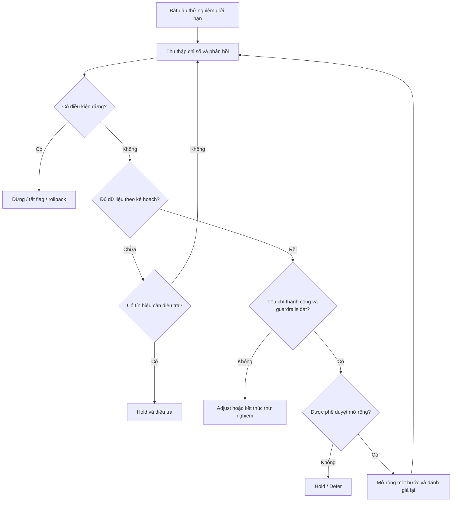

# Thử nghiệm thay đổi ở phạm vi nhỏ với tiêu chí đánh giá

Thay đổi phần mềm luôn có mức độ bất định. Một tính năng mới, cách tính toán được điều chỉnh, phiên bản thư viện, cấu hình hạ tầng hoặc quy trình vận hành có thể hoạt động tốt trong môi trường kiểm thử nhưng tạo ra tác động khác khi gặp dữ liệu và hành vi người dùng thực tế. Triển khai thay đổi cho toàn bộ người dùng cùng lúc làm tăng phạm vi ảnh hưởng nếu giả định ban đầu sai.

Thử nghiệm thay đổi ở phạm vi nhỏ giúp nhóm thu thập bằng chứng trong điều kiện thực tế với mức phơi lộ được giới hạn. Nhóm chọn một nhóm người dùng, một khu vực, một phần lưu lượng hoặc một tập dữ liệu; xác định trước điều cần kiểm chứng; đo kết quả và tín hiệu an toàn; sau đó quyết định tiếp tục, điều chỉnh, mở rộng hay rollback.

Đây không phải cách bỏ qua kiểm thử trước phát hành. Thử nghiệm giới hạn là một lớp kiểm soát bổ sung sau khi các điều kiện tối thiểu đã đạt. Nó cần mục tiêu, phạm vi, quyền quyết định, giám sát và phương án dừng rõ ràng.

## 1. Khi nào nên thử nghiệm thay đổi ở phạm vi nhỏ?

Thử nghiệm giới hạn phù hợp khi thay đổi có thể được bật hoặc triển khai theo phần, và nhóm cần xác minh giả thuyết trong điều kiện sử dụng thật trước khi mở rộng.

Các trường hợp thường gặp:

- Ra mắt một tính năng mới cho một nhóm người dùng đại diện.
- Thay đổi giao diện hoặc luồng thao tác có thể ảnh hưởng tỷ lệ hoàn thành.
- Thay đổi thuật toán xếp hạng, tìm kiếm, đề xuất hoặc phân bổ.
- Điều chỉnh cách tính phí, giới hạn, ưu đãi hoặc quy tắc nghiệp vụ.
- Nâng cấp dịch vụ, database, thư viện hoặc phiên bản API.
- Thay đổi cấu hình hiệu năng, cache, queue, autoscaling hoặc retry.
- Chuyển đổi dữ liệu hoặc chuyển lưu lượng sang một kiến trúc mới.
- Thay đổi quy trình vận hành có thể ảnh hưởng thời gian xử lý hoặc tỷ lệ lỗi.

Không phải thay đổi nào cũng cần pilot. Một sửa lỗi nhỏ, có phạm vi cô lập và đã được kiểm tra đầy đủ có thể đi theo quy trình phát hành thông thường. Ngược lại, thay đổi có tác động lớn, khó đảo ngược, liên quan dữ liệu nhạy cảm hoặc nghĩa vụ bắt buộc có thể cần đánh giá chuyên môn và phê duyệt riêng trước khi thử nghiệm.

### 1.1. Những điều kiện cần có

Trước khi thử nghiệm, cần xác định:

- Có thể giới hạn ai hoặc phần nào chịu tác động.
- Có cách bật/tắt, định tuyến hoặc rollback đã được kiểm tra.
- Có chỉ số đủ tin cậy để quan sát cả kết quả mong muốn và tác dụng phụ.
- Có nhóm chịu trách nhiệm theo dõi trong suốt thời gian thử nghiệm.
- Có tiêu chí tiếp tục, dừng và mở rộng được thống nhất trước.
- Dữ liệu và người tham gia được xử lý theo chính sách bảo mật, quyền riêng tư và thông báo áp dụng.

Nếu không thể cô lập tác động, không thể quan sát kết quả hoặc không có phương án xử lý khi thất bại, thử nghiệm ở phạm vi nhỏ có thể tạo cảm giác an toàn giả. Khi đó cần giảm phạm vi hơn nữa, bổ sung kiểm soát hoặc chọn phương án khác.

## 2. Phân biệt pilot, canary, phased rollout và A/B test

Các thuật ngữ thường được dùng gần nhau nhưng mục đích có khác biệt:

| Hình thức | Mục tiêu chính | Cách giới hạn | Câu hỏi điển hình |
| --- | --- | --- | --- |
| Pilot (thử nghiệm thí điểm) | Đánh giá tính phù hợp và khả năng vận hành trong bối cảnh thực | Một nhóm, đơn vị, khu vực hoặc quy trình được chọn | Nhóm người dùng này có thể sử dụng giải pháp và quy trình mới không? |
| Canary release | Phát hiện vấn đề kỹ thuật khi đưa phiên bản mới vào lưu lượng thực | Một phần nhỏ lưu lượng hoặc instance nhận phiên bản mới | Phiên bản mới có lỗi, latency hoặc tài nguyên bất thường không? |
| Phased rollout | Mở rộng dần sau mỗi lần đánh giá | Tăng dần nhóm người dùng, khu vực hoặc tỷ lệ lưu lượng | Có đủ bằng chứng để mở rộng phạm vi tiếp theo không? |
| A/B test | So sánh tác động của hai hoặc nhiều biến thể lên một kết quả | Chia người tham gia thành các nhóm theo quy tắc xác định | Biến thể nào tạo kết quả tốt hơn theo tiêu chí đã định? |
| Shadow traffic | Kiểm tra hệ thống mới bằng bản sao lưu lượng mà không dùng kết quả để phục vụ người dùng | Gửi bản sao yêu cầu tới hệ thống mới, chặn tác động ghi | Hệ thống mới xử lý dữ liệu thực ra sao khi chưa điều khiển kết quả người dùng? |

Những hình thức này có thể kết hợp. Ví dụ, một pilot có thể được triển khai bằng feature flag và mở rộng theo từng đợt. A/B test có thể nằm trong một đợt rollout giới hạn. Tuy nhiên, nhóm cần nêu rõ mục tiêu của từng hoạt động để không nhầm việc kiểm tra độ ổn định kỹ thuật với việc đo tác động sản phẩm.

## 3. Bắt đầu bằng giả thuyết có thể kiểm chứng

Không nên bắt đầu bằng câu “hãy bật tính năng cho 5% người dùng rồi xem thế nào”. Trước tiên hãy nêu điều nhóm tin là đúng và bằng chứng nào có thể xác nhận hoặc bác bỏ niềm tin đó.

Một giả thuyết thử nghiệm nên có:

1. **Thay đổi:** điều gì sẽ khác so với trạng thái hiện tại?
2. **Đối tượng:** ai hoặc phần nào sẽ tiếp xúc với thay đổi?
3. **Kết quả kỳ vọng:** hành vi hoặc chỉ số nào cần cải thiện?
4. **Cơ chế:** vì sao thay đổi được kỳ vọng tạo ra kết quả?
5. **Chỉ số đánh giá:** đo bằng dữ liệu nào và trong cửa sổ nào?
6. **Chỉ số bảo vệ:** điều gì không được suy giảm vượt giới hạn?
7. **Điều kiện bác bỏ:** dấu hiệu nào cho thấy giả thuyết không đúng hoặc rủi ro quá cao?

Ví dụ:

> Với nhóm khách hàng sử dụng ứng dụng thường xuyên, luồng thanh toán mới được kỳ vọng giảm thời gian hoàn tất giao dịch mà không làm tăng tỷ lệ thanh toán thất bại, giao dịch trùng hoặc yêu cầu hỗ trợ. Nhóm sẽ đo thời gian hoàn tất, tỷ lệ thành công, tỷ lệ lỗi và số giao dịch trùng trong thời gian thử nghiệm đã xác định. Nếu một chỉ số bảo vệ vượt ngưỡng dừng, rollout sẽ được tạm dừng và điều tra.

Giả thuyết cần mô tả một quan hệ có thể quan sát. “Người dùng sẽ thích tính năng mới” quá chủ quan nếu không xác định cách thu thập phản hồi hoặc hành vi nào thể hiện sự phù hợp.

## 4. Xác định mục tiêu và tiêu chí đánh giá trước khi bắt đầu

Tiêu chí đánh giá phải được thống nhất trước khi nhìn thấy kết quả. Nếu chỉ chọn chỉ số sau khi thử nghiệm, nhóm có thể vô tình chọn dữ liệu thuận lợi và bỏ qua dấu hiệu bất lợi.

Nên chia tiêu chí thành bốn nhóm:

- **Tiêu chí thành công:** kết quả mà thay đổi cần đạt.
- **Chỉ số bảo vệ (guardrails):** thuộc tính không được suy giảm quá mức.
- **Điều kiện dừng:** ngưỡng hoặc sự kiện buộc tạm dừng, tắt hoặc rollback.
- **Điều kiện mở rộng:** bằng chứng tối thiểu để tăng phạm vi.

Ví dụ với luồng thanh toán mới:

| Nhóm tiêu chí | Ví dụ | Ý nghĩa |
| --- | --- | --- |
| Thành công | Thời gian hoàn tất thanh toán p95 giảm so với baseline | Đo mục tiêu cải thiện trải nghiệm |
| Bảo vệ | Tỷ lệ thanh toán thất bại không tăng vượt giới hạn đã duyệt | Ngăn cải thiện tốc độ bằng cách làm giảm thành công |
| Bảo vệ | Không có giao dịch logic bị ghi nhận trùng | Bảo vệ tính đúng đắn tài chính |
| Dừng | Có dấu hiệu mất dữ liệu, charge trùng được xác nhận hoặc lỗi nghiêm trọng | Dừng để giới hạn tác động và điều tra |
| Mở rộng | Chỉ số thành công đạt, guardrails ổn định và không còn blocker nghiêm trọng | Cung cấp căn cứ tăng tỷ lệ người dùng |

### 4.1. Viết tiêu chí định lượng

Một tiêu chí định lượng cần nêu:

- Tên và định nghĩa chỉ số.
- Công thức hoặc cách tính.
- Nguồn dữ liệu và cách loại bỏ dữ liệu không hợp lệ.
- Nhóm người dùng, khu vực hoặc loại giao dịch được tính.
- Baseline và khoảng thời gian so sánh.
- Ngưỡng mục tiêu, ngưỡng cảnh báo và ngưỡng dừng.
- Cách xử lý mẫu nhỏ hoặc dữ liệu thiếu.

Ví dụ “tỷ lệ lỗi dưới 1%” chưa đủ nếu chưa định nghĩa lỗi nào, mẫu số là yêu cầu hay phiên người dùng, và lỗi từ nhà cung cấp có được tính không. Định nghĩa phải ổn định giữa baseline và nhóm thử nghiệm.

### 4.2. Viết tiêu chí định tính

Một số thay đổi cần đánh giá qua phản hồi người dùng, quan sát tác vụ hoặc phỏng vấn. Khi đó cần quy định:

- Nhóm người tham gia và cách tuyển chọn.
- Kịch bản hoặc nhiệm vụ được thực hiện.
- Câu hỏi và rubric đánh giá.
- Cách ghi nhận ý kiến trái chiều.
- Người tổng hợp và cách kết luận.

Không nên kết luận “người dùng hài lòng” chỉ từ một vài nhận xét tích cực tự nguyện. Hãy ghi rõ số lượng, đặc điểm người tham gia và giới hạn của mẫu.

## 5. Thiết lập baseline để so sánh

Baseline là trạng thái tham chiếu trước thay đổi. Không có baseline, nhóm khó biết chỉ số sau thử nghiệm tốt hơn hay xấu hơn bình thường.

Baseline có thể gồm:

- Tỷ lệ thành công và thất bại.
- Latency p50, p95, p99.
- Thông lượng và mức sử dụng tài nguyên.
- Tỷ lệ retry, timeout và lỗi phụ thuộc.
- Tỷ lệ hoàn thành tác vụ và bước người dùng bỏ dở.
- Số ticket hỗ trợ hoặc khiếu nại liên quan.
- Tỷ lệ giao dịch trùng, sai trạng thái hoặc cần đối soát.

### 5.1. Chọn cửa sổ baseline

Khoảng thời gian cần đủ đại diện cho chu kỳ sử dụng. Nếu sản phẩm có giờ cao điểm, cuối tuần, ngày trả lương hoặc mùa khuyến mãi, baseline nên phản ánh các biến động đó hoặc ghi rõ phần chưa được đại diện.

Không so sánh trực tiếp ngày thường với ngày cao điểm rồi quy toàn bộ chênh lệch cho thay đổi. Có thể cần phân tầng theo thời gian, khu vực, loại người dùng hoặc loại giao dịch.

### 5.2. Giữ điều kiện so sánh tương đương

Khi có thể, so sánh các nhóm hoặc giai đoạn có điều kiện tương đồng:

- Cùng loại người dùng hoặc phân khúc.
- Cùng khu vực, múi giờ và loại thiết bị.
- Cùng định nghĩa chỉ số và nguồn dữ liệu.
- Cùng thời điểm trong chu kỳ hoặc có điều chỉnh mùa vụ.
- Cùng điều kiện phụ thuộc và tải nền.

Nếu đồng thời có thay đổi khác, ví dụ nâng cấp database trong cùng ngày, cần ghi nhận yếu tố gây nhiễu. Nếu không thể tách tác động, kết luận nên được diễn đạt thận trọng.

## 6. Chọn phạm vi nhỏ và nhóm thử nghiệm

Phạm vi thử nghiệm phải đủ nhỏ để giới hạn tác động nhưng đủ đại diện để thu thập bằng chứng có ích.

Có thể giới hạn theo:

- Tỷ lệ lưu lượng: 1%, 5%, 10% hoặc mức được phê duyệt.
- Nhóm người dùng: nhân viên nội bộ, khách hàng đăng ký tham gia hoặc một phân khúc cụ thể.
- Khu vực: một vùng địa lý hoặc một cụm triển khai.
- Thiết bị/nền tảng: một nhóm phiên bản được hỗ trợ.
- Tính năng: bật một chức năng hoặc một phần luồng.
- Dữ liệu: một tập bản ghi hoặc tenant cô lập.
- Instance: một số node hoặc worker nhận phiên bản mới.

Không có tỷ lệ phần trăm đúng cho mọi tình huống. Một thay đổi có rủi ro cao có thể cần bắt đầu với nhân viên nội bộ hoặc shadow traffic. Một thay đổi có tác động thấp có thể bắt đầu với tỷ lệ lớn hơn nếu có khả năng rollback và giám sát tốt.

### 6.1. Chọn nhóm đại diện

Nhóm thử nghiệm nên phản ánh các đặc điểm liên quan tới giả thuyết:

- Mức độ sử dụng và hành vi thường gặp.
- Loại tài khoản, vai trò hoặc quyền.
- Thiết bị, trình duyệt và phiên bản ứng dụng.
- Khu vực, ngôn ngữ và múi giờ.
- Quy mô giao dịch hoặc dữ liệu.
- Các trường hợp có rủi ro cao hoặc phụ thuộc đặc biệt.

Nhóm quá đồng nhất có thể bỏ sót vấn đề ở phân khúc khác. Ngược lại, nhóm quá đa dạng làm khó xác định nguyên nhân nếu kết quả khác biệt. Có thể bắt đầu với nhóm có kiểm soát rồi mở rộng có chủ đích.

### 6.2. Phân nhóm và tránh lựa chọn thiên lệch

Nếu mục tiêu là so sánh biến thể, việc phân nhóm cần có quy tắc rõ. Với A/B test, phân bổ ngẫu nhiên có thể giúp giảm sai lệch lựa chọn khi phù hợp. Với pilot không ngẫu nhiên, cần mô tả cách chọn nhóm và các khác biệt có thể ảnh hưởng kết quả.

Không nên chỉ chọn người dùng tích cực, nhân viên có kinh nghiệm hoặc khu vực có hạ tầng tốt rồi suy rộng kết quả cho toàn bộ người dùng. Hãy nêu mẫu đại diện cho ai và ai chưa được bao phủ.

### 6.3. Bảo đảm khả năng cô lập

Phạm vi nhỏ chỉ có ý nghĩa nếu nhóm biết ai đang dùng phiên bản nào và có thể tắt hoặc thu hồi thay đổi:

- Dùng feature flag hoặc quy tắc định tuyến có kiểm soát.
- Gắn phiên bản với tenant, cohort hoặc request.
- Tách dữ liệu thử nghiệm khi cần.
- Bảo đảm nhóm đối chứng không vô tình nhận thay đổi.
- Ghi log phiên bản hoặc biến thể đã phục vụ từng yêu cầu.
- Có cơ chế tắt flag và xác minh trạng thái sau khi tắt.

Không để cơ chế phân nhóm làm lộ dữ liệu giữa tenant hoặc làm sai phân quyền. Việc cô lập cần được kiểm tra như một yêu cầu chất lượng.

## 7. Chọn hình thức triển khai giới hạn

### 7.1. Feature flag

Feature flag cho phép bật/tắt hành vi theo điều kiện hoặc nhóm người dùng mà không cần triển khai lại toàn bộ ứng dụng trong mọi trường hợp.

Cần xác định:

- Ai được phép thay đổi flag?
- Điều kiện nhắm mục tiêu là gì?
- Giá trị mặc định khi flag không đọc được?
- Có log ai thay đổi và khi nào không?
- Tắt flag có thực sự đưa hệ thống về hành vi an toàn không?
- Flag có thời hạn hoặc owner để tránh tồn tại vĩnh viễn không?

Feature flag có thể tạo thêm nhánh hành vi. Cần kiểm thử cả flag bật, flag tắt, cấu hình thiếu, cache cũ và trường hợp nhiều instance nhận cấu hình không đồng thời.

### 7.2. Canary release

Canary đưa phiên bản mới tới một phần nhỏ lưu lượng hoặc instance. Nhóm so sánh lỗi, latency, tài nguyên và kết quả nghiệp vụ với phiên bản ổn định.

Canary phù hợp để phát hiện lỗi vận hành hoặc tương thích sớm, nhưng cần bảo đảm lưu lượng canary đủ đại diện. Một vài request thành công không chứng minh phiên bản an toàn dưới tải hoặc tình huống hiếm.

### 7.3. Phased rollout

Phased rollout tăng phạm vi qua các bước đã định. Mỗi bước chỉ được mở rộng khi các tiêu chí của bước trước đạt và không có điều kiện dừng.

Ví dụ:

```text
Nội bộ / sandbox người dùng
        |
        v
Canary 1% lưu lượng
        |
        v
Nhóm giới hạn 5%
        |
        v
Mở rộng 20%
        |
        v
Mở rộng 50%
        |
        v
Phát hành toàn bộ
```

Các tỷ lệ trên chỉ minh họa. Mỗi bước cần có người theo dõi, thời gian quan sát, ngưỡng và quyền cho phép chuyển bước.

### 7.4. Shadow traffic

Shadow traffic gửi bản sao yêu cầu tới phiên bản mới để quan sát kết quả xử lý, trong khi phản hồi phiên bản hiện tại vẫn được dùng cho người dùng.

Phải ngăn hệ thống shadow tạo tác động thật như ghi giao dịch, gửi email, cập nhật tồn kho hoặc gọi dịch vụ tính phí. Có thể dùng chế độ chỉ đọc, dữ liệu cô lập hoặc mock các thao tác ghi. So sánh kết quả cần loại bỏ các trường không ổn định như timestamp hoặc ID được tạo mới.

## 8. Thiết kế kế hoạch đo lường

Mỗi chỉ số cần được gắn với giả thuyết và quyết định. Một bảng kế hoạch đo lường có thể gồm:

| Chỉ số | Loại | Nguồn | Phân nhóm | Cửa sổ | Mục tiêu/ngưỡng | Người theo dõi |
| --- | --- | --- | --- | --- | --- | --- |
| Thời gian hoàn tất thanh toán p95 | Thành công | Trace/metric | Cohort mới và baseline | Theo giờ và toàn kỳ | Cải thiện theo mục tiêu đã duyệt | Product analytics |
| Tỷ lệ thanh toán thất bại | Guardrail | Payment events | Cohort, provider, khu vực | Cửa sổ liên tục | Không vượt ngưỡng dừng | Payments on-call |
| Giao dịch logic trùng | Guardrail | Ledger/reconciliation | Theo idempotency key | Liên tục | Không có giao dịch trùng được xác nhận | Service owner |
| Tỷ lệ hỗ trợ liên quan thanh toán | Guardrail | Support tickets | Cohort và loại vấn đề | Hằng ngày | Không tăng bất thường | Support lead |

### 8.1. Định nghĩa nguồn dữ liệu

Xác định cách tạo chỉ số từ nguồn dữ liệu:

- Sự kiện nào bắt đầu và kết thúc phép đo?
- Có loại trừ traffic nội bộ, bot hoặc retry không?
- Một người dùng có thể xuất hiện ở nhiều cohort không?
- Dữ liệu đến muộn hoặc được sửa lại được xử lý thế nào?
- Múi giờ và cửa sổ tổng hợp được xác định ra sao?
- Ai chịu trách nhiệm xác minh tính đúng của dashboard?

Metric sai hoặc thiếu dữ liệu có thể khiến quyết định rollout sai. Trước khi thử nghiệm, hãy kiểm tra đường đi của telemetry và xác nhận số liệu có thể đối chiếu với nguồn nghiệp vụ.

### 8.2. Cỡ mẫu và thời gian quan sát

Thời gian thử nghiệm phải đủ để quan sát những hành vi liên quan. Một luồng có ít giao dịch vào cuối tuần có thể cần cửa sổ dài hơn. Một thay đổi có tác động theo chu kỳ hóa đơn hoặc tác vụ batch cần quan sát qua ít nhất một chu kỳ thích hợp.

Với thử nghiệm A/B, cỡ mẫu cần dựa trên tỷ lệ nền, mức tác động tối thiểu cần phát hiện, biến động và phương pháp phân tích. Không nên kết luận từ vài sự kiện hoặc dừng ngay khi thấy một kết quả thuận lợi. Nếu nhóm không có chuyên môn thống kê, cần nhờ người có năng lực thiết kế phép đo và diễn giải kết quả.

Với canary vận hành, không chỉ đếm số request. Cần quan sát đủ các loại request, trạng thái, lỗi phụ thuộc và điều kiện tải có liên quan.

## 9. Đặt ngưỡng thành công, cảnh báo và dừng

Ngưỡng phải được xác định trước khi bắt đầu và gắn với hành động cụ thể.

- **Ngưỡng thành công:** kết quả cần đạt để xem giả thuyết được hỗ trợ.
- **Ngưỡng cảnh báo:** tín hiệu cần điều tra hoặc tăng giám sát nhưng chưa nhất thiết phải dừng.
- **Ngưỡng dừng:** điều kiện bắt buộc dừng thử nghiệm, tắt flag hoặc rollback.
- **Điều kiện mở rộng:** yêu cầu để chuyển sang cohort hoặc tỷ lệ tiếp theo.

Ví dụ:

| Tín hiệu | Cảnh báo | Dừng |
| --- | --- | --- |
| Tỷ lệ lỗi thanh toán | Tăng so với baseline trong hai cửa sổ đo liên tiếp | Vượt ngưỡng nghiêm trọng đã được release owner phê duyệt |
| Giao dịch trùng | Có dấu hiệu cần xác minh | Một giao dịch trùng được xác nhận hoặc dữ liệu tài chính sai |
| Latency p95 | Tăng ngoài biến động bình thường | Vượt SLO hoặc làm gián đoạn hành trình trọng yếu |
| Hỗ trợ người dùng | Tăng câu hỏi về trạng thái mới | Có dấu hiệu người dùng bị tính phí sai hoặc không thể hoàn tất tác vụ |

Ngưỡng cụ thể phải dựa trên baseline, SLO, mức độ tác động và khả năng ứng phó. Bảng trên chỉ minh họa logic; không dùng các điều kiện chung thay cho ngưỡng đã được tổ chức phê duyệt.

### 9.1. Điều kiện dừng ngay

Một số sự kiện không nên chờ hết cửa sổ đo:

- Mất hoặc hỏng dữ liệu.
- Truy cập trái phép hoặc rò rỉ dữ liệu.
- Giao dịch tài chính sai hoặc trùng đã xác nhận.
- Ảnh hưởng tới an toàn, nghĩa vụ pháp lý hoặc chính sách bắt buộc.
- Dịch vụ trọng yếu vượt ngưỡng sự cố đã định.
- Cơ chế rollback hoặc cô lập không hoạt động.

Quyền kích hoạt dừng phải được chỉ định trước. Người trực vận hành cần biết ai có quyền tắt flag, ai điều phối incident và ai phê duyệt mở lại.

### 9.2. Điều kiện mở rộng

Chỉ mở rộng khi:

- Đủ lượng dữ liệu và thời gian quan sát theo kế hoạch.
- Chỉ số thành công đạt mục tiêu hoặc có kết luận được phê duyệt.
- Guardrails không vi phạm.
- Không còn blocker nghiêm trọng chưa được xử lý.
- Các giả định trọng yếu vẫn đúng.
- Nhóm vận hành có đủ năng lực theo dõi phạm vi lớn hơn.
- Quyết định được ghi nhận bởi người có thẩm quyền.

Không nên mở rộng chỉ vì không có cảnh báo. “Không thấy vấn đề” có thể do thiếu dữ liệu, telemetry hỏng hoặc nhóm thử nghiệm quá nhỏ.

## 10. Kiểm tra an toàn trước khi bắt đầu

Thử nghiệm nhỏ vẫn có thể gây tác động lớn nếu thay đổi liên quan dữ liệu hoặc giao dịch. Trước khi bật:

- Xác nhận bản build, cấu hình và feature flag đúng phiên bản.
- Xác minh cohort và quy tắc định tuyến.
- Kiểm tra quyền bật/tắt và audit log.
- Diễn tập rollback hoặc khôi phục trong môi trường phù hợp.
- Kiểm tra backup, tính toàn vẹn dữ liệu và khả năng đối soát.
- Xác nhận dashboard, alert và liên hệ on-call.
- Kiểm tra hành vi khi telemetry không có dữ liệu hoặc mất kết nối.
- Chuẩn bị thông báo và hỗ trợ người dùng nếu cần.
- Xác định ai có quyền dừng và ai được phép mở rộng.

Với thay đổi schema hoặc migration dữ liệu, rollback có thể không đơn giản là tắt feature flag. Có thể cần migration tương thích ngược, backup/restore hoặc forward fix. Kế hoạch phải mô tả cách xử lý dữ liệu đã được ghi bởi phiên bản mới.

## 11. Thực hiện thử nghiệm và theo dõi

Trong thời gian thử nghiệm:

1. Ghi lại thời điểm bắt đầu, build, flag, cohort và phạm vi.
2. Xác minh đúng nhóm nhận thay đổi và nhóm đối chứng không bị nhiễm.
3. Theo dõi dashboard và alert theo nhịp đã thống nhất.
4. Kiểm tra cả chỉ số thành công lẫn guardrails.
5. Ghi sự kiện bất thường, thay đổi môi trường và hoạt động can thiệp.
6. Không thay đổi ngưỡng hoặc định nghĩa chỉ số giữa chừng nếu chưa có quy trình điều chỉnh.
7. Tổ chức checkpoint để đánh giá bằng chứng và quyết định bước tiếp theo.
8. Lưu kết quả, giả định, ngoại lệ và quyết định vào hồ sơ thử nghiệm.

### Phân biệt sự cố với dao động thông thường

Metric có thể dao động theo tải, thời gian, khu vực hoặc nguồn dữ liệu. Khi có cảnh báo:

- Kiểm tra liệu cùng biến động có xuất hiện ở baseline hoặc nhóm đối chứng không.
- Xem số lượng mẫu và độ tin cậy của dữ liệu.
- Kiểm tra thay đổi khác xảy ra cùng thời điểm.
- Phân tích theo cohort, phiên bản, khu vực và loại giao dịch.
- Đối chiếu metric kỹ thuật với kết quả nghiệp vụ.

Không được trì hoãn hành động bảo vệ chỉ để thu thập thêm dữ liệu khi đã xuất hiện điều kiện dừng nghiêm trọng.

## 12. Ra quyết định sau mỗi checkpoint

Mỗi checkpoint nên kết thúc bằng một trong các quyết định:

| Quyết định | Khi nào | Hành động |
| --- | --- | --- |
| Continue | Chưa đủ dữ liệu nhưng mọi guardrail ổn định và thời gian thử nghiệm còn trong kế hoạch | Tiếp tục theo dõi tới checkpoint tiếp theo |
| Expand | Đạt tiêu chí, đủ bằng chứng và có phê duyệt | Tăng phạm vi theo bước đã định |
| Hold | Có tín hiệu bất thường hoặc thiếu dữ liệu cần điều tra | Giữ nguyên phạm vi, không mở rộng |
| Adjust | Giả thuyết hoặc cách triển khai cần thay đổi | Sửa cấu hình/kế hoạch, đánh giá lại tác động và ghi phiên bản |
| Rollback/Stop | Vi phạm ngưỡng dừng hoặc rủi ro không còn kiểm soát | Tắt thay đổi, phục hồi và kích hoạt quy trình sự cố nếu cần |

Quyết định phải có người chịu trách nhiệm và căn cứ. Không nên mở rộng bằng quyết định ngầm vì “đã hết giờ thử nghiệm”.

### Sơ đồ quyết định



## 13. Rollback và kế hoạch ứng phó

Rollback là một phần của thiết kế thử nghiệm, không phải quyết định được nghĩ ra khi sự cố xảy ra.

Kế hoạch cần nêu:

- Điều kiện kích hoạt rollback.
- Người có quyền quyết định và người thực hiện.
- Cách tắt feature flag, định tuyến lại hoặc khôi phục phiên bản.
- Cách xử lý dữ liệu đã được tạo hoặc cập nhật.
- Tác động tới giao dịch đang chạy hoặc công việc bất đồng bộ.
- Cách xác minh hệ thống trở về trạng thái ổn định.
- Cách thông báo cho người dùng và nhóm liên quan.
- Cách giữ bằng chứng phục vụ điều tra.

### Kiểm tra rollback

Trước thử nghiệm, cần xác minh:

- Flag thực sự vô hiệu hóa hành vi mới ở mọi instance liên quan.
- Cache hoặc cấu hình phân tán được cập nhật trong thời gian chấp nhận được.
- Phiên bản cũ tương thích với dữ liệu đã được phiên bản mới ghi.
- Job đang chạy, message queue và retry không tạo tác động lặp.
- Có cách đối soát hoặc sửa dữ liệu nếu đã có giao dịch sai.
- Dashboard cho thấy trạng thái sau rollback.

Không phải lúc nào rollback cũng an toàn. Nếu schema đã thay đổi không tương thích, có thể cần forward fix hoặc phục hồi có kiểm soát. Tài liệu thử nghiệm phải nêu phương án thực tế và giới hạn.

## 14. Xử lý kết quả không rõ hoặc dữ liệu không đủ

Thử nghiệm có thể kết thúc mà không đủ căn cứ để kết luận. Các nguyên nhân:

- Số người dùng hoặc giao dịch quá ít.
- Thời gian quan sát chưa bao phủ chu kỳ quan trọng.
- Telemetry thiếu, sai hoặc mất một phần.
- Có thay đổi khác làm nhiễu kết quả.
- Cohort không đại diện hoặc phân bổ sai.
- Một chỉ số thành công cải thiện nhưng guardrail biến động chưa giải thích.

Trong trường hợp này, kết luận nên là inconclusive hoặc cần thêm dữ liệu. Các lựa chọn gồm:

- Kéo dài thử nghiệm trong cùng phạm vi nếu vẫn an toàn và được phê duyệt.
- Điều chỉnh thiết kế đo lường và ghi rõ thay đổi.
- Thu hẹp giả thuyết hoặc chọn cohort phù hợp hơn.
- Bổ sung kiểm thử trong môi trường kiểm soát.
- Dừng thử nghiệm nếu chi phí hoặc rủi ro vượt lợi ích.

Không nên chọn cách diễn giải có lợi nhất chỉ vì nhóm cần quyết định nhanh. Thiếu bằng chứng là một kết quả cần được ghi nhận và có thể là lý do trì hoãn mở rộng.

## 15. Những yếu tố gây sai lệch khi đánh giá

### 15.1. Thay đổi khác diễn ra cùng lúc

Nếu một phiên bản mới, chiến dịch marketing và nâng cấp hạ tầng diễn ra đồng thời, khó tách tác động của từng thay đổi. Hãy ghi các thay đổi liên quan, chọn cửa sổ so sánh phù hợp hoặc trì hoãn một thay đổi nếu cần phép đo rõ hơn.

### 15.2. Nhóm thử nghiệm không đại diện

Người dùng nội bộ có thể hiểu sản phẩm tốt hơn khách hàng mới. Một khu vực có mạng tốt không đại diện vùng có độ trễ cao. Hãy giới hạn kết luận theo nhóm đã tham gia và lập kế hoạch mở rộng kiểm tra.

### 15.3. Chỉ số bị chọn sau khi thấy kết quả

Chọn metric có vẻ tốt sau khi xem dashboard làm tăng nguy cơ diễn giải thiên lệch. Ghi trước metric chính, guardrails, cửa sổ và quy tắc phân tích. Nếu phải thêm metric mới, ghi lý do và phân biệt phân tích xác nhận với phân tích khám phá.

### 15.4. Dừng sớm vì kết quả thuận lợi

Với thử nghiệm so sánh, kiểm tra liên tục và dừng ngay khi thấy chênh lệch có thể làm tăng khả năng kết luận sai nếu phương pháp phân tích không tính đến việc xem dữ liệu nhiều lần. Cần thiết kế thời gian, cỡ mẫu và cách đọc kết quả phù hợp; nhờ chuyên gia thống kê khi quyết định có ý nghĩa lớn.

### 15.5. Mẫu nhỏ và sự kiện hiếm

Không thấy lỗi trong một nhóm nhỏ không chứng minh lỗi hiếm không thể xảy ra. Với rủi ro nghiêm trọng, cần kết hợp thử nghiệm giới hạn với kiểm thử có chủ đích, phân tích thiết kế, fault injection, kiểm soát vận hành và bằng chứng khác.

## 16. Bảo vệ người dùng, dữ liệu và tính công bằng

Thử nghiệm trên người dùng thật cần tuân theo chính sách sản phẩm và tổ chức:

- Không đưa người dùng vào thử nghiệm nếu chưa có căn cứ hoặc thông báo cần thiết.
- Không dùng dữ liệu nhạy cảm vượt mục đích đã được phê duyệt.
- Bảo đảm cohort không vô tình loại trừ hoặc gây tác động bất công cho nhóm cần được bảo vệ.
- Có cách hỗ trợ và phản hồi cho người tham gia.
- Giới hạn thời gian, quyền truy cập và việc chia sẻ dữ liệu thử nghiệm.
- Đánh giá tác động của thay đổi đối với khả năng tiếp cận và nhóm người dùng dễ bị ảnh hưởng.

Với thay đổi liên quan giá, tín dụng, bảo hiểm, sức khỏe, quyền truy cập hoặc quyết định ảnh hưởng đáng kể tới cá nhân, cần có đánh giá chuyên môn và phê duyệt theo chính sách trước khi thử nghiệm. Không nên dùng thử nghiệm giới hạn để né nghĩa vụ bảo vệ người dùng.

## 17. Vai trò và trách nhiệm

Thử nghiệm nhỏ cần phân định ai thiết kế, ai theo dõi, ai dừng và ai cho phép mở rộng.

| Vai trò | Trách nhiệm |
| --- | --- |
| Change owner | Mô tả thay đổi, giả thuyết, phạm vi và kế hoạch |
| Product owner | Xác nhận mục tiêu người dùng, tiêu chí thành công và tác động nghiệp vụ |
| QA/Test lead | Xác định bằng chứng, test trước thử nghiệm, guardrails và kiểm tra kết quả |
| Engineering/Service owner | Bảo đảm khả năng triển khai, cô lập, quan sát và rollback |
| Data/Analytics owner | Xác minh metric, baseline, cohort và chất lượng dữ liệu |
| Operations/SRE | Theo dõi sức khỏe dịch vụ, on-call, incident và khôi phục |
| Security/Privacy | Đánh giá kiểm soát bắt buộc khi thay đổi có liên quan |
| Release authority | Phê duyệt bắt đầu, mở rộng hoặc kết thúc theo thẩm quyền |

Một người có thể giữ nhiều vai trò, nhưng quyền dừng khẩn cấp và quyền mở rộng cần rõ ràng. Người theo dõi metric không nhất thiết có quyền chấp nhận rủi ro hoặc cho phép mở rộng.

## 18. Hồ sơ thử nghiệm và mẫu kế hoạch

Mỗi thử nghiệm nên có một hồ sơ duy nhất để liên kết giả thuyết, cấu hình, kết quả và quyết định.

Mẫu tham khảo:

```text
EXPERIMENT ID:
CHANGE / VERSION:
OWNER:
BUSINESS CONTEXT:
HYPOTHESIS:
EXPECTED OUTCOME:
COHORT / EXPOSURE:
CONTROL OR BASELINE:
START / END / CHECKPOINTS:
PRIMARY SUCCESS METRIC:
GUARDRAIL METRICS:
STOP CONDITIONS:
EXPANSION CRITERIA:
DATA SOURCES / DASHBOARD:
PRE-RELEASE TEST EVIDENCE:
FLAG / ROUTING CONFIGURATION:
ROLLBACK PLAN:
ON-CALL / DECISION AUTHORITY:
PRIVACY / SECURITY REVIEW:
OBSERVATIONS:
DECISIONS (CONTINUE / HOLD / ADJUST / EXPAND / STOP):
FINAL RESULT:
LIMITATIONS / OPEN RISKS:
FOLLOW-UP ACTIONS (OWNER / DUE DATE):
```

Không để các trường quan trọng chỉ tồn tại trong chat. Hồ sơ cần liên kết tới ticket thay đổi, test report, dashboard, incident và quyết định release có liên quan.

## 19. Ví dụ hoàn chỉnh: thử nghiệm luồng thanh toán mới

Giả sử nhóm thay đổi cách gọi payment provider để giảm thời gian hoàn tất thanh toán. Thay đổi có thể ảnh hưởng giao dịch, trạng thái đơn, đối soát và trải nghiệm người dùng.

### Mục tiêu và giả thuyết

- **Thay đổi:** phiên bản mới gọi provider qua một luồng xử lý tối ưu hơn.
- **Giả thuyết:** thời gian hoàn tất p95 giảm mà tỷ lệ thành công và tính đúng đắn tài chính không suy giảm.
- **Nhóm đầu tiên:** một cohort khách hàng có lưu lượng đủ để đo, được chọn theo quy tắc rõ và không chỉ gồm người dùng nội bộ.
- **Baseline:** cùng chỉ số theo phân khúc và thời gian tương đương trước thay đổi.

### Kiểm tra trước khi bật

- Unit test cho quy tắc trạng thái và xử lý timeout.
- Integration test cho provider response, retry, callback trùng và idempotency.
- Contract test cho schema và mã lỗi.
- E2E cho hành trình thanh toán và xác nhận đơn.
- Kiểm tra dashboard, alert, feature flag và rollback.

### Tiêu chí

| Loại | Tiêu chí |
| --- | --- |
| Thành công | p95 hoàn tất giảm theo mục tiêu đã phê duyệt |
| Bảo vệ | Tỷ lệ thành công không thấp hơn giới hạn đã định |
| Bảo vệ | Không có charge trùng hoặc sai số đối soát được xác nhận |
| Cảnh báo | Timeout hoặc retry tăng bất thường so với baseline |
| Dừng | Có giao dịch trùng, mất trạng thái tài chính hoặc vi phạm ngưỡng lỗi nghiêm trọng |
| Mở rộng | Đủ dữ liệu, metric thành công đạt, guardrails ổn định và có phê duyệt |

### Theo dõi và quyết định

Trong từng checkpoint, nhóm so sánh cohort mới với baseline, phân tích theo provider, khu vực và loại giao dịch. Nếu latency giảm nhưng timeout tăng ở một provider, nhóm giữ nguyên phạm vi và điều tra thay vì mở rộng. Nếu phát hiện charge trùng, nhóm dừng ngay, tắt flag theo kế hoạch, đối soát dữ liệu và kích hoạt incident process.

Nếu toàn bộ tiêu chí đạt trong cửa sổ đã định, release authority có thể phê duyệt tăng cohort theo bước. Sau mỗi bước, nhóm tiếp tục đánh giá vì lưu lượng lớn hơn có thể bộc lộ giới hạn chưa thấy ở mẫu nhỏ.

### Kết thúc thử nghiệm

Hồ sơ cuối cần nêu giả thuyết được hỗ trợ hay bác bỏ, chỉ số và giới hạn dữ liệu, sự cố/near miss, quyết định mở rộng hoặc rollback, các rủi ro còn lại và hành động tiếp theo. Nếu thay đổi được mở rộng toàn bộ, vẫn cần theo dõi sau rollout theo kế hoạch.

## 20. Những sai lầm thường gặp

- **Không có giả thuyết:** bật thay đổi rồi tìm chỉ số phù hợp sau đó.
- **Chọn cohort thuận lợi:** kết quả tốt nhưng không đại diện người dùng mục tiêu.
- **Chỉ đo chỉ số thành công:** bỏ qua lỗi, dữ liệu sai hoặc tác động phụ.
- **Không có baseline:** không biết kết quả thay đổi so với trạng thái nào.
- **Mở rộng theo lịch:** hết một ngày là tăng tỷ lệ dù chưa đủ dữ liệu.
- **Coi không có cảnh báo là an toàn:** telemetry có thể thiếu hoặc nhóm thử quá nhỏ.
- **Không kiểm tra rollback:** phát hiện lỗi nhưng không thể tắt thay đổi an toàn.
- **Dùng pilot thay cho kiểm thử bắt buộc:** đưa rủi ro chưa kiểm soát tới người dùng.
- **Thay metric giữa thử nghiệm mà không ghi nhận:** làm kết quả khó diễn giải.
- **Không phân biệt canary và A/B test:** kết luận về trải nghiệm từ dữ liệu chỉ đủ đánh giá sức khỏe kỹ thuật.
- **Không đánh giá lại khi mở rộng:** giả định ở 1% có thể không đúng ở 50% hoặc toàn bộ lưu lượng.
- **Không lưu quyết định:** nhóm sau không biết vì sao đã mở rộng hoặc rollback.

## 21. Checklist trước, trong và sau thử nghiệm

**Trước khi bắt đầu**

- [ ] Thay đổi, mục tiêu và giả thuyết được mô tả rõ.
- [ ] Phạm vi, cohort, nhóm đối chứng và quy tắc định tuyến được xác định.
- [ ] Baseline và định nghĩa metric được kiểm tra.
- [ ] Tiêu chí thành công, guardrails, cảnh báo, dừng và mở rộng được ghi trước.
- [ ] Các kiểm thử bắt buộc trước rollout đã đạt.
- [ ] Feature flag, quyền thay đổi và audit log đã được xác minh.
- [ ] Dashboard, alert, on-call và người có quyền dừng đã sẵn sàng.
- [ ] Rollback hoặc phương án phục hồi dữ liệu đã được kiểm tra.
- [ ] Privacy, security và yêu cầu thông báo đã được xem xét khi cần.

**Trong thử nghiệm**

- [ ] Xác minh đúng cohort nhận thay đổi và nhóm đối chứng không bị nhiễm.
- [ ] Theo dõi metric thành công và guardrails theo lịch.
- [ ] Giữ log, trace, cấu hình và phiên bản của từng checkpoint.
- [ ] Ghi nhận sự kiện bất thường, thay đổi khác và dữ liệu thiếu.
- [ ] Không mở rộng khi chưa đủ dữ liệu hoặc còn blocker.
- [ ] Kích hoạt dừng khi điều kiện đã định xảy ra.

**Sau thử nghiệm**

- [ ] Kết luận dựa trên tiêu chí đã xác định và nêu giới hạn.
- [ ] Quyết định continue, adjust, expand, hold hoặc rollback được ghi nhận.
- [ ] Các sự cố và near miss được liên kết với incident/defect.
- [ ] Hành động tiếp theo có owner, deadline và bằng chứng hoàn tất.
- [ ] Phạm vi mở rộng được đánh giá lại theo lưu lượng và nhóm người dùng mới.
- [ ] Kế hoạch theo dõi sau rollout được duy trì.

## 22. Những điểm cần ghi nhớ

- Thử nghiệm thay đổi ở phạm vi nhỏ giúp thu thập bằng chứng thực tế trong khi giới hạn tác động.
- Cần phân biệt pilot, canary, phased rollout, A/B test và shadow traffic theo mục tiêu.
- Bắt đầu bằng giả thuyết có thể kiểm chứng và tiêu chí được xác định trước.
- Đo cả kết quả mong muốn, guardrails và tín hiệu chẩn đoán.
- Baseline phải có định nghĩa, cửa sổ và điều kiện so sánh phù hợp.
- Cohort cần được chọn có chủ đích, cô lập được và có giới hạn suy rộng rõ.
- Feature flag hoặc canary không thay thế kiểm thử bắt buộc trước rollout.
- Điều kiện dừng, quyền dừng và rollback phải được chuẩn bị trước khi bật thay đổi.
- Chỉ mở rộng khi đủ dữ liệu, guardrails ổn định và có phê duyệt đúng thẩm quyền.
- Kết quả inconclusive cần được ghi nhận; không biến thiếu bằng chứng thành kết luận thành công.
- Bảo vệ người dùng, dữ liệu và nhóm dễ bị ảnh hưởng trong suốt thử nghiệm.
- Lưu hồ sơ và theo dõi sau rollout để quyết định có thể truy nguyên và kiểm chứng.

## Câu hỏi tự kiểm tra

1. Vì sao thử nghiệm ở phạm vi nhỏ là lớp kiểm soát bổ sung chứ không thay thế kiểm thử trước phát hành?
2. Phân biệt pilot, canary release, phased rollout, A/B test và shadow traffic.
3. Một giả thuyết thử nghiệm tốt cần có những thành phần nào?
4. Phân biệt tiêu chí thành công, guardrail, ngưỡng cảnh báo, điều kiện dừng và điều kiện mở rộng.
5. Baseline cần được chọn và kiểm tra như thế nào để tránh so sánh sai?
6. Làm thế nào chọn cohort đủ đại diện nhưng vẫn giới hạn được tác động?
7. Nếu metric thành công cải thiện nhưng tỷ lệ lỗi tăng, nhóm cần quyết định ra sao?
8. Những gì cần kiểm tra trước khi dùng feature flag hoặc canary?
9. Vì sao rollback phải bao gồm cả dữ liệu và giao dịch đang xử lý?
10. Hãy lập kế hoạch thử nghiệm nhỏ cho một thay đổi sản phẩm, gồm giả thuyết, cohort, baseline, metric, guardrails, điều kiện dừng, quyền quyết định và kế hoạch mở rộng.
