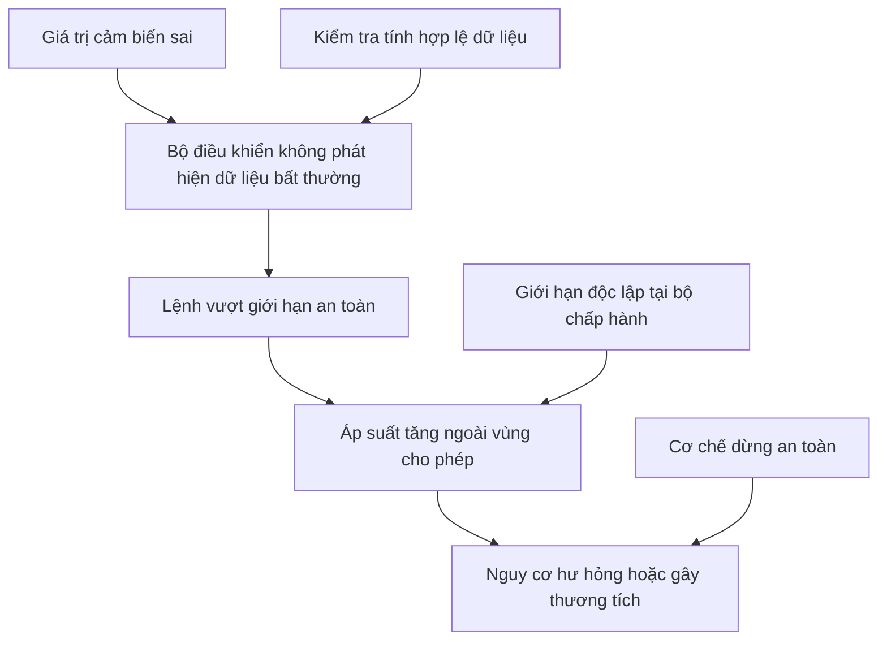
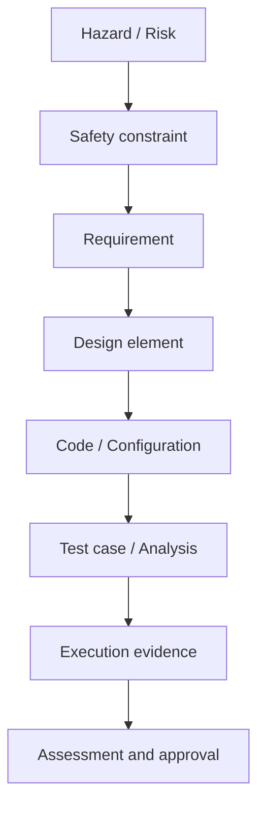

# Điều chỉnh mức kiểm chứng cho chức năng có hậu quả sai sót nghiêm trọng

Khi một chức năng có thể gây thương tích, mất dữ liệu không thể phục hồi, gián đoạn dịch vụ thiết yếu, thiệt hại tài chính lớn hoặc ảnh hưởng nghiêm trọng tới an toàn và quyền lợi của con người, mức kiểm chứng cần tương xứng với hậu quả của sai sót. Một bộ kiểm thử thông thường có thể đủ cho chức năng ít rủi ro nhưng không đủ để chứng minh một chức năng trọng yếu an toàn trong các điều kiện bình thường, bất thường và lỗi hệ thống.

Điều chỉnh mức kiểm chứng có nghĩa là tăng chiều sâu, độ độc lập, khả năng truy vết và độ tin cậy của bằng chứng ở những nơi rủi ro cao. Nhóm cần xác định điều gì có thể gây hại, những kiểm soát nào ngăn ngừa hoặc giảm nhẹ hậu quả, cách chứng minh từng kiểm soát hoạt động và điều kiện nào phải được đáp ứng trước khi phát hành. Mức kiểm chứng được quyết định bằng phân tích rủi ro và yêu cầu của lĩnh vực, không chỉ bằng số lượng test case.

## 1. Vì sao chức năng hậu quả nghiêm trọng cần mức kiểm chứng khác?

Không phải mọi lỗi phần mềm đều có tác động như nhau. Một lỗi định dạng có thể gây khó chịu nhưng dễ khôi phục; một lỗi tính sai liều lượng, mở nhầm van áp suất, cấp quyền trái phép hoặc làm mất dữ liệu giao dịch có thể tạo hậu quả khó đảo ngược. Vì vậy, cùng một xác suất lỗi nhưng mức độ hậu quả khác nhau sẽ dẫn tới yêu cầu kiểm chứng khác nhau.

Ví dụ về các chức năng cần được đánh giá kỹ:

- Điều khiển máy móc, robot, hệ thống điện, áp suất, nhiệt độ hoặc thiết bị có chuyển động nguy hiểm.
- Tính toán liều lượng, thông số điều trị hoặc cảnh báo hỗ trợ quyết định trong môi trường y tế.
- Xác thực, phân quyền và phê duyệt giao dịch có giá trị lớn.
- Xử lý lệnh thanh toán, chuyển tiền, đối soát hoặc ghi nhận dữ liệu tài chính không thể tái tạo.
- Điều phối dịch vụ thiết yếu, hệ thống khẩn cấp hoặc hạ tầng có yêu cầu liên tục cao.
- Cập nhật firmware, schema hoặc cấu hình có thể làm thiết bị hay dữ liệu không thể khởi động hoặc phục hồi.

Mức kiểm chứng cao hơn thường cần:

1. Phân tích nguy hại và rủi ro trước khi thiết kế test.
2. Yêu cầu an toàn hoặc ràng buộc vận hành có thể kiểm tra được.
3. Truy vết hai chiều từ nguy hại tới yêu cầu, thiết kế, mã, test và bằng chứng.
4. Kiểm thử tình huống biên, lỗi, lạm dụng, mất kết nối và phục hồi.
5. Review độc lập hoặc đánh giá bởi người không trực tiếp tạo ra thành phần được kiểm chứng.
6. Bằng chứng tái lập được, có định danh phiên bản và cấu hình.
7. Cổng phát hành chặt chẽ, kiểm soát thay đổi và kế hoạch giám sát sau triển khai.

Đây không phải một công thức áp dụng giống nhau cho mọi sản phẩm. Yêu cầu cụ thể còn phụ thuộc lĩnh vực, môi trường sử dụng, mức độ tự chủ của hệ thống, người chịu tác động và nghĩa vụ pháp lý hoặc tiêu chuẩn chuyên ngành.

## 2. Phân loại mức độ trọng yếu theo rủi ro

Đầu tiên, xác định chức năng nào có thể dẫn tới hậu quả nghiêm trọng. Không nên gán nhãn “critical” chỉ vì một module có tên quan trọng hoặc được nhiều người sử dụng. Hãy phân tích hành vi, điều kiện sử dụng và đường dẫn từ lỗi tới hậu quả.

Một cách sàng lọc ban đầu là đánh giá từng tình huống theo:

| Yếu tố | Câu hỏi |
|---|---|
| Mức độ hậu quả | Nếu chức năng sai, mức thiệt hại lớn nhất hợp lý là gì? |
| Khả năng xảy ra | Lỗi hoặc điều kiện kích hoạt có thể xảy ra thường xuyên đến mức nào? |
| Khả năng phát hiện | Hệ thống hoặc người vận hành có nhận ra lỗi trước khi hậu quả xảy ra không? |
| Khả năng phục hồi | Có thể dừng, quay lui hoặc khôi phục an toàn không? |
| Phạm vi ảnh hưởng | Một người dùng, một thiết bị, một giao dịch hay toàn hệ thống bị ảnh hưởng? |
| Mức phơi nhiễm | Chức năng được sử dụng bao lâu, thường xuyên và trong điều kiện nào? |

Ma trận rủi ro có thể giúp ưu tiên:

| Hậu quả / Khả năng | Thấp | Trung bình | Cao |
|---|---|---|---|
| Nhẹ | Thấp | Thấp | Trung bình |
| Đáng kể | Thấp | Trung bình | Cao |
| Nghiêm trọng | Trung bình | Cao | Rất cao |

Ma trận trên chỉ là công cụ sàng lọc minh họa. Nhóm phải định nghĩa thang đo, tiêu chí xếp hạng và ngưỡng chấp nhận theo bối cảnh thực tế. Không nên nhân các điểm số một cách máy móc rồi coi kết quả là xác suất chính xác. Một tình huống hiếm nhưng có hậu quả thảm khốc vẫn cần biện pháp kiểm soát dù điểm tổng hợp có vẻ thấp.

Phân loại rủi ro cần được xem xét bởi các vai trò có hiểu biết về hệ thống và cách sử dụng thực tế, chẳng hạn kỹ thuật, kiểm thử, vận hành, an toàn, bảo mật, sản phẩm và chuyên gia lĩnh vực. Khi chưa đủ dữ liệu, ghi rõ giả định và mức độ không chắc chắn; không hạ mức kiểm chứng chỉ vì chưa có sự cố trong quá khứ.

## 3. Phân tích nguy hại và đường dẫn gây hậu quả

Phân tích nguy hại (hazard analysis) tìm các trạng thái hoặc hành vi có thể gây hại, sau đó xem xét điều kiện dẫn tới chúng và cách ngăn ngừa hoặc giảm nhẹ. Một hazard có thể xuất phát từ lỗi phần mềm, lỗi phần cứng, dữ liệu sai, thao tác con người, môi trường hoặc tương tác giữa nhiều thành phần.

Phân biệt:

- **Failure:** thành phần không thực hiện đúng hành vi được yêu cầu.
- **Fault:** nguyên nhân tiềm ẩn tạo ra failure, chẳng hạn lỗi mã, cấu hình hoặc phần cứng.
- **Error state:** trạng thái bên trong hoặc dữ liệu sai được tạo ra.
- **Hazard:** trạng thái có khả năng dẫn tới tổn hại trong một bối cảnh sử dụng.
- **Harm:** hậu quả thực tế đối với con người, tài sản, dữ liệu hoặc dịch vụ.

Ví dụ, cảm biến gửi giá trị sai là fault hoặc nguồn dữ liệu lỗi; bộ điều khiển tin giá trị đó và mở van quá giới hạn là failure; áp suất vượt ngưỡng tạo hazard; thiết bị vỡ hoặc gây thương tích là harm. Phân tích phải mô tả được chuỗi liên hệ và các điều kiện có thể chặn nó.

Các kỹ thuật thường dùng gồm:

- **FMEA/FMECA:** phân tích từng chế độ hỏng, nguyên nhân, tác động và biện pháp kiểm soát.
- **FTA (Fault Tree Analysis):** phân tích ngược từ một sự kiện nguy hiểm tới các tổ hợp nguyên nhân.
- **HAZOP:** xem xét sai lệch so với ý định thiết kế, thường hữu ích cho quy trình và hệ thống điều khiển.
- **STPA:** phân tích các ràng buộc an toàn và hành động điều khiển không an toàn trong hệ thống có tương tác phức tạp.
- **Threat modeling:** phân tích cách kẻ tấn công có thể khai thác chức năng trọng yếu hoặc phá vỡ kiểm soát.

Chọn phương pháp theo loại hệ thống và năng lực nhóm. Có thể kết hợp nhiều kỹ thuật. Kết quả phải chuyển thành yêu cầu hoặc ràng buộc có thể kiểm tra; một danh sách nguy hại không gắn với thiết kế và test sẽ khó tạo ra thay đổi thực tế.

Sơ đồ nguyên nhân đơn giản:

Trong sơ đồ, các biện pháp bảo vệ chỉ có tác dụng nếu được thiết kế độc lập ở mức phù hợp, có khả năng hoạt động trong điều kiện lỗi liên quan và được kiểm chứng. Không được coi một biện pháp là độc lập nếu tất cả cùng phụ thuộc vào một cảm biến, một nguồn điện hoặc cùng một lỗi phần mềm.

## 4. Chuyển phân tích rủi ro thành yêu cầu có thể kiểm chứng

Mỗi nguy hại quan trọng cần được liên kết với một hoặc nhiều ràng buộc an toàn. Ràng buộc mô tả điều kiện hệ thống phải luôn giữ hoặc hành vi hệ thống phải thực hiện khi có tình huống nguy hiểm.

Ví dụ:

- Hệ thống không được phát lệnh vượt giới hạn vật lý đã xác định.
- Khi dữ liệu đầu vào thiếu, cũ hoặc không hợp lệ, chức năng phải chuyển sang trạng thái an toàn đã định nghĩa.
- Lệnh có tác động lớn phải được xác thực và kiểm tra quyền ở phía thực thi.
- Một giao dịch không được ghi nhận thành công nếu trạng thái sổ cái và trạng thái thanh toán không nhất quán.
- Khi mất kết nối với thành phần giám sát, hệ thống phải phát hiện trạng thái mất kết nối trong giới hạn thời gian quy định và áp dụng hành vi dự phòng.
- Thao tác khôi phục phải bảo toàn tính toàn vẹn dữ liệu và không lặp lại tác động không thể đảo ngược.

Yêu cầu tốt phải có điều kiện kích hoạt, hành vi mong đợi, giới hạn định lượng khi phù hợp và cách xác minh. Tránh các câu như “hệ thống phải an toàn”, “xử lý nhanh” hoặc “không được lỗi” vì không thể kiểm thử trực tiếp.

Mỗi yêu cầu nên có mã định danh duy nhất và các thuộc tính:

| Thuộc tính | Nội dung |
|---|---|
| Requirement ID | Mã duy nhất, ổn định qua các phiên bản |
| Hazard/risk link | Nguy hại hoặc rủi ro mà yêu cầu kiểm soát |
| Requirement statement | Hành vi hoặc giới hạn phải đáp ứng |
| Rationale | Vì sao yêu cầu cần thiết |
| Verification method | Test, analysis, inspection, demonstration hoặc kết hợp |
| Acceptance criteria | Điều kiện để kết luận đạt |
| Owner/reviewer | Người chịu trách nhiệm và người xem xét |
| Evidence reference | Liên kết tới kết quả và hiện vật xác minh |

Không nên chỉ có yêu cầu chức năng. Với hệ thống hậu quả nghiêm trọng, cần xem xét cả tính toàn vẹn, tính sẵn sàng, thời gian phản hồi, khả năng chịu lỗi, khả năng quan sát, quyền truy cập, tính tương thích và khả năng phục hồi.

## 5. Xác định mức độ nghiêm ngặt và tính độc lập của kiểm chứng

Mức kiểm chứng có thể được điều chỉnh theo mức độ rủi ro, độ phức tạp, khả năng phát hiện và mức độ độc lập của biện pháp bảo vệ. Một số chức năng cần review thông thường; chức năng khác cần kiểm tra chéo, đánh giá độc lập, phân tích hình thức hoặc xác minh bởi chuyên gia có thẩm quyền.

Các chiều cần xem xét:

| Chiều kiểm chứng | Mức cơ bản | Mức tăng cường khi rủi ro cao |
|---|---|---|
| Review yêu cầu | Review bởi nhóm thực hiện | Review đa chuyên môn, kiểm tra ràng buộc an toàn và tình huống lạm dụng |
| Review thiết kế | Peer review | Review độc lập, phân tích failure mode và phụ thuộc chung |
| Review mã | Quy tắc và review thông thường | Reviewer có năng lực phù hợp, kiểm tra vùng trọng yếu, lưu quyết định |
| Test | Test chức năng và hồi quy | Test âm tính, biên, fault injection, stress, timing và phục hồi |
| Truy vết | Liên kết test với yêu cầu chính | Truy vết hai chiều tới nguy hại, kiểm soát, mã, test và bằng chứng |
| Phê duyệt | Chủ sở hữu chức năng | Người có thẩm quyền chấp nhận rủi ro và đánh giá độc lập khi cần |
| Lưu bằng chứng | Báo cáo test | Bằng chứng có phiên bản, cấu hình, nguồn gốc và khả năng tái lập |

Tính độc lập phải được định nghĩa theo rủi ro. Người viết mã không nên là người duy nhất xác nhận rằng chính mã đó đáp ứng yêu cầu trọng yếu. Tuy nhiên, “độc lập” không chỉ là khác tên người; reviewer phải có đủ chuyên môn, quyền tiếp cận thông tin và không bị xung đột lợi ích làm suy giảm đánh giá.

Nếu tiêu chuẩn chuyên ngành hoặc quy định pháp lý yêu cầu mức độc lập, phân loại an toàn hoặc hồ sơ cụ thể, phải tuân thủ yêu cầu áp dụng cho sản phẩm. Không tự suy ra một cấp SIL, ASIL, DAL hoặc cấp chứng nhận chỉ từ ma trận rủi ro nội bộ. Việc phân cấp và đánh giá tuân thủ cần theo đúng tiêu chuẩn, phiên bản và phạm vi được áp dụng.

## 6. Thiết kế chiến lược kiểm thử nhiều lớp

Không có một loại test nào đủ để chứng minh chức năng trọng yếu an toàn trong mọi tình huống. Cần phối hợp nhiều phương pháp và kiểm tra cả hành vi đúng lẫn cách hệ thống phản ứng khi điều kiện sai.

| Lớp kiểm chứng | Mục tiêu | Ví dụ bằng chứng |
|---|---|---|
| Static analysis | Phát hiện lỗi mã, kiểu dữ liệu, luồng nguy hiểm và vi phạm quy tắc | Báo cáo công cụ, cấu hình rule, xử lý ngoại lệ |
| Unit test | Xác minh thuật toán và logic nhỏ | Test biên, giá trị cực trị, nhánh lỗi và assertion |
| Component test | Kiểm tra hành vi module với phụ thuộc được kiểm soát | Báo cáo test component và mô hình phụ thuộc |
| Integration/contract test | Xác minh giao tiếp và tương thích giữa thành phần | Contract test, log giao tiếp và ma trận phiên bản |
| System test | Xác minh hệ thống trong cấu hình gần với sử dụng thật | Kịch bản đầu-cuối, kết quả và cấu hình môi trường |
| Safety/security test | Kiểm tra ràng buộc an toàn và khả năng chống lạm dụng | Test quyền, fault injection, threat scenario |
| Performance/timing test | Kiểm tra giới hạn thời gian, tải và tài nguyên | Phân vị độ trễ, thông lượng, tải cực đại |
| Recovery/resilience test | Xác minh hành vi khi mất phụ thuộc hoặc phục hồi | Kết quả failover, rollback, backup/restore |
| Operational validation | Xác minh quy trình vận hành và con người có thể dùng hệ thống an toàn | Runbook, diễn tập, checklist và biên bản |

Các lớp cần có phạm vi rõ. Unit test có thể chứng minh thuật toán giới hạn hoạt động với dữ liệu đầu vào nhất định nhưng không chứng minh cảm biến thật được hiệu chuẩn đúng hoặc relay phần cứng có thể ngắt nguồn. System test có thể kiểm tra chuỗi tích hợp nhưng không thay thế phân tích thiết kế về các tổ hợp lỗi hiếm.

Chọn test theo từng rủi ro, không chạy tất cả loại test ở cùng độ sâu cho mọi module. Tuy nhiên, các chức năng có thể tạo hậu quả nghiêm trọng cần có bằng chứng rõ cho các ràng buộc liên quan, kể cả khi chức năng đó ít được sử dụng.

## 7. Kiểm thử tình huống biên, lỗi và hành vi không an toàn

Kiểm thử chức năng thông thường thường tập trung vào đầu vào hợp lệ và luồng thành công. Với chức năng trọng yếu, phải xác minh cách hệ thống phản ứng khi đầu vào sai, phụ thuộc hỏng, thứ tự sự kiện bất thường hoặc người dùng thao tác ngoài dự kiến.

Nhóm tình huống nên xem xét:

- Giá trị nhỏ nhất, lớn nhất, sát ngưỡng và vượt ngưỡng.
- Giá trị null, thiếu trường, sai định dạng, tràn số, độ chính xác và đơn vị không khớp.
- Dữ liệu cũ, lặp, đảo thứ tự, sai timestamp hoặc không nhất quán giữa các nguồn.
- Mất mạng, timeout, retry, packet loss, mất nguồn và khởi động lại giữa thao tác.
- Phụ thuộc trả lỗi, trả kết quả một phần hoặc phản hồi chậm.
- Bộ nhớ, CPU, dung lượng lưu trữ hoặc hàng đợi cạn kiệt.
- Lệnh đồng thời, race condition, duplicate request và xử lý không idempotent.
- Người dùng thiếu quyền, tài khoản bị chiếm, cấu hình sai hoặc thao tác nhầm.
- Hệ thống chuyển chế độ, failover, rollback hoặc khôi phục dữ liệu.

Với mỗi kịch bản, mô tả trạng thái ban đầu, sự kiện kích hoạt, hành vi mong đợi, giới hạn thời gian và bằng chứng. “Không bị crash” chưa đủ; hệ thống có thể tiếp tục chạy nhưng ở trạng thái không an toàn. Cần kiểm tra trạng thái thực tế, tác động bên ngoài và tín hiệu được ghi nhận.

Fault injection có thể chủ động làm hỏng một phụ thuộc hoặc đưa hệ thống vào điều kiện bất thường để xác minh biện pháp bảo vệ. Chỉ thực hiện trên môi trường thử nghiệm được kiểm soát hoặc theo quy trình diễn tập được phê duyệt; xác định rõ phạm vi, biện pháp dừng và cách khôi phục trước khi chạy.

Ví dụ bảng kịch bản:

| ID | Điều kiện | Hành vi mong đợi | Bằng chứng |
|---|---|---|---|
| SAFE-01 | Đầu vào vượt giới hạn cho phép | Từ chối lệnh và ghi nhận lý do | Kết quả test, log và trạng thái đầu ra |
| SAFE-02 | Mất tín hiệu cảm biến quá thời gian cho phép | Chuyển sang trạng thái an toàn đã định nghĩa | Timeline, cảnh báo và trạng thái chấp hành |
| SAFE-03 | Gửi lại cùng một lệnh sau timeout | Không lặp tác động không thể đảo ngược | Nhật ký giao dịch và đối soát trạng thái |
| SAFE-04 | Khởi động lại giữa thao tác cập nhật | Phục hồi nhất quán hoặc dừng an toàn | Snapshot trước/sau và log phục hồi |

## 8. Xác minh cơ chế an toàn, dự phòng và độc lập

Một chức năng có thể có nhiều lớp bảo vệ: kiểm tra đầu vào, giới hạn trong phần mềm, interlock, watchdog, cơ chế ngắt độc lập, giám sát và quy trình can thiệp của người vận hành. Cần đánh giá từng lớp và cách chúng tương tác.

Các câu hỏi quan trọng:

- Biện pháp bảo vệ có hoạt động khi thành phần chính bị lỗi không?
- Hai lớp bảo vệ có dùng chung nguồn dữ liệu, nguồn điện, thư viện hoặc cấu hình có thể gây lỗi đồng thời không?
- Có lỗi đơn lẻ nào đủ làm mất toàn bộ biện pháp bảo vệ không?
- Cơ chế fail-safe đưa hệ thống về trạng thái nào, và trạng thái đó có thực sự an toàn trong bối cảnh sử dụng?
- Có cách kiểm tra định kỳ để phát hiện lớp bảo vệ bị hỏng hoặc bị vô hiệu hóa không?
- Người vận hành có thể nhận biết và xử lý cảnh báo trong thời gian cần thiết không?

Không phải lúc nào “tắt hệ thống” cũng là trạng thái an toàn. Với một số hệ thống, dừng đột ngột có thể gây hậu quả lớn hơn việc duy trì hoạt động ở chế độ suy giảm có kiểm soát. Trạng thái an toàn phải được xác định từ hazard analysis và điều kiện vận hành, sau đó được kiểm chứng.

Nếu kiến trúc có redundancy, cần test chuyển đổi khi một thành phần lỗi, chuyển đổi lặp lại, phục hồi thành phần cũ và lỗi đồng thời. Redundancy không tạo ra độ tin cậy nếu các thành phần dự phòng cùng chịu một lỗi nguyên nhân chung hoặc không được kiểm tra trong vận hành.

## 9. Xác minh thời gian, tải và giới hạn tài nguyên

Một thuật toán đúng về logic vẫn có thể gây nguy hiểm nếu phản hồi quá muộn, dùng hết tài nguyên hoặc bỏ lỡ deadline. Với chức năng có ràng buộc thời gian, cần kiểm thử độ trễ đầu-cuối trong điều kiện đại diện và điều kiện xấu hợp lý.

Nội dung cần xác định:

- Deadline hoặc giới hạn phản hồi cho từng hành động trọng yếu.
- Thời gian phát hiện lỗi, thời gian chuyển sang trạng thái dự phòng và thời gian phục hồi.
- Tải đồng thời, tốc độ sự kiện và kích thước dữ liệu.
- Mức tiêu thụ CPU, bộ nhớ, I/O, mạng và dung lượng lưu trữ.
- Hành vi khi tải tăng đột biến hoặc tài nguyên gần cạn.
- Ảnh hưởng của garbage collection, scheduling, clock drift hoặc độ trễ mạng nếu có liên quan.

Không chỉ báo cáo trung bình. Với hành vi có giới hạn thời gian, các phân vị cao và trường hợp xấu nhất có ý nghĩa hơn. Nếu yêu cầu là deadline cứng, cần phương pháp phân tích hoặc đo kiểm phù hợp để chứng minh giới hạn; một phép đo trung bình trong môi trường nhẹ không đủ.

Mỗi kết quả phải gắn với phần cứng, runtime, cấu hình, dữ liệu và tải thử nghiệm. Nếu môi trường test khác môi trường triển khai, nêu rõ khác biệt và cách đánh giá tính đại diện.

## 10. Kiểm chứng bảo mật và chống lạm dụng cho chức năng trọng yếu

Lỗi bảo mật có thể tạo hậu quả nghiêm trọng tương tự lỗi chức năng. Một chức năng thực hiện đúng khi người dùng hợp lệ gọi nhưng cho phép người không có quyền kích hoạt vẫn không đáp ứng yêu cầu.

Phạm vi kiểm chứng có thể bao gồm:

- Xác thực danh tính, phân quyền theo vai trò và kiểm tra quyền tại điểm thực thi.
- Phân tách nhiệm vụ hoặc yêu cầu phê duyệt kép cho thao tác có tác động lớn.
- Quản lý phiên, token, khóa và bí mật; thu hồi quyền khi có sự cố.
- Kiểm tra đầu vào, chống replay, chống sửa đổi thông điệp và bảo vệ tính toàn vẹn.
- Audit log có thể truy vết ai đã thực hiện thao tác gì, vào lúc nào và kết quả ra sao.
- Giới hạn tốc độ, chống lạm dụng API và xử lý lỗi xác thực an toàn.
- Cập nhật phần mềm và cấu hình có xác minh nguồn gốc, chữ ký hoặc tính toàn vẹn khi phù hợp.

Test phải bao gồm cả hành vi hợp lệ và hành vi trái phép. Kiểm tra rằng quyền bị từ chối ở backend hoặc lớp thực thi có thẩm quyền, không chỉ ẩn nút trên giao diện. Với thao tác không thể đảo ngược, kiểm tra retry, replay và xử lý đồng thời để tránh thực hiện lặp.

Log kiểm toán cần đủ chi tiết cho điều tra nhưng không được làm lộ bí mật. Kiểm tra quyền đọc log, tính toàn vẹn, đồng bộ thời gian, thời hạn lưu và khả năng liên kết với định danh giao dịch.

## 11. Truy vết và quản lý cấu hình của bằng chứng

Với chức năng hậu quả nghiêm trọng, không nên chỉ có một báo cáo test tổng hợp. Cần truy vết từ nguy hại tới ràng buộc, yêu cầu, thiết kế, thành phần triển khai, test, kết quả và quyết định chấp nhận rủi ro.

Một chuỗi truy vết điển hình:

Truy vết hai chiều có nghĩa là:

- Từ nguy hại, có thể tìm được các yêu cầu và biện pháp kiểm soát liên quan.
- Từ yêu cầu, có thể tìm được test hoặc phương pháp phân tích xác minh nó.
- Từ test, có thể xác định yêu cầu và rủi ro mà test hỗ trợ.
- Từ bằng chứng, có thể xác định chính xác phiên bản mã, cấu hình, môi trường và người thực thi.
- Từ thay đổi mã hoặc cấu hình, có thể xác định những yêu cầu và test cần đánh giá lại.

Định danh bằng chứng nên bao gồm version, commit, build, artifact digest, phiên bản cấu hình, môi trường, dữ liệu, phiên bản test suite và thời điểm chạy. Lưu log, kết quả thô, báo cáo và công cụ tạo kết quả. Liên kết phải trỏ tới lần chạy cụ thể, không chỉ tới trang dashboard thay đổi theo thời gian.

Nếu một test bị miễn hoặc không chạy, ghi trạng thái riêng, lý do, tác động và người có thẩm quyền phê duyệt. Không chuyển NOT RUN hoặc WAIVED thành PASS để làm đẹp tỷ lệ.

## 12. Kiểm soát thay đổi và kiểm thử hồi quy có trọng tâm

Một thay đổi nhỏ về dòng mã vẫn có thể ảnh hưởng tới ràng buộc an toàn nếu nó nằm trên đường điều khiển, xử lý dữ liệu hoặc cơ chế bảo vệ. Phân tích tác động cần dựa trên quan hệ phụ thuộc và truy vết, không chỉ dựa vào kích thước diff.

Trước khi merge hoặc phát hành, xác định:

1. Thành phần, giao diện, dữ liệu và cấu hình bị thay đổi.
2. Yêu cầu và hazard liên quan tới thành phần đó.
3. Các lớp bảo vệ có thể bị ảnh hưởng trực tiếp hoặc gián tiếp.
4. Test cần chạy lại và test bổ sung cho hành vi mới.
5. Bằng chứng cũ nào còn hiệu lực và bằng chứng nào phải tạo lại.
6. Có cần review độc lập hoặc phê duyệt bổ sung không.

Regression suite cho chức năng trọng yếu cần ưu tiên test gắn với hazard và safety constraint, cùng các test từng phát hiện lỗi nghiêm trọng. Không nên chỉ chọn test theo module vừa sửa vì lỗi có thể lan qua giao diện hoặc phụ thuộc.

Với thay đổi khẩn cấp, vẫn cần quy trình xác định phạm vi, người phê duyệt, kiểm thử tối thiểu bắt buộc, biện pháp giảm thiểu và kế hoạch kiểm chứng sau triển khai. “Hotfix” không làm biến mất rủi ro; nếu phải chấp nhận một khoảng trống kiểm chứng, phải ghi nhận rõ người chấp nhận và thời hạn đóng khoảng trống.

## 13. Cổng phát hành cho chức năng trọng yếu

Quyết định phát hành cần dựa trên tiêu chí đã thống nhất trước, có bằng chứng và có người chịu trách nhiệm. Một cổng phát hành có thể yêu cầu:

| Điều kiện | Bằng chứng cần có |
|---|---|
| Hazard/risk analysis được cập nhật | Bản phân tích có phiên bản, người review và rủi ro tồn dư |
| Safety constraints được truy vết | Ma trận liên kết hazard, requirement, design và test |
| Test trọng yếu đã hoàn tất | Kết quả theo build và cấu hình phát hành |
| Tình huống lỗi và phục hồi đã kiểm tra | Báo cáo fault injection, failover, rollback hoặc diễn tập phù hợp |
| Lỗi nghiêm trọng được xử lý | Defect status, đánh giá tác động và bằng chứng retest |
| Review độc lập hoàn tất khi yêu cầu | Biên bản review, finding và quyết định xử lý |
| Vận hành sẵn sàng | Runbook, monitoring, cảnh báo, backup và kế hoạch ứng phó |
| Ngoại lệ được phê duyệt | Lý do, rủi ro, người phê duyệt, điều kiện và thời hạn |

**GO** chỉ phù hợp khi các tiêu chí bắt buộc được đáp ứng và rủi ro tồn dư nằm trong giới hạn được người có thẩm quyền chấp nhận. **NO-GO** phù hợp khi còn nguy hại chưa được kiểm soát, test bắt buộc thất bại, bằng chứng không đáng tin hoặc điều kiện vận hành chưa sẵn sàng. Một số tổ chức cho phép phát hành có điều kiện; khi đó điều kiện phải có người phụ trách, biện pháp giảm thiểu, thời hạn và cách xác minh.

Không được để áp lực lịch phát hành tự thay thế việc chấp nhận rủi ro. Người phê duyệt phải hiểu chính xác điều gì chưa được xác minh, hậu quả có thể xảy ra và biện pháp bảo vệ còn lại.

## 14. Vận hành an toàn sau phát hành

Kiểm chứng trước phát hành không thể bao phủ mọi điều kiện thực tế. Với chức năng trọng yếu, cần thiết kế khả năng phát hiện sai lệch và ứng phó sau triển khai.

Các cơ chế vận hành có thể bao gồm:

- Monitoring theo hành vi và ràng buộc trọng yếu, không chỉ theo CPU hoặc uptime.
- Cảnh báo có ngưỡng, người nhận, mức độ ưu tiên và hướng dẫn xử lý.
- Audit log và correlation ID để truy vết chuỗi sự kiện.
- Giới hạn tốc độ, circuit breaker, interlock hoặc chế độ suy giảm đã được đánh giá.
- Canary hoặc rollout theo giai đoạn khi phù hợp với rủi ro.
- Kill switch hoặc cơ chế dừng có kiểm soát đã được thử nghiệm.
- Backup, restore, rollback và kế hoạch khôi phục có thể thực thi.
- Diễn tập sự cố, đào tạo người vận hành và phân quyền ứng cứu.

Rollback không phải lúc nào cũng an toàn, đặc biệt khi schema hoặc dữ liệu đã thay đổi không thể đảo ngược. Kế hoạch cần xác định điều kiện có thể quay lui, dữ liệu phải bảo toàn và phương án tiến tới trạng thái ổn định nếu rollback không khả thi.

Sau triển khai, theo dõi các chỉ báo liên quan đến hazard và điều kiện sử dụng. Khi có cảnh báo hoặc sự cố, phải có cơ chế dừng, cô lập, chuyển chế độ hoặc thông báo phù hợp. Kết quả vận hành cần được đưa trở lại phân tích rủi ro và chiến lược kiểm thử cho phiên bản tiếp theo.

## 15. Ví dụ: kiểm chứng chức năng điều khiển áp suất

Giả sử một hệ thống công nghiệp có chức năng điều khiển áp suất trong một thiết bị kín. Nếu áp suất vượt giới hạn, thiết bị có thể hư hỏng và gây nguy hiểm cho người vận hành. Chức năng này được đánh giá là có hậu quả nghiêm trọng nên cần mức kiểm chứng tăng cường.

**Hazard và ràng buộc**

| Mã | Nội dung |
|---|---|
| H-01 | Áp suất vượt giới hạn vận hành an toàn |
| SC-01 | Bộ điều khiển không phát lệnh tăng áp khi giá trị đo không hợp lệ hoặc đã quá cũ |
| SC-02 | Khi áp suất đạt ngưỡng bảo vệ, hệ thống phải chuyển sang hành vi dừng hoặc giảm áp đã được xác định |
| SC-03 | Mất tín hiệu cảm biến phải được phát hiện trong giới hạn thời gian quy định |
| SC-04 | Cơ chế bảo vệ độc lập phải hoạt động khi bộ điều khiển chính bị lỗi, trong phạm vi kiến trúc đã thiết kế |

Các ngưỡng số cụ thể phải lấy từ thiết kế và phân tích an toàn được phê duyệt; không tự đặt giá trị minh họa thành thông số vận hành.

**Chiến lược kiểm chứng**

| Rủi ro | Kiểm chứng | Kết quả mong đợi |
|---|---|---|
| Cảm biến trả giá trị vượt phạm vi | Unit và component test với giá trị biên, NaN, giá trị cũ | Dữ liệu bị đánh dấu không hợp lệ và lệnh nguy hiểm bị chặn |
| Mất kết nối cảm biến | Fault injection ngắt tín hiệu trong môi trường thử nghiệm | Phát hiện mất tín hiệu trong giới hạn và chuyển trạng thái đã định nghĩa |
| Bộ điều khiển chính treo | Kiểm tra watchdog và cơ chế bảo vệ độc lập | Hệ thống đạt trạng thái an toàn theo thiết kế |
| Tín hiệu đến chậm | Timing test dưới tải và khi phụ thuộc chậm | Deadline phát hiện và phản ứng được đáp ứng |
| Khởi động lại giữa chu kỳ | System test ngắt nguồn theo kịch bản kiểm soát | Khôi phục trạng thái nhất quán hoặc dừng an toàn |
| Người dùng không có quyền thay ngưỡng | Security test với vai trò và phiên khác nhau | Thay đổi bị từ chối và được audit |

**Bằng chứng và quyết định**

Hồ sơ cần chứa định danh firmware, commit, cấu hình, phiên bản test suite, thiết bị thử, dữ liệu đầu vào, log cảm biến, lệnh điều khiển, trạng thái cơ chế bảo vệ và kết quả của từng kịch bản. Review độc lập kiểm tra các đường dẫn từ H-01 tới SC-01…SC-04 và bằng chứng tương ứng.

Nếu fault injection cho thấy watchdog không kích hoạt khi bộ điều khiển chính treo, đây là lỗi liên quan trực tiếp tới một ràng buộc an toàn. Nhóm phải đánh giá nguyên nhân, sửa và chạy lại kịch bản cùng các test hồi quy liên quan. Chỉ khi tiêu chí bắt buộc đạt, finding được xử lý và người có thẩm quyền chấp nhận rủi ro tồn dư, ứng viên mới đủ điều kiện qua cổng phát hành.

Ví dụ này cho thấy việc tăng mức kiểm chứng làm thay đổi cả thiết kế test, độ độc lập, bằng chứng và quyết định phát hành. Chỉ tăng số lượng test chức năng thông thường sẽ không giải quyết được các rủi ro liên quan đến lỗi cảm biến, mất tín hiệu hoặc cơ chế bảo vệ độc lập.

## 16. Những sai lầm cần tránh

**Chỉ kiểm thử luồng thành công.** Chức năng trọng yếu cần được kiểm tra trong điều kiện lỗi, biên, lạm dụng và phục hồi.

**Dựa vào một điểm rủi ro tổng hợp.** Điểm số có thể che khuất một tình huống hiếm nhưng hậu quả rất lớn. Hãy xem từng hazard và giả định.

**Coi coverage cao là bằng chứng an toàn.** Coverage chỉ cho biết mã nào đã được thực thi theo cách đo; nó không chứng minh assertion đúng hoặc ràng buộc an toàn đã được xác minh.

**Coi redundancy là độc lập.** Hai thành phần dự phòng có thể cùng thất bại vì dùng chung nguồn dữ liệu, nguồn điện hoặc thiết kế.

**Dùng môi trường thử khác đáng kể với triển khai mà không đánh giá.** Khác biệt phần cứng, dependency, timing hoặc cấu hình có thể làm mất hiệu lực kết quả.

**Chấp nhận waiver không có thời hạn.** Ngoại lệ phải có người chấp nhận, rủi ro, biện pháp giảm thiểu và thời điểm xem xét lại.

**Không truy vết thay đổi tới hazard.** Một sửa đổi tưởng như nhỏ có thể làm vô hiệu lớp bảo vệ hoặc giả định trước đó.

**Cho rằng dừng hệ thống luôn an toàn.** Trạng thái an toàn phụ thuộc bối cảnh vật lý và vận hành, phải được phân tích và kiểm chứng.

**Chỉ kiểm tra trước phát hành.** Monitoring, cảnh báo, diễn tập và khả năng ứng phó là một phần của chiến lược bảo đảm.

## 17. Checklist hoàn thành kiểm chứng tăng cường

- [ ] Chức năng và bối cảnh sử dụng có thể dẫn tới hậu quả nghiêm trọng đã được xác định.
- [ ] Hazard, harm, fault và các giả định quan trọng được phân biệt và ghi nhận.
- [ ] Rủi ro được đánh giá theo hậu quả, khả năng xảy ra, khả năng phát hiện và phục hồi.
- [ ] Ràng buộc an toàn có thể kiểm tra được và được liên kết với yêu cầu.
- [ ] Các biện pháp bảo vệ, phụ thuộc chung và lỗi nguyên nhân chung đã được phân tích.
- [ ] Mức độc lập của review, test và phê duyệt phù hợp với rủi ro và quy định áp dụng.
- [ ] Test bao phủ luồng bình thường, biên, lỗi, lạm dụng, timing, tải và phục hồi theo phạm vi.
- [ ] Truy vết hai chiều từ hazard tới yêu cầu, thiết kế, mã, test và bằng chứng hoạt động.
- [ ] Artifact, cấu hình, môi trường, dữ liệu và phiên bản test suite được định danh.
- [ ] Lỗi nghiêm trọng, test thất bại, test chưa chạy và waiver được đánh giá rõ ràng.
- [ ] Phân tích tác động thay đổi xác định test và review cần chạy lại.
- [ ] Monitoring, cảnh báo, dừng an toàn, rollback hoặc phương án phục hồi đã được kiểm chứng.
- [ ] Người có thẩm quyền đã xem xét rủi ro tồn dư và ghi nhận quyết định phát hành.

Mức kiểm chứng cho chức năng hậu quả nghiêm trọng phải bắt đầu từ việc hiểu nguy hại và ràng buộc cần bảo vệ. Khi rủi ro được chuyển thành yêu cầu rõ ràng, được kiểm tra bằng phương pháp phù hợp và có bằng chứng truy vết độc lập, nhóm mới có cơ sở đáng tin cậy để đánh giá chức năng và quyết định phát hành. Chiến lược này tiếp tục sau phát hành thông qua giám sát, ứng phó, phân tích sự cố và cập nhật kiểm soát theo những gì hệ thống thực sự trải nghiệm.
