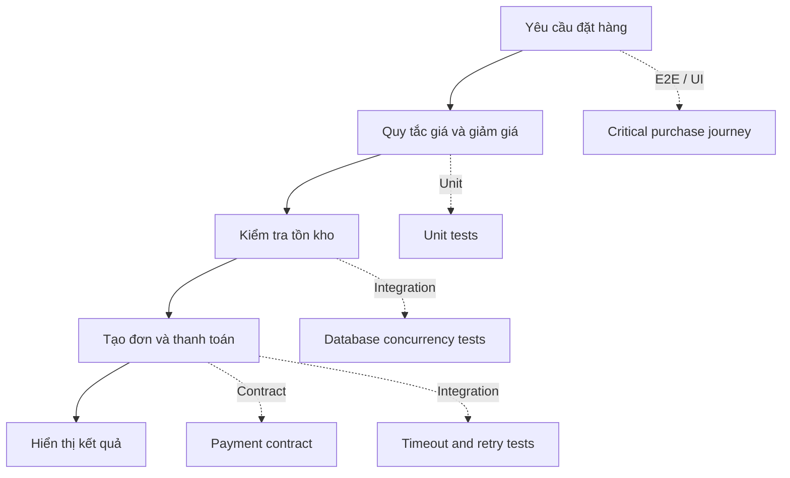

# Chọn cách tiếp cận và phân bổ mục tiêu giữa các tầng kiểm thử

## 1. Mục tiêu thực hành

Khi lập chiến lược kiểm thử cho một tính năng hoặc một thay đổi, nhóm thường phải quyết định kiểm tra điều gì ở mức đơn vị, thành phần, tích hợp, hợp đồng, đầu cuối và nghiệm thu. Nếu mọi mục tiêu đều được đẩy lên kiểm thử giao diện hoặc đầu cuối, bộ kiểm thử thường chậm, khó chẩn đoán và phụ thuộc nhiều vào môi trường. Nếu chỉ tập trung vào kiểm thử đơn vị, nhóm có thể bỏ sót lỗi cấu hình, giao tiếp giữa dịch vụ, dữ liệu và hành trình thực tế của người dùng.

Bài thực hành này hướng dẫn cách chọn tầng kiểm thử dựa trên mục tiêu, rủi ro và chi phí phản hồi. Kết quả mong đợi là một kế hoạch phân bổ có thể giải thích: mỗi mục tiêu được kiểm tra ở đâu, vì sao tầng đó phù hợp, bằng chứng nào được tạo ra và những rủi ro nào vẫn cần kiểm soát.

Phân bổ giữa các tầng không phải là chia đều số lượng test. Một tầng có thể chứa nhiều kiểm thử nếu nó là nơi rẻ và đáng tin cậy nhất để xác nhận hành vi. Mục tiêu là đặt mỗi kiểm tra ở vị trí có khả năng phát hiện lỗi tốt với chi phí duy trì hợp lý, đồng thời giữ một số kiểm tra xuyên suốt để xác nhận các ranh giới quan trọng.

## 2. Hiểu các tầng kiểm thử và loại bằng chứng chúng tạo ra

Tên gọi giữa các tổ chức có thể khác nhau. Điều quan trọng là thống nhất phạm vi và trách nhiệm của từng tầng trong hệ thống đang làm việc.

| Tầng kiểm thử | Phạm vi thường được xác nhận | Lỗi phù hợp để phát hiện | Đặc điểm cần cân nhắc |
|---|---|---|---|
| Đơn vị (unit) | Một hàm, lớp hoặc đơn vị logic nhỏ với phụ thuộc được cô lập | Quy tắc nghiệp vụ, phép tính, điều kiện biên, xử lý lỗi cục bộ | Chạy nhanh, phản hồi rõ; không chứng minh được tích hợp thật |
| Thành phần (component) | Một thành phần có cấu hình và phụ thuộc được kiểm soát | Hành vi nội bộ của thành phần, ánh xạ dữ liệu, xử lý trạng thái | Phạm vi lớn hơn unit; cần xác định ranh giới thành phần |
| Tích hợp (integration) | Tương tác giữa các thành phần hoặc với cơ sở dữ liệu, hàng đợi, dịch vụ | Sai truy vấn, cấu hình, serialization, giao tiếp và giao dịch | Môi trường và dữ liệu có thể làm test chậm hoặc khó ổn định |
| Hợp đồng (contract) | Thỏa thuận giao tiếp giữa bên cung cấp và bên sử dụng | Thay đổi schema, trường bắt buộc, kiểu dữ liệu, ngữ nghĩa API/message | Giúp phát hiện không tương thích mà không cần chạy toàn bộ hành trình |
| Đầu cuối (end-to-end, E2E) | Một hành trình nghiệp vụ xuyên qua nhiều lớp hoặc dịch vụ | Lỗi luồng tổng thể, cấu hình và tương tác giữa các phần | Gần thực tế nhưng thường chậm, nhiều phụ thuộc và khó định vị lỗi |
| Giao diện (UI) | Hành vi hiển thị và thao tác ở lớp người dùng | Điều hướng, nhập liệu, hiển thị trạng thái, khả năng sử dụng | Cần kiểm tra giao diện thật ở những điểm mà API không thể đại diện |
| Nghiệm thu (acceptance) | Điều kiện nghiệp vụ hoặc tiêu chí chấp nhận của bên liên quan | Hiểu sai yêu cầu, thiếu quy tắc nghiệp vụ, kết quả không đáp ứng nhu cầu | Có thể thực hiện ở nhiều tầng; trọng tâm là tiêu chí chấp nhận |

Các tầng này không hoàn toàn loại trừ nhau. “Nghiệm thu” mô tả mục tiêu xác nhận hơn là một vị trí kỹ thuật cố định: một tiêu chí nghiệm thu có thể được kiểm tra bằng unit test, API test hoặc một kịch bản E2E tùy bản chất. Tương tự, kiểm thử UI có thể là một phần của E2E nhưng không phải mọi kiểm thử giao diện đều cần đi qua toàn bộ hệ thống.

## 3. Dùng mô hình kim tự tháp như một điểm xuất phát

Kim tự tháp kiểm thử thường gợi ý đặt nhiều kiểm tra nhanh, tập trung ở đáy; ít kiểm tra tích hợp ở giữa; và một số lượng nhỏ kiểm tra hành trình rộng ở đỉnh.

```text
                 /\
                /  \
               / E2E\        Ít hơn, phạm vi rộng
              /------\
             / Tích   \
            /  hợp và  \      Vừa phải, kiểm tra ranh giới
           / hợp đồng  \
          /--------------\
         / Unit và       \
        / component       \    Nhiều hơn, phản hồi nhanh
       /__________________\
```

Đây là một nguyên tắc định hướng, không phải tỷ lệ bắt buộc. Không nên đặt một mục tiêu như “80% unit, 15% integration, 5% E2E” cho mọi sản phẩm nếu chưa có dữ liệu về kiến trúc, rủi ro và chi phí. Một hệ thống xử lý dữ liệu có thể cần nhiều kiểm thử tích hợp ở ranh giới lưu trữ; một ứng dụng thư viện có thể xác nhận phần lớn quy tắc bằng unit test; một sản phẩm phụ thuộc mạnh vào trình duyệt có thể cần thêm kiểm tra UI có chọn lọc.

Hãy dùng kim tự tháp để đặt câu hỏi: liệu có đang dùng tầng đắt tiền để xác nhận một quy tắc có thể kiểm tra rẻ hơn không; liệu có quá ít kiểm tra ở ranh giới dễ phát sinh lỗi không; và các hành trình E2E có thật sự đại diện cho rủi ro quan trọng không? Nếu câu trả lời cho thấy hình dạng phù hợp khác với kim tự tháp truyền thống, có thể điều chỉnh và ghi rõ lý do.

## 4. Bắt đầu từ mục tiêu và rủi ro, không bắt đầu từ công cụ

Trước khi chọn tầng, diễn đạt mục tiêu kiểm thử dưới dạng hành vi có thể quan sát. Mục tiêu tốt mô tả điều kiện, hành động và kết quả cần xác nhận. Ví dụ: “Khi người dùng gửi yêu cầu thanh toán hai lần với cùng mã giao dịch, hệ thống chỉ ghi nhận một giao dịch” rõ hơn “kiểm thử API thanh toán”.

Với mỗi mục tiêu, xác định:

1. **Tác động nếu lỗi:** ảnh hưởng đến người dùng, dữ liệu, tiền, an toàn, bảo mật hoặc cam kết dịch vụ.
2. **Nơi lỗi có thể xuất hiện:** logic cục bộ, cấu hình, giao tiếp, dữ liệu, giao diện hay toàn bộ hành trình.
3. **Bằng chứng cần có:** giá trị trả về, trạng thái dữ liệu, message, sự kiện, hành vi hiển thị hoặc xác nhận nghiệp vụ.
4. **Điều kiện thực thi:** phụ thuộc thật nào cần thiết, dữ liệu nào phải chuẩn bị và môi trường nào có thể tái lập.
5. **Chi phí phản hồi và duy trì:** thời gian chạy, độ ổn định, công sức chẩn đoán và bảo trì dữ liệu/kịch bản.

Một lỗi có thể được phát hiện ở nhiều tầng. Hãy ưu tiên tầng sớm nhất có thể kiểm tra đầy đủ điều kiện liên quan. Tuy nhiên, nếu lỗi nằm ở tương tác giữa hai thành phần, unit test với mock có thể không đủ; cần ít nhất một kiểm tra tích hợp hoặc hợp đồng để xác nhận hành vi tại ranh giới thật.

## 5. Quy trình phân bổ mục tiêu giữa các tầng

### Bước 1: Liệt kê luồng và tiêu chí cần xác nhận

Lấy yêu cầu, tiêu chí nghiệm thu, phân tích tác động và lịch sử lỗi làm đầu vào. Tách yêu cầu lớn thành các hành vi cụ thể. Với một luồng mua hàng, các hành vi có thể gồm tính tổng tiền, áp dụng mã giảm giá, kiểm tra tồn kho, tạo đơn, gửi yêu cầu thanh toán, xử lý kết quả thanh toán và hiển thị trạng thái.

### Bước 2: Xác định ranh giới có rủi ro

Đánh dấu nơi dữ liệu hoặc quyền điều khiển đi qua ranh giới: giữa hàm và lớp, giữa thành phần và cơ sở dữ liệu, giữa dịch vụ và API ngoài, giữa producer và consumer của message, giữa backend và giao diện. Các ranh giới này thường cần kiểm thử tích hợp hoặc hợp đồng vì mock ở một phía có thể che giấu sai khác thực tế.

### Bước 3: Chọn tầng phù hợp cho từng mục tiêu

- Chọn **unit** khi mục tiêu là quy tắc thuần, phép tính, điều kiện hoặc chuyển trạng thái có thể cô lập.
- Chọn **component** khi cần xác nhận nhiều lớp bên trong một thành phần nhưng vẫn muốn kiểm soát phụ thuộc ngoài.
- Chọn **integration** khi kết quả phụ thuộc vào tương tác thật giữa các thành phần, lưu trữ, hàng đợi hoặc cấu hình.
- Chọn **contract** khi cần bảo đảm hai bên vẫn hiểu cùng một giao diện hoặc schema.
- Chọn **E2E** khi rủi ro nằm ở việc nhiều phần kết hợp thành một hành trình nghiệp vụ và không thể suy ra đầy đủ từ kiểm tra hẹp hơn.
- Chọn **UI** khi bố cục, điều hướng, tương tác trình duyệt hoặc khả năng hiển thị là một phần của yêu cầu.
- Chọn **acceptance** theo tiêu chí mà người dùng hoặc bên nghiệp vụ cần xác nhận; triển khai ở tầng phù hợp với bản chất tiêu chí.

### Bước 4: Kiểm tra phần giao nhau và khoảng trống

Một mục tiêu có thể được kiểm tra ở hai tầng nếu mỗi tầng trả lời một câu hỏi khác nhau. Ví dụ, unit test xác nhận quy tắc tính phí; integration test xác nhận phí được lưu đúng; E2E xác nhận người dùng nhìn thấy tổng tiền nhất quán trong hành trình. Tránh sao chép cùng một khẳng định vào nhiều tầng mà không tạo thêm bằng chứng.

### Bước 5: Ưu tiên theo rủi ro và chi phí

Khi chưa thể thực hiện tất cả, ưu tiên các mục tiêu có tác động lớn, xác suất lỗi đáng kể, khó phát hiện sau triển khai hoặc khó khôi phục. Cân nhắc cả khả năng phát hiện ở tầng rẻ hơn. Nếu mục tiêu rủi ro cao chỉ được kiểm tra thủ công một lần, cần ghi rõ khoảng trống và kế hoạch bổ sung.

### Bước 6: Xác định điều kiện chạy và chủ sở hữu

Ghi thời điểm chạy (mỗi thay đổi, theo lịch, trước phát hành hoặc sau triển khai), môi trường, dữ liệu, người chịu trách nhiệm và cách xử lý khi thất bại. Một test không có người duy trì hoặc dữ liệu tái lập sẽ nhanh chóng mất giá trị.

## 6. Ma trận hỗ trợ lựa chọn tầng

Bảng sau giúp định hướng ban đầu. Đây không phải quy tắc cứng; nếu chọn tầng khác, hãy ghi lý do.

| Dạng mục tiêu | Tầng ưu tiên thường gặp | Tầng bổ sung khi cần |
|---|---|---|
| Quy tắc tính toán, điều kiện biên | Unit | Component nếu phụ thuộc cấu hình hoặc phối hợp nhiều đối tượng |
| Chuyển trạng thái trong một miền nghiệp vụ | Unit hoặc component | Integration để xác nhận lưu trạng thái và giao dịch |
| Truy vấn, ràng buộc và tính toàn vẹn dữ liệu | Integration | E2E chọn lọc nếu ảnh hưởng hành trình quan trọng |
| Tương thích API giữa hai dịch vụ | Contract | Integration để kiểm tra triển khai và cấu hình thật |
| Gửi/nhận message, retry và xử lý trùng | Integration hoặc component | Contract cho schema; E2E cho hành trình xuyên dịch vụ trọng yếu |
| Phân quyền và truy cập tài nguyên | Unit cho quyết định quyền | Integration/API để xác nhận enforcement; E2E cho luồng nhạy cảm |
| Điều hướng và hiển thị giao diện | UI | E2E nếu hành trình xuyên nhiều hệ thống cần được xác nhận |
| Tiêu chí nghiệp vụ của khách hàng | Acceptance | Unit, integration hoặc E2E tùy cách quan sát kết quả |
| Khả năng cài đặt, cấu hình và khởi động | Integration hoặc smoke ở môi trường triển khai | E2E cho một số luồng sau triển khai |

Không phải mọi mục tiêu đều cần đủ mọi tầng. Chọn tầng dựa trên câu hỏi cụ thể mà bằng chứng phải trả lời.

## 7. Ví dụ thực hành: phân bổ mục tiêu cho luồng đặt hàng

Giả sử một dịch vụ bán hàng có luồng đặt hàng gồm tính giá, kiểm tra tồn kho, tạo đơn, gọi dịch vụ thanh toán và hiển thị kết quả. Nhóm muốn xác nhận các mục tiêu sau:

| Mã | Mục tiêu cần xác nhận | Tầng chính | Lý do và bằng chứng |
|---|---|---|---|
| T-01 | Tổng tiền bằng tổng các dòng hàng, thuế và phí theo quy tắc đã duyệt | Unit | Kiểm tra nhiều tổ hợp đầu vào và giá trị biên; bằng chứng là tổng tiền mong đợi và thực tế |
| T-02 | Mã giảm giá hết hạn hoặc không đủ điều kiện bị từ chối đúng quy tắc | Unit | Đây là quy tắc nghiệp vụ có thể cô lập; kiểm tra thời hạn và điều kiện áp dụng |
| T-03 | Số lượng tồn kho được cập nhật an toàn khi hai yêu cầu đồng thời đặt mặt hàng cuối cùng | Integration | Cần cơ sở dữ liệu và cơ chế đồng thời thật; xác nhận không bán vượt tồn |
| T-04 | Dịch vụ đặt hàng và dịch vụ thanh toán thống nhất schema và ý nghĩa mã giao dịch | Contract | Kiểm tra tương thích giữa bên gọi và bên cung cấp; lưu phiên bản hợp đồng |
| T-05 | Khi cổng thanh toán timeout, đơn ở trạng thái có thể đối soát và không bị ghi nhận đã thanh toán | Integration | Cần xác nhận xử lý lỗi, trạng thái lưu trữ và retry ở ranh giới dịch vụ |
| T-06 | Người dùng có thể hoàn tất một đơn hàng hợp lệ và nhìn thấy trạng thái xác nhận | E2E/UI | Một hành trình đại diện xác nhận các phần phối hợp và nội dung hiển thị |
| T-07 | Người dùng không thể xem đơn hàng của tài khoản khác | Unit và API integration | Unit xác nhận chính sách quyền; API test xác nhận quyền được thực thi tại ranh giới |

Phân bổ này có chủ đích: quy tắc tính toán và điều kiện nghiệp vụ được kiểm tra nhanh ở unit; rủi ro dữ liệu và giao tiếp được kiểm tra tại ranh giới; chỉ một số hành trình quan trọng được đưa qua E2E/UI. Nếu nhóm chỉ có E2E, lỗi ở T-01 có thể khó định vị và các tổ hợp giá trị khó kiểm tra đầy đủ. Nếu nhóm chỉ có unit, T-03 và T-05 chưa được chứng minh vì phụ thuộc vào hành vi thực của lưu trữ và giao tiếp.

### 7.1. Sơ đồ phân bổ ví dụ



Sơ đồ chỉ mô tả cách đặt mục tiêu kiểm thử lên luồng. Trong kế hoạch thật, mỗi test cần liên kết với yêu cầu, dữ liệu, môi trường và kết quả chạy cụ thể.

## 8. Cách phân bổ khi kiến trúc hoặc năng lực có giới hạn

Không phải nhóm nào cũng có thể tạo đủ mọi loại kiểm thử ngay lập tức. Hãy ghi nhận hạn chế và chọn phương án thực tế:

- Nếu chưa thể dựng môi trường tích hợp, ưu tiên unit test cho logic có thể cô lập, đồng thời lập kế hoạch kiểm tra ranh giới bằng môi trường dùng chung hoặc kiểm tra thủ công có cấu trúc.
- Nếu hệ thống là monolith khó tách lớp, có thể dùng component test hoặc integration test ở ranh giới ứng dụng với cơ sở dữ liệu thử nghiệm; tách logic dần khi có cơ hội thay đổi.
- Nếu E2E không ổn định, giảm phạm vi xuống những hành trình đại diện, loại bỏ phụ thuộc không cần thiết và cải thiện dữ liệu cũng như cơ chế chờ. Không dùng retry vô hạn để che giấu lỗi chập chờn.
- Nếu API ngoài không có môi trường thử nghiệm, dùng contract test và mô phỏng có kiểm soát cho phần lớn trường hợp; vẫn cần một kế hoạch xác nhận kết nối thật ở môi trường được phép.
- Nếu thiếu thời gian, ưu tiên mục tiêu rủi ro cao và ghi rõ mục tiêu chưa có bằng chứng, người chấp nhận rủi ro và thời điểm đánh giá lại.

Mock hoặc stub rất hữu ích để cô lập hành vi, nhưng không chứng minh dịch vụ thật tuân thủ cùng hợp đồng. Với mỗi phụ thuộc được mô phỏng, xác định phần nào đã được kiểm tra bằng contract hoặc integration để tránh cảm giác bao phủ giả.

## 9. Chỉ số đánh giá chất lượng phân bổ

Không nên đánh giá kế hoạch chỉ bằng số lượng test ở từng tầng. Một kế hoạch tốt cần tạo bằng chứng hữu ích với chi phí hợp lý. Có thể theo dõi:

- **Thời gian phản hồi:** thời gian từ khi thay đổi được kiểm tra đến khi nhóm nhận được kết quả đủ tin cậy.
- **Độ ổn định:** tỷ lệ lần chạy cho kết quả nhất quán trong cùng điều kiện; số test chập chờn và thời gian xử lý.
- **Khả năng chẩn đoán:** mức độ dễ xác định thành phần và nguyên nhân khi test thất bại.
- **Lỗi lọt:** các lỗi được phát hiện sau tầng kiểm thử dự kiến hoặc sau phát hành, phân tích xem thiếu mục tiêu hay chọn sai tầng.
- **Chi phí duy trì:** công sức cập nhật dữ liệu, môi trường, test và hợp đồng khi sản phẩm thay đổi.
- **Liên kết yêu cầu với bằng chứng:** tỷ lệ mục tiêu quan trọng có test hoặc kiểm soát tương ứng và có kết quả truy xuất được.

Các chỉ số cần được đọc cùng bối cảnh. Tăng số lỗi được phát hiện có thể phản ánh khả năng phát hiện tốt hơn chứ không nhất thiết chất lượng sản phẩm đang giảm. Giảm thời gian chạy không có ý nghĩa nếu nhóm đã bỏ các kiểm tra quan trọng. Mục tiêu là cải thiện khả năng phản hồi và giảm rủi ro, không tối ưu một con số riêng lẻ.

## 10. Mẫu kế hoạch phân bổ tầng kiểm thử

Có thể sử dụng bảng sau khi lập kế hoạch cho một tính năng. Mỗi hàng là một mục tiêu kiểm thử cụ thể, không phải một tên test chung.

| Trường | Nội dung cần điền |
|---|---|
| Mã mục tiêu | Mã duy nhất để tham chiếu |
| Yêu cầu / hành vi | Điều kiện, hành động và kết quả cần xác nhận |
| Rủi ro | Tác động, khả năng xảy ra, khả năng phát hiện và khôi phục |
| Tầng chính | Unit, component, integration, contract, E2E, UI hoặc acceptance |
| Tầng bổ sung | Tầng khác cần thiết và câu hỏi riêng mà tầng đó trả lời |
| Dữ liệu và môi trường | Dữ liệu chuẩn bị, phụ thuộc thật/giả lập, cấu hình và môi trường |
| Điều kiện chạy | Mỗi thay đổi, theo lịch, trước phát hành hoặc sau triển khai |
| Bằng chứng | Kết quả, log, trạng thái dữ liệu, ảnh hoặc báo cáo liên quan |
| Chủ sở hữu | Người hoặc nhóm duy trì mục tiêu và xử lý khi thất bại |
| Khoảng trống | Điều chưa được xác nhận và cách xử lý rủi ro còn lại |

Ví dụ một hàng đã điền:

| Trường | Ví dụ |
|---|---|
| Mã mục tiêu | PAY-RETRY-01 |
| Yêu cầu / hành vi | Khi cùng một yêu cầu thanh toán được gửi lại, hệ thống không tạo giao dịch trùng |
| Rủi ro | Ghi nhận thanh toán hai lần và sai lệch đối soát |
| Tầng chính | Integration |
| Tầng bổ sung | Unit cho quy tắc idempotency; contract cho định dạng mã giao dịch |
| Dữ liệu và môi trường | Cơ sở dữ liệu thử nghiệm, cổng thanh toán giả lập trả cùng mã giao dịch |
| Điều kiện chạy | Pipeline trước phát hành và khi thay đổi xử lý thanh toán |
| Bằng chứng | Số giao dịch, trạng thái đơn, log yêu cầu và kết quả đối soát |
| Chủ sở hữu | Nhóm phụ trách thanh toán |
| Khoảng trống | Chưa xác nhận hành vi của nhà cung cấp thật khi timeout; cần kiểm tra trên môi trường tích hợp được phép |

## 11. Bài tập thực hành

### Bài tập A: Phân bổ mục tiêu cho chức năng đăng nhập

Một hệ thống có đăng nhập bằng mật khẩu, khóa tài khoản sau nhiều lần thất bại, cấp token và hiển thị thông tin người dùng. Hãy lập danh sách ít nhất sáu mục tiêu kiểm thử, chọn tầng chính và giải thích vì sao.

Gợi ý để tự kiểm tra:

- Kiểm tra quy tắc khóa tài khoản và thời hạn khóa có thể đặt ở unit nếu logic được cô lập.
- Kiểm tra lưu trạng thái khóa và xác thực với kho dữ liệu cần integration.
- Kiểm tra hợp đồng token giữa dịch vụ xác thực và dịch vụ sử dụng token có thể cần contract.
- Kiểm tra một hành trình đăng nhập thành công và một hành trình bị từ chối có thể cần E2E/UI.
- Kiểm tra người dùng không thể truy cập dữ liệu tài khoản khác cần xác nhận quyền tại API hoặc ranh giới dịch vụ.

### Bài tập B: Tìm kiểm thử đang đặt sai tầng

Một nhóm có một kịch bản E2E dài để kiểm tra hàng chục tổ hợp mã giảm giá. Khi thất bại, nhóm phải mất nhiều thời gian để xác định lỗi ở giao diện, dịch vụ giá hay dữ liệu. Đề xuất cách phân bổ lại.

Hướng giải: đưa tổ hợp quy tắc giảm giá, thời hạn, điều kiện tối thiểu và giới hạn sử dụng xuống unit/component test; giữ integration test cho việc áp dụng mã với dữ liệu lưu trữ và giao dịch; giữ một số E2E đại diện để xác nhận người dùng có thể áp dụng mã và thấy tổng tiền cập nhật. Mỗi tầng cần trả lời một câu hỏi riêng.

### Bài tập C: Ghi nhận khoảng trống

Một API gọi hệ thống đối tác nhưng đối tác không cung cấp môi trường sandbox. Nhóm đã có unit test với mock. Hãy ghi rõ điều gì đã được chứng minh, điều gì chưa được chứng minh và biện pháp bổ sung.

Hướng giải: unit test chứng minh logic của bên gọi với các phản hồi giả lập; nó chưa chứng minh endpoint, xác thực, schema và hành vi thật của đối tác. Có thể bổ sung contract test dựa trên đặc tả đã thống nhất, kiểm tra cấu hình và xác nhận kết nối thật trong môi trường được cho phép, đồng thời theo dõi lỗi tích hợp sau triển khai.

## 12. Lỗi thường gặp khi phân bổ tầng

- **Đẩy mọi thứ lên E2E:** thời gian chạy và độ khó chẩn đoán tăng; các quy tắc có thể kiểm tra nhanh hơn bị lặp lại ở tầng đắt tiền.
- **Chỉ viết unit test:** bỏ qua hợp đồng, cấu hình, dữ liệu và tương tác thật giữa các thành phần.
- **Dùng mock cho mọi phụ thuộc:** test có thể luôn xanh dù hợp đồng thực tế đã thay đổi. Bổ sung contract hoặc integration ở ranh giới quan trọng.
- **Nhầm mục tiêu nghiệm thu với tầng E2E:** tiêu chí nghiệp vụ có thể được xác nhận ở tầng khác nếu bằng chứng phù hợp và bên liên quan chấp nhận.
- **Đặt tỷ lệ tầng thành chỉ tiêu cứng:** tỷ lệ không phản ánh rủi ro và cấu trúc sản phẩm. Dùng dữ liệu chạy và lỗi thực tế để điều chỉnh.
- **Lặp cùng một khẳng định ở nhiều tầng:** làm tăng chi phí mà không tăng bằng chứng. Chỉ giữ kiểm tra nhiều tầng khi mỗi tầng xác nhận một khía cạnh khác nhau.
- **Không ghi khoảng trống:** người đọc hiểu nhầm rằng toàn bộ rủi ro đã được kiểm tra. Nêu rõ phần chưa xác nhận và cách quản lý.
- **Không duy trì test:** test lỗi thời, dữ liệu không tái lập hoặc môi trường không ổn định làm suy giảm niềm tin vào kết quả.

## 13. Checklist trước khi chốt kế hoạch

1. Mỗi mục tiêu kiểm thử mô tả một hành vi hoặc điều kiện có thể quan sát.
2. Rủi ro và hậu quả nếu lỗi xảy ra đã được xem xét.
3. Tầng chính được chọn vì nó xác nhận trực tiếp mục tiêu với chi phí phù hợp.
4. Các ranh giới quan trọng có kiểm thử tích hợp hoặc hợp đồng thích hợp.
5. E2E/UI tập trung vào hành trình và hành vi mà các tầng hẹp hơn không thể chứng minh đầy đủ.
6. Những kiểm tra lặp lại giữa các tầng tạo ra bằng chứng khác nhau và có lý do rõ ràng.
7. Dữ liệu, môi trường, điều kiện chạy và chủ sở hữu đã được xác định.
8. Khoảng trống, phụ thuộc được mô phỏng và rủi ro còn lại được ghi nhận.
9. Có cách theo dõi thời gian phản hồi, độ ổn định, khả năng chẩn đoán và lỗi lọt để điều chỉnh phân bổ.

## 14. Kết luận

Phân bổ mục tiêu giữa các tầng kiểm thử là quyết định về nơi tạo ra bằng chứng phù hợp nhất cho từng rủi ro. Bắt đầu từ hành vi và hậu quả nếu lỗi xảy ra, xác định ranh giới liên quan, rồi chọn tầng có thể kiểm tra đầy đủ với chi phí và độ tin cậy phù hợp. Unit và component thường phù hợp với quy tắc cục bộ; integration và contract xác nhận ranh giới; E2E và UI bảo vệ một số hành trình quan trọng; acceptance bảo đảm kết quả đáp ứng nhu cầu nghiệp vụ.

Sau khi triển khai kế hoạch, dùng thời gian phản hồi, độ ổn định, lỗi lọt và chi phí duy trì để đánh giá lại. Khi hệ thống hoặc rủi ro thay đổi, điều chỉnh tầng và phạm vi kiểm thử tương ứng. Một kế hoạch tốt không tuân theo một tỷ lệ cố định; nó giải thích được vì sao từng mục tiêu được đặt ở tầng đó và cho thấy những rủi ro nào vẫn còn cần quản lý.
