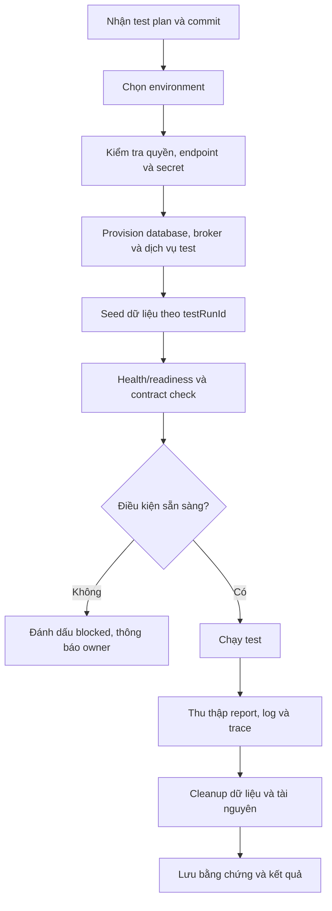

# Lập phương án dữ liệu, môi trường và dịch vụ bên ngoài

Một kế hoạch kiểm thử có thể có test case đầy đủ nhưng vẫn không thực hiện được nếu thiếu dữ liệu phù hợp, môi trường không sẵn sàng hoặc dịch vụ bên ngoài không thể truy cập. Ngược lại, một test chạy thành công trong môi trường quá đơn giản có thể tạo cảm giác an toàn giả nếu nó không đại diện cho cách sản phẩm hoạt động khi tích hợp với hệ thống thật.

Lập phương án dữ liệu, môi trường và dịch vụ bên ngoài là công việc chuẩn bị có chủ đích trước khi chạy kiểm thử. Nhóm xác định cần dữ liệu nào, tạo hoặc tiếp nhận dữ liệu ra sao, môi trường nào phù hợp, phụ thuộc bên ngoài được kết nối hay mô phỏng theo cách nào, ai chịu trách nhiệm và cách xử lý khi một điều kiện không sẵn sàng. Kế hoạch phải đủ cụ thể để người khác có thể chuẩn bị, chạy, lặp lại và thu dọn kiểm thử một cách an toàn.

## 1. Mục tiêu của phương án chuẩn bị kiểm thử

Một phương án tốt giúp trả lời các câu hỏi:

- Test cần dữ liệu nào, ở trạng thái nào và có thể tạo lại bằng cách nào?
- Dữ liệu đến từ nguồn nào, được phân loại ra sao và ai phê duyệt việc sử dụng?
- Môi trường nào sẽ được dùng cho từng tầng kiểm thử và cấu hình có đủ đại diện không?
- Dịch vụ bên ngoài nào là phụ thuộc bắt buộc, có sandbox hay cần mô phỏng?
- Các endpoint, tài khoản, chứng thư, khóa và secret được cấp phát, lưu giữ và thu hồi thế nào?
- Làm sao cô lập test run để không ghi đè dữ liệu của nhóm khác?
- Cần mô phỏng timeout, lỗi, giới hạn tốc độ, retry hoặc phản hồi bất thường nào?
- Điều kiện sẵn sàng, phương án dự phòng, người hỗ trợ và thời hạn chuẩn bị là gì?
- Sau kiểm thử, dữ liệu, tài khoản, tài nguyên và cấu hình tạm thời được dọn dẹp ra sao?

Phương án không chỉ là danh sách URL và tài khoản. Nó mô tả cách các thành phần phối hợp để tạo ra điều kiện kiểm thử đáng tin cậy, an toàn và có thể tái lập.

## 2. Bắt đầu từ mục tiêu và phạm vi kiểm thử

Trước khi yêu cầu dữ liệu hoặc môi trường, hãy đọc mục tiêu, phạm vi và rủi ro của đợt kiểm thử. Mỗi điều kiện chuẩn bị cần phục vụ một câu hỏi kiểm thử cụ thể.

Ví dụ với luồng đặt hàng:

- Kiểm thử tính giá cần sản phẩm, giá, thuế, khuyến mãi và giỏ hàng có thể kiểm soát.
- Kiểm thử thanh toán cần tài khoản test, phương thức thanh toán sandbox, callback và trạng thái giao dịch.
- Kiểm thử tồn kho cần số lượng ban đầu, giữ hàng, giải phóng giữ hàng và cập nhật đồng thời.
- Kiểm thử retry cần khả năng tạo timeout, gửi lại yêu cầu và quan sát khóa idempotency.
- Kiểm thử hiệu năng cần dữ liệu đủ lớn và phân bố gần tải dự kiến.
- Kiểm thử phân quyền cần tài khoản thuộc nhiều vai trò và tenant riêng biệt.

Không nên chuẩn bị một bộ dữ liệu rất lớn hoặc một môi trường phức tạp trước khi biết test cần chứng minh điều gì. Chuẩn bị quá mức làm tăng chi phí, rủi ro dữ liệu và thời gian dọn dẹp.

### 2.1. Lập ma trận nhu cầu

Liệt kê các nhóm kiểm thử và điều kiện cần có:

| Nhóm kiểm thử | Dữ liệu cần | Môi trường/phụ thuộc | Bằng chứng cần quan sát |
| --- | --- | --- | --- |
| Unit/component | Fixture nhỏ, giá trị biên, trạng thái hợp lệ/không hợp lệ | Runner và dependency cục bộ | Kết quả logic, exception và trạng thái |
| Integration | Bản ghi liên quan, transaction, event và dữ liệu tham chiếu | Database, broker, cache hoặc container | Dữ liệu đã ghi, event và tính nhất quán |
| API/contract | Payload hợp lệ, sai schema, mã lỗi và token test | API test environment, provider/consumer contract | Status, header, body và tương thích |
| System/E2E | Tài khoản, đơn hàng và trạng thái xuyên luồng | Staging hoặc môi trường tích hợp | Kết quả nghiệp vụ cuối và trace |
| Performance | Dữ liệu đại diện, phân bố và khối lượng đủ lớn | Môi trường đo tải có cấu hình ghi nhận | Latency, throughput, error rate và tài nguyên |
| Resilience | Trạng thái trước lỗi, giao dịch đang xử lý và dữ liệu phục hồi | Môi trường cô lập có thể fault injection | Khả năng phục hồi, dữ liệu và thời gian khôi phục |

Ma trận giúp phát hiện sớm một test đang thiếu dữ liệu, phụ thuộc hoặc khả năng quan sát. Nó cũng giúp chọn môi trường phù hợp thay vì mặc định mọi test đều chạy trên staging.

## 3. Thiết kế phương án dữ liệu kiểm thử

Dữ liệu phải đủ để kích hoạt hành vi cần kiểm tra, có thể kiểm soát và không tạo rủi ro không cần thiết. Hãy bắt đầu từ yêu cầu và oracle, sau đó xác định bản ghi, trường, quan hệ và trạng thái cần thiết.

### 3.1. Phân loại dữ liệu theo mục đích

Các nhóm dữ liệu thường cần chuẩn bị:

- **Dữ liệu chuẩn (happy path):** bản ghi hợp lệ cho luồng thành công.
- **Dữ liệu biên:** giá trị nhỏ nhất/lớn nhất, giới hạn độ dài, ngày giờ sát mốc, số lượng bằng 0 hoặc sát hạn mức.
- **Dữ liệu không hợp lệ:** thiếu trường, sai định dạng, giá trị ngoài miền, tham chiếu không tồn tại.
- **Dữ liệu trạng thái:** mới tạo, đang xử lý, hoàn tất, thất bại, hủy, hết hạn hoặc cần đối soát.
- **Dữ liệu quan hệ:** bản ghi cha/con, khóa ngoại, tài khoản, tenant, quyền và tham chiếu chéo.
- **Dữ liệu đồng thời:** nhiều yêu cầu cùng cập nhật một tài nguyên hoặc cùng dùng một khóa nghiệp vụ.
- **Dữ liệu quy mô:** số lượng và phân bố đủ để đo truy vấn, tải, phân trang và xử lý batch.
- **Dữ liệu lỗi phục hồi:** giao dịch dở dang, event trùng, event đến muộn, retry và trạng thái không nhất quán có kiểm soát.

Không cần tạo tất cả loại dữ liệu cho mọi đợt kiểm thử. Chọn theo rủi ro, mục tiêu và test case.

### 3.2. Xác định nguồn dữ liệu

Các nguồn phổ biến:

| Nguồn | Ưu điểm | Rủi ro/giới hạn | Khi phù hợp |
| --- | --- | --- | --- |
| Dữ liệu tổng hợp (synthetic) | Chủ động, an toàn hơn, dễ tái tạo và tạo trường hợp hiếm | Có thể không phản ánh phân bố hoặc tương quan thực | Unit, integration, E2E và nhiều bài tải |
| Dữ liệu giả lập thủ công | Dễ hiểu, phù hợp kịch bản nhỏ | Khó duy trì khi schema hoặc quy tắc thay đổi | Test case cụ thể, demo và exploratory |
| Factory/fixture tự động | Tạo dữ liệu theo mã, có thể version hóa | Có thể phụ thuộc thứ tự hoặc tạo dữ liệu không thực tế | CI và test lặp lại |
| Snapshot đã xử lý | Giữ được một phần cấu trúc và phân bố | Cần kiểm soát nhận diện lại, quyền và vòng đời | Kiểm thử cần dữ liệu gần thực tế |
| Sandbox của nhà cung cấp | Kiểm tra được giao thức và hành vi tích hợp đã hỗ trợ | Có thể khác production, dữ liệu và tình huống bị giới hạn | Contract và integration với bên ngoài |
| Dữ liệu production trực tiếp | Đại diện cao | Rủi ro riêng tư, bảo mật, tác động thật và tuân thủ | Chỉ trong trường hợp đặc biệt có căn cứ và phê duyệt rõ |

Ưu tiên dữ liệu tổng hợp hoặc dữ liệu đã xử lý phù hợp. Không sao chép dữ liệu production vào môi trường test chỉ vì đó là cách nhanh nhất để có dữ liệu.

### 3.3. Phân loại và tối thiểu hóa

Trước khi tạo hoặc tiếp nhận dữ liệu, xác định:

- Có thông tin cá nhân, tài chính, xác thực, sức khỏe hoặc bí mật thương mại không?
- Dữ liệu được phân loại theo chính sách nào?
- Mục đích kiểm thử có thực sự cần từng trường không?
- Có thể dùng dữ liệu giả, mask, tokenization hoặc giả danh hóa không?
- Ai được truy cập, ở môi trường nào và trong thời gian bao lâu?
- Dữ liệu có được export, đính kèm ticket hoặc đưa vào log không?

Chỉ lấy trường và số lượng bản ghi cần thiết. Dữ liệu đã giả danh vẫn có thể nhạy cảm nếu còn bảng ánh xạ hoặc khả năng liên kết. Xóa tên và email không tự động làm dữ liệu ẩn danh.

### 3.4. Xác định cấu trúc và quan hệ

Với mỗi bộ dữ liệu, ghi:

- Entity/bảng và trường bắt buộc.
- Khóa chính, khóa ngoại và quy tắc duy nhất.
- Quan hệ giữa tài khoản, tenant, đơn hàng, thanh toán và giao dịch.
- Giá trị mặc định, nullability và ràng buộc.
- Trạng thái ban đầu và các chuyển trạng thái hợp lệ.
- Ngày giờ, múi giờ, tiền tệ, đơn vị đo và độ chính xác.
- Quy tắc tạo ID hoặc business key.

Ví dụ, test hoàn tiền cần một đơn đã thanh toán, một payment record hợp lệ, số tiền còn có thể hoàn, trạng thái không bị khóa và quyền của người yêu cầu. Chỉ tạo một bản ghi order mà thiếu payment reference sẽ không đủ để kiểm tra luồng hoàn tiền.

## 4. Tạo bộ dữ liệu có thể tái lập

Test cần chạy lặp lại với kết quả có thể so sánh. Dữ liệu chuẩn bị thủ công một lần thường dễ bị thay đổi hoặc bị test khác làm nhiễm.

### 4.1. Dùng factory, fixture và seed script

- **Factory:** tạo entity hợp lệ với giá trị mặc định, cho phép ghi đè thuộc tính cần kiểm tra.
- **Fixture:** mô tả một tập dữ liệu cụ thể cho test hoặc nhóm test.
- **Seed script:** nạp dữ liệu ban đầu vào môi trường.
- **Migration/initializer:** tạo schema và cấu hình cần thiết trước khi nạp dữ liệu.

Ví dụ giả mã tạo đơn hàng:

```javascript
const customer = await createCustomer({
  tenantId: testRun.tenantId,
  status: "ACTIVE"
});

const order = await createOrder({
  customerId: customer.id,
  currency: "VND",
  status: "PENDING_PAYMENT",
  items: [
    { sku: "SKU-TEST-01", quantity: 2, unitPrice: 50000 }
  ]
});

const payment = await createPayment({
  orderId: order.id,
  amount: 100000,
  status: "SUCCEEDED"
});
```

Đây là ví dụ minh họa; tên hàm và mô hình dữ liệu cần thay bằng factory thực tế của dự án. Dữ liệu phải tạo trong namespace test riêng và không gọi hệ thống thanh toán thật.

### 4.2. Dữ liệu phải có định danh theo lần chạy

Để tránh test đè lên nhau, dùng một testRunId hoặc namespace riêng:

```text
RUN_ID: ci-58214
TENANT: test-tenant-ci-58214
CUSTOMER: customer-ci-58214-001
ORDER: order-ci-58214-001
IDEMPOTENCY_KEY: idem-ci-58214-order-001
```

Quy tắc định danh cần:

- Không trùng giữa các job hoặc worker chạy song song.
- Có thể truy tìm tất cả dữ liệu thuộc một lần chạy.
- Không chứa bí mật hoặc thông tin cá nhân thật.
- Có thể dùng để dọn dữ liệu sau khi hoàn tất.

Nếu dùng ID ngẫu nhiên, lưu ID đã tạo vào artifact hoặc log đã làm sạch để điều tra. Nếu dùng ID cố định, bảo đảm test run được cô lập và không chạy đồng thời trên cùng namespace.

### 4.3. Làm sạch dữ liệu giữa các lần chạy

Các chiến lược phổ biến:

- Tạo database/schema/container mới cho mỗi test run.
- Reset fixture về trạng thái chuẩn trước từng test.
- Dùng transaction và rollback cho test có thể chạy trong một transaction.
- Xóa dữ liệu theo testRunId sau khi test kết thúc.
- Khôi phục snapshot đã biết nếu môi trường hỗ trợ.

Chọn phương án phù hợp với loại kiểm thử. Transaction rollback không phù hợp nếu test cần kiểm tra commit, event bất đồng bộ hoặc nhiều kết nối độc lập. Reset toàn bộ database có thể ảnh hưởng nhóm khác nếu môi trường dùng chung.

### 4.4. Xử lý thời gian và dữ liệu không ổn định

Test có thể không ổn định nếu phụ thuộc đồng hồ thật, số ngẫu nhiên hoặc thứ tự không được bảo đảm.

- Dùng clock có thể điều khiển hoặc truyền thời điểm rõ ràng khi kiểm thử quy tắc thời gian.
- Đặt timezone và locale rõ ràng.
- Tránh assertion dựa vào thứ tự nếu API không cam kết thứ tự.
- Dùng seed ngẫu nhiên cố định khi cần tái hiện; lưu seed khi failure.
- Không dùng sleep cố định thay cho chờ điều kiện hoặc trạng thái.
- Đặt precision và rounding phù hợp với kiểu dữ liệu tiền tệ/số học.

Ví dụ, kiểm thử mã giảm giá hết hạn cần xác định múi giờ cửa hàng, thời điểm hiệu lực và quy tắc thời điểm kết thúc có bao gồm hay không. Dùng thời gian máy chạy test không kiểm soát có thể khiến kết quả khác nhau theo ngày chạy.

## 5. Quản lý trạng thái và tính nhất quán của dữ liệu

Nhiều lỗi tích hợp chỉ xuất hiện khi dữ liệu ở trạng thái chuyển tiếp hoặc không hoàn toàn nhất quán. Kế hoạch nên xác định trạng thái trước, thao tác và trạng thái mong đợi sau.

Ví dụ với đơn hàng:

| Trạng thái ban đầu | Hành động | Trạng thái mong đợi | Trường hợp cần kiểm tra |
| --- | --- | --- | --- |
| DRAFT | Submit | PENDING_PAYMENT | Thiếu địa chỉ hoặc giỏ hàng rỗng |
| PENDING_PAYMENT | Payment success | PAID/CONFIRMED theo hợp đồng | Callback trùng hoặc đến muộn |
| PENDING_PAYMENT | Payment timeout | PAYMENT_PENDING/UNKNOWN | Provider đã nhận nhưng phản hồi bị mất |
| PAID | Cancel request | CANCELED hoặc REFUND_PENDING theo quy tắc | Hủy đồng thời với giao hàng |
| REFUND_PENDING | Provider refund success | REFUNDED | Callback thất bại hoặc retry |

Không giả định mọi dịch vụ cập nhật trạng thái cùng lúc. Nếu hệ thống bất đồng bộ, xác định trạng thái trung gian hợp lệ, thời hạn chờ và điều kiện hoàn tất.

### 5.1. Kiểm tra tính nhất quán giữa các hệ thống

Với dữ liệu xuyên dịch vụ, kiểm tra:

- Cùng business key được liên kết giữa các hệ thống.
- Tổng tiền, tiền tệ và trạng thái nhất quán.
- Event được phát và tiêu thụ đúng theo hợp đồng.
- Retry không tạo tác động nghiệp vụ trùng.
- Bản ghi thất bại có thể được đối soát hoặc phục hồi.
- Dữ liệu cuối cùng đạt trạng thái mong đợi trong giới hạn thời gian đã xác định.

Không chỉ xác minh API trả `200` hoặc `202`. Cần kiểm tra kết quả nghiệp vụ và dữ liệu downstream khi mục tiêu yêu cầu.

## 6. Lập kế hoạch dữ liệu theo loại kiểm thử

### Unit và component

Dùng dữ liệu nhỏ, rõ, tập trung vào một quy tắc. Chuẩn bị các giá trị bình thường, biên, null, thiếu, không hợp lệ và trạng thái đặc biệt. Ưu tiên factory đơn giản để test đọc được và không phụ thuộc database thật nếu không cần.

### Integration

Chuẩn bị schema, quan hệ, transaction và dữ liệu tham chiếu. Kiểm tra cả trạng thái trước/sau, rollback, retry, duplicate và xử lý lỗi. Có thể dùng container hoặc database riêng để kiểm soát phiên bản và vòng đời.

### API/contract

Chuẩn bị payload hợp lệ, payload sai schema, trường tùy chọn, trường không hỗ trợ, phiên bản contract và trạng thái xác thực. Lưu bộ ví dụ request/response đã loại bỏ bí mật.

### System/E2E

Chuẩn bị tài khoản, quyền, tenant, dữ liệu nghiệp vụ và trạng thái phụ thuộc. Dùng dữ liệu ổn định nhưng có định danh riêng cho test run. Có cơ chế dọn dẹp nếu luồng tạo nhiều tài nguyên.

### Performance

Chuẩn bị dữ liệu đủ lớn và có phân bố phù hợp: số bản ghi, độ lệch phân bố, quan hệ, độ dài trường, mức độ truy cập và tỷ lệ đọc/ghi. Ghi cách nạp dữ liệu, trạng thái cache, cấu hình index và thời gian warm-up.

Không dùng một database trống để kết luận hiệu năng truy vấn production. Kích thước và phân bố dữ liệu có thể làm thay đổi kế hoạch truy vấn, cache và lock contention.

### Resilience/recovery

Chuẩn bị dữ liệu và giao dịch đang ở các trạng thái có thể bị ảnh hưởng: đang xử lý, đã commit một phần, chờ callback, event trong queue và bản ghi cần đối soát. Xác minh sau phục hồi không mất hoặc nhân đôi tác động nghiệp vụ.

## 7. Lập kế hoạch môi trường kiểm thử

Môi trường phải đáp ứng mục tiêu của test, có cấu hình được biết và quyền truy cập phù hợp. Không có một môi trường duy nhất phù hợp cho mọi loại kiểm thử.

### 7.1. Chọn môi trường theo mục tiêu

| Môi trường | Dùng cho | Điều cần kiểm soát |
| --- | --- | --- |
| Local/development | Unit, component, gỡ lỗi và thử nghiệm nhanh | Phiên bản runtime, dependency, config và dữ liệu cục bộ |
| CI ephemeral | Unit/integration tự động, chạy song song | Khởi tạo, cô lập, quota, cache và dọn dẹp |
| Shared test/QA | Kiểm thử tích hợp, chức năng và hồi quy | Lịch dùng chung, dữ liệu, phiên bản deploy và quyền |
| Staging/pre-production | E2E, release rehearsal và kiểm tra gần production | Cấu hình, dữ liệu đã xử lý, phụ thuộc và giới hạn khác biệt |
| Performance environment | Load, stress, soak và capacity | Tài nguyên, topology, tải nền và điều kiện đo |
| Sandbox/vendor test | Tích hợp với nhà cung cấp | Endpoint, credential, test account, quota và khác biệt sandbox |

Chọn môi trường thấp nhất đáp ứng mục tiêu. Một unit test không cần staging; một bài đo tải không nên chạy trên môi trường chia sẻ không kiểm soát.

### 7.2. Ghi cấu hình môi trường

Với mỗi môi trường, ghi:

- Tên, mục đích, owner và cách yêu cầu quyền.
- Phiên bản ứng dụng, image digest, runtime và dependency.
- CPU, memory, instance, database, broker và cache.
- Network, DNS, certificate, firewall và endpoint.
- Feature flag, biến cấu hình và secret reference.
- Dữ liệu, cách reset và lịch sử thay đổi.
- Monitoring, log, trace và dashboard.
- Lịch bảo trì, giới hạn sử dụng và người hỗ trợ.

Không lưu giá trị secret thật vào tài liệu. Chỉ ghi tên secret, vị trí trong secret manager hoặc quy trình xin cấp.

### 7.3. Đánh giá mức độ tương đồng với production

Không phải staging cần giống production ở mọi chi tiết. Hãy so sánh những yếu tố ảnh hưởng đến kết quả:

- Phiên bản runtime, thư viện và database.
- Topology, số instance và cơ chế scale.
- Network latency, TLS, DNS và giới hạn kết nối.
- Cấu hình retry, timeout, cache và queue.
- Kích thước và phân bố dữ liệu.
- Quyền, danh tính và chính sách bảo mật.
- Tích hợp thật hay sandbox/mocked.

Đánh dấu khác biệt quan trọng và tác động tới kết luận. Nếu staging có một instance trong khi production có nhiều instance, test race condition hoặc failover có thể chưa đại diện.

### 7.4. Quản lý môi trường dùng chung

Môi trường dùng chung cần quy tắc để tránh test run can thiệp lẫn nhau:

- Đặt lịch hoặc đặt chỗ cho test tải và thay đổi cấu hình lớn.
- Dùng tenant, schema, queue hoặc namespace riêng.
- Ghi phiên bản đang được triển khai và thông báo thay đổi.
- Không reset database hoặc xóa tài nguyên của nhóm khác.
- Có người quản lý quyền triển khai và quyền truy cập.
- Ghi nhận sự cố môi trường và thời gian không sẵn sàng.

Nếu test cần thay đổi cấu hình toàn môi trường, phải phối hợp với owner và có cửa sổ thực hiện rõ.

## 8. Cô lập và kiểm soát truy cập môi trường

Cô lập giúp kiểm thử không ảnh hưởng người dùng thật hoặc nhóm khác.

Các biện pháp:

- Tách tài khoản, endpoint, database và network giữa test với production.
- Dùng danh tính riêng cho người và service account.
- Cấp quyền tối thiểu theo vai trò, hành động và thời hạn.
- Không dùng credential production trong CI hoặc test script.
- Bảo vệ secret bằng secret manager hoặc cơ chế được tổ chức phê duyệt.
- Tắt hoặc mock thao tác có thể gây giao dịch thật, gửi email/SMS thật hoặc cập nhật dữ liệu thật.
- Ghi audit log cho thay đổi quyền, cấu hình và feature flag.

Kiểm tra rõ môi trường đang trỏ tới đâu trước khi chạy test có tác động ghi. Một biến cấu hình sai có thể khiến test tự động gọi production dù tên job ghi là `staging-test`.

### 8.1. Cổng an toàn trước khi chạy

Trước test run, xác minh:

1. Base URL và DNS thuộc môi trường dự kiến.
2. Tài khoản và credential là tài khoản test.
3. Database/schema/tenant thuộc test run.
4. Payment, email, SMS hoặc dịch vụ ghi ngoài dùng sandbox/mock.
5. Không có khóa hoặc token production trong biến môi trường.
6. Có giới hạn lưu lượng và quyền ghi phù hợp.
7. Có cơ chế dừng nếu phát hiện nhầm môi trường.

Với job CI, nên kiểm tra các điều kiện này tự động khi có thể, ví dụ kiểm tra host allowlist, environment label hoặc tài khoản dịch vụ.

## 9. Lập danh mục dịch vụ bên ngoài

Dịch vụ bên ngoài có thể là nhà cung cấp thanh toán, gửi email/SMS, định danh, bản đồ, vận chuyển, dữ liệu, hệ thống đối tác hoặc API do nhóm khác quản lý.

Với mỗi phụ thuộc, ghi:

- Tên dịch vụ và chức năng sử dụng.
- Provider/owner và đầu mối hỗ trợ.
- Endpoint theo từng môi trường.
- Giao thức, phiên bản API và hợp đồng.
- Cách xác thực, secret reference và thời hạn credential.
- Sandbox, mock, stub hoặc fake hiện có.
- Quota, rate limit, giới hạn dữ liệu và thời gian sẵn sàng.
- Callback/webhook, IP allowlist và chứng thư nếu có.
- Các lỗi có thể mô phỏng và cách kiểm tra.
- Hành vi khi timeout, retry, circuit breaker và fallback.
- Dữ liệu hoặc tác động thật có thể phát sinh.

### 9.1. Ma trận phụ thuộc

| Dịch vụ | Mục đích | Phương án test | Rủi ro/giới hạn | Owner |
| --- | --- | --- | --- | --- |
| Payment provider | Authorize, capture, refund và callback | Sandbox + contract test + mô phỏng lỗi | Sandbox có thể không phản ánh hết settlement thực | Payments owner |
| Email/SMS gateway | Gửi thông báo | Fake local hoặc sandbox recipient | Quota, độ trễ và nguy cơ gửi tới người thật | Notification owner |
| Inventory service | Kiểm tra và giữ tồn kho | Test environment hoặc service virtualization | Dữ liệu chia sẻ và race condition | Inventory owner |
| Identity provider | Đăng nhập và token | Tenant test/sandbox | Token expiry, MFA và policy khác production | Identity owner |
| Shipping partner | Tạo vận đơn và tracking | Sandbox hoặc mock contract | Trạng thái thực tế và webhook có thể không đầy đủ | Logistics owner |

Ma trận phải phản ánh phụ thuộc thực tế của dự án. Không mặc định mọi nhà cung cấp đều có sandbox hoặc mọi sandbox đều hỗ trợ mọi tình huống.

## 10. Chọn cách kiểm thử dịch vụ bên ngoài

Có bốn cách thường dùng, mỗi cách cung cấp loại bằng chứng khác nhau.

### 10.1. Kết nối sandbox hoặc test environment của provider

Sandbox cho phép gửi request theo giao thức thật tới môi trường được nhà cung cấp dành cho kiểm thử.

Phù hợp để xác minh:

- Cách xác thực và cấu trúc request/response.
- Mã trạng thái, mã lỗi và schema.
- Callback/webhook và quy trình đăng ký endpoint.
- Một số trạng thái nghiệp vụ mô phỏng được nhà cung cấp hỗ trợ.

Giới hạn cần ghi:

- Dữ liệu và tài khoản có thể được reset hoặc giới hạn.
- Hành vi tải, độ trễ, quota và tính sẵn sàng có thể khác production.
- Một số lỗi hiếm, đối soát hoặc settlement thật không thể mô phỏng.
- Provider có thể thay đổi sandbox hoặc ngừng hỗ trợ endpoint.

Sandbox là bằng chứng tích hợp hữu ích nhưng không tự chứng minh hành vi production giống hệt.

### 10.2. Mock và stub

- **Stub** trả về phản hồi đã định cho lời gọi cụ thể, thường dùng để điều khiển dữ liệu đầu vào của test.
- **Mock** mô phỏng một cộng tác viên và cho phép kiểm tra tương tác như lời gọi, tham số hoặc số lần gọi.

Mock/stub hữu ích khi cần kiểm tra nhánh lỗi, timeout, response hiếm hoặc tránh phụ thuộc mạng. Tuy nhiên, mock có thể sai hợp đồng nếu không được đồng bộ với provider.

### 10.3. Fake hoặc service virtualization

Fake là một triển khai đơn giản có hành vi thực tế hơn stub, ví dụ một kho lưu trữ trong bộ nhớ hoặc dịch vụ thanh toán giả lập có state. Service virtualization mô phỏng một dịch vụ qua giao diện và hành vi đã mô tả.

Phù hợp để:

- Chạy test nhanh, ổn định và lặp lại.
- Mô phỏng phản hồi lỗi hoặc thời gian chờ.
- Kiểm soát trạng thái, dữ liệu và thứ tự sự kiện.
- Giảm phụ thuộc vào sandbox không ổn định hoặc có quota.

Fake/virtual service cần được kiểm chứng với hợp đồng thật. Nếu mô phỏng sai hành vi, test có thể xanh nhưng tích hợp thật vẫn lỗi.

### 10.4. Contract testing

Contract test xác minh provider và consumer hiểu cùng một giao diện: schema, trường bắt buộc, mã lỗi, kiểu dữ liệu và quy tắc tương thích.

Contract testing giúp phát hiện lệch giao diện mà không cần chạy toàn bộ hành trình với provider thật. Tuy nhiên, nó không thay thế kiểm tra vận hành như latency, quota, độ sẵn sàng hoặc settlement.

### 10.5. So sánh lựa chọn

| Phương án | Bằng chứng tốt nhất | Điểm yếu chính |
| --- | --- | --- |
| Sandbox | Tích hợp giao thức và luồng được provider hỗ trợ | Khác production, giới hạn tình huống |
| Mock/stub | Logic consumer và xử lý nhánh phản hồi có kiểm soát | Dễ lệch hợp đồng |
| Fake/virtual service | Luồng trạng thái và tình huống lặp lại ổn định | Hành vi mô phỏng có thể không đầy đủ |
| Contract test | Tương thích schema và giao diện | Không chứng minh chất lượng vận hành end-to-end |
| Production verification có kiểm soát | Một số hành vi thực tế sau release | Có tác động thật, cần quy trình và phê duyệt nghiêm ngặt |

Thường cần kết hợp nhiều phương án. Ví dụ, unit/integration dùng mock cho nhánh lỗi; contract test kiểm tra schema; sandbox xác minh luồng provider; production monitoring xác minh tín hiệu thực tế sau phát hành.

## 11. Chuẩn bị tình huống lỗi của dịch vụ bên ngoài

Không chỉ kiểm tra phản hồi thành công. Dịch vụ bên ngoài có thể chậm, không sẵn sàng, trả dữ liệu sai định dạng hoặc phản hồi không rõ giao dịch đã được xử lý chưa.

Các tình huống nên cân nhắc:

- Kết nối bị từ chối hoặc DNS không phân giải.
- Timeout trước khi gửi request, trong khi gửi hoặc sau khi provider đã xử lý.
- HTTP 4xx/5xx hoặc mã lỗi nghiệp vụ.
- Response thiếu trường, sai kiểu hoặc có trường mới.
- Rate limit/quota bị vượt.
- Credential hết hạn, chữ ký không hợp lệ hoặc chứng thư hết hạn.
- Callback trùng, đến muộn, sai thứ tự hoặc không đến.
- Provider xử lý thành công nhưng client không nhận được response.
- Retry tạo request trùng hoặc vượt giới hạn.
- Circuit breaker mở và fallback được kích hoạt.

### 11.1. Phân biệt timeout và kết quả không xác định

Timeout không luôn có nghĩa provider chưa xử lý request. Có thể request đã được nhận và thực hiện nhưng response bị mất. Với giao dịch tài chính hoặc thao tác không idempotent, retry mù có thể tạo tác động trùng.

Test nên kiểm tra:

1. Client gửi request với idempotency key nếu hợp đồng hỗ trợ.
2. Mô phỏng provider đã xử lý nhưng response bị mất.
3. Client chuyển sang trạng thái chưa xác định hoặc truy vấn trạng thái theo quy tắc.
4. Retry an toàn không tạo tác động nghiệp vụ trùng.
5. Đối soát có thể xác định kết quả cuối.

### 11.2. Webhook và callback

Chuẩn bị endpoint nhận callback trong môi trường test và kiểm tra:

- Xác minh chữ ký hoặc cơ chế xác thực.
- Xử lý callback lặp.
- Xử lý callback đến trước hoặc sau bước cập nhật nội bộ.
- Không tin payload chỉ vì request đến từ địa chỉ quen thuộc.
- Ghi nhận và xử lý callback sai schema.
- Retry hoặc dead-letter theo hợp đồng.
- Không để callback test gọi endpoint production.

### 11.3. Rate limit và quota

Biết giới hạn request, cửa sổ tính quota, phản hồi khi vượt giới hạn và chính sách retry. Không tạo tải lớn trên sandbox nếu chưa được nhà cung cấp cho phép. Dùng mock hoặc môi trường tải riêng để kiểm tra thuật toán backoff khi cần.

## 12. Quản lý credential, secret và endpoint

Thông tin truy cập là một phần của phương án, nhưng không nên lưu giá trị secret trong tài liệu hoặc mã nguồn.

Cần xác định:

- Secret được lưu ở đâu và ai có quyền đọc?
- Credential nào dành cho local, CI, staging và sandbox?
- Cách cấp, xoay vòng, thu hồi và hết hạn?
- Có phân biệt khóa test và khóa production rõ ràng không?
- Callback URL và IP allowlist đã được đăng ký chưa?
- Có log sử dụng credential mà không ghi lộ giá trị không?

Ví dụ tài liệu chỉ nên ghi:

```text
PAYMENT_SANDBOX_BASE_URL: https://sandbox.example.invalid
PAYMENT_SANDBOX_CLIENT_ID: secret-manager/ref/payment-sandbox-client-id
PAYMENT_SANDBOX_CLIENT_SECRET: secret-manager/ref/payment-sandbox-client-secret
PAYMENT_WEBHOOK_TEST_URL: https://test.example.invalid/webhooks/payment
```

Các hostname `.invalid` trong ví dụ là placeholder. Thay bằng endpoint do tổ chức hoặc nhà cung cấp cấp; không đoán URL thật. Giá trị bí mật chỉ được lấy từ secret manager theo quyền đã duyệt.

## 13. Xử lý phụ thuộc không sẵn sàng

Phụ thuộc có thể không sẵn sàng đúng thời điểm kiểm thử. Kế hoạch cần xác định trước:

- Ai xác nhận trạng thái và thời gian sẵn sàng?
- Có cửa sổ bảo trì hoặc quota reset không?
- Có sandbox thay thế, mock hoặc fake không?
- Phần nào vẫn có thể kiểm thử độc lập?
- Kết quả nào sẽ bị xem là blocked thay vì fail?
- Khi nào cần dời lịch hoặc escalation?

Không nên gắn nhãn lỗi sản phẩm khi test chưa chạy được vì provider sandbox down. Đồng thời, không nên đổi sang mock rồi tuyên bố đã xác minh tích hợp thật. Báo cáo phải nói rõ phương án nào đã được dùng và loại bằng chứng nào có/không có.

### Ma trận dự phòng

| Phụ thuộc | Phương án chính | Phương án dự phòng | Giới hạn khi dùng dự phòng |
| --- | --- | --- | --- |
| Payment provider | Sandbox | Mock + contract test | Không xác minh luồng thật của provider |
| Email gateway | Test recipient trong sandbox | Fake mail server | Không xác minh khả năng giao thư của provider |
| Inventory service | Shared test environment | Virtual service theo contract | Không kiểm tra trạng thái tồn kho thực giữa dịch vụ |
| Identity provider | Tenant test | Stub token/claims trong test cô lập | Không xác minh đầy đủ đăng nhập/MFA |

Phương án dự phòng giúp tiếp tục công việc có ích nhưng phải giữ rõ khoảng trống bằng chứng. Các kiểm tra bị thay thế cần được lên lịch thực hiện lại khi phụ thuộc sẵn sàng.

## 14. Chuẩn bị môi trường và phụ thuộc bằng tự động hóa

Để giảm sai khác giữa các lần chạy, tự động hóa các bước có thể tái lập:

- Tạo database/schema/namespace theo test run.
- Nạp fixture và seed dữ liệu có phiên bản.
- Khởi động container hoặc service virtualization.
- Cấu hình endpoint và secret reference theo environment.
- Chạy health check và readiness check.
- Kiểm tra contract/schema trước khi test.
- Thu thập log, trace và trạng thái phụ thuộc.
- Dọn dữ liệu và tài nguyên sau test.

Có thể mô tả trình tự:



Không nên cho test chạy khi health check hoặc safety check thất bại. Nếu một phụ thuộc tùy chọn không sẵn sàng, test cần xác định rõ có thể bỏ qua hay không theo phạm vi; không tự ý tiếp tục.

## 15. Kiểm tra readiness trước test run

Trước khi bắt đầu một test cycle, dùng checklist readiness:

### Dữ liệu

- [ ] Nguồn và phân loại dữ liệu đã được xác định.
- [ ] Có phê duyệt cần thiết cho dữ liệu nhạy cảm.
- [ ] Fixture/seed phù hợp với test case và có phiên bản.
- [ ] Trạng thái, quan hệ và dữ liệu tham chiếu đã được kiểm tra.
- [ ] Namespace hoặc testRunId đã được tạo và cô lập.
- [ ] Có cách reset, cleanup và xác minh cleanup.

### Môi trường

- [ ] Đúng environment, build, config và dependency.
- [ ] Database, broker, cache và dịch vụ cần thiết đã sẵn sàng.
- [ ] Resource, quota và lịch dùng chung đáp ứng nhu cầu.
- [ ] Quyền truy cập tối thiểu đã được cấp.
- [ ] Endpoint và DNS thuộc môi trường dự kiến.
- [ ] Log, metric, trace và dashboard hoạt động.

### Dịch vụ bên ngoài

- [ ] Provider, endpoint và API version được xác nhận.
- [ ] Sandbox hoặc phương án mô phỏng đã được chọn rõ.
- [ ] Credential còn hiệu lực và được lấy từ secret manager.
- [ ] Callback/webhook, chữ ký và allowlist đã cấu hình.
- [ ] Quota, rate limit và cửa sổ bảo trì được kiểm tra.
- [ ] Tình huống timeout, retry, duplicate và lỗi đã có phương án.
- [ ] Tác động thật như charge, email hoặc cập nhật dữ liệu bị ngăn.

### Điều phối

- [ ] Owner dữ liệu, môi trường và từng phụ thuộc được chỉ định.
- [ ] Thời gian bắt đầu/kết thúc và người hỗ trợ được xác nhận.
- [ ] Blocker và phương án dự phòng đã được thống nhất.
- [ ] Tiêu chí dừng và kênh báo sự cố được công bố.

## 16. Chạy thử một lát cắt nhỏ trước test cycle

Trước khi chạy toàn bộ suite, nên thực hiện một smoke test chuẩn bị:

1. Tạo một testRunId mới.
2. Kết nối tới đúng database và dịch vụ test.
3. Tạo một tài khoản và một bản ghi nghiệp vụ tối thiểu.
4. Gọi một endpoint kiểm tra hoặc luồng sandbox an toàn.
5. Xác minh dữ liệu được lưu và có thể truy vấn.
6. Kiểm tra log/trace có correlation ID.
7. Dọn dữ liệu vừa tạo và xác minh không còn tài nguyên.

Smoke test giúp phát hiện lỗi credential, endpoint, schema, seed hoặc readiness trước khi tiêu tốn thời gian chạy suite lớn.

Không dùng smoke test để tạo giao dịch tài chính thật hoặc gửi thông báo tới người dùng thật. Nếu provider sandbox có thao tác tạo giao dịch test, dùng đúng tài khoản và mã test do provider quy định.

## 17. Theo dõi, xử lý sự cố và dọn dẹp

Trong test run, theo dõi:

- Môi trường có bị thay đổi hoặc restart không?
- Dịch vụ bên ngoài có timeout, quota hoặc lỗi bất thường không?
- Dữ liệu có bị nhiễm bởi test khác không?
- Có sự kiện trùng, callback muộn hoặc queue backlog không?
- Secret, certificate hoặc token có sắp hết hạn không?
- Test có tạo tài nguyên ngoài dự kiến không?

Khi xảy ra lỗi, lưu trạng thái ban đầu, request ID, trace, dữ liệu đã tạo và phiên bản. Phân biệt lỗi sản phẩm, test, môi trường và phụ thuộc; không retry mù nếu thao tác có thể tạo tác động trùng.

### Cleanup sau kiểm thử

- Thu hồi hoặc hết hạn tài khoản và token tạm.
- Xóa dữ liệu theo testRunId và xác minh quan hệ liên quan đã được xử lý.
- Dừng container, virtual service, worker và tài nguyên tạm.
- Gỡ callback hoặc webhook test không còn dùng.
- Xóa artifact chứa dữ liệu nhạy cảm theo chính sách lưu trữ.
- Khôi phục feature flag và cấu hình môi trường.
- Ghi lại tài nguyên không thể xóa ngay và người chịu trách nhiệm.

Cleanup cần có tính an toàn. Không xóa theo prefix rộng nếu có thể trùng dữ liệu của nhóm khác. Dùng nhãn/namespace riêng và kiểm tra danh sách mục tiêu trước khi xóa.

## 18. Ví dụ thực hành: chuẩn bị kiểm thử tích hợp thanh toán

Giả sử nhóm cần kiểm tra luồng tạo đơn, thanh toán, callback, retry và hoàn tiền với một provider bên ngoài.

### 18.1. Dữ liệu cần có

- Một customer test thuộc tenant cô lập.
- Một sản phẩm có tồn kho đủ và giá đã biết.
- Một order ở trạng thái `PENDING_PAYMENT`.
- Một payment record gắn với order và số tiền/tiền tệ xác định.
- Idempotency key duy nhất theo test run.
- Các biến thể dữ liệu cho thanh toán thành công, bị từ chối, timeout và hoàn tiền.

Không dùng thẻ hoặc tài khoản thanh toán thật. Dùng phương thức test do provider sandbox công bố và chỉ tạo dữ liệu trong môi trường được cấp.

### 18.2. Môi trường

- API và database của ứng dụng trong integration environment.
- Broker test với topic/queue riêng cho test run.
- Payment provider sandbox.
- Callback URL công khai qua tunnel hoặc endpoint test đã được phê duyệt.
- Secret sandbox trong secret manager.
- Dashboard cho request, callback, retry và ledger state.

### 18.3. Ma trận tình huống

| Tình huống | Hành động | Kết quả cần xác minh |
| --- | --- | --- |
| Thanh toán thành công | Gửi authorize/capture theo kịch bản sandbox | Order được xác nhận, ledger ghi đúng một giao dịch |
| Bị từ chối | Dùng phương thức test trả decline | Order giữ trạng thái phù hợp, không ghi charge thành công |
| Timeout không rõ kết quả | Mô phỏng response bị mất sau khi provider nhận request | Trạng thái không xác định được xử lý an toàn, retry không charge trùng |
| Callback trùng | Gửi cùng callback hai lần | Một tác động nghiệp vụ logic, duplicate được ghi nhận an toàn |
| Callback đến muộn | Gửi callback sau khi client timeout | Trạng thái cuối được đồng bộ hoặc đối soát |
| Refund | Gửi yêu cầu hoàn tiền | Số tiền hoàn, trạng thái và ledger nhất quán |

### 18.4. Điều kiện sẵn sàng và phương án dự phòng

Trước test run, provider owner xác nhận sandbox và quota; platform owner xác nhận callback endpoint; QA xác minh dữ liệu và oracle; security xác nhận secret và cách xử lý dữ liệu. Nếu sandbox ngừng hoạt động, nhóm vẫn có thể chạy unit/integration với mock cho logic retry, nhưng phải đánh dấu phần tích hợp provider là blocked và chạy lại khi sandbox sẵn sàng.

### 18.5. Bằng chứng cần lưu

- Test run ID, build và environment.
- Provider sandbox reference ID, không lưu credential.
- Request/response đã làm sạch.
- Callback event ID và timestamp.
- Ledger/order state trước và sau.
- Kết quả retry và đối soát.
- Giới hạn sandbox và các tình huống chưa thực hiện.

Ví dụ này cho thấy dữ liệu, môi trường và dịch vụ ngoài phải được chuẩn bị cùng nhau. Một test thanh toán không chỉ cần một endpoint; nó cần trạng thái đơn, tài khoản sandbox, callback, dữ liệu ledger và khả năng quan sát toàn luồng.

## 19. Mẫu kế hoạch dữ liệu, môi trường và dịch vụ bên ngoài

Có thể dùng mẫu sau để lập kế hoạch cho một test cycle:

```text
TEST CYCLE:
PRODUCT / BUILD:
TEST OBJECTIVES / RISKS:
TEST LEVELS:

DATA PLAN
  Dataset / fixture:
  Source and classification:
  Required entities / fields:
  Initial states and relationships:
  Generation / seed method:
  TestRun ID / isolation:
  Reset / cleanup:
  Data owner / approval:

ENVIRONMENT PLAN
  Environment name / purpose:
  Application build / image:
  Runtime / database / broker:
  Endpoint / DNS / network:
  Config / feature flags:
  Access roles:
  Capacity / quota / schedule:
  Monitoring / logs / traces:
  Environment owner:

EXTERNAL SERVICES
  Provider / service:
  API version / contract:
  Endpoint per environment:
  Sandbox / mock / fake / virtual service:
  Credential reference:
  Callback / webhook:
  Quota / rate limit:
  Failure scenarios:
  Fallback and evidence limitation:
  Dependency owner / contact:

READINESS AND EXECUTION
  Health checks:
  Safety checks:
  Smoke test:
  Start / end window:
  On-call / escalation:
  Stop conditions:

CLEANUP
  Data and resource cleanup:
  Credential revocation:
  Callback / flag reset:
  Artifact retention:
  Cleanup owner / verification:

OPEN RISKS / BLOCKERS:
APPROVALS:
```

Mẫu này nên được lưu ở nơi nhóm quản lý test cycle và liên kết tới yêu cầu, risk register, test report và ticket phụ thuộc. Không ghi giá trị bí mật hoặc dữ liệu cá nhân thật vào mẫu.

## 20. Những lỗi thường gặp

- **Chuẩn bị dữ liệu không theo test objective:** dữ liệu nhiều nhưng không kích hoạt đúng hành vi cần kiểm tra.
- **Dùng dữ liệu production thiếu kiểm soát:** tạo rủi ro quyền riêng tư và bảo mật.
- **Fixture không có định danh riêng:** test chạy song song ghi đè hoặc xóa dữ liệu của nhau.
- **Không reset trạng thái:** kết quả phụ thuộc lần chạy trước.
- **Chỉ có dữ liệu happy path:** bỏ qua giá trị biên, lỗi, trạng thái chuyển tiếp và retry.
- **Dùng staging cho mọi loại test:** tăng chi phí và gây nhiễu giữa các nhóm.
- **Không ghi khác biệt với production:** kết quả môi trường test bị suy rộng quá mức.
- **Dùng mock làm bằng chứng tích hợp thật:** bỏ qua lệch hợp đồng hoặc hành vi provider.
- **Không kiểm tra callback/webhook:** bỏ sót luồng bất đồng bộ và xác thực chữ ký.
- **Dùng credential production trong CI:** có thể gây tác động thật hoặc lộ bí mật.
- **Retry khi timeout mà không kiểm tra idempotency:** tạo giao dịch hoặc tác động trùng.
- **Không có phương án khi sandbox down:** test cycle bị chặn mà không có kế hoạch thay thế.
- **Không cleanup:** dữ liệu và tài khoản tạm tồn tại, làm nhiễm lần chạy sau.
- **Cleanup quá rộng:** xóa nhầm dữ liệu hoặc tài nguyên của nhóm khác.

## 21. Checklist hoàn tất phương án

**Dữ liệu**

- [ ] Dữ liệu được liên kết với test objective và rủi ro.
- [ ] Nguồn, phân loại và quyền sử dụng được xác định.
- [ ] Đã tối thiểu hóa trường và số lượng bản ghi.
- [ ] Fixture bao phủ happy path, boundary, invalid và trạng thái cần thiết.
- [ ] Quan hệ, business key, timezone và precision được xác định.
- [ ] Dữ liệu có testRunId/namespace và có thể tái lập.
- [ ] Có kế hoạch reset, cleanup và xác minh.

**Môi trường**

- [ ] Môi trường phù hợp với tầng và mục tiêu kiểm thử.
- [ ] Build, runtime, database, broker và cấu hình được ghi.
- [ ] Khác biệt quan trọng với production được nêu.
- [ ] Endpoint, DNS, quyền và secret được xác minh.
- [ ] Tài nguyên, quota, lịch dùng chung và owner rõ ràng.
- [ ] Monitoring, log, trace và health check sẵn sàng.
- [ ] Có cổng an toàn ngăn test gọi nhầm production.

**Dịch vụ bên ngoài**

- [ ] Danh mục phụ thuộc, provider và owner đã được lập.
- [ ] Sandbox/mock/fake/contract được chọn theo loại bằng chứng.
- [ ] API version, endpoint, credential reference và callback được xác minh.
- [ ] Quota, rate limit và giới hạn sandbox được ghi.
- [ ] Timeout, lỗi, retry, duplicate và callback muộn có kịch bản.
- [ ] Có phương án dự phòng và ghi rõ khoảng trống bằng chứng.

**Điều phối và kết thúc**

- [ ] Readiness, smoke test và tiêu chí dừng được xác định.
- [ ] Người hỗ trợ và đường escalation đã được thống nhất.
- [ ] Có kế hoạch cleanup dữ liệu, credential, callback và tài nguyên.
- [ ] Bằng chứng và giới hạn kết quả được lưu ở nguồn chuẩn.

## 22. Những điểm cần ghi nhớ

- Phương án dữ liệu, môi trường và dịch vụ ngoài phải xuất phát từ mục tiêu và rủi ro kiểm thử.
- Dữ liệu cần đúng cấu trúc, quan hệ, trạng thái và quy mô; ưu tiên nguồn tổng hợp hoặc đã xử lý phù hợp.
- Dùng fixture/factory/seed có phiên bản và định danh theo test run để tái lập, cô lập và cleanup.
- Chọn môi trường theo tầng kiểm thử; ghi rõ cấu hình và khác biệt quan trọng với production.
- Cô lập endpoint, credential, database và thao tác ghi để tránh tác động thật.
- Với mỗi dịch vụ ngoài, ghi owner, endpoint, contract, sandbox, quota, credential reference và cách mô phỏng lỗi.
- Sandbox, mock, fake và contract test tạo ra các loại bằng chứng khác nhau; không dùng một loại thay thế tất cả.
- Timeout có thể xảy ra sau khi provider đã xử lý; cần kiểm tra idempotency, trạng thái không xác định và đối soát.
- Nếu phụ thuộc không sẵn sàng, phân biệt blocked với product failure và ghi rõ giới hạn khi dùng phương án dự phòng.
- Readiness, smoke test, monitoring, rollback và cleanup là phần của kế hoạch, không phải việc phát sinh tùy ý.

## Câu hỏi tự kiểm tra

1. Vì sao cần lập phương án dữ liệu, môi trường và dịch vụ ngoài từ mục tiêu kiểm thử?
2. Hãy phân biệt dữ liệu tổng hợp, fixture, snapshot đã xử lý và dữ liệu production; nêu rủi ro của từng nguồn.
3. Một test thanh toán cần những entity và quan hệ dữ liệu nào để kiểm tra luồng hoàn tiền?
4. Làm thế nào dùng testRunId để tránh test chạy song song ghi đè dữ liệu của nhau?
5. Chọn môi trường nào cho unit, integration, E2E và performance test? Giải thích sự khác nhau.
6. Phân biệt sandbox, mock, stub, fake/service virtualization và contract test về loại bằng chứng chúng cung cấp.
7. Vì sao timeout từ provider không chứng minh giao dịch chưa được xử lý? Test cần xác minh những gì trước khi retry?
8. Nếu sandbox của nhà cung cấp không sẵn sàng, nhóm có thể tiếp tục phần nào và cần ghi giới hạn nào?
9. Những kiểm tra an toàn nào cần thực hiện để bảo đảm test không gọi nhầm production hoặc gửi giao dịch thật?
10. Hãy lập phương án đầy đủ cho một test cycle tích hợp với dịch vụ bên ngoài, gồm dữ liệu, môi trường, credential, lỗi mô phỏng, readiness, dự phòng và cleanup.
