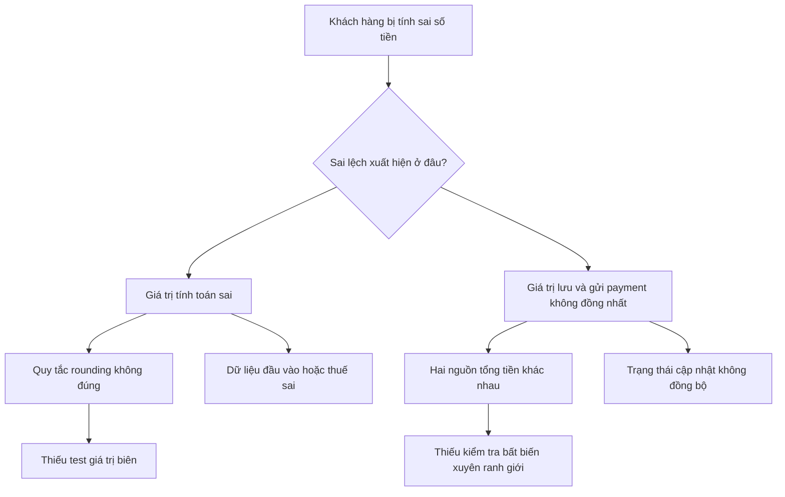

# Phân tích một sự cố lọt lỗi và đề xuất thay đổi có bằng chứng

**Chương:** Thực hành  
**Phạm vi module:** `VALIDATION_TESTING_STRATEGY`

Một sự cố production thường không xuất phát từ một nguyên nhân đơn lẻ. Một thay đổi có thể làm lộ giả định chưa được kiểm tra; bộ test có thể thiếu tình huống biên; dữ liệu hoặc môi trường kiểm thử có thể không đại diện; cảnh báo có thể phát hiện muộn; quy trình phát hành có thể cho phép tiếp tục dù còn rủi ro chưa được xử lý. Nếu nhóm chỉ thêm một test tái hiện đúng lỗi vừa xảy ra, vấn đề cụ thể có thể được ngăn tái diễn nhưng những điều kiện nền tảng đã tạo ra khoảng trống vẫn còn.

Bài thực hành này hướng dẫn cách phân tích một sự cố lọt lỗi (escaped defect/production escape), xác định điều gì đã xảy ra và vì sao các lớp kiểm soát không phát hiện trước phát hành, phân biệt bằng chứng với giả thuyết, rồi đề xuất thay đổi có thể kiểm chứng. Trọng tâm là biến bài học từ sự cố thành hành động cụ thể trong yêu cầu, thiết kế test, dữ liệu, môi trường, pipeline, giám sát và quy trình phát hành.

Tình huống xuyên suốt là một lỗi tính tổng tiền đơn hàng chỉ xuất hiện với một tổ hợp chiết khấu, thuế và nhiều dòng hàng. Lỗi được phát hiện sau khi phát hành, khiến một số giao dịch bị tính sai. Dữ liệu trong bài là giả lập để luyện phương pháp; khi áp dụng vào sự cố thật, phải thay bằng log, trace, dữ liệu và quyết định đã được xác minh của tổ chức.

Sau bài học, người học có thể:

- Lập timeline sự cố từ thay đổi đến phát hiện, giảm thiểu và khắc phục.
- Xác định phạm vi ảnh hưởng bằng dữ liệu và truy vết.
- Phân biệt triệu chứng, nguyên nhân trực tiếp, yếu tố góp phần và nguyên nhân hệ thống.
- Đánh giá vì sao test, review, CI, release gate và monitoring không ngăn hoặc phát hiện sớm sự cố.
- Dùng bằng chứng để xây dựng giả thuyết và kiểm tra giả thuyết.
- Đề xuất hành động sửa lỗi, phòng ngừa, phát hiện và giảm thiểu có chủ sở hữu, mức ưu tiên và tiêu chí hoàn tất.
- Xây dựng test hồi quy và kiểm soát bổ sung ở đúng tầng.
- Đánh giá hiệu quả sau cải tiến mà không tối ưu một chỉ số đơn lẻ.
- Viết báo cáo hậu kiểm rõ ràng, có thể truy vết và không quy lỗi cho cá nhân.

## 1. Mục tiêu và nguyên tắc của bài thực hành

Phân tích sự cố không nhằm tìm một cá nhân để quy trách nhiệm. Mục tiêu là hiểu hệ thống đã cho phép lỗi đi qua những lớp kiểm soát nào, vì sao các tín hiệu chưa đủ mạnh và thay đổi nào sẽ giảm xác suất hoặc tác động của sự cố tương tự.

### 1.1. Phân biệt sự cố và lỗi

- **Defect/bug:** sai lệch trong phần mềm, cấu hình, dữ liệu hoặc tài liệu so với hành vi mong đợi.
- **Incident:** sự kiện vận hành làm suy giảm hoặc đe dọa dịch vụ, dữ liệu, giao dịch hoặc trải nghiệm người dùng.
- **Escaped defect:** lỗi không được phát hiện trước một mốc kiểm soát đã xác định và đi đến môi trường sau kiểm thử, thường là production hoặc người dùng.
- **Root cause:** nguyên nhân nền tảng được xác minh có vai trò tạo ra lỗi hoặc cho phép lỗi lọt qua kiểm soát.

Một defect có thể tạo ra incident, nhưng không phải defect nào cũng gây incident. Một incident cũng có thể liên quan đến nhiều defect, cấu hình hoặc yếu tố vận hành. Khi phân tích, cần ghi rõ đối tượng đang điều tra.

### 1.2. Phân biệt các câu hỏi

Một báo cáo tốt trả lời ít nhất bốn câu hỏi:

1. **Điều gì đã xảy ra?** Triệu chứng, thời gian, phạm vi và tác động.
2. **Vì sao nó xảy ra?** Cơ chế kỹ thuật và điều kiện kích hoạt.
3. **Vì sao không được ngăn hoặc phát hiện sớm hơn?** Khoảng trống trong yêu cầu, test, review, dữ liệu, môi trường, pipeline hoặc giám sát.
4. **Cần thay đổi gì và bằng chứng nào cho thấy thay đổi có tác dụng?** Hành động, chủ sở hữu, thời hạn và tiêu chí xác minh.

### 1.3. Nguyên tắc phân tích

- Bắt đầu từ bằng chứng, không bắt đầu từ kết luận có sẵn.
- Phân biệt điều đã biết, điều suy luận và điều chưa rõ.
- Xem xét điều kiện hệ thống và quy trình, không chỉ hành động của một cá nhân.
- Tìm nguyên nhân có thể kiểm chứng và có khả năng thay đổi.
- Không thêm test trùng lặp nếu chưa xác định được khoảng trống cần lấp.
- Ưu tiên hành động giảm rủi ro lớn và có thể xác minh.
- Ghi cả điều đã hoạt động tốt để duy trì những kiểm soát hữu ích.

## 2. Tình huống thực hành: tính sai tổng tiền đơn hàng

### 2.1. Bối cảnh hệ thống

Một hệ thống thương mại điện tử có các thành phần:

- **Order API:** tiếp nhận đơn hàng và hiển thị tổng tiền.
- **Pricing Service:** tính giá dòng hàng, chiết khấu và thuế.
- **Order Database:** lưu chi tiết dòng hàng và tổng tiền.
- **Payment Adapter:** gửi số tiền cần thu đến cổng thanh toán.
- **Order Projection:** cung cấp dữ liệu đọc cho giao diện và báo cáo.
- **CI/CD:** chạy unit test, API test, integration test và một số E2E trước phát hành.

Quy tắc nghiệp vụ được phê duyệt trong tình huống giả lập:

1. Chiết khấu được áp dụng trên giá trị hàng đủ điều kiện trước thuế.
2. Phí vận chuyển được cộng sau chiết khấu.
3. Thuế được tính trên cơ sở tính thuế đã được định nghĩa cho từng nhóm hàng.
4. Tiền được làm tròn đến đơn vị nhỏ nhất theo quy tắc của loại tiền tệ.
5. Số tiền lưu trong đơn hàng và gửi sang cổng thanh toán phải nhất quán.

Đây là quy tắc của ví dụ. Trong một sản phẩm thật, nhóm phải lấy quy tắc từ nguồn nghiệp vụ có thẩm quyền, không tự suy ra từ code hiện tại.

### 2.2. Triệu chứng được báo cáo

Sau khi phát hành phiên bản `2026.11.3`, bộ phận hỗ trợ nhận được phản ánh rằng một số đơn hàng hiển thị tổng tiền thấp hơn số tiền được gửi đến cổng thanh toán. Một số khách hàng thấy số tiền trên biên nhận không khớp với tổng tiền trên trang xác nhận.

Điều tra ban đầu cho thấy lỗi xuất hiện ở một tổ hợp:

- Đơn hàng có nhiều dòng hàng.
- Có chiết khấu phần trăm.
- Có ít nhất một dòng hàng chịu thuế với giá trị tạo phần thập phân.
- Một số giá trị được làm tròn ở cấp dòng hàng, sau đó tổng hợp và làm tròn lần nữa.

Không phải mọi đơn hàng đều bị ảnh hưởng. Đơn một dòng hoặc đơn không có chiết khấu thường cho kết quả đúng.

### 2.3. Dữ liệu giả lập ban đầu

Giả sử báo cáo sự cố ghi nhận:

| Thuộc tính | Giá trị giả lập |
|---|---|
| Phiên bản phát hành | `2026.11.3` |
| Thời điểm bắt đầu ảnh hưởng | 09:20 UTC |
| Thời điểm phát hiện | 10:05 UTC |
| Thời điểm tạm dừng rollout | 10:18 UTC |
| Thời điểm áp dụng biện pháp giảm thiểu | 10:42 UTC |
| Đơn hàng được xác định có sai lệch | 37 |
| Đơn hàng đã thanh toán trong nhóm ảnh hưởng | 21 |
| Sai lệch tối đa trong mẫu điều tra | 1.20 đơn vị tiền tệ |
| Phạm vi | Một khu vực thuế và một nhóm quy tắc chiết khấu |

Các số liệu chỉ dùng để luyện tập. Chúng không phải số liệu của một sự cố thật.

### 2.4. Timeline ban đầu

| Thời điểm | Sự kiện | Nguồn bằng chứng cần tìm |
|---|---|---|
| T-2 ngày | Pull request thay đổi cách áp dụng chiết khấu và tổng hợp dòng hàng được merge | PR, diff, review, yêu cầu và test report |
| T-1 ngày | CI chạy thành công | Pipeline run, test list, skip/retry và artifact |
| T-1 ngày | Release candidate được triển khai staging | Deployment log, cấu hình, dữ liệu staging |
| 09:20 | Bắt đầu rollout production | Deployment event, version theo instance |
| 09:35 | Đơn hàng đầu tiên trong mẫu có sai lệch | Order record, pricing trace, payment request |
| 10:05 | Hỗ trợ nhận báo cáo khách hàng | Ticket, biên nhận, thông tin đơn hàng |
| 10:18 | Tạm dừng rollout | Quyết định release, người thực hiện, trạng thái traffic |
| 10:42 | Áp dụng biện pháp giảm thiểu | Feature flag/config, kiểm tra sau thay đổi |
| 13:10 | Bản sửa được triển khai có kiểm soát | Build, migration/config nếu có, test result |
| 14:00 | Đối soát mẫu đơn hàng hoàn tất | Reconciliation report và danh sách ngoại lệ |

Không được coi timeline này là đầy đủ cho đến khi đối chiếu timestamp từ các hệ thống và xác nhận múi giờ. Nếu hai nguồn có đồng hồ lệch, cần ghi sai số và nguồn thời gian chuẩn.

## 3. Bước 1 — Bảo toàn bằng chứng và xác định phạm vi

Trước khi phân tích nguyên nhân, bảo toàn dữ liệu cần thiết. Việc sửa cấu hình, retry job hoặc triển khai hotfix có thể làm thay đổi trạng thái ban đầu.

### 3.1. Thu thập bằng chứng

Các nguồn cần xem xét:

- Mã commit, pull request, review comment và build artifact.
- Kết quả CI đầy đủ, gồm test đã chạy, bị skip, retry hoặc quarantine.
- Log ứng dụng, structured log, trace và metric theo correlation ID.
- Dữ liệu đơn hàng, dòng hàng, chiết khấu, thuế và số tiền đã lưu.
- Request/response với payment provider đã được làm sạch dữ liệu nhạy cảm.
- Cấu hình, feature flag, phiên bản runtime và deployment event.
- Ticket hỗ trợ, báo cáo khách hàng và kết quả đối soát.
- Lịch sử thay đổi quy tắc nghiệp vụ và tài liệu liên quan.

Không chỉ lưu ảnh chụp màn hình. Ảnh có thể cho thấy triệu chứng nhưng thường không đủ để xác định phép tính, trạng thái lưu trữ hoặc chuỗi sự kiện.

### 3.2. Bảo vệ dữ liệu nhạy cảm

Khi thu thập bằng chứng:

- Ẩn hoặc loại bỏ token, API key, cookie và thông tin xác thực.
- Chỉ dùng định danh khách hàng/đơn hàng cần thiết cho điều tra.
- Không sao chép dữ liệu cá nhân vào tài liệu chia sẻ rộng.
- Giới hạn quyền truy cập và thời hạn lưu bằng chứng.
- Ghi rõ dữ liệu nào đã được biến đổi hoặc ẩn danh.

### 3.3. Xác định phạm vi ảnh hưởng

Đừng chỉ đếm số ticket. Truy vấn dữ liệu theo điều kiện có khả năng gây lỗi:

- Phiên bản ứng dụng và khoảng thời gian triển khai.
- Nhóm quy tắc chiết khấu.
- Khu vực hoặc loại thuế.
- Số dòng hàng và giá trị tạo phần thập phân.
- Số tiền hiển thị, số tiền lưu và số tiền gửi provider.
- Trạng thái thanh toán và hoàn tiền.

Đối chiếu ba đại lượng quan trọng: expected amount theo quy tắc đã phê duyệt, amount lưu trong Order Database và amount gửi sang Payment Adapter. Xác định sai lệch ở bước nào và số đơn bị ảnh hưởng.

### 3.4. Ghi độ tin cậy của phạm vi

Phân biệt:

- **Đã xác nhận:** đơn có bằng chứng đầy đủ về sai lệch.
- **Có khả năng ảnh hưởng:** thỏa điều kiện kích hoạt nhưng chưa đủ dữ liệu để kết luận.
- **Chưa đánh giá:** thiếu log hoặc dữ liệu lịch sử.
- **Đã loại trừ:** có bằng chứng cho thấy không thuộc phạm vi.

Không báo cáo một con số duy nhất nếu dữ liệu chưa đủ. Nêu rõ số xác nhận và số đang điều tra.

## 4. Bước 2 — Xây dựng giả thuyết và xác minh nguyên nhân

Một triệu chứng có thể có nhiều giả thuyết. Cần ghi giả thuyết, bằng chứng ủng hộ, bằng chứng phản bác và bước kiểm tra tiếp theo.

### 4.1. Danh sách giả thuyết ban đầu

| Giả thuyết | Bằng chứng cần tìm | Kiểm tra có thể thực hiện |
|---|---|---|
| H1: Công thức chiết khấu thay đổi sai thứ tự | Diff của Pricing Service và quy tắc nghiệp vụ | Tính lại bằng ví dụ độc lập, so sánh trước/sau |
| H2: Làm tròn ở cấp dòng thay vì tổng đơn | Giá trị trung gian và cấu hình scale/rounding | Dùng bộ dữ liệu tạo phần thập phân, đối chiếu từng bước |
| H3: UI và Payment Adapter dùng hai nguồn tổng tiền | Trace và payload ở hai ranh giới | So sánh nguồn dữ liệu và thời điểm đọc |
| H4: Cấu hình thuế khác giữa staging và production | Config snapshot đã làm sạch | So sánh profile, flag và version cấu hình |
| H5: Dữ liệu cũ hoặc cache làm sai kết quả | Timestamp, cache key và record history | Tái hiện với cache sạch và dữ liệu mới |
| H6: Race condition khi cập nhật chiết khấu | Trace đồng thời, transaction và thứ tự event | Chạy kịch bản đồng thời có kiểm soát |

### 4.2. Ví dụ bằng chứng giả lập

Giả sử điều tra thu được:

| Quan sát | Bằng chứng | Ý nghĩa |
|---|---|---|
| Order API hiển thị `98.34` | Response được lưu theo request ID | Triệu chứng ở phía người dùng |
| Database lưu `98.34` | Record và audit timestamp | Sai lệch đã tồn tại trước bước hiển thị |
| Payment request gửi `99.54` | Payload đã làm sạch, cùng order ID | Payment Adapter dùng giá trị khác với giá trị lưu |
| Pricing trace có tổng trung gian `99.54` | Trace theo từng dòng hàng | Khác biệt phát sinh trước khi lưu đơn |
| Cấu hình thuế staging và production giống nhau | Snapshot cấu hình đã chuẩn hóa | Giảm khả năng H4, trong phạm vi snapshot |
| Chỉ các đơn nhiều dòng có phần thập phân bị ảnh hưởng | Query đối chiếu và test tái hiện | Ủng hộ giả thuyết liên quan đến làm tròn |

Các quan sát này ủng hộ H2 và H3. Chúng chưa đủ để khẳng định H1 hoặc H6 không liên quan; cần kiểm tra diff, logic tính và thứ tự ghi dữ liệu.

### 4.3. Dùng phép tính độc lập làm oracle

Không dùng chính Pricing Service đã gây nghi ngờ để tạo expected amount. Tạo bảng tính hoặc hàm tham chiếu độc lập từ quy tắc đã được nghiệp vụ xác nhận. Kiểm tra từng thành phần:

- Giá trị từng dòng trước chiết khấu.
- Mức chiết khấu đủ điều kiện.
- Cơ sở tính thuế.
- Phí vận chuyển.
- Quy tắc và điểm làm tròn.
- Tổng cuối cùng.

Nếu quy tắc nghiệp vụ còn mơ hồ, dừng việc kết luận expected amount và yêu cầu chủ sở hữu nghiệp vụ xác nhận. Không dùng kết quả hiện tại của production như định nghĩa đúng.

### 4.4. Tách nguyên nhân trực tiếp và yếu tố góp phần

Trong ví dụ, có thể xác định:

- **Nguyên nhân trực tiếp:** một nhánh tính toán làm tròn từng dòng trước khi tổng hợp, trong khi quy tắc yêu cầu tổng hợp theo một cơ sở khác.
- **Yếu tố góp phần:** test hiện có chủ yếu dùng một dòng hàng hoặc dữ liệu không tạo phần thập phân.
- **Yếu tố góp phần:** assertion kiểm tra tổng tiền trong response nhưng không đối chiếu số tiền lưu và payload payment.
- **Yếu tố góp phần:** dữ liệu staging không có tổ hợp khu vực/chiết khấu giống nhóm đơn bị ảnh hưởng.
- **Yếu tố phát hiện muộn:** dashboard theo dõi tỷ lệ payment thành công nhưng không đối chiếu amount giữa order và payment.

Đây là cấu trúc giả định để thực hành. Trong sự cố thật, mỗi kết luận cần gắn với bằng chứng cụ thể và mức độ tin cậy.

## 5. Bước 3 — Tìm khoảng trống trong các lớp kiểm soát

Không chỉ hỏi “test nào thiếu?”. Hãy xem toàn bộ chuỗi kiểm soát từ yêu cầu đến vận hành.

### 5.1. Yêu cầu và quy tắc nghiệp vụ

Kiểm tra:

- Quy tắc làm tròn có được viết rõ không?
- Thứ tự chiết khấu, thuế và phí có được định nghĩa không?
- Có ví dụ expected result được nghiệp vụ phê duyệt không?
- Các trường hợp nhiều dòng, nhiều loại thuế và giá trị biên có được nêu không?
- Yêu cầu có liên kết đến test và rủi ro không?

Nếu yêu cầu chỉ ghi “tính tổng tiền chính xác”, tester không có oracle đủ cụ thể để xác định đúng/sai ở các trường hợp biên.

### 5.2. Thiết kế và review code

Kiểm tra:

- Thay đổi có làm thay đổi quy tắc tính toán hoặc kiểu dữ liệu không?
- Reviewer có được cung cấp ví dụ biên không?
- Logic tiền tệ có dùng kiểu dữ liệu phù hợp và quy tắc rounding nhất quán không?
- Nguồn tổng tiền có duy nhất giữa UI, database và payment không?
- Có rủi ro do tính toán lặp lại ở nhiều thành phần không?

Review không nên bị xem là một checkbox. Cần xác định thông tin nào giúp reviewer nhận ra rủi ro và liệu có thời gian để kiểm tra.

### 5.3. Unit và component test

Đánh giá:

- Có test cho nhiều dòng hàng không?
- Có test giá trị thập phân và ranh giới rounding không?
- Expected value có độc lập với implementation không?
- Có test cho các nhóm thuế và điều kiện chiết khấu không?
- Có test bất biến như tổng tiền không âm hoặc tổng các thành phần khớp không?

### 5.4. Integration và API test

Đánh giá:

- Database có lưu đúng giá trị đã tính không?
- API trả về có lấy từ cùng nguồn dữ liệu với payment không?
- Payment Adapter có dùng tổng tiền đã được xác minh không?
- Có kiểm tra idempotency và giao dịch trùng không?
- Có đối chiếu số tiền giữa các ranh giới không?

### 5.5. Regression và E2E

Đánh giá:

- Thay đổi có phân tích tác động đến checkout, payment, refund và reporting không?
- Bộ hồi quy có ca rủi ro cao cho tiền tệ không?
- Có E2E đại diện kiểm tra xuyên suốt từ giỏ hàng đến payment không?
- Suite có bị cắt phạm vi do thời gian mà không ghi rủi ro không?
- Kết quả CI có nêu rõ test skip hoặc blocked không?

### 5.6. Dữ liệu và môi trường kiểm thử

Đánh giá:

- Dữ liệu staging có đại diện cho nhiều dòng và phân bố giá trị không?
- Có test data tạo ra phần thập phân và điều kiện thuế thực tế không?
- Cấu hình staging có tương đương về quy tắc nghiệp vụ không?
- Có dữ liệu cũ hoặc trạng thái cache ảnh hưởng kết quả không?
- Dữ liệu test có thể tái tạo và truy vết không?

### 5.7. Release gate và giám sát

Đánh giá:

- Release gate có yêu cầu test bắt buộc cho tính toán tiền không?
- Có kiểm tra đối chiếu order amount và payment amount không?
- Có cảnh báo sai lệch hoặc bất thường theo nhóm giao dịch không?
- Có canary hoặc rollout từng phần không?
- Có thể dừng rollout nhanh khi xuất hiện dấu hiệu sai lệch không?
- Có dashboard đủ dữ liệu để xác định phạm vi ảnh hưởng không?

### 5.8. Ma trận khoảng trống kiểm soát

| Lớp kiểm soát | Câu hỏi | Khoảng trống giả lập | Bằng chứng cần xác minh |
|---|---|---|---|
| Yêu cầu | Quy tắc rounding có rõ? | Ví dụ biên chưa được ghi trong acceptance criteria | Story, tài liệu nghiệp vụ, quyết định owner |
| Review | Rủi ro thay đổi có được nhận diện? | Review không có checklist cho tiền tệ | PR, review comment, checklist |
| Unit | Có kiểm tra nhiều dòng và phần thập phân? | Fixture chỉ có một dòng | Test source và report |
| Integration | Có đối chiếu dữ liệu lưu với payment? | Không có assertion liên hệ hai hệ thống | Test run, trace và database record |
| Regression | Có luồng liên quan refund/reporting? | Tập hồi quy không gắn với dependency | Test selection log và impact analysis |
| Dữ liệu | Staging có điều kiện đại diện? | Thiếu tổ hợp khu vực/chiết khấu | Dataset manifest và test data |
| Release | Có gate cho bất biến tài chính? | Chỉ dựa vào test pass chung | Release checklist và quyết định go/no-go |
| Monitoring | Có phát hiện sai lệch tiền? | Chỉ theo dõi payment success rate | Dashboard, alert rule và incident timeline |

## 6. Bước 4 — Dùng phương pháp phân tích nguyên nhân có kiểm soát

Các kỹ thuật như 5 Whys, fishbone hoặc fault tree giúp tổ chức suy nghĩ, nhưng không tự tạo ra sự thật. Mỗi nhánh cần được xác minh.

### 6.1. Ví dụ 5 Whys

**Vấn đề:** Một số đơn hàng bị lưu tổng tiền thấp hơn số tiền gửi sang payment provider.

1. **Vì sao có sai lệch?** Vì hai thành phần sử dụng giá trị tổng tiền được tính ở hai bước khác nhau.
2. **Vì sao hai giá trị khác nhau?** Vì một nhánh làm tròn ở cấp dòng hàng trước khi tổng hợp, nhánh khác tổng hợp rồi làm tròn.
3. **Vì sao hai nhánh có quy tắc khác nhau?** Vì logic tính toán được cập nhật ở một thành phần nhưng nguồn tổng tiền dùng để lưu đơn chưa được chuẩn hóa.
4. **Vì sao khác biệt không được phát hiện trước phát hành?** Vì test không đối chiếu expected value độc lập và không so sánh giá trị ở database với payment payload.
5. **Vì sao test và review bỏ sót?** Vì tiêu chí chấp nhận và checklist thay đổi chưa yêu cầu kiểm tra các bất biến tiền tệ xuyên ranh giới; test data không có tổ hợp nhiều dòng tạo phần thập phân.

Kết luận này cần được kiểm chứng bằng diff, trace, test source, yêu cầu và dữ liệu. Nếu bằng chứng chỉ xác nhận đến câu hỏi thứ hai, các câu sau vẫn là giả thuyết, chưa phải root cause đã xác minh.

### 6.2. Fishbone: các nhóm nguyên nhân

Có thể phân loại giả thuyết theo:

- **People/knowledge:** hiểu biết về quy tắc tiền tệ, người review, chia sẻ tri thức.
- **Process:** tiêu chí chấp nhận, phân tích tác động, release gate, bàn giao bản sửa.
- **Technology:** thuật toán, kiểu dữ liệu, rounding, transaction, API.
- **Test:** oracle, coverage, test level, assertion, regression selection.
- **Data/environment:** test data, cấu hình, cache, phiên bản dịch vụ.
- **Observability/operations:** log, metric, alert, canary và quy trình phản ứng.

Không dùng sơ đồ fishbone để liệt kê mọi nguyên nhân tưởng tượng rồi kết luận tất cả đều gây ra sự cố. Mỗi nhánh cần được phân loại thành đã xác nhận, bị bác bỏ hoặc cần điều tra.

### 6.3. Fault tree: từ điều kiện đến tác động

Ví dụ dạng cây lỗi:



Sơ đồ là cách tổ chức giả thuyết. Nhóm cần xác minh nhánh nào thực sự xảy ra, không suy ra rằng mọi node đều là nguyên nhân của incident.

### 6.4. Phân biệt nguyên nhân và tương quan

Một test mới được thêm sau sự cố có thể phát hiện lỗi, nhưng điều đó không chứng minh thiếu test là nguyên nhân kỹ thuật duy nhất. Một deployment gần thời điểm incident có thể liên quan, nhưng cần chứng minh thay đổi đó kích hoạt cơ chế lỗi.

Hãy dùng các phép so sánh:

- Phiên bản trước và sau thay đổi trên cùng dữ liệu.
- Cùng phiên bản với các bộ dữ liệu khác nhau.
- Cùng bộ dữ liệu trên các nhánh tính toán khác nhau.
- Trace của đơn lỗi và đơn không lỗi.
- Test chạy trên môi trường đại diện và môi trường hiện tại.

Chỉ kết luận khi bằng chứng đủ để giải thích cơ chế và phạm vi.

## 7. Bước 5 — Đề xuất hành động có bằng chứng

Hành động sau sự cố cần xử lý cả lỗi cụ thể và khoảng trống kiểm soát. Mỗi hành động phải có lý do, người sở hữu, mức ưu tiên, thời hạn và tiêu chí xác minh.

### 7.1. Phân loại hành động

| Loại hành động | Mục đích | Ví dụ trong tình huống |
|---|---|---|
| Corrective | Sửa lỗi hiện tại và khôi phục trạng thái đúng | Sửa phép tính và đối soát các đơn bị ảnh hưởng |
| Preventive | Giảm khả năng lỗi tương tự xảy ra | Chuẩn hóa một nguồn tính tổng tiền và thêm test biên |
| Detective | Phát hiện sai lệch sớm hơn | Đối chiếu order amount với payment amount và cảnh báo |
| Mitigative | Giảm tác động khi lỗi vẫn xảy ra | Canary, feature flag, dừng rollout và quy trình hoàn tiền |
| Process/systemic | Sửa cách làm tạo ra khoảng trống | Cập nhật acceptance criteria, review checklist và release gate |

Một hành động có thể thuộc nhiều nhóm. Hãy phân loại theo mục tiêu chính để tránh bỏ sót lớp kiểm soát.

### 7.2. Hành động sửa lỗi trực tiếp

Ví dụ:

- Sửa thuật toán làm tròn theo quy tắc nghiệp vụ đã xác nhận.
- Dùng một nguồn tổng tiền đã được xác minh cho lưu trữ và payment payload.
- Đối soát các đơn bị ảnh hưởng và xác định hoàn tiền/điều chỉnh cần thiết.
- Thêm log/trace cho các thành phần tính toán với định danh giao dịch, không ghi dữ liệu nhạy cảm.

Tiêu chí hoàn tất cần chứng minh expected amount, database amount và payment amount nhất quán trong các tình huống liên quan.

### 7.3. Hành động phòng ngừa

- Bổ sung unit test cho nhiều dòng, giá trị thập phân và ranh giới làm tròn.
- Tạo test dữ liệu có nhiều nhóm thuế và chiết khấu.
- Thêm integration test đọc lại dữ liệu đã lưu.
- Thêm contract/assertion cho số tiền gửi sang payment provider.
- Liên kết rủi ro tài chính với test hồi quy bắt buộc.
- Bổ sung checklist review khi thay đổi pricing hoặc money calculation.

### 7.4. Hành động phát hiện

- Đối chiếu amount trong order với amount gửi payment và amount provider xác nhận.
- Theo dõi sai lệch theo currency, khu vực và loại quy tắc.
- Cảnh báo khi có chênh lệch vượt ngưỡng được nghiệp vụ phê duyệt.
- Gắn correlation ID để truy từ đơn hàng đến request, event và giao dịch.
- Thêm canary metric riêng cho phiên bản mới.

### 7.5. Hành động giảm thiểu

- Dừng rollout khi chỉ số sai lệch vượt ngưỡng.
- Tắt feature flag nếu có thể khôi phục hành vi an toàn.
- Giữ quy trình đối soát và hoàn tiền có kiểm soát.
- Chuẩn bị runbook cho support và operations.
- Xác định điều kiện rollback/roll-forward.

### 7.6. Tránh hành động quá chung chung

Các đề xuất sau chưa đủ:

- “Tăng cường kiểm thử.”
- “QA cần cẩn thận hơn.”
- “Bổ sung thêm nhiều test.”
- “Cải thiện quy trình review.”

Hãy chuyển thành hành động kiểm chứng được, ví dụ: “Bổ sung integration test xác minh số tiền trong Order Database bằng expected value độc lập và khớp với payment request cho các đơn nhiều dòng có chiết khấu và thuế; test phải chạy trong pipeline trước khi merge.”

## 8. Ưu tiên hành động theo rủi ro và bằng chứng

Không phải mọi hành động đều cần làm ngay. Ưu tiên dựa trên tác động nếu không thực hiện, khả năng tái diễn, mức liên quan đến nguyên nhân đã xác minh, độ bao phủ và chi phí.

### 8.1. Tiêu chí ưu tiên

- Mức nghiêm trọng của hậu quả.
- Khả năng lỗi tái diễn hoặc mở rộng phạm vi.
- Mức độ chắc chắn của bằng chứng.
- Số lượng người dùng hoặc giao dịch bị ảnh hưởng.
- Khả năng phát hiện trước khi gây tác động.
- Thời gian và chi phí thực hiện.
- Phụ thuộc vào nhóm hoặc nền tảng khác.
- Khả năng giảm thiểu ngay trong khi chờ sửa dài hạn.

### 8.2. Ma trận hành động ví dụ

| Hành động | Tác động giảm rủi ro | Độ khẩn cấp | Công sức | Ưu tiên gợi ý |
|---|---|---|---|---|
| Sửa logic rounding và xác minh phép tính độc lập | Rất cao | Ngay | Trung bình | P0/P1 theo mức ảnh hưởng |
| Đối soát 37 đơn giả lập bị ảnh hưởng và xử lý ngoại lệ | Rất cao | Ngay | Trung bình | P0 |
| Thêm unit test cho giá trị biên | Cao | Trước release kế tiếp | Thấp | P1 |
| Thêm integration test đối chiếu database/payment payload | Rất cao | Trước release kế tiếp | Trung bình | P1 |
| Thêm dashboard cảnh báo amount mismatch | Cao | Sớm | Trung bình | P1 |
| Cập nhật checklist review pricing | Trung bình/cao | Trong chu kỳ | Thấp | P1/P2 |
| Tái cấu trúc toàn bộ pricing engine | Có thể cao, phạm vi rộng | Cần phân tích | Rất cao | Đánh giá riêng |

Mức ưu tiên chỉ mang tính minh họa. Chủ sở hữu phát hành và nghiệp vụ phải quyết định theo mức ảnh hưởng thực tế.

### 8.3. Quick win và thay đổi hệ thống

Tách:

- **Giảm thiểu ngay:** feature flag, dừng rollout, đối soát, cảnh báo tạm thời.
- **Sửa nguyên nhân:** thay đổi logic và kiểm tra tính đúng.
- **Phòng ngừa dài hạn:** test data, oracle, traceability, review và release gate.
- **Cải thiện hệ thống:** nguồn dữ liệu tính tiền thống nhất, observability và quy trình quản trị rủi ro.

Không để quick win thay thế hành động phòng ngừa. Ngược lại, không trì hoãn biện pháp giảm thiểu có tác dụng ngay chỉ vì giải pháp kiến trúc dài hạn chưa sẵn sàng.

## 9. Thiết kế bộ test hồi quy sau sự cố

Test mới phải kiểm tra cơ chế gây lỗi và các bất biến liên quan, không chỉ sao chép một bộ dữ liệu production thành một test duy nhất.

### 9.1. Xây dựng ma trận dữ liệu

Với phép tính tiền, xem xét:

| Chiều dữ liệu | Các giá trị cần xem xét |
|---|---|
| Số dòng hàng | Một dòng, hai dòng, nhiều dòng |
| Chiết khấu | Không có, phần trăm, số tiền cố định, nhiều điều kiện |
| Thuế | Không chịu thuế, một nhóm thuế, nhiều nhóm thuế |
| Giá trị | Số nguyên, phần thập phân, sát ngưỡng làm tròn |
| Phí | Không phí, phí cố định, phí theo vùng |
| Currency | Loại tiền có số chữ số thập phân khác nhau theo phạm vi hỗ trợ |
| Trạng thái | Tạo đơn, thanh toán, hủy, hoàn tiền |
| Nguồn tính | Preview, create order, payment, read model |

Không cần tạo mọi tổ hợp Cartesian nếu số lượng quá lớn. Chọn tổ hợp đại diện theo rủi ro và dùng pairwise hoặc kỹ thuật thiết kế test phù hợp khi có nhiều chiều.

### 9.2. Dùng expected value độc lập

Expected amount cần được tính từ quy tắc nghiệp vụ đã phê duyệt bằng cách độc lập với implementation. Có thể dùng bảng ví dụ chuẩn, hàm tham chiếu đơn giản hoặc fixture được review.

Tránh tạo expected value bằng cách gọi lại chính hàm `calculateTotal()` của production code. Test như vậy có thể lặp lại cùng lỗi và vẫn pass.

### 9.3. Kiểm tra bất biến xuyên ranh giới

Ví dụ assertion:

```java
assertEquals(expectedTotal, orderView.total());
assertEquals(expectedTotal, persistedOrder.total());
assertEquals(expectedTotal, paymentRequest.amount());
assertEquals(1, paymentRepository.countByOrderId(orderId));
```

Đây là pseudocode. Kiểu tiền cần dùng biểu diễn chính xác phù hợp với currency; tránh so sánh `float`/`double` trực tiếp nếu hệ thống yêu cầu độ chính xác thập phân. Test thực tế cần đọc dữ liệu qua ranh giới tương ứng, không chỉ kiểm tra object trong bộ nhớ.

### 9.4. Chọn tầng test

| Tầng | Mục tiêu sau sự cố |
|---|---|
| Unit | Xác minh công thức, thứ tự áp dụng, rounding và giá trị biên |
| Component | Kiểm tra phối hợp giữa Pricing logic và adapter nội bộ |
| Integration | Xác minh dữ liệu lưu và payment request nhất quán |
| API | Kiểm tra response và mã lỗi theo hợp đồng |
| E2E | Xác minh luồng tạo đơn đến thanh toán với một số kịch bản đại diện |
| Monitoring/operational test | Xác minh mismatch được phát hiện và cảnh báo đúng |

Không đưa toàn bộ tổ hợp vào E2E vì chi phí và độ bất ổn cao. Dùng tầng thấp để kiểm tra chi tiết, tầng tích hợp để xác minh ranh giới và E2E để kiểm tra luồng nghiệp vụ đại diện.

### 9.5. Đặt điều kiện hồi quy vào pipeline

Xác định test nào chạy:

- Mỗi commit/pull request.
- Trước merge hoặc trước release candidate.
- Trong canary/post-deployment.
- Theo lịch cho kiểm tra mở rộng.

Test bảo vệ bất biến tài chính quan trọng nên có vị trí phù hợp trong release gate. Nếu một test bị quarantine hoặc blocked, cần ghi rủi ro và người chấp nhận ngoại lệ.

## 10. Đề xuất thay đổi có thể đo lường

Mỗi hành động cần một tiêu chí xác minh, không chỉ trạng thái “đã hoàn thành”.

### 10.1. Mẫu action item

| Trường | Câu hỏi |
|---|---|
| ID | Có mã truy vết không? |
| Vấn đề/bằng chứng | Hành động xử lý phát hiện nào? |
| Hành động cụ thể | Thay đổi gì, ở thành phần nào? |
| Loại | Corrective, preventive, detective, mitigative hay process |
| Chủ sở hữu | Ai chịu trách nhiệm hoàn tất? |
| Ưu tiên | Mức nào và vì sao? |
| Hạn hoàn thành | Khi nào cần xong? |
| Phụ thuộc | Cần nhóm, dữ liệu hoặc môi trường nào? |
| Tiêu chí hoàn tất | Bằng chứng nào xác nhận hành động có hiệu lực? |
| Rủi ro còn lại | Điều gì vẫn chưa được giải quyết? |

### 10.2. Ví dụ action plan

| ID | Hành động | Chủ sở hữu giả định | Tiêu chí xác minh |
|---|---|---|---|
| A1 | Sửa logic rounding theo quy tắc đã duyệt | Pricing owner | Bộ test tham chiếu độc lập đạt cho các trường hợp đã xác định |
| A2 | Đối soát các giao dịch trong phạm vi ảnh hưởng | Finance/Ops owner | Mọi đơn có trạng thái xác minh; ngoại lệ có quyết định xử lý |
| A3 | Bổ sung unit test nhiều dòng và giá trị biên | Pricing test owner | Test chạy trong CI và thất bại với phiên bản logic lỗi trước đó |
| A4 | Bổ sung integration assertion cho database và payment amount | Order/Payment test owner | Test chứng minh ba giá trị khớp trên môi trường tích hợp |
| A5 | Thêm metric và alert mismatch | Observability owner | Test alert xác nhận tín hiệu, ngưỡng và routing đúng |
| A6 | Cập nhật checklist review và release gate | QA/release lead | Pull request và release checklist có mục bắt buộc, có bằng chứng sử dụng |

Chủ sở hữu trong bảng là vai trò giả định, không phải tên cá nhân. Khi áp dụng thật, chỉ định người hoặc nhóm chịu trách nhiệm và người phê duyệt.

### 10.3. Tiêu chí hoàn tất phải đo được

Ví dụ chưa đủ: “Thêm test cho rounding”.

Ví dụ tốt hơn:

> Có test tự động cho ít nhất các lớp dữ liệu đã xác định: một/nhiều dòng, có/không chiết khấu, thuế theo nhóm và giá trị sát ranh giới rounding. Expected amount lấy từ fixture tham chiếu được nghiệp vụ review. Test chạy trong pipeline trước merge và chứng minh thất bại trên implementation cũ có lỗi.

Ví dụ chưa đủ: “Cải thiện monitoring”.

Ví dụ tốt hơn:

> Metric đối chiếu amount theo order ID được phát khi Order và Payment có cùng giao dịch; dashboard phân đoạn theo phiên bản và currency; alert được kiểm tra bằng dữ liệu giả lập mismatch; log không chứa dữ liệu xác thực hoặc thông tin thanh toán nhạy cảm.

## 11. Xác minh rằng hành động đã có tác dụng

Một action item được đánh dấu done chỉ chứng minh công việc đã được thực hiện theo mô tả. Cần kiểm tra nó có thực sự giảm khoảng trống và không tạo tác dụng phụ.

### 11.1. Kiểm tra hồi quy của chính hành động

Với test mới:

- Chạy test trên phiên bản đã sửa.
- Nếu có thể, chạy trên phiên bản lỗi trước đó để xác nhận test có khả năng phát hiện lỗi.
- Kiểm tra expected value độc lập.
- Kiểm tra test ổn định qua nhiều lần chạy và môi trường phù hợp.
- Xác minh test được gọi trong pipeline đúng thời điểm.

Một test mới luôn pass cả trên phiên bản lỗi cũ có thể không tái hiện được defect và cần xem lại oracle hoặc dữ liệu.

### 11.2. Kiểm tra monitoring và cảnh báo

Tạo tín hiệu giả lập có kiểm soát và xác minh:

- Metric được phát đúng.
- Dashboard hiển thị đúng phạm vi.
- Ngưỡng cảnh báo kích hoạt đúng.
- Alert đến đúng kênh/nhóm chịu trách nhiệm.
- Alert có đủ thông tin điều tra nhưng không lộ dữ liệu nhạy cảm.
- Tín hiệu bình thường không tạo cảnh báo giả quá mức.

### 11.3. Kiểm tra release gate

Xác minh release gate thực sự chặn hoặc yêu cầu phê duyệt khi test bắt buộc fail, blocked hoặc chưa chạy. Không chỉ kiểm tra tài liệu checklist đã được sửa; cần kiểm tra workflow hoặc quy trình thực thi.

### 11.4. Đánh giá sau một số chu kỳ

Theo dõi các bản phát hành tiếp theo:

- Có tái diễn sai lệch tương tự không?
- Test mới có phát hiện lỗi liên quan trong môi trường trước production không?
- Có tăng thời gian pipeline hoặc flaky rate không?
- Cảnh báo có hữu ích và đúng mức không?
- Có phát sinh tác dụng phụ như chặn release quá mức không?

Không thể kết luận một thay đổi đã loại bỏ hoàn toàn rủi ro chỉ vì không có incident trong một khoảng thời gian ngắn. Cần xem số giao dịch, mức phơi nhiễm và độ dài thời gian quan sát.

## 12. Đánh giá hiệu quả bằng chỉ số cân bằng

Sau sự cố, nhóm thường muốn đặt target như “không để lỗi này xảy ra lần nữa”. Mục tiêu đó có thể đúng về ý định nhưng không đủ để đo. Chọn chỉ số phản ánh cả phòng ngừa, phát hiện và tác động.

### 12.1. Chỉ số dẫn dắt

- Tỷ lệ thay đổi pricing có test giá trị biên.
- Tỷ lệ test tài chính có expected value độc lập.
- Tỷ lệ release chạy kiểm tra đối chiếu amount.
- Tỷ lệ rủi ro tài chính có test và chủ sở hữu.
- Tỷ lệ action item hậu kiểm hoàn tất đúng hạn với bằng chứng.

### 12.2. Chỉ số kết quả

- Số incident sai lệch amount theo release.
- Tổng số giao dịch bị ảnh hưởng và mức sai lệch.
- Số lỗi liên quan được phát hiện sau production.
- Thời gian từ giao dịch đầu tiên bị ảnh hưởng đến phát hiện.
- Thời gian khôi phục và hoàn tất đối soát.

### 12.3. Chỉ số cân bằng

- Thời gian CI và thời gian phát hành.
- Flaky rate của test tài chính.
- Tỷ lệ false positive của alert.
- Số release bị chặn do môi trường/test không sẵn sàng.
- Chi phí vận hành và bảo trì kiểm tra mới.

Không nên tối ưu số lỗi production bằng cách ngừng ghi nhận hoặc phân loại lỗi khác đi. Cần giữ định nghĩa và nguồn dữ liệu ổn định để so sánh.

### 12.4. Xác định baseline và kỳ đánh giá

Ghi baseline trước khi thay đổi nếu dữ liệu có sẵn. Sau đó chọn kỳ đánh giá đủ số giao dịch hoặc release để có ý nghĩa. Với lỗi hiếm, có thể cần theo dõi lâu hơn và bổ sung test chủ động thay vì chờ lỗi thật xảy ra.

## 13. Viết báo cáo hậu kiểm (post-incident review)

Báo cáo nên ngắn gọn ở phần điều hành nhưng đủ chi tiết để kỹ thuật và QA có thể truy vết.

### 13.1. Cấu trúc báo cáo

1. **Tóm tắt:** điều gì xảy ra, phạm vi và mức độ ảnh hưởng.
2. **Timeline:** các mốc quan trọng với nguồn timestamp.
3. **Phát hiện:** bằng chứng xác nhận, dữ liệu và cách xác định phạm vi.
4. **Nguyên nhân:** nguyên nhân trực tiếp, yếu tố góp phần và mức độ tin cậy.
5. **Khoảng trống kiểm soát:** yêu cầu, review, test, CI, môi trường, release và monitoring.
6. **Giảm thiểu/khắc phục:** hành động đã thực hiện và kết quả.
7. **Hành động tiếp theo:** corrective, preventive, detective, mitigative và systemic.
8. **Chỉ số xác minh:** baseline, target, owner và thời điểm xem lại.
9. **Rủi ro còn lại:** phần chưa giải quyết và người chấp nhận.
10. **Bài học duy trì:** điều gì đã hoạt động tốt và cần tiếp tục.

### 13.2. Phân biệt mức độ chắc chắn

Có thể dùng các nhãn:

- `CONFIRMED`: được hỗ trợ bởi bằng chứng trực tiếp và tái hiện được.
- `SUPPORTED`: có nhiều bằng chứng phù hợp nhưng chưa tái hiện đầy đủ.
- `HYPOTHESIS`: giả thuyết cần kiểm tra thêm.
- `REJECTED`: đã có bằng chứng phản bác.
- `UNKNOWN`: chưa có đủ dữ liệu.

Nhãn giúp người đọc không nhầm một suy luận hợp lý với kết luận đã xác minh.

### 13.3. Ghi điều đã hoạt động tốt

Ví dụ:

- Correlation ID giúp nối request, order và payment payload.
- Bộ phận hỗ trợ chuyển báo cáo sớm với định danh đơn hàng.
- Feature flag cho phép giảm thiểu trước khi có bản sửa đầy đủ.
- Đối soát dữ liệu xác định được phạm vi giao dịch.

Ghi nhận những điểm này giúp duy trì và mở rộng kiểm soát hữu ích.

## 14. Bài tập thực hành theo nhóm

Người học có thể làm bài trong 60–90 phút với vai trò QA lead, tester, developer, operations và product owner. Một người điều phối ghi nhận quyết định và bằng chứng.

### 14.1. Bài tập A — Xác định phạm vi và timeline

**Đầu vào:** tình huống ở mục 2.

**Nhiệm vụ:**

1. Chọn các nguồn dữ liệu cần thu thập.
2. Lập timeline có mốc bắt đầu ảnh hưởng, phát hiện, giảm thiểu và khắc phục.
3. Xác định những dữ liệu còn thiếu để kết luận phạm vi.
4. Phân loại các đơn hàng thành đã xác nhận, có khả năng ảnh hưởng, chưa đánh giá hoặc đã loại trừ.
5. Nêu cách bảo vệ dữ liệu nhạy cảm.

**Đầu ra:** timeline, bảng phạm vi và danh sách câu hỏi điều tra.

### 14.2. Bài tập B — Kiểm tra giả thuyết

**Nhiệm vụ:**

1. Chọn ít nhất ba giả thuyết trong mục 4.
2. Với mỗi giả thuyết, ghi bằng chứng ủng hộ và phản bác.
3. Đề xuất phép kiểm tra có thể phân biệt các giả thuyết.
4. Chỉ ra điều kiện nào cần được nghiệp vụ xác nhận.
5. Đánh dấu kết luận là confirmed, supported, hypothesis, rejected hoặc unknown.

**Đầu ra:** bảng giả thuyết và kết luận có mức độ tin cậy.

### 14.3. Bài tập C — Phân tích khoảng trống kiểm soát

**Nhiệm vụ:**

1. Rà soát các lớp từ yêu cầu đến monitoring.
2. Xác định lớp nào đã có kiểm soát và lớp nào thiếu bằng chứng.
3. Phân biệt lỗi test cụ thể với vấn đề hệ thống.
4. Xác định ít nhất một kiểm soát phòng ngừa và một kiểm soát phát hiện.

**Đầu ra:** ma trận khoảng trống, mỗi hàng gắn với bằng chứng hoặc câu hỏi cần xác minh.

### 14.4. Bài tập D — Đề xuất action plan

**Nhiệm vụ:**

1. Đề xuất từ 5 đến 8 hành động.
2. Có ít nhất một hành động corrective, preventive, detective và mitigative.
3. Xếp ưu tiên theo rủi ro và công sức.
4. Gán vai trò sở hữu, thời hạn và phụ thuộc.
5. Viết tiêu chí hoàn tất đo được.

**Đầu ra:** action register có thể đưa vào backlog.

### 14.5. Bài tập E — Thiết kế test hồi quy

**Nhiệm vụ:**

1. Tạo ma trận dữ liệu cho nhiều dòng, chiết khấu, thuế và rounding.
2. Chọn expected value độc lập.
3. Chọn test ở unit, integration, API và E2E.
4. Xác định bất biến xuyên ranh giới.
5. Chọn test nào là release gate và test nào chạy theo lịch.

**Đầu ra:** test strategy cập nhật, test case và vị trí chạy trong pipeline.

### 14.6. Bài tập F — Xác minh hiệu quả

**Nhiệm vụ:**

1. Chọn hai chỉ số dẫn dắt, hai chỉ số kết quả và ít nhất một chỉ số cân bằng.
2. Định nghĩa công thức và nguồn dữ liệu.
3. Đặt baseline, target hoặc ngưỡng dựa trên giả định rõ.
4. Nêu kỳ quan sát và giới hạn kết luận.

**Đầu ra:** measurement plan và dashboard sketch.

## 15. Gợi ý lời giải và lập luận mẫu

Phần này là một phương án phân tích tham khảo. Nhóm có thể chọn giải pháp khác nếu bằng chứng và ràng buộc của mình hỗ trợ kết luận đó.

### 15.1. Kết luận nguyên nhân mẫu

Giả sử diff và trace xác nhận nhánh tính toán mới làm tròn từng dòng trước khi tổng hợp, trong khi quy tắc nghiệp vụ yêu cầu tổng hợp trên cơ sở chưa làm tròn theo cách đã phê duyệt. Database lưu giá trị từ nhánh này, còn Payment Adapter dùng kết quả trung gian từ nhánh khác.

Kết luận có thể ghi:

- **Nguyên nhân trực tiếp — CONFIRMED:** hai thành phần dùng hai giá trị tổng tiền được tính theo quy tắc rounding khác nhau.
- **Yếu tố góp phần — CONFIRMED:** unit test hiện có không bao gồm nhiều dòng có phần thập phân và expected value không độc lập.
- **Yếu tố góp phần — CONFIRMED:** integration test không đối chiếu số tiền đã lưu với payload payment.
- **Yếu tố góp phần — SUPPORTED:** dữ liệu staging thiếu tổ hợp chiết khấu/thuế thuộc phạm vi lỗi; cần xác nhận manifest dữ liệu và lịch sử staging.
- **Khoảng trống phát hiện — CONFIRMED:** không có cảnh báo mismatch giữa order và payment amount trong thời điểm sự cố.

### 15.2. Hành động ưu tiên mẫu

1. Sửa nguồn tính tổng tiền và bảo đảm Order/Payment dùng cùng giá trị đã xác minh.
2. Đối soát giao dịch bị ảnh hưởng và xử lý ngoại lệ theo nghiệp vụ.
3. Thêm unit test cho rounding và tổ hợp nhiều dòng.
4. Thêm integration test đối chiếu database với payment request.
5. Thêm kiểm tra bất biến amount trong release gate.
6. Thêm metric/alert cho mismatch và dashboard theo phiên bản.
7. Cập nhật tiêu chí chấp nhận và review checklist cho thay đổi pricing.
8. Rà soát các luồng refund, cancellation và reporting có dùng cùng giá trị.

### 15.3. Vì sao không chỉ thêm một E2E test?

Một E2E test có thể tái hiện đúng đơn hàng bị lỗi, nhưng nếu chỉ thêm test đó:

- Công thức có thể vẫn sai ở nhiều tổ hợp chưa được bao phủ.
- Test khó chỉ ra tầng gây sai lệch.
- E2E có thể chậm và phụ thuộc payment sandbox.
- Không nhất thiết kiểm tra đầy đủ giá trị đã lưu so với payload.
- Không tạo cảnh báo nếu sai lệch xuất hiện trong production do điều kiện chưa có trong test.

Do đó, dùng unit test để kiểm tra công thức, integration test để xác minh ranh giới dữ liệu, E2E đại diện để kiểm tra hành trình và monitoring để phát hiện sai lệch thực tế.

### 15.4. Vì sao cần chỉ số cân bằng?

Nếu chỉ đo số lỗi sai lệch sau release, nhóm có thể không phát hiện vấn đề trong thời gian ít giao dịch. Nếu chỉ đo số test mới, nhóm có thể thêm nhiều test nhưng làm pipeline quá chậm. Cần kết hợp phạm vi rủi ro được bảo vệ, thời gian phản hồi, flaky rate, lỗi lọt và mức sử dụng cảnh báo.

## 16. Rubric đánh giá chất lượng phân tích

Có thể dùng thang 0–3 cho từng tiêu chí:

| Tiêu chí | 0 — Chưa đạt | 1 — Cơ bản | 2 — Tốt | 3 — Rất tốt |
|---|---|---|---|---|
| Timeline/phạm vi | Thiếu mốc và tác động | Có mốc nhưng thiếu nguồn hoặc giới hạn | Có nguồn và phạm vi rõ | Có độ tin cậy, dữ liệu thiếu và sai số thời gian |
| Phân tích nguyên nhân | Kết luận theo cảm tính | Có giả thuyết nhưng ít kiểm chứng | Tách nguyên nhân và yếu tố góp phần | Mỗi kết luận gắn bằng chứng và giả thuyết bị bác bỏ |
| Khoảng trống kiểm soát | Chỉ nói thiếu test | Xem xét vài tầng | Xem xét yêu cầu đến vận hành | Chỉ ra quan hệ giữa các lớp và nguyên nhân hệ thống |
| Thiết kế test | Chỉ thêm một test trùng lỗi | Có test tái hiện | Có test theo tầng và dữ liệu biên | Có oracle độc lập, bất biến và release gate hợp lý |
| Action plan | Hành động chung chung | Có hành động nhưng thiếu owner/tiêu chí | Có owner, ưu tiên và tiêu chí | Có phụ thuộc, rủi ro còn lại và cách kiểm chứng hiệu quả |
| Đo lường | Chỉ có số lượng | Có chỉ số nhưng thiếu định nghĩa | Có công thức và nguồn | Có baseline, chỉ số cân bằng và giới hạn diễn giải |
| Báo cáo | Thiếu truy vết | Có tóm tắt và hành động | Rõ ràng, có bằng chứng | Phân biệt chắc chắn, minh bạch rủi ro và duy trì bài học tốt |

Điểm số giúp cấu trúc phản hồi, không nên dùng để xếp hạng cá nhân. Nhóm nên thảo luận vì sao một tiêu chí chưa đạt và cần bổ sung bằng chứng nào.

## 17. Mẫu báo cáo phân tích sự cố

Có thể dùng mẫu sau để ghi kết quả bài tập hoặc hậu kiểm thực tế:

```text
INCIDENT / ESCAPED DEFECT:
SERVICE / VERSION:
SEVERITY / BUSINESS IMPACT:

1. SUMMARY
- Triệu chứng:
- Phạm vi đã xác nhận:
- Phạm vi đang điều tra:
- Biện pháp giảm thiểu:

2. TIMELINE
- Thay đổi:
- Triển khai:
- Bắt đầu ảnh hưởng:
- Phát hiện:
- Giảm thiểu:
- Khắc phục:

3. EVIDENCE
- Source/build:
- Logs/traces/metrics:
- Data/reconciliation:
- Test/CI/release records:

4. CAUSAL ANALYSIS
- Nguyên nhân trực tiếp:
- Yếu tố góp phần:
- Khoảng trống kiểm soát:
- Giả thuyết chưa xác minh:
- Bằng chứng phản bác:

5. ACTIONS
- Corrective:
- Preventive:
- Detective:
- Mitigative:
- System/process:

6. VALIDATION
- Test mới và tầng chạy:
- Oracle/expected result:
- Release gate:
- Monitoring/alert:
- Tiêu chí hoàn tất:

7. METRICS / REVIEW DATE
- Baseline:
- Target/threshold:
- Balancing metric:
- Owner:
- Ngày xem lại:

8. RESIDUAL RISK / DECISIONS
- Rủi ro còn lại:
- Người chấp nhận:
- Điều kiện xem xét lại:

9. WHAT WORKED WELL
- Kiểm soát cần duy trì:
```

## 18. Những sai lầm thường gặp khi phân tích sự cố

### 18.1. Kết luận quá sớm từ một log

Một dòng log có thể chỉ phản ánh một thành phần hoặc một thời điểm. Đối chiếu nhiều nguồn theo correlation ID và timeline trước khi kết luận.

### 18.2. Chỉ tìm lỗi ở code

Yêu cầu mơ hồ, dữ liệu không đại diện, môi trường lệch, release gate yếu hoặc thiếu monitoring cũng có thể tạo điều kiện cho lỗi lọt. Phân tích toàn bộ chuỗi kiểm soát.

### 18.3. Dùng 5 Whys để ép có đúng năm nguyên nhân

5 Whys là kỹ thuật đặt câu hỏi, không phải quy tắc số lượng. Có thể cần ít hơn hoặc nhiều hơn năm bước; có thể có nhiều nhánh nguyên nhân.

### 18.4. Nhầm tương quan với nguyên nhân

Một thay đổi xảy ra gần thời điểm incident chưa chắc là nguyên nhân. Tái hiện và kiểm tra cơ chế gây lỗi bằng dữ liệu độc lập.

### 18.5. Chỉ thêm test tái hiện triệu chứng

Test mới cần bao phủ nguyên nhân và bất biến liên quan. Một test duy nhất có thể không bảo vệ các tổ hợp dữ liệu, ranh giới tích hợp hoặc trạng thái bất đồng bộ.

### 18.6. Đề xuất hành động không có owner hoặc tiêu chí hoàn tất

“Cải thiện test” không thể kiểm chứng. Mỗi action cần chủ sở hữu, thời hạn, phụ thuộc và bằng chứng hoàn tất.

### 18.7. Tạo quá nhiều action item

Danh sách dài nhưng không có ưu tiên làm phân tán nguồn lực. Chọn hành động giảm rủi ro cao nhất trước, gom các công việc liên quan và theo dõi phần còn lại.

### 18.8. Bỏ qua điều đã hoạt động tốt

Hậu kiểm chỉ tập trung vào sai sót có thể khiến nhóm vô tình loại bỏ cơ chế đã giúp phát hiện hoặc giảm thiểu incident. Ghi nhận và duy trì các kiểm soát hữu ích.

### 18.9. Đóng hậu kiểm khi action mới chỉ được tạo

Tạo ticket không chứng minh rủi ro đã giảm. Cần xác minh thay đổi thực sự được triển khai, test có hiệu lực và chỉ số được theo dõi.

## 19. Checklist hoàn tất bài thực hành

Trước khi nộp phân tích, hãy kiểm tra:

- [ ] Timeline có nguồn dữ liệu và múi giờ rõ.
- [ ] Phạm vi ảnh hưởng phân biệt xác nhận, có khả năng và chưa đánh giá.
- [ ] Bằng chứng được bảo toàn và dữ liệu nhạy cảm được bảo vệ.
- [ ] Triệu chứng được phân biệt với nguyên nhân trực tiếp.
- [ ] Giả thuyết có bằng chứng ủng hộ, phản bác và bước xác minh.
- [ ] Quy tắc nghiệp vụ/expected result có nguồn có thẩm quyền.
- [ ] Các lớp kiểm soát từ yêu cầu đến monitoring được rà soát.
- [ ] Khoảng trống test được mô tả cụ thể theo dữ liệu, oracle và tầng.
- [ ] Hành động gồm sửa lỗi, phòng ngừa, phát hiện và giảm thiểu phù hợp.
- [ ] Hành động có owner, ưu tiên, thời hạn và tiêu chí hoàn tất.
- [ ] Test hồi quy kiểm tra nguyên nhân và bất biến, không chỉ triệu chứng.
- [ ] Có kế hoạch xác minh alert, release gate và hành động sau triển khai.
- [ ] Chỉ số có baseline, định nghĩa và chỉ số cân bằng.
- [ ] Rủi ro còn lại và người chấp nhận được ghi nhận.
- [ ] Bài học và kiểm soát đã hoạt động tốt được duy trì.

## 20. Kết luận

Phân tích một sự cố lọt lỗi cần đi từ bằng chứng đến giả thuyết, từ giả thuyết đến nguyên nhân được xác minh, rồi từ nguyên nhân đến hành động có thể kiểm chứng. Nhóm cần hiểu phạm vi và tác động, dựng timeline, kiểm tra các lớp kiểm soát từ yêu cầu đến vận hành và phân biệt điều đã biết với điều chưa rõ. Không nên dừng ở kết luận “thiếu test” nếu chưa xác định test nào, dữ liệu nào, oracle nào và ranh giới nào đã bỏ sót hành vi.

Một kế hoạch cải tiến tốt kết hợp sửa lỗi trực tiếp, test phòng ngừa, kiểm soát phát hiện, biện pháp giảm thiểu và thay đổi quy trình. Mỗi hành động cần chủ sở hữu, ưu tiên, thời hạn và tiêu chí hoàn tất dựa trên bằng chứng. Sau khi triển khai, cần xác minh test mới có thể phát hiện lỗi cũ, release gate thực sự thực thi, monitoring tạo tín hiệu đúng và rủi ro được theo dõi qua các chu kỳ tiếp theo. Mục tiêu của hậu kiểm là làm cho hệ thống và quy trình có khả năng phát hiện, ngăn chặn và phục hồi tốt hơn, đồng thời duy trì những điều đã hoạt động hiệu quả.
