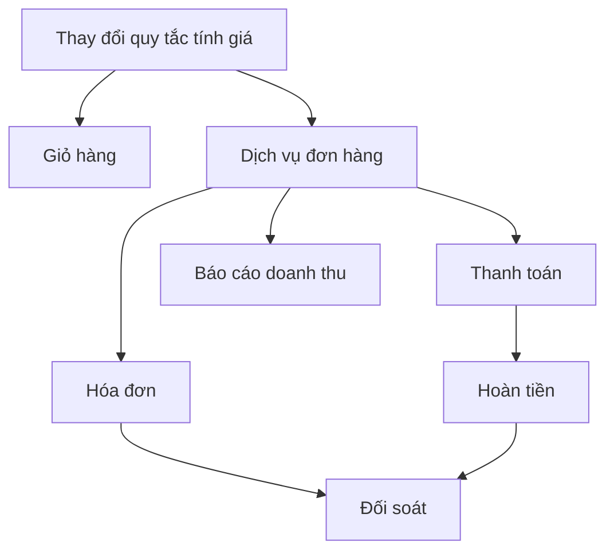

# Phân biệt phạm vi của một thay đổi với phạm vi hồi quy

Trong module `VALIDATION_TESTING_STRATEGY`, xác định phạm vi kiểm thử là quyết định về những hành vi, thành phần, quy trình và rủi ro cần được xác nhận trước khi kết luận một thay đổi có thể được chấp nhận. Khi phần mềm thay đổi, nhóm cần kiểm tra cả điều mới được yêu cầu lẫn những hành vi hiện có có thể bị ảnh hưởng. Hai phạm vi này liên quan nhưng phục vụ hai mục tiêu khác nhau.

**Phạm vi của một thay đổi** tập trung vào phần hành vi được sửa, bổ sung hoặc loại bỏ và các tiêu chí chấp nhận tương ứng. **Phạm vi hồi quy** tập trung vào những hành vi đã tồn tại cần được kiểm tra lại để phát hiện tác động ngoài dự kiến do thay đổi gây ra. Nếu chỉ kiểm tra phần mới, nhóm có thể bỏ sót lỗi lan sang chức năng cũ. Nếu chạy lại mọi kiểm thử mà không phân tích tác động, nhóm có thể tốn nhiều thời gian mà vẫn không ưu tiên đúng rủi ro.

Bài học này thuộc chương **Phạm vi kiểm thử** và hướng dẫn cách xác định hai phạm vi, phân tích tác động, chọn mức hồi quy phù hợp và ghi lại căn cứ cho quyết định kiểm thử.

## 1. Hai phạm vi trả lời hai câu hỏi khác nhau

### 1.1. Phạm vi của một thay đổi

Phạm vi của một thay đổi (change scope) mô tả những gì thay đổi cần làm và những phần liên quan trực tiếp cần xác nhận. Nó được xác định từ yêu cầu, lỗi cần sửa, tiêu chí chấp nhận, thiết kế và các thành phần được điều chỉnh.

Phạm vi này thường bao gồm:

- Hành vi mới hoặc hành vi đã được sửa.
- Quy tắc nghiệp vụ và điều kiện đầu vào, đầu ra liên quan.
- Các trạng thái, dữ liệu và quyền hạn bị thay đổi.
- Các nhánh thành công, từ chối, lỗi và biên của chức năng thay đổi.
- Giao diện hoặc hợp đồng mà thay đổi làm mới hay điều chỉnh.
- Các tiêu chí chấp nhận và bằng chứng cần có để xác nhận yêu cầu.

Ví dụ, yêu cầu bổ sung mã giảm giá theo nhóm khách hàng có thể làm thay đổi cách xác định điều kiện áp dụng, tính giá cuối cùng, hiển thị mức giảm và ghi nhận thông tin trên đơn hàng. Phạm vi kiểm thử thay đổi cần xác nhận đúng các quy tắc đó, bao gồm trường hợp mã hợp lệ, hết hạn, không đủ điều kiện, không áp dụng được và đơn hàng bị hủy.

Phạm vi thay đổi được định hình chủ yếu bởi câu hỏi: **Hệ thống phải làm gì khác đi sau thay đổi này?**

### 1.2. Phạm vi hồi quy

Phạm vi hồi quy (regression scope) là tập hợp các hành vi đã tồn tại cần được kiểm tra lại vì thay đổi có thể làm chúng hoạt động khác đi ngoài dự kiến. Hồi quy không chỉ giới hạn ở các dòng mã được sửa. Một thay đổi nhỏ có thể ảnh hưởng đến nhiều chức năng dùng chung dữ liệu, quy tắc, thư viện, dịch vụ hoặc giao diện.

Phạm vi hồi quy có thể bao gồm:

- Chức năng cũ sử dụng cùng thành phần hoặc quy tắc vừa thay đổi.
- Luồng nghiệp vụ đi qua thành phần bị ảnh hưởng.
- Các tích hợp nhận dữ liệu hoặc sự kiện từ phần đã sửa.
- Các vai trò người dùng có quyền truy cập vào chức năng liên quan.
- Báo cáo, thông báo, dữ liệu lưu trữ hoặc tác vụ nền phụ thuộc vào kết quả thay đổi.
- Các thuộc tính chất lượng như hiệu năng, bảo mật, khả năng tương thích và độ ổn định nếu có nguy cơ bị tác động.

Ví dụ, khi thay đổi cách tính giá đơn hàng để hỗ trợ mã giảm giá, nhóm cần xem lại các hành vi hiện có như tính thuế, phí vận chuyển, hoàn tiền, hóa đơn, báo cáo doanh thu và quy trình thanh toán. Những hành vi này có thể không nằm trong yêu cầu mới, nhưng có thể bị ảnh hưởng vì dùng chung tổng tiền hoặc dữ liệu giá.

Phạm vi hồi quy được định hình bởi câu hỏi: **Điều gì đang hoạt động đúng có thể bị thay đổi ngoài ý muốn bởi thay đổi này?**

### 1.3. So sánh hai phạm vi

| Khía cạnh | Phạm vi của thay đổi | Phạm vi hồi quy |
|---|---|---|
| Mục tiêu | Xác nhận yêu cầu mới hoặc hành vi được sửa | Phát hiện hành vi hiện có bị ảnh hưởng ngoài dự kiến |
| Điểm xuất phát | Yêu cầu, lỗi, tiêu chí chấp nhận và thiết kế thay đổi | Phân tích tác động, phụ thuộc và rủi ro |
| Đối tượng chính | Hành vi được thêm, sửa hoặc loại bỏ | Hành vi hiện hữu có quan hệ với phần thay đổi |
| Kết quả mong đợi | Đáp ứng đúng yêu cầu mới | Duy trì hành vi cũ theo đặc tả và chính sách |
| Câu hỏi cốt lõi | Điều gì phải thay đổi? | Điều gì phải tiếp tục hoạt động đúng? |
| Bằng chứng | Kết quả theo tiêu chí chấp nhận | Kết quả tương thích với hành vi đã được xác nhận trước đó |

Hai phạm vi có thể giao nhau. Ví dụ, một lỗi sửa ở quy tắc tính phí vừa là hành vi được thay đổi, vừa tác động đến các luồng tính tiền hiện có. Khi ghi kế hoạch, có thể dùng chung một kịch bản nếu kịch bản đó chứng minh rõ cả yêu cầu sửa lỗi và việc không phá vỡ hành vi liên quan. Tuy nhiên, mục tiêu xác nhận cần được nêu rõ để không bỏ sót một trong hai.

## 2. Vì sao không thể dùng phạm vi thay đổi làm phạm vi hồi quy?

Mã nguồn hoặc danh sách tệp thay đổi chỉ cho biết nơi có chỉnh sửa trực tiếp. Nó không cho biết đầy đủ những nơi phụ thuộc vào hành vi đó. Ngược lại, chạy toàn bộ bộ kiểm thử sau mọi thay đổi có thể tốn kém và không phải lúc nào cũng khả thi.

Có một số lý do khiến phạm vi hồi quy thường rộng hơn vùng chỉnh sửa trực tiếp:

1. **Thành phần dùng chung:** một hàm, thư viện hoặc dịch vụ có thể phục vụ nhiều chức năng.
2. **Phụ thuộc dữ liệu:** thay đổi cấu trúc hoặc cách tính dữ liệu có thể ảnh hưởng báo cáo, tìm kiếm, đồng bộ và lịch sử.
3. **Phụ thuộc theo luồng:** một bước trong quy trình thay đổi có thể làm thay đổi kết quả ở bước tiếp theo.
4. **Tích hợp:** hệ thống khác có thể phụ thuộc vào định dạng, trạng thái, thời điểm hoặc ý nghĩa của dữ liệu được gửi đi.
5. **Quyền hạn và bảo mật:** thay đổi xác thực hoặc phân quyền có thể ảnh hưởng nhiều vai trò và nhiều điểm truy cập.
6. **Hành vi phi chức năng:** thay đổi truy vấn, thuật toán hoặc giao tiếp mạng có thể ảnh hưởng hiệu năng và độ ổn định.
7. **Cấu hình và triển khai:** thay đổi biến cấu hình, phiên bản thư viện hoặc cách khởi tạo có thể tác động đến môi trường khác nhau.

Vì vậy, chỉ chạy kiểm thử trên phần mã vừa sửa không đủ để kết luận hệ thống không có lỗi hồi quy. Nhóm cần hiểu quan hệ phụ thuộc và chọn kiểm thử dựa trên rủi ro.

## 3. Xác định phạm vi kiểm thử của thay đổi

Bắt đầu từ yêu cầu và mô tả chính xác điều gì được phép thay đổi. Một thay đổi được mô tả mơ hồ sẽ dẫn đến phạm vi kiểm thử thiếu hoặc không thống nhất.

### 3.1. Làm rõ mục tiêu và tiêu chí chấp nhận

Với mỗi thay đổi, cần trả lời:

- Vấn đề hoặc nhu cầu nào đang được giải quyết?
- Ai bị ảnh hưởng và họ cần đạt được kết quả gì?
- Hành vi hiện tại nào cần được giữ nguyên, sửa hoặc loại bỏ?
- Điều kiện nào khiến hành vi mới được xem là đúng?
- Những trường hợp nào phải bị từ chối hoặc xử lý theo nhánh ngoại lệ?
- Có yêu cầu về dữ liệu, quyền hạn, hiệu năng, bảo mật hoặc khả năng tương thích không?

Tiêu chí chấp nhận cần mô tả kết quả có thể quan sát và xác minh. “Mã giảm giá hoạt động tốt” chưa đủ rõ. Có thể cụ thể hóa thành: mã còn hiệu lực và phù hợp với nhóm khách hàng được áp dụng mức giảm theo quy tắc; mã hết hạn bị từ chối với thông báo phù hợp; tổng tiền sau giảm không âm và được lưu nhất quán trên đơn hàng.

Nếu yêu cầu mâu thuẫn với hành vi hiện tại hoặc thiếu quy tắc quan trọng, ghi lại câu hỏi và xin xác nhận từ người có thẩm quyền trước khi tự suy diễn.

### 3.2. Liệt kê phần tử bị thay đổi

Xem xét thay đổi ở nhiều góc độ, không chỉ danh sách tệp:

| Góc độ | Nội dung cần xác định |
|---|---|
| Nghiệp vụ | Quy tắc, điều kiện, trạng thái và quyết định nào thay đổi? |
| Giao diện | Màn hình, API, thông điệp hoặc hợp đồng nào thay đổi? |
| Dữ liệu | Trường, cấu trúc, phép tính, vòng đời hoặc nguồn dữ liệu nào thay đổi? |
| Xử lý | Thuật toán, luồng điều khiển, tác vụ nền hoặc xử lý lỗi nào thay đổi? |
| Quyền hạn | Vai trò hoặc quyền truy cập nào được thêm, sửa hoặc thu hồi? |
| Tích hợp | Dịch vụ, sự kiện, định dạng hoặc thứ tự trao đổi nào thay đổi? |
| Vận hành | Cấu hình, triển khai, giám sát hoặc quy trình hỗ trợ nào bị tác động? |

Kết hợp thông tin từ yêu cầu, thiết kế, pull request, thay đổi cơ sở dữ liệu, cấu hình và trao đổi với nhóm phát triển. Nếu có khác biệt giữa mô tả yêu cầu và triển khai thực tế, ghi nhận để làm rõ.

### 3.3. Xác định các trường hợp kiểm thử trực tiếp

Với hành vi mới hoặc được sửa, hãy xem xét các nhóm tình huống:

- Đầu vào hợp lệ và luồng thành công.
- Đầu vào không hợp lệ, thiếu dữ liệu hoặc sai định dạng.
- Giá trị biên, giới hạn và điều kiện chuyển tiếp.
- Người dùng hoặc vai trò không đủ quyền.
- Trạng thái không cho phép thực hiện thao tác.
- Xử lý lỗi, timeout, thử lại và phục hồi.
- Yêu cầu lặp, xử lý đồng thời hoặc thứ tự sự kiện khác nhau.
- Dữ liệu cũ, dữ liệu mới và khả năng tương thích nếu có thay đổi cấu trúc.

Không phải mọi thay đổi đều cần mọi nhóm tình huống. Chọn trường hợp dựa trên quy tắc thực tế và hậu quả nếu sai. Điều quan trọng là tiêu chí chấp nhận của thay đổi phải được bao phủ bằng bằng chứng rõ ràng.

## 4. Phân tích tác động để xác định phạm vi hồi quy

Phân tích tác động (impact analysis) là quá trình tìm những thành phần, dữ liệu, quy trình và hành vi có thể bị ảnh hưởng bởi thay đổi. Kết quả phân tích là cơ sở để chọn phạm vi hồi quy.

### 4.1. Truy vết phụ thuộc trực tiếp và gián tiếp

Bắt đầu từ thành phần thay đổi, tìm các thành phần gọi nó, được nó gọi, dùng chung dữ liệu hoặc nhận kết quả từ nó. Xem xét cả phụ thuộc đồng bộ và bất đồng bộ.

Ví dụ với thay đổi tính tổng tiền:

- Giao diện giỏ hàng gọi dịch vụ tính giá.
- Dịch vụ đơn hàng lưu tổng tiền.
- Dịch vụ thanh toán dùng tổng tiền để tạo giao dịch.
- Dịch vụ hóa đơn dùng tổng tiền để xuất hóa đơn.
- Dịch vụ hoàn tiền dùng dữ liệu giao dịch và đơn hàng.
- Báo cáo doanh thu tổng hợp dữ liệu đơn đã hoàn tất.

Sơ đồ đơn giản:

Sơ đồ này không khẳng định mọi hệ thống đều phụ thuộc trực tiếp vào nhau. Nó minh họa cách lập bản đồ các điểm cần xác minh. Trong dự án thực tế, hãy dùng sơ đồ kiến trúc, tài liệu giao diện, mã nguồn và xác nhận của chủ sở hữu thành phần để kiểm chứng quan hệ.

### 4.2. Xem xét các lớp tác động

Không chỉ xem xét phụ thuộc kỹ thuật. Một thay đổi có thể tạo ra tác động theo nhiều lớp:

| Lớp tác động | Câu hỏi phân tích | Ví dụ phạm vi hồi quy |
|---|---|---|
| Thành phần | Chức năng nào dùng chung mã hoặc thư viện vừa sửa? | Các màn hình và dịch vụ dùng chung bộ tính giá |
| Dữ liệu | Cấu trúc, giá trị hoặc ý nghĩa dữ liệu nào thay đổi? | Đơn cũ, báo cáo, lịch sử giao dịch và dữ liệu đồng bộ |
| Quy trình | Luồng nghiệp vụ nào đi qua phần thay đổi? | Đặt hàng, hủy đơn, hoàn tiền và đối soát |
| Tích hợp | Bên nhận nào phụ thuộc vào hợp đồng hoặc sự kiện? | Cổng thanh toán, hóa đơn và hệ thống vận chuyển |
| Người dùng và quyền hạn | Vai trò nào sử dụng hoặc bị ảnh hưởng? | Khách hàng, nhân viên hỗ trợ và quản trị viên |
| Phi chức năng | Thuộc tính chất lượng nào có thể suy giảm? | Thời gian phản hồi khi phép tính mới truy vấn thêm dữ liệu |
| Môi trường và cấu hình | Cấu hình hoặc phiên bản nào ảnh hưởng hành vi? | Cờ tính năng, cấu hình thuế và phiên bản dịch vụ |

### 4.3. Xác định độ gần và mức độ ảnh hưởng

Có thể phân loại quan hệ với thay đổi thành:

- **Ảnh hưởng trực tiếp:** thành phần hoặc luồng được thay đổi sử dụng trực tiếp.
- **Ảnh hưởng gián tiếp:** thành phần phụ thuộc vào đầu ra, dữ liệu hoặc trạng thái của phần thay đổi.
- **Ảnh hưởng dùng chung:** nhiều chức năng sử dụng cùng dịch vụ, thư viện, cấu hình hoặc mô hình dữ liệu.
- **Ảnh hưởng theo rủi ro:** không có phụ thuộc rõ ràng nhưng hậu quả nếu xảy ra lỗi rất lớn hoặc khó phát hiện.

Độ gần kỹ thuật không đồng nghĩa với mức độ rủi ro. Một hệ thống ở xa trong sơ đồ có thể chịu hậu quả nghiêm trọng nếu nhận dữ liệu sai. Một thành phần gần thay đổi có thể ít rủi ro nếu được cô lập và có kiểm soát tốt.

### 4.4. Đặt câu hỏi để tìm tác động bị bỏ sót

Sau khi có danh sách phụ thuộc ban đầu, hỏi thêm:

- Có chức năng nào dùng chung quy tắc nhưng nằm ở repository hoặc dịch vụ khác không?
- Có báo cáo hoặc tác vụ chạy theo lịch sử dụng dữ liệu đã thay đổi không?
- Có hệ thống ngoài nào dựa vào định dạng hoặc thứ tự sự kiện không?
- Có dữ liệu cũ cần đọc được sau khi thay đổi không?
- Có luồng hủy, hoàn tác hoặc phục hồi sử dụng cùng logic không?
- Có vai trò nào có cách sử dụng khác với người dùng thông thường không?
- Có giới hạn tải hoặc thời gian phản hồi nào có thể bị ảnh hưởng không?
- Có cờ tính năng, cấu hình theo khách hàng hoặc môi trường nào làm hành vi khác đi không?

Đưa các câu trả lời vào bản phân tích tác động. Những điểm chưa rõ cần được ghi là giả định hoặc câu hỏi cần xác minh.

## 5. Chọn phạm vi hồi quy theo rủi ro

Phạm vi hồi quy cần đủ rộng để kiểm soát rủi ro, đồng thời phù hợp với thời gian, nguồn lực và mức độ quan trọng của thay đổi. Không có một bộ kiểm thử cố định phù hợp cho mọi thay đổi.

### 5.1. Các yếu tố dùng để ưu tiên

Đánh giá mỗi hành vi có khả năng bị ảnh hưởng theo các yếu tố:

1. **Mức độ nghiêm trọng:** nếu chức năng sai, tác động đến tiền, dữ liệu, an toàn, quyền lợi hoặc hoạt động cốt lõi đến đâu?
2. **Khả năng xảy ra:** thành phần có thay đổi thường xuyên, phức tạp hoặc dễ phát sinh lỗi không?
3. **Mức độ phụ thuộc:** có bao nhiêu luồng, hệ thống hoặc vai trò sử dụng thành phần?
4. **Khả năng phát hiện:** lỗi có dễ quan sát hay có thể âm thầm làm sai dữ liệu?
5. **Khả năng phục hồi:** có thể khôi phục an toàn hay cần sửa dữ liệu thủ công?
6. **Lịch sử lỗi:** khu vực này có từng phát sinh lỗi tương tự hoặc lỗi hồi quy không?
7. **Độ tin cậy của bằng chứng:** kiểm thử hiện có có ổn định và đủ đại diện không?

Có thể dùng thang thấp, trung bình, cao để xếp hạng. Điểm số giúp thảo luận và so sánh; không thay thế đánh giá của người chịu trách nhiệm nghiệp vụ và kỹ thuật.

### 5.2. Phân nhóm phạm vi kiểm thử

| Nhóm | Nội dung | Khi nào nên chạy |
|---|---|---|
| Kiểm thử thay đổi | Các trường hợp trực tiếp xác nhận hành vi mới hoặc đã sửa | Mọi thay đổi có hành vi cần xác nhận |
| Hồi quy cục bộ | Kiểm tra thành phần và các chức năng dùng chung gần nhất | Khi thay đổi một thành phần có nhiều người dùng |
| Hồi quy theo luồng | Kiểm tra các quy trình đầu cuối có thể bị ảnh hưởng | Khi thay đổi nằm trên luồng nghiệp vụ quan trọng |
| Hồi quy theo rủi ro | Kiểm tra các chức năng có hậu quả lớn hoặc phụ thuộc gián tiếp | Khi thời gian giới hạn hoặc tác động lan rộng |
| Hồi quy toàn bộ | Chạy bộ kiểm thử rộng nhất có thể và phù hợp với môi trường | Trước mốc phát hành quan trọng, thay đổi nền tảng lớn hoặc khi rủi ro lan rộng |

Các nhóm này có thể kết hợp. Một thay đổi nhỏ trong thư viện dùng chung có thể cần hồi quy cục bộ và theo luồng. Một thay đổi kiến trúc, mô hình dữ liệu hoặc cơ chế xác thực có thể cần phạm vi hồi quy rộng hơn nhiều.

### 5.3. Dùng nhiều tầng hồi quy

Có thể tổ chức hồi quy thành các tầng để nhận phản hồi sớm:

- **Smoke test:** kiểm tra nhanh các chức năng cốt lõi và khả năng hệ thống hoạt động sau triển khai.
- **Hồi quy mục tiêu:** chạy các kịch bản liên quan trực tiếp đến thành phần và phụ thuộc đã xác định.
- **Hồi quy theo rủi ro:** mở rộng sang các luồng, vai trò và tích hợp có hậu quả lớn.
- **Hồi quy rộng hoặc toàn bộ:** chạy bộ kiểm thử rộng trước mốc phát hành khi thời gian và môi trường cho phép.

Smoke test không thay thế hồi quy. Một hệ thống khởi động được và đăng nhập thành công vẫn có thể tính sai tiền, mất dữ liệu hoặc làm hỏng một luồng nghiệp vụ ít phổ biến.

### 5.4. Khi nào cần mở rộng phạm vi?

Mở rộng phạm vi hồi quy khi:

- Thay đổi ảnh hưởng thành phần dùng chung hoặc hợp đồng tích hợp.
- Không xác định được đầy đủ phụ thuộc.
- Có thay đổi cấu trúc dữ liệu hoặc chuyển đổi dữ liệu.
- Thay đổi tác động đến xác thực, phân quyền, thanh toán hoặc quy tắc cốt lõi.
- Kiểm thử mục tiêu phát hiện lỗi ngoài khu vực dự kiến.
- Có lịch sử lỗi hồi quy hoặc chất lượng kiểm thử hiện tại không đáng tin cậy.
- Có thay đổi lớn về nền tảng, cấu hình hoặc thư viện nền.

Nếu phát hiện lỗi hồi quy, cập nhật phân tích tác động và mở rộng sang những khu vực cùng phụ thuộc. Không nên chỉ sửa trường hợp thất bại rồi chạy lại đúng một kiểm thử mà không xem xét nguyên nhân và phạm vi ảnh hưởng.

### 5.5. Khi nào có thể thu hẹp phạm vi?

Có thể chọn hồi quy có mục tiêu khi có bằng chứng đáng tin cậy rằng:

- Thay đổi được cô lập trong một thành phần.
- Phụ thuộc đã được xác định và có thể kiểm tra.
- Các chức năng khác không dùng chung dữ liệu hoặc hành vi bị thay đổi.
- Có kiểm thử tự động ổn định cho các rủi ro quan trọng.
- Không có thay đổi cấu hình, dữ liệu hoặc tích hợp làm tăng phạm vi.
- Rủi ro còn lại được ghi nhận và người có thẩm quyền chấp nhận.

Thu hẹp phạm vi là một quyết định có căn cứ. Nếu thiếu dữ liệu về phụ thuộc, không nên coi việc chưa tìm thấy ảnh hưởng là bằng chứng rằng không có ảnh hưởng.

## 6. Ví dụ: thay đổi quy tắc tính giá đơn hàng

Giả sử sản phẩm bổ sung giảm giá theo nhóm khách hàng. Trước thay đổi, giá đơn được tính từ giá sản phẩm, số lượng, thuế và phí vận chuyển. Sau thay đổi, hệ thống cần kiểm tra nhóm khách hàng và áp dụng mức giảm phù hợp.

### 6.1. Phạm vi của thay đổi

Các hành vi cần xác nhận trực tiếp:

- Khách thuộc nhóm đủ điều kiện được áp dụng đúng mức giảm.
- Khách không thuộc nhóm đủ điều kiện không được áp dụng giảm giá.
- Mã giảm giá hết hạn hoặc không hợp lệ bị từ chối theo chính sách.
- Quy tắc kết hợp nhiều loại giảm giá được áp dụng đúng thứ tự.
- Tổng tiền không âm và làm tròn theo quy tắc.
- Giá trị giảm được lưu và hiển thị nhất quán.
- Khi khách thay đổi số lượng hoặc nhóm khách hàng, giá được tính lại đúng.
- Khi đơn bị hủy hoặc hoàn tiền, phần tiền giảm được xử lý theo chính sách.

Đây là những trường hợp chứng minh yêu cầu mới hoạt động đúng.

### 6.2. Phạm vi hồi quy

Những hành vi cũ có thể bị ảnh hưởng:

| Hành vi hiện có | Nguy cơ hồi quy | Kiểm thử hồi quy gợi ý |
|---|---|---|
| Tính thuế | Thuế được tính trên sai cơ sở giá | Kiểm tra đơn có và không có giảm giá theo quy tắc thuế |
| Phí vận chuyển | Điều kiện miễn phí vận chuyển bị thay đổi ngoài ý muốn | Kiểm tra ngưỡng miễn phí và phí theo khu vực |
| Thanh toán | Số tiền gửi sang cổng thanh toán khác với tổng đơn | Đối chiếu tổng đơn, yêu cầu thanh toán và giao dịch |
| Hóa đơn | Giá trị trước giảm, tiền giảm và tổng sau giảm không nhất quán | Kiểm tra nội dung hóa đơn và dữ liệu lưu |
| Hoàn tiền | Số tiền hoàn không đúng số tiền đã thu | Kiểm tra hoàn toàn phần và hoàn một phần |
| Báo cáo doanh thu | Doanh thu bị cộng trùng hoặc tính theo sai giá trị | Đối chiếu báo cáo với các đơn đại diện |
| Giỏ hàng | Tổng tiền thay đổi sai khi cập nhật số lượng | Kiểm tra thêm, xóa và thay đổi số lượng sản phẩm |
| Lịch sử đơn hàng | Dữ liệu đơn cũ bị diễn giải theo quy tắc mới | Kiểm tra khả năng đọc và hiển thị đơn đã tạo trước thay đổi |

### 6.3. Quyết định mức hồi quy

Nếu thay đổi chỉ ảnh hưởng một hàm tính giá nhưng hàm đó được dùng bởi giỏ hàng, đơn hàng, thanh toán và hoàn tiền, hồi quy phải bao phủ các luồng quan trọng này. Nếu có thêm thay đổi cấu trúc dữ liệu hoặc dịch vụ tính thuế, phạm vi cần mở rộng tương ứng.

Một kế hoạch hợp lý có thể gồm:

1. Chạy kiểm thử trực tiếp cho mọi tiêu chí chấp nhận của giảm giá.
2. Chạy kiểm thử đơn vị và tích hợp cho bộ tính giá, thuế và phí vận chuyển.
3. Chạy các luồng đầu cuối đặt hàng, thanh toán và hoàn tiền đại diện.
4. Đối chiếu dữ liệu đơn hàng, giao dịch và báo cáo.
5. Chạy hồi quy rộng hơn trước phát hành nếu thay đổi chạm vào dịch vụ dùng chung hoặc dữ liệu nền.

Phạm vi cuối cùng phải dựa trên kiến trúc và phụ thuộc thực tế của sản phẩm. Ví dụ trên minh họa cách suy luận, không phải danh sách bắt buộc cho mọi hệ thống bán hàng.

## 7. Ví dụ: thay đổi cơ chế xác thực người dùng

Giả sử hệ thống chuyển từ phiên đăng nhập thông thường sang cơ chế làm mới token. Phần thay đổi trực tiếp gồm cấp token, làm mới token, hết hạn và thu hồi phiên. Phạm vi hồi quy cần xem xét các hành vi hiện có sử dụng trạng thái đăng nhập:

- Đăng nhập, đăng xuất và đăng nhập lại.
- Điều hướng giữa các trang yêu cầu xác thực.
- Phân quyền theo vai trò và quyền trên từng tài nguyên.
- Gọi API từ trình duyệt và ứng dụng di động.
- Hành vi khi mở nhiều tab hoặc nhiều thiết bị.
- Phiên hết hạn khi người dùng đang thao tác.
- Thu hồi phiên sau khi đổi mật khẩu hoặc khóa tài khoản.
- Các tác vụ nền hoặc tích hợp sử dụng thông tin định danh.
- Khả năng tương thích với trình duyệt, thiết bị và phiên bản ứng dụng được hỗ trợ.

Nếu chỉ kiểm tra việc token mới được cấp, nhóm có thể bỏ sót tình huống người dùng đã đăng xuất nhưng token cũ vẫn truy cập được, hoặc một vai trò được cấp quyền vượt quá phạm vi. Vì thay đổi liên quan đến bảo mật và nhiều luồng dùng chung, phạm vi hồi quy thường cần mở rộng và có bằng chứng từ cả giao diện lẫn API.

## 8. Quản lý trường hợp kiểm thử và khả năng truy vết

Phạm vi chỉ hữu ích khi có thể chuyển thành danh sách kiểm thử, người phụ trách và bằng chứng. Hãy liên kết mỗi trường hợp với yêu cầu thay đổi hoặc rủi ro hồi quy mà nó xác nhận.

### 8.1. Ma trận truy vết

| ID | Yêu cầu hoặc hành vi | Loại phạm vi | Rủi ro liên quan | Kiểm thử | Bằng chứng |
|---|---|---|---|---|---|
| CHG-01 | Áp dụng giảm giá cho nhóm đủ điều kiện | Thay đổi | Giảm sai giá | Kiểm tra nhóm đủ điều kiện | Tổng tiền và chi tiết giảm giá |
| CHG-02 | Từ chối mã đã hết hạn | Thay đổi | Áp dụng ưu đãi sai | Kiểm tra mã hết hạn | Kết quả từ chối và thông báo |
| REG-01 | Thuế được tính đúng sau giảm giá | Hồi quy | Sai số tiền thuế | Kiểm tra đơn có giảm giá | Chi tiết thuế và tổng đơn |
| REG-02 | Thanh toán dùng đúng tổng đơn | Hồi quy | Thu thiếu hoặc thu thừa | Đối chiếu đơn và giao dịch | Bản ghi đơn và giao dịch |
| REG-03 | Hoàn tiền theo số tiền đủ điều kiện | Hồi quy | Hoàn sai số tiền | Kiểm tra hoàn toàn phần và một phần | Bản ghi hoàn tiền và đối soát |

Có thể thêm các trường như mức ưu tiên, môi trường, dữ liệu, trạng thái chạy, người thực hiện và phiên bản. Điều quan trọng là có thể truy ngược từ thay đổi đến kiểm thử và từ rủi ro đến bằng chứng.

### 8.2. Mẫu phân tích tác động

Trước khi chốt phạm vi hồi quy, ghi lại:

| Trường | Nội dung |
|---|---|
| Thay đổi | Mô tả yêu cầu, lỗi hoặc thành phần được sửa |
| Thành phần trực tiếp | Mã, dịch vụ, dữ liệu, giao diện hoặc cấu hình thay đổi |
| Phụ thuộc | Thành phần gọi, được gọi, dùng chung hoặc nhận dữ liệu |
| Luồng nghiệp vụ | Các quy trình có thể bị ảnh hưởng |
| Rủi ro | Hậu quả nếu hành vi cũ bị thay đổi |
| Kiểm thử đề xuất | Kịch bản thay đổi và hồi quy cần chạy |
| Mức ưu tiên | Căn cứ về tác động và khả năng xảy ra |
| Khoảng trống | Phụ thuộc hoặc bằng chứng chưa xác minh |
| Quyết định phạm vi | Mục nào được đưa vào, hoãn hoặc loại trừ |
| Người xác nhận | Người chịu trách nhiệm chấp nhận phạm vi và rủi ro còn lại |

### 8.3. Ghi rõ lý do loại trừ kiểm thử

Không phải mọi kiểm thử trong kho đều cần chạy mỗi lần. Nếu loại một trường hợp khỏi phạm vi, ghi lại lý do như:

- Không có quan hệ phụ thuộc với phần thay đổi theo phân tích đã xác minh.
- Được bao phủ bởi một kịch bản khác có bằng chứng tương đương.
- Không còn áp dụng với phiên bản hoặc chức năng hiện tại.
- Được hoãn do giới hạn môi trường, kèm rủi ro và kế hoạch xử lý.
- Đã được kiểm tra ở tầng khác và có bằng chứng phù hợp.

Tránh ghi “không liên quan” mà không có căn cứ. Khi thay đổi hoặc kiến trúc thay đổi, quyết định loại trừ cần được xem xét lại.

## 9. Những sai lầm thường gặp

1. **Đồng nhất phạm vi thay đổi với phạm vi hồi quy:** chỉ kiểm thử phần được yêu cầu sửa và bỏ qua hành vi cũ phụ thuộc.
2. **Dựa hoàn toàn vào tệp mã thay đổi:** bỏ qua luồng nghiệp vụ, dữ liệu, cấu hình và hệ thống tích hợp.
3. **Chạy toàn bộ bộ kiểm thử theo thói quen:** tốn thời gian nhưng không xem xét chất lượng, mức liên quan và rủi ro của từng trường hợp.
4. **Chỉ chạy smoke test:** coi việc hệ thống khởi động và đăng nhập được là bằng chứng đủ cho chất lượng.
5. **Bỏ qua dữ liệu và tác vụ nền:** không kiểm tra báo cáo, đồng bộ, lịch sử hoặc xử lý bất đồng bộ.
6. **Không kiểm tra nhánh phục hồi:** bỏ qua hủy, hoàn tiền, thử lại và xử lý lỗi sau khi thay đổi.
7. **Không truy vết yêu cầu với kiểm thử:** khó biết tiêu chí nào chưa được xác nhận hoặc vì sao một kiểm thử được chọn.
8. **Loại trừ kiểm thử không có căn cứ:** cho rằng một khu vực không bị ảnh hưởng chỉ vì không thấy nó trong danh sách tệp sửa.
9. **Không cập nhật phạm vi khi phát hiện lỗi:** tiếp tục chạy kế hoạch cũ dù bằng chứng mới cho thấy tác động rộng hơn.
10. **Không ghi nhận rủi ro còn lại:** người phê duyệt không biết những hành vi nào chưa được kiểm tra.

## 10. Checklist trước khi chốt phạm vi

- [ ] Đã hiểu mục tiêu, yêu cầu và tiêu chí chấp nhận của thay đổi.
- [ ] Đã liệt kê hành vi, dữ liệu, giao diện và cấu hình thay đổi trực tiếp.
- [ ] Đã xác định các trường hợp thành công, lỗi, biên và phục hồi cho thay đổi.
- [ ] Đã phân tích phụ thuộc trực tiếp, gián tiếp và dùng chung.
- [ ] Đã xem xét tác động đến quy trình, dữ liệu, tích hợp, vai trò và thuộc tính chất lượng.
- [ ] Đã đánh giá mức độ nghiêm trọng, khả năng xảy ra và khả năng phát hiện.
- [ ] Đã chọn phạm vi hồi quy theo rủi ro và tầng kiểm thử phù hợp.
- [ ] Đã bảo đảm các luồng nghiệp vụ quan trọng có kiểm thử đại diện.
- [ ] Đã ghi rõ kiểm thử bị loại trừ hoặc hoãn cùng lý do.
- [ ] Đã liên kết yêu cầu, rủi ro, trường hợp kiểm thử và bằng chứng.
- [ ] Đã xác định người xác nhận phạm vi và người chấp nhận rủi ro còn lại.
- [ ] Đã có điều kiện mở rộng hoặc xem xét lại phạm vi khi xuất hiện bằng chứng mới.

Phạm vi của thay đổi cho biết điều cần chứng minh đã được sửa hoặc bổ sung đúng. Phạm vi hồi quy cho biết những hành vi đang hoạt động cần được bảo vệ trước tác động ngoài dự kiến. Khi phân biệt rõ hai mục tiêu, phân tích phụ thuộc và ưu tiên theo rủi ro, nhóm có thể chọn một tập kiểm thử vừa có căn cứ vừa phù hợp với mức độ ảnh hưởng của thay đổi.
