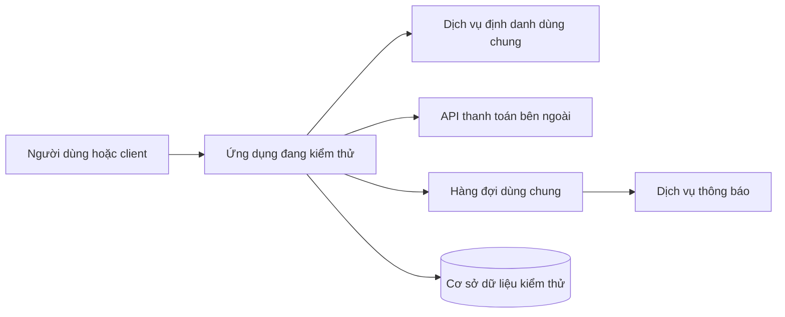

# Quản lý giả định về dịch vụ bên ngoài và hệ thống dùng chung

## Mục tiêu học tập

Sau bài học này, người học có thể:

- Nhận diện dịch vụ bên ngoài, hệ thống dùng chung và các phụ thuộc nằm ngoài quyền kiểm soát trực tiếp của nhóm kiểm thử.
- Phân biệt giả định, ràng buộc, phụ thuộc và rủi ro; ghi lại giả định theo cách có thể xác minh.
- Xác định phạm vi kiểm thử đối với các tích hợp và hệ thống dùng chung.
- Lựa chọn giữa kiểm thử với dịch vụ thật, môi trường thử nghiệm, service virtualization và test double.
- Quản lý dữ liệu, quyền truy cập, lịch sử dụng, nhiễu do nhiều nhóm cùng chạy kiểm thử và các giới hạn của môi trường.
- Xây dựng phương án xử lý khi phụ thuộc chậm, lỗi, thay đổi hợp đồng hoặc không sẵn sàng.

## 1. Vì sao phải quản lý giả định về phụ thuộc?

Trong phạm vi **VALIDATION_TESTING_STRATEGY**, xác định phạm vi kiểm thử không chỉ là liệt kê các chức năng thuộc sản phẩm. Một hệ thống thường dựa vào nhiều thành phần khác nhau: cổng thanh toán, dịch vụ định danh, hệ thống gửi email, nền tảng dữ liệu, API của đối tác, hàng đợi thông điệp, cơ sở dữ liệu dùng chung hoặc một dịch vụ nội bộ do nhóm khác vận hành. Những thành phần này có thể ảnh hưởng trực tiếp đến kết quả kiểm thử dù nhóm không sở hữu mã nguồn, môi trường hoặc lịch triển khai của chúng.

Nếu nhóm ngầm giả định rằng một dịch vụ luôn sẵn sàng, dữ liệu luôn sạch, API không thay đổi hoặc môi trường dùng chung chỉ có nhóm mình sử dụng, kết quả kiểm thử có thể gây hiểu nhầm. Một ca kiểm thử thất bại có thể do sản phẩm, do phụ thuộc, do cấu hình hoặc do một nhóm khác đang thay đổi dữ liệu. Ngược lại, kiểm thử có thể Pass vì test double quá đơn giản, trong khi tích hợp thật không hoạt động.

Vì vậy, phạm vi kiểm thử cần trả lời rõ:

- Hệ thống phụ thuộc vào dịch vụ và tài nguyên nào?
- Nhóm đang giả định điều gì về hành vi, dữ liệu, khả năng sẵn sàng và quyền sử dụng của các phụ thuộc?
- Giả định nào đã được xác minh bằng hợp đồng, tài liệu, kiểm thử hoặc bằng chứng vận hành?
- Thành phần nào sẽ được kiểm tra thật, thành phần nào được mô phỏng, và giới hạn của từng cách kiểm tra là gì?
- Ai chịu trách nhiệm cung cấp môi trường, dữ liệu, quyền truy cập và xử lý sự cố của mỗi phụ thuộc?

Mục tiêu không phải là kiểm soát mọi hệ thống bên ngoài. Mục tiêu là làm rõ ranh giới, quản lý rủi ro và bảo đảm kết luận kiểm thử phản ánh đúng những gì đã được kiểm tra.

## 2. Phân biệt phụ thuộc, giả định, ràng buộc và rủi ro

Các khái niệm này thường xuất hiện cùng nhau nhưng có ý nghĩa khác nhau:

- **Phụ thuộc (dependency)** là dịch vụ, hệ thống, dữ liệu, nhóm hoặc điều kiện mà hoạt động của sản phẩm hay kiểm thử cần đến. Ví dụ: dịch vụ xác thực phải cấp token trước khi gọi API đơn hàng.
- **Giả định (assumption)** là điều nhóm tạm xem là đúng để lập kế hoạch hoặc thiết kế kiểm thử, nhưng chưa được xác minh đầy đủ. Ví dụ: sandbox thanh toán sẽ trả kết quả giao dịch giả lập trong vòng vài giây.
- **Ràng buộc (constraint)** là giới hạn phải tuân thủ. Ví dụ: môi trường kiểm thử chỉ cho phép 20 yêu cầu mỗi giây, hoặc nhóm không được sử dụng dữ liệu cá nhân thật.
- **Rủi ro (risk)** là khả năng một sự kiện xảy ra và gây ảnh hưởng đến mục tiêu. Ví dụ: nhà cung cấp thay đổi định dạng phản hồi mà không thông báo, khiến tích hợp ngừng hoạt động.

Một phụ thuộc có thể tạo ra nhiều giả định và ràng buộc. Nếu giả định sai, rủi ro có thể xảy ra. Ví dụ:

| Thành phần | Nội dung |
|---|---|
| Phụ thuộc | API định danh của nhà cung cấp bên ngoài |
| Giả định | Token sandbox có cùng cấu trúc và quy tắc hết hạn như token production |
| Ràng buộc | Không được dùng tài khoản hoặc dữ liệu người dùng thật trong sandbox |
| Rủi ro | Hành vi hết hạn token ở production khác sandbox, khiến luồng làm mới token thất bại sau triển khai |
| Cách xác minh | Đối chiếu hợp đồng API và kiểm thử riêng luồng hết hạn, thu hồi và làm mới token |

Không nên ghi một giả định như thể đó là sự thật đã được xác nhận. Hãy ghi rõ trạng thái, người chịu trách nhiệm xác minh, bằng chứng cần có và thời điểm cần xem xét lại.

## 3. Lập bản đồ các dịch vụ bên ngoài và hệ thống dùng chung

Trước khi thiết kế kiểm thử, nhóm cần nhận diện những thành phần nằm ngoài ranh giới sở hữu của mình nhưng có thể ảnh hưởng đến hành vi cần kiểm tra.

### 3.1. Những loại phụ thuộc thường gặp

| Loại phụ thuộc | Ví dụ | Điều cần làm rõ |
|---|---|---|
| API của đối tác | Thanh toán, vận chuyển, xác minh danh tính, dữ liệu tỷ giá | Hợp đồng API, xác thực, giới hạn lưu lượng, lỗi, timeout, phiên bản và chính sách thay đổi. |
| Dịch vụ nền tảng | Email, SMS, push notification, lưu trữ tệp | Trạng thái gửi, cơ chế thử lại, giới hạn gửi, dữ liệu giả lập và khả năng quan sát kết quả. |
| Hệ thống nội bộ dùng chung | Identity provider, cấu hình tập trung, hàng đợi, kho dữ liệu | Chủ sở hữu, lịch bảo trì, cấu hình theo môi trường, cách cô lập tenant và dữ liệu. |
| Hạ tầng dùng chung | Cơ sở dữ liệu, cluster, cache, máy chủ kiểm thử, mạng | Mức tài nguyên, quyền truy cập, tranh chấp tài nguyên, backup, reset và lịch sử dụng. |
| Dữ liệu tham chiếu | Danh mục sản phẩm, bảng giá, mã vùng, dữ liệu địa lý | Nguồn dữ liệu, phiên bản, thời điểm cập nhật, tính nhất quán và quyền sử dụng. |
| Hệ thống cũ (legacy) | Ứng dụng kế thừa, batch job, giao thức cũ | Hợp đồng thực tế, lịch chạy, định dạng dữ liệu, hành vi chưa được tài liệu hóa và khả năng phục hồi. |

### 3.2. Vẽ ranh giới và luồng tương tác

Một sơ đồ đơn giản giúp nhóm thấy hệ thống nào nằm trong phạm vi sở hữu và hệ thống nào là phụ thuộc:



Sơ đồ cần thể hiện các tương tác có ý nghĩa với kiểm thử: giao thức, hướng gọi, dữ liệu đi qua, cơ chế xác thực, điểm phát sinh trạng thái và nơi có thể quan sát kết quả. Nếu một luồng có nhiều bước bất đồng bộ, cần chỉ ra cách tương quan các sự kiện, chẳng hạn mã giao dịch hoặc correlation ID.

Không cần mô tả toàn bộ kiến trúc ở mức chi tiết triển khai. Hãy tập trung vào những ranh giới có thể làm thay đổi kết quả kiểm thử hoặc quyết định phạm vi.

## 4. Xác định và quản lý giả định

Giả định nên được viết thành câu cụ thể có thể xác minh, tránh các cách nói chung chung như “dịch vụ đối tác hoạt động bình thường” hoặc “dữ liệu sẽ luôn đúng”.

Một bản ghi giả định hữu ích có thể chứa:

1. **Mã và nội dung**: một câu mô tả điều đang được giả định.
2. **Phụ thuộc liên quan**: dịch vụ, API, môi trường hoặc nhóm chịu ảnh hưởng.
3. **Lý do và phạm vi**: vì sao cần giả định này và những kịch bản nào dựa vào nó.
4. **Trạng thái**: chưa xác minh, đã xác minh, bị bác bỏ, tạm chấp nhận hoặc hết hiệu lực.
5. **Chủ sở hữu**: người hoặc nhóm chịu trách nhiệm kiểm tra và cập nhật.
6. **Bằng chứng xác minh**: hợp đồng, tài liệu, kết quả kiểm thử, xác nhận từ nhà cung cấp hoặc dữ liệu quan sát.
7. **Hạn xem xét**: thời điểm hoặc sự kiện khiến giả định phải được kiểm tra lại.
8. **Phương án nếu sai**: tác động đến phạm vi, kế hoạch, môi trường hoặc quyết định phát hành.

Ví dụ về sổ đăng ký giả định:

| Mã | Giả định | Cách xác minh | Chủ sở hữu | Trạng thái và xử lý nếu sai |
|---|---|---|---|---|
| `ASM-01` | Sandbox thanh toán hỗ trợ giao dịch thành công, bị từ chối và đang xử lý. | Đối chiếu tài liệu sandbox và chạy bộ kiểm thử tích hợp cho từng trạng thái. | Nhóm tích hợp thanh toán | Chưa xác minh; nếu thiếu trạng thái, bổ sung mô phỏng và ghi rõ phần chưa kiểm tra với nhà cung cấp thật. |
| `ASM-02` | API định danh trả lỗi 401 khi token hết hạn. | Kiểm thử token hết hạn trên môi trường thử nghiệm và đối chiếu hợp đồng. | Nhóm tích hợp định danh | Đã xác minh; xem xét lại khi nhà cung cấp đổi phiên bản. |
| `ASM-03` | Dữ liệu danh mục trong môi trường dùng chung được nạp trước mỗi đợt kiểm thử. | Kiểm tra phiên bản dữ liệu và dấu thời gian nạp trước khi chạy. | Chủ sở hữu dữ liệu kiểm thử | Chưa xác minh; dừng ca phụ thuộc dữ liệu nếu bộ dữ liệu chưa đúng phiên bản. |

Một giả định chỉ nên được đánh dấu đã xác minh khi có bằng chứng phù hợp với phạm vi. Ví dụ, tài liệu nói rằng API hỗ trợ timeout không chứng minh rằng timeout được cấu hình đúng trong ứng dụng. Cần kiểm tra cả hợp đồng lẫn hành vi thực tế của tích hợp.

### 4.1. Ưu tiên xác minh theo rủi ro

Không phải giả định nào cũng có cùng mức quan trọng. Hãy ưu tiên những giả định mà nếu sai có thể làm kết quả kiểm thử mất giá trị hoặc gây hậu quả lớn:

- Ảnh hưởng đến tiền, quyền truy cập, dữ liệu cá nhân hoặc tính toàn vẹn dữ liệu.
- Có thể khiến hệ thống báo thành công dù giao dịch chưa hoàn tất.
- Có thể tạo dữ liệu trùng, mất dữ liệu hoặc trạng thái không thể khôi phục.
- Phụ thuộc vào hợp đồng bên ngoài thay đổi thường xuyên hoặc không có môi trường thử nghiệm đáng tin cậy.
- Có thể làm nhiều nhóm cùng thất bại hoặc gây nhiễu trên môi trường dùng chung.

Với giả định rủi ro cao, cần xác minh trước khi dựa vào nó để đưa ra kết luận quan trọng. Với giả định rủi ro thấp, nhóm có thể tạm chấp nhận nhưng phải ghi rõ giới hạn và điều kiện xem xét lại.

## 5. Chọn cách kiểm thử phụ thuộc

Có nhiều cách đưa phụ thuộc vào phạm vi kiểm thử. Việc lựa chọn phụ thuộc vào mục tiêu cần chứng minh, độ tin cậy của môi trường, quyền truy cập, chi phí và mức độ rủi ro.

### 5.1. Kiểm thử với dịch vụ thật

Gọi dịch vụ thật phù hợp khi cần xác minh tích hợp thực tế, hành vi giao thức, xác thực, cấu hình mạng, quyền truy cập hoặc tương tác giữa nhiều hệ thống.

Ưu điểm:

- Kiểm tra được hợp đồng và hành vi thực tế của phụ thuộc.
- Có thể phát hiện khác biệt về cấu hình, chứng thư, quyền, serialization, timeout và xử lý lỗi.
- Tạo bằng chứng trực tiếp hơn về luồng tích hợp đang được sử dụng.

Giới hạn:

- Môi trường có thể không ổn định, bị giới hạn lưu lượng hoặc phụ thuộc lịch bảo trì.
- Dữ liệu và giao dịch có thể để lại tác động, phát sinh chi phí hoặc gửi thông báo thật.
- Kết quả khó lặp lại nếu dữ liệu, trạng thái hoặc phản hồi của đối tác thay đổi.
- Nhóm có thể không mô phỏng được mọi trường hợp lỗi hiếm hoặc tình huống nguy hiểm.

Chỉ sử dụng tài khoản, endpoint và dữ liệu được phép cho môi trường kiểm thử. Trước khi chạy, cần xác nhận giới hạn lưu lượng, cách dọn dữ liệu, khả năng hoàn tiền hoặc hủy giao dịch giả lập và biện pháp ngăn gửi thông báo tới người dùng thật.

### 5.2. Dùng sandbox hoặc môi trường thử nghiệm của nhà cung cấp

Sandbox thường cho phép thực hiện giao dịch giả lập mà không tác động đến hệ thống production. Đây là lựa chọn hữu ích để kiểm tra luồng tích hợp, nhưng không nên mặc định sandbox có hành vi giống hoàn toàn production.

Hãy xác minh:

- Phiên bản API và schema có tương ứng với production không?
- Cơ chế xác thực, quyền, thời hạn token và chữ ký có giống production không?
- Sandbox mô phỏng được những trạng thái thành công, từ chối, chờ, timeout và thử lại nào?
- Có khác biệt về dữ liệu, độ trễ, giới hạn lưu lượng hoặc cơ chế callback không?
- Nhà cung cấp có lịch bảo trì hoặc quy tắc reset dữ liệu không?

Kết quả sandbox chứng minh hành vi trong sandbox với các điều kiện đã thử. Những khác biệt chưa kiểm tra cần được ghi nhận là giới hạn bằng chứng.

### 5.3. Dùng service virtualization hoặc test double

Khi phụ thuộc không sẵn sàng, chi phí cao hoặc cần kiểm soát chính xác phản hồi, nhóm có thể mô phỏng dịch vụ. Các dạng thường gặp:

- **Stub**: trả về phản hồi đã định trước cho một lời gọi.
- **Mock**: mô phỏng tương tác và có thể kiểm tra lời gọi, tham số hoặc thứ tự gọi mong đợi.
- **Fake**: triển khai đơn giản nhưng có hành vi thực thi, chẳng hạn kho dữ liệu trong bộ nhớ.
- **Service virtualization**: mô phỏng hợp đồng và một phần hành vi của dịch vụ hoặc hệ thống phụ thuộc, có thể bao gồm trạng thái, độ trễ và lỗi.

Các thuật ngữ có thể được sử dụng hơi khác nhau giữa các nhóm hoặc công cụ; điều quan trọng là mô tả rõ test double mô phỏng điều gì và không mô phỏng điều gì.

Ví dụ, để kiểm tra ứng dụng xử lý timeout từ API vận chuyển, một service virtualization có thể được cấu hình để:

- Trả phản hồi thành công ngay lập tức.
- Trả lỗi 429 khi vượt giới hạn lưu lượng.
- Không phản hồi trong khoảng thời gian vượt timeout của ứng dụng.
- Trả lỗi 5xx trong một tỷ lệ yêu cầu được kiểm soát.
- Gửi callback lặp hoặc callback đến chậm.

Mô phỏng giúp kịch bản có thể lặp lại và kiểm soát được. Tuy nhiên, nó chỉ có giá trị khi phản ánh đúng hợp đồng cần kiểm tra. Nếu test double tự tạo một schema khác với nhà cung cấp, kiểm thử có thể Pass trong khi tích hợp thật thất bại.

### 5.4. Kết hợp nhiều cách tiếp cận

Thông thường, chiến lược tốt sẽ kết hợp:

| Mục tiêu | Cách tiếp cận phù hợp |
|---|---|
| Kiểm tra logic xử lý phản hồi thành công, từ chối và timeout | Unit test với stub hoặc mock có cấu hình rõ ràng. |
| Kiểm tra schema và quy tắc tương tác giữa hai bên | Contract test giữa consumer và provider. |
| Kiểm tra cấu hình, xác thực và giao tiếp thực tế | Integration test với sandbox hoặc dịch vụ thật được phép sử dụng. |
| Kiểm tra lỗi hiếm, callback lặp và độ trễ có kiểm soát | Service virtualization hoặc test double. |
| Xác nhận hành trình xuyên suốt gần môi trường production | End-to-end test với môi trường tích hợp đại diện, trong giới hạn an toàn. |

Không một cách tiếp cận nào chứng minh tất cả. Kết luận cần nêu rõ phần nào được kiểm tra thật, phần nào được mô phỏng và phần nào còn phụ thuộc vào xác nhận khác.

## 6. Kiểm tra hợp đồng giữa các hệ thống

Khi hai hệ thống được phát triển độc lập, hợp đồng tích hợp là căn cứ để tránh hiểu khác nhau về request, response, sự kiện và quy tắc lỗi.

Hợp đồng nên mô tả:

- Endpoint, phương thức, schema, kiểu dữ liệu, trường bắt buộc và trường tùy chọn.
- Cơ chế xác thực, quyền, chữ ký, mã hóa và cách xử lý thông tin nhạy cảm.
- Mã trạng thái, cấu trúc lỗi, timeout, retry và giới hạn lưu lượng.
- Quy tắc tương thích phiên bản, trường mới, trường bị loại bỏ và thay đổi ngữ nghĩa.
- Cơ chế phân trang, sắp xếp, tính nhất quán và thứ tự sự kiện nếu có.
- Quy tắc idempotency, callback, correlation ID và xử lý thông điệp trùng.

**Contract testing** kiểm tra xem bên cung cấp và bên sử dụng có tuân theo hợp đồng đã thống nhất hay không. Consumer-driven contract testing thường ghi nhận kỳ vọng mà bên sử dụng cần; provider kiểm tra rằng phiên bản dịch vụ của mình vẫn đáp ứng những kỳ vọng đó.

Contract test không thay thế integration test. Nó có thể xác nhận schema và một số hành vi hợp đồng nhưng không tự chứng minh mạng, quyền, cấu hình, độ trễ hoặc trạng thái thực tế của toàn bộ hệ thống hoạt động đúng. Nên kết hợp kiểm tra hợp đồng tự động với một số kiểm thử tích hợp đại diện.

Khi hợp đồng thay đổi, nhóm cần đánh giá:

1. Thay đổi có tương thích ngược không?
2. Consumer nào đang phụ thuộc vào trường hoặc hành vi bị thay đổi?
3. Cần chạy lại contract test, integration test và regression test nào?
4. Có cần hỗ trợ đồng thời nhiều phiên bản trong giai đoạn chuyển tiếp không?
5. Bằng chứng nào xác nhận các bên đã chuyển sang phiên bản mới?

## 7. Quản lý hệ thống dùng chung và môi trường tích hợp

Hệ thống dùng chung giúp tiết kiệm tài nguyên và tạo môi trường tích hợp thực tế, nhưng cũng làm tăng nguy cơ kiểm thử gây ảnh hưởng lẫn nhau.

### 7.1. Các nguồn gây nhiễu

- Nhiều nhóm cùng cập nhật một bản ghi hoặc dùng chung tài khoản.
- Một bộ kiểm thử xóa dữ liệu mà bộ khác đang sử dụng.
- Lịch chạy batch job hoặc tác vụ đồng bộ thay đổi dữ liệu giữa chừng.
- Cấu hình, feature flag hoặc phiên bản dịch vụ thay đổi trong lúc kiểm thử.
- Hệ thống bị giới hạn tài nguyên do các nhóm khác chạy tải hoặc tác vụ nặng.
- Callback, message hoặc job cũ được xử lý muộn và làm thay đổi trạng thái sau khi ca kiểm thử kết thúc.

Những hiện tượng này có thể tạo ra lỗi không ổn định (flaky) hoặc khiến kết quả không thể tái hiện. Trước khi quy kết lỗi cho sản phẩm, cần kiểm tra thời điểm chạy, phiên bản, dữ liệu, lịch sử thay đổi môi trường và dấu vết của các tác vụ liên quan.

### 7.2. Cô lập dữ liệu và tài nguyên

Ưu tiên các biện pháp sau khi môi trường hỗ trợ:

- Dùng tenant, namespace, schema hoặc database riêng cho từng nhóm hoặc đợt kiểm thử.
- Tạo dữ liệu có định danh duy nhất theo run ID, test ID hoặc correlation ID.
- Dùng tài khoản và thông tin xác thực riêng cho môi trường kiểm thử.
- Giới hạn quyền xóa hoặc cập nhật dữ liệu theo phạm vi cần thiết.
- Chuẩn bị dữ liệu bằng fixture hoặc seed có phiên bản; kiểm tra trạng thái trước khi chạy.
- Dọn dữ liệu theo phạm vi sở hữu sau khi hoàn tất, có cơ chế tránh xóa dữ liệu của nhóm khác.
- Ghi nhận cấu hình và phiên bản của dịch vụ dùng chung tại thời điểm thực thi.

Nếu không thể cô lập hoàn toàn, cần thống nhất quy tắc đặt tên, lịch chạy, vùng dữ liệu được phép sử dụng và cách phối hợp khi có xung đột. Không chạy kiểm thử phá hủy hoặc tải cao trên môi trường dùng chung khi chưa có sự đồng thuận của chủ sở hữu môi trường.

### 7.3. Lập lịch và quản lý mức tải

Đối với kiểm thử tải, migration, reset dữ liệu hoặc kiểm thử phục hồi, nhóm cần xác định trước cửa sổ thực thi, giới hạn tài nguyên và người liên hệ khi có sự cố. Một lần chạy tải có thể làm chậm hệ thống dùng chung và khiến kết quả của nhóm khác mất giá trị.

Nên ghi rõ:

- Thời gian bắt đầu và kết thúc dự kiến.
- Mức tải, số lượng worker và phạm vi endpoint hoặc tenant.
- Hệ thống nào có thể bị ảnh hưởng.
- Ngưỡng dừng khẩn cấp, chẳng hạn tỷ lệ lỗi hoặc tài nguyên vượt giới hạn đã thống nhất.
- Người chịu trách nhiệm theo dõi và cách thông báo khi cần dừng.

Nếu phép đo cần đại diện cho năng lực tối đa, môi trường cô lập hoặc môi trường có cấu hình tương đương production thường phù hợp hơn một hệ thống đang bị nhiều nhóm sử dụng đồng thời. Nếu buộc phải đo trên hệ thống dùng chung, báo cáo phải nêu rõ nhiễu và giới hạn của kết quả.

## 8. Xử lý lỗi và hành vi bất thường của phụ thuộc

Phụ thuộc bên ngoài có thể chậm, từ chối, trả dữ liệu sai, mất kết nối hoặc thay đổi trạng thái bất ngờ. Phạm vi kiểm thử cần xác định hệ thống đang kiểm thử phải phản ứng như thế nào trong từng trường hợp.

### 8.1. Timeout và retry

Timeout xác định thời gian tối đa ứng dụng chờ phản hồi. Giá trị cần phù hợp với hành trình người dùng, đặc tính phụ thuộc và ngân sách thời gian tổng thể. Nếu mỗi lớp đều chờ quá lâu, một yêu cầu có thể giữ tài nguyên trong thời gian dài và làm cạn kết nối hoặc worker.

Retry có thể giúp vượt qua lỗi tạm thời nhưng cũng có thể tạo tải bổ sung hoặc giao dịch trùng. Cần kiểm tra:

- Chỉ retry các lỗi được xem là tạm thời theo chính sách.
- Có giới hạn số lần thử và khoảng chờ, có thể dùng exponential backoff và jitter.
- Không retry vô hạn hoặc retry đồng thời gây bão yêu cầu.
- Với thao tác ghi, có khóa idempotency hoặc cơ chế bảo đảm không tạo tác động trùng.
- Tổng thời gian retry không vượt quá giới hạn của hành trình hoặc deadline đã xác định.
- Kết quả cuối cùng được ghi nhận rõ ràng để người dùng hoặc hệ thống gọi biết cần tiếp tục, chờ hay xử lý lỗi.

### 8.2. Circuit breaker và suy giảm có kiểm soát

Circuit breaker có thể ngăn ứng dụng tiếp tục gọi một phụ thuộc đang lỗi liên tục. Khi mạch mở, hệ thống có thể trả lỗi sớm, dùng dữ liệu cache còn hợp lệ hoặc chuyển sang một hành vi suy giảm đã được thiết kế. Kiểm thử cần xác nhận các trạng thái đóng, mở và thử lại (half-open), thời điểm phục hồi, cũng như việc không làm mất dữ liệu hoặc báo thành công giả.

Không phải chức năng nào cũng được phép suy giảm. Ví dụ, một trang danh mục có thể hiển thị dữ liệu cache cũ trong một khoảng thời gian; thao tác thanh toán hoặc phân quyền thường cần từ chối an toàn nếu không xác minh được kết quả. Quyết định này phải dựa trên yêu cầu nghiệp vụ và rủi ro.

### 8.3. Kiểm tra callback và thông điệp bất đồng bộ

Với webhook, message queue hoặc event bus, cần kiểm tra các trường hợp:

- Thông điệp đến chậm, đến lặp hoặc sai thứ tự.
- Consumer tạm dừng, khởi động lại hoặc xử lý lại thông điệp.
- Nhà cung cấp gửi callback nhiều lần sau khi không nhận được xác nhận.
- Thông điệp không hợp lệ được đưa vào dead-letter queue hoặc quy trình xử lý lỗi.
- Trạng thái cuối cùng hội tụ trong thời hạn nghiệp vụ cho phép.

Hệ thống cần có cơ chế nhận diện trùng, tương quan sự kiện và xử lý lại an toàn. Bằng chứng nên chứa message ID, correlation ID, thời điểm tiếp nhận, số lần thử, trạng thái xử lý và kết quả nghiệp vụ cuối cùng.

## 9. Dữ liệu, bảo mật và giới hạn sử dụng dịch vụ

Phụ thuộc bên ngoài và hệ thống dùng chung thường chứa dữ liệu hoặc thông tin xác thực cần được bảo vệ. Kiểm thử phải sử dụng dữ liệu được phép và tuân thủ phạm vi quyền đã cấp.

Những nguyên tắc cần áp dụng:

- Ưu tiên dữ liệu tổng hợp, dữ liệu giả hoặc dữ liệu đã được ẩn danh phù hợp.
- Không ghi token, khóa API, mật khẩu, thông tin thanh toán hoặc dữ liệu cá nhân nhạy cảm vào log và báo cáo.
- Dùng secret riêng cho từng môi trường; giới hạn thời hạn và quyền của credential.
- Không gọi endpoint production hoặc gửi giao dịch thật nếu phạm vi kiểm thử chưa được cho phép.
- Tôn trọng rate limit, quota và điều khoản sử dụng của nhà cung cấp.
- Có quy trình thu hồi credential, dọn dữ liệu và xử lý sự cố khi thông tin truy cập bị lộ.
- Kiểm tra quyền truy cập theo nguyên tắc tối thiểu; không dùng tài khoản quản trị chung chỉ để thuận tiện.

Nếu cần kiểm tra giới hạn lưu lượng, hãy xác định rõ đây là bài kiểm thử đã được cho phép, phạm vi endpoint, thời gian, mức tải và phương án dừng. Không biến một bài kiểm thử tích hợp thông thường thành hoạt động gây tải ngoài kế hoạch cho dịch vụ của đối tác.

## 10. Bằng chứng và tiêu chí kết luận khi phụ thuộc không thuộc quyền sở hữu

Kết quả kiểm thử cần cho người đọc biết điều gì đã được kiểm tra, điều gì được mô phỏng và phụ thuộc nào có thể đã ảnh hưởng đến kết quả.

Một hồ sơ kiểm thử tích hợp nên lưu:

1. Mã yêu cầu, ca kiểm thử và phụ thuộc liên quan.
2. Phiên bản ứng dụng, phiên bản hợp đồng hoặc API, môi trường và cấu hình.
3. Loại endpoint được gọi: dịch vụ thật, sandbox, stub, mock hay service virtualization.
4. Dữ liệu đầu vào đã được làm sạch hoặc định danh an toàn.
5. Thời điểm gọi, thời gian phản hồi, mã trạng thái, số lần thử và kết quả quan sát.
6. Log, trace, message ID hoặc correlation ID đủ để nối các bước trong luồng.
7. Trạng thái của phụ thuộc và các sự kiện môi trường có thể ảnh hưởng đến lần chạy.
8. Giới hạn, giả định chưa xác minh và phần chưa được kiểm tra.

Khi phụ thuộc không sẵn sàng, hãy phân loại kết quả chính xác:

- **Fail do sản phẩm**: bằng chứng cho thấy ứng dụng vi phạm yêu cầu trong điều kiện phụ thuộc đáp ứng hợp đồng.
- **Fail do phụ thuộc**: dịch vụ bên ngoài hoặc hệ thống dùng chung vi phạm hợp đồng hoặc không sẵn sàng theo điều kiện đã cam kết.
- **Blocked**: không thể thực hiện kiểm thử vì thiếu quyền, môi trường, dữ liệu hoặc phụ thuộc.
- **Inconclusive**: có kết quả nhưng không thể xác định nguyên nhân hoặc kết luận do nhiễu, thiếu log hay điều kiện đo không hợp lệ.
- **Pass có giới hạn**: phần đã kiểm tra đạt tiêu chí, nhưng một số hành vi của phụ thuộc thật chưa được xác minh vì dùng sandbox hoặc mô phỏng.

Không nên gộp các trường hợp này thành một trạng thái Pass chung. Nếu phụ thuộc bị lỗi, nhóm cần ghi lại bằng chứng về trạng thái phụ thuộc và chạy lại khi điều kiện phù hợp. Nếu ứng dụng xử lý lỗi phụ thuộc sai cách, đó vẫn là lỗi của ứng dụng và cần được theo dõi.

## 11. Ví dụ xuyên suốt: kiểm thử luồng thanh toán qua nhà cung cấp

Giả sử ứng dụng đặt hàng gọi API thanh toán bên ngoài và nhận kết quả qua webhook. Nhóm kiểm thử không sở hữu hệ thống của nhà cung cấp, nhưng phải xác nhận đơn hàng chỉ chuyển sang trạng thái đã thanh toán khi có kết quả hợp lệ.

### 11.1. Ghi nhận phụ thuộc và giả định

| Mục | Nội dung |
|---|---|
| Phụ thuộc | API thanh toán và webhook của nhà cung cấp |
| Hợp đồng cần có | Cấu trúc yêu cầu, phản hồi, chữ ký webhook, mã giao dịch, trạng thái và quy tắc retry |
| Giả định | Sandbox mô phỏng được trạng thái thành công, từ chối và đang xử lý |
| Ràng buộc | Chỉ dùng tài khoản sandbox; không gửi yêu cầu đến endpoint giao dịch thật |
| Rủi ro | Webhook đến trễ hoặc lặp có thể làm đơn hàng chuyển trạng thái sai hoặc xử lý nhiều lần |
| Cách giảm rủi ro | Contract test, kiểm thử sandbox, mô phỏng callback trễ/lặp và xác minh idempotency |

### 11.2. Thiết kế các lớp kiểm thử

1. **Unit test**: kiểm tra ánh xạ trạng thái nhà cung cấp sang trạng thái nội bộ; xác minh trạng thái không hợp lệ không được coi là thanh toán thành công.
2. **Contract test**: kiểm tra schema request/response và cấu trúc webhook theo hợp đồng đã thống nhất.
3. **Integration test với sandbox**: gửi giao dịch giả lập, xác minh xác thực, phản hồi và callback.
4. **Service virtualization**: tạo callback trễ, callback lặp, timeout, 429 và 5xx để kiểm tra xử lý lỗi có thể lặp lại.
5. **End-to-end test**: chạy hành trình đặt hàng trong môi trường tích hợp, sau đó đối chiếu trạng thái đơn hàng, thanh toán và lịch sử sự kiện.

### 11.3. Tiêu chí chấp nhận minh họa

```gherkin
Given đơn hàng đang ở trạng thái chờ thanh toán
And nhà cung cấp gửi webhook có chữ ký hợp lệ với kết quả thành công
When ứng dụng tiếp nhận và xử lý webhook
Then giao dịch được ghi nhận là đã thanh toán
And đơn hàng chuyển sang trạng thái tương ứng theo quy tắc
And việc gửi lại cùng webhook không tạo thêm giao dịch hoặc tác động trùng
```

Các ca bổ sung cần xác minh webhook sai chữ ký bị từ chối, callback đến trước phản hồi đồng bộ được xử lý nhất quán, callback đến trễ không làm ghi đè trạng thái mới hơn và lỗi tạm thời được retry theo chính sách.

### 11.4. Kết luận có giới hạn

Nếu tất cả kiểm thử sandbox và mô phỏng đều đạt, nhóm có bằng chứng về hành vi ứng dụng trong các tình huống đã mô phỏng và về tương tác với sandbox. Nếu chưa có kiểm thử trên môi trường tích hợp thật được cho phép, không nên kết luận toàn bộ tích hợp production đã được xác minh. Báo cáo cần nêu rõ phần chưa kiểm tra, khác biệt đã biết giữa sandbox và production, cùng biện pháp theo dõi sau triển khai.

## 12. Quy trình quản lý phụ thuộc trong một vòng kiểm thử

Nhóm có thể áp dụng trình tự sau:

1. **Lập danh sách phụ thuộc**: xác định dịch vụ, hệ thống dùng chung, dữ liệu và nhóm bên ngoài có thể ảnh hưởng đến phạm vi.
2. **Vẽ ranh giới và luồng dữ liệu**: ghi nhận điểm gọi, giao thức, trạng thái, xác thực và cơ chế bất đồng bộ.
3. **Ghi sổ giả định và ràng buộc**: mô tả điều chưa được xác minh, chủ sở hữu, rủi ro, hạn xem xét và phương án nếu sai.
4. **Xác minh hợp đồng**: lấy phiên bản schema, quy tắc lỗi, giới hạn, chính sách thay đổi và bằng chứng từ bên cung cấp.
5. **Chọn cách kiểm thử**: quyết định phần nào dùng dịch vụ thật, sandbox, contract test, service virtualization hoặc test double.
6. **Chuẩn bị môi trường và dữ liệu**: xác nhận quyền, quota, lịch dùng chung, dữ liệu riêng, cấu hình và khả năng dọn dẹp.
7. **Thiết kế tình huống lỗi**: bao gồm timeout, retry, lỗi xác thực, callback lặp, sự kiện đến trễ và phụ thuộc không sẵn sàng.
8. **Thực thi và lưu bằng chứng**: ghi rõ loại phụ thuộc được dùng, phiên bản, thời điểm, kết quả và giới hạn.
9. **Đánh giá và cập nhật**: phân loại nguyên nhân, cập nhật trạng thái giả định, báo cáo rủi ro còn lại và chạy lại khi phụ thuộc ổn định.

## 13. Tự kiểm tra

Trước khi chốt phạm vi kiểm thử có phụ thuộc, hãy tự hỏi:

- Đã nhận diện các dịch vụ bên ngoài và hệ thống dùng chung ảnh hưởng đến hành trình chưa?
- Các giả định có được ghi rõ, có người chịu trách nhiệm và cách xác minh không?
- Hợp đồng API, phiên bản, giới hạn lưu lượng và chính sách lỗi đã được xác nhận chưa?
- Đã quyết định rõ phần nào dùng dịch vụ thật, sandbox hay mô phỏng chưa?
- Test double có phản ánh đúng hợp đồng và có giới hạn nào cần công bố không?
- Dữ liệu, tài khoản, secret và tài nguyên dùng chung có được cô lập hoặc phối hợp sử dụng không?
- Các tình huống timeout, retry, callback lặp, sự kiện trễ và phụ thuộc ngừng hoạt động đã được kiểm tra chưa?
- Bằng chứng có cho biết môi trường, phiên bản, loại phụ thuộc và giới hạn kết luận không?
- Những giả định rủi ro cao chưa được xác minh có được xử lý trước quyết định phát hành không?

## Kết luận

Quản lý giả định về dịch vụ bên ngoài và hệ thống dùng chung là một phần thiết yếu của việc xác định phạm vi kiểm thử. Nhóm cần nhận diện phụ thuộc, phân biệt điều đã biết với điều đang giả định, xác minh hợp đồng và chọn cách kiểm thử phù hợp với rủi ro. Việc cô lập dữ liệu, phối hợp sử dụng môi trường, kiểm tra hành vi lỗi và lưu bằng chứng có bối cảnh giúp tránh kết luận sai về chất lượng. Khi phần chưa được xác minh được công bố rõ, kết quả kiểm thử sẽ đáng tin cậy và hỗ trợ quyết định phát hành tốt hơn.
