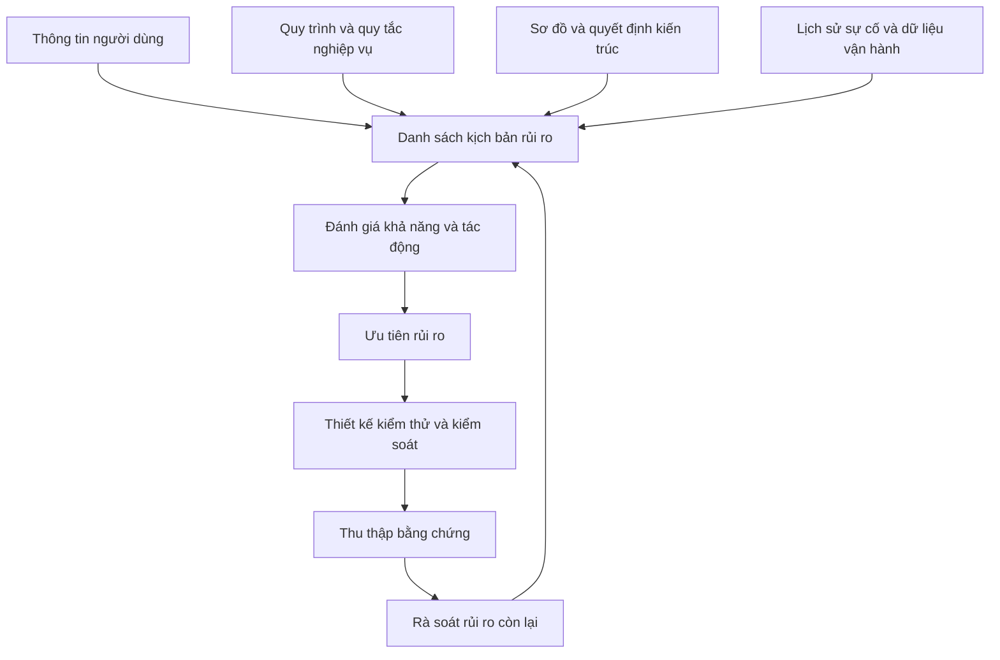
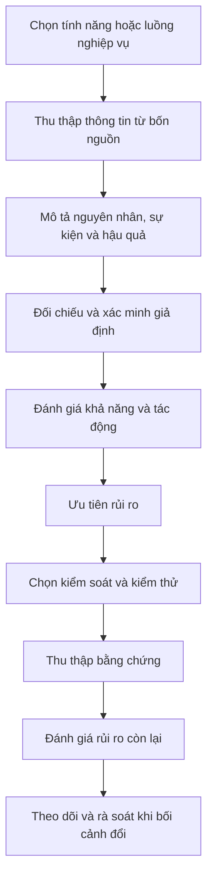

# Nhận diện rủi ro từ người dùng, nghiệp vụ, kiến trúc và lịch sử sự cố

Chiến lược kiểm thử cần tập trung vào những điều có thể làm hệ thống thất bại trong bối cảnh sử dụng thực tế. Nếu chỉ dựa vào danh sách chức năng hoặc các trường hợp kiểm thử quen thuộc, nhóm có thể bỏ sót những rủi ro quan trọng: người dùng hiểu sai quy trình, quy tắc nghiệp vụ bị áp dụng không nhất quán, một dịch vụ phụ thuộc ngừng hoạt động hoặc một lỗi cũ tái diễn sau khi thay đổi kiến trúc.

Nhận diện rủi ro là quá trình tìm ra những sự kiện không chắc chắn có thể ảnh hưởng đến mục tiêu chất lượng hoặc mục tiêu nghiệp vụ. Trong chiến lược kiểm thử, kết quả của quá trình này giúp nhóm quyết định điều gì cần kiểm tra, mức độ kiểm tra, dữ liệu và môi trường cần chuẩn bị, cũng như bằng chứng nào cần có trước khi phát hành. Bốn nguồn thông tin quan trọng là người dùng, nghiệp vụ, kiến trúc và lịch sử sự cố. Mỗi nguồn cho thấy một góc nhìn khác nhau; kết hợp chúng giúp bức tranh rủi ro đầy đủ hơn.

## 1. Hiểu rủi ro trong hoạt động kiểm thử

Rủi ro là khả năng một sự kiện hoặc điều kiện không chắc chắn xảy ra và gây ảnh hưởng đến mục tiêu. Rủi ro có thể tạo ra tổn thất, làm gián đoạn dịch vụ, khiến dữ liệu sai lệch, vi phạm cam kết hoặc làm giảm trải nghiệm người dùng. Một vấn đề đã xảy ra và đang cần xử lý thường được gọi là sự cố hoặc vấn đề hiện hữu; rủi ro mô tả điều có thể xảy ra trong tương lai hoặc có thể tái diễn.

Ví dụ:

- **Rủi ro:** hai khách hàng có thể nhìn thấy dữ liệu đơn hàng của nhau do kiểm tra quyền truy cập thiếu điều kiện theo tổ chức.
- **Sự cố:** một khách hàng đã thực sự truy cập được đơn hàng thuộc tổ chức khác.
- **Hành động kiểm soát:** bổ sung kiểm tra phân quyền ở API, kiểm thử cách ly dữ liệu và theo dõi các truy cập bị từ chối.

Rủi ro nên được mô tả đủ rõ để người khác hiểu nguyên nhân, sự kiện và hậu quả. Một mẫu diễn đạt hữu ích là:

> Do **[nguyên nhân hoặc điều kiện]**, **[sự kiện có thể xảy ra]**, dẫn đến **[hậu quả]** đối với **[mục tiêu hoặc bên liên quan]**.

Ví dụ: “Do hệ thống thanh toán có thể gửi lại thông báo khi hết thời gian chờ, một đơn hàng có thể bị ghi nhận thanh toán hai lần, dẫn đến sai lệch số dư và yêu cầu hoàn tiền.” Mô tả này giúp nhóm nhận ra cần kiểm thử tính lặp an toàn, xử lý thông báo trùng và đối soát giao dịch.

### Phân biệt rủi ro, nguyên nhân và hậu quả

Ba phần này cần được tách biệt khi phân tích:

| Thành phần | Câu hỏi | Ví dụ trong hệ thống đặt hàng |
|---|---|---|
| Nguyên nhân/điều kiện | Vì sao sự kiện có thể xảy ra? | Yêu cầu thanh toán có thể được gửi lại khi mạng chập chờn |
| Sự kiện rủi ro | Điều gì có thể xảy ra? | Một giao dịch bị xử lý hai lần |
| Hậu quả | Điều gì bị ảnh hưởng? | Khách hàng bị trừ tiền hai lần, dữ liệu đơn hàng sai và phát sinh công sức đối soát |

Không nên chỉ ghi “thanh toán có rủi ro” hoặc “cần kiểm thử bảo mật”. Những câu này chưa cho biết cần kiểm tra hành vi nào. Cũng không nên biến mọi lỗi kỹ thuật thành rủi ro độc lập nếu chúng có cùng nguyên nhân và hậu quả; nhóm có thể nhóm chúng theo một kịch bản rủi ro chung rồi liệt kê các trường hợp kiểm thử cụ thể.

### Đánh giá mức độ rủi ro

Một cách tiếp cận phổ biến là xem xét khả năng xảy ra và mức độ tác động:

\[
Risk\ Exposure \approx Likelihood \times Impact
\]

Đây là mô hình hỗ trợ thảo luận và sắp xếp ưu tiên, không phải phép đo chính xác tuyệt đối. Nhóm có thể dùng thang định tính như thấp, trung bình, cao hoặc thang điểm đã thống nhất. Khi cần, hãy xem thêm khả năng phát hiện trước khi hậu quả xảy ra, phạm vi ảnh hưởng, thời gian phơi nhiễm và khả năng khôi phục.

Không phải rủi ro có xác suất thấp nào cũng được ưu tiên thấp. Một sự cố hiếm nhưng có thể làm lộ dữ liệu nhạy cảm, gây mất dữ liệu không thể phục hồi hoặc vi phạm nghĩa vụ pháp lý vẫn có thể cần biện pháp kiểm soát nghiêm ngặt. Hãy xem xét cả hậu quả nghiêm trọng nhất có cơ sở và các biện pháp giảm thiểu hiện có.

## 2. Nhận diện rủi ro từ người dùng

Người dùng là nguồn thông tin trực tiếp về cách hệ thống được sử dụng, điều họ kỳ vọng và những khó khăn họ gặp phải. Tài liệu yêu cầu có thể mô tả luồng lý tưởng, nhưng người dùng thực tế thường làm việc trong điều kiện khác: họ dùng thiết bị cũ, mạng không ổn định, thiếu kinh nghiệm, có nhiều nhiệm vụ đồng thời hoặc hiểu thuật ngữ theo cách khác với nhóm phát triển.

### Xem xét người dùng, nhiệm vụ và bối cảnh

Trước khi thiết kế kiểm thử, hãy xác định:

- **Nhóm người dùng:** khách hàng, nhân viên vận hành, quản trị viên, đối tác tích hợp hoặc người dùng có quyền hạn khác nhau.
- **Mục tiêu:** người dùng cần hoàn thành việc gì và kết quả nào có ý nghĩa với họ?
- **Tần suất và mức độ quan trọng:** tác vụ nào diễn ra thường xuyên, tác vụ nào ít xảy ra nhưng có hậu quả lớn?
- **Bối cảnh sử dụng:** thiết bị, trình duyệt, mạng, vị trí, thời điểm, môi trường làm việc và công nghệ trợ giúp.
- **Giới hạn và kỳ vọng:** người dùng có thể chờ bao lâu, chấp nhận bước xác nhận nào và cần được thông báo ra sao khi lỗi xảy ra?

Một chức năng có thể hoạt động đúng với người dùng thành thạo nhưng gây nhầm lẫn cho người mới. Ví dụ, nút “Hủy” trong màn hình thanh toán có thể được hiểu là hủy giao dịch, hủy đơn hàng hoặc đóng hộp thoại. Nếu hành động không rõ, người dùng có thể tạo đơn trùng hoặc bỏ dở giao dịch.

### Khai thác nguồn thông tin từ người dùng

Nhóm có thể thu thập thông tin từ nhiều kênh:

- Phỏng vấn người dùng và quan sát họ thực hiện tác vụ.
- Phản hồi trong khảo sát, đánh giá sản phẩm và yêu cầu hỗ trợ.
- Nhật ký hành vi, phễu hoàn thành tác vụ và các điểm người dùng thường thoát.
- Phiên kiểm thử khả dụng và thử nghiệm với nhóm người dùng đại diện.
- Phản hồi từ bộ phận chăm sóc khách hàng, bán hàng, triển khai và đào tạo.
- Yêu cầu về khả năng truy cập, ngôn ngữ, thiết bị và môi trường sử dụng.

Dữ liệu định lượng cho biết vấn đề xuất hiện ở đâu và thường xuyên đến mức nào; phỏng vấn và quan sát giúp giải thích vì sao. Ví dụ, tỷ lệ bỏ dở biểu mẫu cao là một tín hiệu, nhưng cần quan sát hoặc hỏi người dùng để biết nguyên nhân là biểu mẫu quá dài, thông báo lỗi khó hiểu hay kết nối bị ngắt.

Khi sử dụng nhật ký hành vi hoặc dữ liệu hỗ trợ, cần tôn trọng quyền riêng tư và chính sách dữ liệu. Chỉ thu thập thông tin cần thiết, giới hạn quyền truy cập và tránh đưa dữ liệu cá nhân hoặc bí mật của khách hàng vào môi trường kiểm thử.

### Những nhóm rủi ro thường xuất phát từ người dùng

| Nhóm rủi ro | Dấu hiệu cần tìm | Hướng kiểm thử |
|---|---|---|
| Hiểu sai thao tác | Người dùng chọn nhầm, lặp thao tác hoặc không nhận ra trạng thái | Kiểm thử khả dụng, kiểm tra nội dung và trạng thái giao diện |
| Quy trình không hoàn tất | Người dùng thường dừng ở một bước hoặc không biết cách khôi phục | Kiểm thử luồng chính, luồng thay thế và khả năng tiếp tục sau lỗi |
| Thiết bị và môi trường đa dạng | Lỗi tập trung ở trình duyệt, thiết bị hoặc mạng cụ thể | Kiểm thử tương thích, mạng yếu và kích thước màn hình |
| Khả năng truy cập | Tác vụ khó thực hiện bằng bàn phím, trình đọc màn hình hoặc công nghệ trợ giúp | Kiểm thử accessibility và đánh giá với người dùng đại diện |
| Lạm dụng hoặc thao tác bất thường | Gửi yêu cầu quá nhanh, thử nhiều mã, nhập dữ liệu không mong đợi | Kiểm thử giới hạn tần suất, xác thực đầu vào và kiểm thử bảo mật |
| Kỳ vọng về dữ liệu | Người dùng hiểu sai số tiền, thời gian, trạng thái hoặc quyền riêng tư | Kiểm thử quy tắc hiển thị, định dạng, múi giờ và phân quyền |

Không nên coi một phản hồi cá biệt là đại diện cho tất cả người dùng. Hãy xác minh mức độ phổ biến, hậu quả và nhóm bị ảnh hưởng; đồng thời chú ý đến nhóm ít xuất hiện trong dữ liệu nhưng có nhu cầu quan trọng.

## 3. Nhận diện rủi ro từ nghiệp vụ

Rủi ro nghiệp vụ xuất hiện khi hệ thống không hỗ trợ đúng quy trình, quy tắc, nghĩa vụ hoặc mục tiêu hoạt động của tổ chức. Một lỗi có thể không làm ứng dụng ngừng chạy nhưng vẫn gây hậu quả lớn: tính sai giá, áp dụng nhầm chính sách, bỏ qua bước phê duyệt hoặc ghi nhận trạng thái không hợp lệ.

### Hiểu quy trình và điểm kiểm soát

Hãy mô tả quy trình từ đầu đến cuối, bao gồm cả trường hợp bình thường và ngoại lệ. Xác định:

- Điểm bắt đầu, điều kiện hoàn tất và các trạng thái trung gian.
- Vai trò tham gia, quyền hạn và trách nhiệm phê duyệt.
- Quy tắc tính toán, giới hạn, thời hạn và điều kiện chuyển trạng thái.
- Dữ liệu đầu vào, dữ liệu được tạo ra và hệ thống nhận kết quả.
- Các trường hợp hủy, hoàn tác, điều chỉnh, gửi lại và xử lý thủ công.
- Những thời điểm nghiệp vụ quan trọng như chốt ngày, cuối tháng, kỳ báo cáo hoặc giờ cao điểm.

Ví dụ, quy trình hoàn tiền có thể yêu cầu đơn hàng đã thanh toán, người yêu cầu có quyền phù hợp, số tiền hoàn không vượt quá số tiền đã thu và mỗi giao dịch chỉ được hoàn trong giới hạn cho phép. Nếu nhóm chỉ kiểm thử trường hợp hoàn tiền thành công, họ có thể bỏ sót hoàn tiền trùng, hoàn vượt số tiền, hoàn sau khi đơn đã bị điều chỉnh hoặc yêu cầu từ vai trò không có quyền.

### Tìm các quy tắc có hậu quả cao

Các quy tắc thường đáng chú ý gồm:

- Tính tiền, thuế, chiết khấu, phí, lãi, hạn mức và làm tròn.
- Phân quyền, phân tách nhiệm vụ và phê duyệt nhiều cấp.
- Thời hạn, ngày hiệu lực, múi giờ, ngày nghỉ và kỳ đối soát.
- Trạng thái đơn hàng, giao dịch, hồ sơ hoặc yêu cầu.
- Tính duy nhất, chống xử lý trùng và tính nhất quán dữ liệu.
- Điều kiện pháp lý, lưu trữ, xóa và xuất dữ liệu.
- Cam kết dịch vụ, thời gian xử lý và nghĩa vụ với khách hàng hoặc đối tác.

Quy tắc nghiệp vụ nên được xác nhận với người có thẩm quyền về nghiệp vụ. Không suy ra quy tắc chỉ từ cách mã hiện tại đang hoạt động; phần mềm có thể đang thực thi một giả định sai hoặc một quy định đã cũ.

### Xem xét tác động kinh doanh

Đánh giá hậu quả theo các khía cạnh như doanh thu, chi phí, trải nghiệm khách hàng, hoạt động vận hành, uy tín, nghĩa vụ pháp lý và khả năng tiếp tục cung cấp dịch vụ. Cùng một lỗi kỹ thuật có thể có mức độ ảnh hưởng khác nhau tùy thời điểm. Một lỗi tính phí vào cuối kỳ có thể tác động đến nhiều giao dịch hơn lỗi tương tự trong giai đoạn thử nghiệm nội bộ.

| Tình huống nghiệp vụ | Hậu quả có thể có | Câu hỏi kiểm thử cần đặt ra |
|---|---|---|
| Áp dụng sai mã giảm giá | Thất thoát doanh thu hoặc khách hàng bị tính sai | Điều kiện kết hợp, giới hạn sử dụng và thời điểm hết hạn đã được kiểm tra chưa? |
| Bỏ qua bước phê duyệt | Giao dịch trái thẩm quyền hoặc vi phạm kiểm soát nội bộ | Vai trò nào được phép thực hiện từng chuyển trạng thái? |
| Ghi nhận giao dịch hai lần | Sai số liệu, khiếu nại và công sức đối soát | Yêu cầu gửi lại có tạo thêm giao dịch không? |
| Xử lý sai ngày hiệu lực | Tính sai kỳ, hạn hoặc quyền lợi | Múi giờ, thời điểm biên và ngày chuyển kỳ được xử lý thế nào? |
| Không xuất được dữ liệu đúng hạn | Vi phạm cam kết hoặc chậm quy trình vận hành | Khối lượng lớn, dữ liệu lỗi và dịch vụ phụ thuộc được xử lý ra sao? |

## 4. Nhận diện rủi ro từ kiến trúc

Kiến trúc cho biết hệ thống được chia thành những thành phần nào, dữ liệu đi qua đâu, thành phần nào phụ thuộc vào thành phần khác và ranh giới tin cậy nằm ở vị trí nào. Rủi ro kiến trúc thường khó thấy khi chỉ kiểm thử từng chức năng riêng lẻ, bởi chúng phát sinh từ tương tác, cấu hình, trạng thái phân tán hoặc giới hạn của hạ tầng.

### Lập bản đồ thành phần và luồng dữ liệu

Để nhận diện rủi ro, hãy xem xét sơ đồ kiến trúc và luồng dữ liệu hiện tại. Ghi nhận:

- Các ứng dụng, dịch vụ, thư viện, cơ sở dữ liệu, hàng đợi và thành phần hạ tầng.
- Giao thức giao tiếp, API, sự kiện, lịch chạy và các điểm tích hợp bên ngoài.
- Dữ liệu nhạy cảm, nơi lưu trữ, nơi truyền và nơi có thể được sao chép.
- Ranh giới mạng, ranh giới tổ chức, vùng tin cậy và cơ chế xác thực.
- Thành phần dùng chung, điểm nghẽn, điểm lỗi đơn và cơ chế dự phòng.
- Các đường đi của một nghiệp vụ quan trọng qua nhiều thành phần.

Sơ đồ kiến trúc cần phản ánh hệ thống đang chạy, không chỉ thiết kế dự kiến. Nếu sơ đồ đã lỗi thời, việc phân tích có thể bỏ sót một tích hợp hoặc một đường dữ liệu thực tế.

### Kiểm tra các kiểu lỗi kiến trúc thường gặp

| Khu vực | Rủi ro tiềm ẩn | Hướng kiểm chứng |
|---|---|---|
| Giao tiếp giữa dịch vụ | Timeout, mất kết nối, phản hồi trễ hoặc sai định dạng | Kiểm thử hợp đồng, timeout, retry và xử lý lỗi |
| Xử lý bất đồng bộ | Sự kiện trùng, sai thứ tự hoặc bị mất | Kiểm thử idempotency, thứ tự, retry và dead-letter queue |
| Cơ sở dữ liệu | Tranh chấp cập nhật, mất dữ liệu, migration sai | Kiểm thử đồng thời, giao dịch, migration và khôi phục |
| Cache | Dữ liệu cũ, vô hiệu hóa không đầy đủ hoặc rò rỉ dữ liệu giữa người dùng | Kiểm thử hết hạn, cập nhật, cách ly khóa và tính nhất quán |
| Xác thực và phân quyền | Ranh giới tin cậy bị vượt qua hoặc quyền không được truyền đúng | Kiểm thử bảo mật ở từng điểm truy cập và giữa các dịch vụ |
| Triển khai và cấu hình | Khác biệt môi trường, thiếu bí mật hoặc cấu hình sai | Kiểm thử cấu hình, triển khai, rollback và kiểm tra sức khỏe |
| Mở rộng và giới hạn tài nguyên | Hết kết nối, bộ nhớ, luồng hoặc hàng đợi | Kiểm thử tải, sức chịu đựng và hành vi khi cạn tài nguyên |
| Dự phòng và khôi phục | Chuyển đổi không thành công hoặc dữ liệu không nhất quán | Diễn tập lỗi, failover, backup và restore |

Một số câu hỏi hữu ích khi xem xét kiến trúc:

- Thành phần nào là điểm lỗi đơn? Nếu thành phần đó ngừng hoạt động thì nghiệp vụ nào bị ảnh hưởng?
- Điều gì xảy ra khi phản hồi đến chậm, đến hai lần hoặc không đến?
- Hệ thống có thể xử lý cùng một yêu cầu nhiều lần một cách an toàn không?
- Dữ liệu có thể bị đọc hoặc sửa qua một đường truy cập ngoài dự kiến không?
- Giới hạn tài nguyên nằm ở đâu và hệ thống phản ứng khi chạm giới hạn thế nào?
- Triển khai phiên bản mới có tương thích với dữ liệu và dịch vụ phiên bản cũ không?
- Có thể khôi phục dữ liệu và dịch vụ trong khoảng thời gian đã cam kết không?

### Dùng các kỹ thuật phân tích kiến trúc

Nhóm có thể kết hợp sơ đồ thành phần, sơ đồ triển khai, sơ đồ luồng dữ liệu, phân tích phụ thuộc, rà soát quyết định kiến trúc (ADR) và mô hình hóa mối đe dọa. Với mỗi thay đổi kiến trúc, cần xác định mục tiêu chất lượng được cải thiện, rủi ro mới phát sinh và giả định nào cần được kiểm chứng.

Ví dụ, khi chuyển từ xử lý đồng bộ sang hàng đợi, hệ thống có thể chịu tải tốt hơn nhưng cần xử lý sự kiện trùng, sai thứ tự, độ trễ và thông điệp bị kẹt. Bộ kiểm thử nên xác nhận những đặc tính đó thay vì chỉ kiểm tra rằng thông điệp được gửi thành công.

## 5. Khai thác lịch sử sự cố và tín hiệu vận hành

Sự cố đã xảy ra là bằng chứng thực tế về cách hệ thống có thể thất bại. Lịch sử sự cố giúp nhóm tìm ra điểm yếu đã bị bỏ qua, điều kiện kích hoạt, cách lỗi lan truyền và hiệu quả của biện pháp phát hiện hiện tại. Những tình huống suýt gây sự cố (near miss) cũng có giá trị vì chúng cho thấy hệ thống đã tiến gần đến hậu quả nghiêm trọng dù chưa gây thiệt hại.

### Thu thập bằng chứng từ quá trình vận hành

Nguồn dữ liệu có thể bao gồm:

- Báo cáo sự cố, phân tích nguyên nhân và hành động khắc phục.
- Nhật ký ứng dụng, log truy cập, trace phân tán và thông báo cảnh báo.
- Chỉ số độ trễ, thông lượng, tỷ lệ lỗi, mức sử dụng tài nguyên và hàng đợi.
- Yêu cầu hỗ trợ, khiếu nại, hoàn tiền và kết quả đối soát.
- Lịch sử triển khai, rollback, thay đổi cấu hình và migration dữ liệu.
- Báo cáo kiểm thử thất bại, kiểm thử chập chờn và lỗi chỉ xuất hiện trong môi trường cụ thể.
- Các lần diễn tập khôi phục, kiểm thử xâm nhập và đánh giá bảo mật.

Hãy tìm cả những sự cố lặp lại với biểu hiện khác nhau. Nhiều cảnh báo timeout ở các dịch vụ khác nhau có thể cùng bắt nguồn từ một cơ sở dữ liệu quá tải. Nếu chỉ xử lý từng cảnh báo riêng lẻ, nhóm có thể bỏ qua nguyên nhân chung.

### Học từ sự cố mà không quy lỗi cá nhân

Phân tích sau sự cố nên tập trung vào điều kiện hệ thống, thông tin sẵn có, quyết định được đưa ra và các lớp phòng vệ đã hoạt động hoặc thất bại. Cách tiếp cận không đổ lỗi giúp người tham gia cung cấp thông tin đầy đủ hơn và giúp nhóm tìm được biện pháp có tác dụng lâu dài.

Với mỗi sự cố, hãy xác định:

1. Tác động thực tế đến người dùng, dữ liệu và hoạt động nghiệp vụ.
2. Sự kiện khởi phát và các điều kiện khiến sự kiện lan rộng.
3. Vì sao kiểm soát hiện tại không ngăn chặn hoặc phát hiện sớm hơn.
4. Tín hiệu nào đã xuất hiện trước khi sự cố được xác nhận.
5. Cách khôi phục và những giới hạn còn tồn tại.
6. Hành động khắc phục nào cần được kiểm chứng để tránh tái diễn.

Không phải mọi sự cố đều có một nguyên nhân duy nhất. Một lỗi có thể cần đồng thời điều kiện tải cao, cấu hình sai và thiếu giới hạn retry. Khi thiết kế kiểm thử hồi quy, nên tái tạo tổ hợp điều kiện có ý nghĩa thay vì chỉ kiểm tra dòng mã đã được sửa.

### Biến sự cố thành trường hợp kiểm thử

| Bằng chứng trong lịch sử | Rủi ro cần ghi nhận | Kiểm thử hoặc kiểm soát bổ sung |
|---|---|---|
| Giao dịch bị tạo hai lần sau khi client retry | Xử lý lặp không an toàn | Gửi lặp cùng mã định danh và xác nhận chỉ có một kết quả nghiệp vụ |
| Bản phát hành làm sai dữ liệu ở một nhóm bản ghi | Migration không tương thích hoặc thiếu kiểm tra | Kiểm thử migration trên bản sao dữ liệu đại diện, kiểm tra hậu điều kiện và rollback |
| Dịch vụ cạn kết nối khi tải tăng | Giới hạn tài nguyên và phục hồi chưa phù hợp | Kiểm thử tải, kiểm thử cạn kết nối và xác nhận hệ thống phục hồi |
| Cảnh báo đến sau khi người dùng đã gặp lỗi | Thiếu tín hiệu hoặc ngưỡng phát hiện chậm | Kiểm thử cảnh báo, synthetic monitoring và diễn tập quy trình phản ứng |
| Lỗi chỉ xảy ra ở một múi giờ | Giả định thời gian không đúng | Kiểm thử thời điểm biên, đổi ngày, giờ mùa hè nếu áp dụng và múi giờ khác nhau |

Sau khi sửa lỗi, cần thêm kiểm thử ở tầng có thể tái hiện nguyên nhân với tín hiệu ổn định. Có thể cần thêm kiểm thử ở tầng cao nếu sự cố phụ thuộc vào tương tác giữa nhiều thành phần. Không nên chỉ thêm một kiểm thử trùng lặp ở mọi tầng mà không làm rõ rủi ro cần kiểm soát.

## 6. Kết hợp bốn nguồn để tạo bức tranh rủi ro

Bốn nguồn thông tin bổ sung cho nhau:

- Người dùng cho biết điều gì quan trọng, cách họ thực hiện công việc và nơi trải nghiệm gặp trở ngại.
- Nghiệp vụ cho biết quy tắc, nghĩa vụ, điểm kiểm soát và hậu quả của sai lệch.
- Kiến trúc cho biết lỗi có thể phát sinh và lan truyền qua những thành phần, luồng dữ liệu hoặc ranh giới nào.
- Lịch sử sự cố cho biết hệ thống đã thất bại ra sao và lớp phòng vệ hiện tại còn thiếu điều gì.

Có thể tổ chức một buổi rà soát rủi ro với đại diện sản phẩm, nghiệp vụ, phát triển, kiến trúc, kiểm thử, vận hành, bảo mật và hỗ trợ khách hàng. Bắt đầu từ một luồng nghiệp vụ quan trọng, lần theo hành trình người dùng qua kiến trúc, xem xét quy tắc nghiệp vụ và đối chiếu với các sự cố đã xảy ra.

### Tránh bỏ sót do chỉ nhìn một nguồn

Một yêu cầu được xác nhận bởi người dùng vẫn có thể có rủi ro nghiệp vụ nếu quy tắc phê duyệt chưa rõ. Một thiết kế kiến trúc được đánh giá tốt vẫn có thể bỏ sót cách người dùng thao tác bất thường. Một sự cố đã được khắc phục vẫn có thể tái diễn khi quy mô hoặc điều kiện vận hành thay đổi.

Hãy đối chiếu các nguồn thay vì coi một nguồn là sự thật đầy đủ. Khi có mâu thuẫn, ghi nhận giả định và tìm người có thẩm quyền hoặc bằng chứng cần thiết để giải quyết. Ví dụ, tài liệu nghiệp vụ nói rằng một giao dịch chỉ được gửi một lần, nhưng log cho thấy client thường retry khi timeout. Đây là dấu hiệu cần làm rõ liệu hệ thống phải hỗ trợ retry an toàn hay cần thay đổi giao thức.

## 7. Ghi nhận và ưu tiên rủi ro

Sau khi nhận diện, nhóm cần lưu rủi ro theo một cấu trúc nhất quán để có thể theo dõi và chuyển thành kế hoạch kiểm thử. Một bản ghi rủi ro nên có:

- Mã định danh và mô tả ngắn.
- Nguồn phát hiện: người dùng, nghiệp vụ, kiến trúc, sự cố hoặc nhiều nguồn.
- Nguyên nhân, sự kiện có thể xảy ra và hậu quả.
- Tài sản, người dùng, quy trình hoặc thành phần bị ảnh hưởng.
- Mục tiêu chất lượng liên quan.
- Khả năng xảy ra, mức độ tác động và mức ưu tiên.
- Kiểm soát hiện có, bằng chứng và điểm chưa chắc chắn.
- Kiểm thử hoặc hành động giảm thiểu cần thực hiện.
- Người chịu trách nhiệm, thời hạn và trạng thái xử lý.
- Rủi ro còn lại sau khi áp dụng kiểm soát.

### Dùng ma trận để hỗ trợ ưu tiên

Một thang định tính đơn giản có thể giúp nhóm thảo luận nhất quán:

| Khả năng xảy ra / Tác động | Thấp | Trung bình | Cao |
|---|---|---|---|
| Cao | Trung bình | Cao | Rất cao |
| Trung bình | Thấp | Trung bình | Cao |
| Thấp | Thấp | Thấp hoặc trung bình | Cao |

Ma trận chỉ là công cụ sàng lọc. Nhóm cần xem xét bản chất hậu quả, phạm vi ảnh hưởng, khả năng phát hiện, khả năng khôi phục và nghĩa vụ bắt buộc. Rủi ro liên quan đến an toàn, bảo mật, quyền riêng tư hoặc mất dữ liệu có thể cần xử lý ngay cả khi khả năng xảy ra được đánh giá thấp.

Khi nhiều rủi ro có cùng mức điểm, hãy ưu tiên theo hậu quả không thể đảo ngược, số người bị ảnh hưởng, thời gian phơi nhiễm, khả năng phát hiện muộn và mức độ khó khôi phục. Ghi lại lý do ưu tiên để quyết định có thể được xem xét lại khi có dữ liệu mới.

### Phân biệt rủi ro trước và sau kiểm soát

Rủi ro vốn có (inherent risk) là mức rủi ro trước khi tính đến kiểm soát. Rủi ro còn lại (residual risk) là mức rủi ro sau khi áp dụng biện pháp kiểm soát. Ví dụ, API cho phép truy cập dữ liệu khách hàng có rủi ro vốn có về truy cập trái phép. Xác thực, phân quyền theo tổ chức, kiểm thử bảo mật và giám sát làm giảm rủi ro, nhưng không nhất thiết loại bỏ hoàn toàn nguy cơ.

Không nên đánh dấu rủi ro là “đã đóng” chỉ vì đã tạo một trường hợp kiểm thử. Cần xác nhận kiểm soát đã được triển khai, kiểm thử đã chạy và bằng chứng đạt yêu cầu. Nếu vẫn còn rủi ro, ghi nhận người có thẩm quyền chấp nhận, điều kiện theo dõi và thời điểm đánh giá lại.

## 8. Chuyển rủi ro thành chiến lược kiểm thử

Kiểm thử dựa trên rủi ro (risk-based testing) phân bổ công sức theo mức độ quan trọng và khả năng xảy ra của các rủi ro. Nó không có nghĩa là chỉ kiểm thử những phần được đánh giá cao; các kiểm tra nền tảng và yêu cầu bắt buộc vẫn cần được thực hiện. Mục tiêu là quyết định phạm vi, chiều sâu và thứ tự kiểm thử dựa trên hậu quả nếu hệ thống hoạt động sai.

### Ánh xạ rủi ro sang loại kiểm thử

| Rủi ro | Kiểm thử phù hợp | Bằng chứng cần có |
|---|---|---|
| Người dùng hiểu sai trạng thái thanh toán | Kiểm thử component, khả dụng và E2E | Trạng thái, thông báo và hành động tiếp theo rõ ràng trong các tình huống thành công/thất bại |
| Quy tắc tính phí không nhất quán | Unit, kiểm thử bảng quyết định và kiểm thử tích hợp | Kết quả đúng với trường hợp biên, tổ hợp điều kiện và dữ liệu thực tế đại diện |
| Quyền truy cập vượt ranh giới khách hàng | Kiểm thử API, kiểm thử bảo mật và kiểm thử phân quyền | Yêu cầu trái phép bị từ chối và không rò rỉ dữ liệu |
| Sự kiện thanh toán bị gửi lặp | Kiểm thử tích hợp, kiểm thử chịu lỗi và kiểm thử đồng thời | Một kết quả nghiệp vụ duy nhất dù nhận nhiều thông báo giống nhau |
| Dịch vụ phụ thuộc ngừng hoạt động | Kiểm thử lỗi có kiểm soát, timeout, retry và E2E trọng yếu | Hệ thống suy giảm có kiểm soát, phục hồi đúng và không làm sai dữ liệu |
| Lỗi cũ tái diễn sau migration | Kiểm thử hồi quy, migration và khôi phục | Dữ liệu trước/sau đáp ứng bất biến nghiệp vụ và có phương án phục hồi |

### Chọn tầng kiểm thử phù hợp

Hãy đặt kiểm thử ở tầng nhỏ nhất có thể xác nhận rủi ro một cách đáng tin cậy, đồng thời bổ sung kiểm thử ở tầng cao khi rủi ro chỉ xuất hiện qua tương tác thực tế. Quy tắc tính phí có thể được kiểm tra sâu bằng unit test; việc truyền dữ liệu giữa dịch vụ đơn hàng và thanh toán cần contract hoặc integration test; luồng khách hàng hoàn thành giao dịch cần một số kịch bản E2E cốt lõi.

Một rủi ro cao có thể cần nhiều lớp phòng vệ: kiểm thử tự động trong pipeline, rà soát thiết kế, kiểm soát quyền truy cập, giám sát và diễn tập vận hành. Đừng giả định rằng một loại kiểm thử duy nhất có thể chứng minh toàn bộ mục tiêu.

### Thiết kế trường hợp kiểm thử từ kịch bản rủi ro

Với mỗi kịch bản, xác định:

1. Điều kiện bình thường để có điểm so sánh.
2. Đầu vào biên và tổ hợp điều kiện có thể làm lộ lỗi.
3. Hành vi bất thường như timeout, retry, dữ liệu thiếu, dữ liệu trùng hoặc quyền không hợp lệ.
4. Trạng thái hệ thống trước, trong và sau khi sự kiện xảy ra.
5. Kết quả mong đợi và bất biến nghiệp vụ phải được giữ.
6. Log, metric hoặc bằng chứng cần thu thập để xác nhận và điều tra.

Ví dụ với rủi ro xử lý thanh toán hai lần, kiểm thử không chỉ gửi hai yêu cầu liên tiếp. Cần thử cùng mã idempotency, khác mã idempotency, thông báo đến trễ, hai worker xử lý đồng thời, timeout sau khi nhà cung cấp đã trừ tiền và hệ thống khởi động lại giữa quá trình. Kết quả phải xác nhận trạng thái đơn hàng, số tiền đã thu và dữ liệu đối soát nhất quán.

### Duy trì liên kết giữa rủi ro và bằng chứng

Mỗi rủi ro quan trọng nên liên kết đến yêu cầu hoặc mục tiêu chất lượng, trường hợp kiểm thử, kết quả chạy, sự cố liên quan và quyết định chấp nhận rủi ro còn lại. Khi một thay đổi kiến trúc hoặc nghiệp vụ diễn ra, nhóm có thể tìm các kiểm thử chịu ảnh hưởng. Khi một kiểm thử thất bại, nhóm cũng có thể xác định rủi ro nào đang được phát hiện.

Độ phủ mã nguồn không thay thế được liên kết này. Một đoạn mã có thể được thực thi mà rủi ro nghiệp vụ vẫn chưa được kiểm tra. Hãy đo mức độ bao phủ rủi ro bằng câu hỏi: các rủi ro quan trọng đã có kiểm soát và bằng chứng phù hợp chưa?

## 9. Quy trình thực hành nhận diện rủi ro

Một quy trình có thể áp dụng cho từng tính năng, luồng nghiệp vụ hoặc thay đổi kiến trúc như sau:

1. **Xác định phạm vi và mục tiêu:** chọn luồng nghiệp vụ, nhóm người dùng và mục tiêu chất lượng cần xem xét.
2. **Thu thập bốn nguồn thông tin:** phản hồi người dùng, quy tắc nghiệp vụ, kiến trúc hiện tại và lịch sử sự cố.
3. **Lập kịch bản thất bại:** mô tả nguyên nhân, sự kiện, môi trường và hậu quả có thể xảy ra.
4. **Kiểm tra giả định:** hỏi người có hiểu biết phù hợp, đối chiếu dữ liệu và làm rõ điểm mâu thuẫn.
5. **Đánh giá và ưu tiên:** xem xét khả năng, tác động, phạm vi, khả năng phát hiện và khả năng khôi phục.
6. **Chọn biện pháp kiểm soát:** quyết định thay đổi thiết kế, quy trình, giám sát hoặc loại kiểm thử cần bổ sung.
7. **Xác định bằng chứng:** nêu rõ kết quả nào chứng minh kiểm soát có hiệu lực.
8. **Theo dõi rủi ro còn lại:** giao người phụ trách, thời hạn và điều kiện rà soát lại.

## 10. Ví dụ tổng hợp: nhận diện rủi ro cho luồng đặt hàng và thanh toán

Giả sử một hệ thống thương mại điện tử cho phép khách hàng chọn sản phẩm, áp dụng mã giảm giá, thanh toán qua nhà cung cấp bên ngoài và theo dõi đơn hàng. Nhóm chuẩn bị thay đổi để tăng tải và bổ sung phương thức thanh toán mới. Buổi rà soát sử dụng cả bốn nguồn:

- **Người dùng:** khách hàng phản ánh trang thanh toán đôi khi quay lâu và họ nhấn nút thanh toán nhiều lần vì không biết yêu cầu đã được gửi chưa.
- **Nghiệp vụ:** một đơn hàng chỉ được ghi nhận thanh toán một lần; mã giảm giá có giới hạn sử dụng; đơn đã giao không được hủy theo quy trình thông thường.
- **Kiến trúc:** dịch vụ đơn hàng gửi yêu cầu đến nhà cung cấp thanh toán qua mạng; kết quả có thể đến qua phản hồi đồng bộ hoặc webhook; webhook có thể được gửi lại.
- **Lịch sử sự cố:** một lần timeout trước đây khiến hệ thống đánh dấu đơn hàng thất bại dù nhà cung cấp đã thu tiền; nhân viên phải đối soát thủ công.

Từ các thông tin đó, nhóm lập danh sách rủi ro ban đầu:

| Mã | Nguồn chính | Kịch bản rủi ro | Hậu quả | Ưu tiên minh họa |
|---|---|---|---|---|
| R-01 | Người dùng, kiến trúc, sự cố | Khách hàng gửi lại yêu cầu khi chưa nhận phản hồi và giao dịch bị xử lý hai lần | Thu tiền trùng, khiếu nại và đối soát | Rất cao |
| R-02 | Nghiệp vụ | Mã giảm giá được áp dụng vượt giới hạn khi nhiều yêu cầu chạy đồng thời | Thất thoát doanh thu và sai báo cáo | Cao |
| R-03 | Kiến trúc, sự cố | Webhook đến trễ hoặc lặp khiến trạng thái đơn hàng không đồng nhất với nhà cung cấp | Đơn hàng bị kẹt hoặc xử lý sai | Cao |
| R-04 | Người dùng | Người dùng không biết thanh toán đang xử lý nên thoát trang hoặc thử lại | Bỏ dở giao dịch hoặc tạo yêu cầu trùng | Trung bình đến cao |
| R-05 | Nghiệp vụ, kiến trúc | Một đơn hàng đã giao vẫn được chuyển sang trạng thái hủy do chuyển trạng thái không hợp lệ | Sai tồn kho, hoàn tiền hoặc báo cáo | Cao |

Nhóm tiếp tục thiết kế kiểm soát và kiểm thử:

| Mã rủi ro | Biện pháp và kiểm thử | Bằng chứng mong đợi |
|---|---|---|
| R-01 | Dùng mã idempotency; kiểm thử gửi lặp, đồng thời và timeout sau khi nhà cung cấp xử lý | Chỉ có một giao dịch thu tiền và một kết quả đơn hàng hợp lệ |
| R-02 | Kiểm thử điều kiện giới hạn bằng nhiều yêu cầu đồng thời; bảo đảm cập nhật giới hạn có tính nguyên tử | Số lần áp dụng không vượt chính sách |
| R-03 | Kiểm thử webhook lặp, trễ, sai thứ tự và cơ chế đối soát định kỳ | Trạng thái cuối cùng nhất quán và có thể phục hồi |
| R-04 | Kiểm thử giao diện ở trạng thái đang xử lý, thông báo timeout và khả năng tiếp tục tra cứu | Người dùng hiểu trạng thái và không tạo giao dịch mới ngoài ý muốn |
| R-05 | Kiểm thử chuyển trạng thái theo bảng quyết định và quyền của vai trò | Chuyển trạng thái không hợp lệ bị từ chối, dữ liệu liên quan không bị thay đổi |

Ưu tiên trong bảng là minh họa cho cách thảo luận. Nhóm thực tế cần xác nhận xác suất, tác động, dữ liệu sự cố và mức kiểm soát hiện có trước khi quyết định. Sau khi triển khai, cần chạy kiểm thử phù hợp, xem xét kết quả vận hành và cập nhật hồ sơ rủi ro nếu tải, nhà cung cấp hoặc hành vi người dùng thay đổi.

## 11. Những sai lầm thường gặp khi nhận diện rủi ro

- **Chỉ đọc yêu cầu chức năng:** yêu cầu mô tả hành vi mong muốn nhưng có thể không nói hết bối cảnh sử dụng, ngoại lệ và hậu quả.
- **Chỉ hỏi người dùng hoặc chỉ hỏi nhóm phát triển:** mỗi bên nhìn thấy một phần vấn đề. Cần kết hợp người dùng, nghiệp vụ, kiến trúc và vận hành.
- **Dùng từ chung chung:** các nhãn như “hiệu năng”, “bảo mật” hoặc “ổn định” chưa phải kịch bản rủi ro có thể kiểm thử.
- **Chỉ xem sự cố nghiêm trọng:** near miss, khiếu nại lặp lại, cảnh báo bất thường và công việc đối soát thủ công cũng có thể báo hiệu điểm yếu.
- **Đánh giá theo cảm tính mà không ghi căn cứ:** hãy lưu dữ liệu, giả định và lý do để người khác có thể xem xét lại.
- **Coi điểm số là sự thật:** ma trận rủi ro hỗ trợ ưu tiên nhưng không thay thế đánh giá chuyên môn hoặc nghĩa vụ bắt buộc.
- **Chỉ thêm kiểm thử sau khi lỗi xảy ra:** cần dùng sự cố để học, đồng thời chủ động tìm rủi ro trước khi có hậu quả.
- **Không cập nhật rủi ro sau thay đổi:** kiểm soát cũ có thể không còn phù hợp khi người dùng, quy trình, tải hoặc kiến trúc thay đổi.
- **Không giao người chịu trách nhiệm:** rủi ro không có chủ sở hữu và thời hạn dễ bị quên sau buổi họp.
- **Đóng rủi ro ngay khi tạo kiểm thử:** cần có bằng chứng kiểm soát hoạt động và đánh giá mức rủi ro còn lại.

## 12. Danh sách câu hỏi rà soát nhanh

Khi đánh giá một tính năng hoặc thay đổi quan trọng, nhóm có thể dùng các câu hỏi sau để mở đầu cuộc thảo luận:

**Từ người dùng**

- Ai sử dụng tính năng và họ cần hoàn thành tác vụ nào?
- Người dùng có thể hiểu sai, bỏ dở hoặc lặp thao tác ở bước nào?
- Thiết bị, mạng, khả năng truy cập hoặc bối cảnh nào làm thay đổi hành vi?
- Có phản hồi, dữ liệu sử dụng hoặc yêu cầu hỗ trợ nào cho thấy vấn đề lặp lại?

**Từ nghiệp vụ**

- Quy tắc nào có hậu quả lớn nếu bị áp dụng sai?
- Vai trò nào được phép thực hiện hoặc phê duyệt từng hành động?
- Điều gì xảy ra khi giao dịch bị lặp, hủy, hoàn tác hoặc đến trễ?
- Có thời hạn, kỳ chốt, cam kết hoặc nghĩa vụ pháp lý nào cần xét đến?

**Từ kiến trúc**

- Dữ liệu đi qua những thành phần và ranh giới tin cậy nào?
- Điều gì xảy ra khi dịch vụ phụ thuộc chậm, ngừng hoạt động hoặc trả dữ liệu sai?
- Hệ thống xử lý timeout, retry, sự kiện trùng và cập nhật đồng thời ra sao?
- Điểm lỗi đơn, giới hạn tài nguyên và cơ chế khôi phục nằm ở đâu?

**Từ lịch sử sự cố**

- Lỗi nào đã xảy ra hoặc suýt xảy ra trong luồng tương tự?
- Những cảnh báo hoặc chỉ số nào thay đổi trước sự cố?
- Biện pháp khắc phục trước đây đã được kiểm thử và theo dõi chưa?
- Điều kiện nào có thể khiến lỗi cũ tái diễn ở quy mô hoặc kiến trúc mới?

Sau khi trả lời, hãy chuyển các phát hiện có ý nghĩa thành kịch bản rủi ro, xác định mức ưu tiên và liên kết chúng với biện pháp kiểm soát cùng bằng chứng kiểm thử.

## Kết luận

Nhận diện rủi ro hiệu quả cần kết hợp góc nhìn của người dùng, yêu cầu nghiệp vụ, cấu trúc kiến trúc và bằng chứng từ lịch sử sự cố. Mỗi nguồn giúp phát hiện những dạng thất bại khác nhau; khi đối chiếu chúng, nhóm có thể mô tả rủi ro rõ ràng, đánh giá hậu quả và chọn kiểm thử phù hợp. Việc duy trì hồ sơ rủi ro, liên kết với kiểm thử và xem xét lại khi bối cảnh thay đổi giúp chiến lược kiểm thử tập trung vào những vấn đề có ý nghĩa nhất đối với sản phẩm và người sử dụng.
