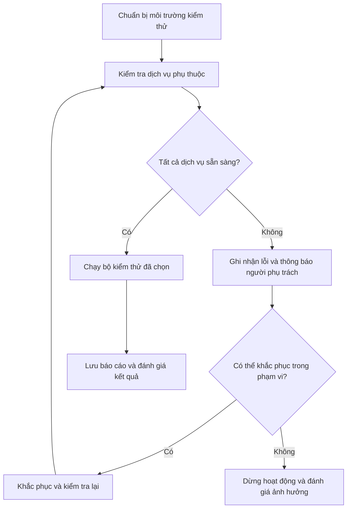

# Sử dụng danh sách kiểm tra hoặc quy trình theo nhu cầu chứng minh

**Chương:** Cách tiếp cận  
**Phạm vi module:** `VALIDATION_TESTING_STRATEGY`

Khi tổ chức hoạt động kiểm thử, nhóm thường cần hướng dẫn để bảo đảm các bước quan trọng được thực hiện đầy đủ và kết quả có thể được xác minh. Có hai hình thức phổ biến: **danh sách kiểm tra** (checklist) và **quy trình** (procedure). Cả hai đều hỗ trợ tính nhất quán, nhưng phù hợp với những loại công việc và nhu cầu bằng chứng khác nhau.

Danh sách kiểm tra giúp người thực hiện xác nhận những điểm cần xem xét hoặc hoàn tất. Quy trình mô tả cách thực hiện công việc theo trình tự, điều kiện và trách nhiệm cụ thể. Lựa chọn hình thức nào cần dựa trên mức độ phức tạp, rủi ro khi bỏ sót, mức độ phụ thuộc giữa các bước và loại bằng chứng mà bên liên quan cần xem.

Bài học này giải thích cách chọn, thiết kế và kết hợp checklist với procedure trong hoạt động kiểm thử. Trọng tâm là bảo đảm công việc có thể thực hiện nhất quán và có bằng chứng phù hợp với mục đích kiểm soát.

Sau bài học, người học có thể:

- Phân biệt mục đích và cấu trúc của checklist và procedure.
- Chọn hình thức phù hợp theo độ phức tạp, rủi ro và nhu cầu chứng minh.
- Thiết kế mục kiểm tra và bước quy trình có thể quan sát, xác minh.
- Xác định bằng chứng, trách nhiệm, ngoại lệ và tiêu chí hoàn thành.
- Kết hợp checklist và procedure mà không tạo ra tài liệu dư thừa hoặc khó sử dụng.

## 1. Hai hình thức hỗ trợ thực hiện công việc

### 1.1. Danh sách kiểm tra (checklist)

Checklist là danh sách các câu hỏi, điều kiện hoặc hạng mục cần xác nhận trong một hoạt động. Người thực hiện rà soát từng mục và ghi nhận trạng thái, nhận xét hoặc bằng chứng theo yêu cầu.

Checklist thường phù hợp khi:

- Công việc gồm nhiều điểm cần nhớ nhưng không nhất thiết phải thực hiện theo một thứ tự cố định.
- Người thực hiện đã có chuyên môn và biết cách xử lý từng mục.
- Mục tiêu chính là tránh bỏ sót, hỗ trợ rà soát hoặc xác nhận tính đầy đủ.
- Bên liên quan cần biết từng điều kiện đã được xem xét hay chưa.

Ví dụ, trước khi chạy kiểm thử hồi quy, checklist có thể nhắc nhóm xác nhận phiên bản triển khai, dữ liệu kiểm thử, trạng thái dịch vụ phụ thuộc, phạm vi bộ kiểm thử và nơi lưu kết quả.

Một checklist tốt dùng câu chữ cụ thể, có thể trả lời hoặc quan sát được. Mục “kiểm tra hệ thống hoạt động tốt” quá chung chung. Mục “xác nhận endpoint `/health` trả về trạng thái sẵn sàng trên môi trường kiểm thử” rõ ràng hơn, dù vẫn cần quy định cách ghi bằng chứng nếu hoạt động đó quan trọng.

### 1.2. Quy trình (procedure)

Procedure là hướng dẫn có cấu trúc mô tả cách thực hiện một công việc. Quy trình thường nêu trình tự các bước, vai trò, đầu vào, công cụ, điều kiện trước và sau khi thực hiện, điểm quyết định, cách xử lý lỗi và hồ sơ cần tạo.

Procedure phù hợp khi:

- Thứ tự thực hiện có ảnh hưởng đến kết quả hoặc an toàn.
- Một bước phụ thuộc vào kết quả của bước trước.
- Có nhiều nhánh xử lý, điều kiện dừng hoặc yêu cầu phê duyệt.
- Công việc phức tạp, có rủi ro cao hoặc cần người khác có thể lặp lại chính xác.
- Tổ chức cần chứng minh không chỉ rằng một hạng mục đã được đánh dấu, mà còn cách thức, người thực hiện và kết quả của hoạt động.

Ví dụ, quy trình phục hồi môi trường kiểm thử sau sự cố cần xác định thứ tự dừng tác vụ, bảo toàn log, kiểm tra bản sao lưu, khôi phục dữ liệu, xác minh tính nhất quán và cho phép môi trường hoạt động trở lại. Nếu đảo thứ tự hoặc bỏ bước bảo toàn bằng chứng, nhóm có thể làm mất dữ liệu cần điều tra.

### 1.3. So sánh nhanh

| Tiêu chí | Checklist | Procedure |
|---|---|---|
| Mục đích chính | Nhắc và xác nhận các điểm cần kiểm tra | Hướng dẫn cách thực hiện công việc |
| Cấu trúc | Danh sách câu hỏi hoặc điều kiện | Các bước, vai trò, điều kiện và nhánh xử lý |
| Thứ tự | Có thể linh hoạt nếu các mục độc lập | Thường quan trọng và cần được nêu rõ |
| Người sử dụng | Người có thể tự quyết định cách thực hiện từng mục | Người cần hướng dẫn chi tiết hoặc phải tuân thủ cách làm thống nhất |
| Bằng chứng | Trạng thái, ghi chú, liên kết hoặc kết quả của từng mục | Nhật ký từng bước, đầu vào, đầu ra, phê duyệt và hồ sơ phát sinh |
| Khi thay đổi | Dễ cập nhật một mục hoặc câu hỏi | Cần đánh giá ảnh hưởng đến trình tự, phụ thuộc và nhánh xử lý |

Hai hình thức có thể cùng xuất hiện trong một tài liệu. Một procedure có thể kết thúc bằng checklist xác nhận sau thực hiện; một checklist có thể liên kết đến procedure để giải thích cách kiểm tra mục phức tạp.

## 2. “Đã đánh dấu” chưa chắc đã là bằng chứng

Nhu cầu chứng minh quyết định mức thông tin cần lưu. Một ô được đánh dấu hoàn tất chỉ cho biết người dùng đã chọn trạng thái đó. Tùy hoạt động, bên liên quan có thể còn cần biết ai thực hiện, thực hiện lúc nào, trên phiên bản nào, dùng dữ liệu gì, kết quả thực tế ra sao và có ngoại lệ nào được chấp nhận.

Hãy phân biệt ba lớp thông tin:

1. **Yêu cầu cần kiểm tra:** điều kiện hoặc hành vi mà nhóm cần xác minh.
2. **Hướng dẫn thực hiện:** cách kiểm tra, thứ tự, công cụ và tiêu chí đánh giá.
3. **Hồ sơ bằng chứng:** dữ liệu cho thấy hoạt động đã được thực hiện và kết quả quan sát được.

Ví dụ, mục checklist “xác nhận kiểm thử phân quyền đã hoàn tất” là một lời nhắc. Để chứng minh, nhóm có thể cần liên kết đến báo cáo kiểm thử, phiên bản ứng dụng, tài khoản hoặc vai trò đã dùng, thời điểm chạy và kết quả. Nếu việc kiểm thử có nhiều bước phụ thuộc hoặc cần phê duyệt, procedure có thể mô tả cách chạy và lưu các thông tin đó.

### 2.1. Chọn mức bằng chứng theo mục đích

Không phải hoạt động nào cũng cần cùng mức ghi nhận. Có thể cân nhắc:

| Nhu cầu | Bằng chứng thường phù hợp |
|---|---|
| Nhắc việc cá nhân hoặc rà soát nhanh | Trạng thái đã kiểm tra, ghi chú ngắn nếu có vấn đề |
| Phối hợp giữa các thành viên | Người phụ trách, trạng thái, thời điểm và liên kết đến kết quả |
| Xác minh yêu cầu kỹ thuật | Log, kết quả chạy, ảnh chụp, báo cáo, dữ liệu đầu vào và phiên bản được kiểm tra |
| Phê duyệt phát hành | Kết quả kiểm thử quan trọng, lỗi còn tồn tại, ngoại lệ được chấp nhận và người phê duyệt |
| Điều tra sự cố hoặc chứng minh tuân thủ | Hồ sơ có thể truy vết, dấu thời gian, nguồn dữ liệu, lịch sử thay đổi và phê duyệt theo quy định |

Loại bằng chứng phải phù hợp với câu hỏi cần trả lời. Ảnh chụp màn hình có thể cho thấy một trạng thái tại một thời điểm, nhưng có thể không chứng minh được dữ liệu phía máy chủ hoặc toàn bộ lịch sử thao tác. Log có thể cho thấy sự kiện kỹ thuật, nhưng không tự chứng minh rằng người dùng đã hoàn tất một quy trình nghiệp vụ. Nên kết hợp nguồn bằng chứng khi một nguồn riêng lẻ không đủ.

### 2.2. Bằng chứng cần có khả năng truy vết

Một bằng chứng hữu ích thường liên kết được với:

- Yêu cầu, rủi ro hoặc tiêu chí cần xác minh.
- Môi trường, cấu hình và phiên bản của đối tượng được kiểm tra.
- Người hoặc hệ thống thực hiện và thời điểm thực hiện.
- Dữ liệu đầu vào, bước quan trọng và kết quả thực tế.
- Trạng thái đạt, không đạt, bị chặn hoặc được chấp nhận ngoại lệ.
- Mã lỗi, liên kết báo cáo hoặc quyết định xử lý tiếp theo nếu có.

Không cần lặp lại tất cả thông tin trong từng mục nếu công cụ quản lý đã ghi nhận chúng. Có thể dùng mã lần chạy, liên kết báo cáo hoặc định danh phiên bản để tránh sao chép dữ liệu và giảm nguy cơ thông tin không đồng nhất.

## 3. Chọn checklist hay procedure theo nhu cầu chứng minh

Quyết định không chỉ dựa vào số lượng bước. Một công việc có nhiều mục độc lập vẫn có thể phù hợp với checklist. Ngược lại, chỉ vài bước cũng có thể cần procedure nếu thứ tự hoặc điều kiện dừng rất quan trọng.

Hãy đánh giá các yếu tố sau:

### 3.1. Mức độ phụ thuộc và trình tự

Nếu các mục có thể thực hiện độc lập, checklist thường đủ. Nếu bước sau chỉ được thực hiện khi bước trước đạt một điều kiện cụ thể, procedure sẽ giúp thể hiện rõ luồng công việc.

Ví dụ:

- Rà soát nhiều trình duyệt được hỗ trợ có thể dùng checklist, vì các trình duyệt có thể được kiểm tra độc lập.
- Triển khai bản dựng vào môi trường kiểm thử có thể cần procedure, vì phải xác nhận bản dựng, sao lưu cấu hình, cập nhật dịch vụ, chạy kiểm tra sức khỏe và xử lý lỗi theo thứ tự.

### 3.2. Hậu quả khi bỏ sót hoặc làm sai

Khi một bước bị bỏ qua có thể gây mất dữ liệu, lộ thông tin, làm hỏng môi trường hoặc ảnh hưởng quyết định phát hành, cần hướng dẫn rõ hơn. Procedure nên nêu bước kiểm soát, điều kiện dừng và cách khôi phục.

Với hoạt động có hậu quả thấp, checklist ngắn có thể đủ. Không nên biến mọi thao tác nhỏ thành quy trình nhiều trang nếu không có nhu cầu kiểm soát tương ứng.

### 3.3. Mức chuyên môn của người thực hiện

Người có kinh nghiệm có thể dùng checklist để nhắc các điểm cần xem xét. Người mới, người thay ca hoặc người ở nhóm khác có thể cần procedure với hướng dẫn cụ thể, ví dụ, tiêu chí kết quả và cách xử lý tình huống bất thường.

Nếu một công việc chỉ có thể thực hiện bởi một cá nhân nắm kiến thức không được ghi lại, khả năng lặp lại và bàn giao sẽ thấp. Procedure giúp biến kiến thức quan trọng thành hướng dẫn có thể chuyển giao.

### 3.4. Yêu cầu kiểm toán, tuân thủ và phê duyệt

Khi cần chứng minh một hoạt động được thực hiện theo chính sách, hợp đồng hoặc yêu cầu quản trị, cần xác định hồ sơ phải lưu và người có thẩm quyền xác nhận. Checklist có thể ghi nhận việc rà soát; procedure mô tả cách thực hiện và tạo hồ sơ. Nhiều trường hợp cần kết hợp cả hai.

Không nên mặc định rằng có checklist là đã đáp ứng yêu cầu kiểm toán. Hãy xác định cụ thể bên đánh giá cần bằng chứng nào, thời gian lưu bao lâu, ai được phép sửa và cách bảo đảm lịch sử có thể truy vết.

### 3.5. Tần suất và mức độ thay đổi

Checklist thường dễ cập nhật khi danh sách kiểm tra thay đổi. Procedure có thể tốn công duy trì hơn vì một thay đổi ở bước đầu có thể ảnh hưởng đến nhiều bước sau hoặc nhánh ngoại lệ.

Tuy nhiên, công việc ít thực hiện nhưng có rủi ro cao vẫn có thể cần procedure chi tiết. Tần suất thấp không làm giảm nhu cầu hướng dẫn; đôi khi người thực hiện càng ít làm thì càng cần quy trình rõ ràng.

### 3.6. Ma trận lựa chọn

| Điều kiện công việc | Hình thức nên cân nhắc | Lý do |
|---|---|---|
| Các mục độc lập, người thực hiện có kinh nghiệm | Checklist | Cần tránh bỏ sót và xác nhận tính đầy đủ |
| Trình tự có ảnh hưởng đến kết quả | Procedure | Cần kiểm soát thứ tự và điều kiện chuyển bước |
| Nhiều nhánh hoặc ngoại lệ | Procedure, có thể kèm checklist | Cần hướng dẫn quyết định và xử lý tình huống |
| Rủi ro thấp, bằng chứng đơn giản | Checklist | Mức kiểm soát nhẹ là đủ |
| Rủi ro cao hoặc hậu quả khó đảo ngược | Procedure và hồ sơ thực thi | Cần hướng dẫn, điểm kiểm soát và bằng chứng có thể truy vết |
| Cần rà soát nhiều điều kiện sau một hoạt động phức tạp | Checklist gắn với procedure | Procedure hướng dẫn thực hiện; checklist xác nhận đầu ra |

Ma trận là gợi ý. Quyết định cuối cùng cần xét các yêu cầu nội bộ, quy định áp dụng và năng lực của người thực hiện.

## 4. Thiết kế một checklist hữu ích

Checklist cần ngắn gọn, rõ ràng và có thể sử dụng trong bối cảnh thực tế. Nếu danh sách quá dài, trùng lặp hoặc chứa những mục mơ hồ, người dùng dễ đánh dấu theo thói quen mà không thật sự kiểm tra.

### 4.1. Xác định mục đích và phạm vi

Nêu rõ checklist được dùng khi nào, áp dụng cho thành phần hoặc loại hoạt động nào và ai chịu trách nhiệm hoàn tất. Ví dụ: “Checklist trước khi chạy kiểm thử hồi quy cho bản dựng ứng viên trên môi trường staging”. Phạm vi cụ thể giúp tránh dùng nhầm checklist cho môi trường hoặc hoạt động khác.

### 4.2. Viết mục kiểm tra có thể xác minh

Mỗi mục nên diễn đạt một điều kiện hoặc câu hỏi cụ thể. Tránh ghép nhiều hành động độc lập vào một dòng. Ví dụ:

| Mục chưa rõ | Mục rõ hơn |
|---|---|
| Kiểm tra dữ liệu | Xác nhận bộ dữ liệu kiểm thử có đủ đơn hàng ở trạng thái chờ, thành công và thất bại |
| Kiểm tra API | Gửi yêu cầu đến endpoint thanh toán và xác nhận mã phản hồi cùng cấu trúc dữ liệu theo hợp đồng |
| Kiểm tra bảo mật | Xác nhận yêu cầu đọc giao dịch của tài khoản khác bị từ chối khi dùng tài khoản không có quyền |
| Kiểm tra log | Xác nhận log có mã tương quan của giao dịch và không ghi giá trị bí mật theo chính sách |

Nếu một mục cần hướng dẫn nhiều bước, hãy liên kết đến procedure hoặc tài liệu kỹ thuật có thẩm quyền thay vì nhồi tất cả vào checklist.

### 4.3. Cho phép ghi trạng thái và ngoại lệ

Một mục kiểm tra không nên chỉ có hai trạng thái “xong” và “chưa xong” nếu thực tế có thể bị chặn hoặc không áp dụng. Tùy mục đích, có thể dùng:

- **Đạt:** điều kiện được xác minh và đáp ứng.
- **Không đạt:** điều kiện đã kiểm tra nhưng kết quả không đáp ứng.
- **Bị chặn:** chưa thể kiểm tra vì thiếu điều kiện hoặc phụ thuộc.
- **Không áp dụng:** mục không thuộc phạm vi; cần ghi lý do nếu việc loại trừ có ý nghĩa.
- **Chờ xem xét:** cần người có thẩm quyền đánh giá hoặc quyết định.

Không được xem “chưa kiểm tra” là “đạt”. Nếu mục bị chặn, cần nêu ảnh hưởng đến phạm vi và quyết định có được tiếp tục hoạt động hay không.

### 4.4. Gắn bằng chứng với mục quan trọng

Với mục có ảnh hưởng đến quyết định phát hành hoặc chấp nhận rủi ro, ghi cách lưu bằng chứng: mã lần chạy, liên kết báo cáo, log, ảnh chụp hoặc người xác nhận. Các mục thông thường có thể chỉ cần trạng thái, nhưng nhóm phải thống nhất mức ghi nhận trước khi thực hiện.

### 4.5. Ví dụ checklist trước khi chạy kiểm thử hồi quy

| # | Mục kiểm tra | Trạng thái / bằng chứng |
|---:|---|---|
| 1 | Xác nhận mã phiên bản bản dựng trùng với phiên bản đã được chọn để kiểm thử | Ghi mã phiên bản |
| 2 | Xác nhận môi trường staging sẵn sàng và các dịch vụ phụ thuộc truy cập được | Liên kết kết quả health check |
| 3 | Xác nhận dữ liệu kiểm thử đã được chuẩn bị và không chứa dữ liệu thật trái chính sách | Ghi mã bộ dữ liệu hoặc xác nhận của người phụ trách |
| 4 | Xác nhận bộ kiểm thử hồi quy phù hợp với phạm vi thay đổi | Liên kết danh sách hoặc phiên bản bộ kiểm thử |
| 5 | Xác nhận các lỗi chặn đã được xử lý hoặc có quyết định chấp nhận rủi ro | Mã lỗi và người phê duyệt |
| 6 | Xác nhận kết quả chạy được lưu ở nơi nhóm có thể truy cập | Liên kết báo cáo lần chạy |

Đây là ví dụ về cấu trúc, không phải điều kiện phát hành mặc định cho mọi sản phẩm. Dự án cần điều chỉnh các mục theo rủi ro và quy trình quản trị của mình.

## 5. Thiết kế một procedure có thể thực hiện và truy vết

Một procedure cần đủ chi tiết để người phù hợp thực hiện công việc một cách nhất quán. Nó không nên mô tả những điều hiển nhiên đến mức gây khó đọc, nhưng phải nêu rõ các bước mà việc làm sai có thể ảnh hưởng đến kết quả hoặc bằng chứng.

### 5.1. Cấu trúc thường gặp

Một procedure có thể có các phần sau:

1. **Mục đích:** công việc cần hoàn thành và kết quả mong đợi.
2. **Phạm vi:** hệ thống, môi trường, loại thay đổi hoặc tình huống áp dụng.
3. **Vai trò và quyền hạn:** ai thực hiện, ai rà soát, ai phê duyệt và ai được phép dừng công việc.
4. **Điều kiện tiên quyết:** quyền truy cập, phiên bản, dữ liệu, công cụ, môi trường và trạng thái ban đầu.
5. **Đầu vào và đầu ra:** thông tin cần có trước khi bắt đầu và hồ sơ phải tạo sau khi hoàn tất.
6. **Các bước thực hiện:** hành động, thứ tự, công cụ, kết quả mong đợi và cách xác minh từng bước quan trọng.
7. **Điểm quyết định:** điều kiện để tiếp tục, lặp lại, chuyển nhánh hoặc dừng.
8. **Xử lý ngoại lệ:** cách ứng phó khi bước không đạt, phụ thuộc lỗi hoặc dữ liệu không hợp lệ.
9. **Bằng chứng và lưu trữ:** loại hồ sơ cần giữ, nơi lưu, quyền truy cập và thời hạn lưu nếu có yêu cầu.
10. **Lịch sử thay đổi:** phiên bản, ngày hiệu lực, người phê duyệt và lý do sửa đổi.

Không phải procedure nào cũng cần đủ mười phần. Mức chi tiết nên tương xứng với rủi ro, độ phức tạp và nhu cầu chứng minh.

### 5.2. Viết bước theo hành động và kết quả

Một bước hữu ích thường có cấu trúc:

**Ai thực hiện + hành động + điều kiện hoặc dữ liệu + kết quả mong đợi + bằng chứng cần lưu.**

Ví dụ:

> Người kiểm thử dùng tài khoản có vai trò `customer_A` gửi yêu cầu đọc giao dịch thuộc `customer_B`. Xác nhận hệ thống từ chối truy cập theo hợp đồng API và không trả về dữ liệu giao dịch. Lưu mã yêu cầu, mã phản hồi và log tương quan vào báo cáo kiểm thử phân quyền.

Mô tả này rõ hơn câu “kiểm tra phân quyền” vì nó xác định vai trò, hành động, điều kiện và bằng chứng.

### 5.3. Thể hiện điểm quyết định và điều kiện dừng

Nếu kết quả bước kiểm tra không đạt, procedure phải nói rõ phải làm gì tiếp theo. Ví dụ:

Sơ đồ chỉ là ví dụ. Procedure thực tế cần xác định ai có quyền quyết định tiếp tục, điều kiện nào cho phép chạy lại và cách ghi nhận nếu hoạt động bị dừng.

### 5.4. Ví dụ procedure: thực hiện kiểm thử tích hợp thanh toán

**Mục đích:** xác minh cửa hàng xử lý đúng phản hồi từ cổng thanh toán, bao gồm thành công, thất bại, hết thời gian chờ và callback gửi lại.

**Phạm vi:** môi trường kiểm thử tích hợp với cổng thanh toán sandbox; dùng tài khoản và dữ liệu thử nghiệm được phê duyệt.

**Vai trò:** người kiểm thử thực hiện và lưu bằng chứng; người phụ trách tích hợp hỗ trợ khi dịch vụ phụ thuộc lỗi; người rà soát đánh giá kết quả và ngoại lệ.

| Bước | Hành động | Kết quả cần xác minh / bằng chứng |
|---:|---|---|
| 1 | Xác nhận phiên bản cửa hàng, cấu hình sandbox và thông tin tài khoản thử nghiệm | Ghi mã phiên bản và mã môi trường; không lưu bí mật truy cập trong báo cáo |
| 2 | Tạo đơn hàng thử nghiệm ở trạng thái chờ thanh toán | Ghi mã đơn hàng và dữ liệu cần thiết để tái lập |
| 3 | Gửi yêu cầu thanh toán theo kịch bản đã chọn | Lưu mã tương quan, phản hồi và thời điểm gửi |
| 4 | Kích hoạt phản hồi thành công hoặc thất bại từ sandbox | Đối chiếu trạng thái giao dịch, đơn hàng và phản hồi API với kết quả mong đợi |
| 5 | Với kịch bản timeout, làm gián đoạn phản hồi rồi gửi lại theo cùng khóa định danh yêu cầu | Xác nhận không tạo giao dịch trùng; lưu log và mã giao dịch |
| 6 | Gửi lại callback hoặc phát callback đến sai thứ tự nếu kịch bản yêu cầu | Xác nhận trạng thái không bị ghi đè sai và thao tác lặp được xử lý an toàn |
| 7 | Đối chiếu bản ghi cửa hàng với trạng thái giao dịch trong sandbox | Ghi kết quả đối soát và mọi sai lệch |
| 8 | Tổng hợp kết quả, mở lỗi nếu cần và gửi rà soát | Liên kết báo cáo, mã lỗi và quyết định xử lý ngoại lệ |

**Điều kiện dừng:** dừng kiểm thử nếu môi trường không còn đáng tin cậy, dữ liệu thử nghiệm có nguy cơ ảnh hưởng dữ liệu thật hoặc xuất hiện hành vi có thể gây giao dịch ngoài dự kiến. Người kiểm thử thông báo người phụ trách và ghi lại trạng thái tại thời điểm dừng.

Procedure này là ví dụ học tập. Khi áp dụng, nhóm cần điều chỉnh theo hợp đồng API, công cụ, cơ chế bảo vệ dữ liệu và quyền hạn thực tế.

## 6. Kết hợp checklist và procedure

Trong nhiều hoạt động, cách hiệu quả là dùng procedure để hướng dẫn phần phức tạp và checklist để xác nhận các điều kiện hoặc đầu ra. Ví dụ:

- Procedure mô tả cách triển khai môi trường kiểm thử; checklist xác nhận phiên bản, cấu hình, dịch vụ và dữ liệu sau triển khai.
- Procedure mô tả cách thực hiện kiểm thử phục hồi; checklist xác nhận các mục tiêu thời gian, tính toàn vẹn dữ liệu và trạng thái dịch vụ.
- Procedure mô tả cách đánh giá lỗi bảo mật; checklist hỗ trợ rà soát phạm vi, mức độ nghiêm trọng, bằng chứng và người phê duyệt.

Một checklist có thể đứng độc lập cho các mục đơn giản, nhưng khi một mục yêu cầu nhiều bước, hãy liên kết đến procedure tương ứng. Ngược lại, procedure có thể kết thúc bằng một checklist ngắn để xác nhận không bỏ sót đầu ra.

### 6.1. Tránh trùng lặp và mâu thuẫn

Khi cùng một thông tin xuất hiện trong nhiều tài liệu, có nguy cơ một bản được cập nhật còn bản kia đã lỗi thời. Để giảm vấn đề:

- Chỉ định một nguồn có thẩm quyền cho hướng dẫn chi tiết.
- Dùng liên kết hoặc mã tham chiếu thay vì sao chép toàn bộ nội dung.
- Ghi phiên bản procedure mà checklist đang tham chiếu nếu khác phiên bản có thể làm thay đổi kết quả.
- Khi sửa bước hoặc tiêu chí, đánh giá các checklist, biểu mẫu và báo cáo có liên quan.
- Xác định người sở hữu và chu kỳ rà soát tài liệu.

### 6.2. Không biến checklist thành procedure thu nhỏ

Nếu mỗi mục checklist chứa nhiều đoạn hướng dẫn, nhánh điều kiện và thao tác kỹ thuật, người dùng khó rà soát nhanh. Hãy tách hướng dẫn thực hiện ra procedure, giữ checklist ở dạng câu hỏi hoặc điều kiện cần xác nhận.

Tương tự, procedure không nên trở thành danh sách các câu “đã kiểm tra chưa?” mà thiếu hành động, kết quả và cách xử lý. Cần giữ đúng vai trò của từng hình thức.

## 7. Kiểm soát phiên bản, quyền sửa đổi và tính nhất quán

Checklist và procedure là một phần của hệ thống quản lý công việc. Tài liệu chỉ hữu ích khi người dùng biết phiên bản nào đang có hiệu lực và có thể xác định thay đổi đã ảnh hưởng đến hoạt động ra sao.

Với tài liệu quan trọng, nên quản lý:

- Mã định danh, tên, phạm vi và chủ sở hữu.
- Phiên bản hiện hành và ngày hiệu lực.
- Người soạn, người rà soát và người phê duyệt theo vai trò.
- Lý do và nội dung thay đổi.
- Các tài liệu, biểu mẫu, bộ kiểm thử hoặc hệ thống chịu ảnh hưởng.
- Nơi lưu bản có hiệu lực và cách ngăn việc sử dụng nhầm bản cũ.

Không phải mọi checklist cá nhân đều cần quy trình phê duyệt chính thức. Mức quản trị phải tương xứng với hậu quả nếu dùng sai nội dung. Một checklist cá nhân để ghi nhớ thao tác có thể chỉ cần người sở hữu; procedure phục vụ phục hồi dữ liệu hoặc phát hành sản phẩm có thể cần rà soát và phê duyệt rõ ràng.

## 8. Đánh giá hiệu quả sau khi áp dụng

Checklist và procedure cần được đánh giá bằng kết quả thực tế. Một tài liệu dài hoặc được phê duyệt đầy đủ chưa chắc giúp giảm lỗi hoặc tăng khả năng truy vết.

Có thể theo dõi các chỉ số sau:

- Tỷ lệ mục bị bỏ sót hoặc phát hiện muộn.
- Số lần phải làm lại do hướng dẫn không rõ hoặc bước bị thực hiện sai.
- Tỷ lệ hoạt động có đủ bằng chứng theo yêu cầu.
- Số ngoại lệ, mục bị chặn và lý do thường gặp.
- Thời gian hoàn tất công việc và thời gian cần để người mới làm quen.
- Số lỗi phát sinh do sử dụng phiên bản tài liệu không còn hiệu lực.
- Mức độ nhất quán giữa những người hoặc nhóm thực hiện khác nhau.

Không nên chỉ tối ưu tỷ lệ hoàn thành checklist. Nếu mọi mục đều được đánh dấu đạt nhưng bằng chứng không đủ hoặc lỗi vẫn lọt qua, checklist chưa hỗ trợ đúng mục đích. Hãy kết hợp chỉ số quy trình với kết quả chất lượng và phản hồi của người sử dụng.

### 8.1. Rà soát khi có thay đổi

Hãy xem xét lại tài liệu khi:

- Yêu cầu, kiến trúc, công cụ hoặc môi trường thay đổi.
- Có sự cố hoặc lỗi cho thấy một điểm kiểm soát còn thiếu.
- Người dùng hiểu sai một mục hoặc thực hiện một bước theo nhiều cách khác nhau.
- Có thay đổi về quy định, chính sách, quyền hạn hoặc yêu cầu lưu bằng chứng.
- Chỉ số cho thấy checklist gây quá tải hoặc procedure khó thực hiện.

Khi một mục không còn phù hợp, cần xác định liệu nó nên được sửa, bỏ, chuyển sang procedure khác hay giữ lại như một kiểm soát bắt buộc. Ghi lại lý do để tránh loại bỏ một điểm kiểm soát quan trọng chỉ vì nó ít được sử dụng.

## 9. Những sai lầm thường gặp

### 9.1. Cho rằng checklist tự chứng minh công việc đã hoàn thành

Một dấu kiểm không cho biết cách thực hiện hoặc kết quả. Với mục quan trọng, hãy yêu cầu bằng chứng hoặc liên kết đến hồ sơ có thể truy vết.

### 9.2. Dùng procedure cho mọi hoạt động

Quy trình quá chi tiết cho công việc đơn giản làm tăng chi phí duy trì và khiến người dùng bỏ qua hướng dẫn. Chỉ mô tả trình tự và kiểm soát cần thiết theo mức rủi ro.

### 9.3. Dùng checklist cho công việc có nhánh phức tạp

Danh sách phẳng không thể hiện rõ điều kiện tiếp tục, dừng hoặc quay lại bước trước. Khi trình tự và nhánh xử lý ảnh hưởng đến kết quả, hãy dùng procedure hoặc sơ đồ luồng.

### 9.4. Mục kiểm tra quá chung chung

Các từ như “đúng”, “tốt”, “đầy đủ” cần được gắn với tiêu chí quan sát. Người thực hiện phải hiểu điều kiện nào cho phép đánh dấu đạt.

### 9.5. Không định nghĩa trạng thái bị chặn và không áp dụng

Nếu chỉ có “đạt/không đạt”, người thực hiện có thể đánh dấu đạt để kết thúc dù thực tế chưa thể kiểm tra. Hãy có trạng thái phản ánh đúng tình hình và yêu cầu lý do cho ngoại lệ quan trọng.

### 9.6. Lưu bằng chứng không có ngữ cảnh

Một log hoặc ảnh chụp không có phiên bản, môi trường, thời điểm hoặc mã lần chạy có thể khó sử dụng khi điều tra. Hãy liên kết bằng chứng với đối tượng và hoạt động đã tạo ra nó.

### 9.7. Không cập nhật tài liệu sau sự cố

Nếu một lỗi cho thấy hướng dẫn thiếu bước hoặc tiêu chí, hãy cập nhật tài liệu và kiểm tra xem các tài liệu liên quan có bị ảnh hưởng không. Nếu không, cùng lỗi có thể lặp lại ở lần thực hiện sau.

## 10. Danh sách lựa chọn và rà soát

Trước khi tạo hoặc chọn checklist/procedure, hãy trả lời:

- [ ] Mục đích, phạm vi và người sử dụng đã rõ.
- [ ] Các mục kiểm tra có độc lập hay phụ thuộc thứ tự?
- [ ] Hậu quả khi bỏ sót hoặc thực hiện sai đã được đánh giá.
- [ ] Người thực hiện có đủ chuyên môn để tự quyết định cách làm không?
- [ ] Có nhánh xử lý, điều kiện dừng hoặc phê duyệt cần hướng dẫn không?
- [ ] Bên liên quan cần chứng minh điều gì và cần lưu bằng chứng nào?
- [ ] Trạng thái đạt, không đạt, bị chặn và không áp dụng được định nghĩa phù hợp.
- [ ] Tài liệu tham chiếu có nguồn có thẩm quyền và phiên bản rõ ràng.
- [ ] Có chủ sở hữu, người rà soát và cách cập nhật khi bối cảnh thay đổi.
- [ ] Tài liệu đã được thử với người sử dụng thực tế và điều chỉnh theo phản hồi.

## 11. Kết luận

Checklist phù hợp để nhắc và xác nhận các điều kiện cần kiểm tra, đặc biệt khi các mục tương đối độc lập và người thực hiện đã biết cách làm. Procedure phù hợp khi cần hướng dẫn trình tự, vai trò, điều kiện, nhánh xử lý và bằng chứng thực thi. Công việc phức tạp hoặc có rủi ro cao thường cần procedure kết hợp checklist xác nhận kết quả.

Hãy bắt đầu từ câu hỏi cần chứng minh, xác định bằng chứng đủ để trả lời câu hỏi đó, rồi chọn hình thức tài liệu phù hợp. Thiết kế rõ ràng, có thể truy vết và được cập nhật theo thực tế sẽ giúp hoạt động kiểm thử nhất quán mà vẫn giữ được mức kiểm soát tương xứng với rủi ro.
